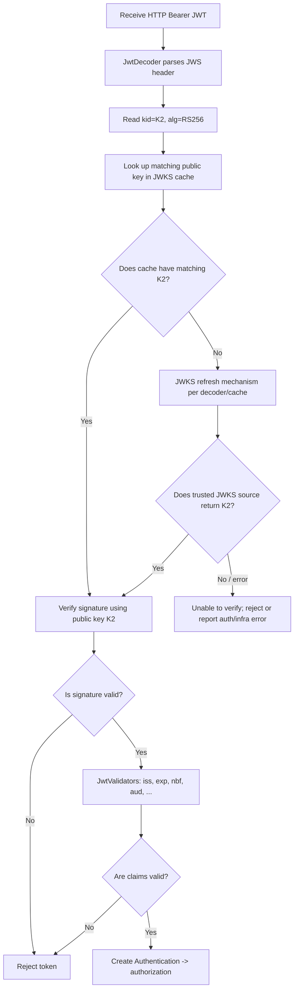
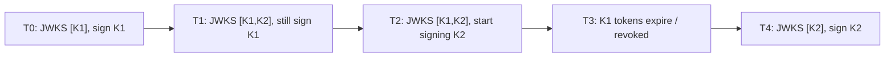

# Tokens with a New `kid` During Key Rotation

In a **Spring Security OAuth 2.0 OIDC Resource Server**, the Authorization Server typically uses a **private key** to sign JWT access tokens, while the Resource Server uses the **public key** to verify signatures. When the issuer rotates keys (*key rotation*), new JWTs may carry a `kid` value that has never appeared in previous tokens.

A very realistic operational scenario:

- Yesterday, access tokens had header `kid=signing-2026-10` and the API verified them successfully.
- Today, the Authorization Server starts issuing tokens with `kid=signing-2026-11`.
- The Resource Server is still using a **previously cached JWKS** containing only key `signing-2026-10`.
- New JWTs reach the API, but the decoder **cannot yet find a matching public key** to verify the signature.

This does not necessarily prove the token is forged. It may be the result of key rotation not yet being synchronized. However, the Resource Server **must never accept a token just on suspicion that it belongs to a valid new key**: it must obtain the key from a trusted source, select an eligible key, and verify the signature successfully.

This lesson focuses on: what `kid` is, how a JWKS holds multiple keys, why caching introduces a "key visibility lag," how to rotate keys safely, and how to implement/observe this process in a Spring Security JWT Resource Server.

## 1. The Role of `kid` in a Signed JWT

A JWT access token in JWS compact form has the structure:

```text
BASE64URL(HEADER).BASE64URL(PAYLOAD).BASE64URL(SIGNATURE)
```

Example JWT header:

```json
{
  "alg": "RS256",
  "typ": "at+jwt",
  "kid": "signing-2026-11"
}
```

Field meanings:

| Field | Meaning | Security Note |
|---|---|---|
| `alg` | Declared signing algorithm, such as `RS256`. | Resource Server accepts only **permitted algorithms**; never blindly trust an algorithm requested by the token. |
| `typ` | Declared JWT type; `at+jwt` is associated with the JWT access token profile (RFC 9068). | Helps prevent confusing access tokens with ID tokens, though checks depend on profile/decoder version. |
| `kid` | *Key ID*: label identifying the signing key so a verifier can select it from a JWKS. | Only a **key-lookup hint**; does not prove the key or token is trustworthy. |

`kid` is not a private key, not secret data, and not a signature. The JWT header is data **a client can craft before authentication**. An attacker can easily send:

```json
{"alg":"RS256","kid":"signing-2026-99"}
```

Therefore, when encountering an unknown `kid`, a proper Resource Server follows its key-selection and JWKS-refresh policy against a **trusted issuer**, rather than "inventing" a key or skipping signature verification.

### 1.1. Why Is `kid` Needed?

During normal operation, an issuer may sign tokens with key `K1`. When preparing to rotate keys, it adds key `K2` to the JWKS:

```text
JWKS before rotation:
  K1 (kid=signing-2026-10)

JWKS during transition:
  K1 (kid=signing-2026-10)
  K2 (kid=signing-2026-11)

JWKS after transition:
  K2 (kid=signing-2026-11)
```

A verifier can use `kid` in the JWT header to pick the **matching public key** from the key set published by the issuer. A JWKS does not have to contain only one key; having multiple keys simultaneously is normal.

Although `kid` usually makes key selection fast and explicit, it does not replace other checks such as key type `kty`, purpose `use=sig`, compatible algorithm, or cryptographic signature verification.

## 2. How Do Private Keys, Public Keys, and JWKS Relate?

With asymmetric signatures like RSA or ECDSA:

1. The **Authorization Server** holds the private key and uses it to sign JWTs.
2. The **Resource Server** uses the corresponding public key to verify signatures.
3. The Authorization Server's **JWKS endpoint** publishes the set of JSON Web Keys (typically public keys).
4. The **JWT's `kid`** indicates which key to look up in the trusted JWKS.

Illustrative JWKS example:

```json
{
  "keys": [
    {
      "kty": "RSA",
      "kid": "signing-2026-10",
      "use": "sig",
      "alg": "RS256",
      "n": "<base64url-public-modulus-K1>",
      "e": "AQAB"
    },
    {
      "kty": "RSA",
      "kid": "signing-2026-11",
      "use": "sig",
      "alg": "RS256",
      "n": "<base64url-public-modulus-K2>",
      "e": "AQAB"
    }
  ]
}
```

This is **mock JSON** to explain the structure; the `n` values are placeholders, not immediately usable public keys.

Key attributes to recognize:

| JWK Attribute | Role |
|---|---|
| `kty` | Key type, such as `RSA` or `EC`. |
| `kid` | Key identifier matched against the JWT header. |
| `use` | Intended usage, e.g., `sig` for signatures. |
| `key_ops` | Operations that may be permitted, e.g., `verify`. |
| `alg` | Algorithm described or intended for use with the JWK. |
| `n`, `e` | RSA public key parameters. |
| `crv`, `x`, `y` | Parameters of applicable elliptic curve keys. |
| `x5c`, `x5t` | X.509 certificate information when published by the issuer. |

Private keys must be kept secure by the signer (for instance in an HSM/KMS or keystore with proper access controls). **Never publish private key parameters** such as RSA `d` in a public JWKS. Per OIDC Discovery, a published JWKS must not contain private or symmetric key values.

### 2.1. Selecting a New Key Does Not Change the Issuer

Example issuer:

```text
https://login.example.test/realms/shop
```

Trusted metadata may indicate:

```json
{
  "issuer": "https://login.example.test/realms/shop",
  "jwks_uri": "https://login.example.test/realms/shop/protocol/openid-connect/certs"
}
```

When rotating signing keys from `K1` to `K2`, **the issuer normally stays the same**. The Resource Server continues trusting the same issuer, fetching that issuer's JWKS, and checking `iss` in access tokens. Changing `kid` does not create a new issuer.

Never use the `kid` string to construct an arbitrary JWKS URL, and never alter the trusted issuer based on a value inside an unverified JWT.

## 3. What Happens When a JWT Carrying a New `kid` Reaches the Resource Server?

Suppose:

- Old tokens carry `kid=K1`.
- New JWTs carry `kid=K2`.
- The JWKS cached by the Resource Server contains only `K1`.

Logical processing flow:



There are two separate things:

- **Finding a public key with `kid=K2`:** only gives the verifier a *candidate key*.
- **Passing signature verification and validators:** is the basis for accepting the token.

If the JWKS has a key matching `kid` but the signature check fails, the token is still rejected. A matching `kid` is not cryptographic proof.

### 3.1. Not All Libraries Refresh JWKS the Same Way

Spring Security typically uses `NimbusJwtDecoder` backed by the underlying JOSE/JWT library. Cache/refresh behavior is influenced by:

- Spring Security and Nimbus versions.
- The type of JWK source used.
- Cache retention duration and stale/expiration settings.
- How the decoder handles an unfound `kid`.
- HTTP client configuration, timeouts, proxies, and HTTP caching.
- Whether a custom cache/JWK source or intermediate gateway is configured.

Therefore, **never promise that encountering a new `kid` will make every decoder immediately fetch JWKS exactly once and accept the token right away**. In common deployments, failing to find a key may trigger a refresh attempt; exact refresh conditions and throttling limits must be checked against your library and configuration.

If a trusted key cannot be obtained for verification, the token must not be accepted, even if both the issuer and the application are functioning normally in every other respect.

## 4. The Three Core Phases of Safe Key Rotation

A **zero-downtime rotation** generally follows the principle of **publishing the new key before signing with it** and **retaining the old key long enough for older tokens to still verify**.

### 4.1. Phase A — Using Only Old Key K1

Authorization Server:

- Uses private key `K1` to sign new access tokens.
- Publishes public key `K1` in the JWKS.
- Tokens carry `kid=K1`.

Resource Server:

- JWKS cache contains `K1`.
- Verifies tokens with `kid=K1`.

```text
AS signs with:      K1
JWKS publishes:     [K1]
New tokens issued:  kid=K1
RS typically has:   [K1]
```

### 4.2. Phase B — Publish K2 While Still Signing with K1

The Authorization Server generates key pair `K2` and **adds public key K2 to the JWKS**. However, the AS continues signing new tokens with `K1` for an appropriate period.

```text
AS signs with:      K1
JWKS publishes:     [K1, K2]
New tokens issued:  kid=K1
RS may have:        [K1] or [K1, K2] depending on cache
```

The goal of this phase is to let Resource Servers **observe K2 before** having to verify tokens signed with K2.

The waiting period should account for:

- Actual JWKS cache lifetimes on Resource Servers.
- TTLs on CDNs, reverse proxies, and intermediate layers.
- Rollout/propagation times across Authorization Server instances.
- Multiple Resource Servers or tenants with varying refresh settings.
- Timeouts and request rates in the system.

Without proactive preloading/refresh on the RS side, merely "adding K2 to the JWKS" does not guarantee every instance sees K2 immediately.

### 4.3. Phase C — Sign New Tokens with K2, Retain K1

After the propagation window, the AS switches the active signing key to `K2`:

```text
AS signs with:      K2
JWKS publishes:     [K1, K2]
New tokens issued:  kid=K2
Refreshed RS has:   [K1, K2]
```

At this point, two kinds of tokens may be in flight simultaneously:

- Older tokens carrying `kid=K1`, not yet expired.
- Newer tokens carrying `kid=K2`.

Resource Servers must be able to verify both if both remain valid under the contract. **Do not delete K1 from the JWKS as soon as signing switches to K2** if valid tokens signed by K1 are still active.

### 4.4. Phase D — Retire Old Key K1

Once the last K1 token has expired (plus a suitable buffer for issuance policy, clock skew, and propagation), the AS can remove public key `K1` from the JWKS.

```text
AS signs with:      K2
JWKS publishes:     [K2]
New tokens issued:  kid=K2
RS after refresh:   [K2]
```

If older tokens are long-lived, K1 may have to stay published longer. Conversely, in a private key leak incident, an organization may have to **revoke K1 urgently** and accept older tokens being rejected; security can outweigh session continuity in that case.

### 4.5. Consolidated Timeline



Phase breakdown:

| Phase | Key Signing New Tokens | Published JWKS | Reason |
|---|---|---|---|
| T0 | K1 | K1 | Normal operation |
| T1 | K1 | K1 + K2 | Pre-publish K2, wait for caches to update |
| T2 | K2 | K1 + K2 | New tokens use K2, old tokens still verified |
| T3 | K2 | K1 + K2 | Wait for remaining valid K1 tokens to expire |
| T4 | K2 | K2 | Complete rotation, retire K1 per policy |

**The overlap window depends on token lifetimes and caching architecture, not a universal fixed number across all organizations.**

## 5. Four States Often Lumped Together as "New `kid` Doesn't Work"

Suppose a JWT carries `kid=K2`. There are at least four distinct reasons a request can fail:

| Scenario | Actual JWKS on Issuer | JWKS on Resource Server | Root Cause |
|---|---|---|---|
| **A. AS signed K2 too early** | K2 not yet published | Missing K2 | Wrong rotation order; verifier cannot find the key. |
| **B. Stale RS cache** | Already has K2 | Cache has only K1 | Refresh/cache lag. |
| **C. Wrong key source** | K2 is in another issuer/realm | RS fetches a different JWKS | Wrong issuer, realm, JWKS path, or multi-tenant config. |
| **D. Has K2, bad signature** | Has key ID K2 | Has key ID K2 | Wrong key material, incompatible algorithm, tampered token, or improper `kid` reuse. |

Another failure can happen **after signing succeeds**: the JWT has an invalid `iss`, `aud`, `exp`, or token type. In that case the root cause is not the JWKS cache, even if the request still returns `401`.

To fix properly, pinpoint **which step failed** instead of changing every setting or disabling validation.

## 6. Why Is JWKS Caching Necessary Yet Introduces Lag?

Fetching JWKS over HTTPS for **every JWT request** makes the API constantly network-dependent, raising latency and Authorization Server load. Consequently, decoders/JWK sources normally **cache the public key set**.

Advantages:

- Resource Server verifies signatures locally when the required key is cached.
- Reduces load on the JWKS endpoint.
- Shields against brief Authorization Server slowdowns.
- Sustains throughput under high JWT request volume.

Disadvantages:

- A new public key may not yet appear in every instance's cache.
- An old key removed from the JWKS may linger in caches for a while.
- CDN/proxy caching can extend propagation beyond expectations.
- When a new `kid` is missing, concurrent requests may trigger multiple refresh demands.

### 6.1. Cache Layers You Must Account For

```text
Resource Server / Nimbus JWK cache
            │
            ▼
Resource Server's HTTP client
            │
            ▼
Enterprise proxy / egress gateway (if any)
            │
            ▼
Issuer's CDN / reverse proxy (if any)
            │
            ▼
Authorization Server JWKS endpoint
```

Even if the Resource Server just sent a fresh GET, the result may still be the old key set if an intermediate layer serves an unrefreshed cached copy.

When investigating, do not merely ask "Did Spring Security fetch JWKS?"—ask "Which **JWKS version** did it actually receive from the endpoint it connected to?"

### 6.2. HTTP Cache Headers and Refresh Conditions

A JWKS endpoint may return headers like:

```http
HTTP/1.1 200 OK
Content-Type: application/json
Cache-Control: public, max-age=300
ETag: "jwks-version-42"
```

These headers are illustrative; **they do not mean every Nimbus/Spring Security version derives its internal TTL the same way**. The library may maintain an independent internal cache, while proxies/CDNs enforce their own cache policies.

A setup supporting conditional requests might use `If-None-Match`/`304 Not Modified`, but do not assume your decoder uses that technique without verifying your implementation and configuration.

### 6.3. "Unknown `kid`" and the Risk of Refresh Storms

An attacker can send a steady stream of forged JWTs with random `kid` values:

```json
{"alg":"RS256","kid":"random-000001"}
```

If every unseen value forced the Resource Server to call JWKS unboundedly, the issuer endpoint could be overwhelmed (*refresh storm / cache stampede*). Operational design must balance:

- Timely discovery/refresh of new keys during genuine issuer rotations.
- Rate limits and sensible connection/timeout bounds.
- Never letting untrusted requests dictate key-fetching URLs.
- Monitoring unknown `kid` volume and refresh error spikes.
- Avoiding unbounded per-`kid` caching driven by caller inputs.

**Never "fix" an unknown `kid` by accepting tokens when JWKS fetching fails.** Such situations must be treated as failed authentication.

## 7. How Does Spring Security Read `kid` and JWKS?

When configuring a JWT Resource Server, the key components are:

```text
BearerTokenAuthenticationFilter
           │
           ▼
JwtAuthenticationProvider
           │
           ▼
JwtDecoder (typically NimbusJwtDecoder)
           │
           ├─ Parse JWS header: alg, kid, typ...
           │
           ├─ Use trusted JWK Set / key source
           │
           ├─ Verify signature
           │
           └─ JwtValidators: iss, exp, nbf, aud, ...
           │
           ▼
JwtAuthenticationToken + GrantedAuthorities
           │
           ▼
AuthorizationFilter / method security
```

Key notes:

- `JwtAuthenticationProvider` invokes the decoder and creates an authentication upon successful decoding.
- `NimbusJwtDecoder` typically uses Nimbus JOSE/JWT components to select keys and verify signatures.
- The trusted key set is defined by **issuer/JWK Set configuration**; `kid` is used solely to pick a key within that set.
- After signature verification, the decoder runs validators. **Finding a new key never automatically authorizes a token.**

The Resource Server receives a Bearer JWT on each request, though JWKS is not necessarily re-fetched on every request. Refresh details depend on the version and configured cache.

## 8. Basic Configuration via `issuer-uri`

Spring Boot example:

```yaml
spring:
  security:
    oauth2:
      resourceserver:
        jwt:
          issuer-uri: https://login.example.test/realms/shop
          audiences:
            - orders-api
```

With this configuration, Spring Security can use the issuer to discover metadata, retrieve `jwks_uri`, and use the issuer's public keys to verify JWTs.

- `issuer-uri`: Trusted Authorization Server identifier, linked to validating the `iss` claim.
- `audiences`: Audience must include `orders-api` if your Spring Boot version supports this property.
- Key rotation: Once the AS publishes public key K2 in the trusted JWKS, the decoder can use it after its cache/JWK source observes the update.

Example Spring Security filter chain:

```java
@Configuration
public class ApiSecurityConfig {

    @Bean
    SecurityFilterChain apiSecurity(HttpSecurity http) throws Exception {
        return http
            .authorizeHttpRequests(auth -> auth
                .requestMatchers("/public/**").permitAll()
                .requestMatchers(HttpMethod.GET, "/api/orders/**")
                    .hasAuthority("SCOPE_orders.read")
                .anyRequest().authenticated()
            )
            .oauth2ResourceServer(oauth2 ->
                oauth2.jwt(Customizer.withDefaults()))
            .build();
    }
}
```

Primary imports:

```java
import org.springframework.context.annotation.Bean;
import org.springframework.context.annotation.Configuration;
import org.springframework.http.HttpMethod;
import org.springframework.security.config.Customizer;
import org.springframework.security.config.annotation.web.builders.HttpSecurity;
import org.springframework.security.web.SecurityFilterChain;
```

In this flow, even when a JWT is signed with K2 and passes the decoder, the request still needs the proper scope/authority. Spring Security typically converts `scope=orders.read` into `SCOPE_orders.read`.

## 9. Direct Configuration via `jwk-set-uri`

If the Authorization Server does not expose compatible discovery metadata, or the Resource Server prefers specifying the JWKS endpoint explicitly, you can configure the URI:

```yaml
spring:
  security:
    oauth2:
      resourceserver:
        jwt:
          issuer-uri: https://login.example.test/realms/shop
          jwk-set-uri: https://login.example.test/realms/shop/protocol/openid-connect/certs
          audiences:
            - orders-api
```

Meaning:

1. The Resource Server does not need discovery to locate the JWKS path because `jwk-set-uri` is given.
2. The Resource Server **still needs to fetch or obtain public keys** from the JWKS to verify tokens carrying a new `kid`.
3. `issuer-uri` preserves the `iss` validator; specifying the JWKS URL alone does not replace issuer validation.
4. `audiences` enforces that tokens target the Orders API when applied by auto-configuration.

Some startup environments require reducing dependencies on the AS metadata endpoint. Configuring the JWKS URI directly helps, yet **does not make token verification completely independent of the key source**: when keys rotate, the decoder still needs to update its key set.

### 9.1. Configuring the Decoder in Java

Corresponding example:

```java
@Configuration
public class JwtDecoderConfiguration {

    private static final String ISSUER =
        "https://login.example.test/realms/shop";

    private static final String JWKS_URI =
        "https://login.example.test/realms/shop/protocol/openid-connect/certs";

    @Bean
    JwtDecoder jwtDecoder() {
        NimbusJwtDecoder decoder =
            NimbusJwtDecoder.withJwkSetUri(JWKS_URI).build();

        OAuth2TokenValidator<Jwt> defaultsAndIssuer =
            JwtValidators.createDefaultWithIssuer(ISSUER);

        OAuth2TokenValidator<Jwt> audienceValidator = jwt -> {
            if (jwt.getAudience().contains("orders-api")) {
                return OAuth2TokenValidatorResult.success();
            }
            return OAuth2TokenValidatorResult.failure(
                new OAuth2Error(
                    "invalid_token",
                    "Access token is not for orders-api",
                    null
                )
            );
        };

        decoder.setJwtValidator(
            new DelegatingOAuth2TokenValidator<>(
                defaultsAndIssuer,
                audienceValidator
            )
        );

        return decoder;
    }
}
```

Imports for this configuration:

```java
import org.springframework.context.annotation.Bean;
import org.springframework.context.annotation.Configuration;
import org.springframework.security.oauth2.core.OAuth2Error;
import org.springframework.security.oauth2.core.OAuth2TokenValidator;
import org.springframework.security.oauth2.core.OAuth2TokenValidatorResult;
import org.springframework.security.oauth2.core.DelegatingOAuth2TokenValidator;
import org.springframework.security.oauth2.jwt.Jwt;
import org.springframework.security.oauth2.jwt.JwtDecoder;
import org.springframework.security.oauth2.jwt.JwtValidators;
import org.springframework.security.oauth2.jwt.NimbusJwtDecoder;
```

This code expresses **two independent boundaries**:

- The JWKS URI determines which **public keys** may verify signatures.
- `JwtValidators.createDefaultWithIssuer(ISSUER)` and the audience validator determine whether the **JWT claims** fit the Resource Server.

If you configure `withJwkSetUri` and forget issuer/audience validators, tokens from unexpected issuers or meant for other APIs can be mishandled depending on setup. Validators must be declared explicitly when constructing a custom decoder.

Remember: declaring a custom `JwtDecoder` bean can cause Spring Boot to skip decoder auto-configuration. Therefore, never assume YAML JWT properties automatically apply to an application-defined bean unless wired in explicitly.

## 10. Encountering a New `kid`: Right vs. Wrong Responses

| Response | Assessment | Reason |
|---|---|---|
| Look in cached JWKS, attempt refresh from trusted issuer per policy, then verify signature | **Appropriate** | Preserves trusted key boundaries. |
| Reject token when no matching public key exists or signature verification fails | **Appropriate** | Insufficient proof that the token is valid. |
| Monitor metrics/logs for unknown `kid` and JWKS fetch errors | **Appropriate** | Helps distinguish rotation from issuer/network outages. |
| Adjust timeouts/cache in a controlled way after understanding library behavior | Can be appropriate | Must balance performance, availability, and security. |
| Skip signature verification for a few minutes because "we are rotating" | **Unsafe** | Any forged JWT could be accepted. |
| Trust token merely because `kid` has a new suffix or familiar prefix | **Unsafe** | `kid` provides no proof of issuing authority. |
| Fetch JWKS from a URL provided in the token header without policy | **Unsafe** | Risks trusting attacker keys or introducing SSRF. |
| Use old public key K1 to "let through" a token declaring K2 with a bad signature | **Unsafe** | Violates signature verification principles. |
| Replace all validators with a `kid` check | **Unsafe** | Bypasses issuer, time, audience, and other checks. |
| Delete K1 from JWKS immediately upon signing with K2 | Disruptive | Unexpired K1 tokens may lose verification capability. |

One operational point to keep in mind: **a token with a new `kid` does not justify unlimited retries**. A client endlessly retrying 401 responses does not make a key valid. The AS/RS teams must fix issuance ordering, propagation, or configuration.

## 11. Distinguishing Key Verification Errors from Claim Validation Errors

Example Token A:

```json
{
  "iss": "https://login.example.test/realms/shop",
  "sub": "user-123",
  "aud": ["orders-api"],
  "scope": "orders.read",
  "exp": 1900000000
}
```

Token header:

```json
{"alg":"RS256","kid":"K2"}
```

Consider each case:

**Case 1 — K2 not found in JWKS cache:** The decoder has no candidate key yet. If a refresh succeeds and the trusted JWKS source returns K2, it can proceed to signature verification. If K2 is absent, the token cannot be accepted.

**Case 2 — JWKS has K2, but signature fails:** The key was found, yet JWS verification fails. The token must be rejected, no matter how valid the claims look.

**Case 3 — Signature valid, but `aud=payments-api`:** Moving to claim validation, the Orders API's audience validator must reject it.

**Case 4 — Signature valid, `aud` valid, token expired:** The time validator rejects it.

**Case 5 — Signature valid, claims valid, missing scope:** The token passes Authentication, but `AuthorizationFilter` returns `403 Forbidden` when the endpoint requires `SCOPE_orders.read`.

**Case 6 — Valid token and sufficient scope, but user accesses someone else's order:** Method/service authorization must still reject based on ownership/tenant permissions.

Crucial point: "unknown kid," "bad signature," "invalid audience," "expired token," and "insufficient scope" occur at **different layers**. Seeing `401` or `403` on the client is not enough by itself to pinpoint the root cause.

## 12. HTTP Responses During Rotation

For unauthenticated JWTs, Spring Security Resource Server typically returns a bearer authentication failure response, such as:

```http
HTTP/1.1 401 Unauthorized
WWW-Authenticate: Bearer error="invalid_token"
```

However, not every error contacting the JWKS endpoint necessarily produces the exact same status and header. If the decoder cannot fetch keys due to timeouts, TLS failures, or infrastructure issues, the final HTTP response can depend on how exceptions are mapped and any custom application/gateway handlers.

Distinguish clearly:

| Symptom | Possible Conclusion | Investigation Path |
|---|---|---|
| `401 invalid_token` as soon as tokens carry new `kid` | Cannot verify key or invalid token | Check JWKS and claim validators. |
| Across multiple API instances, only some fail | Inconsistent cache/JWKS state | Compare refresh behavior and deployment topology. |
| HTTP 503/5xx or timeout when decoder fetches JWKS | Infrastructure/network/timeout issue | Check egress, TLS, DNS, and AS/JWKS availability. |
| Old K1 tokens suddenly return 401 after rotation | K1 removed prematurely or issuer policy changed | Check when AS dropped K1 from JWKS vs. token TTL. |
| K2 tokens pass signature yet return 401 | Claim validation (`iss`, `aud`, `exp`, ...) may fail | Inspect each decoder validator. |
| K2 tokens authenticate yet return 403 | Missing scope/authority or data permission | Inspect authorization configuration. |

Do not classify every JWKS outage as a "forged token" in operational incident reports, yet **never allow requests through simply because the error might be infrastructural**.

## 13. Inspecting Metadata and JWKS Directly

When verifying an issuer that just rotated keys, first confirm the exact **issuer** and **JWKS URI**.

Example issuer:

```text
https://login.example.test/realms/shop
```

OIDC configuration may live at:

```text
https://login.example.test/realms/shop/.well-known/openid-configuration
```

Inspect using curl:

```bash
curl --fail --silent --show-error \
  "https://login.example.test/realms/shop/.well-known/openid-configuration"
```

Extract key fields with `jq` if available:

```bash
curl --fail --silent --show-error \
  "https://login.example.test/realms/shop/.well-known/openid-configuration" \
  | jq '{issuer, jwks_uri}'
```

Suppose metadata reports:

```json
{
  "issuer": "https://login.example.test/realms/shop",
  "jwks_uri": "https://login.example.test/realms/shop/protocol/openid-connect/certs"
}
```

Inspect the key set:

```bash
curl --fail --silent --show-error \
  "https://login.example.test/realms/shop/protocol/openid-connect/certs" \
  | jq '.keys[] | {kid, kty, use, alg}'
```

The output might be:

```json
{
  "kid": "signing-2026-10",
  "kty": "RSA",
  "use": "sig",
  "alg": "RS256"
}
{
  "kid": "signing-2026-11",
  "kty": "RSA",
  "use": "sig",
  "alg": "RS256"
}
```

**Seeing `kid` in the JWKS does not prove a JWT has been verified.** It only confirms the public key has been **published** by the issuer. Signature verification must still be performed by the trusted decoder on the actual token.

### 13.1. Do Not Print Bearer Tokens to Logs to Inspect `kid`

A JWT header can be parsed for diagnostics, yet that data **remains unauthenticated**. Never dump entire JWTs into logs, tickets, or public dashboards. If `kid` must be logged for troubleshooting:

- Extract only with length/format bounds, encode safely, and treat it as untrusted input.
- Include the request ID, **configured** issuer, instance ID, key source name, and controlled error code.
- Never log raw `Authorization` headers, sensitive payloads, private keys, or secrets.
- Never use a request-supplied `kid` to construct URLs, file paths, or queries without validation.

### 13.2. Comparing Behavior Across Instances

If one instance verifies K2 tokens while another returns 401, check:

1. Are both instances configured with **the same issuer and `jwk-set-uri`**?
2. Does any instance define a custom decoder bean with its own cache?
3. Do all instances reach the same JWKS endpoint, or do they route through different proxies/CDNs?
4. Have all cache layers received the update containing K2?
5. Are system clocks synchronized?
6. Are Spring Security/Nimbus versions consistent?
7. Is a network/TLS failure affecting only one node?

You should not have to restart every pod to cope; if continuous restarts are required to pick up new keys, revisit your refresh/cache mechanics and rotation design.

## 14. Role of Spring Security/Nimbus Caching and Advanced Configuration

`NimbusJwtDecoder` and underlying JWK sources can cache to avoid repeated fetches. Certain Spring Security versions provide an option to plug in `org.springframework.cache.Cache` when building a decoder from a JWK Set URI; verify exact APIs and refresh policies against your deployed version.

Directional example:

```java
NimbusJwtDecoder decoder =
    NimbusJwtDecoder.withJwkSetUri(
        "https://login.example.test/realms/shop/protocol/openid-connect/certs"
    )
    .build();
```

For advanced needs (timeouts, proxies, cache TTL, preloading), configure the builder/HTTP client or JWK source appropriate for your version. **Never copy-paste a cache snippet from a different version and assume it handles unknown `kid` values and key rotation as expected.**

When using a custom cache:

- Define the cache key clearly: is it per JWKS response, per issuer, or per JWK source?
- Does it prevent mixing JWKS across multiple issuers/realms?
- When the issuer publishes K2, what triggers a cache refresh?
- When a token carries an unknown `kid`, is there a bounded refresh mechanism?
- Can the cache retain K1 during the transition period?
- If a JWKS fetch fails, how does the decoder treat existing cached entries?
- Are concurrency limits and timeouts in place to prevent refresh storms?
- Is cache metadata exposed safely in logging/telemetry?

**Important:** Never allow a custom cache to turn a newly fetched JWKS from an untrusted source into "trusted keys" merely because `kid` looks plausible. JWKS loading must be bound to configured issuers and verified HTTPS/TLS.

### 14.1. Key Warm-Up Before the AS Switches Keys

In latency-sensitive systems, some teams **proactively refresh** JWKS or prewarm instances before the AS begins signing with K2. This is an operational optimization, not a standard mandate.

Illustrative timeline:

```text
09:00  AS publishes K2 in JWKS, still signs with K1
09:05  RS instances refresh caches or pass TTL
09:10  Operators confirm RS instances observe K2
09:15  AS begins signing with K2
09:15+ Both K1 and K2 are verified
After K1 token TTL + margin -> AS retires K1 from JWKS
```

These timestamps are **illustrative**, not a fixed TTL recommendation. With multiple cache layers or varying token lifetimes, recalculate waiting intervals and K1 retention durations accordingly.

### 14.2. CDNs and Multi-Region State

In multi-region architectures, an AS may issue JWTs from multiple instances concurrently. If Region A already signs with K2 while Region B/CDN still serves only K1, some clients will suffer intermittent failures.

Issuer-side rotation procedures must ensure:

- JWKS is published consistently across regions before switching signing keys.
- AS nodes never issue tokens with a private key whose corresponding public key is not yet visible at the JWKS endpoints reached by RS instances.
- CDN caching policies are accounted for.
- Rollback and investigation steps exist if JWT authentication failure rates rise.
- Never reuse the same `kid` for **different key material** within the same key set; improper ID reuse causes verifiers to pick the wrong key and makes rotation difficult to debug.

## 15. Why Must Keys Never Be Fetched from the JWT Header?

A JWT JOSE header may carry parameters such as `jku` or `x5u` to reference key or certificate locations in their respective standard contexts. However, a client sending a JWT is **untrusted** before signature verification succeeds.

Suppose an attacker sends a token with:

```json
{
  "alg": "RS256",
  "kid": "attacker-key",
  "jku": "https://attacker.example.test/jwks.json"
}
```

If the Resource Server behaves like:

```text
JWT header has jku -> fetch JWKS from jku -> use that key to verify
```

then the attacker can generate their own key pair, sign their own JWT, and serve a public key they control. The system can also be abused to issue HTTP requests to unintended addresses.

**Correct approach:**

1. Establish the allowed issuer list from trusted server configuration/onboarding.
2. Select the JWKS URI from controlled metadata/configuration.
3. Use keys exclusively from that key source.
4. Verify algorithm, key usage, and signature.
5. Then validate issuer, audience, lifetime, and remaining constraints.

Never trust a key simply because `kid` matches or because a URL was supplied by a JWT.

## 16. Multi-Issuer: Each Issuer Has Its Own Key Lifecycle

One Resource Server can accept tokens from multiple issuers/tenants:

```text
Issuer A: https://login.example.test/realms/customers
Issuer B: https://login.example.test/realms/partners
```

Each issuer may have:

- Its own JWKS endpoint.
- Its own `kid` values and key material.
- Different signing algorithms within the permitted set.
- Different rotation schedules and token TTLs.
- Different audience/scope policies.

If both issuers happen to use `kid=K2`, **this does not mean the two keys are the same**. `kid` is a key identifier **within the scope of a key set/issuer**, not a globally unique identifier.

A multi-tenant resolver must:

- Trust only issuers configured/registered through a trusted process.
- Pair each issuer with the right decoder/JWK source and validators.
- Never take an arbitrary `iss` from an unverified token and trust it by default.
- Never merge tenant keys into a loose shared cache that allows issuer A's key to verify issuer B's token.

Tenant A's key rotation must also never disrupt Tenant B merely because they happen to use the same `kid` label.

## 17. Should Old Key K1 Stay in the JWKS Forever?

No. The old public key is retained during the transition window so Resource Servers can continue verifying **unexpired K1 tokens**.

To decide when K1 can be retired, evaluate:

| Factor | Impact |
|---|---|
| Access token lifetime | K1 tokens remain usable until the `exp` of the last token issued with K1. |
| Clock skew | Some validators allow tolerance when evaluating `exp`/`nbf`. |
| Time AS stopped signing with K1 | Must know the latest possible timestamp a K1 access token could have been issued. |
| Multiple AS instances | Ensure no node unexpectedly keeps signing with K1. |
| Other JWTs or token profiles | The JWKS may serve ID tokens or other access tokens with different lifetimes; check shared-key contracts. |
| Cache propagation | Differing JWKS snapshots across nodes make timing retirement harder. |
| Key compromise incident | May force retiring K1 early even though old tokens cease to be accepted. |

For instance, if the AS stops signing with K1 at 10:00 and access tokens have a 15-minute maximum TTL, K1 tokens can remain valid until around 10:15, before accounting for clock skew and operational buffers. Removing K1 at 10:01 can cause users to hit 401 errors continuously even though their tokens' `exp` is still in the future.

On the other hand, **retaining a compromised key** merely to avoid breaking old tokens is unsafe. Routine rotation and emergency rotation have different priorities.

## 18. Runbook Procedure When K2 Tokens Start Getting Rejected

When production sees a spike in 401 errors right as the AS rotates keys, a runbook should isolate the cause:

### Step 1 — Scope the Incident

Observe:

- When errors started vs. when the AS enabled signing with K2.
- Whether all access tokens fail or only new tokens with `kid=K2`.
- Which instances/regions are affected.
- Whether older `kid=K1` tokens still authenticate.
- Whether HTTP responses are `401 invalid_token` or network/5xx errors.

Log only essential metadata—**never log raw access tokens**.

### Step 2 — Confirm Trusted Issuer and JWKS URI

Check Resource Server configuration:

```yaml
spring:
  security:
    oauth2:
      resourceserver:
        jwt:
          issuer-uri: https://login.example.test/realms/shop
          jwk-set-uri: https://login.example.test/realms/shop/protocol/openid-connect/certs
```

If using discovery with `issuer-uri` alone, determine the actual metadata/JWKS URL used by the decoder. Never pull a URL from a token's `jku` as a quick fix.

### Step 3 — Verify Whether the Issuer Published K2

GET the JWKS over HTTPS from the same network environment as the Resource Server if possible. Confirm `kid=K2` and the matching public key are published, not merely sitting inside the AS secret manager.

If the **JWKS does not yet contain K2**, the AS side must restore proper rotation sequencing: publish the key first, then switch signing keys. The Resource Server cannot verify K2 tokens before the issuer publishes the needed public key.

### Step 4 — Inspect Caches and Propagation

If the issuer published K2 yet some Resource Servers have not picked it up:

- Check decoder/JWK source cache TTLs.
- Check CDN/proxy caching.
- Check HTTP connectivity, TLS, DNS, timeouts, and JWKS reachability.
- Verify configuration consistency across nodes.
- Check the refresh mechanism of your Spring Security/Nimbus version.

Do not immediately drop TTL to 0 or restart all instances without assessing load and availability impact. A controlled refresh action may be appropriate if supported by your system.

### Step 5 — If K2 Is Present, Verify Signature and Claims

Once public key K2 is visible to the decoder:

- Does the key material match the signing private key?
- Is `alg` in the allowed list?
- Was `sig`/`enc` key usage mixed up?
- Was the JWT signature altered in transit?
- Does the token have valid `iss`, `aud`, `exp`, and access token type?

This step distinguishes **key not found** from **key found, token invalid**.

### Step 6 — Monitor Recovery and Complete Rotation

Once K2 tokens verify cleanly:

- Keep K1 in the JWKS long enough for active K1 tokens to remain accepted, unless responding to an urgent security incident.
- Watch JWT authentication failure rates, JWKS refreshes, and latency.
- Retire K1 only according to the plan accounting for token TTL/clock skew/caching.
- Record root causes and refine pre-publish/propagation procedures so future rotations run more smoothly.

## 19. Operational Metrics to Track

A system handling high JWT volume can emit the following metrics without exposing bearer tokens:

| Metric / Signal | Meaning |
|---|---|
| JWT signature verification failure count | Detects wrong keys, forged tokens, or key propagation issues. |
| Unmatched `kid` count | Observes unknown `kid` rates and new key rotations. |
| JWKS fetch failures | Surfaces network, TLS, JWKS endpoint, or proxy failures. |
| JWKS fetch/refresh latency | Tracks responsiveness of the issuer and cache layers. |
| HTTP 401 rate by instance/region | Spots uneven caches or broken rollouts. |
| 401 rate for K2 tokens vs. K1 tokens | Pinpoints errors tied to the new signing key. |
| Timestamp when AS began signing with K2 | Correlates against when K2 was published in the JWKS. |
| Number of keys published in JWKS | Confirms K1/K2 overlap and timely K1 retirement. |

Not every library exposes all of these metrics out of the box. You may need custom instrumentation at the HTTP/JWK source layer or controlled logging; never inject synchronous network fetches into business paths solely to gather metrics.

If logging `kid`, treat it as untrusted input and bound length/format prior to logging. Never store raw tokens because leaked bearer tokens can be replayed.

## 20. Practical Scenarios: Making the Right Call on a Token with a New `kid`

### Scenario A — AS Signs with K2 Before Publishing JWKS

State:

```text
New JWT:      kid=K2
AS JWKS:      [K1]
RS cache:     [K1]
```

**Conclusion:** The K2 token cannot be verified from the current trusted public key source. The Resource Server must reject it; the AS side must publish K2 or follow proper rotation recovery. Never trust K2 simply because the `kid` name looks right.

### Scenario B — AS Publishes K2, RS Has Not Refreshed Yet

```text
New JWT:      kid=K2
AS JWKS:      [K1, K2]
RS cache:     [K1]
```

**Conclusion:** This may be a cache/propagation lag issue. If the decoder has a reliable refresh mechanism and fetches K2, it can verify the token. If it still cannot retrieve K2, the token must not be accepted.

### Scenario C — RS Has K2, Token Forged by Attacker

```text
JWT header:    kid=K2, alg=RS256
RS JWKS cache: [K1, K2]
Signature:     invalid
```

**Conclusion:** A matching `kid` only selects a candidate public key; an invalid signature must still be rejected.

### Scenario D — Valid K2 JWT, Wrong `aud`

```text
Signature:   valid with K2
iss:         https://login.example.test/realms/shop
aud:         payments-api
RS expected: orders-api
```

**Conclusion:** The JWT must be rejected by the audience validator even though key rotation succeeded. Audience mismatches are distinct from key-lookup errors.

### Scenario E — AS Removes K1 Too Early

```text
Old JWT:               kid=K1, exp still in future
AS JWKS:               [K2]
RS after cache refresh:[K2]
```

**Conclusion:** Old tokens may stop verifying even before expiring. In routine rotation, retain K1 in the JWKS throughout the calculated overlap window; if removing K1 urgently due to a leaked key, communicate it as a security decision and handle the impact.

### Scenario F — Two Issuers Share the Name K2

```text
Issuer A, JWKS A: kid=K2, key material A
Issuer B, JWKS B: kid=K2, key material B
```

**Conclusion:** Never mix the two key sources. `kid` is not a global primary key across all issuers; resolve the right issuer/JWKS first before verifying.

### Scenario G — Thousands of Requests with Random `kid` Values

Legitimate requests carry `kid=K2`, while a flood of forged JWTs arrives with random `kid` values.

**Conclusion:** Cap refresh/network load and monitor anomalies. An unknown `kid` can be a real rotation or an attack; never auto-trust tokens or issue unbounded requests to the issuer.

### Scenario H — Key Rotation Succeeds, Endpoint Returns 403

The K2 JWT has a valid signature, issuer, audience, and lifetime, but lacks `scope=orders.read`.

**Conclusion:** The decoder finished authentication; the failure is **authorization**, not JWKS. Check scopes/authorities, URL/method rules, and data permissions.

## 21. Rotation Design Rules to Minimize Disruption

An operational policy might state:

1. **Each signing key version has its own `kid`**; never reuse a `kid` for different public key material.
2. **The AS publishes public key K2 before signing with K2**.
3. **The JWKS maintains a K1 + K2 overlap window** while K1 tokens remain valid.
4. **Waiting intervals account for both caching and propagation** across every Resource Server and gateway.
5. **The AS never issues tokens with a private key whose public key is not yet in the trusted JWKS**.
6. **The RS trusts only configured issuers/JWKS**, never URIs taken from JWT headers.
7. **The RS verifies signatures and all validators**, never letting a token pass just because a new `kid` was found.
8. **Cache layers enforce clear policies** for TTL, refresh, timeouts, backoff, and network load limits.
9. **Monitoring distinguishes real rotations from unknown-`kid` abuse**.
10. **An emergency rotation plan exists** for private key compromise, including early invalidation of old tokens if needed.

This is the policy for routine rotation. During emergency key revocation, sequencing and timing may be adjusted for security; communicate such changes clearly to API operations teams.

## 22. Standards and References for Deeper Reading

- [RFC 7517 — JSON Web Key (JWK)](https://www.rfc-editor.org/rfc/rfc7517): JWK/JWKS and `kid`, `kty`, `use`, `alg` properties.
- [RFC 7515 — JSON Web Signature (JWS)](https://www.rfc-editor.org/rfc/rfc7515): JWS headers, signatures, and verification rules.
- [RFC 7519 — JSON Web Token (JWT)](https://www.rfc-editor.org/rfc/rfc7519): JWT claims such as `iss`, `aud`, `exp`.
- [RFC 8725 — JSON Web Token Best Current Practices](https://www.rfc-editor.org/rfc/rfc8725): signature/algorithm verification practices and mitigating JWT risks.
- [OpenID Connect Discovery 1.0](https://openid.net/specs/openid-connect-discovery-1_0.html): provider metadata and `jwks_uri`.
- [RFC 8414 — OAuth 2.0 Authorization Server Metadata](https://www.rfc-editor.org/rfc/rfc8414): Authorization Server discovery metadata.
- [Spring Security — OAuth 2.0 Resource Server JWT](https://docs.spring.io/spring-security/reference/servlet/oauth2/resource-server/jwt.html): JWT validation, issuer/JWK Set config, and key rotation.
- [Spring Security — NimbusJwtDecoder API](https://docs.spring.io/spring-security/site/docs/current/api/org/springframework/security/oauth2/jwt/NimbusJwtDecoder.html): decoder and building JWT verification pipelines.

**Conclusion:** When an access token carries a new `kid`, the Resource Server may need to refresh the JWKS to retrieve the **trusted issuer's** new public key. Only when a matching key exists, the signature is valid, and all JWT validators pass is the token authenticated. Safe key rotation starts on the AS side by **publishing K2 before signing with K2**, keeping **K1 + K2 long enough to overlap**, and ending by retiring K1 based on token lifetime and security policy.
