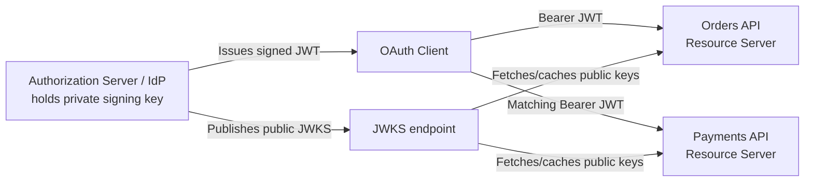
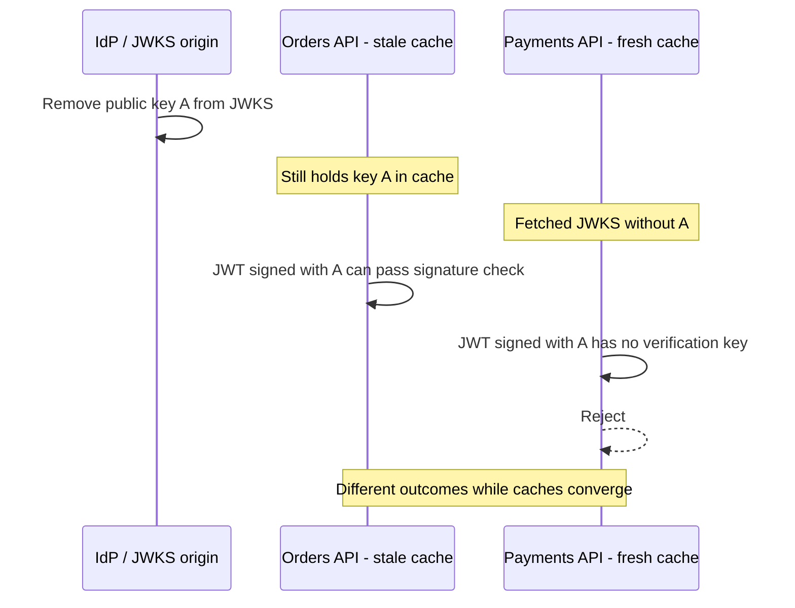
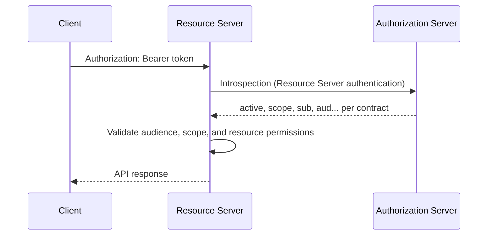

# Removed Keys, Compromised Keys, and Cache Retention Limits

In a **Spring Security OAuth 2.0/OIDC Resource Server**, authenticating a JWT access token generally relies on **public keys** provided by the issuer (Authorization Server/Identity Provider) in a **JSON Web Key Set (JWKS)**. The Resource Server uses the key matching the JWS signature to verify the token, then validates `iss`, `aud`, `exp`, `nbf`, and other contract requirements.

An easily misunderstood situation: **the Authorization Server removes a key from the JWKS, yet some APIs still accept tokens signed with that key**. This happens because an API, JWT library, proxy, or JWKS distribution layer still holds the old key in cache. During planned key rotation, that buffer prevents downtime. When a **private signing key is compromised**, that very lag becomes a window an attacker can exploit.

This lesson examines the security implications of three events:

1. **Key removal/retirement:** the public JWK no longer appears in the newly published key set.
2. **Private signing key compromise:** an attacker may gain the ability to mint tokens carrying valid signatures from the compromised key.
3. **Cache still holding the old key:** some Resource Servers keep verifying tokens against a stored JWKS copy even after the origin changed.

Understanding these boundaries helps you design key lifecycles, contain incidents, and enforce only the guarantees a Resource Server can actually provide.

## 1. Who Owns the Keys and Who Trusts Them?

Consider a system with an Authorization Server and two APIs:



With common asymmetric signature algorithms like RSA/ECDSA:

| Component | Holds | Used For What? |
|---|---|---|
| Authorization Server | **Private signing key** | Signs JWT access tokens |
| Issuer's JWKS endpoint | **Public verification keys** | Enables Resource Servers to verify signatures |
| Resource Server | Public keys from trusted issuer source, possibly cached | Verifies signatures of incoming tokens |
| OAuth client | Access token (bearer credential) | Sends to authorized APIs |

**Publishing public verification keys is normal and is the whole point of JWKS.** Anyone reading a public key cannot automatically forge JWTs, provided the algorithm and key management are sound. A **private signing key compromise** is far more severe because anyone holding the private key can produce JWS signatures that verify against the corresponding public key.

This lesson uses the **asymmetrically signed JWS** JWT model. If using HMAC with a shared secret (e.g., HS256), any party knowing the secret can both sign and verify; the trust model and blast radius differ. Never treat a shared secret as a "public key" to publish in a JWKS.

## 2. What Does a JWKS Contain and Why Is It Cached?

An illustrative JWKS example:

```json
{
  "keys": [
    {
      "kty": "RSA",
      "use": "sig",
      "kid": "sign-2026-a",
      "alg": "RS256",
      "n": "BASE64URL_MODULUS_PLACEHOLDER",
      "e": "AQAB"
    },
    {
      "kty": "RSA",
      "use": "sig",
      "kid": "sign-2026-b",
      "alg": "RS256",
      "n": "ANOTHER_MODULUS_PLACEHOLDER",
      "e": "AQAB"
    }
  ]
}
```

The `n` values are placeholders, not usable RSA keys. In a real JWKS, `n` and `e` (or the corresponding EC parameters) are the public values enabling signature verification.

Fields to understand:

- `kty`: key type (`RSA`, `EC`, `OKP`... depending on supported algorithms).
- `kid`: *Key ID*, an identifier to **assist key selection** within an already-trusted set; not proof a key is trustworthy.
- `use: "sig"`: key intended for signature operations; do not confuse with JWE encryption keys.
- `alg`: algorithm the key is intended to support; the API still needs an **allowed algorithm allowlist**.
- Public parameters (`n/e`, `crv/x/y`...): verification material.

A JWT typically has a header:

```json
{
  "alg": "RS256",
  "typ": "at+jwt",
  "kid": "sign-2026-a"
}
```

The Resource Server locates a key matching `kid`, algorithm, and issuer in its trusted key set and then **actually verifies the signature**. Never conclude "token is valid" simply because `kid` appears in the JWKS; an attacker can put any `kid` in an unverified token header.

### 2.1. Why Doesn't the Resource Server Fetch the JWKS on Every Request?

If every request queried the IdP/JWKS endpoint, every Bearer JWT authentication would depend directly on the network and IdP availability. Consequently, JWT libraries normally **cache public keys/metadata** to:

- Reduce latency and outbound network calls.
- Keep processing requests if the JWKS endpoint is temporarily slow or disrupted, depending on cache policy.
- Let multiple requests share the same public key set.

The trade-off is that **cached copies can lag behind a newly updated JWKS**. TTL policies, refresh mechanisms, and behavior when the JWKS is unreachable are implementation/cache properties; do not assume one fixed duration across every version of Spring Security/Nimbus.

### 2.2. Which Caches Might Still Hold the Old Key?

```text
Authorization Server
  |
  v
JWKS origin / discovery metadata
  |
  v
CDN / proxy / gateway / HTTP cache (if any)
  |
  v
NimbusJwtDecoder / JWKSource / JWT library
  |
  v
Resource Server instances A, B, C...
```

These layers can have different refresh cycles. For example:

| Storage Layer | What to Check |
|---|---|
| IdP / JWKS origin | When was the new key published, and when was the old key actually removed? |
| CDN, reverse proxy | Cache-Control, TTL, purge/invalidation, stale-serving behavior |
| API gateway performing JWT verification | Does the gateway maintain its own JWKS cache? |
| Nimbus/JWT decoder inside the API | Cached JWK set and reload triggers |
| Multiple Resource Server replicas | Has every instance fetched the updated JWKS? |
| Restarted processes, sidecars, or static key config | Are keys loaded only at startup or periodically reloaded? |

**A single JWKS update at the IdP does not automatically synchronize every cache.** Furthermore, different Resource Servers may evaluate the same token differently during the convergence window.

## 3. What "Key Removed" Means — and What It Does Not Mean

Suppose the IdP initially publishes:

```text
JWKS at T0:
  sign-2026-a
  sign-2026-b
```

Later, the IdP removes key `sign-2026-a`:

```text
JWKS at T1:
  sign-2026-b
```

We can conclude:

> **The new JWKS at the origin no longer publishes public key A.**

We **cannot yet conclude**:

- Every Resource Server has loaded the new JWKS.
- Intermediate caches have purged key A.
- All JWTs signed with A are rejected starting at exact timestamp T1.
- All tokens issued with A have been revoked across every API.
- Private signing key A has been safely wiped from all systems.

Signed JWTs are verified **offline** against the public keys held in the verifier. If an API still holds public key A in memory, a JWT signed with private key A can keep passing signature checks. If the token is unexpired, matches the issuer and audience, and is not blocked by another rule, the API may accept it.

### 3.1. Deleting a Public JWK Does Not Erase Signatures on Old Tokens

An issued JWT carries a signature computed with the prior signing key. When the IdP removes the public JWK, the signature inside the token **does not change**, nor does the token "know" the JWKS was updated. Only **the verifier inside the API** decides which public keys and rules to enforce.



The diagram highlights divergence due to **key-set state**. Final acceptance also depends on issuer, audience, lifetime, profile, and authorization on each API. If API1 enforces a key-A blocklist independent of the JWKS cache, API1 can still reject immediately.

### 3.2. Removing a Key at the IdP Differs from Invalidating Tokens in the Resource Server

Each action has a specific effect:

| Action | Direct Effect | Limitation |
|---|---|---|
| Stop using private key A to **sign new tokens** | Legitimate new tokens are no longer minted with A | An attacker holding private key A can still forge tokens |
| Remove public JWK A from **JWKS origin** | Verifiers fetching the new key set no longer receive A | Stale verifiers/caches may still hold A |
| Remove A from **every verifier's trusted key set** | That verifier stops accepting A for verification | Must be deployed/enforced across all APIs/gateways/instances |
| Token introspection returns `active=false` | APIs using compliant introspection reject inactive tokens | Offline-verified JWTs do not call introspection automatically |
| Block `jti`/subject/issuer via state | Rejects targeted tokens/scopes when the API checks state | Requires shared state and enforcement everywhere |
| Wait for token `exp` | Tokens expire under time policy | If the private key leaked, an attacker can sign new tokens with distant `exp` unless max age is enforced |

**Removing a JWK from an endpoint is not an instant token revocation protocol.** It is a key-set change that verifiers must observe.

## 4. Cached Old Keys Create Time-Bounded Risk

Suppose:

```text
T0 = 10:00  API fetches JWKS containing keys A and B.
T1 = 10:05  IdP removes key A from JWKS.
T2 = 10:06  Client/attacker sends JWT signed with A.
T3 = 10:15  API refreshes JWKS and no longer has key A.
```

Between T1 and just before T3, the API can still verify A's signature. If caching does not guarantee fixed refresh timing, T3 might happen later than 10:15, earlier, or never if misconfigured/unrefreshed.

<details>
<summary>Observing token acceptance windows</summary>

```text
                       JWKS origin:      A + B ------> B
                                         T1

Resource Server cache:  A + B ---------------------> B
                                                 T3

JWT signed with A:
   May pass signature verification while API still trusts A.
   Rejected for signature/missing key once verifier drops A.
```

</details>

**Do not assume every token signed with A stops working after a single fixed TTL.** Cache TTLs can differ across instances, proxies, and library versions; some implementations serve stale caches when endpoints fail, while others fail closed. Verify behavior **on your actual runtime verification path**.

### 4.1. Cache Freshness and Token Expiration Are Two Separate Clocks

Consider two concepts:

- **Token lifetime:** how long a token is valid according to claims like `nbf`, `exp`, and any max-age validator.
- **Key cache freshness:** how long a verifier reuses a previously fetched public key set before reloading.

A token may be **unexpired** yet rejected because the verifier dropped the verification key. Conversely, a token whose signature matches a cached key must still be rejected if `exp` has passed or `aud` is wrong.

In a private key leak, the exposure window is not simply the JWT TTL. If an attacker signs tokens with a far-future `exp` while the API checks only expiration without bounding total token age, forged tokens can carry abnormally long lifetimes as long as the cached key remains trusted. **Maximum token age checks and issuance policies** add defense in depth, though they never replace removing the compromised key.

### 4.2. `Cache-Control` Is Not a Command to Purge Keys Inside the JVM

Example HTTP response from a JWKS endpoint:

```http
HTTP/1.1 200 OK
Content-Type: application/json
Cache-Control: public, max-age=300
ETag: "jwks-v42"
```

These headers describe HTTP-layer caching policy for components that honor them; they **do not prove** every `JwtDecoder` inside the JVM reloads at exactly 300 seconds. A JWT library may have its own cache/refresh mechanics. An application might also read keys from a static file or build a custom decoder that ignores `Cache-Control`.

`ETag` and `If-None-Match` help HTTP clients check efficiently whether a document changed, but they are not token revocation mechanisms and do not guarantee **public key A has been purged from all memory**.

### 4.3. "Refresh Failure" Can Happen

Scenarios to design for:

- JWKS endpoint returns 5xx or times out.
- CDN serves stale content because policy permits stale responses.
- DNS or issuer metadata changes make the URL unreachable.
- Resource Server uses a custom cache retaining old keys to favor availability.
- New pods load the new key while old pods retain the prior key before reload.
- A gateway holds its own JWK cache while the API verifies directly with a different cache.

A verifier may be designed to **fail closed** when signature or trust state cannot be verified, yet you must know **whether it still treats a cached key as trusted**. "Cannot reach the network" and "no key exists to verify" are two distinct conditions.

**During a key compromise incident, serving stale caches for availability can directly conflict with eliminating the compromised key.**

## 5. Planned Key Rotation: Avoiding Disruption to Active Tokens

Routine rotation (*planned rotation*) swaps signing keys without unnecessarily invalidating valid tokens. A typical plan includes:

### Step 1 — Publish the New Public Key Before Using It

```text
JWKS: [A]
     -> [A, B]

IdP still signs new tokens with A.
```

Resource Servers get time to fetch the JWKS containing both A and B. This phase prevents the API from seeing `kid=B` for the first time before holding public key B.

### Step 2 — Switch the IdP to Sign with Key B

```text
JWKS: [A, B]

IdP signs new tokens with B.
Older tokens signed with A are still unexpired.
```

Both public keys coexist so the API handles both old and new JWTs. Some libraries refresh the JWKS upon seeing an uncached `kid`, yet **never assume every version, cache, and proxy refreshes instantaneously**. Publishing the key prior to switching signers minimizes disruption.

### Step 3 — Wait for the Old Token Window to End

Key A normally needs to remain published at least until:

1. No valid A tokens are expected to remain active, including the longest-lived access tokens permitted by policy.
2. Resource Server clock skew/tolerances are accounted for.
3. All instances/gateways have had time to pick up B given actual cache cycles and update mechanics.

Separate the **old token lifetime window** from the **new key propagation window**. Both must be factored into the plan. If the IdP drops A too early, users may receive 401 errors even though their tokens have not reached `exp`.

### Step 4 — Remove Key A and Monitor

```text
JWKS: [A, B]
     -> [B]
```

At this point, tokens signed with A should be expired or rejected by policy. Some verifiers still caching A is worth monitoring, though the impact is usually minor since **private key A is not considered compromised** and old A tokens have expired.

### 5.1. Example Calculation for a Planned Window

Suppose the issuance contract specifies:

```text
Max access token lifetime:   20 minutes
Allowed clock skew:           1 minute
Switch signing A -> B:       12:00
```

The last token A issued right before 12:00 can remain valid until roughly **12:20**, or slightly longer depending on how validators apply clock skew. Removing A from the JWKS at **12:01** causes refreshed APIs to reject time-valid A tokens.

Therefore, keep A published for the **entire valid lifetime of old tokens**, accounting for cache propagation, any IdP nodes still issuing A during rollout, and any longer-TTL token exceptions. Never treat a fixed "20 + 1 minutes" addition as a universal SLA when other configurations or token types exist.

## 6. Compromised Private Signing Key: A Completely Different Problem from Routine Rotation

**A compromised private signing key** means an attacker can forge the issuer's signature on JWTs that Resource Servers trust. The risk goes beyond replaying stolen tokens: the attacker can **mint new JWTs** with arbitrary contents—such as `sub`, `scope`, `aud`, or `exp`—within whatever checks the API enforces.

Example forged token:

```json
{
  "iss": "https://idp.example.com/realms/shop",
  "sub": "user-admin",
  "aud": ["orders-api"],
  "scope": "orders.read orders.write",
  "iat": 1893456000,
  "exp": 1893542400
}
```

This payload illustrates the impact; if an attacker holds private signing key A, they can sign it with A. **A valid signature is no longer sufficient proof of the issuing source** because the issuer's key was compromised.

### 6.1. Why Stopping Signing with A Alone Is Not Enough

The IdP can switch to signing with B in one minute. Yet the attacker does not need the IdP to sign for them: they already hold private key A. As long as Resource Servers still accept public key A, signatures forged with A will pass cryptographic checks.

### 6.2. Why Removing Public JWK A Alone Is Also Not Enough

Some APIs still cache A. Until they purge A from their verification key sets, the compromise is not contained on those verifiers. **Never treat the JWKS origin update timestamp as the actual time of safety** without verifying the state of every verifier.

### 6.3. You Cannot Distinguish Real vs. Forged Tokens by Signature A Alone

Once private key A has leaked, two tokens:

```text
Real token previously signed by IdP with A
Forged token signed by attacker with A
```

both verify cleanly against public key A. Checking signature A alone cannot tell them apart. To selectively accept A tokens, you need **evidence outside the compromised signature**, such as issuance state stored by the Authorization Server, introspection capable of recognizing genuine issued tokens, or another trusted authorization mechanism.

If the system has no reliable way to distinguish them, the safe action is usually to **stop trusting key A**, accepting that valid A-signed tokens will also break. This differs from routine rotation: isolating the compromised key takes priority over maintaining compatibility windows.

## 7. Incident Timeline: Caching Turns an Instant Change into a Distributed Event

Illustrative incident timeline:

| Time | Event | Risk |
|---|---|---|
| 09:00 | APIs A, B, C all cache JWKS containing key K1 | APIs trust K1 |
| 09:12 | Security team detects private signing key K1 leaked | Attacker can sign forged JWTs with K1 |
| 09:14 | IdP stops signing with K1, switches to K2 | Legitimate new tokens use K2; attacker still has K1 |
| 09:15 | K1 is removed from JWKS origin | Verifiers fetching new JWKS no longer see K1 |
| 09:17 | API A refreshes and drops K1 | API A stops accepting K1 signatures |
| 09:22 | API B still caches K1 | API B may still accept forged tokens |
| 09:31 | Gateway C still uses the old key set | Traffic through this gateway remains exposed |
| After system-wide verification | All verifiers have dropped K1 and reject K1-signed tokens | Trust in key K1 is narrowed/eliminated |

These timestamps are illustrative. **Effective key-removal lag** depends on replicas, CDNs/proxies, cache settings, routing paths, timeouts, fallback rules, and operational coordination.

Key insight:

```text
Time IdP detects key leak
        !=
Time JWKS origin removes public key
        !=
Time all Resource Servers stop trusting the key
```

If even one API route bypasses an updated gateway, or one old pod keeps its configuration, the system can still accept K1-signed tokens.

## 8. Response Playbook for a Compromised Private Signing Key

Incident procedures must be prepared in advance, because real-world response time cannot easily shrink if you only start mapping services and caches after a leak occurs.

### Phase A — Scope the Incident and Isolate the Issuing Source

1. **Identify affected issuer and key**: which key, algorithm, `kid`/thumbprint, and how many realms/tenants share that key?
2. **Stop signing new tokens with that key** and switch to a protected, safe signing key.
3. **Revoke access to the old private signing key**, lock down secret manager/HSM/KMS, and investigate the leak vector.
4. **Inventory services trusting that issuer/key**, including Resource Servers, API gateways, service mesh plugins, batch jobs, standby environments, and any system consuming the JWKS.

Stopping signing prevents only the IdP from issuing valid tokens with the old key; if an attacker already holds the key, the next step must **change the key set trusted by verifiers**.

### Phase B — Force Recipients to Stop Accepting the Compromised Key

1. Remove the affected public JWK from trusted key sets/JWKS per emergency procedures.
2. **Ensure all verifiers purge the key from caches** via library- and infrastructure-supported refresh/invalidation hooks. If no safe invalidation API exists, redeploy or restart instances with updated configuration; verify startup paths so stale JWKS copies are not reloaded.
3. Consider **blocking the key via an independent policy** outside the JWKS cache at gateways/APIs if supported reliably—such as a policy keyed on the public-key fingerprint pushed to every verifier.
4. Restrict or temporarily pause sensitive operations until every verifier is confirmed to have dropped the key.
5. Check for bypasses: are there internal endpoints, replicas, or parallel environments still accepting the old key?

**Never rely solely on a denylist keyed on `kid` from an unverified JWT header.** `kid` is caller-supplied and can be omitted, duplicated, or altered. A safe key-blocking rule must bind to the **actual verification key selected from the trusted set**—such as an internal identifier or fingerprint of the verified key—or remove the key outright from verifier candidates.

A rule like "reject if header `kid=K1`" can help as a temporary mitigation when token formats require consistent `kid` values, but **never treat it as complete** if parsers try fallback keys when `kid` is absent or if alternate verification paths exist.

### Phase C — Mitigate Impact of Already-Issued Tokens

- Once key K1 is removed from verifiers, both real and forged K1 tokens will be rejected. Provide a smooth way for legitimate clients to **obtain fresh access tokens** signed with the safe key.
- Evaluate related access/refresh tokens, user privileges, and abuse potential. **Removing a signing key does not revoke refresh tokens** if refresh tokens use separate state or signing keys.
- If token introspection or a token registry exists, consider invalidating affected tokens where genuine tokens can be reliably distinguished.
- If certain paths cannot update verifiers quickly enough, consider network/endpoint restrictions or temporarily pausing high-risk APIs based on risk.
- If an attacker may have had key-management or IdP access, broaden the investigation because rotating one signing key may be insufficient.

### Phase D — Monitor, Confirm Convergence, and Recover

Declaring containment must be evidence-based:

- All relevant Resource Servers/gateways have loaded key sets excluding the compromised key.
- Mechanisms verify state across newly spawned replicas, autoscaling groups, and standby regions.
- Requests carrying tokens signed with the old key are rejected across every controlled path.
- Tokens signed with the new safe key succeed when issuer/audience/time/scope match.
- No remaining endpoints or static configs still trust key K1.

Follow up with blast-radius analysis, anomaly logs, signs of forged tokens, and strengthened private key protection. Never copy raw bearer tokens, private keys, or credentials into incident tickets.

## 9. Why Short Token TTLs Help but Do Not Replace Key Removal

A common defense is keeping access tokens short-lived—such as 5–15 minutes depending on system needs. This limits the usable window of a **stolen already-issued token**.

With a **compromised private signing key**, however, an attacker can mint fresh tokens with K1:

```text
Attacker holds private signing key K1
     |
     +--> craft arbitrary claims passing verifier checks
     +--> set plausible or abnormal iat / nbf / exp
     +--> sign JWT with K1
     |
     v
API still caching public key K1
     |
     v
Signature can pass if policy has not removed K1
```

Enforcing **max token lifetime** (e.g., bounding `exp - iat`), rejecting far-future `iat`, and capping token age block certain anomalies. Still, an attacker can **craft tokens with timestamps inside valid bounds**. Thus, **the ultimate barrier remains revoking trust in the compromised signing key** or relying on independent trust evidence an attacker cannot forge.

### 9.1. Clock Skew Is a Separate Concern

When validating `exp` and `nbf`, Spring Security validators may permit a small clock skew tolerance. That skew **does not extend how long a key stays in the JWKS cache**, though it can slightly extend token acceptance around expiration boundaries.

Never set large clock-skew tolerances to mask unsynchronized IdP/API clocks. Synchronize system clocks and pick a sensible tolerance.

### 9.2. Revoking Key Trust vs. Revoking Individual Tokens Are Different Tools

| Mechanism | Blast Radius | Best Fit When |
|---|---|---|
| Remove compromised key from trusted key set | All tokens signed with that key | Key leaked; real vs. forged tokens cannot be distinguished by signature alone |
| Revoke by `jti`/token registry | One or a specific group of tokens | Reliable issuance state exists and every verifier checks it |
| Revoke by user/session | A set of permissions, accounts, or sessions | Account compromised or permissions changed |
| Real-time introspection | API queries AS for active token state | Revocation state must be reflected immediately; endpoint is trusted and returns full metadata |
| Short TTL | Caps exposure of issued tokens | Baseline policy to reduce exposure |
| Real-time data-level authorization | Per operation on each object | Prevents abuse even while a token remains valid |

No single "cache refresh" trick replaces all of these controls.

## 10. Limits of `kid`, JWKS, and Token Claims

### 10.1. `kid` Is a Selector, Not a Trust Anchor

A JWT header may declare:

```json
{
  "alg": "RS256",
  "kid": "sign-2026-a"
}
```

Yet `kid` is merely metadata in the JOSE header sent by the client. The API trusts only **signatures verified using a key from the issuer's valid trust set**. Treating `kid` as an absolute security identifier without binding issuer, key material, and algorithm type invites key confusion.

Some libraries let a key selector try multiple keys when `kid` is missing or ambiguous. Blocking solely on the `kid` string may miss alternate verification paths. For emergency revocation, **remove the specific key material/fingerprint from candidate keys** on every verifier or enforce library-supported key-blocking policies.

### 10.2. Never Fetch Keys from URLs Suggested by Unverified Tokens

JOSE headers may include fields like `jku` or `x5u`. Never treat those URLs as dynamic key sources to "fix an unknown `kid` error." Otherwise, a token sender can steer trust sources, creating SSRF risks or verifying against attacker-controlled keys.

Issuers, JWKS endpoints, and key sets must originate from **trusted application configuration** or governed management mechanisms. If accepting multiple issuers, each issuer requires its own allowlist/configuration and validators.

### 10.3. Removing One Key Does Not Mean the Entire Issuer Is Invalidated

An IdP may maintain multiple keys per tenant, token type, or algorithm. One compromised key can affect:

- JWT access tokens of a specific realm.
- JWT ID tokens of another OIDC client if signing keys are shared.
- Multiple APIs/resources with different audiences.
- Other services trusting that public key or certificate.

Scope must be mapped via **actual issuer, key material, environment, token profile, clients, and verifiers**, not just the `kid` string. Two issuers can share the same `kid` string for completely different keys.

## 11. Spring Security/`NimbusJwtDecoder`: Understanding the Cache Path Accurately

In a standard Servlet JWT Resource Server:

```text
Authorization: Bearer JWT
    |
    v
BearerTokenAuthenticationFilter
    |
    v
JwtAuthenticationProvider
    |
    v
JwtDecoder (typically NimbusJwtDecoder)
    |
    +--> fetch/cache trusted issuer's JWKs
    +--> verify JWS signature with matching public key
    +--> run validators for issuer, lifetime, audience...
    |
    v
JwtAuthenticationToken
    |
    v
Authorization / business policy
```

Spring Security uses Nimbus JOSE + JWT across many JWT decoding paths. **Key caching, refresh on unknown `kid`, cache lifetimes, and network-error fallbacks depend on the exact version and initialization method**:

- A default Boot-configured decoder built from `issuer-uri` can differ from one constructed manually via builders.
- Providing `jwk-set-uri` can alter how endpoint discovery works.
- An application-provided `JwtDecoder` bean can completely override auto-configuration behavior.
- An application may supply a Spring `Cache` or custom `JWKSource`, altering Nimbus defaults.
- Gateways/service meshes may validate JWTs upstream of the API using an independent cache.

Therefore, **never claim a blanket rule like "Spring always caches JWKS for 5 minutes" across all versions and configs**. Framework docs describe defaults per version, while operations teams must confirm the exact deployed implementation.

### 11.1. Minimal JWT Resource Server Configuration

Spring Boot 3.x example with Servlet Resource Server dependencies:

```groovy
// build.gradle
dependencies {
    implementation 'org.springframework.boot:spring-boot-starter-web'
    implementation 'org.springframework.boot:spring-boot-starter-oauth2-resource-server'
}
```

```yaml
# application.yml
spring:
  security:
    oauth2:
      resourceserver:
        jwt:
          issuer-uri: https://idp.example.com/realms/shop
          audiences:
            - orders-api
```

```java
import org.springframework.context.annotation.Bean;
import org.springframework.context.annotation.Configuration;
import org.springframework.security.config.Customizer;
import org.springframework.security.config.annotation.web.builders.HttpSecurity;
import org.springframework.security.web.SecurityFilterChain;

@Configuration
class OrdersSecurityConfiguration {

    @Bean
    SecurityFilterChain securityFilterChain(HttpSecurity http)
            throws Exception {
        return http
            .authorizeHttpRequests(auth -> auth
                .requestMatchers("/public/health").permitAll()
                .requestMatchers("/api/orders/**")
                    .hasAuthority("SCOPE_orders.read")
                .anyRequest().authenticated())
            .oauth2ResourceServer(oauth2 ->
                oauth2.jwt(Customizer.withDefaults()))
            .build();
    }
}
```

This configuration illustrates separation of roles: issuer/audience govern JWT verification, while HTTP rules check authorities. It **does not automatically add an emergency key revocation hook to cached JWT decoders**. To support a command like "stop trusting signing key K1 immediately," your system must be able to manage **trusted verification keys** across all verifiers.

When manually defining a `JwtDecoder`, preserve all required validation checks; passing only a JWKS URI without issuer/audience validators risks accepting tokens meant for other audiences. Example validator configuration:

```java
import org.springframework.beans.factory.annotation.Value;
import org.springframework.context.annotation.Bean;
import org.springframework.context.annotation.Configuration;
import org.springframework.security.oauth2.core.DelegatingOAuth2TokenValidator;
import org.springframework.security.oauth2.core.OAuth2Error;
import org.springframework.security.oauth2.core.OAuth2TokenValidator;
import org.springframework.security.oauth2.core.OAuth2TokenValidatorResult;
import org.springframework.security.oauth2.jwt.Jwt;
import org.springframework.security.oauth2.jwt.JwtDecoder;
import org.springframework.security.oauth2.jwt.JwtValidators;
import org.springframework.security.oauth2.jwt.NimbusJwtDecoder;

@Configuration
class JwtContractConfiguration {

    @Bean
    JwtDecoder jwtDecoder(
            @Value("${app.security.issuer}") String trustedIssuer,
            @Value("${app.security.audience}") String requiredAudience) {

        NimbusJwtDecoder decoder =
            NimbusJwtDecoder.withIssuerLocation(trustedIssuer).build();

        OAuth2TokenValidator<Jwt> defaults =
            JwtValidators.createDefaultWithIssuer(trustedIssuer);

        OAuth2TokenValidator<Jwt> audience = jwt ->
            jwt.getAudience().contains(requiredAudience)
                ? OAuth2TokenValidatorResult.success()
                : OAuth2TokenValidatorResult.failure(
                    new OAuth2Error(
                        "invalid_token",
                        "JWT audience does not match this API",
                        null));

        decoder.setJwtValidator(
            new DelegatingOAuth2TokenValidator<>(defaults, audience));
        return decoder;
    }
}
```

```yaml
app:
  security:
    issuer: https://idp.example.com/realms/shop
    audience: orders-api
```

In this Java example, the `@Value` strings use Spring property placeholder syntax. **This illustrates issuer/audience validation**, not cache invalidation; when replacing the default decoder, keep validators intact and never assume changing a property refreshes keys instantaneously.

### 11.2. How Can You Force a JWKS Re-Fetch?

There is no single safe answer across all architectures. Check the cache management APIs supported by your **actual implementation**:

- Can you clear/invalidate the specific `Cache` instance used by the decoder?
- Which `JWKSource` does the decoder use—does it expose an explicit refresh method or rely solely on TTL?
- If you restart a pod, will it fetch the fresh origin JWKS or hit a stale CDN/proxy?
- If multiple `SecurityFilterChain`s or issuers exist, have you targeted each chain's decoder?
- Does an upstream API gateway hold its own cache that must be purged?
- Is an independent compromised-key block policy deployed uniformly alongside JWKS refreshes?

**Never assume a request carrying an unseen `kid` always triggers a refresh.** Unknown-key handling depends on library, version, last refresh timestamp, rate limits, and JWK source. Allowing every strange request to force refreshes can also be abused to overload the IdP.

### 11.3. Can You Rely on Restarting the Service?

Restarting a process clears **that process's in-memory cache**. Yet it fails to guarantee fresh keys if:

- The JWKS endpoint, CDN, or sidecar still serves old content.
- The application uses a shared/persistent cache or static key config holding the old key.
- Some replicas are not restarted, or autoscaling launches an old image/config.
- Another request path bypasses through a different service still trusting the old key.

Restarting can be **one step in recovery**, never proof that key rotation is complete. Afterward, observe and verify **rejection of the compromised key** across all entry points.

## 12. How Does Introspection Change the Revocation Model?

With self-contained JWTs, APIs typically verify locally using signatures and claims. With **opaque access tokens / introspection**, the API asks the Authorization Server whether the credential is currently active.



Example opaque token configuration:

```yaml
spring:
  security:
    oauth2:
      resourceserver:
        opaquetoken:
          introspection-uri: https://idp.example.com/oauth2/introspect
          client-id: orders-api
          client-secret: INTROSPECTION_SECRET_FROM_SECURE_CONFIG
```

The secret value is a placeholder; real environments must manage secrets via secure secret stores or environment variables.

If the IdP maintains a token registry, introspection can reflect revocation state; **an introspected JWT can also be validated as a credential under the IdP's rules**, provided the IdP genuinely verifies and distinguishes validly issued tokens. Still, clarify:

1. How does the introspection endpoint return `active=false` for forged tokens signed with a compromised key?
2. Does the IdP track real issuance state, or does it merely verify signature/`exp` itself? If it only checks signature with the leaked key, it **can be fooled too**.
3. Does the API cache introspection results? Caching delays revocation enforcement.
4. Does the endpoint return sufficient `aud`, `scope`, and principal metadata for Resource Server authorization?

**"Using introspection" does not fix the incident on its own if the Authorization Server itself still trusts the compromised key without a way to spot forged tokens.** Genuine revocation requires an authoritative state or trust source outside the attacker's control.

## 13. Complementary Policies Beyond JWKS Caching

JWKS is a critical trust layer, yet sensitive APIs often need additional safeguards:

### 13.1. Bounding Token Lifetime and Contract Claims

Validators can check:

```text
iss == configured issuer
aud contains API audience
exp > now (with appropriate clock skew)
nbf <= now (with appropriate clock skew)
iat is not unreasonably in the future
exp - iat does not exceed max token lifetime
typ/token profile matches expectation
```

This defends against misconfigured IdP issuance or abnormal attacker-chosen claims. However, an attacker holding a compromised signing key can still set claims **within valid bounds**. These validators reduce abuse scope but do not replace key revocation.

### 13.2. Token-Level and Key-Level Blocklists

If an API implements revocation:

- **Token-level** can use `iss + jti` when tokens carry stable `jti`s, the issuer guarantees uniqueness, and all APIs check state.
- **Key-level** should rely on internal identifiers or fingerprints of the **actual key used during signature verification**, not just the `kid` string in the token header.
- **Issuer-level** can temporarily disable an entire issuer if compromise scope is unknown; blast radius is massive, so plan recovery carefully.

Blocklists are only effective when **every relevant recipient enforces the policy**. If even one Resource Server verifies JWTs offline without checking revocation state, it can still accept tokens under its cached key set.

### 13.3. Business Authorization and Channel Security

Even when a token authenticates with a valid key:

- APIs must enforce operation scopes/authorities.
- Enforce ownership, tenant, state, and business limits on each resource.
- Never treat `sub` or an `admin` claim as sufficient unless the IdP contract and policy permit it.
- Protect access tokens in transit with TLS; never place bearer tokens in URLs or logs.
- Consider idempotency for sensitive actions like payments.

This limits damage from an abused token, though business checks must never be used as an excuse to leave broken key trust unresolved.

## 14. Side-by-Side Comparison of Two Scenarios

### Scenario A — Key Removal in Routine Rotation

Suppose tokens live at most 15 minutes:

```text
10:00  JWKS already holds both A and B
10:05  IdP starts signing with B
10:20  Last A tokens expected to be expired
10:22  IdP removes A from JWKS (accounting for clock skew)
```

Between 10:05 and 10:22, APIs should keep verifying valid A tokens and new B tokens. When APIs refresh the JWKS after 10:22, dropping A causes no disruption if all A tokens have truly expired. This **optimizes service continuity**.

### Scenario B — Private Key A Compromised at 10:05

```text
10:05  Detected that attacker holds private signing key A
10:06  IdP stops signing with A, switches to B
10:07  IdP removes public A from JWKS
10:08  Orders API 1 still caches A
10:09  Orders API 2 refreshed and rejects A
10:10  A gateway still caches A
```

**It is unsafe to wait 15 minutes just because legitimate A tokens live at most 15 minutes**: an attacker can keep minting new JWTs with A until verifiers stop trusting that key. Trigger incident procedures to remove A across every verification point or temporarily block exposed paths. This **prioritizes incident containment**.

| Question | Routine Rotation | Compromised Private Key |
|---|---|---|
| Keep accepting unexpired A tokens? | Usually yes, to avoid unnecessary 401s | Usually must stop trusting A even if legitimate tokens break |
| When to remove public A from JWKS? | After A token window + propagation | As soon as possible under incident plan |
| What is a lingering cache of A? | Expected transition buffer; low risk once A tokens expire | Extended exposure trusting a compromised key |
| Can we wait out token TTL? | Yes, within a plan covering all A tokens | Cannot rely on token TTL as sufficient protection |
| Priority | Service continuity | Isolating the leaked key and verifying system-wide state |

## 15. When Must Caching Be Verified in a Real Environment?

Design questions that need concrete answers from configuration and infrastructure:

1. **Where is the JWKS origin?** Does it sit behind a CDN/proxy, and what are the Cache-Control and purge rules?
2. **How does each Resource Server load keys?** Boot auto-config, Nimbus decoder builder, custom `JWKSource`, or static keys?
3. **How long does each instance cache?** Does it refresh on TTL or unknown `kid`, and are there stale fallbacks or timeouts?
4. **How do you force all instances to drop a key immediately?** Invalidation API, replacing trusted key sets, redeploy, or restart?
5. **Are gateways, service meshes, and batch workers included?** Does each have its own JWKS cache?
6. **When the JWKS endpoint fails, do verifiers fail closed or serve cached keys?** Is that policy acceptable during a key compromise?
7. **Do metrics show which keys verifiers currently trust?** Can you observe that without logging raw JWTs or secrets?
8. **Are max token lifetime, clock skew, and key retirement aligned?**
9. **Can a forged signed JWT set arbitrary `iat`, `exp`, and `scope`?** What bounds do extra validators and data permissions enforce?
10. **Are all token ingestion paths covered?** External APIs, internal APIs, multi-region, standby, and autoscaling pods?

### 15.1. Observing State Without Leaking Keys or Tokens

Operational telemetry safe to record:

```text
service=orders-api
instance=orders-7b9f
issuer=https://idp.example.com/realms/shop
jwks_refresh_status=success
jwks_last_success_at=...
trusted_key_fingerprints=[fingerprint-A,fingerprint-B]
rejected_tokens_reason=invalid_signature / invalid_audience / expired
```

Here, a fingerprint is a **non-sensitive identifier of the public verification key** computed via managed algorithm and canonicalization, never the private key. Never log `Authorization` headers, full JWTs, or sensitive plaintext.

"Last successful refresh" is helpful, yet **does not prove** the cache dropped key A if an intermediate endpoint served an old JWKS. Confirm both **the actual trusted key set** and active rejection of A-signed tokens along critical verification paths.

### 15.2. Interpreting Request Outcomes at the Right Layer

| Symptom | Cause to Investigate |
|---|---|
| JWT signed with old key still authenticates after origin dropped key | Stale cache, gateway cache, or another trust set still holds the key |
| JWT signed with new key returns 401 | Verifier hasn't loaded new key, or key selection/algorithm/claim check failed |
| Valid signature, wrong audience returns 401 | Audience validator rejecting as intended |
| Authenticated JWT lacking scope returns 403 | Authorization policy denies the action |
| Spikes of 401 on unexpired old tokens after rotation | Old key removed too early or replicas converged out of order |
| JWKS endpoint down yet requests still succeed | Verifier holds cached keys; review stale policy and actual validity |
| Restarted one pod, yet another path still accepts old key | Unrestarted replicas, gateways, intermediate caches, or static configs haven't converged |

A single 401 does not prove a key was purged; a 401 can stem from expiration, wrong audience, bad signature, or a route outside the Resource Server. Confirming key revocation requires verifying **the state of the trust set at the actual verification point**.

## 16. Misconceptions to Avoid

| Misconception | Reality |
|---|---|
| "The IdP removed the key from JWKS, so every API rejects it immediately." | Verifiers may still hold cached keys or static trust sets |
| "A public key leak is as severe as a private key leak." | Public verification keys are meant to be public; leaking the private signing key enables forging signatures |
| "Once the IdP stops signing with key A, attackers can't sign with A either." | An attacker holding private key A can still sign |
| "JWTs expire in 10 minutes, so a compromised key is only risky for 10 minutes." | Attackers can mint fresh tokens while APIs still trust the key; real key revocation is required |
| "Deleting a key at the origin revokes all tokens with `kid=A`." | It changes the published key set; caches and key selectors govern enforcement |
| "Clearing the cache in API A fixes the whole system." | Gateways, API B, replicas, CDNs, and other environments remain |
| "If `kid` is in the JWKS, the token is trustworthy." | `kid` only assists key lookup; signature, issuer, audience, and claims must still verify |
| "Blocking the string `kid=A` always stops a compromised key." | `kid` can be omitted or altered; the actual **key material** must be removed from verifiers |
| "Because JWKS returns Cache-Control, Nimbus definitely follows that exact TTL." | JWT libraries and custom caches have their own policies |
| "On an unknown `kid`, the library always refreshes immediately." | Depends on version, key source, cache/rate limits, and network errors |
| "Introspection automatically catches forged tokens signed with a compromised key." | Only if the AS has independent issuance state to tell them apart or has dropped the key |
| "A valid JWT signature means full permission to read any record." | Audience, scopes, and business authorization still apply |

## 17. Trust Model to Remember

```text
Authorization Server
  |
  +-- private signing key (strictly protected)
  |
  +-- public JWKS ---------------+
                                  |
                                  v
                        Caches on each Resource Server
                                  |
                                  v
                         Trusted verification keys
                                  |
                    +-------------+-------------+
                    |                           |
                 Key still                  Key removed
                  trusted                 from trust set
                    |                           |
                    v                           v
            Can verify JWS           Cannot verify with that key
                    |
                    v
          Check iss / aud / exp / nbf / profile
                    |
                    v
          Scope + business permissions on data
```

**Removing a public key from the JWKS origin changes only what is published from that moment on; it does not guarantee an immediate change to the keys held by every Resource Server.** During routine rotation, preserve enough overlap for old tokens to expire and systems to converge. When a private signing key is compromised, never treat cache buffers as harmless: execute a plan to **revoke trust in the leaked key across every verifier**, contain active tokens, and verify actual behavior before declaring the incident contained.

## References

- [RFC 7517 — JSON Web Key (JWK)](https://www.rfc-editor.org/rfc/rfc7517): JWK/JWKS, key selection, and key parameters.
- [RFC 7515 — JSON Web Signature (JWS)](https://www.rfc-editor.org/rfc/rfc7515): protecting and verifying JOSE signatures.
- [RFC 7518 — JSON Web Algorithms (JWA)](https://www.rfc-editor.org/rfc/rfc7518): signature algorithms and key management in JOSE.
- [RFC 7519 — JSON Web Token (JWT)](https://www.rfc-editor.org/rfc/rfc7519): JWT claims and validation.
- [RFC 8725 — JSON Web Token Best Current Practices](https://www.rfc-editor.org/rfc/rfc8725): algorithms, issuer/audience, trusted keys, and preventing key confusion.
- [RFC 9068 — JWT Profile for OAuth 2.0 Access Tokens](https://www.rfc-editor.org/rfc/rfc9068): access token profile and validation requirements.
- [RFC 7662 — OAuth 2.0 Token Introspection](https://www.rfc-editor.org/rfc/rfc7662): verifying access token state via the Authorization Server.
- [RFC 6750 — OAuth 2.0 Bearer Token Usage](https://www.rfc-editor.org/rfc/rfc6750): transmitting bearer tokens and protecting credentials.
- [Spring Security — Servlet OAuth 2.0 Resource Server JWT](https://docs.spring.io/spring-security/reference/servlet/oauth2/resource-server/jwt.html): issuer/JWKS, decoders, and JWT validation.
- [Spring Security — Opaque Token](https://docs.spring.io/spring-security/reference/servlet/oauth2/resource-server/opaque-token.html): token introspection and stateful authentication models.
- [Spring Security API — NimbusJwtDecoder](https://docs.spring.io/spring-security/site/docs/current/api/org/springframework/security/oauth2/jwt/NimbusJwtDecoder.html): builders and decoder behavior to check against your application version.
