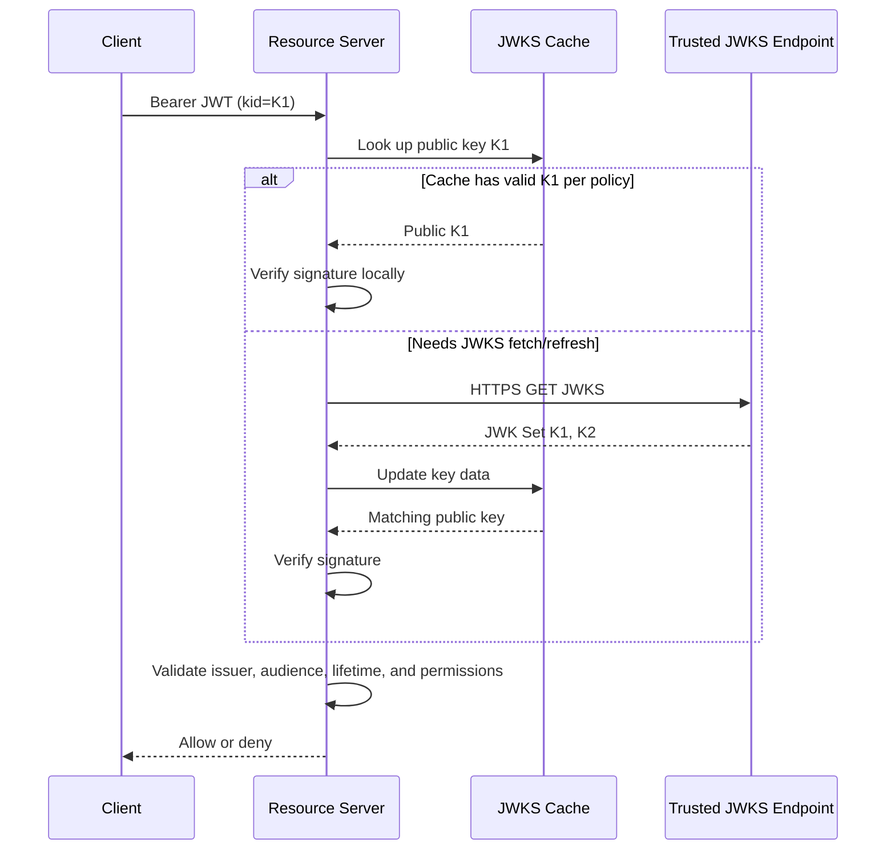
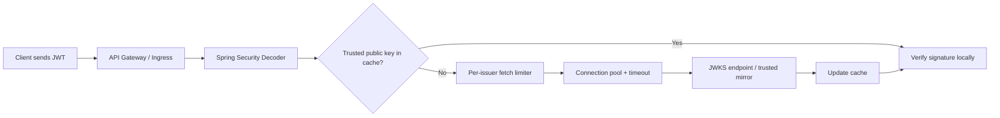
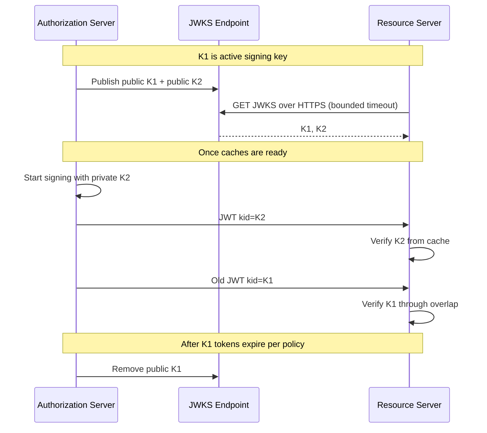

# Timeouts, Network Errors, Retries, and Load Limiting During JWK Lookups

In a **Spring Security OAuth 2.0 / OIDC Resource Server**, the application receives JWT access tokens and verifies their signatures with the Authorization Server's public keys. Keys are typically published as **JSON Web Keys (JWK)** inside a **JSON Web Key Set (JWKS)**. Many Spring Security deployments use `NimbusJwtDecoder` to fetch, cache, and select public keys from the issuer's JWKS endpoint.

JWT signature verification itself can run locally, yet **the initial JWKS fetch**, **cache refreshes**, or **tokens referencing a new key** can trigger HTTP requests to the Authorization Server. Consequently, the system must handle cases where the JWKS endpoint is slow, unreachable, returning errors, overloaded, seeing unknown key IDs, or rotating keys. Merely configuring the right URL is not enough to keep an API reliable.

This lesson focuses on four tightly coupled concerns:

1. Setting appropriate **timeouts** for connecting to and reading JWKS so user requests do not hang indefinitely.
2. Handling **network and key-fetch failures** while preserving signature, issuer, audience, and lifetime validation.
3. **Bounded retries** with backoff and jitter on recoverable errors, avoiding self-inflicted request storms.
4. **Load limiting during key lookups** via caching, pre-publishing keys before rotation, concurrency bounds, and monitoring unknown-`kid` bursts.

Examples use Java 17+, Spring Boot 3.x, Spring Security 6.x, and a mock endpoint `https://login.example.test/realms/orders`. All timeout, TTL, and retry values shown are illustrative and must be chosen based on your actual SLOs, latency, and infrastructure capacity.

## 1. When Must a Resource Server Hit the Network for Key Lookup?

An RSA/EC-signed JWT typically has three parts:

```text
BASE64URL(protected-header).BASE64URL(payload).BASE64URL(signature)
```

The protected header might contain:

```json
{
  "alg": "RS256",
  "typ": "at+jwt",
  "kid": "orders-key-2026-11"
}
```

`kid` is the **key ID** that helps the decoder pick the matching key in the JWKS. It is **not proof of identity**, since the header is caller-supplied and only trusted after verifying the signature with a key belonging to a trusted issuer.

Example Authorization Server JWKS:

```json
{
  "keys": [
    {
      "kty": "RSA",
      "kid": "orders-key-2026-10",
      "use": "sig",
      "alg": "RS256",
      "n": "<public-modulus-K1-base64url>",
      "e": "AQAB"
    },
    {
      "kty": "RSA",
      "kid": "orders-key-2026-11",
      "use": "sig",
      "alg": "RS256",
      "n": "<public-modulus-K2-base64url>",
      "e": "AQAB"
    }
  ]
}
```

The `<...>` strings are placeholders, not usable keys. A public JWKS must contain only **public key material**; private signing keys stay on the Authorization Server or HSM/KMS.

Distinguish the operations:

| Operation | Requires Network per Request? | Meaning |
|---|---|---|
| Split JWS, read header and JWT claims | No | Simply reads data; establishes zero trust. |
| Verify signature with a **cached** public key | Normally no | Verifies integrity and cryptographic origin locally. |
| Initial JWKS fetch | Potentially yes | Retrieves public keys from a fixed, trusted endpoint. |
| Refresh JWKS on cache expiry or missing key | Potentially yes | Discovers new, rotated, or removed keys. |
| Validate `iss`, `aud`, `exp`, `nbf` | Normally no | Decides whether the token is acceptable for this API. |
| Check scope, role, owner/tenant | Depends on business data | Authorization layer, independent of JWKS fetching. |

**Not every token causes Spring Security to call the JWKS endpoint.** Caching and refresh mechanics depend on the Spring Security/Nimbus version, decoder type, and HTTP/cache setup. Any assumptions about refresh timing or default TTLs should be verified via testing against your deployed stack.

### 1.1. Distinguishing Metadata Discovery from JWKS Fetching

Two separate network exchanges must be considered:

1. **OIDC/OAuth metadata discovery**: the app fetches issuer metadata (e.g., OpenID Provider Configuration or Authorization Server Metadata) to discover `jwks_uri`.
2. **JWKS fetch**: the decoder actually calls `jwks_uri` to download the JSON Web Key Set.

If only `issuer-uri` is configured, some initialization paths or version behaviors may contact the Authorization Server for metadata. Supplying both `issuer-uri` and a fixed `jwk-set-uri` can avoid startup metadata discovery in supporting Spring configurations while keeping issuer validation active.

**Metadata timeouts and JWKS timeouts may use different HTTP clients.** When building a decoder via `NimbusJwtDecoder.withJwkSetUri(...)`, you explicitly control the client used for JWKS; do not assume discovery requests elsewhere automatically inherit that same timeout configuration.

### 1.2. When Might a Request Hit the JWKS?



In this diagram, cache-miss reloading is simplified to illustrate the concept. In practice, a decoder might not immediately reload on an unknown `kid`, may enforce its own TTL/refresh policy, or may throttle concurrent fetches.

## 2. Three Reasons JWKS Becomes a Bottleneck

### 2.1. Cold Starts or Empty Caches

When a pod starts up, the in-memory public key cache may be empty. The first JWT request needing a public key must fetch the JWKS. If the JWKS endpoint is slow, the API slows down; if unreachable, requests lacking keys cannot be verified.

Distinguish **a Spring application starting up** from **an application ready to verify tokens for live traffic**. Skipping startup discovery does not guarantee the first request will avoid a network hop to fetch keys.

### 2.2. Rotation: Tokens Carrying a New `kid`

The Authorization Server may create key pair K2 while Resource Servers cache a JWKS holding only K1. New tokens carrying `kid=K2` can trigger decoders to look for the new key. If all API instances encounter K2 simultaneously, a burst of JWKS requests can occur right at the signer switch.

The key operational safeguard is **publishing K2 in the JWKS before issuing K2 tokens**, giving caches time to update. Retain K1 until active K1 tokens expire and overlap conditions are met.

### 2.3. Error Traffic or Random `kid` Floods

An untrusted client can send large volumes of forged JWTs with varying headers:

```json
{"alg":"RS256","kid":"random-000001"}
```

and then swap `random-000001` across thousands of distinct values. If the verifier reloads JWKS unboundedly on every unseen `kid`, client requests amplify into heavy load on the Authorization Server. This is a form of **resource exhaustion / cache-miss amplification**, even when zero tokens carry valid signatures.

**`kid` is untrusted before verification.** Never let a client-chosen `kid` string dictate which URL is called, retry counts, connection usage, or unbounded metric label cardinality.

## 3. Designing Timeouts: Connection, Read, and Total Budget

Different timeouts stop different types of hangs:

| Timeout Type | Interval Controlled | If Unbounded |
|---|---|---|
| **Connection timeout** | Time to establish TCP connection to server/proxy. | Worker threads stall during DNS/routing/network outages. |
| **TLS handshake timeout** | Time for TLS handshake; depending on HTTP client, separate or part of socket/connect budget. | Socket connects, yet establishing the trusted channel stalls. |
| **Read/response timeout** | Time waiting for response data once connected. | Connection accepted, yet server sends no body. |
| **Connection-pool acquisition timeout** | Time waiting for a pooled connection when all slots are busy. | Requests queue indefinitely inside the HTTP client. |
| **Total deadline/budget** | Total cap on key lookup, including retries, backoff, and all phases above. | A series of retries blows past the API's SLO even though each single attempt had a timeout. |

Not every HTTP client exposes all five timeouts or identical semantics. For example, `SimpleClientHttpRequestFactory` easily configures connect/read timeouts, whereas total deadlines or pool acquisition require capabilities specific to the HTTP transport.

### 3.1. Sizing Timeouts to the API Request Budget

Suppose an API has a tight latency SLO. If JWKS lookups are permitted to wait many seconds and retry repeatedly, incoming API calls can time out at the reverse proxy before Spring Security returns. That triggers further retries from clients/gateways, compounding the load.

Design principle:

```text
Budget for JWKS lookup
  <= Remaining HTTP request budget
     - time reserved for controller/service
     - network, gateway, and error-handling overhead
```

Each attempt consumes connect + response wait time. Total duration approaches:

```text
total ~= sum(duration of attempts) + sum(backoff delays)
```

Purely illustrative example: 1s connect timeout, 2s read timeout, max 2 attempts, 200 ms backoff. In the worst case, total wait can exceed 6 seconds—excluding DNS/TLS/pool/queue delays depending on the HTTP client. That may far exceed the budget of an API expected to respond in a couple of seconds. Tune parameters from measured latency and upstream limits.

**Never set infinite timeouts to "avoid intermittent errors."** Network dependencies can hang indefinitely; finite timeouts protect resources and enable controlled failure responses.

### 3.2. Do Not Confuse Network Timeouts with JWT Expiration

- `exp` is **when an access token expires**, per JWT policy.
- JWKS cache TTL is **how long the public key document is retained**.
- HTTP read timeout is **how long to wait for a JWKS endpoint response**.
- Retry backoff is **how long to pause before another attempt** on transient errors.

An unexpired token (`exp` in the future) must still be rejected if the decoder lacks a trusted public key to verify it. Conversely, caching a public key never makes an expired token valid.

## 4. Classify Errors Before Deciding to Retry

Not every JWT verification failure can be fixed by fetching the JWKS again. Classify failures to avoid pointless or harmful retries:

| Scenario | Meaning | Appropriate Behavior |
|---|---|---|
| JWKS HTTP connection timeout | Could not reach key source. | May retry **a few times** if request budget remains; fail closed if key remains unavailable. |
| JWKS read timeout | Endpoint did not return data in time. | May retry with backoff/jitter; never pass unverified tokens. |
| DNS/TLS handshake failure | Network error or trust/certificate misconfiguration. | Observe and fix infrastructure; never disable TLS verification. Retry only if truly transient. |
| HTTP `500`/`502`/`503`/`504` | Endpoint or proxy error. | Bounded retries per policy; honor `Retry-After` if provided. |
| HTTP `429 Too Many Requests` | Key source is rate-limiting traffic. | Shed load, back off, and honor `Retry-After` within deadline; never amplify retry storms. |
| HTTP `401`/`403` calling JWKS | Endpoint is protected or misconfigured. | Check permissions/config; do not loop infinitely. Public JWKS normally do not require a client secret. |
| HTTP `404` | Wrong/changed JWKS URL. | Reconfigure endpoint after verifying source; never brute-force alternate URLs. |
| HTTPS returns invalid JSON or invalid JWK | Malformed JWKS payload or policy mismatch. | Reject keys; alert on issuer/metadata failure; retries will not fix deterministic structural bugs. |
| `kid` absent from valid JWKS | Token references unknown key or rotation lagged. | Refresh per policy; if still missing, reject token—do not probe other URLs. |
| Bad JWT signature despite finding key | Token not signed with matching private key or tampered with. | **Reject**; never hammer JWKS just because a signature failed. |
| Wrong `iss`/`aud`/`exp` | Token contract violation. | **Reject**; do not retry network calls. |
| Valid JWT missing scope/role | Authorization failure. | `403` per policy; unrelated to JWKS. |

The same symptom can carry different meaning by context. For instance, an **unknown `kid`** during a scheduled rotation signals a cache needing refresh; outside rotation, thousands of random `kid`s signal attack traffic. Either way, **never accept a token before holding a matching public key and passing signature verification**.

### 4.1. HTTP Status Codes from the Resource Server

On a protected API:

- Missing Bearer token or token failing authentication/validators: typically **`401 Unauthorized`**.
- Valid token lacking required scope, role, or business permission: typically **`403 Forbidden`**.
- During a JWKS outage where tokens cannot be verified: **grant no access**. Exact HTTP status depends on exception propagation, Spring Security version, and handlers. An app can explicitly return `503 Service Unavailable` when infrastructure dependency failures are cleanly distinguished, provided it is implemented and tested carefully without misclassifying invalid JWTs as "network" errors.

Separating **authentication failures** (bad tokens) from **dependency failures** (JWKS unavailable) is valuable for monitoring. Never turn off `JwtDecoder`, set routes to `permitAll()`, or trust unverified Base64URL claims just to return `200`.

## 5. Proper Retries: Bounded, Backed Off, and Non-Amplifying

Retries help on transient glitches like packet loss or brief `503`s; they cause harm when dozens of API instances retry simultaneously against an overloaded endpoint.

### 5.1. Retry Only Eligible Failure Types

Failures **eligible for consideration**:

- Transient network timeouts on JWKS GET.
- `502`/`503`/`504`/`429` under an explicit policy.
- Temporary connection reset/drop before receiving the full response.

Failures **never to retry simply because a token was rejected**:

- Invalid JWT signature.
- Disallowed `alg`, `alg=none`, or incompatible key type.
- Invalid `iss`/`aud`, expired token, or `nbf` in the future.
- Malformed JWT structure or invalid JWS header.
- Missing endpoint scope/role.
- Random `kid` absent from an already-refreshed key set before cache policy permits another refresh.

An HTTP GET to JWKS is a read operation and functionally idempotent, yet **functional idempotence does not mean load safety**.

### 5.2. Backoff and Jitter

Do not immediately slam the endpoint across all pods:

```text
Attempt 1 fails
  -> wait backoff + random jitter
  -> Attempt 2 if budget remains
  -> if failed, return safe error and emit monitoring signal
```

Illustrative backoff formula:

```text
delay_n = min(baseDelay * 2^(n - 1), maxDelay)
actualDelay = random(0, delay_n)  // full jitter
```

Jitter prevents hundreds of API instances from synchronizing retries at the exact same instant. Enforce **max attempts**, **max delay**, and **total deadline**. Ensure the HTTP client, retry library, service mesh, and reverse proxy do not **stack multi-layer retries** accidentally, which multiplies outbound requests rapidly.

### 5.3. Why "Retry 3 Times" Is Not Enough

Picture 100 concurrent requests needing the JWKS; if each request launches its own JWKS GET and retries 3 times, the system can emit hundreds of JWKS requests for the exact same key set. Across multiple pods, regions, and retrying gateways, Authorization Server traffic explodes.

A proper solution combines **per-decoder shared caching**, concurrent fetch limits, preventing concurrent requests from all bypassing the cache, and bounded retries. Actual outbound request volume depends on the decoder/caching implementation; never assume every incoming JWT equals one HTTP call.

### 5.4. Retries Must Fit Inside the Total Budget

Pseudocode expressing **policy** (not a literal Nimbus Java API):

```text
fetchTrustedJwks(url, deadline):
    assert url is configured and valid HTTPS
    for attempt in 1..MAX_ATTEMPTS:
        if deadline exceeded:
            fail KEY_FETCH_TIMEOUT

        try:
            return GET(url, timeout <= remaining time)
        catch transientNetworkError:
            if attempt == MAX_ATTEMPTS:
                fail KEY_FETCH_UNAVAILABLE
            wait boundedBackoffWithJitter(remainingDeadline)

    fail KEY_FETCH_UNAVAILABLE
```

Never place a blanket controller-level retry around **the entire JWT decode flow**. Unconditional decoder retries let clients with bad signatures or bogus `kid` values keep generating useless network traffic. If custom retries are needed, wrap the JWKS HTTP fetch layer with strict error classification and bounds while leaving JOSE verifier semantics untouched.

## 6. Caching Is the Most Important Load-Shedding Mechanism

A JWKS supplies public keys for verifying signatures. Once a public key sits in a trusted cache, thousands of JWTs verify locally without hitting the JWKS endpoint again.

### 6.1. Caching Principles

- **Key the cache by trusted issuer and JWKS URL**, never mixing multiple trust domains into one undifferentiated store.
- **Bound capacity and TTL**; key sets are rarely huge, yet JWKS responses must have size/parse limits so oversized payloads cannot exhaust memory.
- **Controlled refresh** when TTL expires or a new `kid` appears, per library capabilities.
- **Never store private keys or raw Bearer tokens in the JWKS cache**. The cache holds public key metadata only.
- **Never treat cache TTL as JWT lifetime**: `exp` must be validated on every token.
- **Never create thousands of cache entries keyed by arbitrary client-supplied `kid`s**; the key set comes from one trusted JWKS source, and `kid` only selects within it.
- **Never permit indefinite stale key sets**. When an issuer revokes a compromised key, stale caches extend how long that key remains trusted.

### 6.2. Balancing Availability and Key Revocation

If the JWKS endpoint goes offline while the decoder **already holds valid public key K1 in cache per policy**, it can keep verifying K1 tokens (while still validating lifetime and claims). That benefits availability.

However, if a token carries an **unseen K2**, there is no basis to verify it. Never guess that K2 "probably came from the same issuer" and accept it.

Decision matrix:

| Cache State | Token | JWKS Outage | Safe to Verify? |
|---|---|---|---|
| Holds trusted K1, cache still valid | K1-signed JWT | Yes | **Possible**, if signature and all JWT validators pass. |
| Empty (no keys) | K1-signed JWT | Yes | **No**, must fail closed. |
| Cache holds K1 only | K2-signed JWT | Yes | **No**, requires trusted public K2. |
| Holds K1, yet policy revoked K1 due to compromise | K1-signed JWT | Yes or No | **No**, stale cache never overrides key revocation. |
| JWKS refreshed and contains K1+K2 | K2-signed JWT | No | **Possible**, after verifying signature and claims. |

"Stale-while-revalidate" is sometimes considered for availability, yet **must carry strict age bounds and explicit revocation overrides**. Retaining stale K1 too long after a private key leak lets forged tokens keep passing signature verification. That is an explicit architectural security trade-off, not a fallback to enable blindly.

### 6.3. Unknown `kid` and Cache-Miss Amplification

When the decoder lacks a `kid`, it may need to refresh the JWKS. Under a flood of fake `kid`s, continuous refreshes overload the system. Consider safeguards such as:

1. **Per-issuer JWKS refresh rate limiting**: e.g., a minimum interval between unexpected refreshes, with controlled rotation handling.
2. **Coalescing concurrent fetches** (*single-flight*): concurrent requests needing the same updated JWKS share one network call instead of each firing its own.
3. **In-flight fetch limits**: semaphores, connection pools, or per-issuer caps in the client or proxy.
4. **Short, bounded negative caching** for missing `kid`s if supported and tuned so legitimate newly rotated keys are not blocked for too long. Never use bogus `kid`s as unbounded or permanent cache keys.
5. **Ingress/API gateway rate limiting** on anomalous authentication failures using appropriate IP/client signals, without locking out legitimate users rotating to K2.
6. **Header/JWT length and input size caps** before parsing to block oversized-token resource exhaustion.

Do not assume Nimbus or Spring automatically provides every safeguard above. Check your exact version's behavior; add protections only where tests/metrics show a need, while preserving trust boundaries.

### 6.4. Is a Centralized Cache Always Better?

A shared cache across applications cuts calls to the AS, yet increases blast radius for misconfiguration or incident propagation. If using a shared cache:

- Namespace strictly by `issuer + jwks_uri` and bind algorithms.
- Restrict write/read access and protect network transport.
- Prevent one tenant from overwriting another issuer's key set.
- Define semantics for cache unavailability, cache poisoning, and key revocation.
- Never let a shared cache become **more trusted than the trusted issuer** without integrity guarantees.

Per-instance caching inside each Resource Server is usually simpler. To optimize across many pods, an internal trusted proxy/JWKS mirror with bounded caching and rate limits can help, provided HTTPS, issuer/key origin, and rotation rules remain intact.

## 7. Spring Security: Configuring JWKS and HTTP Timeouts

Standard JWT Resource Server configuration typically sets `issuer-uri` and audiences:

```yaml
spring:
  security:
    oauth2:
      resourceserver:
        jwt:
          issuer-uri: https://login.example.test/realms/orders
          audiences:
            - orders-api
```

To pin the exact issuer-confirmed JWKS endpoint:

```yaml
spring:
  security:
    oauth2:
      resourceserver:
        jwt:
          issuer-uri: https://login.example.test/realms/orders
          jwk-set-uri: https://login.example.test/realms/orders/protocol/openid-connect/certs
          audiences:
            - orders-api
```

These URLs are illustrative. Never accept `jwk-set-uri` from a request parameter or unverified JWS `jku`/`x5u` headers. JWKS resolution must remain pinned to **trusted issuer configuration** with HTTPS/TLS validation.

### 7.1. Manually Declaring `JwtDecoder` with an HTTP Client Timeout

To explicitly set timeouts for **JWKS HTTP GET** requests, declare a `NimbusJwtDecoder` bean:

```yaml
security:
  jwt:
    issuer: https://login.example.test/realms/orders
    audience: orders-api
    jwk-set-uri: https://login.example.test/realms/orders/protocol/openid-connect/certs
```

```java
package com.example.orders.security;

import org.springframework.beans.factory.annotation.Value;
import org.springframework.context.annotation.Bean;
import org.springframework.context.annotation.Configuration;
import org.springframework.http.client.SimpleClientHttpRequestFactory;
import org.springframework.security.oauth2.core.DelegatingOAuth2TokenValidator;
import org.springframework.security.oauth2.core.OAuth2Error;
import org.springframework.security.oauth2.core.OAuth2TokenValidator;
import org.springframework.security.oauth2.core.OAuth2TokenValidatorResult;
import org.springframework.security.oauth2.jwt.Jwt;
import org.springframework.security.oauth2.jwt.JwtDecoder;
import org.springframework.security.oauth2.jwt.JwtValidators;
import org.springframework.security.oauth2.jwt.NimbusJwtDecoder;
import org.springframework.web.client.RestTemplate;

@Configuration
public class JwtKeyFetchConfig {

    @Bean
    JwtDecoder jwtDecoder(
        @Value("${security.jwt.issuer}") String issuer,
        @Value("${security.jwt.audience}") String audience,
        @Value("${security.jwt.jwk-set-uri}") String jwksUri
    ) {
        SimpleClientHttpRequestFactory factory =
            new SimpleClientHttpRequestFactory();

        // Millisecond values are examples to be tuned according to your SLO.
        factory.setConnectTimeout(1_500);
        factory.setReadTimeout(2_000);

        RestTemplate jwksHttp = new RestTemplate(factory);

        NimbusJwtDecoder decoder = NimbusJwtDecoder
            .withJwkSetUri(jwksUri)
            .restOperations(jwksHttp)
            .build();

        OAuth2TokenValidator<Jwt> audienceValidator = token ->
            token.getAudience().contains(audience)
                ? OAuth2TokenValidatorResult.success()
                : OAuth2TokenValidatorResult.failure(
                    new OAuth2Error(
                        "invalid_token",
                        "Audience does not match this API",
                        null));

        decoder.setJwtValidator(
            new DelegatingOAuth2TokenValidator<>(
                JwtValidators.createDefaultWithIssuer(issuer),
                audienceValidator
            ));

        return decoder;
    }
}
```

**What this configuration does:**

- `withJwkSetUri(jwksUri)` specifies the application-trusted JWKS endpoint; the decoder verifies signatures with the retrieved public keys.
- `restOperations(jwksHttp)` supplies the HTTP client used to fetch the JWKS, applying connect and read timeouts.
- The validators preserve **issuer**, **lifetime**, and **audience** checks. Declaring a custom `JwtDecoder` can override Spring Boot auto-configuration, so never drop required token checks.
- `SimpleClientHttpRequestFactory` provides connect and read timeouts, **but does not provide connection pooling, total deadlines, or formal retry/backoff**. Under high load, choose an HTTP transport with connection pooling, limits, and full timeout management.
- `1500` and `2000` are illustrative, not universal recommendations. Measure p95/p99 latency between your API and IdP, gateway deadlines, and actual request budgets.

Note for apps using **RFC 9068-compliant JWT access tokens**: beyond issuer/audience/time, the Resource Server must also validate the `at+jwt` token type and required contract claims. Whether using `JwtValidators.createAtJwtValidator()` or a custom validator, match your Spring Security version and keep all trust conditions wired together. Never let timeout tuning strip away token-type validation.

### 7.2. Enabling Resource Server and Route Authorization

```java
package com.example.orders.security;

import org.springframework.context.annotation.Bean;
import org.springframework.context.annotation.Configuration;
import org.springframework.http.HttpMethod;
import org.springframework.security.config.Customizer;
import org.springframework.security.config.annotation.web.builders.HttpSecurity;
import org.springframework.security.config.annotation.web.configurers.AbstractHttpConfigurer;
import org.springframework.security.config.http.SessionCreationPolicy;
import org.springframework.security.web.SecurityFilterChain;

@Configuration
class ApiSecurityConfig {

    @Bean
    SecurityFilterChain securityFilterChain(HttpSecurity http) throws Exception {
        return http
            .csrf(AbstractHttpConfigurer::disable)
            .sessionManagement(session ->
                session.sessionCreationPolicy(SessionCreationPolicy.STATELESS))
            .authorizeHttpRequests(auth -> auth
                .requestMatchers(HttpMethod.GET, "/api/public/ping").permitAll()
                .requestMatchers(HttpMethod.GET, "/api/orders/**")
                    .hasAuthority("SCOPE_orders:read")
                .anyRequest().denyAll())
            .oauth2ResourceServer(oauth ->
                oauth.jwt(Customizer.withDefaults()))
            .build();
    }
}
```

This stateless/CSRF setup applies only to APIs accepting Bearer tokens via HTTP `Authorization`; cookie/session apps require dedicated CSRF analysis. Once Spring Security decodes the JWT, the default converter maps `scope`/`scp` claims to `SCOPE_...` authorities. Add business-layer owner/tenant checks where needed; a valid token does not grant access to every order.

### 7.3. If You Want to Customize the JWKS Cache

Spring Security 6.x builder options allow supplying an `org.springframework.cache.Cache` to cache JWK Set responses on supported versions. You can provide a bounded, TTL-configured cache—such as Caffeine—via `cache(...)` on the `NimbusJwtDecoder.withJwkSetUri(...)` builder.

**Optional alternative snippet** (do not duplicate alongside the `.build()` call above):

```java
import java.time.Duration;

import com.github.benmanes.caffeine.cache.Caffeine;
import org.springframework.cache.Cache;
import org.springframework.cache.caffeine.CaffeineCache;
import org.springframework.security.oauth2.jwt.NimbusJwtDecoder;

// Requires Spring Cache and Caffeine dependencies compatible with your Boot version.
Cache jwkResponseCache = new CaffeineCache(
    "trusted-issuer-jwks",
    Caffeine.newBuilder()
        .maximumSize(1)
        .expireAfterWrite(Duration.ofMinutes(10))
        .build()
);

NimbusJwtDecoder decoder = NimbusJwtDecoder
    .withJwkSetUri(jwksUri)
    .restOperations(jwksHttp)
    .cache(jwkResponseCache)
    .build();

// Continue attaching issuer/audience/token-profile validators as shown above.
```

This snippet illustrates providing a cache for **a single JWKS URL**. Verify the exact builder API, cache keys, and refresh behavior in your Spring Security/Nimbus version before deploying. A 10-minute TTL is not a universal standard: it can be too long for emergency revocation or too short for rate-limited endpoints. A Spring `Cache` alone also does not enforce concurrent fetch limits, single-flight coalescing, negative caching, or total deadlines.

**Never raise TTL to infinity to avoid network errors.** JWKS response caching must align with your rotation schedule, new-key publication times, and emergency key revocation process.

### 7.4. Production HTTP Clients and Internal Proxies

For production traffic, replace the simple transport with a client supporting:

- Connection pooling with total and per-host limits.
- Connection acquisition timeout and read/response timeout.
- TLS with proper truststore/hostname validation and proxy configuration if required.
- Request/response size limits at the HTTP client or gateway layer.
- Metrics for latency, timeouts, pool exhaustion, and retries.
- Policies blocking automatic credential forwarding or arbitrary URL access.

Never create a new `RestTemplate` on every JWT request. Instantiate one shared client through the decoder bean and let the library retain its cache and key selector. If using an internal JWKS mirror, it must also be trusted and reflect issuer key changes per policy.

## 8. Load Limiting During Key Lookups in Multi-Pod Systems

### 8.1. Layers Where Load Can Be Bounded



Each layer mitigates load differently:

| Layer | Control | Note |
|---|---|---|
| **Ingress/API gateway** | Rate-limit anomalous traffic, cap header/token sizes, cap connections. | Avoid locking out legitimate users during rotation. |
| **JWT parser/decoder** | Structural validation, algorithm allowlist, bounded handling of untrusted headers. | Never trust `kid` prior to verification. |
| **JWKS cache** | Cache key set, bound refreshes, enforce TTL. | Never let stale caches keep revoked keys accepted. |
| **Concurrency control** | Cap concurrent JWKS fetches, coalesce identical loads. | Under overload, fail closed for unverified tokens; never hang indefinitely. |
| **HTTP transport** | Timeouts, connection pools, bounded retries. | Watch pool exhaustion and request budgets. |
| **Issuer/mirror** | Trusted CDN/proxy caching, sensible rate limits, redundant JWKS instances. | Never weaken trust along the key-source path. |

A strong strategy for high-JWT-volume systems is **zero network calls on the fast path** when keys are already cached. Avoid "GET JWKS on every request just to be safe," which needlessly couples every authentication to IdP availability.

### 8.2. Does a Circuit Breaker Help?

Yes, when placed properly. A circuit breaker in front of the JWKS endpoint detects persistent dependency failures and prevents thousands of hanging timeouts. While the circuit is open:

- JWTs whose public keys are already cached and still policy-valid can continue verifying locally.
- JWTs needing **an uncached key** cannot pass authentication; reject or return a safe dependency error.
- When transitioning to half-open, allow only a small number of probes so all pods do not stampede together.
- Never enable "allow unknown tokens while circuit is open," which destroys signature verification entirely.

A circuit breaker **does not replace JWT validation**. It protects resources during key fetching and must pair with caching, timeouts, and rate limits. When using Resilience4j or a gateway, avoid conflicting multi-layer retries and define open-circuit behavior clearly.

### 8.3. Do Not Retry Automatically Based on `kid`

A flawed rule:

```text
if kid not in cache:
    repeat GET JWKS until kid appears
```

With random `kid` values, this loops or causes DoS. Replace with time-bounded logic:

```text
if kid exists in trusted keyset:
    verify locally
else:
    if refresh allowed by cache/rotation policy:
        fetch trusted JWKS (bounded)
        if matching trusted key exists:
            verify signature
    reject token if no matching trusted key
```

When a new `kid` is scheduled for rotation, trigger proactive refreshes in your pipeline before the issuer signs tokens with it rather than waiting for the first real user request to "wake up" the JWKS cache.

## 9. Key Rotation as a Special Stress-Test Scenario

Suppose the issuer signs with K1 and wants to switch to K2. Switching straight to K2 before publishing public-K2 causes new tokens to return `401` across APIs that only know K1. Publishing K2 early while caches have overly long unrefreshed TTLs still leaves some pods missing K2.

A proactive workflow:

| Phase | Issuer Signs With | Published JWKS | Resource Server Responsibility |
|---|---|---|---|
| **A. Pre-rotation** | K1 | K1 | Monitor baseline fetch/cache/latency. |
| **B. Pre-publish K2** | K1 | **K1 + K2** | Let caches refresh; confirm APIs can fetch K2. |
| **C. Switch signer** | **K2** | K1 + K2 | Both new K2 tokens and older K1 tokens verify properly. |
| **D. Drain K1 tokens** | K2 | K1 + K2 | Account for max TTL, skew, cache, and issuance lag. |
| **E. Remove K1** | K2 | K2 | Confirm caches/pods updated and handle revocation if needed. |



**Pre-publishing public-K2** eliminates synchronized cache-miss spikes at cutover. Cache pre-warming can be driven by trusted verification/health workflows against the trusted key source—never put private signing keys on Resource Servers, and never use client-supplied fake tokens to force unbounded reloads.

### 9.1. Cache TTL vs. Overlap Duration

Simply cranking up the cache TTL is counterproductive:

- Too short: increases JWKS traffic and risks synchronized refresh spikes across pods.
- Too long: delays picking up K2, or keeps trusting K1 long after the AS removed it.
- Removing K1 too early: breaks unexpired K1 tokens even though their signatures match the retired key.
- Unsynchronized signer and `kid` updates: mints tokens with K2 while headers still say K1, breaking key selection.

TTL, refresh policy, rotation overlap, and token lifetime must form **a single coherent operational contract**.

### 9.2. Emergency Rotation Differs from Scheduled Rotation

When private-K1 is suspected compromised, the issuer may have to revoke K1 before older tokens expire. The top security priority becomes: **every Resource Server must stop trusting K1 as soon as possible**.

The risk is JWKS caches still retaining K1. During emergency revocation, simply deleting the key from the JWKS does not guarantee API nodes stop trusting it right away. You need tested cache-clearing, restart/rollout, or push invalidation procedures.

Therefore, **any stale-JWKS outage fallback must have a clear override for key compromise**. Never let availability excuses keep revoked compromised keys trusted.

## 10. Protecting Trust Boundaries When Fetching JWKS

Timeouts and retries are useless if the Resource Server can be steered to an **untrusted key source**.

### 10.1. Fetch Only from Verified URLs

The JWKS URL must come from:

- Metadata discovery of a **pre-identified, trusted issuer**, or
- A system-configured fixed `jwk-set-uri` matching the issuer contract.

Never obtain the key-fetch address from:

- HTTP query strings, headers, or parameters on incoming API requests.
- Unverified `iss` claims used to construct arbitrary URLs.
- Uncontrolled `jku` or `x5u` headers inside a JWT.
- A "try these URLs" fallback derived from `kid`.

If an application follows arbitrary URLs, an attacker can point to their own JWKS, perform SSRF, or forge tokens signed with their own private key.

### 10.2. TLS and HTTP Redirects

- Always use HTTPS to trusted endpoints with certificate chain and hostname verification.
- Never use `trustAllCertificates` or disable hostname verification to "fix timeouts."
- Never automatically follow redirects to arbitrary hosts without checking whether the new target is allowed.
- Ensure enterprise proxies and service meshes cannot alter JWKS payloads out of policy.
- Enforce network egress allowlists where possible, limiting outbound access strictly to required IdP/JWKS endpoints.

Even for a public JWKS, **a substituted key breaks authentication**. Integrity and provenance matter regardless of whether the JWKS data itself is confidential.

### 10.3. Bounding Response Sizes and Parsing Resources

A JWKS response can hold many keys, and a token or header can be huge. Against attacker-controlled inputs, set proper bounds:

- Cap Bearer token and HTTP header sizes at ingress.
- Cap JWKS response size, JWK count, JSON nesting depth, and key-material sizes within HTTP client/parser limits.
- Avoid retrying or logging full bodies on JSON parse errors.
- Bound thread/connection pools and queue depths.
- Never allocate cache entries per client-supplied `kid` string.

Limits must comfortably accommodate valid key sets and issuer rotation overlaps without being unbounded.

## 11. Testing Network Failures and Load Protections

Testing should combine a **JWKS HTTP stub**, test JWTs signed with test private keys, and security integration tests using WireMock, MockWebServer, or a local HTTP test server. Never use production private signing keys.

### 11.1. Minimum Test Scenario Matrix

| Scenario | Simulation | Expected Outcome |
|---|---|---|
| Initial JWKS succeeds | Endpoint returns valid K1 keyset | K1 token verifies; subsequent requests do not re-fetch every time. |
| JWKS slower than read timeout | Stub intentionally delays response | Terminates within finite budget; never enters protected controller without a key. |
| Connection refused | Stub closes port / refuses connections | Fails closed; timeout/connection error observable. |
| JWKS returns `503` | Stub transient error | Retries if configured; attempts are bounded; unverified requests receive no access. |
| JWKS returns `429` | Stub throttling | Applies backoff/`Retry-After` per policy without creating retry storms. |
| JWKS returns `404` | Wrong URL | Does not probe alternate URLs; logs configuration error safely. |
| Invalid JSON or invalid `keys` | Malformed body | Rejects keys; alerts dependency error. |
| Unknown `kid` while JWKS has only K1 | Header `kid=unknown` | Rejects if no key found; outbound fetch count stays bounded. |
| 1,000 tokens with 1,000 random `kid`s | High concurrency | Outbound JWKS fetches/connections remain capped per policy. |
| Cache holds K1 during JWKS outage | K1 still valid in cache | May continue verifying K1 per policy while rejecting unknown-key tokens. |
| Pre-publish K2 | JWKS shifts from K1 to K1+K2 | After refresh, K2 tokens succeed; unexpired K1 tokens still succeed. |
| Remove K1 | JWKS holds K2 only | Once cache updates/revokes, K1 tokens are rejected. |
| Wrong issuer/audience | JWT has valid signature | Rejected by validators; does not retry JWKS for claim errors. |
| Expired token | `exp` in the past | Rejected; cached public key never extends token lifetime. |
| Compromised private key K1 | Simulate emergency revocation | K1 purged from all verifiers/caches regardless of JWKS outage. |

### 11.2. Example Test Setup with a Local JWKS Server

Test structure (pseudocode depending on mock server library):

```text
given:
    test-generated keypairs K1, K2
    mock JWKS server on localhost:<dynamic-port>
    decoder configured with mock server URL and short HTTP timeouts
    JWTs K1/K2 signed with matching test private keys

test "first-fetch-and-cache":
    stub GET /jwks -> {public-K1}
    decode token K1 -> succeeds
    decode another token K1 -> succeeds
    assert GET /jwks count does not grow per decode

test "timeout-fails-closed":
    stub GET /jwks delayed beyond readTimeout
    empty decoder cache
    decode token K1 -> fails
    assert no Authentication created
    assert elapsed time stays within total budget

test "unknown-kid-storm":
    stub GET /jwks -> {public-K1}
    send many tokens with random kids
    assert zero tokens accepted
    assert GET/connection counts remain within configured cap

test "rotation":
    GET /jwks -> {public-K1}
    decode K1 -> succeeds
    update mock JWKS -> {public-K1,public-K2}
    trigger/wait for cache refresh per tested mechanism
    decode K2 -> succeeds
    decode unexpired K1 -> succeeds
```

Note two things: **tests may need to drive cache TTL/refresh** or rebuild the decoder after updating the mock JWKS depending on library behavior; and **load-limit tests only prove anything if they actually assert outbound GETs and concurrency**, not just JWT rejection.

### 11.3. Distinguishing MockMvc Tests from Decoder Tests

`spring-security-test` provides `jwt()` to inject a mock authentication into MockMvc requests:

```java
mvc.perform(get("/api/orders/42")
        .with(jwt().authorities(
            new SimpleGrantedAuthority("SCOPE_orders:read"))))
   .andExpect(status().isOk());
```

This is useful for testing HTTP route **authorization**; it **bypasses JWKS, HTTP fetching, and cryptographic signature verification**. You cannot use `jwt()` test results to claim timeouts or retries are configured properly.

Include at least one test tier sending **real signed Bearer JWTs from test key pairs** through the security filter end-to-end, or testing `JwtDecoder` directly against a mock JWKS HTTP server. To test `401`/`503` mapping on dependency errors, exercise the application's real exception-handling layer to verify the exact HTTP status.

### 11.4. Testing Multiple Pods and Infrastructure Failures

In staging or multi-instance simulation environments:

1. Cold-start multiple pods simultaneously with empty JWKS caches and measure initial fetches.
2. Inject slowness/`503`s on the JWKS endpoint; monitor queues and API response times.
3. Issue K2 tokens after pre-publishing public-K2; observe which pods have not refreshed.
4. Roll part of the fleet to a new version; confirm no inconsistent trust policies appear.
5. Test outage recovery: confirm the API recovers cleanly once JWKS is reachable and decoders refresh.
6. Test removing K1 and invalidating caches under a simulated private-K1 compromise.

Dashboards should separate **API request count**, **JWKS GET count**, **JWTs rejected for missing keys**, **timeouts**, and **401/403 authorization errors**.

## 12. Logging, Metrics, and Alerting Without Leaking Tokens

A JWKS is public metadata, whereas **raw Bearer tokens are credentials**. Never log:

- `Authorization: Bearer ...` header values.
- Full JWT headers/payloads/signatures or sensitive claims.
- Issuer private signing keys.
- Full URLs containing tokens/credentials (standard JWKS URLs need no token).
- Arbitrary `kid` values as unbounded metric labels (cardinality can explode).

Useful metrics (illustrative names):

| Metric / Event | Operational Meaning |
|---|---|
| `jwt_jwks_fetch_total{result=success,error}` | Count of successful vs. failed JWKS fetches. |
| `jwt_jwks_fetch_duration_seconds` | Latency and p95/p99 of JWKS HTTP calls. |
| `jwt_jwks_cache_lookup_total{result=hit,miss}` | Cache usage rates, depending on actual cache/instrumentation APIs. |
| `jwt_jwks_unknown_kid_total` | Tokens referencing unknown keys; avoid logging raw `kid`. |
| `jwt_jwks_fetch_inflight` | Concurrent key fetches, spotting load storms. |
| `jwt_authentication_failure_total{reason=...}` | Separates signature/issuer/audience/expired/key-unavailable failures. |
| `http_server_requests_seconds` | Impact of key-lookup timeouts on endpoint latency. |
| `jwks_cache_refresh_age_seconds` | Time since the last successful key-set refresh, if instrumented. |

Tag metrics with **bounded registered issuer IDs**, app/pod names, and normalized reason codes—never raw Bearer tokens or attacker-controlled `kid`s. When enabling detailed diagnostic logs, sanitize/truncate request-derived fields and restrict log access.

Useful alerts include: rising JWKS fetch timeout rates, `unknown_kid` spikes outside rotation schedules, per-pod JWT `401` spikes right as the issuer switches signers, stale JWKS caches failing to refresh within bounds, or concurrent fetches exceeding thresholds.

## 13. Runbook for JWKS Outages

When an API starts returning bursts of auth failures, operators must quickly separate **bad tokens**, **broken cache/rotation**, and **JWKS network outages**.

**Step 1 — Identify symptoms.** Measure 401/403/5xx rates, p95/p99 latency, and JWKS fetch/timeout counts by pod and deploy version. If 403s spike while decoders still verify signatures, check scopes/roles/tenants first.

**Step 2 — Verify the JWKS source.** Inspect configured issuer, `jwk-set-uri`, DNS, TLS, proxies, routing, and official endpoint health. Never swap in an unverified URL.

**Step 3 — Check cache and `kid` state.** Are valid tokens using K1 or K2? Has the JWKS published both? Which pods haven't refreshed? Are anomalous random `kid`s appearing? Avoid pasting raw tokens into tickets.

**Step 4 — Protect against overload.** If the endpoint is overwhelmed, engage bounded rate limits, circuit breakers, or retry budgets. Never wipe JWKS caches across every pod simultaneously during an issuer outage, which forces all traffic onto the network.

**Step 5 — Protect trust boundaries.** If no trusted public key can be found for a token, deny access. If caches hold validated, policy-eligible keys, continue verifying matching tokens—never use revoked keys during a compromise.

**Step 6 — Recover.** Once the endpoint recovers, confirm decoders fetch the proper JWKS, K1/K2 test tokens behave per current state, and issuer/audience validators remain active. Watch latency before lifting temporary rate limits.

**Step 7 — Postmortem.** Identify the root cause: missing K2 pre-publish, mis-tuned cache TTL, synchronized retries, missing transport timeouts, broken TLS routes, or unknown-`kid` floods. Tune based on measured data instead of tweaking every threshold blindly at once.

### 13.1. Resilience-Aware Rotation Runbook

Before scheduled key rotation:

1. Prepare K2 and a new `kid` on the Authorization Server; private-K2 never leaves the issuer.
2. Publish public-K2 **alongside K1** in the JWKS before signing with K2.
3. Confirm JWKS endpoint capacity and API timeout/retry/cache budgets meet SLOs.
4. Verify all pods can retrieve K2; if using long cache TTLs, execute explicit refresh/pre-warm procedures.
5. Switch the signer to K2 once verifiers are ready.
6. Retain K1 in the JWKS until the last K1 token expires plus clock skew and cache margins.
7. Remove K1 per procedure; verify caches drop K1 while K2 tokens continue verifying.
8. If responding to a private-K1 compromise, prioritize removing K1 trust faster than the normal cycle and verify cache invalidation across every instance.

## 14. Common Mistakes

| Mistake | Right Approach |
|---|---|
| "JWT verification is always offline, so timeouts never matter." | Fetching/refreshing JWKS uses HTTPS; configure bounded timeouts. |
| "Retrying many times boosts reliability with no downside." | Unbounded retries cause retry storms and overload the AS. |
| "If a token fails signature, refetch JWKS until it passes." | A bad signature is a token failure; never bend trust policy for incoming tokens. |
| "If `kid` is missing, load the key from the URL in the JWS header." | Use only trusted, issuer-configured JWKS endpoints. |
| "Return `200` when JWKS times out because tokens might be valid." | Unverified tokens must be rejected; fail closed. |
| "Set cache TTL to infinity to eliminate network calls." | Delays discovering K2 and keeps revoked K1 keys trusted. |
| "Flushing caches on every pod fixes an outage." | When JWKS is down, flushing drops trusted public keys and triggers fetch storms. |
| "Use unknown `kid` as a metric label to track bad tokens." | Attacker-controlled `kid`s cause cardinality explosions; use normalized reason/status tags. |
| "Spring `jwt()` tests prove JWKS timeouts work." | Mock JWTs bypass the decoder; test with real signed JWTs and a JWKS HTTP stub. |
| "Upstream `503` means all requests can use stale keys." | Use cached keys only within policy limits; never use compromised or unknown keys. |
| "Scope checks alone suffice once a JWT signature is valid." | Validate issuer, audience, token type, and object-level permissions too. |

## 15. Minimum Design Blueprint for a Secure System

For a production API, document explicitly:

| Decision | What Must Be Specified |
|---|---|
| **Key source** | Trusted issuers, fixed `jwks_uri`, permitted algorithms, and key types. |
| **Network transport** | HTTPS/TLS trust, proxies, and redirect/egress policies. |
| **Timeouts** | Connect/read/pool/total budgets aligned with gateway SLOs. |
| **Retries** | Retryable errors, max attempts, exponential backoff, jitter, `Retry-After`, and max deadline. |
| **Caching** | TTL, max size, refresh behavior, unknown-`kid` handling, and per-issuer isolation. |
| **Load limits** | Per-issuer concurrency, connection pools, request rate limits, and single-flight coalescing if needed. |
| **Key rotation** | K2 pre-publish, K1+K2 overlap, old-token drain time, cache refresh, and emergency revocation. |
| **Testing** | Cold starts, HTTP timeouts/5xx/429, wrong `kid`, invalid signatures, claim validators, concurrent load, and K1/K2 rotation. |
| **Monitoring** | JWKS fetch latency/errors, cache hit/miss, unknown `kid`, auth failures, and per-pod correlation. |
| **Incident response** | Triage of JWKS failures, load shedding, fail-closed posture, cache invalidation, and recovery. |

Overall architecture:

```text
Trusted Authorization Server
        │
        └── HTTPS JWKS endpoint (public keys K1, K2)
                    │
                    ▼
         HTTP fetch: connect/read timeouts
           + bounded retry/backoff/jitter
           + connection/concurrency limits
                    │
                    ▼
        Per-issuer JWKS cache, TTL/refresh policy
                    │
                    ▼
          Spring Security JwtDecoder
          ├── Select key from trusted JWKS
          ├── Verify JWS signature and algorithm
          ├── Validate iss / aud / exp / nbf / profile
          └── Build Authentication if token is valid
                    │
                    ▼
      Scope / role / ownership / tenant authorization
                    │
                    ▼
                 Business API
```

**Core takeaway:** Optimizing JWK lookups means optimizing the **trusted key delivery path** into the JWT verifier. Caching, timeouts, retries, and load limits only help as long as the security boundary holds: **no matching public key from a trusted source means no signature verification; an unverified token means zero access granted.**

### Technical References

- [RFC 7517 — JSON Web Key (JWK)](https://www.rfc-editor.org/rfc/rfc7517.html): JWK and JWK Set specifications.
- [RFC 7515 — JSON Web Signature (JWS)](https://www.rfc-editor.org/rfc/rfc7515.html): protected headers, `kid`, and signatures.
- [RFC 7519 — JSON Web Token (JWT)](https://www.rfc-editor.org/rfc/rfc7519.html): claims and validity validation.
- [RFC 8725 — JWT Best Current Practices](https://www.rfc-editor.org/rfc/rfc8725.html): algorithms, token types, and trust boundaries.
- [RFC 9068 — JWT Profile for OAuth 2.0 Access Tokens](https://www.rfc-editor.org/rfc/rfc9068.html): token type and audience checks for JWT access tokens.
- [Spring Security Reference — OAuth 2.0 Resource Server JWT](https://docs.spring.io/spring-security/reference/servlet/oauth2/resource-server/jwt.html): issuer/JWKS setup, decoders, caching, and token validation.
- [Spring Security `NimbusJwtDecoder` API](https://docs.spring.io/spring-security/site/docs/current/api/org/springframework/security/oauth2/jwt/NimbusJwtDecoder.html): decoder configuration and builder options by version.
- [Spring Boot Reference — Spring Security](https://docs.spring.io/spring-boot/reference/web/spring-security.html): externalized Resource Server configuration.
