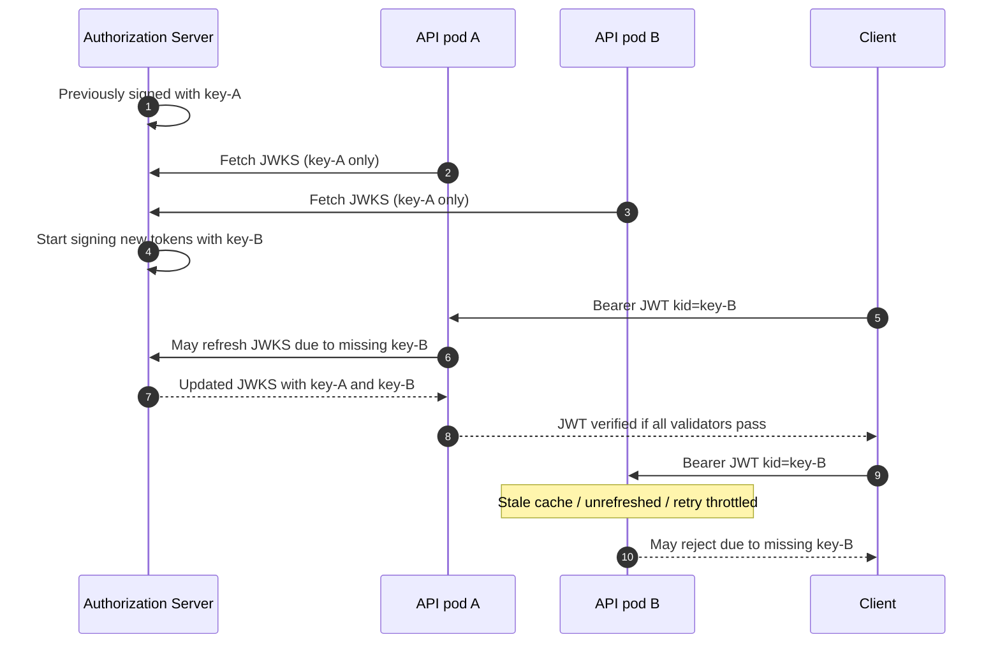
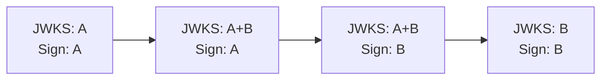

# Multiple API Nodes, Isolated Caches, and Behavior During Key Changes

When a system runs multiple instances of a **Spring Security OAuth 2.0 Resource Server**, every instance may trust the same Authorization Server yet **not necessarily observe the same JWK Set at the same instant**. Each instance can have its own `JwtDecoder`, its own key cache, its own startup time, and its own JWK Set fetch history.

This is why a newly issued JWT can be **accepted by API pod A yet rejected by pod B**, even when both pods share identical source code, issuer, and configuration. Failures typically surface right as the Authorization Server **rotates signing keys** (*key rotation*), when some caches have not yet learned the new public key or when the old public key was removed from the JWK Set too soon.

This lesson explains how to understand and design key lifecycles in a **multi-node API** architecture, covering:

- Distinguishing the Authorization Server's private signing key from the JWK public keys used by Resource Servers.
- How each `JwtDecoder` can cache the JWK Set independently.
- Behavior when a new `kid` appears, caches hold old keys, or the JWKS endpoint is slow or unreachable.
- Why rotation requires **pre-publishing the new key before use** and **retaining the old key long enough**.
- How to configure, operate, and observe Spring Security Resource Servers without relaxing JWT verification requirements.

Spring examples use **Spring Boot 3 / Spring Security 6** style. Caching, retry, timeout, and JWK Set reload details depend on the exact versions of Spring Security, Nimbus JOSE + JWT, and HTTP client/cache config; do not treat one TTL number or refresh behavior as invariant across all releases.

## 1. Context: One Issuer, Multiple Resource Server Instances

Suppose an `orders-api` service runs behind a load balancer:

```text
                       ┌──────────────────────────────────┐
                       │ Authorization Server             │
                       │ Signs JWTs with private key      │
                       │ Publishes public keys via JWKS   │
                       └────────────────┬─────────────────┘
                                        │ HTTPS /jwks
                  ┌─────────────────────┼─────────────────────┐
                  │                     │                     │
           ┌──────▼──────┐       ┌──────▼──────┐       ┌──────▼──────┐
           │ API pod A   │       │ API pod B   │       │ API pod C   │
           │ JwtDecoder  │       │ JwtDecoder  │       │ JwtDecoder  │
           │ JWK cache A │       │ JWK cache B │       │ JWK cache C │
           └──────▲──────┘       └──────▲──────┘       └──────▲──────┘
                  │                     │                     │
                  └─────────────────────┼─────────────────────┘
                                        │
                                  Load balancer
                                        │
                                      Client
```

Each pod shares the same issuer configuration, for example:

```yaml
spring:
  security:
    oauth2:
      resourceserver:
        jwt:
          issuer-uri: https://identity.example.com/realms/shop
```

However, **same issuer does not mean shared cache**. If A fetched the new JWK Set, B still holds the old copy, and C just started up, the three pods enter three different key states.

This divergence does not occur only on Kubernetes. It also occurs across:

- Multiple virtual machines behind a reverse proxy.
- Multiple Java processes on the same host.
- Multiple geographic regions, data centers, or clusters.
- Multiple `JwtDecoder` instances built for different filter chains or issuers within one process.

The unit you must observe is **the cache bound to the actual decoder validating requests**, not merely the host count.

## 2. How Do JWK, JWK Set, `kid`, and JWT Relate?

In the standard asymmetric signing model:

1. The Authorization Server holds the **private key** to sign JWT access tokens.
2. The Authorization Server publishes the corresponding **public key** via a JWK Set (*JWKS*) endpoint.
3. The Resource Server fetches the JWK Set from a trusted source, picks the matching public key, and **verifies the signature**.

A compact JWT has the form:

```text
base64url(header).base64url(payload).base64url(signature)
```

Example JWT header:

```json
{
  "alg": "RS256",
  "typ": "at+jwt",
  "kid": "shop-signing-2026-b"
}
```

Example payload:

```json
{
  "iss": "https://identity.example.com/realms/shop",
  "sub": "user-123",
  "aud": ["orders-api"],
  "scope": "orders.read",
  "exp": 1900000000
}
```

Both JSON blocks illustrate structure only; they are not a validly signed token.

An illustrative JWK Set:

```json
{
  "keys": [
    {
      "kty": "RSA",
      "kid": "shop-signing-2026-a",
      "use": "sig",
      "alg": "RS256",
      "n": "<public-modulus-of-key-a>",
      "e": "AQAB"
    },
    {
      "kty": "RSA",
      "kid": "shop-signing-2026-b",
      "use": "sig",
      "alg": "RS256",
      "n": "<public-modulus-of-key-b>",
      "e": "AQAB"
    }
  ]
}
```

Where:

| Component | Meaning | Security Note |
| --- | --- | --- |
| `kid` | Key identifier assisting key lookup inside the JWK Set. | Data inside the JWT header; **never proves** the token is trustworthy. |
| `alg` | Signing algorithm declared by the JWT. | Decoder must enforce an allowed algorithm list, never trusting every `alg` unconditionally. |
| `kty` | Key type, such as RSA or EC. | Must match the verification method. |
| `n`, `e` | RSA public key parameters. | Not the private key used to sign. |
| `iss` | Token issuer. | Must match the configured trusted issuer. |
| `aud` | Intended API/recipient. | Requires an audience validator per API contract. |

`kid` is normally meaningful **only within a specific key source/issuer context**. Never treat `kid` as a global identifier or dynamically fetch a JWK Set from an arbitrary client-supplied URL. An attacker can easily mint a token setting `kid = "shop-signing-2026-b"`; the decoder must still verify the signature and claims.

## 3. Lifecycles of Three Commonly Confused Things

When people say "key cache," separate three items:

| Component | Data Held | When It Must Update |
| --- | --- | --- |
| **Issuer metadata / discovery cache** | `issuer`, `jwks_uri`, related metadata. | When initializing an issuer-based decoder or as required by discovery mechanics. |
| **JWK Set cache** | Known set of public keys for the issuer. | When the cache needs refreshing, new keys appear, or cache policy dictates. |
| **JWT access token** | Signed credential carrying `exp` and permission claims. | Lives by its issuance/expiration lifecycle—**not a JWK Set entry**. |

Knowing `jwks_uri` **does not mean** the decoder holds every current public key. Having a public key that verifies a signature **does not mean** the token is unexpired or issued for `orders-api`.

Conversely, an expired JWT can still have a signature that checks out against a cached public key; the time validator will still reject it. **JWK caching never replaces `exp`, `iss`, `aud`, or authorization checks.**

## 4. How Does Each Instance Create Its Own JWK Cache?

In standard setups, each Spring Boot process builds a `JwtDecoder` in its `ApplicationContext`, and the JWT implementation uses the decoding library's JWK Set storage mechanism. Certain Nimbus/Spring Security versions cache the JWK Set in memory under a configured TTL/policy.

Snapshot at a single instant:

| Pod | Started | Current Cache | Notes |
| --- | --- | --- | --- |
| A | Many hours ago | Keys A and B | Refreshed after the issuer published B. |
| B | Many hours ago | Key A only | Has not refreshed since B was published. |
| C | Just started | Empty cache | May have to fetch JWKS on its first JWT request. |

In practice, which keys sit in cache depends on **when the pod fetched the JWKS**, not solely on startup time. If a pod receives zero Bearer requests for minutes, a lazy decoder may never have loaded keys yet. If another pod handles continuous JWT traffic, it may have refreshed multiple times.

Nodes do not share Java heap memory by default, so there is no automatic "A fetched key B, therefore B and C know it" unless the application or infrastructure introduces a shared cache or explicit key distribution layer.

### What Should You Never Assume?

- Never assume **JWKS cache TTL is always 5 minutes** across all versions; actual defaults vary by library and cache adapter.
- Never claim **encountering an unknown `kid` always triggers an immediate refresh**: behavior depends on implementation, cache state, cooldowns, and configuration.
- Never equate refreshing JWKS with "refreshing an access token"—they are completely different operations.
- Never assume adding more pods yields identical JWT verification across every pod right after a key rotation.

In operations, inspect the caching behavior of the **actual running decoder**, including TTL, refreshes, cache misses, negative caching, and network call throttling.

## 5. Common Incident: New Key B Exists, Yet Pod B Still Caches A

Suppose the Authorization Server initially signs JWTs only with private key A, while JWKS publishes public key A. Then the issuer switches to signing with B.

If the issuer **starts signing with B before Resource Servers have a chance to fetch public key B**, this can happen:



This illustrates **potential divergence across pods**, not a guarantee that Nimbus behaves identically in every version. One decoder might refresh on a missing `kid`; another might wait out a TTL/cooldown; network glitches can also fail a refresh.

To clients, the symptom looks like "first request 200, next request 401" simply because the load balancer routed to a replica unaware of the key. Still, **never jump to the conclusion that every 401 after rotation is a cache issue**: verify issuer, audience, signature, token expiry, allowed algorithms, and authorities too.

## 6. Safe Rotation: Publish First, Sign Second, Retire Old Key Last

For planned key changes, the standard strategy is **overlapping keys**:

1. **Prepare key B** in the key management system; private key B stays solely inside the Authorization Server or authorized signing service.
2. **Publish public key B in the JWKS** while the Authorization Server continues signing tokens with A.
3. **Wait a sufficient propagation window** so Resource Servers and edge caches can refresh the JWK Set and see B.
4. **Start signing new tokens with private key B**. Throughout transition, the JWKS retains both public keys A and B.
5. **Keep serving key A** as long as valid A-signed tokens can still arrive at APIs.
6. **Remove public key A only** after old tokens expire under policy plus an appropriate buffer.



Four states in the diagram:

| Phase | Key Signing New JWTs | Public Keys in JWKS | Goal |
| --- | --- | --- | --- |
| 1. Pre-rotation | A | A | Normal operation. |
| 2. *Pre-publish* | A | A + B | Resource Servers learn key B before it is used. |
| 3. *Overlap* | B | A + B | Both new B tokens and old A tokens can verify. |
| 4. *Retire* | B | B | Drop A only when no valid A tokens remain to support. |

**Reversing this order is a classic failure source.** If B starts signing before B appears in the JWKS, Resource Servers cannot verify new tokens. If A is dropped while A-signed tokens remain valid, pods refreshing the new JWKS start rejecting valid old tokens.

Pre-publishing is an operational safeguard, not absolute proof every pod has seen B. Newly booted pods, heterogeneous cache TTLs, or network blips can still leave a pod without B when signing starts. Pair it with monitoring and safe time buffers.

## 7. Sizing Overlap Windows from Both Time Directions

Overlap duration usually has **two halves**, and you should never pick one number out of habit:

**Before switching signing to B:** Wait for public key B to reach caches. This interval depends on TTL/refresh policies, CDNs/proxies, cross-region sync delays, network health, and unknown-`kid` handling.

**After stopping signing with A:** Retain public key A until the last A-signed token **is no longer eligible for use**, plus clock skew and a safety margin.

Hypothetical example:

```text
Max JWT access token lifetime:        15 minutes
Validator clock skew tolerance:        1 minute
Operational buffer for key removal:    4 minutes
```

If the issuer last signed a JWT with A at time `T`, a straightforward policy keeps public key A until **at least `T + 20 minutes`** under those assumptions. Formula:

```text
Retain A after last signature
  >= max lifetime of last A token
   + accepted clock skew
   + propagation/operational margin
```

This **does not mean every system needs 20 minutes**. If longer-lived A tokens exist, tokens are issued across regions, rollouts lag, batch jobs mint tokens, or clocks drift, you must use the **actual maximum lifetime** of tokens needing support.

The *pre-publish B* duration must instead be sized around **how long Resource Servers take to update caches**. Never use token lifetime in place of the cache refresh window: one governs **old tokens**, the other governs **new keys**.

## 8. Why Can Pods Hit Two Opposite Errors During One Rotation?

During an A-to-B switch, two request patterns occur simultaneously:

| Incoming Token | Pod Cache State | Possible Outcome |
| --- | --- | --- |
| New JWT, `kid = B` | Cache has A only | Public key B not found; needs refresh or rejects. |
| New JWT, `kid = B` | Cache has A + B | Can verify signature with B. |
| Old JWT, `kid = A`, unexpired | Cache has A + B | Continues verifying with A. |
| Old JWT, `kid = A`, unexpired | Cache has B only because A was removed too early | Missing key A; risks rejecting valid tokens. |
| Old JWT, `kid = A`, expired | Cache still has A | **Must still reject** via time validator. |

"Missing new key B" errors appear **right after the issuer begins signing with B**. "Missing old key A" errors appear **after the issuer removes A from the JWKS**. They are two separate issues with different fixes.

In neither case may the API **skip signature verification** just because the issuer is rotating keys. Keep the old key only as long as policy trusts it and it has not been flagged as compromised.

## 9. Unknown `kid`: Should the JWK Set Always Refresh Immediately?

When receiving a JWT whose header `kid` is absent from cache, the decoder may want to reload the JWKS in case the issuer just rotated keys. Yet `kid` is **caller-supplied input**, so an attacker could send thousands of JWTs with random `kid` values to trigger outbound requests against the JWKS endpoint.

That is why refresh-on-unknown-key needs sensible policy:

- The decoder contacts **only the configured trusted JWK Set URI or one discovered from a trusted issuer**, never a URL nominated by the JWT.
- Enforce timeouts, caching, rate limits/cooldowns, or fetch throttling within library capabilities.
- Never turn arbitrary unseen `kid` values into unbounded-cardinality metric labels, risking monitoring overload.
- When no matching public key exists, **never let the request pass**; a failed refresh is never a reason to trust a payload.
- Verify cache-miss behavior for your exact **implementation and version** rather than assuming every library refreshes unconditionally.

Example flow:

```text
Bearer JWT with unknown kid
    -> look up key in decoder cache
    -> if missing: attempt refresh per decoder policy
    -> if updated JWKS has matching key: verify signature + claims
    -> otherwise: fail authentication safely
```

Remember that finding a key matching `kid` **is only key lookup**. The JWT still must pass signature verification, issuer, expiration, audience, and remaining checks.

## 10. Spring Boot Resource Server: Baseline Multi-Pod Configuration

Dependencies for a Servlet application:

```gradle
dependencies {
    implementation 'org.springframework.boot:spring-boot-starter-security'
    implementation 'org.springframework.boot:spring-boot-starter-oauth2-resource-server'
}
```

Issuer-based JWT configuration:

```yaml
spring:
  security:
    oauth2:
      resourceserver:
        jwt:
          issuer-uri: https://identity.example.com/realms/shop
```

A `SecurityFilterChain` authenticating Bearer JWTs and requiring scopes:

```java
import org.springframework.context.annotation.Bean;
import org.springframework.context.annotation.Configuration;
import org.springframework.http.HttpMethod;
import org.springframework.security.config.Customizer;
import org.springframework.security.config.annotation.web.builders.HttpSecurity;
import org.springframework.security.config.http.SessionCreationPolicy;
import org.springframework.security.web.SecurityFilterChain;

@Configuration
public class ApiSecurityConfig {

    @Bean
    SecurityFilterChain apiSecurity(HttpSecurity http) throws Exception {
        return http
            .securityMatcher("/api/**")
            .csrf(csrf -> csrf.disable())
            .sessionManagement(session -> session
                .sessionCreationPolicy(SessionCreationPolicy.STATELESS))
            .authorizeHttpRequests(auth -> auth
                .requestMatchers(HttpMethod.GET, "/api/orders/**")
                    .hasAuthority("SCOPE_orders.read")
                .anyRequest().denyAll())
            .oauth2ResourceServer(oauth2 -> oauth2
                .jwt(Customizer.withDefaults()))
            .build();
    }
}
```

In this setup, the decoder typically uses Spring Security's issuer/JWK Set metadata mechanics, and **each pod can maintain its own isolated key cache**. Spring Boot does not automatically create a "cluster-wide JWKS cache" simply because multiple replicas share `issuer-uri`.

`SecurityFilterChain` protects only URLs matching `/api/**`; other endpoints need their own chain or fallback policy. `csrf.disable()` here assumes a stateless API using explicit `Authorization` Bearer headers rather than browser-sent session cookies; session/cookie apps require separate CSRF design.

### Identical YAML Config Does Not Guarantee Uniform Runtime Results

Even if pods share **the same container image and environment**, JWT verification still depends on:

1. Whether the pod has the right decoder and issuer validation active.
2. Whether the pod has fetched the JWKS yet, and which keys sit in its cache.
3. Whether the JWKS endpoint returns identical data across CDNs, regions, and proxies.
4. Whether the pod can reach the endpoint across DNS, TLS, proxies, and network policies.
5. Whether pod clocks are synchronized closely enough for `exp`/`nbf`.
6. Whether pods run identical library versions and cache policies, especially during rolling deployments.

Consequently, not every `401` discrepancy across pods stems from rotation. It can stem from **config validation, clock drift, network reachability, or runtime version differences**.

## 11. When the JWK Set URI Is Known: Separating Discovery from Key Fetching

A deployment may obtain the issuer URI from the Authorization Server while already knowing the trusted JWKS URL:

```yaml
spring:
  security:
    oauth2:
      resourceserver:
        jwt:
          issuer-uri: https://identity.example.com/realms/shop
          jwk-set-uri: https://identity.example.com/realms/shop/keys
```

In supporting Spring Boot/Spring Security configurations, `jwk-set-uri` supplies a **direct JWKS path**, avoiding metadata discovery just to look up the key URL. `issuer-uri` remains needed for `iss` claim validation.

However:

- New pods may still need to fetch public keys when the first JWT arrives.
- Key rotation still requires JWKS refreshes and overlap windows.
- Direct `jwk-set-uri` **does not create a shared cache** across pods.
- If setting `jwk-set-uri` without `issuer-uri`, never assume `iss` is automatically checked against your expected issuer; attach an explicit contract validator.

Changing configuration to avoid startup discovery dependencies **does not solve key distribution**. It changes only how the Resource Server learns where to fetch the JWK Set.

## 12. Custom `JwtDecoder`: Preserving Validators When Customizing Keys and Caching

If you need explicit control over the HTTP client, key source, cache, or audience, define a custom `JwtDecoder` bean. The example below builds a decoder from a trusted JWKS URI with issuer and audience validation:

```yaml
app:
  security:
    issuer: https://identity.example.com/realms/shop
    jwks-uri: https://identity.example.com/realms/shop/keys
    audience: orders-api
```

```java
import java.util.List;

import org.springframework.beans.factory.annotation.Value;
import org.springframework.context.annotation.Bean;
import org.springframework.context.annotation.Configuration;
import org.springframework.security.oauth2.core.DelegatingOAuth2TokenValidator;
import org.springframework.security.oauth2.core.OAuth2TokenValidator;
import org.springframework.security.oauth2.jwt.Jwt;
import org.springframework.security.oauth2.jwt.JwtClaimValidator;
import org.springframework.security.oauth2.jwt.JwtDecoder;
import org.springframework.security.oauth2.jwt.JwtValidators;
import org.springframework.security.oauth2.jwt.NimbusJwtDecoder;

@Configuration
public class TokenValidationConfig {

    @Bean
    JwtDecoder jwtDecoder(
            @Value("${app.security.issuer}") String issuer,
            @Value("${app.security.jwks-uri}") String jwksUri,
            @Value("${app.security.audience}") String audience) {

        NimbusJwtDecoder decoder =
            NimbusJwtDecoder.withJwkSetUri(jwksUri).build();

        OAuth2TokenValidator<Jwt> defaults =
            JwtValidators.createDefaultWithIssuer(issuer);

        OAuth2TokenValidator<Jwt> audienceValidator =
            new JwtClaimValidator<List<String>>(
                "aud",
                values -> values != null &&
                    values.contains(audience));

        decoder.setJwtValidator(
            new DelegatingOAuth2TokenValidator<>(
                defaults,
                audienceValidator));

        return decoder;
    }
}
```

Here:

- `withJwkSetUri(jwksUri)` configures **the public key source**; it does not handle claim validation by itself.
- `JwtValidators.createDefaultWithIssuer(issuer)` preserves standard validators and issuer verification.
- The `aud` validator ensures tokens target `orders-api`, not another API under the same issuer.
- JWK Set caching remains handled by the configured decoder/Nimbus setup, not by services/controllers caching tokens.

In this example, defining a custom bean typically causes Spring Boot to **back off** from auto-configuring the default `JwtDecoder`. If Boot previously used lazy issuer discovery, remember your custom decoder behaves according to the **factory and cache you wire**—do not infer its behavior from unused YAML properties.

If your Boot version supports configuring audiences via properties and you need no custom decoder, auto-configuration may be simpler. Whenever a custom decoder is present, the application owns preserving every required validator.

## 13. Should You Use a Cluster-Wide Shared JWKS Cache?

Because pods maintain isolated caches, teams sometimes consider moving JWKS into Redis or a shared cache. This is an **architectural trade-off**, not a Spring Security requirement.

| Criterion | Per-Pod Independent Cache | Shared Cache via Intermediate Infrastructure |
| --- | --- | --- |
| Hit latency | Typically in-memory within the pod. | Adds a network hop or an extra local cache tier. |
| Independence | Pods do not depend on a shared cache service. | Depends on shared cache availability. |
| Rotation | Pods may observe new keys at slightly different times. | Can synchronize key data if refresh/invalidation is well designed. |
| Load on JWKS endpoint | Can burst when many pods refresh simultaneously. | Can reduce fetches if paired with single-flight/coordination. |
| Failure blast radius | Isolated per pod; outages may affect only a subset. | Stale or broken centralized cache affects the whole cluster at once. |
| Complexity | Usually simple, using standard library defaults. | Requires designing TTLs, per-issuer cache keys, invalidation, and trust boundaries. |

**A shared cache is not automatically "more accurate."** If every pod reads the same stale JWKS entry without a sound refresh path, the whole cluster misses the new key together. If a shared cache mixes data across two issuers, the blast radius is worse than isolated caches.

In many systems, **pre-publishing new keys early and retaining old keys long enough** is simpler and easier to operate than building a custom shared cache. A shared cache pays off when running very large instance counts, high traffic, strict JWKS rate limits, or centralized key-sync requirements.

### If Using a Shared Cache, Cache Keys Must Be Unambiguous

Never use `kid` alone as the cache key:

```text
Wrong: jwk-cache["key-42"]
```

Two issuers can both use `kid = key-42` with completely different public keys. At minimum, scope by **trusted issuer/JWKS source**, algorithm policy, and token acceptance context:

```text
issuer + jwksUri -> JWKS belonging to that specific issuer
```

Cache management must respect trust boundaries: cache only public keys retrieved from trusted sources, never a JWK Set supplied by an external HTTP request.

## 14. Synchronized Refreshes: The "Thundering Herd" Risk

A 100-pod cluster can receive JWTs carrying a new `kid` all at once. If all 100 pods immediately call the JWKS endpoint, the Authorization Server or CDN sees **a sudden traffic spike**. Severity worsens when:

- All pods just rolling-restarted with empty caches.
- Cache TTLs across many pods expire around the same time.
- The issuer enforces tight connection or request limits.
- Network latency between the cluster and issuer is high.
- Clients or attackers stream JWTs with random `kid`s.

Illustrative load:

```text
100 pods x 1 JWKS fetch/pod ~= 100 fetches in a brief window
```

This illustrates potential burst traffic, not a guarantee of exact request counts: a pod skips fetching if its cache holds the key, or fetches more than once if retries/refresh policies allow.

Mitigations at scale:

1. Pre-publish new public keys before the issuer starts signing with them.
2. Avoid flushing caches or restarting all pods simultaneously during rotation.
3. Configure timeouts, connection pooling, cache cooldowns, and concurrent-refresh coalescing where supported.
4. Put a resilient CDN or scalable JWK Set endpoint in front, while bounding propagation lag.
5. Use a shared cache/single-flight fetch when benefits justify it and trust boundaries are well defined.
6. Monitor per-pod auth failure rates and JWKS fetch errors to spot cache drift.

**Never weaken JWT verification or accept unverified signatures** as a "quick fix" for a JWKS burst.

## 15. When the JWKS Endpoint or Authorization Server Temporarily Disconnects

Across multiple pods, a JWKS outage impacts requests unevenly:

| Pod State | Incoming Token | Possible Behavior |
| --- | --- | --- |
| Cache holds matching public key still eligible per policy | JWT signed with known key | Can keep verifying locally. |
| Cache lacks matching key | JWT signed with new key | Cannot verify while JWKS is unreachable. |
| Cache invalidated or expired and requires reload | JWT using previously known key | May fail if decoder policy forbids using expired cache entries. |
| Fresh pod that has never loaded JWKS | Any JWT needing key lookup | May fail on its first authentication request. |

**Never claim "JWT validation always works offline"** merely because the signature algorithm is asymmetric. Mathematically, JWT verification requires no network **once you already hold the matching public key and required validators**. Fetching and refreshing keys still require the network when caches fall short.

An invalid-signature token error differs from an infrastructure key-fetch failure. Exact HTTP statuses depend on Spring Security version, decoder, and exception handlers: invalid tokens normally yield `401`, whereas JWKS/discovery outages should be surfaced as authentication infrastructure incidents. In every case, **never turn a network outage into accepting unverified tokens**.

### Should Old Keys Be Kept Past Cache Expiration?

This is a security decision driven by your threat model and issuer policy:

- Retaining old keys longer keeps services running during brief issuer outages.
- Yet an old key may have been **revoked due to compromise** or dropped from the issuer's trust set.
- Libraries differ in caching policies; never hack a decoder to ignore cache expiry purely to boost availability.

If *stale-while-revalidate* is required, enforce strict time caps, trusted origins, monitoring, and explicit **key revocation** overrides. For a key known to be untrusted, security may require **rejecting immediately**, accepting the availability trade-off.

## 16. Routine Rotation vs. Compromised Key Are Two Different Scenarios

**Planned rotation**: private key A remains trustworthy, yet the system transitions smoothly to B. Pre-publish B, switch signing to B, and retain A until old tokens expire.

**Compromise or suspected leak of private key A**: A is no longer trustworthy. Keeping A alive for old tokens lets attackers forge arbitrary JWTs under key A. Security may require removing A rapidly, blocking affected tokens, issuing fresh tokens, and requiring users/services to re-authenticate.

| Scenario | Priority | Typical Action |
| --- | --- | --- |
| Routine rotation | Avoid disrupting valid traffic. | Pre-publish B, overlap A+B, retire A after A tokens expire. |
| Compromised signing key A | Stop trusting A quickly per incident plan. | Stop signing with A, remove/deny A per policy, issue B, handle issued A tokens. |
| Temporary JWKS outage | Preserve auth integrity, limit impact within policy. | Serve valid cached keys per policy; bounded retries; monitor and restore endpoint. |

**Removing public key A from the JWKS does not instantaneously stop every pod from accepting A-signed JWTs**: some pods still cache A. Emergency revocation requires push/cache invalidation or dedicated controls—such as key-ID/key-fingerprint denylists, rejecting affected issuers/profiles, or controlled decoder replacement/restarts depending on architecture.

Furthermore, rotating signing keys **is not the same as revoking individual access tokens**. A validly signed JWT remains accepted until expiration unless extra revocation controls exist. Immediate per-token revocation needs dedicated design (short token lifetimes, introspection/token status, denylists, or policy engines), not just JWKS updates.

## 17. Key Rotation Must Not Drop Issuer/Audience Validation

In Spring Security, `JwtDecoder` decodes and verifies JWTs, while downstream components map claims to `Authentication` and enforce authorization. Whenever adjusting decoders or caches for rotation, **preserve all validators**:

```text
Bearer JWT
  -> select key source from trusted issuer
  -> pick matching key in JWK Set
  -> verify signature and algorithm
  -> validate iss, exp, nbf, aud, and token profile
  -> create Authentication + authorities
  -> check scope/role and owner/tenant
```

Suppose a token is signed with new key B yet carries:

```json
{
  "iss": "https://identity.example.com/realms/shop",
  "aud": ["analytics-api"],
  "scope": "analytics.read"
}
```

If that request hits `orders-api`, it **must not be accepted** just because public key B is cached. Each Resource Server must validate audience per its own contract.

Similarly, Spring Security producing a `JwtAuthenticationToken` with `sub = user-123` does not authorize reading another user's orders. JWT authentication and resource authorization remain two separate layers.

## 18. Observing the Cluster During Rotation

When errors affect only some pods, correlate by **pod + timestamp + issuer + refresh status**. A useful operational telemetry set includes:

| Signal | Why It Matters |
| --- | --- |
| Authentication success/failure rate per pod | Detects replicas behaving inconsistently. |
| Decoder failure reason: missing key, bad signature, invalid `iss`/`aud`/`exp` | Separates cache/JWKS lag from bad tokens or misconfiguration. |
| JWKS fetch counts, latency, timeouts, HTTP statuses | Spots failed refreshes and network bursts. |
| Timestamp of last successful JWKS refresh | Identifies pods holding stale data. |
| Issuer and config/library version | Avoids confusing cache lag with mixed configs during rolling deploys. |
| Newly started instances and cache-miss spikes | Surfaces impact of autoscaling or rolling restarts. |
| Clock sync health | Separates clock-driven `exp`/`nbf` errors from key errors. |

Not all of these metrics exist out of the box in Spring Security; you may need instrumentation on HTTP clients, cache wrappers, or infrastructure. **Never log raw Bearer tokens or private keys.** Be careful with `kid`: it comes from an unverified JWT header, so while useful for diagnostics, never turn it into an unbounded-cardinality metric label.

Example controlled log entry:

```text
time=...
service=orders-api
pod=orders-7d8f9c-abc
issuer_config=shop
stage=jwt_verification
reason=signing_key_not_available
jwks_fetch=timeout
trace_id=...
```

Never log raw JWT payloads containing personal data, `Authorization` headers, or introspection credentials. Use trace IDs or request IDs to correlate requests.

## 19. Distinguishing Authentication vs. Authorization Errors During Rotation

A client reporting "API returns 200 sometimes, 403 sometimes, 401 sometimes" is not enough to blame the JWK cache:

| Outcome | Likely Cause | Investigation Path |
| --- | --- | --- |
| `401 Unauthorized` | Invalid token, wrong issuer/audience, expired, or decoder lacks matching key. | Check decoder, claim validators, and pod JWKS state. |
| `403 Forbidden` | Authenticated token lacking authority, policy denial, or unauthorized caller. | Check `scope`, roles, converter, and endpoint/domain policy. |
| `404 Not Found` | API may intentionally hide records outside owner/tenant. | Check data authorization; do not assume a cache bug. |
| `5xx` | Network/discovery/JWKS outage or unrelated app error depending on exception handling. | Inspect failure stage and upstream dependencies. |
| `2xx` | Token passed both authentication and authorization. | Normal outcome; never use isolated 2xxs to assume every pod refreshed. |

In OAuth 2.0 Bearer auth, authentication failures typically emit `WWW-Authenticate: Bearer`, often with `invalid_token`. Still, exact HTTP status for **failing to fetch keys during an outage** depends on implementation and handlers; categorize errors in logs rather than guessing from HTTP status alone.

## 20. Testing Multi-Pod Rotation

Before rotating keys in production, build test scenarios reproducing diverging cache states:

| Test Scenario | Simulated State | What Must Be Proven |
| --- | --- | --- |
| Pod A refreshed, Pod B did not | Diverging caches. | New JWTs using B do not cause prolonged outages beyond the planned window. |
| Pre-publish B, keep signing with A | JWKS A+B, new tokens still A. | A tokens work on all pods; B is already fetchable. |
| Switch signing to B during overlap | JWT A and JWT B coexist. | Pods verify both A and B per policy without skipping validation. |
| Remove A while A JWTs remain valid (simulated misstep) | Refreshed pod caches hold B only. | Surfaces risk of rejecting valid A tokens. |
| JWKS endpoint goes down mid-rotation | Some pods cached, some not. | Rejects unverifiable tokens and reports dependency failure. |
| Many pods restart together | Widespread empty caches. | JWKS infra absorbs load or burst controls hold. |
| Issuer emits unseen `kid` | Cache miss. | Bounded refresh attempt; invalid signatures still rejected. |
| Flood of JWTs with random `kid`s | Malicious input. | Does not trigger unbounded JWKS traffic or metric cardinality explosions. |
| Valid signature, wrong audience | Audience validator triggers. | Rejected even when key is present. |
| Expired A JWT while cache still holds A | Old key still cached. | Expired token rejected on timestamp checks. |

These are **test design scenarios**, not instructions to run risky rotation experiments directly in production. Use mock issuers/JWK Sets in integration tests with dedicated test RSA key pairs A/B, or a staging Authorization Server supporting rotation drills.

The Spring Security Test MockMvc helper `jwt()` creates a mock principal and typically **skips real signature/decoder checks**. Thus `jwt()` tests validate authorization well, yet **cannot prove** JWK caching, key rotation, or JWKS fetching across pods. Test real tokens flowing through the decoder to evaluate those behaviors.

## 21. Multi-Node Rotation Rollout Runbook

An operational runbook can organize milestones with pre-agreed owners and timings:

**Before rotation**

1. Inventory issuers, `jwks_uri`s, Resource Server clusters, and running decoder/cache versions.
2. Confirm maximum JWT lifetime for key A, clock skew, and affected token profiles.
3. Confirm cache TTL/refresh behavior, edge caches/CDNs, and cross-region JWKS propagation times.
4. Confirm per-pod JWT failure and JWKS fetch error metrics, plus a controlled rollback plan.
5. Prepare private/public key B per key-storage policy; **never place private keys on Resource Servers**.

**Executing planned rotation**

1. Publish **public key B** in the JWKS alongside A.
2. Wait for observed propagation across caches; where feasible, verify pod groups can fetch the updated JWKS.
3. Switch the Authorization Server to **sign new JWTs with B**.
4. Monitor `kid = B` tokens across pod groups/regions, JWT error rates, and JWKS fetch errors.
5. Keep **public key A** published for remaining unexpired A tokens.
6. After the expiration window and safety margin, remove A cleanly and continue monitoring.

**After rotation**

1. Verify new B tokens succeed on both older and newer pods.
2. Verify expired A tokens are properly rejected.
3. Confirm the JWKS no longer serves retired keys per schedule.
4. Record propagation, refresh, and error metrics, and refine the runbook for future rotations.

During a **compromise**, never follow the overlap schedule mechanically. Incident response must prioritize purging the untrusted key under emergency procedures, even if old tokens break.

## 22. When Should You Change the Caching Architecture?

Not every cluster needs a shared JWKS cache. Choose based on real operational demands:

**Keep local caches** when pod counts are moderate, the JWKS endpoint has headroom, rotations are planned, and refresh skew is absorbed by pre-publish/overlap.

**Consider a centralized cache or JWKS proxy** when running thousands of instances, facing tight fetch limits, spanning many regions, or requiring synchronized key distribution. That proxy/cache must safeguard integrity, TTLs, issuer provenance, tenant isolation, and emergency key removal.

**Consider other revocation mechanisms** when the requirement is not "pods must learn a new public key" but "immediately reject a revoked token or key." That calls for short token lifetimes, introspection, denylists, or online authorization checks—not routine JWKS refreshes.

**Consider reducing startup discovery dependencies** when services must boot independently of the Authorization Server. Pairing `issuer-uri` with `jwk-set-uri` or using a lazy decoder avoids some early startup coupling, though it does not eliminate ongoing JWKS fetching and rotation needs.

## 23. A Mental Model for Troubleshooting Any JWK Incident

Instead of immediately asking "when does the cache expire?", separate three layers:

```text
LAYER 1 — TRUST SOURCES
  Which issuers does the API accept?
  Which JWKS URIs and verification algorithms are allowed?

LAYER 2 — PER-NODE KEY STATE
  Which public keys does this pod currently hold?
  Does it have a key matching this JWT?
  What were the latest fetch/refresh times and network errors?

LAYER 3 — JWT AND RESOURCE POLICY
  Are signature, iss, exp, nbf, and aud valid?
  Are scopes/roles sufficient?
  Does the subject have permission on this owner/tenant/record?
```

Two pods can diverge at **Layer 2** even when identical at Layers 1 and 3. Meanwhile, a wrong-audience token fails at **Layer 3** on both pods even after both have loaded public key B.

**Bottom line:** In multi-node Resource Servers, JWK Set caches are typically isolated per decoder/instance, so rotations create a **non-uniform key-visibility window**. The primary safeguards are **pre-publishing new keys, overlapping old and new keys, keeping old keys until old tokens expire, monitoring per-pod refreshes, and always failing closed when a JWT cannot be verified**. Shared caches, CDNs, retries, and warm-ups are scaling aids—never substitutes for validating issuer, signature, audience, lifetime, and resource permissions.
