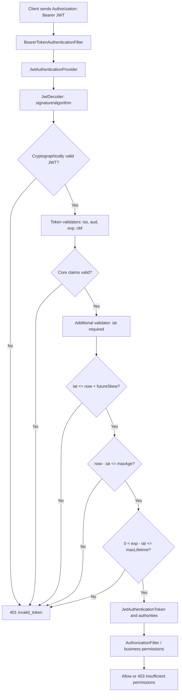

# `iat`, Token Age, and Contract-Based Additional Policies

In a **Spring Security OAuth 2.0 / OIDC Resource Server** system, verifying a JWT's signature only tells you that the token was not modified by someone without the signing key. A validly signed access token can still be unsuitable for acceptance if it is **too old**, claims to have been **issued in the future**, has a longer lifetime than the contract permits, or fails to satisfy API-specific rules.

The **`iat` (Issued At)** claim provides the timestamp used to interpret when the token was issued. Combined with the current time, `exp`, and Authorization Server/Resource Server policies, `iat` can support checking **token age**, **maximum issued lifetime**, and additional operational constraints.

However, **`iat` is not the time the user logged in**, does not prove the token has not been revoked, and does not automatically enforce token age limits. Those guarantees require an explicit contract and corresponding validators.

> **Illustrative context:** The Authorization Server has issuer `https://login.example.com`, and the Resource Server is the Orders API with audience `orders-api`. A client calls `GET /api/orders/42` using a bearer access token with scope `orders.read`. Java examples use Spring Security 6.x with a Servlet Resource Server and signed JWTs.

## 1. The Role of `iat` in the JWT Validation Contract

A JWT includes registered claims such as `iss`, `sub`, `aud`, `exp`, `nbf`, `iat`, and `jti`. The three time-related claims most commonly confused are:

| Claim | Name | Meaning | Question Asked During Resource Server Validation |
|---|---|---|---|
| **`iat`** | Issued At | Timestamp at which the issuer declares the token was issued. | When was the token issued? Is it too old or in the future? |
| **`nbf`** | Not Before | Must not be accepted before this timestamp. | Has the time arrived when the token becomes valid? |
| **`exp`** | Expiration Time | Must not be accepted on or after expiration, excluding a small clock skew if permitted. | Has the token expired? |

These three claims **cannot replace one another**:

- `iat` **does not establish an expiration limit on its own**. A token with `iat` and no `exp` does not automatically expire by age unless an additional policy enforces it.
- `exp` tells when a token expires but does not guarantee it was recently issued. A token with `exp` in the future could have an `iat` from long ago.
- `nbf` tells when the token **starts being accepted**, not when it was issued.
- `iat` is part of the JWT payload asserted by the issuer. The Resource Server should only trust claims after verifying the signature and foundational checks.

### 1.1. Is `iat` Required?

In **RFC 7519 (JWT)**, `iat` is an **optional** registered claim; the application decides which claims are required by contract.

In **RFC 9068 (JWT Profile for OAuth 2.0 Access Tokens)**, `iat` is part of the **required** claim set alongside `iss`, `exp`, `aud`, `sub`, `client_id`, and `jti`.

Therefore:

- A Resource Server accepting **RFC 9068 JWTs** must ensure the `iat` claim is present according to the token profile.
- A Resource Server using a **custom or legacy JWT profile** must specify whether `iat` is required or optional and what happens when it is missing.
- Do not assume every JWT decoder automatically rejects tokens missing `iat`. A default decoder/validator may focus on signature, `exp`, `nbf`, and issuer without enforcing a business **token age** policy.

## 2. NumericDate: The Time Unit of `iat`

Per RFC 7519, standard time claims use **NumericDate**: the number of seconds since `1970-01-01T00:00:00Z` (UTC), not milliseconds. NumericDate may have a fractional part per the standard definition; many issuers in practice emit integers.

Example JWT payload:

```json
{
  "iss": "https://login.example.com",
  "sub": "user-42",
  "aud": ["orders-api"],
  "iat": 1763208000,
  "nbf": 1763208000,
  "exp": 1763208900,
  "scope": "orders.read"
}
```

These values are illustrative data only. Each claim's meaning must be interpreted in **UTC seconds** after the decoder verifies the JWT; do not compare `System.currentTimeMillis()` directly against NumericDate without unit conversion.

In Java:

```java
import java.time.Instant;

Instant issuedAt = Instant.ofEpochSecond(1763208000L);
Instant expiresAt = Instant.ofEpochSecond(1763208900L);

System.out.println(issuedAt);
System.out.println(expiresAt);
```

In Spring Security, `Jwt#getIssuedAt()` and `Jwt#getExpiresAt()` expose these timestamps as `Instant` when the corresponding claims are properly parsed.

**Avoid:** using the user's or server's timezone to decide whether a token is too old. Always compute on `Instant`/UTC; timezones only apply when **displaying** time.

## 3. Three Distinct Time Checks

There are three common comparisons; they serve three distinct goals.

### 3.1. Expiration Check: `now` vs. `exp`

Foundational condition:

```text
now < exp
```

By definition of `exp`, once the current time reaches or exceeds `exp`, the token is not accepted, except for a small **clock skew/leeway** permitted by the validator.

Examples:

- `now = 12:00`, `exp = 12:05`: not expired.
- `now = 12:05`, `exp = 12:05`: reached expiration time.
- `now = 12:06`, `exp = 12:05`: expired; a recent `iat` cannot "extend" `exp`.

In practice, Spring Security can apply a small clock skew to compensate for clock drift. This is a bounded technical validation exception and **should not** be used to significantly extend token lifetime.

### 3.2. Token Age Check: `now - iat`

**Token age** is the elapsed duration from when the token claims to have been issued to when the Resource Server evaluates it:

\[
\text{tokenAge} = \text{now} - \text{iat}
\]

If the contract permits a maximum age `maxAge`, the age acceptance condition is typically:

```text
iat >= now - maxAge
```

Suppose `maxAge = 10 minutes`:

| `iat` Relative to Now | Token Age | Age Check Result |
|---|---:|---|
| 2 minutes ago | 2 minutes | Pass |
| 9 minutes ago | 9 minutes | Pass |
| 15 minutes ago | 15 minutes | **Fail** |
| 1 minute after current time | -1 minute | Requires future-issued-at check |

A token **whose `exp` is still in the future** can still be rejected because `now - iat` exceeds `maxAge`. This is a stricter policy than checking `exp` alone.

### 3.3. Issued Lifetime Check: `exp - iat`

**Declared lifetime at issuance** is calculated as:

\[
\text{issuedLifetime} = \text{exp} - \text{iat}
\]

If the contract requires that tokens not be issued for longer than `maxLifetime`:

```text
exp > iat
exp - iat <= maxLifetime
```

Example with `maxLifetime = 15 minutes`:

- `iat=12:00, exp=12:10`: 10-minute issued lifetime, compliant.
- `iat=12:00, exp=13:00`: 60-minute issued lifetime, **non-compliant**, even if the request arrives at 12:01 and the token has not expired.
- `iat=12:05, exp=12:00`: anomalous time relationship; reject because `exp <= iat`.

This policy is particularly useful when a Resource Server wants to detect an Authorization Server issuing access tokens **longer than agreed** due to misconfiguration or an incident.

### 3.4. Comparing the Three Checks

| Check | Formula | Purpose |
|---|---|---|
| Not expired | `now < exp` | Is the token still valid at validation time? |
| Age within limit | `now - iat <= maxAge` | Was the token issued recently enough under API policy? |
| Issued lifetime within limit | `exp - iat <= maxLifetime` | Did the issuer mint a token longer-lived than the contract allows? |

All three can be enabled together. **`maxAge` and `maxLifetime` are not the same value.** A token with a 60-minute lifetime at 2 minutes of age still passes `maxAge=10m`; a `maxLifetime=15m` policy rejects it immediately because its issued lifetime is 60 minutes.

## 4. Timeline Diagram

Suppose an access token is issued at 11:50, becomes valid at 11:51, and expires at 12:20; the system requires `maxAge=10m`.

```text
UTC:      11:50       11:51        12:00         12:10       12:20
           |-----------|-------------|-------------|-----------|
           iat         nbf           |             |           exp
                                     |             |
                                 age 10m       age 20m
                                 just reached  exceeds maxAge
```

At 12:10, the token **has not expired according to `exp`** yet **exceeds the allowed age**. If only `JwtTimestampValidator` checking `exp/nbf` is enabled, the token can still pass the timestamp check. A **dedicated validator for `iat/maxAge`** is needed if the contract requires it.

For `iat` in the future—for instance, the Resource Server clock reads 12:00 while `iat` is 12:05—simply computing `now - iat` yielding a negative number is not enough to decide. You need an explicit **future-issued-at** policy.

## 5. Future `iat` and Clock Skew

### 5.1. Why Can `iat` Be After `now`?

Several legitimate or anomalous causes exist:

- The Authorization Server clock runs faster than the Resource Server clock.
- Two hosts/nodes are not time-synchronized.
- The client/issuer has a seconds ↔ milliseconds conversion bug.
- The token was generated using simulated/test time and leaked into a real environment.
- The issuer emitted an incorrect timestamp claim.
- Key compromise or issuer misconfiguration produced non-compliant timestamps.

A validator may allow a **very small future skew**, such as 30 seconds:

```text
iat <= now + allowedFutureSkew
```

If `now=12:00:00Z` and `allowedFutureSkew=30s`:

| `iat` | Assessment |
|---|---|
| `11:59:50Z` | In the past; proceed with normal age check |
| `12:00:15Z` | 15 seconds in the future; acceptable under policy |
| `12:01:00Z` | 60 seconds in the future; **reject** |
| `13:00:00Z` | Large discrepancy; likely a clock or token issue |

Choose skew based on acceptable clock drift in your infrastructure. The 30-second figure is an example, **not a universal OAuth/JWT requirement**.

### 5.2. Time Synchronization Beats Relaxing Policy

Token-issuing and token-verifying systems should:

1. Sync UTC via a trusted infrastructure time service.
2. Monitor clock drift across nodes, VMs, and containers.
3. Evaluate `iat`, `nbf`, and `exp` on a consistent `Instant` standard.
4. Use a small, configured, and observable skew.
5. Never raise skew to hours just to "fix" broken tokens.

Excessive clock skew can keep expired tokens valid longer than intended or allow tokens with far-future `nbf` values to be used prematurely.

### 5.3. Distinguishing Three Types of Leeway

- **`exp` leeway:** may accept recently expired tokens for a brief window, depending on the validator.
- **`nbf` leeway:** may accept tokens slightly before their validity window begins.
- **`iat` future skew:** only permits an issuance timestamp slightly in the future; this is a **custom policy**, and you cannot assume clock skew settings in every library automatically cover `iat`.

For strict APIs, thresholds should align in intent and be documented in the contract. Do not pick thresholds merely to silence failing tokens without understanding why they fail.

## 6. `iat` Differs from `auth_time` in OIDC

A misconception with major security impact is treating **"newly issued token"** as equivalent to **"user recently re-authenticated"**.

| Claim | Context | Meaning |
|---|---|---|
| `iat` | JWT / JWT access token | When the **token** was issued by the issuer. |
| `auth_time` | OIDC and profiles using this claim | When the **user actually authenticated** at the OpenID Provider. |
| `exp` | JWT | Token expiration time. |
| `max_age` | OIDC Authentication Request parameter | Client requests recency of the **authentication event**, not the access token. |

Example:

1. The user logs in at 09:00.
2. The client receives a refresh token under policy.
3. At 13:00, the client uses the refresh token to obtain a new access token.
4. The new access token has `iat=13:00`, yet the user's authentication event may still be `auth_time=09:00`.

If an API requires "user authenticated within the last 5 minutes", checking `now - iat <= 5m` **is not sufficient**. The fresh token may simply come from a **refresh** without interactive re-login.

To enforce recent-authentication policies, you need OIDC/Authorization Server mechanisms supporting `auth_time`, step-up authentication, `max_age`, `acr`/`amr`, or trusted session-state references per contract. The Resource Server must check claims issued for that exact context and never infer `auth_time` from `iat`.

## 7. `iat` Does Not Replace Revocation, Session Limits, or Replay Protection

### 7.1. A Fresh Token Can Still Be Revoked

A signed, self-contained JWT can pass signature, `iss`, `exp`, and `iat` checks even when:

- The user has logged out.
- Permissions were revoked seconds ago.
- The account was locked.
- The login session was terminated at the Authorization Server.
- The bearer token was stolen and has not yet expired.

**Max token age does not check revocation status.** For near-real-time revocation, design short-lived tokens, introspection, denylists, session-state references, or mechanisms matched to your risk profile.

### 7.2. A Fresh Token Does Not Prove a New Session

If a client uses a refresh token continuously over 8 hours, each new access token has an `iat` close to the current time. A `maxAge=10m` check passes on every refresh cycle even though **the overall session has been active for 8 hours**.

Absolute session limits must be enforced at the Authorization Server/session policy level or via appropriate independent claims/evidence. You cannot use the latest access token's `iat` to bound the entire session.

### 7.3. `iat` Alone Does Not Prevent Replay

With bearer tokens, anyone holding the token can use it multiple times during its accepted window. `iat` limits the age window when validated, but does not ensure single-use execution.

`jti` can help identify tokens in replay-detection or denylist solutions, while sender-constrained access tokens like DPoP or mTLS reduce the usability of stolen tokens where supported. These are **separate mechanisms** from `iat` validation.

## 8. Writing a Time Contract Between Authorization Server and Resource Server

Before writing validators, the Authorization Server and Resource Server teams should align on rules. Example contract for the Orders API:

| Condition | Example Value | Owner |
|---|---|---|
| Issuer | `https://login.example.com` | AS publishes, RS verifies. |
| Audience | `orders-api` | AS targets accurately, RS verifies. |
| Access token profile | Signed JWT with `iat` and `exp` | AS issues compliantly, RS validates profile. |
| `iat` required | **Yes** | AS always emits, RS rejects when missing. |
| Max token age | **10 minutes** | RS checks `now - iat`. |
| Max issued lifetime | **15 minutes** | RS checks `exp - iat`. |
| `iat` in the future | Allow up to **30 seconds** | RS validates, infrastructure syncs clocks. |
| `exp` and `nbf` skew | Example **30 seconds** | RS configures timestamp validator. |
| Scope | `orders.read` | AS grants; RS enforces on endpoints/resources. |
| When token exceeds max age | Client requests new access token via valid flow | Client/AS perform, RS rejects old token. |
| Revocation | Dedicated policy, not inferred from `iat` | AS/RS coordinate. |

The durations in this table are **illustrative examples**, not mandatory Spring Security thresholds. They must also be mutually consistent: if an access token is allowed a 15-minute lifetime but the RS rejects it after 10 minutes, clients need to know how to refresh proactively to avoid recurring `401` errors.

The contract should clarify: **is `maxAge` measured from token issuance (`iat`) or from user login (`auth_time`)?** Those two requirements lead to different designs.

### 8.1. Policies by API, Scope, or Sensitivity Level

An organization may differentiate:

- Public catalog read APIs requiring a standard valid access token.
- Private profile retrieval APIs requiring a token no older than 15 minutes.
- Money transfer or password-change APIs requiring **recent user authentication** via step-up/authentication context, in addition to a fresh access token.
- Machine-to-machine APIs using `client_credentials` requiring very short-lived access tokens and an explicit subject/client, without applying "user just logged in" semantics.

These requirements must live in the **token and authorization contract**; do not just drop an `iat` check into an API and expect it to solve every business requirement.

## 9. Time Validation Flow in Spring Security



The diagram illustrates **conditional logic**, not a guarantee of the exact internal ordering of every validator. What is mandatory is never trusting `iat` or other claims from a JWT that has not been fully verified.

In Spring Security Resource Server, these conditions can be composed via `OAuth2TokenValidator<Jwt>` and `DelegatingOAuth2TokenValidator`. When any validator rejects, the decoder/provider treats the token as invalid; the request typically receives `401` with an appropriate Bearer error.

## 10. Configuring Spring Security and Custom Validators for `iat`

The example below uses **Spring Boot 3.x / Spring Security 6.x on the Servlet stack**, accepting JWT access tokens signed with a properly configured algorithm from a trusted issuer.

### 10.1. Dependencies

```groovy
dependencies {
    implementation 'org.springframework.boot:spring-boot-starter-web'
    implementation 'org.springframework.boot:spring-boot-starter-security'
    implementation 'org.springframework.boot:spring-boot-starter-oauth2-resource-server'
}
```

### 10.2. Issuer Configuration in `application.yml`

```yaml
spring:
  security:
    oauth2:
      resourceserver:
        jwt:
          issuer-uri: https://login.example.com
```

In the next example, the application defines its own `JwtDecoder` bean with complete validators. Therefore, do not expect a YAML `audiences` property to be automatically wired into the custom decoder: the audience validator will be declared explicitly in Java.

### 10.3. `JwtDecoder` Checking Issuer, Audience, `exp`/`nbf`, and `iat`

```java
package com.example.orders.security;

import java.time.Clock;
import java.time.Duration;
import java.time.Instant;
import java.util.List;

import org.springframework.context.annotation.Bean;
import org.springframework.context.annotation.Configuration;
import org.springframework.security.oauth2.core.DelegatingOAuth2TokenValidator;
import org.springframework.security.oauth2.core.OAuth2Error;
import org.springframework.security.oauth2.core.OAuth2TokenValidator;
import org.springframework.security.oauth2.core.OAuth2TokenValidatorResult;
import org.springframework.security.oauth2.jwt.Jwt;
import org.springframework.security.oauth2.jwt.JwtDecoder;
import org.springframework.security.oauth2.jwt.JwtIssuerValidator;
import org.springframework.security.oauth2.jwt.JwtTimestampValidator;
import org.springframework.security.oauth2.jwt.NimbusJwtDecoder;

@Configuration
public class AccessTokenValidationConfiguration {

    private static final String ISSUER = "https://login.example.com";
    private static final String AUDIENCE = "orders-api";

    private static final Duration CLOCK_SKEW = Duration.ofSeconds(30);
    private static final Duration MAX_TOKEN_AGE = Duration.ofMinutes(10);
    private static final Duration MAX_ISSUED_LIFETIME =
        Duration.ofMinutes(15);

    @Bean
    JwtDecoder jwtDecoder() {
        NimbusJwtDecoder decoder =
            NimbusJwtDecoder.withIssuerLocation(ISSUER).build();

        // Validate exp and nbf with the agreed clock skew.
        JwtTimestampValidator timestampValidator =
            new JwtTimestampValidator(CLOCK_SKEW);

        // Ensure the issuer matches so JWTs from other environments are rejected.
        JwtIssuerValidator issuerValidator = new JwtIssuerValidator(ISSUER);

        OAuth2TokenValidator<Jwt> audienceValidator = jwt -> {
            List<String> audiences = jwt.getAudience();
            if (audiences == null || !audiences.contains(AUDIENCE)) {
                return invalid("Required audience is missing");
            }
            return OAuth2TokenValidatorResult.success();
        };

        OAuth2TokenValidator<Jwt> issuedAtValidator =
            new IssuedAtPolicyValidator(
                Clock.systemUTC(),
                CLOCK_SKEW,
                MAX_TOKEN_AGE,
                MAX_ISSUED_LIFETIME
            );

        decoder.setJwtValidator(
            new DelegatingOAuth2TokenValidator<>(
                timestampValidator,
                issuerValidator,
                audienceValidator,
                issuedAtValidator
            )
        );
        return decoder;
    }

    private static OAuth2TokenValidatorResult invalid(String reason) {
        return OAuth2TokenValidatorResult.failure(
            new OAuth2Error("invalid_token", reason, null)
        );
    }

    private static final class IssuedAtPolicyValidator
            implements OAuth2TokenValidator<Jwt> {

        private final Clock clock;
        private final Duration futureSkew;
        private final Duration maxAge;
        private final Duration maxIssuedLifetime;

        IssuedAtPolicyValidator(
                Clock clock,
                Duration futureSkew,
                Duration maxAge,
                Duration maxIssuedLifetime) {
            this.clock = clock;
            this.futureSkew = futureSkew;
            this.maxAge = maxAge;
            this.maxIssuedLifetime = maxIssuedLifetime;
        }

        @Override
        public OAuth2TokenValidatorResult validate(Jwt jwt) {
            Instant iat = jwt.getIssuedAt();
            Instant exp = jwt.getExpiresAt();
            if (iat == null || exp == null) {
                return invalid("iat and exp are required");
            }

            Instant now = clock.instant();

            // Reject issuance timestamps in the future beyond allowed skew.
            if (iat.isAfter(now.plus(futureSkew))) {
                return invalid("iat is too far in the future");
            }

            // Reject tokens issued too long ago even if exp is still valid.
            if (iat.isBefore(now.minus(maxAge))) {
                return invalid("token age exceeds policy");
            }

            // Reject negative or zero issued lifetime windows.
            if (!exp.isAfter(iat)) {
                return invalid("exp must be after iat");
            }

            // Reject tokens minted with a lifetime exceeding the contract.
            if (exp.isAfter(iat.plus(maxIssuedLifetime))) {
                return invalid("issued token lifetime exceeds policy");
            }

            return OAuth2TokenValidatorResult.success();
        }
    }
}
```

In this code:

- `NimbusJwtDecoder.withIssuerLocation(ISSUER)` sets up the decoder using the trusted issuer and its corresponding key-retrieval mechanism per library version; the application must secure HTTPS/discovery/JWKS transport.
- `JwtTimestampValidator` validates **`exp` and `nbf`** with the configured clock skew.
- `JwtIssuerValidator` validates `iss`.
- `audienceValidator` only accepts tokens issued for the Orders API.
- `IssuedAtPolicyValidator` validates required `iat`, future `iat`, **maxAge**, and **maxIssuedLifetime**.
- `Clock.systemUTC()` ensures comparisons use absolute timestamps. In tests that need simulated time, you can pass a different `Clock` into the validator to verify boundary behavior deterministically.

**Important:** `decoder.setJwtValidator(...)` sets the validator chain used by this decoder. When defining a custom bean and replacing validators, you must **include all required baseline checks**; never add an `iat` validator and accidentally drop issuer, timestamp, or audience checks.

This snippet demonstrates an **example contract**. It does not implement every RFC 9068 profile requirement (such as `typ=at+jwt`, `jti`, `client_id`) and does not replace scope/role/tenant checks. If the Resource Server commits to **RFC 9068 JWT access tokens**, use your Spring Security version's appropriate profile validator (for example, `JwtValidators.createAtJwtValidator()` on supported versions) and combine it with your token-age policy, ensuring `typ` validation is preserved.

### 10.4. `SecurityFilterChain` Securing the Orders API

```java
package com.example.orders.security;

import org.springframework.context.annotation.Bean;
import org.springframework.context.annotation.Configuration;
import org.springframework.http.HttpMethod;
import org.springframework.security.config.Customizer;
import org.springframework.security.config.annotation.web.builders.HttpSecurity;
import org.springframework.security.config.http.SessionCreationPolicy;
import org.springframework.security.web.SecurityFilterChain;

@Configuration
public class OrdersSecurityConfiguration {

    @Bean
    SecurityFilterChain ordersApiChain(HttpSecurity http) throws Exception {
        return http
            .securityMatcher("/api/**")
            .authorizeHttpRequests(auth -> auth
                .requestMatchers(HttpMethod.GET, "/api/orders/**")
                    .hasAuthority("SCOPE_orders.read")
                .requestMatchers(HttpMethod.POST, "/api/orders/**")
                    .hasAuthority("SCOPE_orders.write")
                .anyRequest().authenticated()
            )
            .sessionManagement(session ->
                session.sessionCreationPolicy(SessionCreationPolicy.STATELESS)
            )
            .oauth2ResourceServer(oauth2 ->
                oauth2.jwt(Customizer.withDefaults())
            )
            .build();
    }
}
```

`BearerTokenAuthenticationFilter` extracts the access token from `Authorization: Bearer ...`; the provider/decoder verifies the JWT and validators; then `AuthorizationFilter` checks the request's authorities.

Under default scope mapping, a `scope` claim containing `orders.read` becomes `SCOPE_orders.read`. If the issuer uses `scp` or a custom permission claim, configure the appropriate converter.

**Time policy and authorization policy are separate layers:** a token with valid `iat`/`exp` that lacks `orders.read` is still rejected when calling the order-read endpoint.

### 10.5. When You Only Want to Check Age Without Limiting Issued Lifetime

Some contracts only require:

```text
iat is required
iat <= now + allowedFutureSkew
iat >= now - maxAge
```

In that case, you can omit `exp - iat <= maxLifetime` in the custom validator, **while still keeping `exp` and required claims**. Conversely, if you only want to cap the issuer-minted lifetime, you can validate `exp - iat` without imposing a separate `maxAge`.

Do not add a policy just because a calculation "looks useful"; verify its impact on clients, refresh flows, and token lifecycles in the real system.

## 11. What Does the Client See When a Token Violates the Contract?

Failures during token validation typically result in authentication rejection:

```http
HTTP/1.1 401 Unauthorized
WWW-Authenticate: Bearer error="invalid_token"
```

Examples:

| Scenario | Failure Layer | Typical Outcome |
|---|---|---|
| Missing `iat` when contract requires it | Claim policy | `401 invalid_token` |
| `iat` is 5 minutes after `now`, skew is 30s | Future-issued-at policy | `401 invalid_token` |
| Token is 20 minutes old, `maxAge` is 10 minutes | Age policy | `401 invalid_token` |
| `exp - iat` is 60 minutes, `maxLifetime` is 15 minutes | Issued-lifetime policy | `401 invalid_token` |
| JWT is past `exp` | Timestamp validator | `401 invalid_token` |
| `nbf` not yet reached, beyond skew | Timestamp validator | `401 invalid_token` |
| Wrong `iss` or `aud` | Issuer/audience validation | `401 invalid_token` |
| Valid timestamps, missing `orders.read` | Authorization | **`403 Forbidden`** |
| Valid token and scope, principal lacks access to order 42 | Business authorization | Typically `403` or `404` depending on policy |

Avoid returning `iat`, `sub`, the bearer token, keys, or full claims in error descriptions. You may log generalized error categories for diagnostics, but **never log raw tokens or sensitive personal data**.

When a token is too old, the client can obtain a new access token via its granted OAuth mechanism (such as a refresh token at the token endpoint) and retry the request. However, the API **should not** accept a refresh token or ID token in place of an access token.

## 12. Concrete Timestamp Examples and Outcomes

Suppose at validation time:

```text
now               = 2026-11-15T12:00:00Z
maxAge            = 10 minutes
maxIssuedLifetime = 15 minutes
allowedFutureSkew = 30 seconds
```

Assume signature, issuer, audience, and other contract claims have already passed.

| `iat` | `exp` | Assessment |
|---|---|---|
| 11:58:00Z | 12:08:00Z | Age 2 minutes, lifetime 10 minutes: **passes** custom `iat` checks. |
| 11:49:00Z | 12:04:00Z | Age 11 minutes: **rejected** by `maxAge`. |
| 12:00:20Z | 12:10:20Z | `iat` 20 seconds in future: acceptable under `futureSkew=30s`. |
| 12:01:00Z | 12:11:00Z | `iat` 60 seconds in future: **rejected**. |
| 11:58:00Z | 12:30:00Z | Issued lifetime 32 minutes: **rejected** by `maxIssuedLifetime`. |
| 11:40:00Z | 11:50:00Z | Past `exp` and too old: **rejected**. |
| Missing `iat` | 12:05:00Z | **Rejected** because the contract requires `iat`. |
| 12:00:00Z | 11:59:59Z | `exp <= iat`: **rejected** due to invalid time ordering. |

These examples illustrate applying the **sample policy**. Tokens must still pass the **`exp/nbf` timestamp validator**, audience, signature, issuer, and endpoint authorization. "Passing `iat` validation" does not guarantee the request receives HTTP 200.

## 13. Common Additional Policies Beyond `iat`

A Resource Server may need multiple contract rules working together. The key is adding only meaningful conditions backed by trustworthy data sources.

### 13.1. Requiring and Checking `aud`

A JWT with a valid signature and `aud=billing-api` must not be accepted at `orders-api`. Audience separates Resource Servers independently of token age.

If an API accepts multiple audiences, maintain an explicit allowlist and corresponding authorization policy; never use uncontrolled wildcard audiences.

### 13.2. Checking Token Type

If an API requires **RFC 9068 JWT access tokens**, JOSE `typ` should be `at+jwt` or `application/at+jwt`. Never accept an **OIDC ID token** as an access token merely because it is signed by the same issuer and has a recent `iat`.

A valid `typ` alone is not enough either; you must still verify signature, issuer, audience, timestamps, and required claims.

### 13.3. Client ID and Grant Constraints

OAuth `client_credentials` can issue tokens for an **application**, with no logged-in user. For certain endpoints, the Resource Server may require the client to be in an allowlist or restrict allowed grants/subjects by contract.

The `client_id` claim does not mean `sub`; do not infer a "user principal" from a machine token. A fresh `iat` cannot compensate for a wrong client or subject policy.

### 13.4. Tenant and Object-Level Ownership Constraints

A token with `aud=orders-api` and `scope=orders.read` may be valid while its subject belongs only to `tenant-A`. If a request accesses orders in `tenant-B`, the application must enforce tenant/ownership checks in the authorization layer. Never treat a client-supplied tenant header/claim outside the JWT as authorization proof.

### 13.5. Business-Level Time Conditions

Some APIs require:

- A sufficiently recent user authentication time `auth_time`.
- `acr`/`amr` policies proving strong authentication methods.
- Overall session limits managed by the AS.
- Checking password-change or account-lock timestamps from a trusted state store.
- Rejecting tokens issued prior to a user/session security event `notBefore`, **if** the API has a trustworthy data source and clear revocation model.

You cannot collapse all of these requirements into `iat` while preserving their true security semantics.

## 14. When the Contract Requires Fresh `iat` but the JWT Omits `iat`

There are three design options with different consequences:

1. **Reject tokens missing `iat`**: appropriate when the contract requires the timestamp to guarantee freshness; clients must request tokens conforming to the profile.
2. **Allow a controlled legacy branch**: only when a migration policy is formally approved, scoped to a specific issuer/client/audience, time-bounded with an end date, and paired with risk mitigations.
3. **Drop the freshness requirement**: only when the business genuinely does not need it; never accidentally treat a token missing `iat` as having age 0.

Never "fix" a missing `iat` by setting `iat = now` inside the Resource Server: that makes every old token appear brand new, defeating age validation.

Likewise, never assume `iat = exp - maxTTL` for every token: you can only infer that if the issuer guarantees a fixed TTL and that guarantee is explicitly bound in the contract. Without such proof, reject tokens missing `iat` if freshness is a security requirement.

## 15. Operational and Distributed-System Impact

### 15.1. Multiple Resource Server Nodes

When an API runs across multiple replicas:

- Every instance must use a synchronized clock.
- `maxAge` and `futureSkew` should be identical within the same security policy.
- Instances with differing configs or clocks may inconsistently return `200`/`401` for the same token.
- Logs should record a request ID and standardized internal error codes such as `iat_too_old` / `iat_in_future`, never the token itself.
- Canary rollouts changing policies must consider compatibility with tokens already in circulation.

If errors appear on only one pod, check its clock, environment variables, validator configuration, and application version before concluding the issuer is minting bad tokens.

### 15.2. How Changing `maxAge` Affects Clients

Suppose the AS issues access tokens with a 60-minute TTL, while the API starts rejecting them after 10 minutes of age. Clients may not expect to refresh because `expires_in` still reports 50 minutes remaining.

To prevent `401` loops and business disruption:

- Align lifetime and freshness policies across AS, RS, and clients.
- Design clients to obtain new tokens before hitting the age limit where permitted.
- Define behavior when a refresh token is absent, revoked, or expired.
- Account for multiple APIs having different `maxAge` limits; clients must know which token satisfies which resource.
- If policy requires **user re-authentication** rather than just a new access token, document the step-up flow clearly.

A token can still be valid under standard JWT rules yet **no longer accepted by the RS** under its specific contract. That is a system-level decision and must be documented.

### 15.3. Timeouts Cannot Be Solved by Increasing Skew

If an API occasionally sits in a queue for several seconds and tokens expire, widening clock skew to hours is dangerous. Instead, examine:

- Token TTL suited to realistic request latency.
- Clock synchronization.
- Client-side proactive refresh before sending requests.
- Retries and idempotency where appropriate.
- Where the Resource Server validates tokens at request entry vs. backend processing duration.

Skew should absorb **minor clock drift**, not paper over architectural flaws in the token lifecycle.

## 16. Key Invariants to Remember

```text
Signature-verified JWT access token
              │
              ▼
         Validate iss, aud, exp, nbf
              │
              ▼
         Validate iat per contract
           - Is iat required?
           - Is iat too far in the future?
           - Is now - iat > maxAge?
           - Is exp - iat > maxLifetime?
              │
              ▼
         Validate scope/role/tenant
              │
              ▼
      Resource access decision
```

Keep in mind:

- **`iat` is token issuance time**, not user authentication time.
- **Token age**: `now - iat`. **Issued lifetime**: `exp - iat`. **Expiration**: compare `now` against `exp`.
- **`iat` may be optional in general JWTs but is required in RFC 9068 JWT access tokens**; the Resource Server must know the profile it accepts.
- **Clock skew should be small and justified**; preventing `iat` from lying too far in the future requires a dedicated validator if the library does not provide one out of the box.
- **Token-age validators must supplement, never drop**, signature, issuer, audience, `exp`, and `nbf` checks.
- **A fresh token does not imply a fresh login**, because a refresh token can mint an access token with a new `iat`.
- **`iat` does not revoke tokens, prevent replay, or grant permissions by itself**.
- **Every limit must be backed by a contract** among the Authorization Server, Resource Server, and clients; an overly strict policy unknown to clients causes unexpected `401` failures.

## 17. Authoritative References

- [RFC 7519 — JSON Web Token](https://www.rfc-editor.org/rfc/rfc7519): semantics of `iat`, `exp`, `nbf`, and the `NumericDate` type.
- [RFC 9068 — JWT Profile for OAuth 2.0 Access Tokens](https://www.rfc-editor.org/rfc/rfc9068): required `iat` claim and JWT access token profile requirements.
- [RFC 8725 — JWT Best Current Practices](https://www.rfc-editor.org/rfc/rfc8725): validating tokens by issuer, audience, algorithm, and preventing JWT type confusion.
- [OpenID Connect Core 1.0](https://openid.net/specs/openid-connect-core-1_0.html): `auth_time`, `max_age`, authentication contexts, and ID tokens.
- [Spring Security Reference — OAuth 2.0 Resource Server JWT](https://docs.spring.io/spring-security/reference/servlet/oauth2/resource-server/jwt.html): `JwtDecoder`, `JwtTimestampValidator`, `JwtValidators`, and extending validation.

When you receive a requirement that **"tokens must not be too old"**, the first step is clarifying **"too old relative to what?"**. If measured from access token issuance, `iat` is the right timestamp for enforcing `maxAge`. If the requirement is that the user recently authenticated, you must rely on **`auth_time`/step-up** context or independent state; `iat` cannot substitute for that requirement.
