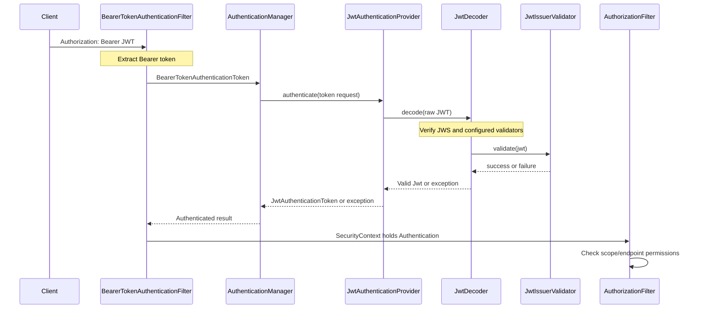

# `JwtIssuerValidator` and Verifying the Right Issuer in Spring Security Resource Server

## 1. Why Must You Validate a JWT Access Token's Issuer?

In an **OAuth 2.0 / OpenID Connect (OIDC)** system, a **Resource Server** (API) receives access tokens issued by an **Authorization Server** (AS) or OpenID Provider (OP). When the token is represented as a signed JWT, the Resource Server typically verifies the signature using the issuer's corresponding public key. However, checking only the signature, expiration, or presence of the `sub` claim is **not enough** to determine whether the token came from **the exact issuer trusted by the API**.

A JWT includes the `iss` (*issuer*) claim to identify the principal that issued the token. Example JWT Claims Set:

```json
{
  "iss": "https://identity.example.com/realms/shop",
  "sub": "user-123",
  "aud": ["orders-api"],
  "iat": 1910000000,
  "exp": 1910003600,
  "scope": "orders.read"
}
```

In the `orders-api` service, we want to enforce:

```text
JWT iss in the access token
        ==
Issuer identifier configured as trusted
```

If the API is configured to trust only `https://identity.example.com/realms/shop`, a JWT with `iss=https://identity.example.com/realms/other` must be rejected, **even if** the token is structurally valid, unexpired, and carries seemingly valid permission claims.

Spring Security provides **`JwtIssuerValidator`**, an `OAuth2TokenValidator<Jwt>`, to enforce this rule when validating decoded JWTs. It is typically wired into the `JwtDecoder`'s validator set, for example via `JwtValidators.createDefaultWithIssuer(issuer)`.

This lesson focuses on:

- Understanding JWT `iss`, issuer URIs, and the Resource Server's trust boundary accurately.
- Knowing what `JwtIssuerValidator` validates **and what it does not validate**.
- Configuring `issuer-uri`, JWKS, and validators in a Spring Security Servlet Resource Server.
- Distinguishing issuer mismatch from invalid signatures, wrong audience, wrong token purpose, or missing scope.
- Handling issuers with paths, reverse proxies, key rotation, multi-issuer setups, and common misconfigurations.

## 2. The `iss` Claim in JWT vs. the Issuer Identifier in OAuth/OIDC

### 2.1. What Is the `iss` Claim?

Per RFC 7519, `iss` identifies the **principal that issued the JWT**. Its value is a `StringOrURI`; when it is a URI, it must follow the exact identifier rules of the governing protocol.

In OAuth 2.0 and OIDC, the issuer is typically an **HTTPS URL identifying the Authorization Server / OpenID Provider**, such as:

```text
https://identity.example.com/realms/shop
```

That identifier can appear in three different places:

1. In the Resource Server's trust configuration, e.g., `issuer-uri`.
2. In the AS/OP JSON metadata, under the `issuer` field.
3. In the JWT access token, under the `iss` claim.

A consistent configuration model:

```text
Resource Server config:
  issuer-uri: https://identity.example.com/realms/shop

Discovery metadata:
  "issuer": "https://identity.example.com/realms/shop"

JWT payload:
  "iss": "https://identity.example.com/realms/shop"
```

All three values describe the same issuer identifier. If any discrepancy exists, the Resource Server must treat it as an issuance contract or configuration error, **not relax issuer validation to let tokens pass**.

### 2.2. The Issuer Is Not Every Endpoint of the Authorization Server

A system may publish several URLs:

```text
Issuer:
  https://identity.example.com/realms/shop

OIDC discovery:
  https://identity.example.com/realms/shop/.well-known/openid-configuration

Authorization endpoint:
  https://identity.example.com/realms/shop/protocol/openid-connect/auth

Token endpoint:
  https://identity.example.com/realms/shop/protocol/openid-connect/token

JWKS endpoint:
  https://identity.example.com/realms/shop/protocol/openid-connect/certs
```

They serve distinct roles:

| Value | What Is It Used For? | Can It Substitute for `iss`? |
|---|---|---|
| **Issuer identifier** | Identifies the issuing party; used in `iss` | **This is the expected value** |
| **Discovery URL** | Returns OP/AS metadata | No |
| **Authorization endpoint** | Where clients start the authorization flow | No |
| **Token endpoint** | Where clients exchange codes or refresh tokens | No |
| **`jwks_uri`** | Where the Resource Server fetches public keys to verify JWS | No |
| **Introspection endpoint** | Queries status and metadata of opaque tokens | No |

If you set `issuer-uri` to `.../token` or `.../certs`, Spring Security may resolve metadata incorrectly and tokens with the proper `iss` will be rejected.

### 2.3. `iss` Is Not `sub`, `aud`, or `client_id`

| Claim | Question Answered | Example |
|---|---|---|
| `iss` | **Who issued the token?** | `https://identity.example.com/realms/shop` |
| `sub` | **Which subject is the token about?** | `user-123` or a client subject |
| `aud` | **Who is the intended recipient?** | `orders-api` |
| `client_id` | **Which client requested the token per profile?** | `shop-web` |
| `scope` / `scp` | **Which permission scopes were granted?** | `orders.read` |
| `exp` / `nbf` | **When is the token valid?** | Epoch seconds |

**A valid issuer does not prove a valid audience**. An OP may sign an ID token intended for `shop-web` and an access token intended for `orders-api` with the same key pair. Both can share the same `iss`, yet an ID token **must not be used as an access token** when calling an API.

## 3. What Is `JwtIssuerValidator`?

In Spring Security, `JwtIssuerValidator` is the class used to check a `Jwt`'s issuer claim:

```java
import org.springframework.security.oauth2.jwt.JwtIssuerValidator;
```

It implements the contract:

```java
OAuth2TokenValidator<Jwt>
```

Conceptually:

```text
Input:
  Jwt passed into the token validation stage
  expected issuer from trusted configuration

Operation:
  Compare Jwt's iss claim against expected issuer

Output:
  OAuth2TokenValidatorResult.success()
     or
  OAuth2TokenValidatorResult.failure(...)
```

Example:

```java
String expectedIssuer =
        "https://identity.example.com/realms/shop";

JwtIssuerValidator issuerValidator =
        new JwtIssuerValidator(expectedIssuer);
```

A `Jwt` with the expected issuer passes **only the issuer condition**. If the `iss` claim is missing or does not match, the validator reports a failure.

### 3.1. What Does `JwtIssuerValidator` Do?

- Compares the JWT issuer against the issuer expected by the Resource Server.
- Rejects differing or missing issuers per validator policy.
- Returns a validation result for `JwtDecoder`/provider to turn into authentication success or failure.
- Composes with other `OAuth2TokenValidator<Jwt>` instances inside `DelegatingOAuth2TokenValidator`.

### 3.2. What Does `JwtIssuerValidator` Not Do?

It does **not**:

- Fetch JWKS or select a public key using `kid`.
- Verify the JWS signature, `alg` algorithm, or JWT format.
- Automatically check `aud`, `exp`, `nbf`, token type, or scopes.
- Check whether the user still exists in a database.
- Guarantee the token is an **access token** rather than an OIDC ID token.
- Decide authorization to read or modify a specific order.

Those other checks are handled by the **JWT decoder**, other validators, and the **authorization** layer.

### 3.3. Why Not Trust `iss` Before Signature Verification to Grant Access?

A JWS JWT's header and payload can be Base64URL-decoded without the private key. An attacker can craft a payload:

```json
{
  "iss": "https://identity.example.com/realms/shop",
  "sub": "admin",
  "scope": "orders.write",
  "exp": 1910003600
}
```

However, **self-asserting `iss` does not turn a forged token into one issued by the real issuer**. The attacker has not proven possession of the issuer's signing key.

The Resource Server must verify the **signature** using a trusted key and allowed algorithm, and then enforce issuer, audience, time, token profile, and authorization checks. `JwtIssuerValidator` handles **one piece** of that chain, not the entire authentication mechanism.

## 4. JWT Access Token Authentication Flow in a Servlet Resource Server

When a client calls the API:

```http
GET /api/orders/42 HTTP/1.1
Host: orders.example.com
Authorization: Bearer ACCESS_TOKEN
```

the typical Spring Security flow is:



The diagram depicts logical responsibilities; the exact internal ordering inside the decoder depends on the library implementation. There is **no** case where `JwtIssuerValidator` standalone accepts a bearer request without JWT verification.

In a typical processing path:

1. `BearerTokenResolver` extracts the token string from the HTTP request.
2. `BearerTokenAuthenticationFilter` creates an unauthenticated `BearerTokenAuthenticationToken`.
3. `JwtAuthenticationProvider` delegates token processing to `JwtDecoder`.
4. The decoder verifies the JWS structure and signature using a trusted key/algorithm.
5. Validators check issuer, timestamps, audience, and the token contract.
6. The provider builds a `JwtAuthenticationToken` from the validated JWT.
7. The filter stores the result in `SecurityContext`; security rules enforce authorities and resource-level permissions.

If issuer validation fails, the request is not considered authenticated, even if the token contains `scope=orders.read`.

## 5. The Simplest Approach: Declaring `issuer-uri` in Spring Boot

With Spring Boot OAuth 2.0 Resource Server support and an issuer exposing compliant metadata/JWKS:

```yaml
spring:
  security:
    oauth2:
      resourceserver:
        jwt:
          issuer-uri: https://identity.example.com/realms/shop
```

When Spring Boot uses this property to auto-configure the default JWT decoder, Spring Security can:

- Use the configured issuer as the starting point for **discovery** of Authorization Server / OpenID Provider metadata.
- Locate `jwks_uri` in the metadata and download public keys for JWT verification.
- Verify the signature of incoming access tokens.
- Apply the appropriate `iss` issuer validator and default JWT checks, depending on the framework version and configuration.
- Produce a successful `Authentication` so the security chain can continue to authorization.

Example `SecurityFilterChain` for a Servlet API:

```java
import org.springframework.context.annotation.Bean;
import org.springframework.context.annotation.Configuration;
import org.springframework.http.HttpMethod;
import org.springframework.security.config.Customizer;
import org.springframework.security.config.annotation.web.builders.HttpSecurity;
import org.springframework.security.web.SecurityFilterChain;

@Configuration
public class OrdersSecurityConfig {

    @Bean
    SecurityFilterChain ordersApi(HttpSecurity http) throws Exception {
        return http
                .securityMatcher("/api/**")
                .authorizeHttpRequests(auth -> auth
                        .requestMatchers(HttpMethod.GET, "/api/orders/**")
                            .hasAuthority("SCOPE_orders.read")
                        .requestMatchers(HttpMethod.POST, "/api/orders/**")
                            .hasAuthority("SCOPE_orders.write")
                        .anyRequest().authenticated())
                .oauth2ResourceServer(oauth2 ->
                        oauth2.jwt(Customizer.withDefaults()))
                .build();
    }
}
```

The URLs and scopes are **illustrative values**. The API must still require tokens to carry an **audience** intended for this API; issuer and signature alone do not prove the token was issued for the right purpose. In applications with multiple security chains, `securityMatcher("/api/**")` scopes this chain to matching paths; other paths must be protected with appropriate policies.

### 5.1. `issuer-uri` Serves Two Separate Roles

In the JWT model, an issuer URI helps:

1. **Locate metadata/JWKS** of the trusted issuer when using discovery.
2. **Establish the expected issuer** that the JWT `iss` claim must match.

These two roles are related but not identical. If you already know the JWKS URI without performing discovery, the API still needs **issuer validation**. Conversely, having an expected issuer without a trusted signing key still requires rejection.

### 5.2. Discovery Is Not User Authentication

The Resource Server fetches metadata/JWKS to validate JWTs presented by clients. It does **not** perform an OIDC login just because the issuer exposes `openid-configuration`, does not fetch ID tokens, and does not redirect users to the authorization endpoint like an OAuth Client.

An OIDC Client validates an ID token issued for `client_id`; a Resource Server validates an access token issued for the **API's audience/resource**.

## 6. `JwtValidators.createDefaultWithIssuer` — Common Pattern for Custom Decoders

When an application registers a custom `JwtDecoder` bean, it should attach complete validators. Spring Security provides a helper:

```java
import org.springframework.security.oauth2.jwt.JwtValidators;

JwtValidators.createDefaultWithIssuer(
        "https://identity.example.com/realms/shop");
```

This helper constructs the default validator set including **issuer validation**, giving you not only `JwtIssuerValidator` but also default JWT constraints such as timestamps per your Spring Security version.

Example Resource Server using a directly configured JWKS URI, trusting `RS256`, and validating issuer and audience:

```java
import org.springframework.context.annotation.Bean;
import org.springframework.context.annotation.Configuration;
import org.springframework.http.HttpMethod;
import org.springframework.security.config.Customizer;
import org.springframework.security.config.annotation.web.builders.HttpSecurity;
import org.springframework.security.oauth2.core.DelegatingOAuth2TokenValidator;
import org.springframework.security.oauth2.core.OAuth2Error;
import org.springframework.security.oauth2.core.OAuth2TokenValidator;
import org.springframework.security.oauth2.core.OAuth2TokenValidatorResult;
import org.springframework.security.oauth2.jose.jws.SignatureAlgorithm;
import org.springframework.security.oauth2.jwt.Jwt;
import org.springframework.security.oauth2.jwt.JwtDecoder;
import org.springframework.security.oauth2.jwt.JwtValidators;
import org.springframework.security.oauth2.jwt.NimbusJwtDecoder;
import org.springframework.security.web.SecurityFilterChain;

@Configuration
public class JwtIssuerSecurityConfig {

    private static final String ISSUER =
            "https://identity.example.com/realms/shop";

    private static final String JWKS_URI =
            "https://identity.example.com/realms/shop/protocol/openid-connect/certs";

    @Bean
    JwtDecoder jwtDecoder() {
        NimbusJwtDecoder decoder = NimbusJwtDecoder
                .withJwkSetUri(JWKS_URI)
                .jwsAlgorithm(SignatureAlgorithm.RS256)
                .build();

        OAuth2TokenValidator<Jwt> issuerAndDefaults =
                JwtValidators.createDefaultWithIssuer(ISSUER);

        OAuth2TokenValidator<Jwt> audience = jwt ->
                jwt.getAudience().contains("orders-api")
                        ? OAuth2TokenValidatorResult.success()
                        : OAuth2TokenValidatorResult.failure(
                                new OAuth2Error(
                                        "invalid_token",
                                        "Token audience must include orders-api",
                                        null));

        decoder.setJwtValidator(
                new DelegatingOAuth2TokenValidator<>(
                        issuerAndDefaults, audience));

        return decoder;
    }

    @Bean
    SecurityFilterChain api(HttpSecurity http) throws Exception {
        return http
                .securityMatcher("/api/**")
                .authorizeHttpRequests(auth -> auth
                        .requestMatchers(HttpMethod.GET, "/api/orders/**")
                            .hasAuthority("SCOPE_orders.read")
                        .anyRequest().authenticated())
                .oauth2ResourceServer(oauth2 ->
                        oauth2.jwt(Customizer.withDefaults()))
                .build();
    }
}
```

**Responsibility breakdown:**

| Component | Enforced Condition |
|---|---|
| `withJwkSetUri(JWKS_URI)` | Trusted public key source configured |
| `jwsAlgorithm(RS256)` | Restricts accepted JWS algorithms |
| Decoder's JWS verifier | Signature must match a trusted key |
| `JwtValidators.createDefaultWithIssuer(ISSUER)` | Includes issuer check and default validations |
| `audience` validator | Token must target `orders-api` |
| `hasAuthority("SCOPE_orders.read")` | Authenticated token must hold read permission for the endpoint |
| Service/domain layer | Verifies specific order/tenant access for the principal |

Critically: **`decoder.setJwtValidator(...)` replaces previously attached validators**. Therefore, never write only an audience validator and forget to restore issuer and timestamp validation. Including `createDefaultWithIssuer` inside `DelegatingOAuth2TokenValidator` preserves those essential baseline checks.

If the issuer follows the **RFC 9068 JWT Access Token Profile**, the API should also check token profile details such as `typ=at+jwt` and RFC 9068 claims. If the issuer uses a custom profile, enforce the actual contract rather than assuming one algorithm or token type fits all providers.

## 7. Using `JwtIssuerValidator` Directly in a Validator Collection

`createDefaultWithIssuer` is usually sufficient. However, to understand the API or when building custom validators, you can instantiate `JwtIssuerValidator` directly.

Example validator composition:

```java
import org.springframework.security.oauth2.core.DelegatingOAuth2TokenValidator;
import org.springframework.security.oauth2.core.OAuth2Error;
import org.springframework.security.oauth2.core.OAuth2TokenValidator;
import org.springframework.security.oauth2.core.OAuth2TokenValidatorResult;
import org.springframework.security.oauth2.jwt.Jwt;
import org.springframework.security.oauth2.jwt.JwtIssuerValidator;
import org.springframework.security.oauth2.jwt.JwtValidators;

public final class OrdersJwtValidators {

    private OrdersJwtValidators() {}

    public static OAuth2TokenValidator<Jwt> create(String trustedIssuer) {
        OAuth2TokenValidator<Jwt> defaults =
                JwtValidators.createDefault();

        OAuth2TokenValidator<Jwt> issuer =
                new JwtIssuerValidator(trustedIssuer);

        OAuth2TokenValidator<Jwt> audience = jwt ->
                jwt.getAudience().contains("orders-api")
                    ? OAuth2TokenValidatorResult.success()
                    : OAuth2TokenValidatorResult.failure(
                            new OAuth2Error(
                                    "invalid_token",
                                    "Invalid API audience",
                                    null));

        return new DelegatingOAuth2TokenValidator<>(
                defaults, issuer, audience);
    }
}
```

After creating the decoder and configuring its key source, apply it:

```java
decoder.setJwtValidator(
        OrdersJwtValidators.create(
                "https://identity.example.com/realms/shop"));
```

In this example:

- `JwtValidators.createDefault()` provides the default JWT validators.
- `new JwtIssuerValidator(trustedIssuer)` adds the specific `iss` constraint.
- `audience` requires the token to target `orders-api`.
- `DelegatingOAuth2TokenValidator` combines the checks; **passing one condition never bypasses the remaining ones**.

If you already use `JwtValidators.createDefaultWithIssuer(trustedIssuer)`, there is normally **no need to duplicate** `new JwtIssuerValidator(trustedIssuer)` unless there is a specific reason. Duplication adds no extra trust; it just makes configuration harder to read.

### 7.1. Do Not Set Only `JwtIssuerValidator` and Drop Timestamps

Anti-pattern to avoid:

```java
// DO NOT configure only an issuer validator
// if that unintentionally drops timestamp and other validations.
decoder.setJwtValidator(new JwtIssuerValidator(TRUSTED_ISSUER));
```

`JwtIssuerValidator` does not check `exp` or `nbf`. Even with a valid `iss`, a token may already be expired or not yet valid. The validator set must cover every requirement of the access-token contract.

### 7.2. What If You Need to Validate Another Claim?

Spring Security provides `JwtClaimValidator<T>` for expressing predicates on a single JWT claim, or you can implement `OAuth2TokenValidator<Jwt>`. For `iss`, however, the dedicated **`JwtIssuerValidator`** class already exists, so avoid rewriting issuer comparisons with manual string manipulation.

Use dedicated validators for audience, token purpose, client binding, or provider-specific claims when required by contract. **Never** use `sub != null` as a substitute for issuer validation.

## 8. Exact Issuer Matching: Slashes, Hostnames, and Schemes

With URL-based issuer identifiers, values that look similar are **not automatically equivalent**:

| Trusted Issuer | JWT `iss` | Expected Handling |
|---|---|---|
| `https://id.example.com/realms/shop` | `https://id.example.com/realms/shop` | Match |
| `https://id.example.com/realms/shop` | `https://id.example.com/realms/other` | Reject |
| `https://id.example.com/realms/shop` | `https://id.example.com/realms/shop/` | Do not assume match; trailing `/` is a difference |
| `https://id.example.com/realms/shop` | `http://id.example.com/realms/shop` | Reject: different scheme and security boundary |
| `https://id.example.com/realms/shop` | `https://id-internal:8080/realms/shop` | Reject: public issuer differs from internal host |
| `https://id.example.com/realms/shop` | `https://id.example.com` | Reject: missing issuer path |
| `https://id.example.com/realms/shop` | Missing `iss` | Reject per issuer validator |
| `https://id.example.com/realms/shop` | `https://fake.example/realms/shop` | Reject |

Issuer validation is an **identifier** check, not a "fuzzy" match. Under OAuth/OIDC standards, you should normally match the exact issuer identifier published by the provider rather than treating normalized URLs as equivalent. Never strip paths, queries, or slashes just to let a token through.

### 8.1. Why Do Trailing Slashes Often Break Things?

Suppose the metadata says:

```json
{
  "issuer": "https://id.example.com/realms/shop"
}
```

But the application configures:

```yaml
issuer-uri: https://id.example.com/realms/shop/
```

Depending on discovery mechanics, the API may fail to locate metadata or fail `iss` matching. The fix is to configure the **official issuer string**, never to disable `JwtIssuerValidator`.

### 8.2. Reverse Proxies, Kubernetes, Gateways, and Internal Issuers

A common issue:

```text
Public URL:
  https://auth.example.com/realms/shop

Issuer emitted in JWT:
  http://keycloak-service:8080/realms/shop
```

Both addresses may reach the same AS instance over different networks, yet they are **not the same issuer identifier**. The Resource Server must not treat them as identical.

Recommended approach:

- Configure the AS/OP with a **stable public issuer**.
- Configure trusted proxy headers, external hostname, and TLS termination properly for production.
- Ensure metadata `issuer` and JWT `iss` match the exact published string.
- If the Resource Server must fetch JWKS over an internal network, configure a **trusted internal JWKS URI** separately while keeping issuer validation anchored to the public issuer, when the architecture permits.

Separating **trust identity** from **network connectivity address** avoids the temptation to disable issuer validation whenever an API runs in containers.

## 9. How Do Issuer Discovery, Metadata, and JWKS Relate?

Issuer metadata may be published via:

- **OIDC Provider Configuration** per OpenID Connect Discovery 1.0.
- **OAuth 2.0 Authorization Server Metadata** per RFC 8414.

Example for an issuer with a path:

```text
Issuer:
  https://id.example.com/realms/shop

OIDC Provider Configuration:
  https://id.example.com/realms/shop/.well-known/openid-configuration

OAuth Authorization Server Metadata per RFC 8414:
  https://id.example.com/.well-known/oauth-authorization-server/realms/shop
```

Illustrative OIDC metadata response:

```json
{
  "issuer": "https://id.example.com/realms/shop",
  "authorization_endpoint": "https://id.example.com/realms/shop/protocol/openid-connect/auth",
  "token_endpoint": "https://id.example.com/realms/shop/protocol/openid-connect/token",
  "jwks_uri": "https://id.example.com/realms/shop/protocol/openid-connect/certs"
}
```

Spring Security can use metadata to locate JWKS, though supported well-known endpoints and probe order can vary across versions. When configuring a decoder manually, understand the difference between **issuer identifier**, **discovery endpoint**, and **JWKS URL**.

### 9.1. Issuer and Key Verification Sequence

```text
Configured issuer-uri
          |
          v
Discover issuer metadata (if using discovery)
          |
          +----> metadata issuer must be consistent
          |
          v
Trusted jwks_uri
          |
          v
Public signing keys (JWK Set)
          |
          v
Verify JWT signature against algorithm allow-list
          |
          v
JwtIssuerValidator compares iss against issuer-uri
          |
          v
Other validators: exp, nbf, aud, token profile
          |
          v
Authorization via scope and object-level permissions
```

`kid` in the JOSE header helps select a candidate key from the JWKS. It **does not** replace checking `iss`. Two different issuers could use the same `kid` or even the same algorithm; trust criteria must still be anchored to the issuer.

### 9.2. Why Not Dynamically Trust `iss` Declared by the Token?

An attacker can craft a JWT containing:

```json
{
  "iss": "https://attacker.example",
  "aud": "orders-api",
  "scope": "orders.read"
}
```

If the server reads `iss`, downloads metadata/JWKS from that URL, and trusts the public key published by the attacker, the forged signature will validate against the attacker's own key. Obtaining "signature valid" in that workflow **does not prove the token was issued by an Authorization Server the API is allowed to trust**.

The Resource Server must obtain its allowed issuers or key sources from **trusted configuration**, never minting new trust from unverified claims.

## 10. Combining `issuer-uri` and `jwk-set-uri`

In some environments, the Resource Server cannot reach the discovery endpoint from an internal network but can reach JWKS directly. Spring Boot supports configuring both issuer and key URI together in appropriate versions:

```yaml
spring:
  security:
    oauth2:
      resourceserver:
        jwt:
          issuer-uri: https://auth.example.com/realms/shop
          jwk-set-uri: https://auth-internal.example.local/realms/shop/certs
```

When supported by your framework version:

- `issuer-uri` preserves the **expected issuer identifier** so JWT `iss` is checked against it.
- `jwk-set-uri` specifies **where to fetch public keys**, potentially skipping metadata discovery when constructing the decoder.
- The decoder still needs to enforce signatures, algorithms, expiration, audience, and token type per contract.
- An internal JWKS URI is acceptable only when it is a **trusted key source provisioned by your organization**, never a URL supplied by a token or HTTP request.

If you configure `jwk-set-uri` alone and omit `issuer-uri`, **do not assume issuer validation still happens automatically**. When building a decoder manually in that scenario, explicitly attach `JwtValidators.createDefaultWithIssuer(expectedIssuer)` or an equivalent check.

### 10.1. Direct Decoder Configuration and the Risk of Forgetting the Issuer

Minimal example with only a JWKS URI:

```java
NimbusJwtDecoder decoder =
        NimbusJwtDecoder.withJwkSetUri(JWKS_URI).build();
```

This defines the **key source**; it **does not declare the expected issuer** for the API. When using a custom decoder, proactively attach issuer validation:

```java
decoder.setJwtValidator(
        JwtValidators.createDefaultWithIssuer(EXPECTED_ISSUER));
```

This is a frequent configuration mistake because a validly signed JWT can still belong to the wrong trust domain or API purpose. In multi-issuer systems, never solve it by removing `iss` from validation.

## 11. When the Issuer Matches Yet the Token Must Still Be Rejected

`JwtIssuerValidator` is a **necessary** condition in many profiles, not a **sufficient** one.

### 11.1. Valid Issuer but Invalid JWT Signature

A JWT claims:

```json
{
  "iss": "https://identity.example.com/realms/shop",
  "aud": "orders-api",
  "scope": "orders.read"
}
```

but its signature does not match any trusted public key. The decoder must reject it **before** establishing an authenticated principal. Matching `iss` as a string proves nothing about the token's origin.

### 11.2. Valid Issuer but Wrong Audience

An Authorization Server can issue a token:

```json
{
  "iss": "https://identity.example.com/realms/shop",
  "aud": "billing-api",
  "scope": "orders.read",
  "exp": 1910003600
}
```

If `orders-api` checks only issuer and signature, it could mistakenly accept an access token meant for `billing-api`. The API must check that `aud` contains the expected target resource.

### 11.3. Valid Issuer but Token Is an OIDC ID Token

Example ID token:

```json
{
  "iss": "https://identity.example.com/realms/shop",
  "sub": "user-123",
  "aud": "shop-web",
  "nonce": "login-nonce",
  "exp": 1910003600
}
```

An ID token lets an OIDC Client verify a login event; it is **not an access token** for a Resource Server. Sharing the same issuer, signing key, or `sub` does not make the two token types interchangeable. If the AS issues RFC 9068 JWT access tokens, the API can also check `typ=at+jwt` and profile rules; other providers may use dedicated token-purpose claims.

### 11.4. Valid Issuer but Expired Token

If `exp` has passed, `JwtIssuerValidator` alone still sees a matching issuer; however, the full validator chain must reject the token via **`JwtTimestampValidator`** or equivalent expiration checks.

### 11.5. Valid Issuer and Audience but Missing Scope

The token is accepted by the decoder, yet `POST /api/orders` requires `orders.write` while the token only carries `orders.read`. This is an **authorization failure**, normally returning **403 Forbidden**, not an issuer error.

### 11.6. Valid Issuer, Audience, and Scope but Wrong Tenant

A token for `orders-api` carrying `scope=orders.read` does not automatically authorize reading orders belonging to another tenant. The domain service or authorization policy must enforce permissions on the **specific target resource**.

## 12. Multi-Issuer: Multiple Valid Issuers Without Dropping Issuer Validation

An application may serve multiple tenants, each with its own Authorization Server or realm:

```text
Tenant A:
  issuer = https://id.example.com/realms/tenant-a
  JWKS   = https://.../tenant-a/certs

Tenant B:
  issuer = https://id.example.com/realms/tenant-b
  JWKS   = https://.../tenant-b/certs
```

If the API genuinely trusts **both**, do not write a validator checking whether `iss` "contains `id.example.com`". That widens trust to unregistered realms on the same domain.

A proper architecture preserves the mapping:

```text
issuer A     -> JWKS A -> validators A -> audience/scope policy A
issuer B     -> JWKS B -> validators B -> audience/scope policy B
unknown iss  -> reject
```

### 12.1. Selecting an `AuthenticationManager` by Issuer

Spring Security Servlet provides **`AuthenticationManagerResolver<HttpServletRequest>`** and multi-tenant helpers such as `JwtIssuerAuthenticationManagerResolver` (exact API varies by Spring Security version). For configured trusted issuers, the resolver selects the corresponding `AuthenticationManager`/decoder.

Conceptual example:

```java
// Illustrative API for Spring Security versions providing fromTrustedIssuers(...):
JwtIssuerAuthenticationManagerResolver resolver =
        JwtIssuerAuthenticationManagerResolver.fromTrustedIssuers(
                "https://id.example.com/realms/tenant-a",
                "https://id.example.com/realms/tenant-b");
```

Wire the resolver into the Resource Server DSL per your framework version, e.g.:

```java
.oauth2ResourceServer(oauth2 -> oauth2
        .authenticationManagerResolver(resolver))
```

**Security point:** when using `iss` from an unverified JWT for **routing**, that value must only select **one of the pre-configured entries in an allow-list**. The selected decoder must still verify the signature and the actual `iss` claim. Never use an untrusted `iss` to extend trust to a new domain.

### 12.2. Why a Single `JwtIssuerValidator` Is Not Enough for Multi-Issuer

A basic `JwtIssuerValidator` is constructed with **one expected issuer**. If an API trusts multiple issuers, turning the validator into "issuer equals A or B" inside a single decoder solves only half the problem. You must also bind each issuer to its **own key source**; issuer A's signing key must never arbitrarily verify tokens claiming `iss=B`.

In many architectures, it is cleaner to give **each issuer its own decoder/validators** and have the Resource Server choose the manager from a trusted-issuer allow-list.

### 12.3. Avoid Issuer Wildcards or Loose Domain Matching

Broken trust boundary:

```text
Accept if iss startsWith("https://id.example.com")
```

This rule would accept:

```text
https://id.example.com/realms/untrusted
https://id.example.com/anything-else
```

Even on the same host, different realms or tenants represent **distinct issuers** with separate keys, clients, audiences, and policies. Instead, maintain an explicit issuer allow-list and match the full issuer string.

## 13. What About Issuer Validation for Opaque Access Tokens?

`JwtIssuerValidator` operates on a **`Jwt`** object. It cannot be applied directly to an **opaque access token**, which is just an opaque string that cannot be decoded into JWT claims.

If the API uses OAuth 2.0 Token Introspection (RFC 7662), the Resource Server sends the token to a **trusted configured introspection endpoint** to retrieve status and metadata:

```yaml
spring:
  security:
    oauth2:
      resourceserver:
        opaquetoken:
          introspection-uri: https://identity.example.com/realms/shop/protocol/openid-connect/token/introspect
          client-id: orders-api-introspection
          client-secret: ${INTROSPECTION_CLIENT_SECRET}
```

These URIs are examples; the introspection URL must come from your actual provider configuration rather than being guessed for arbitrary Authorization Servers.

An introspection response may contain:

```json
{
  "active": true,
  "iss": "https://identity.example.com/realms/shop",
  "sub": "user-123",
  "aud": ["orders-api"],
  "scope": "orders.read",
  "client_id": "shop-web",
  "exp": 1910003600
}
```

However, `iss` is **not a required field in every introspection response** under RFC 7662. For opaque access tokens, trust stems from the **configured introspection endpoint and credentials** together with the metadata and guarantees committed by the AS. If additional issuer/resource binding is needed, enforce it inside an `OpaqueTokenIntrospector` or policy tailored to the returned response; do not attempt to decode an opaque token as a JWT and invoke `JwtIssuerValidator`.

Likewise, `active=true` does not mean the API can accept the token for every resource. Audience, scopes, and object-level permissions must still be enforced per contract.

## 14. Authentication Errors and HTTP Status Codes for Issuer Mismatch

When a JWT access token has the wrong issuer, that is an **authentication / token validation** failure. Under the Resource Server Bearer model, the typical response is:

```http
HTTP/1.1 401 Unauthorized
WWW-Authenticate: Bearer error="invalid_token"
```

Different failures can map to similar status codes:

| Scenario | Failing Step | Typical Result |
|---|---|---|
| No Bearer token on a protected endpoint | Missing credentials | 401 with Bearer challenge |
| Malformed Bearer token | `BearerTokenResolver` | Request/token error per framework mapping |
| Invalid JWT signature | `JwtDecoder` | 401, typically `invalid_token` |
| JWT `iss` differs from expected issuer | `JwtIssuerValidator` | 401, typically `invalid_token` |
| JWT missing `iss` under required contract | Issuer validation | 401 |
| JWT `exp` expired | Timestamp validation | 401 |
| JWT `aud` does not include API audience | Audience validation | 401 |
| Valid JWT missing `orders.write` | Authorization layer | 403, possibly `insufficient_scope` |
| Valid token, user lacks access to another tenant's order | Domain authorization | Access denied per policy |

Exact responses depend on the exception type, `BearerTokenAuthenticationEntryPoint`, `BearerTokenAccessDeniedHandler`, `SecurityFilterChain`, and framework version. **Never include JWT contents or raw tokens in error descriptions**.

### 14.1. Should You Return "Issuer Mismatch" Details to the Client?

An `invalid_token` indication is generally enough for the client to know the credential cannot be used. Details like expected issuer and token issuer are useful for operations, but should stay within controlled logs/metrics to avoid leaking architectural details or sensitive token data.

On the client side, the client should obtain the proper **access token intended for the API from the configured Authorization Server**, rather than trying to edit the JWT `iss` payload. Any payload edit after signing invalidates the signature.

## 15. Common Mistakes When Using `JwtIssuerValidator`

### 15.1. Omitting Issuer Validation When Building a Custom `JwtDecoder`

Example:

```java
NimbusJwtDecoder decoder =
        NimbusJwtDecoder.withJwkSetUri(JWKS_URI).build();
```

This configures the key source without explicitly stating the expected issuer. Without attaching corresponding issuer validation, the API may verify JWS signatures while missing a critical access-token contract constraint.

**Fix:** register `JwtValidators.createDefaultWithIssuer(ISSUER)` along with audience and required token-type validators per contract.

### 15.2. Replacing All Validators with Only an Issuer Check

```java
// Anti-pattern: only the issuer validator remains; other checks are dropped.
decoder.setJwtValidator(new JwtIssuerValidator(ISSUER));
```

**Fix:** use `createDefaultWithIssuer` to retain default validators, then compose audience and token-profile validation.

### 15.3. Misconfiguring Where `issuer-uri` Points

Wrong:

```text
issuer-uri = https://id.example.com/realms/shop/.well-known/openid-configuration
```

Correct for the example issuer identifier:

```text
issuer-uri = https://id.example.com/realms/shop
```

The issuer is an identifier, not a metadata endpoint.

### 15.4. Changing the Expected Issuer by Rewriting `iss` Per Environment

A microservice in Kubernetes might reach the AS over an internal service name, while JWT `iss` is issued using the public issuer. Never alter tokens or change the expected issuer to an internal hostname just for "convenient connectivity". Instead, configure a secure internal JWKS endpoint if needed while keeping the issuer identifier aligned with metadata and tokens.

### 15.5. Skipping Audience Validation Because the Issuer Matches

One Authorization Server issues access tokens for multiple APIs. A token meant for `billing-api` is signed by the same trusted issuer; if `orders-api` accepts it, access leaks across APIs.

**Fix:** an audience validator must be a mandatory part of the API's access-token contract.

### 15.6. Accepting an ID Token as a Bearer Access Token

OIDC ID tokens have a valid issuer and signature from the same OP, yet their `aud` targets the **OIDC client**. A Resource Server must never accept an ID token as an access token. If the issuer supports RFC 9068, checking token type `at+jwt` helps classify tokens; you must still validate audience and full profile requirements.

### 15.7. Auto-Discovering from Any `iss` Inside a JWT

If a JWT asserts an arbitrary URL, custom code could accidentally fetch the attacker's JWKS and accept a forged signature. This is a **trust-on-first-use** flaw driven by unverified input.

**Fix:** only use a pre-configured list of trusted issuers; never allow an incoming token to introduce a new issuer.

### 15.8. Validating `iss` with `contains` or `startsWith`

Example:

```java
// Do NOT use for trust decisions:
boolean seemsTrusted =
        issuerFromJwt.startsWith("https://id.example.com");
```

This is not exact issuer validation. The Resource Server should use `JwtIssuerValidator` or the corresponding profile validator with the full issuer string.

### 15.9. Confusing Issuer Validation with JWKS Caching

If a new token carries a `kid` absent from the JWKS cache, signature verification can fail **before** reaching the issuer check. Do not blame every `401` on `JwtIssuerValidator`. Diagnose layer by layer: transport → JWT parsing/signature → validators → authorization.

## 16. Illustrative Issuer Validation Test Matrix

The cases below represent a **design expectation table**, not test output executed against a live system.

Assume the API trusts issuer:

```text
https://id.example.com/realms/shop
```

and audience:

```text
orders-api
```

| Incoming JWT Access Token | `JwtIssuerValidator` | Overall Resource Server Outcome |
|---|---|---|
| Correct `iss`, valid signature, `aud=orders-api`, unexpired, sufficient scope | Pass | Allowed after object-level authorization |
| Different `iss` `/realms/other` | **Fail** | Authentication rejected |
| `iss` with extra trailing `/` | Do not assume match | Rejected if not equal to expected issuer |
| Missing `iss` | **Fail** | Authentication rejected |
| Correct `iss`, invalid signature | May match on claim alone | Decoder rejects due to invalid signature |
| Correct `iss`, expired JWT | Issuer matches | Timestamp validators reject |
| Correct `iss`, `aud=billing-api` | Issuer matches | Audience validator rejects |
| Correct `iss`, ID token with `aud=shop-web` | Issuer matches | Token-purpose/audience contract rejects |
| Correct `iss`, `scope=orders.read` on POST needing `orders.write` | Issuer matches | Authorization rejects |
| Correct `iss`, `kid` absent from trusted JWKS | Payload string may match | Decoder cannot verify signature and rejects |
| `iss` not in allow-list in multi-issuer mode | Not selected as trusted issuer | Rejected before creating identity |
| Correct `iss`, JWT signed with another issuer's key | Claim matches string | Signature fails trusted key verification |

This table shows that **matching the issuer is one distinct condition**—never a substitute for signature, audience, timestamp, or permission checks.

## 17. Code Example Testing `JwtIssuerValidator` in Isolation

To see that the validator does not verify signatures itself, you can construct an in-memory `Jwt` in an example and invoke the validator directly:

```java
import java.time.Instant;

import org.springframework.security.oauth2.core.OAuth2TokenValidatorResult;
import org.springframework.security.oauth2.jwt.Jwt;
import org.springframework.security.oauth2.jwt.JwtIssuerValidator;

public final class IssuerValidatorExample {

    public static void main(String[] args) {
        String expectedIssuer =
                "https://id.example.com/realms/shop";

        JwtIssuerValidator validator =
                new JwtIssuerValidator(expectedIssuer);

        Instant issuedAt = Instant.now();
        Instant expiresAt = issuedAt.plusSeconds(3600);

        Jwt matchingIssuerJwt = Jwt.withTokenValue("illustration-only")
                .header("alg", "RS256")
                .issuer(expectedIssuer)
                .subject("user-123")
                .issuedAt(issuedAt)
                .expiresAt(expiresAt)
                .build();

        OAuth2TokenValidatorResult result =
                validator.validate(matchingIssuerJwt);

        boolean issuerAccepted = !result.hasErrors();
        System.out.println("issuer accepted: " + issuerAccepted);
    }
}
```

**Explicit limitation:** `Jwt.withTokenValue(...)` here builds an **in-memory test object**, not a real signed JWS. `validator.validate(jwt)` checks **only the issuer condition** and does not prove the token has a valid signature. Never use this pattern to validate real incoming request tokens.

In a live application, `JwtDecoder` is responsible for decoding and verifying the token before returning an accepted `Jwt` to the provider.

### 17.1. Expected Result When `iss` Is Wrong

If you change:

```java
.issuer("https://id.example.com/realms/other")
```

while keeping `expectedIssuer` above, `validator.validate(jwt)` returns an error result per issuer validation logic. This only proves the **issuer check** works—it is not an integration test for signatures, JWKS, or `SecurityFilterChain`.

### 17.2. Do Not Use the `jwt()` Request Post-Processor to Prove Real Signature Verification

In Spring Security Test, the `jwt()` post-processor injects a simulated `JwtAuthenticationToken` into a request to test **authorization logic**. It is a convenient test utility, yet it **bypasses the real JWT decoder and issuer/signature validation path**.

To verify that your actual API rejects JWTs with a bad `iss`, write an integration test passing through the real Resource Server authentication filter and a decoder configured with your test environment's trusted key source, or unit-test the validator directly for the issuer predicate. Never treat mocked authentication tests as proof that production enforces issuer checks.

No test suite was run for this lesson; the snippets above only illustrate how to test each responsibility properly.

## 18. Distinguishing Issuer Validation, Authentication, and Authorization

When troubleshooting Resource Server errors, know **where the failure occurred**:

```text
HTTP Authorization: Bearer token
             |
             v
BearerTokenResolver:
  Is there a well-formed Bearer credential?
             |
             v
JwtDecoder:
  Are JWS structure and signature valid for trusted keys/alg?
             |
             v
JWT validators:
  iss == expected issuer?
  exp/nbf valid?
  aud targets this API?
  token type/profile valid?
             |
             v
JwtAuthenticationToken:
  Principal and authorities from verified claims
             |
             v
Authorization:
  What scope does the endpoint require?
  Does the user/client have permission on this resource?
```

`JwtIssuerValidator` belongs to the **JWT claims validation layer**, not HTTP header parsing and not business authorization.

A properly configured system typically returns:

- **401** when credentials are missing, signature is invalid, issuer is wrong, audience is wrong, or the token is expired.
- **403** when the token was accepted but lacks the required authority/scope/permission.
- Other errors per custom configuration when a bearer request is malformed or an endpoint uses custom handlers.

Never tell a client to **edit the `iss` claim** inside a JWT to get past a 401; JWTs are signed, so modifying the payload breaks the signature. The client must obtain a **valid access token from the trusted issuer**, and the API must configure its issuer/metadata to match the environment.

## 19. Operating and Debugging Issuer Mismatches Safely

When an API returns `invalid_token`, follow this diagnostic sequence:

### 19.1. Which Issuer Does the API Trust?

Confirm `issuer-uri`/expected issuer from deployment configuration, not from client claims. Verify it was not accidentally set to a JWKS URL, token endpoint, or internal hostname.

### 19.2. Authorization Server Issuer Metadata

OIDC discovery might return:

```json
{
  "issuer": "https://id.example.com/realms/shop",
  "jwks_uri": "https://id.example.com/realms/shop/protocol/openid-connect/certs"
}
```

Compare the **`issuer` string** against your configuration. If they differ, fix the provider or deployment config. Never accept metadata from an arbitrary issuer just because the endpoint returns 200.

### 19.3. Does the JWT `iss` Match the Expected Issuer?

For a token in a safe test environment, you can inspect `iss` using an internal debugging tool. Remember that decoding an unverified JWT only shows **self-asserted values**. Never paste real access tokens into public JWT decoder websites or log raw bearer tokens.

When `iss` mismatches, typical causes include:

- The client obtained a token from a different realm or tenant.
- A staging token was sent to a production API.
- The AS behind a reverse proxy advertises the wrong external issuer.
- The API configured a trailing slash (or omitted one) differently from the token.
- The API configured the token endpoint as the issuer instead of the issuer identifier.
- The token belongs to a different security domain even if it uses the same signing algorithm.

### 19.4. Are Signature Verification and JWKS Working?

If signature verification already failed, the issuer validator may **not be the failing point yet**. Check JWS `alg`, `kid`, the trusted JWKS endpoint, and key rotation. Never enable `alg=none` or try arbitrary JWKS URLs just to "let the token pass".

### 19.5. Are Audience and Access Token Purpose Correct?

If the issuer matches yet the JWT was issued for `shop-web` (an ID token) or `billing-api`, the `orders-api` Resource Server must still reject it. Fix the scope/resource/audience in the token-issuance flow or perform an appropriate token exchange—do not weaken the issuer validator.

### 19.6. Safe Logging

Prefer logging/metering standardized categories:

```text
jwt_signature_invalid
jwt_issuer_mismatch
jwt_audience_mismatch
jwt_expired
jwt_profile_invalid
insufficient_scope
```

Never log raw `Authorization` headers, full JWTs, refresh tokens, or signing keys. If you log an issuer string read from an unverified token, bound its length and characters to prevent log injection and high cardinality, and never expose sensitive details in client-facing error responses.

## 20. Misconceptions to Avoid

| Misconception | Accurate Understanding |
|---|---|
| "A JWT with the right `iss` is trustworthy." | You must verify the signature and other validators; self-asserted `iss` is not enough |
| "Any JWT signed by the OP's key works for any API." | You still need `aud`, token purpose, timestamps, and authorization |
| "`JwtIssuerValidator` downloads JWKS." | JWKS is handled by the decoder/key source; the validator compares `iss` |
| "Issuer is `jwks_uri`." | Issuer identifies the AS/OP; JWKS URI is the public-keys endpoint |
| "Issuer only needs the same hostname." | You need the full expected issuer identifier, including path/realm |
| "Same `kid` means same issuer." | `kid` only identifies a candidate key within a key set |
| "We can disable issuer checks because signatures are verified." | That drops the trust-domain boundary; an explicit contract is required |
| "Creating a custom `JwtDecoder` checks all claims automatically." | When replacing validators, you must preserve issuer/time/audience and profile checks |
| "An ID token from the same issuer makes a fine Bearer access token." | ID tokens are issued for OIDC Clients, not Resource Servers |
| "If issuer is wrong, the client can edit the JWT payload." | The client must fetch a new token from the right issuer; editing the payload breaks the signature |
| "A single OR validator works for every tenant." | You need an issuer allow-list and an issuer → JWKS/policy mapping |
| "Opaque access tokens also use `JwtIssuerValidator`." | Opaque tokens require introspection/metadata and tailored policies |

## 21. Implementation Principles to Remember

1. **Determine trusted issuers from configuration**, never by taking an arbitrary issuer URL from a JWT and trusting its metadata/JWKS.
2. **Use the exact issuer identifier**, not an OIDC well-known URL, token endpoint, or JWKS endpoint.
3. **`JwtIssuerValidator` checks the `iss` claim**; it does not check signatures, expiration, audience, or permissions.
4. **Preserve default validators when customizing**: `JwtValidators.createDefaultWithIssuer(ISSUER)` is the standard way to combine issuer validation with default JWT checks.
5. **When declaring a custom decoder with a JWKS URI**, attach an explicit issuer validator; locating a signing key does not guarantee the expected issuer.
6. **Validate audience/resource and token profile** so access tokens for other APIs or OIDC ID tokens are not accepted by mistake.
7. **In multi-issuer setups**, allow only registered trusted issuers and bind each issuer to its proper JWKS and validators.
8. **Never loosen issuer matching** with substrings, hostname wildcards, or arbitrary trailing-slash stripping.
9. **Keep authorization separate**: a valid issuer and valid token do not grant unrestricted access to every endpoint and data object.
10. **When troubleshooting errors**, isolate the exact layer (resolver, signature/JWKS, issuer, audience, timestamps, authorization) without leaking Bearer tokens.

You can summarize this with a logical formula:

```text
Accepting a JWT access token for an API
    =
  trusted key source
  AND valid JWS signature
  AND issuer == expected issuer
  AND JWT is within valid time window
  AND audience targets this API
  AND token has the right type/purpose
  AND all other access-token contract conditions

Permitting an action
    =
  accepted access token
  AND required scope/authority
  AND resource-specific authorization satisfied
```

**Conclusion:** `JwtIssuerValidator` enforces the **"right issuer"** boundary in a Spring Security JWT Resource Server. To protect an API properly, combine it inside `JwtDecoder` with a **trusted key source**, the remaining validators, and authorization policies—never relying solely on `iss` or a valid JWT signature to grant access.

## 22. References

- **Spring Security API — `JwtIssuerValidator`**: validator checking a JWT's issuer. https://docs.spring.io/spring-security/site/docs/current/api/org/springframework/security/oauth2/jwt/JwtIssuerValidator.html
- **Spring Security API — `JwtValidators`**: helpers such as `createDefaultWithIssuer`. https://docs.spring.io/spring-security/site/docs/current/api/org/springframework/security/oauth2/jwt/JwtValidators.html
- **Spring Security Reference — OAuth 2.0 Resource Server JWT (Servlet)**: configuring `issuer-uri`, JWKS, and validators. https://docs.spring.io/spring-security/reference/servlet/oauth2/resource-server/jwt.html
- **Spring Security Reference — OAuth 2.0 Resource Server**: JWT and opaque authentication architecture. https://docs.spring.io/spring-security/reference/servlet/oauth2/resource-server/index.html
- **RFC 7519 — JSON Web Token (JWT)**: definitions of `iss`, `sub`, `aud`, and related claims. https://www.rfc-editor.org/rfc/rfc7519
- **RFC 8725 — JWT Best Current Practices**: validating issuer, audience, algorithms, and avoiding token confusion. https://www.rfc-editor.org/rfc/rfc8725
- **RFC 8414 — OAuth 2.0 Authorization Server Metadata**: issuer identifiers and Authorization Server metadata. https://www.rfc-editor.org/rfc/rfc8414
- **OpenID Connect Discovery 1.0**: `issuer`, `jwks_uri`, and Provider Configuration. https://openid.net/specs/openid-connect-discovery-1_0.html
- **RFC 9068 — JWT Profile for OAuth 2.0 Access Tokens**: issuer, audience, and JWT access token profile requirements. https://www.rfc-editor.org/rfc/rfc9068
- **RFC 6750 — OAuth 2.0 Bearer Token Usage**: Bearer access tokens and Resource Server error responses. https://www.rfc-editor.org/rfc/rfc6750
