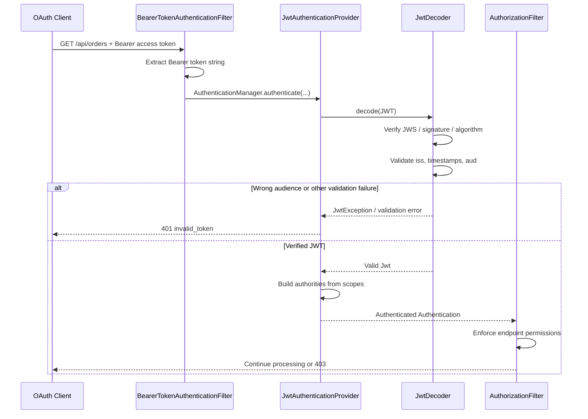
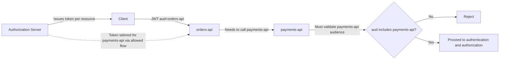

# API Audience and Validating the `aud` List

## 1. Why Must an Access Token Have an Audience Matching the API?

In a **Spring Security OAuth 2.0/OIDC Resource Server** architecture, an Authorization Server may issue JWT access tokens for many APIs: orders, payments, user profiles, or internal services. A token with a valid signature from the same issuer **is not automatically valid for every API**.

The **`aud` (audience)** claim identifies the **intended recipients of the JWT**. For an access token sent to a Resource Server, the audience is typically the identifier of a resource/API toward which the Authorization Server issued the token. When receiving a Bearer request, the API must verify **whether the access token's audience includes that exact API according to the configured contract**.

Example:

- Authorization Server `https://login.example.test/realms/shop` issues a token for `orders-api`.
- A web application receives the access token and calls `GET /api/orders`.
- Resource Server `orders-api` verifies the signature, issuer, expiration, **and audience**.
- If the token was actually intended for `payments-api`, `orders-api` must reject it even though the JWT signature is valid.

**Key takeaway:** a signature proves the JWT was protected by a trusted issuer's key; audience binds that token to **its permitted recipient(s)**. Both checks answer different questions and both are necessary.

> `aud` is **not** a list of authorized users, not an IP allowlist, not a scope, and not a list of logged-in clients. It is part of the token-acceptance contract between the Authorization Server and the Resource Server.

## 2. Role of Audience in the OAuth 2.0 Model

| Component | Role Regarding Audience |
| --- | --- |
| **Authorization Server (AS)** | Issues access tokens based on client details, permissions, and allowed resources; sets audience per its policy. |
| **OAuth 2.0 Client** | Requests a token suitable for the target resource; sends an **access token**, never substituting an ID token. |
| **Resource Server (API)** | Verifies that the token was issued for this exact resource; rejects it otherwise. |
| **OIDC Client / Relying Party** | Verifies that an **ID token**'s `aud` contains its own `client_id`; a different purpose from an API's audience. |

Example of two JWTs both signed by issuer `https://login.example.test/realms/shop` using the same key:

**Access token for the Orders API:**

```json
{
  "iss": "https://login.example.test/realms/shop",
  "sub": "user-123",
  "aud": ["orders-api"],
  "scope": "orders:read",
  "iat": 1893452400,
  "exp": 1893456000
}
```

**Access token for the Payments API:**

```json
{
  "iss": "https://login.example.test/realms/shop",
  "sub": "user-123",
  "aud": ["payments-api"],
  "scope": "payments:read",
  "iat": 1893452400,
  "exp": 1893456000
}
```

These are **illustrative decoded payloads**, not usable signed JWTs. `orders-api` must reject the second token **even when the JWT is validly signed and the subject is the same user**.

### 2.1. Audience Prevents Cross-Target Token Misuse

Suppose a client holds an access token issued for `profile-api`. If the Orders API only checked signature, issuer, and timestamps, the client could send the `profile-api` token to `orders-api`. A token minted for one resource would then be accepted outside its intended scope, opening the door to **token substitution / cross-resource token confusion**.

Audience validation enforces boundaries between resources. Still, audience **does not replace** the other checks: a token with the right audience can still be expired, come from the wrong issuer, or lack endpoint permissions.

## 3. RFC 7519: `aud` Can Be a String or an Array of Strings

Under the JWT specification, the `aud` claim identifies **one or more intended recipients**. In the special case where there is only one audience, it **may be represented as a single string**. When there are multiple recipients, it is an **array of strings**.

### 3.1. Single Audience as a String

```json
{
  "iss": "https://login.example.test",
  "aud": "orders-api",
  "scope": "orders:read",
  "exp": 1893456000
}
```

### 3.2. Single Audience Inside an Array

```json
{
  "iss": "https://login.example.test",
  "aud": ["orders-api"],
  "scope": "orders:read",
  "exp": 1893456000
}
```

Both representations can carry the **same single-audience meaning** if the issuer/resource contract accepts both forms. An API should not inspect `aud` only as a raw string and break when the issuer switches to an array.

### 3.3. Multiple Audiences Inside an Array

```json
{
  "iss": "https://login.example.test",
  "aud": ["orders-api", "reports-api"],
  "scope": "orders:read reports:read",
  "exp": 1893456000
}
```

This example represents a JWT with two recipients. `orders-api` can treat itself as part of the audience if the contract permits multi-audience tokens and all other conditions are met. **A multi-audience array is not automatically invalid under JWT rules**, though allowing one token to be used across multiple APIs requires an explicit security decision.

Some systems require each access token to target **only one resource** to reduce the risk of token reuse across APIs. In that case, the validator can require the audience list to **equal the singleton set containing only that API's identifier**. That is an **API policy**, not a mandatory rule for all JWTs.

### 3.4. Data Types That Violate the Contract

| Claim in Payload | Assessment |
| --- | --- |
| `"aud": "orders-api"` | Syntactically valid: single audience string. |
| `"aud": ["orders-api"]` | Syntactically valid: array with one audience string. |
| `"aud": ["orders-api", "reports-api"]` | Syntactically valid: multiple audiences; API decides acceptance policy. |
| `"aud": 123` | Invalid JWT audience claim type. |
| `"aud": {"name": "orders-api"}` | Invalid JWT audience claim type. |
| `"aud": [123, "orders-api"]` | Array contains an invalid element type. |
| `"aud": []` | Identifies no specific resource; an API requiring `orders-api` must reject. |
| Missing `aud` | An API with a required-audience policy must reject the token. |
| `"aud": null` | Does not satisfy the string/list audience contract. |

The Resource Server should use a standard parser/decoder and a trusted validator to enforce types. Never coerce a numeric or object value into a string and accept it just because it "looks like" a resource ID.

## 4. Audience Matching Must Be Exact

RFC 7519 specifies comparing audience identifiers using **case-sensitive string comparison** in the JWT claim context. Therefore, when an API expects `orders-api`, you must distinguish:

| Token Audience | Required API Audience | Exact Match Result |
| --- | --- | --- |
| `orders-api` | `orders-api` | Match. |
| `Orders-API` | `orders-api` | No match. |
| `orders-api-v2` | `orders-api` | No match. |
| `orders-api-admin` | `orders-api` | No match. |
| `https://api.example.test/orders` | `orders-api` | No match unless the contract defines a mapping. |
| `https://api.example.test/orders/` | `https://api.example.test/orders` | String mismatch; extra trailing `/`. |

Avoid doing this:

```java
// WRONG: recipients must be matched exactly.
if (rawAudienceString.contains("orders-api")) {
    // could mistakenly accept "orders-api-admin" or "not-orders-api"
}
```

Or:

```java
// WRONG: "orders-api-v2" shares the same prefix.
if (rawAudienceString.startsWith("orders-api")) {
    // ...
}
```

If the API uses a URI-style audience, **lock down the exact URI emitted by the issuer** in the contract. Do not arbitrarily change casing, strip trailing slashes, drop paths, or apply loose URL matching to broaden accepted values.

## 5. Distinguishing `aud` from `iss`, `client_id`, `sub`, `scope`, and `azp`

An access token may contain several claims that look like "identifiers" but serve different purposes:

| Claim | Question Answered | Why It Cannot Replace `aud` |
| --- | --- | --- |
| `iss` | Who issued the token? | The same issuer can mint tokens for dozens of APIs. |
| `aud` | Which recipients is the token intended for? | Binds the target recipient, though it does not define permissions on its own. |
| `sub` | Who is the issuer-identified subject? | A user/service can obtain tokens for many different resources. |
| `client_id` | Which client received the token? (per issuer profile) | Client ID identifies the requester/holder, not the receiving API. |
| `scope` / `scp` | Which permissions or authorization scopes does the token carry? | Scopes do not prove the token was issued for this API. |
| `azp` | Authorized party in OIDC ID token contexts and some provider profiles. | Should not be treated as an alias for API audience. |
| `exp` / `nbf` | Is the token currently within its validity window? | An unexpired token can still be intended for a different API. |
| `jti` | Unique identifier of a JWT per issuer/profile. | Does not represent resource, scope, or permissions. |

Example token:

```json
{
  "iss": "https://login.example.test/realms/shop",
  "sub": "user-123",
  "client_id": "web-client",
  "aud": ["orders-api"],
  "scope": "orders:read",
  "exp": 1893456000
}
```

In this example:

- `web-client` is the **OAuth client** using the token.
- `orders-api` is the **Resource Server** targeted by the token.
- `orders:read` is the **permission** the API evaluates after authenticating the token.
- `user-123` is the subject, who is not automatically allowed to read every order.

**Do not configure `aud=web-client` on the Resource Server just because `web-client` is the app calling the API.** The Resource Server needs a resource identifier agreed upon by the Authorization Server and the API.

### 5.1. ID Tokens and Access Tokens Do Not Share the Same Audience

In OpenID Connect, an **ID token** targets the **OIDC Client**, and its `aud` normally contains the login client's `client_id`. An access token for an API must satisfy the **Resource Server**'s audience contract.

```text
ID token:
  aud = ["web-client"]     // OIDC Client verifies login

Access token:
  aud = ["orders-api"]     // Resource Server authorizes API access
```

If an application takes the ID token from an OIDC login and sends:

```http
GET /api/orders HTTP/1.1
Authorization: Bearer <id_token>
```

the API must reject any token not issued for its resource, even if the ID token was **signed by the same OpenID Provider**. Checking audience and token type/profile mitigates **cross-JWT confusion**.

## 6. From Access Token Request to Issued Audience

A client cannot append `aud` to a JWT after receiving it, because changing the payload invalidates the signature. Audience is **emitted by the Authorization Server** based on configuration policy, grant type, and the resources the client is permitted to access.

In OAuth 2.0, **RFC 8707 — Resource Indicators for OAuth 2.0** defines the `resource` parameter so a client can specify its desired protected resource in authorization flows/providers that support it:

```http
GET /authorize?response_type=code
  &client_id=web-client
  &redirect_uri=https%3A%2F%2Fapp.example.test%2Flogin%2Foauth2%2Fcode%2Fshop
  &scope=openid%20orders%3Aread
  &resource=https%3A%2F%2Fapi.example.test%2Forders
  &state=example-state
  &code_challenge=...
  &code_challenge_method=S256
```

This request is wrapped across lines for readability; on the wire it must be a properly URL-encoded URL. `resource` is a resource identifier **governed by the provider contract**, not a way for clients to self-grant access. The Authorization Server can reject disallowed resources or require additional consent/policy checks.

**Not every provider handles `resource` the same way or places that exact URI verbatim into `aud`.** Many systems configure audiences through API registrations, permissions, token exchange, custom scopes, or provider-specific mechanisms. Both sides must agree on **the exact audience value that ultimately appears in the access token**.

### 6.1. Both Scope and Audience Must Be Right

A client requesting `orders:read` does not guarantee the access token gets `aud=orders-api`. Conversely, a token with audience `orders-api` does not prove the caller is allowed to read or write orders.

Example for `GET /api/orders`:

| Audience | Permission | Typical Decision |
| --- | --- | --- |
| `orders-api` | `orders:read` | Can proceed once token and business rules are validated. |
| `payments-api` | `orders:read` | **401 invalid_token** due to wrong token audience. |
| `orders-api` | `payments:read` | Authentication succeeds, but order-read permission is missing; typically **403**. |
| `orders-api` | `orders:write` | If the endpoint requires `orders:read`, do not treat `write` as implying `read` unless policy specifies it. |
| `web-client` (ID token) | Has custom group/role claims | Do not accept as an API access token; reject by audience/token profile. |

## 7. The `aud` List: "Contains This API" or "Contains Only This API"?

When a JWT carries an array audience, two policies are commonly considered:

**Policy A — Membership:** Accept if the audience list contains the expected API identifier.

```text
expected = "orders-api"

aud = ["orders-api"]                  → passes aud check
aud = ["orders-api", "reports-api"]   → passes aud check
aud = ["payments-api"]                → rejected
```

This directly expresses "the Resource Server must be one of the JWT's intended recipients" when the issuer intentionally mints multi-audience tokens.

**Policy B — Exclusive Audience:** Accept only if the audience set **equals** `{"orders-api"}` exactly.

```text
expected = "orders-api"

aud = ["orders-api"]                  → passes aud check
aud = ["orders-api", "reports-api"]   → rejected
aud = ["payments-api"]                → rejected
```

Policy B is typically chosen when an API requires tokens **scoped strictly to a single resource**. It reduces the chance of one access token being replayed across unintended APIs, but should only be used if the Authorization Server is configured to emit single-audience tokens.

| Aspect | Membership | Exclusive Audience |
| --- | --- | --- |
| Token with `["orders-api"]` | Passes audience step. | Passes audience step. |
| Token with `["orders-api", "reports-api"]` | Passes audience step. | Rejected. |
| Fit for issuers minting shared multi-API tokens | Suitable if participating APIs agree to the contract. | Requires the issuer to mint API-specific tokens. |
| Cross-API token reuse risk | Broader token reach. | Narrower audience boundary. |
| Compatibility | More flexible. | Stricter; requires coordinated token issuance. |

**Never take the approach of "unioning every known audience" so tokens for other APIs get accepted.** When supporting multiple audiences temporarily during migration, enforce an **exact allowlist, documented business reason, separate authorization checks, and a sunset deadline**. Long-term rules should mirror true resource boundaries.

## 8. Spring Security: How Does `JwtDecoder` Expose the `aud` List?

Once a JWT has been parsed into a `Jwt` by `JwtDecoder`, Spring Security provides:

```java
List<String> audiences = jwt.getAudience();
```

This exposes audiences as a list so your application can match against them without manually handling whether the JSON payload held a string or an array. For example:

```java
String expectedAudience = "orders-api";
boolean aimedAtThisApi = jwt.getAudience()
        .contains(expectedAudience);
```

Here `List.contains(...)` compares **each string element** against the expected value—it does not search for a substring inside a long audience. This suits a membership policy once the token has been properly parsed and the contract permits an audience list.

**However**, you must never simply Base64URL-decode a JWT, run that check manually, and treat it as authenticated. The Resource Server must verify **signature, algorithm, issuer, and timestamps** via the decoder and validators first, and use audience as part of token acceptance.

### 8.1. Pitfall: Reading `aud` via `getClaimAsString`

Some code reads the JWT directly as:

```java
String audience = jwt.getClaimAsString("aud");
```

This assumes the claim is a string. When the issuer sends `"aud": ["orders-api", "reports-api"]`, coercing it to a single string can fail or cause incorrect validation logic. In Spring Security, prefer **`jwt.getAudience()`** to obtain the recipient list, then apply an explicit policy.

### 8.2. Standardized Audience Validator Result

Example validator in Spring Security:

```java
private static final String EXPECTED_AUDIENCE = "orders-api";

OAuth2TokenValidator<Jwt> audienceValidator = jwt -> {
    if (jwt.getAudience().contains(EXPECTED_AUDIENCE)) {
        return OAuth2TokenValidatorResult.success();
    }
    return OAuth2TokenValidatorResult.failure(
            new OAuth2Error(
                    "invalid_token",
                    "JWT was not issued for orders-api",
                    null));
};
```

This implements a **membership policy**. If a JWT has `aud=["orders-api","reports-api"]`, the validator passes the audience step while remaining validators and authorization still inspect the token.

## 9. Complete Resource Server Example with Issuer + Audience

Suppose a Spring Boot application secures `orders-api` using **signed JWT access tokens** from a trusted issuer.

### 9.1. Issuer Configuration

```yaml
spring:
  security:
    oauth2:
      resourceserver:
        jwt:
          issuer-uri: https://login.example.test/realms/shop
```

With appropriate discovery/JWKS, the Resource Server obtains trusted public keys and verifies tokens. However, **never assume configuring `issuer-uri` automatically checks your specific API audience across all versions and configuration styles**. The API should enforce an explicit audience policy.

Some Spring Boot versions provide properties for audience configuration; the example below uses a **custom validator** to make the principle explicit and avoid relying on version-specific Boot properties.

### 9.2. `JwtDecoder` Bean Validating Signature, Issuer, Timestamps, and `aud`

```java
import org.springframework.context.annotation.Bean;
import org.springframework.context.annotation.Configuration;
import org.springframework.security.oauth2.core.OAuth2Error;
import org.springframework.security.oauth2.core.OAuth2TokenValidator;
import org.springframework.security.oauth2.core.OAuth2TokenValidatorResult;
import org.springframework.security.oauth2.core.DelegatingOAuth2TokenValidator;
import org.springframework.security.oauth2.jwt.Jwt;
import org.springframework.security.oauth2.jwt.JwtDecoder;
import org.springframework.security.oauth2.jwt.JwtValidators;
import org.springframework.security.oauth2.jwt.NimbusJwtDecoder;

@Configuration
public class OrdersJwtValidationConfig {

    private static final String ISSUER =
            "https://login.example.test/realms/shop";

    private static final String EXPECTED_AUDIENCE = "orders-api";

    @Bean
    JwtDecoder jwtDecoder() {
        NimbusJwtDecoder decoder =
                NimbusJwtDecoder.withIssuerLocation(ISSUER).build();

        OAuth2TokenValidator<Jwt> defaults =
                JwtValidators.createDefaultWithIssuer(ISSUER);

        OAuth2TokenValidator<Jwt> audienceValidator = jwt -> {
            if (jwt.getAudience().contains(EXPECTED_AUDIENCE)) {
                return OAuth2TokenValidatorResult.success();
            }
            return OAuth2TokenValidatorResult.failure(
                    new OAuth2Error(
                            "invalid_token",
                            "JWT audience does not include orders-api",
                            null));
        };

        decoder.setJwtValidator(
                new DelegatingOAuth2TokenValidator<>(
                        defaults, audienceValidator));

        return decoder;
    }
}
```

Key points:

1. `withIssuerLocation(ISSUER)` configures the JWT/public-key source from the trusted issuer. Signatures are never verified with arbitrary keys taken from the token.
2. `JwtValidators.createDefaultWithIssuer(ISSUER)` provides default validations including issuer and timestamp checks.
3. `audienceValidator` requires `aud` to contain the **exact element** `orders-api`.
4. `DelegatingOAuth2TokenValidator` composes the conditions: **signature, issuer, timestamps, and audience** must all pass.
5. The Resource Server still needs to verify the access-token profile/type, allowed algorithms, and any required claims per the issuer contract.

Class names, packages, and builders in this example correspond to Spring Security's `NimbusJwtDecoder` model; align with the exact Spring Security version in your project. This `JwtDecoder` bean illustrates a **dedicated Orders API** and should not accidentally share a hardcoded audience across APIs with different resource IDs.

### 9.3. Protecting Endpoints with Authorities

```java
import org.springframework.context.annotation.Bean;
import org.springframework.context.annotation.Configuration;
import org.springframework.http.HttpMethod;
import org.springframework.security.config.Customizer;
import org.springframework.security.config.annotation.web.builders.HttpSecurity;
import org.springframework.security.web.SecurityFilterChain;

@Configuration
public class OrdersApiSecurityConfig {

    @Bean
    SecurityFilterChain apiSecurity(HttpSecurity http) throws Exception {
        return http
                .authorizeHttpRequests(auth -> auth
                        .requestMatchers(HttpMethod.GET, "/api/orders/**")
                            .hasAuthority("SCOPE_orders:read")
                        .requestMatchers(HttpMethod.POST, "/api/orders/**")
                            .hasAuthority("SCOPE_orders:write")
                        .anyRequest().authenticated())
                .oauth2ResourceServer(oauth2 ->
                        oauth2.jwt(Customizer.withDefaults()))
                .build();
    }
}
```

With standard JWT mapping, Spring Security converts `scope`/`scp` into `GrantedAuthority` instances prefixed with `SCOPE_`. If the Authorization Server uses a custom claim like `permissions`, build a matching `JwtAuthenticationConverter`; **never treat audience as a permission**.

In this setup:

- **Wrong audience:** authentication fails before reaching authorization, typically returning `401`.
- **Right audience, valid token and signature, missing scope:** authentication succeeds but authorization rejects, typically returning `403`.
- **Right audience and sufficient scope:** the request proceeds beyond authorization; the service still needs to enforce ownership, tenant, and business checks.

### 9.4. If Policy Permits Only a Single Audience

If the issuer commits that every access token for `orders-api` carries **exactly one** audience, replace the membership validator with a strict set check:

```java
OAuth2TokenValidator<Jwt> singleAudience = jwt -> {
    boolean valid = jwt.getAudience().size() == 1
            && "orders-api".equals(jwt.getAudience().get(0));

    if (valid) {
        return OAuth2TokenValidatorResult.success();
    }
    return OAuth2TokenValidatorResult.failure(
            new OAuth2Error(
                    "invalid_token",
                    "Token must target only orders-api",
                    null));
};
```

This validator accepts a single audience whether the raw payload used a **string** or a **single-element string array** once normalized to a list. It rejects multi-audience tokens; enforce whichever policy both sides agreed upon.

## 10. Runtime Authentication Flow in a Servlet Resource Server



This diagram omits some intermediate components to highlight audience validation: in practice, `BearerTokenAuthenticationFilter` invokes `AuthenticationManager`, typically delegating to `JwtAuthenticationProvider`, after which `SecurityContext` and authorization filters take over. If the decoder rejects the token, no "provisional" principal may be created from an unvalidated payload.

## 11. How Should a URI-Formatted Audience Be Managed?

Many Authorization Servers use a resource URI as the audience:

```json
{
  "aud": [
    "https://api.example.test/orders"
  ]
}
```

The Resource Server must be configured to expect **this exact string**:

```java
private static final String EXPECTED_AUDIENCE =
        "https://api.example.test/orders";
```

A resource audience does not have to match the incoming HTTP request URL. For instance:

- The audience might be `https://api.example.test/orders`.
- Actual HTTP requests might enter through a gateway at `https://gateway.example.test/api/v1/orders`.
- Multiple hosts/pods in a deployment all represent the same `orders-api` resource.

**Audience is a logical resource identifier in the token contract**, not a dynamic `request.getRequestURL()` comparison against host/path on every request. Computing expected audience from an untrusted HTTP `Host` header can break routing or enable host-header manipulation. Define a stable resource identifier in deployment configuration coordinated with the Authorization Server.

### 11.1. Should Every Endpoint Path Have Its Own Audience?

Not by default. All `/api/orders/**` endpoints can share the `orders-api` audience and distinguish actions via scopes and authorization. Only assign separate audiences to sub-groups of resources if your architecture and issuer intentionally model separate resource boundaries.

Example:

```text
GET  /api/orders/**  → aud=orders-api + scope=orders:read
POST /api/orders/**  → aud=orders-api + scope=orders:write
```

An API does not need `aud=orders-read-api` and `aud=orders-write-api`. Audience identifies the **intended recipient**; scopes/policies decide **what actions are permitted**.

## 12. Gateways, Microservices, and Forwarding Access Tokens

In multi-service architectures, it is common to run into **a token issued for service A being forwarded to service B**.



If `orders-api` receives a JWT with `aud=["orders-api"]` and forwards **the exact same token** to `payments-api`, the Payments Resource Server must reject the wrong-audience token—even when the caller is an internal service.

Proper architectural options include:

- **Per-API tokens:** the OAuth client requests a token carrying the audience required by the target resource.
- **Token exchange / downstream delegation:** an intermediary service uses an Authorization Server-supported flow (such as an RFC 8693 token exchange where appropriate) to obtain an access token targeted at the downstream API.
- **Intentional multi-audience tokens:** only when the issuer and participating APIs explicitly accept a shared trust boundary, understand the security trade-offs, and enforce per-service authorization rules.

Never work around this by turning off audience validation on downstream services. **Every Resource Server must validate tokens for its own resource**, even when an edge gateway has already inspected the token; checks may align with explicit trust boundaries, but internal traffic must never blindly trust arbitrary JWTs.

## 13. Multiple Trusted Issuers Sharing an API Audience

A Resource Server may accept access tokens from two Authorization Servers:

```text
Issuer A: https://login-partner.example.test
Issuer B: https://login-internal.example.test
API:      orders-api
```

Each issuer has its own keys, metadata, and profile. A token with `aud=orders-api` from an **untrusted issuer** must still be rejected. Likewise, a single issuer may emit different audiences depending on client or grant; the API must not accept all of them.

For a multi-issuer Resource Server:

1. Maintain an explicit **issuer allowlist**; never fetch JWKS from an arbitrary `iss` found in an unverified JWT.
2. Give each issuer its own `JwtDecoder`/validators and trusted algorithm policy.
3. After verification, check the audience accepted by the API within that trust domain.
4. If two issuers emit different audience strings for the same API, document the exact mapping and business justification.
5. Interpret permission claims, subjects, and tenants per each issuer's contract—never merge arbitrary roles into identical authorities blindly.

Spring Security offers mechanisms like `AuthenticationManagerResolver<HttpServletRequest>` and `JwtIssuerAuthenticationManagerResolver` for certain multi-issuer architectures. When a resolver inspects an unverified `iss` to pick a decoder, it **must use that value strictly as a lookup hint against an allowlist**, after which the chosen decoder verifies `iss`, signature, and audience.

## 14. If the Access Token Is Opaque, Where Is Audience Checked?

Not every access token is a JWT. For an **opaque access token**, the Resource Server cannot inspect `aud` locally with a `JwtDecoder`. Instead, it typically calls token introspection (RFC 7662) or uses an Authorization Server verification mechanism.

Illustrative introspection response:

```json
{
  "active": true,
  "iss": "https://login.example.test/realms/shop",
  "sub": "user-123",
  "client_id": "web-client",
  "aud": ["orders-api"],
  "scope": "orders:read",
  "exp": 1893456000
}
```

In this example, `active: true` indicates the token is currently active according to the introspection system; it **does not automatically mean the token is valid for every resource**. The Resource Server must still enforce resource/audience policies, permissions, and additional claims per the provider contract.

With Spring Security opaque tokens:

```yaml
spring:
  security:
    oauth2:
      resourceserver:
        opaquetoken:
          introspection-uri: https://login.example.test/oauth2/introspect
          client-id: orders-introspection-client
          client-secret: replace-with-secure-secret
```

`OpaqueTokenIntrospector` returns the principal/attributes used for authentication. If the contract requires audience in the introspection response, the API must apply **trusted validation on the introspection attributes** or rely on an introspection policy/endpoint guaranteeing the token is active only for that resource. Do not assume every provider returns `aud` in the exact same shape, and never treat an opaque token as a JWT just to decode it.

## 15. HTTP 401 and 403 Errors Related to Audience

For a Bearer-only API configured with audience validation:

| Scenario | Typical Result |
| --- | --- |
| No Bearer token sent to a protected endpoint | **401 Unauthorized**, typically `WWW-Authenticate: Bearer` with no `error` code. |
| JWT access token with invalid signature | **401 invalid_token**. |
| Validly signed JWT with `aud=["payments-api"]` | **401 invalid_token** due to wrong recipient. |
| JWT missing `aud` when API requires `orders-api` | **401 invalid_token**. |
| JWT with right audience but wrong `iss` | **401 invalid_token**. |
| JWT with right audience but expired | **401 invalid_token**. |
| JWT with valid issuer, signature, and audience, missing `orders:read` | **403 Forbidden**, typically `insufficient_scope`. |
| Valid JWT, right audience and scope, caller does not own the order | Denied by data policy, typically `403` or appropriate business decision. |

Example when the audience validator rejects:

```http
HTTP/1.1 401 Unauthorized
WWW-Authenticate: Bearer error="invalid_token"
```

Responses do not need to reveal `"audience mismatch"` details to clients. The API can return a generic error description while internal logs record controlled diagnostic reasons.

If the token is completely valid and only **lacks an authority**, the Resource Server typically responds:

```http
HTTP/1.1 403 Forbidden
WWW-Authenticate: Bearer error="insufficient_scope"
```

**Do not use `403` to signal "wrong token audience" after treating the token as authenticated.** In a JWT Resource Server, audience is part of token acceptance; a wrong audience should be rejected before creating a trusted principal.

## 16. Testing Audience Validation in Spring Security

To confirm a Resource Server validates `aud` properly, test **both valid tokens and wrong-recipient tokens**, including string/array formats and multi-audience cases.

| Scenario | JWT `aud` | Expectation Under Membership Policy (`orders-api`) |
| --- | --- | --- |
| Valid single string audience | `"orders-api"` | Passes audience validator. |
| Valid single-element array | `["orders-api"]` | Passes audience validator. |
| Multiple elements including this API | `["orders-api", "reports-api"]` | Passes audience validator, unless policy requires exclusive audience. |
| Array with only another resource | `["payments-api"]` | Rejected. |
| Array with lookalike name | `["orders-api-admin"]` | Rejected. |
| Different letter casing | `["Orders-API"]` | Rejected. |
| Missing `aud` | No `aud` claim | Rejected. |
| Empty array | `[]` | Rejected. |
| Invalid claim type | `123` or object | Rejected by parser/contract validation. |
| Valid audience but invalid signature | `["orders-api"]` | Rejected; right audience cannot rescue a bad signature. |
| Valid audience but wrong issuer | `["orders-api"]` | Rejected. |
| Valid audience but expired | `["orders-api"]` | Rejected. |
| Valid audience but missing scope | `["orders-api"]` | Authentication may succeed; authorization rejects when endpoint requires scope. |

### 16.1. Testing `JwtDecoder` Differs from Testing Endpoint Permissions

In `spring-security-test`, a MockMvc example:

```java
mockMvc.perform(get("/api/orders")
        .with(jwt().authorities(
                new SimpleGrantedAuthority("SCOPE_orders:read"))))
        .andExpect(status().isOk());
```

This test checks **authorization given a mocked `JwtAuthenticationToken`**, but **does not prove `JwtDecoder` validated the audience**. Tests using the `jwt()` mock post-processor typically bypass real signature, issuer, and audience validators.

To verify audience validation properly:

1. Use a real `JwtDecoder` configured with test issuer/JWKS or an isolated decoder/validator under unit test.
2. Generate test tokens signed validly with matching and non-matching `aud` values across cases—never use production credentials.
3. Verify the decoder accepts tokens with the expected audience and rejects wrong-audience tokens with the appropriate exception.
4. In integration tests, exercise `BearerTokenAuthenticationFilter` and the security filter chain to confirm expected `401`/`403` responses.
5. Also cover string vs. array forms and multi-audience behavior actually emitted by your issuer.

These are **testing guidelines**, not results executed in this repository. When using test doubles, clearly separate parser/validator tests from authorization tests.

### 16.2. Example Validator Logic Test

A standalone validator can be tested using `Jwt` instances built with Spring Security's builder API:

```java
Jwt jwt = Jwt.withTokenValue("test-token")
        .header("alg", "RS256")
        .issuer(URI.create("https://login.example.test/realms/shop"))
        .audience(List.of("orders-api", "reports-api"))
        .issuedAt(Instant.parse("2029-12-31T00:00:00Z"))
        .expiresAt(Instant.parse("2030-01-01T00:00:00Z"))
        .subject("user-123")
        .build();

boolean containsExpectedAudience =
        jwt.getAudience().contains("orders-api");
```

This code checks claim representation as an audience list; **it is not a signed JWS token or a signature test**. When testing the decoder, use test-signed JWTs with a corresponding key source.

## 17. Rolling Out Audience Changes Without Breaking APIs

Audience is part of the access token contract. Changing a resource identifier abruptly can cause all in-flight tokens to fail.

Example:

```text
Old access token version:
  aud = ["orders-api"]

New access token version:
  aud = ["https://api.example.test/orders"]
```

If the API accepts only `orders-api`, new tokens get `401`. If it accepts only the new URI, unexpired old tokens get `401`. When migrating:

1. Document the old audience, new audience, affected Resource Servers, and reason for change.
2. Upgrade the API to accept **both exact values** during an approved transition window, if security policy allows.
3. Once all API instances are deployed, update Authorization Server configuration to emit the new audience.
4. Monitor `401` rates, clients still receiving old vs. new tokens, and any lagging instances.
5. Wait until the last access token carrying the old audience expires, accounting for clock skew and refresh-flow re-issuance.
6. Remove acceptance of the old audience on schedule once no valid consumers remain.

Sample temporary migration validator:

```java
private static final Set<String> ALLOWED_AUDIENCES = Set.of(
        "orders-api",
        "https://api.example.test/orders");

OAuth2TokenValidator<Jwt> migrationAudienceValidator = jwt -> {
    boolean accepted = jwt.getAudience().stream()
            .anyMatch(ALLOWED_AUDIENCES::contains);

    return accepted
            ? OAuth2TokenValidatorResult.success()
            : OAuth2TokenValidatorResult.failure(
                    new OAuth2Error("invalid_token",
                            "Audience is not allowed", null));
};
```

This is a **temporary allowlist** for the same Resource Server under a migration contract. If the system requires a single audience, combine it with a constraint disallowing extraneous audiences outside the valid identifier/set. Never let an allowlist expand to include every audience across your ecosystem, as that defeats resource binding.

## 18. Real-World Mistakes and How to Avoid Them

### Mistake 1 — Checking Only `iss`, Signature, and `exp`

A JWT from a trusted issuer could be intended for any API that issuer serves. Without `aud`, the Resource Server risks accepting misplaced tokens. Always add an explicit audience validator.

### Mistake 2 — Treating `client_id` as `aud`

The OAuth client and the Resource Server have distinct roles. `web-client` may call multiple APIs, whereas an access token's `aud` must identify the granted target resource.

### Mistake 3 — Using an ID Token as a Bearer Access Token

An OIDC ID token is issued for the OIDC Client, typically with `aud=client_id`. APIs must require access tokens with the right audience and token profile; never accept ID tokens simply because the same issuer signed them.

### Mistake 4 — Loose Matching

`startsWith("orders-api")` and substring checks can mistakenly accept `orders-api-admin`. Always perform **exact comparisons per audience string**.

### Mistake 5 — Supporting Only String `aud`

Issuers may emit `aud` as an array. Use `Jwt.getAudience()` or a list-normalizing API rather than casting to a string and dropping valid tokens.

### Mistake 6 — Allowing Multi-Audience Tokens Without Understanding the Contract

A multi-audience list is not invalid under JWT rules, yet it widens token reuse across APIs. Choose membership vs. exclusive audience based on your resource boundaries and Authorization Server capabilities.

### Mistake 7 — Deriving Audience from the HTTP `Host` Header Per Request

Hosts, gateways, and paths can differ from the resource identifier minted by the issuer. Configure a stable resource audience rather than turning untrusted request headers into audience decisions.

### Mistake 8 — Accepting All Audiences During Issuer Changes or Key Rotation

JWKS rotation, issuer changes, and audience changes are separate axes. Fixing `401` errors by disabling audience validation destroys a security boundary. Diagnose the root cause and migrate according to contract.

### Mistake 9 — Inferring Tenant Permissions from Audience

`aud=orders-api` only says the token targets the Orders API; it does not prove the caller may read every order or tenant. Record-level access requires separate authorization policies.

### Mistake 10 — Assuming MockMvc `jwt()` Proves Decoder Behavior

Mock authentication is great for authorization tests, yet skips real JWT signature and claim validation. To be sure your audience validator runs, test the decoder directly or run integration tests with test-signed tokens.

## 19. Diagnosing `aud`-Related 401 Errors

| Symptom | Questions to Check |
| --- | --- |
| Validly signed JWT always returns 401 | Is an audience validator active? What is the token's actual `aud` vs. what the API expects? |
| Only the web client fails while another service client succeeds | Does the Authorization Server emit different audiences per client registration or flow? |
| Token intended for the gateway is rejected by a backend API | Did the gateway request or exchange a token intended for the downstream API? |
| `aud` is an array but code calls `getClaimAsString("aud")` | Is there a type-coercion bug or improper string comparison? |
| 401s spike after an API domain change | Is audience being compared against dynamic request URLs instead of a stable resource ID? |
| A new issuer sends tokens with the right audience yet still gets 401 | Is the issuer in the allowlist? Are signature/JWKS and token profile valid? |
| Token carries multiple audiences and one API returns 401 | Does that API enforce an exclusive-audience policy, or is the resource ID mismatched? |
| Token has right audience yet returns 403 | Are scopes/authorities, tenant, and ownership rules satisfied? |
| ID token from OIDC login is rejected | Is the client mistakenly sending an ID token instead of an access token? |

In development environments, you can enable controlled Spring Security logging:

```yaml
logging:
  level:
    org.springframework.security: DEBUG
```

**Never log raw access tokens, ID tokens, refresh tokens, or sensitive claims.** For investigation, log request IDs, error categories, verified issuers, expected resource IDs, and audience-validation outcomes in line with policy. Never emit unverified audience strings into unbounded-cardinality metrics, which could let attacker-controlled input create millions of log/metric labels.

### 19.1. Where Should Audience Mismatches Be Fixed?

You cannot fix a JWT signature after issuance by manually editing `aud`. The valid fixes are:

- **Client side:** request an access token targeting the right resource using mechanisms supported by the provider.
- **Authorization Server side:** configure audience mappers, resource registrations, permissions, or token exchange to match the contract.
- **Resource Server side:** declare the exact expected audience, verify the decoder and list handling, and only add allowed audiences when the contract genuinely changes.
- **Across multiple APIs:** decide whether each resource gets its own token or uses deliberate token exchange / multi-audience design.

Never solve a mismatch by disabling the audience validator or accepting every token from the same issuer.

## 20. Self-Check Questions

**1. What does `aud` identify?** The JWT's intended recipients. For access tokens, the Resource Server must find its matching resource identifier in the audience.

**2. Can `aud` be a string, or must it be an array?** It can be a string when there is one audience, or an array of strings when there are multiple. Spring Security's `Jwt.getAudience()` normalizes it to a list.

**3. Should an API expecting `orders-api` accept `orders-api-v2`?** No under exact matching; only if an approved migration contract explicitly permits the additional audience.

**4. Is a token with `aud=["orders-api","reports-api"]` automatically invalid?** No under JWT rules. Acceptance depends on the Resource Server's multi-audience policy.

**5. Is a valid JWT signature enough to skip audience validation?** No. The same issuer can sign tokens for many different resources and OIDC clients.

**6. Can `scope=orders:read` substitute for `aud=orders-api`?** No. Scope expresses permissions; audience identifies the intended recipient.

**7. May an ID token with `aud=web-client` be sent to `orders-api`?** No. ID tokens serve the OIDC Client; the API requires an access token with the right audience and token profile.

**8. Does a wrong audience return 401 or 403?** In a JWT Resource Server validating audience during authentication, typically **401 invalid_token**. **403** is normally reserved for authenticated tokens lacking sufficient permissions.

**9. Should an API behind a reverse proxy use the request hostname as its audience?** Not by default. Resource audience should be a stable identifier agreed upon by both sides.

**10. Why is MockMvc `jwt()` insufficient to prove the audience validator works?** Because it can inject a pre-built authenticated principal, bypassing the JWT decoder and real signature/claim validators.

## 21. Further Authoritative Reading

- **RFC 7519 — JSON Web Token (JWT):** the `aud` claim, string/array representations, and matching rules.
- **RFC 8725 — JWT Best Current Practices:** validating audience, preventing JWT type confusion, and rejecting tokens issued for other purposes.
- **RFC 9068 — JWT Profile for OAuth 2.0 Access Tokens:** the JWT access token profile and required claims/recipient rules when that profile applies.
- **RFC 8707 — Resource Indicators for OAuth 2.0:** the `resource` parameter for requesting access tokens scoped to a specific resource when supported by the provider.
- **RFC 6749 — OAuth 2.0 Authorization Framework:** roles of Authorization Server, client, Resource Server, and scopes.
- **RFC 6750 — OAuth 2.0 Bearer Token Usage:** Bearer credentials and `invalid_token` / `insufficient_scope` errors.
- **RFC 7662 — OAuth 2.0 Token Introspection:** opaque access token metadata and introspection-based validation.
- **OpenID Connect Core:** ID tokens issued to OIDC Clients as distinct from API access tokens.
- **Spring Security OAuth 2.0 Resource Server JWT:** `JwtDecoder`, `NimbusJwtDecoder`, `OAuth2TokenValidator`, `Jwt.getAudience()`, and Resource Server authorization configuration.

**Final rule:** A Resource Server should accept a JWT access token only when it is **verified against a trusted issuer and key, unexpired, carries an audience matching the API exactly per policy, and satisfies the access token contract**. `aud` may be a single string or a list of strings; choosing membership vs. exclusive audience must be an explicit decision. Only after authentication does the API apply scope, tenant, ownership, and business authorization—preventing a token issued for one resource from being misused as a credential for another.
