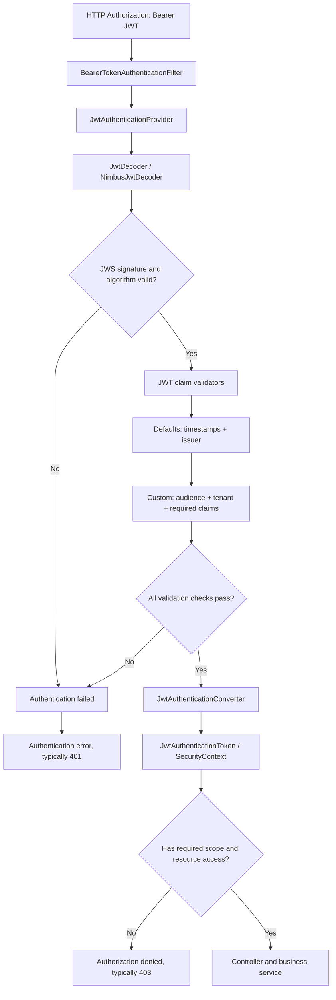

# `OAuth2TokenValidator`, `JwtClaimValidator`, and Custom Rules

In a **Spring Security OAuth 2.0 Resource Server**, verifying a JWT signature is essential, yet **not sufficient to accept the token for an API**. A validly signed access token can still come from the wrong issuer, be expired, target a different Resource Server, or violate a system-specific claim contract.

Spring Security provides two very useful building blocks for expressing claim validation rules:

- **`OAuth2TokenValidator<Jwt>`:** A general interface that receives a `Jwt` object and returns a validation result. Use it for simple or complex conditions, cross-claim checks, or application-specific constraints.
- **`JwtClaimValidator<T>`:** An `OAuth2TokenValidator<Jwt>` implementation tailored to checking **a single claim** with a `Predicate<T>`. Ideal for concise, clear, claim-value rules.

Validators can be combined via **`DelegatingOAuth2TokenValidator`** and attached to `JwtDecoder` alongside default issuer/timestamp checks. This stage **determines whether a token is valid for authentication at the Resource Server**; it does not replace endpoint-level authorization.

This lesson focuses on choosing the right validator, writing safe custom rules, composing them into a complete validation chain, and handling missing, mistyped, or non-conforming claims.

## 1. Where Claim Validation Fits in an Access Token's Journey

Suppose the Orders API receives a request:

```http
GET /api/orders/42 HTTP/1.1
Host: api.example.test
Authorization: Bearer <ACCESS_TOKEN>
Accept: application/json
```

The request follows a typical flow:



**Do not blur these three boundaries:**

1. **Signature and key-source verification:** Was the JWT signed with a trusted key and allowed algorithm without tampering?
2. **Token validation:** Do the token's claims satisfy the Resource Server's contract—such as `iss`, `exp`, `nbf`, `aud`, `tenant_id`?
3. **Authorization:** Does the authenticated caller have the required scope/authority, role, and permission for order 42?

A **cryptographically valid** JWT can still be rejected by an `OAuth2TokenValidator<Jwt>`. Conversely, a token that passes every validator can still be blocked by `AuthorizationFilter` or method security.

### 1.1. Sample Token Used Throughout This Lesson

Suppose the Authorization Server issues a JWT access token for the Orders API:

```json
{
  "iss": "https://login.example.test/realms/shop",
  "sub": "user-123",
  "aud": ["orders-api"],
  "client_id": "shop-web",
  "scope": "orders.read",
  "tenant_id": "shop",
  "iat": 1794715200,
  "nbf": 1794715200,
  "exp": 1794718800
}
```

In this lesson:

| Field | Expected Value or Meaning |
|---|---|
| `iss` | Issuer trusted by the Resource Server: `https://login.example.test/realms/shop` |
| `aud` | Includes `orders-api`: token was issued for the Orders API |
| `exp` | Token has an expiration time and has not expired under the time policy |
| `nbf` | If present, token must not be used prior to its start time |
| `tenant_id` | Contract-defined custom claim, e.g., tenant `shop` |
| `client_id` | Application that requested the token, e.g., `shop-web`; not the audience |
| `scope` | Permission scopes, e.g., `orders.read`; used for authorization |
| `sub` | Subject asserted by the issuer; may be a user or service principal depending on grant |

**The JSON above is purely an illustrative payload**, not a signed JWT. Never extract claims from an unverified payload to grant access.

## 2. What Is `OAuth2TokenValidator<Jwt>`?

Spring Security defines `OAuth2TokenValidator<T>` as a validation contract. For JWTs, developers work with `OAuth2TokenValidator<Jwt>`.

Conceptual signature:

```java
public interface OAuth2TokenValidator<T extends OAuth2Token> {
    OAuth2TokenValidatorResult validate(T token);
}
```

A validator receives **a token constructed by the decoder**, evaluates its validity under policy, and returns:

- `OAuth2TokenValidatorResult.success()` when the rule passes.
- `OAuth2TokenValidatorResult.failure(OAuth2Error)` or a collection of errors when the rule fails.

Example audience validator:

```java
OAuth2TokenValidator<Jwt> audienceValidator = jwt -> {
    if (jwt.getAudience().contains("orders-api")) {
        return OAuth2TokenValidatorResult.success();
    }

    return OAuth2TokenValidatorResult.failure(
        new OAuth2Error(
            "invalid_token",
            "Access token is not intended for orders-api",
            null
        )
    );
};
```

Basic imports:

```java
import org.springframework.security.oauth2.core.OAuth2Error;
import org.springframework.security.oauth2.core.OAuth2TokenValidator;
import org.springframework.security.oauth2.core.OAuth2TokenValidatorResult;
import org.springframework.security.oauth2.jwt.Jwt;
```

This example expresses a small yet essential rule: the token is accepted at the Orders API only if `aud` contains the API's configured audience.

### 2.1. What Level of Data Can a Validator Inspect?

Given a `Jwt`, a validator can read:

```java
jwt.getIssuer();
jwt.getAudience();
jwt.getSubject();
jwt.getExpiresAt();
jwt.getIssuedAt();
jwt.getNotBefore();
jwt.getClaimAsString("tenant_id");
jwt.getClaims();
jwt.getHeaders();
```

A validator can therefore inspect **multiple claims at once**—for example, requiring `tenant_id=shop` only when `client_id=partner-app`, or checking that the tenant belongs to a server-managed allowlist.

However, being able to read everything **does not mean cramming every rule into a single validator**. Keep independent, reusable constraints cleanly separated so readers can immediately see which rule rejected a token.

### 2.2. Validators Do Not Decode or Verify Signatures

`OAuth2TokenValidator<Jwt>` is not responsible for fetching JWKS, selecting public keys, or verifying JWS signatures. Those belong to signature processing inside `JwtDecoder`. Nor is a validator responsible for converting `scope` into `GrantedAuthority`; that belongs to converters and the authorization layer.

A rule checking `tenant_id` **must never replace** signature or issuer verification.

## 3. `OAuth2TokenValidatorResult` and `OAuth2Error`

Example error returned by a validator:

```java
new OAuth2Error(
    "invalid_token",
    "Required tenant_id claim is missing",
    null
);
```

The three arguments are the error code, description, and optional reference URI. For JWT validation errors, `invalid_token` is the standard code used in examples so Spring Security treats it as a token rejection.

| Type | Role |
|---|---|
| `OAuth2TokenValidatorResult.success()` | Signals the validator accepts the token under this rule. |
| `OAuth2TokenValidatorResult.failure(error)` | Signals failure and carries the validation error. |
| `OAuth2Error` | Holds error code, description, and optional URI. |
| `DelegatingOAuth2TokenValidator` | Invokes multiple validators and aggregates required results. |

In real applications, **never place raw access tokens, private user data, or secrets inside error descriptions**. Descriptions exist for diagnostics and should not necessarily be echoed verbatim to callers.

### 3.1. Helper Method for Cleaner Validators

When writing multiple custom validators, a helper keeps code concise:

```java
private static OAuth2TokenValidatorResult invalid(String reason) {
    return OAuth2TokenValidatorResult.failure(
        new OAuth2Error("invalid_token", reason, null)
    );
}
```

Then:

```java
OAuth2TokenValidator<Jwt> requiredSubject = jwt ->
    jwt.getSubject() != null && !jwt.getSubject().isBlank()
        ? OAuth2TokenValidatorResult.success()
        : invalid("Missing required subject");
```

Requiring `sub` makes sense only when the **issuer's token contract** mandates it. Under certain grants or custom profiles, subject semantics can differ from an interactive logged-in user.

## 4. `JwtClaimValidator<T>`: Validating a Single Claim with a `Predicate`

When a rule targets **one claim**, Spring Security provides `JwtClaimValidator<T>`.

Example requiring tenant `shop`:

```java
OAuth2TokenValidator<Jwt> tenantValidator =
    new JwtClaimValidator<String>(
        "tenant_id",
        "shop"::equals
    );
```

Import:

```java
import org.springframework.security.oauth2.jwt.JwtClaimValidator;
```

Structure:

```text
JwtClaimValidator<T>(claimName, predicate)
                                 │
                                 ▼
              Read claim from Jwt and pass to Predicate<T>
                                 │
                  ┌──────────────┴──────────────┐
                  │                             │
              predicate=true                predicate=false
                  │                             │
              success()                  failure(...)
```

Advantages:

- Concise and clearly expresses a single-claim check.
- Reuses standard Java `Predicate<T>`.
- Avoids writing full `OAuth2TokenValidatorResult` boilerplate for every rule.
- Composes cleanly with other validators inside `DelegatingOAuth2TokenValidator`.

### 4.1. Example: Allowing Only Tenants in an Allowlist

```java
Set<String> allowedTenants = Set.of("shop", "partner-shop");

OAuth2TokenValidator<Jwt> tenantValidator =
    new JwtClaimValidator<String>(
        "tenant_id",
        allowedTenants::contains
    );
```

Additional import:

```java
import java.util.Set;
```

**The allowlist must come from trusted Resource Server configuration**, never from a header or query parameter sent by the client.

If a token carries `tenant_id=unknown`, the predicate returns `false` and the token is rejected during validation.

### 4.2. Example: Requiring Audience Membership in a List

Under JWT, `aud` is a string or string array; inside Spring Security's `Jwt`, `getAudience()` returns a list of audiences. In some cases, `JwtClaimValidator<List<String>>` can be used:

```java
OAuth2TokenValidator<Jwt> audienceValidator =
    new JwtClaimValidator<List<String>>(
        "aud",
        audiences -> audiences != null &&
            audiences.contains("orders-api")
    );
```

Import:

```java
import java.util.List;
```

When token sources vary in claim representation or you want a clearer error message, writing a validator that calls `jwt.getAudience()` directly gives better control:

```java
OAuth2TokenValidator<Jwt> audienceValidator = jwt ->
    jwt.getAudience().contains("orders-api")
        ? OAuth2TokenValidatorResult.success()
        : invalid("Unexpected audience");
```

**Audience is not the client ID.** When client `shop-web` calls Resource Server `orders-api`, the API should check `aud=orders-api`, not `aud=shop-web`. Do not copy OIDC ID token audience rules (which target the relying party) onto API access tokens.

### 4.3. Example: Checking Type and Value of a Custom Claim

If the issuer guarantees `token_version` is an integer, you might write a typed predicate:

```java
OAuth2TokenValidator<Jwt> versionValidator =
    new JwtClaimValidator<Integer>(
        "token_version",
        version -> version != null && version >= 2
    );
```

Be cautious: after JSON parsing, a claim's Java runtime type can differ from expectations depending on the claim converter and implementation. A JSON number might deserialize as `Integer` or `Long`; guessing the wrong type causes `Predicate<Integer>` to throw a `ClassCastException` at runtime.

For claims whose numeric/Java type may vary, either establish an explicit claim conversion contract or use `OAuth2TokenValidator<Jwt>` with controlled `instanceof` checks.

Example:

```java
OAuth2TokenValidator<Jwt> versionValidator = jwt -> {
    Object raw = jwt.getClaim("token_version");

    if (!(raw instanceof Number)) {
        return invalid("token_version must be numeric");
    }

    int version = ((Number) raw).intValue();

    return version >= 2
        ? OAuth2TokenValidatorResult.success()
        : invalid("Unsupported token_version");
};
```

This shows how **a general validator can safely enforce type checks**. When high numeric precision matters, avoid narrowing `Number` to `int` blindly; base checks on the exact type and range guaranteed by the issuer.

### 4.4. When Should You Use `JwtClaimValidator`?

| Requirement | Typical Best Fit |
|---|---|
| `tenant_id` must equal a fixed string | `JwtClaimValidator<String>` with an equals predicate |
| `client_id` must belong to a managed allowlist | `JwtClaimValidator<String>` with a contains predicate |
| `aud` must contain the API audience | `JwtClaimValidator<List<String>>` if claim type is stable, or a general validator reading `getAudience()` |
| Claim has complex or varying Java types | `OAuth2TokenValidator<Jwt>` with explicit type checks and clear errors |
| Comparing two or more claims together | `OAuth2TokenValidator<Jwt>` |
| Conditions relative to current time | General validator using `Clock`/`Instant` |
| Checking attributes of a specific HTTP request | Usually **does not** belong in a shared JWT validator; prefer authorization or request-scoped policies |

## 5. Missing Claims, Null Claims, and Required-Claim Rules

A JWT may omit a custom claim expected by the application. Distinguish:

1. **Claim present with valid value.**
2. **Claim present with wrong value.**
3. **Claim absent or mapped to `null`.**
4. **Claim present with wrong Java type.**

Never write a predicate assuming the value is non-null:

```java
// Risk of NullPointerException when claim is missing:
new JwtClaimValidator<String>(
    "tenant_id",
    value -> value.equals("shop")
);
```

Safer form:

```java
new JwtClaimValidator<String>(
    "tenant_id",
    "shop"::equals
);
```

With the method reference above, when `value == null`, the comparison safely returns `false` instead of dereferencing `null`.

### 5.1. Optional vs. Required Claims

Certain claims are **optional in the general JWT format**, yet an organization may enforce stricter requirements. For example:

- `exp` must be present in every API access token.
- `tenant_id` is mandatory in a multi-tenant system.
- `client_id` is mandatory if resource policy depends on the OAuth client.
- `sub` must be a non-empty string if every access token represents a subject by contract.

Example requiring `exp` presence:

```java
OAuth2TokenValidator<Jwt> expirationRequired = jwt ->
    jwt.getExpiresAt() != null
        ? OAuth2TokenValidatorResult.success()
        : invalid("Missing exp claim");
```

This is a **presence check**; it does not replace `JwtTimestampValidator` for checking expiration. If your access token profile mandates `exp`, enforce **both presence and time validity**.

Example requiring non-blank `sub`:

```java
OAuth2TokenValidator<Jwt> subjectRequired = jwt -> {
    String subject = jwt.getSubject();

    if (subject == null || subject.isBlank()) {
        return invalid("Missing required subject");
    }

    return OAuth2TokenValidatorResult.success();
};
```

Do not force `sub` to look like an email address or numeric user ID if the Authorization Server issues service principals or pairwise identifiers.

## 6. Preserving Default Validators with `JwtValidators`

Spring Security offers factories for standard validation suites:

```java
OAuth2TokenValidator<Jwt> defaults =
    JwtValidators.createDefault();

OAuth2TokenValidator<Jwt> defaultsAndIssuer =
    JwtValidators.createDefaultWithIssuer(
        "https://login.example.test/realms/shop"
    );
```

These factories establish baseline checks matching your Spring Security version—typically timestamp validation, and issuer validation in `createDefaultWithIssuer`.

**Never assume** setting a new audience validator automatically keeps issuer/time validators:

```java
// Avoid if this is the only validator attached to the decoder:
decoder.setJwtValidator(audienceValidator);
```

`setJwtValidator(...)` replaces whatever validator chain was previously configured. Passing only an audience validator can silently drop critical issuer and expiration checks.

Standard composition pattern:

```java
OAuth2TokenValidator<Jwt> combined =
    new DelegatingOAuth2TokenValidator<>(
        JwtValidators.createDefaultWithIssuer(ISSUER),
        audienceValidator,
        tenantValidator
    );

decoder.setJwtValidator(combined);
```

The exact validators inside the factory can evolve across library releases. If your project requires a stricter profile or custom clock skew/defaults, inspect what your version applies and assemble an explicit chain.

### 6.1. Never Validate Issuer with `startsWith`

An issuer is a **trusted identifier**, e.g.:

```text
https://login.example.test/realms/shop
```

A token from:

```text
https://login.example.test/realms/admin
```

does not come from the configured issuer merely because it shares a host or path prefix. Always use the exact contract issuer string with a standard validator like `JwtIssuerValidator` or `createDefaultWithIssuer`.

Never treat an `iss` read from an unverified JWT as a trusted issuer and dynamically fetch metadata/JWKS from arbitrary URLs. When multiple issuers are permitted, maintain an explicitly governed trusted-issuer list.

## 7. How `DelegatingOAuth2TokenValidator` Combines Conditions

An API might require:

- Exact trusted issuer.
- Unexpired token.
- Audience containing `orders-api`.
- Tenant in an allowlist.
- Mandatory `exp` claim.

Compose them as:

```java
OAuth2TokenValidator<Jwt> combined =
    new DelegatingOAuth2TokenValidator<>(
        JwtValidators.createDefaultWithIssuer(ISSUER),
        audienceValidator,
        tenantValidator,
        expirationRequired
    );
```

**For the final decision, this acts as a logical AND:** the token must satisfy every required rule. If any rule fails, the decoder rejects the token.

| JWT Signature | Defaults + Issuer | Audience | Tenant | Required `exp` | Outcome |
|---|---|---|---|---|---|
| Invalid | Cannot trust claims | — | — | — | Rejected at signature verification |
| Valid | Pass | Pass | Pass | Pass | Token passes validation |
| Valid | Expired | Pass | Pass | Pass | Rejected |
| Valid | Pass | Wrong | Pass | Pass | Rejected |
| Valid | Pass | Pass | Wrong | Pass | Rejected |
| Valid | Pass | Pass | Pass | Missing `exp` | Rejected |
| Valid | Wrong issuer | Wrong audience | Pass | Pass | Rejected |

Validators may collect multiple errors; never write logic relying on "which validator definitely runs first" or expecting one validator to mutate claims for the next. **Validators evaluate predicates; they are not a claim-transformation pipeline.**

### 7.1. Do Not Confuse Validators with Converters

A JWT Resource Server involves three related yet distinct processing roles:

| Processing Step | Component | Result |
|---|---|---|
| Parsing / normalizing claim data | JWT parser or claim-set converter | Claims inside `Jwt` with expected Java types/formats |
| Deciding whether the token is valid | `OAuth2TokenValidator<Jwt>` | `success` or `failure` |
| Converting claims into authorities | `JwtAuthenticationConverter` / `JwtGrantedAuthoritiesConverter` | `JwtAuthenticationToken` with `GrantedAuthority` instances |

For example, when `scope` is issued as:

```json
"scope": "orders.read orders.write"
```

Spring Security can produce:

```text
SCOPE_orders.read
SCOPE_orders.write
```

This is **authority mapping**, not a timestamp/audience validity rule. Endpoint rules such as `hasAuthority("SCOPE_orders.write")` belong to authorization.

## 8. Building a `JwtDecoder` with Multiple Custom Rules

The following example shows a complete Spring Security validator wiring. The system trusts only the `shop` issuer and accepts tokens for `orders-api` with tenant `shop`.

```java
@Configuration
public class JwtValidationConfig {

    private static final String ISSUER =
        "https://login.example.test/realms/shop";

    private static final String EXPECTED_AUDIENCE =
        "orders-api";

    private static final String EXPECTED_TENANT =
        "shop";

    @Bean
    JwtDecoder jwtDecoder() {
        NimbusJwtDecoder decoder =
            NimbusJwtDecoder.withIssuerLocation(ISSUER).build();

        OAuth2TokenValidator<Jwt> issuerAndDefaults =
            JwtValidators.createDefaultWithIssuer(ISSUER);

        OAuth2TokenValidator<Jwt> audienceValidator = jwt ->
            jwt.getAudience().contains(EXPECTED_AUDIENCE)
                ? OAuth2TokenValidatorResult.success()
                : invalid("Unexpected audience");

        OAuth2TokenValidator<Jwt> tenantValidator =
            new JwtClaimValidator<String>(
                "tenant_id",
                EXPECTED_TENANT::equals
            );

        OAuth2TokenValidator<Jwt> expirationRequired = jwt ->
            jwt.getExpiresAt() != null
                ? OAuth2TokenValidatorResult.success()
                : invalid("Missing exp");

        decoder.setJwtValidator(
            new DelegatingOAuth2TokenValidator<>(
                issuerAndDefaults,
                audienceValidator,
                tenantValidator,
                expirationRequired
            )
        );

        return decoder;
    }

    private static OAuth2TokenValidatorResult invalid(
            String description) {
        return OAuth2TokenValidatorResult.failure(
            new OAuth2Error("invalid_token", description, null)
        );
    }
}
```

Imports:

```java
import org.springframework.context.annotation.Bean;
import org.springframework.context.annotation.Configuration;
import org.springframework.security.oauth2.core.OAuth2Error;
import org.springframework.security.oauth2.core.OAuth2TokenValidator;
import org.springframework.security.oauth2.core.OAuth2TokenValidatorResult;
import org.springframework.security.oauth2.core.DelegatingOAuth2TokenValidator;
import org.springframework.security.oauth2.jwt.Jwt;
import org.springframework.security.oauth2.jwt.JwtClaimValidator;
import org.springframework.security.oauth2.jwt.JwtDecoder;
import org.springframework.security.oauth2.jwt.JwtValidators;
import org.springframework.security.oauth2.jwt.NimbusJwtDecoder;
```

### 8.1. Why Each Component Is Needed

**`withIssuerLocation(ISSUER)`:** Configures the decoder for a trusted issuer and may use discovery to locate JWKS as supported by Spring Security. If the issuer lacks compatible discovery, configure `jwk-set-uri` directly.

**`createDefaultWithIssuer(ISSUER)`:** Retains standard checks, including issuer and timestamp validity for your version.

**Audience validator:** Confirms the token targets `orders-api`, rather than another API or the OAuth client itself.

**`JwtClaimValidator<String>` for tenant:** Enforces the custom `tenant_id` claim per contract. If the real issuer does not include that tenant claim, do not blindly enforce this rule.

**Expiration presence:** Requires `exp` to be present. Checking whether it has expired remains the timestamp validator's job.

**`DelegatingOAuth2TokenValidator`:** Forces the decoder to reject the token if any condition fails.

### 8.2. Connecting the Decoder to the Servlet Filter Chain

```java
@Configuration
public class SecurityConfig {

    @Bean
    SecurityFilterChain securityFilterChain(HttpSecurity http)
            throws Exception {
        return http
            .authorizeHttpRequests(auth -> auth
                .requestMatchers("/public/**").permitAll()
                .requestMatchers(HttpMethod.GET, "/api/orders/**")
                    .hasAuthority("SCOPE_orders.read")
                .requestMatchers(HttpMethod.POST, "/api/orders/**")
                    .hasAuthority("SCOPE_orders.write")
                .anyRequest().authenticated()
            )
            .oauth2ResourceServer(oauth2 ->
                oauth2.jwt(Customizer.withDefaults()))
            .build();
    }
}
```

Imports:

```java
import org.springframework.context.annotation.Bean;
import org.springframework.context.annotation.Configuration;
import org.springframework.http.HttpMethod;
import org.springframework.security.config.Customizer;
import org.springframework.security.config.annotation.web.builders.HttpSecurity;
import org.springframework.security.web.SecurityFilterChain;
```

When a `JwtDecoder` bean is registered, the JWT Resource Server branch uses that configured decoder as supported by the framework. **Do not assume defining a custom decoder bean preserves all Spring Boot auto-configuration properties.** Register all essential constraints explicitly in the active bean.

The `authorizeHttpRequests` block performs authorization: a token accepted by the decoder still needs `SCOPE_orders.read` or `SCOPE_orders.write` for the respective HTTP method.

## 9. Comparing Auto-Configuration vs. Custom Decoder

If you only need issuer and audience on Spring Boot versions supporting the corresponding properties, a simple configuration may suffice:

```yaml
spring:
  security:
    oauth2:
      resourceserver:
        jwt:
          issuer-uri: https://login.example.test/realms/shop
          audiences:
            - orders-api
```

However, if you need to check `tenant_id`, `token_version`, `exp` presence, or cross-claim rules, a custom decoder bean lets you attach dedicated validators.

| Need | Common Choice |
|---|---|
| Standard issuer + audience only | Spring Boot properties if supported by your version |
| One additional required claim | Custom `JwtClaimValidator` or general validator wired into the decoder |
| Cross-claim relationships | `OAuth2TokenValidator<Jwt>` |
| Custom JWT timestamp skew | `JwtTimestampValidator` with an explicit validator group |
| AS lacks compatible discovery | Configure `jwk-set-uri` alongside an issuer validator |
| Multiple issuers | Per-issuer decoder/resolver from a trusted issuer allowlist with matching validators |
| Opaque tokens | Never apply `JwtClaimValidator` directly; rely on introspection contract and validators for AS attributes |

### 9.1. Static JWKS Configuration

If not using issuer discovery to locate keys:

```java
NimbusJwtDecoder decoder =
    NimbusJwtDecoder.withJwkSetUri(
        "https://login.example.test/realms/shop/protocol/openid-connect/certs"
    ).build();
```

You must still attach:

```java
decoder.setJwtValidator(
    new DelegatingOAuth2TokenValidator<>(
        JwtValidators.createDefaultWithIssuer(ISSUER),
        audienceValidator,
        tenantValidator
    )
);
```

**A JWK Set URI only identifies the signing-key source**—it does not replace checking `iss`, `aud`, or other constraints. Nor should you ever read an arbitrary JWKS URI from a client-supplied JWT header.

## 10. Custom Rules When Two Claims Must Be Consistent

A constraint that cannot be expressed naturally as a single-claim predicate may involve **a relationship between two claims**.

Suppose the AS contract states:

- Tokens with `token_kind=user` must have a `sub` starting with the user prefix.
- Tokens with `token_kind=service` must have a `client_id` in the approved service-client allowlist.
- All other token kinds are rejected.

This is an **illustrative policy for a hypothetical system**, not a standard requirement of every Authorization Server.

```java
OAuth2TokenValidator<Jwt> kindValidator = jwt -> {
    String kind = jwt.getClaimAsString("token_kind");
    String subject = jwt.getSubject();
    String clientId = jwt.getClaimAsString("client_id");

    if ("user".equals(kind)) {
        if (subject != null && subject.startsWith("user-")) {
            return OAuth2TokenValidatorResult.success();
        }
        return invalid("User token must have user subject");
    }

    if ("service".equals(kind)) {
        Set<String> allowedServices =
            Set.of("orders-worker", "report-scheduler");

        if (allowedServices.contains(clientId)) {
            return OAuth2TokenValidatorResult.success();
        }
        return invalid("Service client is not allowed");
    }

    return invalid("Unsupported token_kind");
};
```

This rule only makes sense if the AS **actually emits** `token_kind` with those semantics. If your system uses another token-type standard, follow the actual profile.

### When Should Rules Like This Stay Out of the Global Decoder?

If the same Resource Server exposes endpoints for both users and services with different permissions, validating **general token kind** in the decoder may make sense, whereas "only services may call `POST /batch/import`" is usually **endpoint-level authorization**, not a system-wide invalid-token rule.

Putting an endpoint-specific rule inside the global JWT validator would wrongly reject valid user tokens at authentication time even for endpoints they are allowed to call.

## 11. Custom Time Rules Using `Clock`

Standard validators check token validity against `exp` and `nbf`. When a system enforces a custom policy—such as **admin API tokens must be no older than 10 minutes from `iat`**—you can build a validator backed by `Clock`.

```java
Clock clock = Clock.systemUTC();

OAuth2TokenValidator<Jwt> maxAgeValidator = jwt -> {
    Instant issuedAt = jwt.getIssuedAt();

    if (issuedAt == null) {
        return invalid("Missing iat");
    }

    Instant now = clock.instant();
    Duration age = Duration.between(issuedAt, now);

    if (age.isNegative() ||
        age.compareTo(Duration.ofMinutes(10)) > 0) {
        return invalid("Token age is not allowed");
    }

    return OAuth2TokenValidatorResult.success();
};
```

Imports:

```java
import java.time.Clock;
import java.time.Duration;
import java.time.Instant;
```

**Notes:**

- This is an **additional token-age policy**, not a replacement for `JwtTimestampValidator` and unexpired `exp`.
- If the issuer and Resource Server clocks can drift slightly, account for a reasonable clock skew; the simple snippet above rejects any `iat` in the future.
- Do not impose a 10-minute rule across all tokens if the AS legitimately issues longer-lived tokens and the API contract does not require it.
- Prefer injecting a configured `Clock` rather than hardcoding hard-to-test time calls.

### 11.1. When You Need to Change Clock Skew

Spring Security provides `JwtTimestampValidator`:

```java
JwtTimestampValidator timestampValidator =
    new JwtTimestampValidator(Duration.ofSeconds(45));
```

Import:

```java
import org.springframework.security.oauth2.jwt.JwtTimestampValidator;
```

When you need to **explicitly replace** the default timestamp policy, assemble an explicit validator group:

```java
OAuth2TokenValidator<Jwt> validators =
    new DelegatingOAuth2TokenValidator<>(
        new JwtTimestampValidator(Duration.ofSeconds(45)),
        new JwtIssuerValidator(ISSUER),
        audienceValidator,
        expirationRequired,
        tenantValidator
    );

decoder.setJwtValidator(validators);
```

Additional import:

```java
import org.springframework.security.oauth2.jwt.JwtIssuerValidator;
```

This illustrates **taking explicit ownership of the validator chain**. If your profile or Spring Security version includes additional default checks, include them here. Never place a second `JwtTimestampValidator` alongside the default group expecting to "override" tolerance: if both execute, the stricter one still rejects tokens.

Clock skew is a technical tolerance for clock drift, **not a workaround for extending token lifetimes to avoid operational errors**.

## 12. Audience Validator: One Resource or Several?

### 12.1. A Resource Server With One Audience

Example:

```java
OAuth2TokenValidator<Jwt> audienceValidator = jwt ->
    jwt.getAudience().contains("orders-api")
        ? OAuth2TokenValidatorResult.success()
        : invalid("Invalid audience");
```

Valid tokens must include `orders-api` in `aud`, even if other audiences are also present.

### 12.2. An API Accepting Two Identifiers During Migration

Suppose an API is migrating from `orders-api-v1` to `orders-api-v2` while both genuinely represent the same API under the AS contract:

```java
Set<String> allowedAudiences =
    Set.of("orders-api-v1", "orders-api-v2");

OAuth2TokenValidator<Jwt> audienceValidator = jwt -> {
    boolean matched = jwt.getAudience().stream()
        .anyMatch(allowedAudiences::contains);

    return matched
        ? OAuth2TokenValidatorResult.success()
        : invalid("Invalid audience");
};
```

This is an **OR condition across allowed audience values** encapsulated inside **one validator**. When placed inside `DelegatingOAuth2TokenValidator`, this entire audience rule still combines with **AND** alongside issuer, timestamps, and other required constraints.

Never add `payments-api` or every organizational audience to the accepted set just to reduce 401 errors. That lets the API accept tokens meant for other services, breaking resource boundaries.

### 12.3. Must All Audiences Be Present or Just One?

Two policies carry different semantics:

```java
// Contains at least one allowed audience:
audiences.stream().anyMatch(allowed::contains);

// Contains every required audience:
audiences.containsAll(required);
```

For a standalone Resource Server, a token normally only needs to carry **that API's identifier**. Requiring multiple audiences simultaneously is a specialized policy that can accidentally weaken least-privilege if it forces clients to obtain overly broad multi-resource tokens. Choose according to the real contract, not simply because configuration holds multiple strings.

## 13. Tenant Validation and Tenant Authorization Are Two Different Things

A multi-tenant system may emit:

```json
{
  "iss": "https://login.example.test/realms/shop",
  "aud": ["orders-api"],
  "tenant_id": "shop",
  "sub": "user-123"
}
```

If a Resource Server is deployed **exclusively for the `shop` tenant**, the validator:

```java
new JwtClaimValidator<String>(
    "tenant_id",
    "shop"::equals
);
```

rejects tokens from other tenants, even when signed by a shared issuer.

However, if a single API **serves multiple tenants**, hardcoding `tenant_id=shop` in the global decoder rejects valid tokens for other tenants. Instead:

- The token validator can confirm the tenant claim **is present and matches a valid format/allowlist**.
- Per-request authorization verifies the caller is allowed to access **the target record's tenant**.

Example:

```text
Verified token:
  tenant_id = shop
  sub = user-123
  scope = orders.read

HTTP:
  GET /api/tenants/partner/orders/42

Claim validation step:
  token is valid for this API and trusted issuer

Business authorization step:
  Is tenant_id=shop allowed to read tenant=partner?
  -> Normally denied unless special privilege exists
```

Never take an expected tenant from a request query or path and use it as a "trusted reference" to approve token validity without proper authorization policy. Request paths are caller-controlled inputs; tenant/object access must be grounded in managed authorization data.

## 14. Client Identity, Scopes, and Token Type: Do Not Mix Purposes

### 14.1. `client_id` as an Additional Constraint

An API restricted to approved integrations might require `client_id` to be in an allowlist:

```java
Set<String> allowedClients =
    Set.of("shop-web", "trusted-batch-worker");

OAuth2TokenValidator<Jwt> clientValidator =
    new JwtClaimValidator<String>(
        "client_id",
        allowedClients::contains
    );
```

This is appropriate only when `client_id` is **signed and reliably defined** by the issuer under the access token contract. If the issuer uses another claim such as `azp`, verify its exact semantics rather than guessing from its name.

**`client_id` never replaces `aud`.** Which client requested the token and which API may receive it are independent facts.

### 14.2. Scope Authorization Usually Belongs Outside the JWT Validator

Suppose an API access token carries:

```json
"scope": "orders.read"
```

A GET endpoint requires `orders.read`, while a POST endpoint requires `orders.write`. If the global decoder required both scopes, valid read-only tokens would be rejected with `401` right at authentication.

Typical design:

```java
.requestMatchers(HttpMethod.GET, "/api/orders/**")
    .hasAuthority("SCOPE_orders.read")
.requestMatchers(HttpMethod.POST, "/api/orders/**")
    .hasAuthority("SCOPE_orders.write")
```

The converter maps scopes to `SCOPE_...`; authorization enforces them per HTTP method and route.

If the contract genuinely mandates that **every token reaching the Resource Server carry a syntactically valid scope claim**, a structural claim validator makes sense. However, **permission to invoke a specific operation** normally belongs in authorization.

### 14.3. An OIDC ID Token Is Not an Access Token

An OIDC ID token may be a JWT signed by the same issuer using the same JWKS. Its `aud` typically contains the OAuth/OIDC client ID, such as `shop-web`, whereas an access token for the Orders API needs audience `orders-api`.

A proper Resource Server never accepts an ID token merely because the signature is valid. If the issuer follows the JWT Profile for OAuth 2.0 Access Tokens (RFC 9068), you may also need to verify the appropriate token type/profile, such as the `typ` header for access tokens.

Type validation may live in the JOSE/JWT decoder configuration or in validators depending on framework version, so never write a lone header predicate and assume all profile rules are covered. **Audience and token type provide complementary layers of defense.**

## 15. Mistyped Claim Data: Validation or Conversion?

When integrating with an AS, you may encounter varying representations:

```json
{
  "aud": ["orders-api"],
  "tenant_id": "shop",
  "token_version": 2,
  "groups": ["sales", "support"]
}
```

Another issuer might emit:

```json
{
  "aud": "orders-api",
  "tenant_id": 17,
  "token_version": "2",
  "groups": "sales support"
}
```

Never assume different formats carry identical semantics unless the contract specifies so.

There are two strategies:

**Strategy A — Strict validation:** Reject the token if a claim has the wrong type. Best for systems requiring crisp contracts without ambiguous coercion:

```java
OAuth2TokenValidator<Jwt> tenantFormatValidator = jwt -> {
    Object raw = jwt.getClaim("tenant_id");

    if (raw instanceof String value && !value.isBlank()) {
        return OAuth2TokenValidatorResult.success();
    }

    return invalid("tenant_id must be a nonblank string");
};
```

This uses pattern-matching `instanceof` (on supported Java versions).

**Strategy B — Intentional claim-set conversion:** If the AS formally commits to an alternative format, a converter can normalize claims before validators and authority converters consume them, within decoder capabilities. Proceed carefully because **transforming data before validating claims can alter security semantics**.

For example, never automatically:

- Convert every `"true"` string to boolean `true` without a contract.
- Coerce numeric tenant IDs into strings arbitrarily if `tenant_id` is an authorization key.
- Join a groups array into one unescaped string, risking group confusion.
- Discard unrecognized values instead of rejecting tokens violating a required constraint.

Both validation and conversion must be identical across every Resource Server instance so the same token is never accepted on one node and rejected on another due to parser differences.

## 16. Timestamp Claim Checks and Active Policy

Time claims have distinct responsibilities:

| Claim | Function | Common Mistake |
|---|---|---|
| `exp` | When the token expires | Checking presence without checking expiration |
| `nbf` | Earliest time the token is valid | Ignoring it, allowing premature use |
| `iat` | When the token was issued | Treating it as `exp` even though the AS ties no TTL contract to `iat` |
| Clock skew | Tolerance for system clock drift | Setting it huge to "fix" clock bugs |

In Spring Security, `JwtTimestampValidator` performs the standard timestamp checks. If policy requires `exp`, add a presence validator as shown earlier.

Comparison:

```text
JWT A:
  exp = 1900000000
  -> must verify current time is within the valid bound

JWT B:
  no exp claim
  -> policy requiring exp must reject, even if a timestamp validator
     only checks timestamps that are present

JWT C:
  iat = 1794715200
  -> reveals issuance time, not TTL by itself
```

### 16.1. Never Use Request Data as the Reference Clock

Validators must read time from a trusted server `Clock` or framework clock mechanism—never from a client-supplied HTTP header claiming the token is "not expired".

Synchronize clocks via NTP and choose an appropriate skew. Clock skew is not a mechanism for arbitrarily extending token lifetimes.

## 17. Unit-Testing Validators

To test predicate logic, you can construct a synthetic `Jwt` in a **unit test** without signing a real token. Example:

```java
@Test
void rejectsUnexpectedTenant() {
    OAuth2TokenValidator<Jwt> validator =
        new JwtClaimValidator<String>(
            "tenant_id",
            "shop"::equals
        );

    Instant now = Instant.now();

    Jwt jwt = Jwt.withTokenValue("test-only")
        .header("alg", "RS256")
        .subject("user-123")
        .audience(List.of("orders-api"))
        .claim("tenant_id", "other")
        .issuedAt(now)
        .expiresAt(now.plusSeconds(300))
        .build();

    OAuth2TokenValidatorResult result = validator.validate(jwt);

    assertTrue(result.hasErrors());
}
```

Illustrative imports:

```java
import static org.junit.jupiter.api.Assertions.assertTrue;
import java.time.Instant;
import java.util.List;
import org.junit.jupiter.api.Test;
import org.springframework.security.oauth2.core.OAuth2TokenValidator;
import org.springframework.security.oauth2.core.OAuth2TokenValidatorResult;
import org.springframework.security.oauth2.jwt.Jwt;
import org.springframework.security.oauth2.jwt.JwtClaimValidator;
```

**Important:** A `Jwt` built with the unit-test builder is **unsigned** and is **not evidence of a valid token**. This test only verifies the predicate against a claim value. Testing signature/JWKS/issuer verification and the real filter chain requires properly signed test tokens flowing through a real decoder in integration tests.

### 17.1. Cases Worth Covering in Lessons or Tests

| Claim Case | Expected Outcome |
|---|---|
| `aud` includes `orders-api` | Audience validator passes |
| `aud` contains only `payments-api` | Audience validator fails |
| `tenant_id` equals `shop` | Tenant validator passes |
| `tenant_id` has any other value | Tenant validator fails |
| Missing `tenant_id` | Required validator fails |
| Mistyped `tenant_id` | Rejected or handled per defined conversion contract |
| Missing `exp` when API requires it | Presence validator fails |
| `exp` in the past | Timestamp validator fails |
| `iss` differs from trusted issuer | Issuer validator fails |
| JWT with invalid signature | Decoder rejects before trusting claims |
| Valid JWT lacking endpoint scope | Authorization rejects after validation |

Never treat validator tests using `Jwt.withTokenValue(...)` as end-to-end proof for AS-issued access tokens. They simply isolate one piece of logic to verify exact conditions.

## 18. From Validator Failure to HTTP 401

Suppose a token is signed by the trusted issuer yet contains:

```json
{
  "iss": "https://login.example.test/realms/shop",
  "aud": ["payments-api"],
  "tenant_id": "shop",
  "exp": 1900000000
}
```

The Resource Server requires `aud=orders-api`. The flow can be:

1. `BearerTokenAuthenticationFilter` extracts the bearer token.
2. `JwtAuthenticationProvider` calls `JwtDecoder`.
3. JWS verification succeeds.
4. `DelegatingOAuth2TokenValidator` runs issuer/time and custom audience validators.
5. Audience validator returns `OAuth2TokenValidatorResult.failure(...)`.
6. The decoder rejects the token, typically throwing `JwtValidationException`.
7. The provider/filter translates this into a bearer authentication failure; the API typically returns `401` with code `invalid_token`.

Example response:

```http
HTTP/1.1 401 Unauthorized
WWW-Authenticate: Bearer error="invalid_token"
```

When a token has the right audience/tenant yet lacks the scope required for the endpoint, a different response occurs:

```http
HTTP/1.1 403 Forbidden
WWW-Authenticate: Bearer error="insufficient_scope"
```

These are typical examples; exact codes and headers depend on exception handlers and Spring Security configuration.

| Scenario | Is It a JWT Validator Error? | Typical Result |
|---|---|---|
| Invalid JWT signature | No; rejected at signature verification | `401` |
| Expired JWT | Yes, at timestamp validation | `401` |
| Wrong issuer | Yes, at issuer validation | `401` |
| Wrong audience | Yes, at audience validation | `401` |
| Missing required tenant | Yes, if tenant validation is configured | `401` |
| Valid JWT lacking `SCOPE_orders.read` | No; authorization | `403` |
| Valid JWT and scope, caller does not own the order | No; business authorization | `403` or `404` per policy |
| Valid JWT with sufficient permissions | No error | API processes request |

**Never turn every 403 into a decoder error** just to unify error responses. Doing so blurs authentication with authorization and can break tokens that are valid for other endpoints.

## 19. Common Mistakes When Writing Custom Validators

### Mistake 1 — Dropping Default Validators

```java
decoder.setJwtValidator(tenantValidator);
```

If this is the only validator set, the application drops previously active default checks. Always compose them:

```java
decoder.setJwtValidator(
    new DelegatingOAuth2TokenValidator<>(
        JwtValidators.createDefaultWithIssuer(ISSUER),
        audienceValidator,
        tenantValidator
    )
);
```

### Mistake 2 — Trusting Unverified Claims

Base64URL-decoding the payload and reading `tenant_id` to allow access before the decoder verifies the signature is unsafe. Claims may drive trust decisions **only after passing JWT verification**.

### Mistake 3 — Predicates That Throw `NullPointerException`

```java
value -> value.equals("shop")
```

This can throw when the claim is missing. Prefer:

```java
"shop"::equals
```

or explicit null checks.

### Mistake 4 — Using the Wrong Generic Type

```java
new JwtClaimValidator<Integer>(
    "token_version",
    version -> version >= 2
);
```

This fails if the parser represents `token_version` as `Long` or a string. Fix the claim type in the contract or use a general validator with explicit type checks.

### Mistake 5 — Reading Expected Values from the Caller

If a validator compares `aud` against an audience string supplied by the HTTP request itself, the caller can make the check pass trivially. Expected audience, tenant, and client allowlists must come from trusted configuration.

### Mistake 6 — Putting Endpoint-Specific Permissions in the Global Decoder

Requiring every JWT to contain `orders.write` forces valid read-only tokens to fail with `401`. HTTP-method permissions belong in authorization rules such as `hasAuthority("SCOPE_orders.write")`.

### Mistake 7 — Validating Issuer via `startsWith` or Domain Only

`https://login.example.test/realms/shop` and `https://login.example.test/realms/admin` can be two separate issuers. Enforce exact issuer matching per contract rather than host or path-prefix matching.

### Mistake 8 — Ignoring Token Type

A validly signed JWT might be an OIDC ID token rather than an access token. Validate intended purpose, audience, and profile—never treat a valid signature as sufficient.

### Mistake 9 — Catching Exceptions and Accepting the Token Anyway

A decoder or introspector wrapper must never fabricate a valid `Authentication` when validation fails just to "reduce login errors". If a token cannot be verified, protected endpoints must **fail closed**.

### Mistake 10 — Multiple Issuers With One Overly Broad Validator Set

When accepting multiple issuers/tenants, never pool every issuer, audience, and key into one unlinked policy. Identify the managed issuer and bind its matching decoder, audience, and claim semantics.

## 20. Multi-Tenant and Multi-Issuer: Constraints Must Travel in Pairs

Suppose a Resource Server trusts two issuers:

```text
Issuer A: https://login.example.test/realms/shop
  expected audience: orders-api-shop

Issuer B: https://login.example.test/realms/partner
  expected audience: orders-api-partner
```

A token with `iss=A` and `aud=orders-api-partner` is not valid merely because both strings appear in two separate global allowlists.

Proper design checks the **issuer–audience pair**:

```text
(iss=A, aud=orders-api-shop)      -> potentially valid
(iss=B, aud=orders-api-partner)   -> potentially valid
(iss=A, aud=orders-api-partner)   -> must not validate automatically
(iss=outside list)                -> reject
```

In a multi-issuer Spring Security application, a resolver architecture can select an `AuthenticationManager`/decoder per allowed issuer with matching validators attached. An unverified JWT's `iss` may act **solely as a selector among pre-approved issuers**; it must never cause the server to trust an arbitrary caller-specified issuer.

## 21. What Custom JWT Validation Does Not Solve

Even when every validator passes, risks outside claim validation remain.

**Revocation:** An unexpired, validly signed JWT could already be revoked. Local claim checks cannot detect revocation prior to `exp`. If business requirements demand up-to-date status, add mechanisms like denylists, introspection, or short-lived tokens by design.

**Bearer token replay:** Claims like `iss`, `aud`, and `client_id` do not prove the caller possesses the client's private key. If sender-constrained tokens are needed, consider DPoP or mTLS certificate-bound access tokens and verify the binding at the Resource Server.

**Ownership:** A token granting `orders.read` does not let a user view every order. Record and tenant ownership must still be checked in services or method security.

**JWKS/key rotation:** Validators run on data already decoded. Failure to locate a new `kid`, stale JWKS caches, or signature failures belong to the decoder/JWK source—never fix them by removing claim validation.

**AS claim semantics:** A signed claim proves the issuer put that value into the token. It does not independently guarantee attributes like email or group membership were vetted against business rules unless the issuer commits to those semantics.

## 22. Sample Claim-Validation Contract for a Resource Server

A team can document its contract clearly:

```text
Resource Server:
  name: orders-api

Trusted issuer:
  https://login.example.test/realms/shop

Signature trust:
  JWKS of trusted issuer
  allowed signing algorithms according to policy

Token-wide validation:
  - Default JWT validation (time/profile conditions as configured)
  - iss must equal configured issuer
  - aud must contain orders-api
  - exp must exist and be valid
  - tenant_id must equal shop
  - token type must represent an access token

After authentication:
  - GET /api/orders/** requires SCOPE_orders.read
  - POST /api/orders/** requires SCOPE_orders.write
  - record access requires ownership/tenant policy
```

This structure separates the **token-wide contract** (enforced at the decoder) from **request/resource-specific policies** (enforced at authorization).

When errors happen, operations can pinpoint:

- Signature/signing-key errors.
- Issuer/time/audience/required-claim errors.
- Authority/scope errors.
- Record-authorization errors.

Instead of logging raw tokens, log error classification codes, request IDs, configured expected audience/issuer, and parameterized routes:

```text
request_id=req-123
resource_server=orders-api
auth_result=FAILED
reason=INVALID_TENANT_CLAIM
configured_issuer=https://login.example.test/realms/shop
expected_audience=orders-api
route=/api/orders/{id}
```

Never send real tokens or sensitive internal details in logs, traces, or error responses.

## 23. References for Deeper Study

- [Spring Security — OAuth 2.0 Resource Server JWT](https://docs.spring.io/spring-security/reference/servlet/oauth2/resource-server/jwt.html): configuring `JwtDecoder`, issuer, validation, and authority mapping.
- [Spring Security API — OAuth2TokenValidator](https://docs.spring.io/spring-security/site/docs/current/api/org/springframework/security/oauth2/core/OAuth2TokenValidator.html): contract for creating OAuth 2.0 token validators.
- [Spring Security API — JwtClaimValidator](https://docs.spring.io/spring-security/site/docs/current/api/org/springframework/security/oauth2/jwt/JwtClaimValidator.html): validating a single claim with a predicate.
- [Spring Security API — JwtValidators](https://docs.spring.io/spring-security/site/docs/current/api/org/springframework/security/oauth2/jwt/JwtValidators.html): default and issuer validation factories.
- [Spring Security API — DelegatingOAuth2TokenValidator](https://docs.spring.io/spring-security/site/docs/current/api/org/springframework/security/oauth2/core/DelegatingOAuth2TokenValidator.html): composing validation rules.
- [Spring Security API — JwtTimestampValidator](https://docs.spring.io/spring-security/site/docs/current/api/org/springframework/security/oauth2/jwt/JwtTimestampValidator.html): validity timestamps and clock skew.
- [RFC 7519 — JSON Web Token](https://www.rfc-editor.org/rfc/rfc7519): semantics of `iss`, `aud`, `exp`, `nbf`, `iat`, and JWT registered claims.
- [RFC 9068 — JWT Profile for OAuth 2.0 Access Tokens](https://www.rfc-editor.org/rfc/rfc9068): access token profile constraints, audience, client identity, and token type.
- [RFC 8725 — JSON Web Token Best Current Practices](https://www.rfc-editor.org/rfc/rfc8725): JWT verification practices, avoiding token-type confusion and untrusted key sources.

**Conclusion:** `JwtClaimValidator<T>` excels at concise rules on **a single claim**; `OAuth2TokenValidator<Jwt>` fits multi-claim, presence, data-type, or time-based checks. Compose them with default/issuer validators via `DelegatingOAuth2TokenValidator` to preserve foundational safeguards. Once the decoder accepts a JWT, **authorization remains a separate stage** that governs endpoint access and specific resource permissions.
