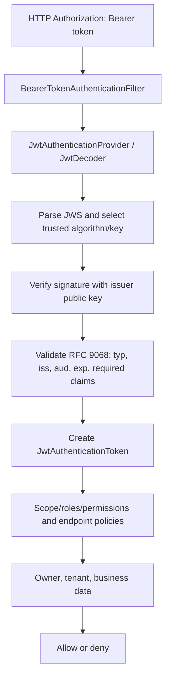
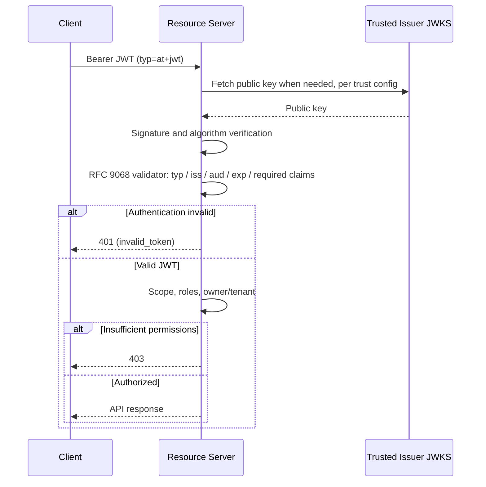

# Enforcing RFC 9068 Based on Spring Security Version Support

In a **Spring Security OAuth 2.0 / OIDC Resource Server**, configuring a JWT decoder lets the API verify the signature, issuer, and validity window of an access token. Yet **a cryptographically valid JWT is not necessarily an RFC 9068–compliant JWT access token**. An OpenID Connect ID Token can also be a JWT signed by the same Authorization Server containing `sub` and `exp`, while serving an entirely different purpose.

**RFC 9068 — JSON Web Token (JWT) Profile for OAuth 2.0 Access Tokens** defines a standard profile for **JWT access tokens**, specifying the token type marker in the JWS header (`typ`), a set of required claims (`iss`, `sub`, `aud`, `exp`, `iat`, `jti`, `client_id`), validation rules, and how authorization information should be interpreted. Beyond the specification comes a practical question: **does your running Spring Security version ship a built-in RFC 9068 validator, or must you assemble equivalent checks yourself?**

This lesson shows how to read RFC 9068 requirements, distinguish default validation from profile validation, spot API changes across versions, configure an appropriate `JwtDecoder`, and design tests that prevent accepting ID Tokens, wrong-audience tokens, or tokens missing required claims.

The examples depict an `orders-api` service accepting JWTs issued by `https://login.example.test/realms/orders`. They use illustrative URLs, client IDs, and keys only—never production credentials.

## 1. RFC 9068 Is an Access Token Profile, Not the Definition of Every JWT

OAuth 2.0 does not mandate JWT format for access tokens. You may encounter:

- **Opaque access tokens:** the Resource Server typically calls introspection to fetch status and metadata.
- **IdP-proprietary JWT access tokens:** may use `azp`, `scp`, `realm_access`, or different headers without fulfilling all of RFC 9068.
- **RFC 9068–compliant JWT access tokens:** the issuer commits to the structure and validation rules defined by RFC 9068.
- **OIDC ID Tokens:** JWTs intended for an OIDC client to verify a user authentication event; **never a Bearer access token for an API**.

Therefore, **you cannot assume that simply having three dot-separated segments makes an access token RFC 9068–compliant**. Integration teams must confirm which profile the issuer supports and whether it truly emits `at+jwt` tokens.

### 1.1. Verification Flow and Where the Profile Applies



Processing splits into three layers:

| Layer | Responsibility | On Failure |
|---|---|---|
| **JOSE/JWS cryptography** | Accept only allowed algorithms, use trusted public keys, verify signature; `alg=none` disallowed. | No identity established from token; typically `401`. |
| **JWT access-token profile** | Verify it is actually an RFC 9068 `at+jwt`, with valid issuer, audience, timestamps, and required claims. | Authentication rejected; typically `401` / `invalid_token`. |
| **Authorization** | Interpret scopes, roles, client/tenant/owner, and resource rules. | Valid token may still receive `403`/`404` per API contract. |

A complete JSON claim set cannot grant access if the signature is invalid; conversely, a validly signed JWT missing `client_id` or carrying the wrong `typ` fails the RFC 9068 profile.

## 2. Token Structure Required by RFC 9068

RFC 9068 specifies that **JWT access tokens must be signed**. The profile permits suitable signing algorithms, recommends asymmetric signatures for public-key distribution, and requires compliant implementations to support `RS256`. That **does not mean a Resource Server should enable every algorithm**. For each issuer, accept only the algorithms actually agreed upon and safely supported by your library.

### 2.1. The `typ` Header Prevents Confusing ID Tokens with Access Tokens

Example JWS protected header:

```json
{
  "typ": "at+jwt",
  "alg": "RS256",
  "kid": "orders-signing-key-01"
}
```

RFC 9068 specifies the media type `application/at+jwt`; the header value usually omits the `application/` prefix as `at+jwt`. A profile-compliant Resource Server must accept both forms per the RFC and reject others.

| `typ` Header | Interpretation for an **RFC 9068–Only** Resource Server |
|---|---|
| `at+jwt` | Valid token type at header level; proceed with verification. |
| `application/at+jwt` | Full media type form permitted by the RFC; proceed with verification. |
| `JWT` | Insufficient; may be an ID Token or generic JWT; reject per profile. |
| Missing `typ` | Non-compliant with RFC 9068; reject. |
| `JOSE`, `id_token`, or disallowed value | Reject. |

**`typ` is only a classification check**, not standalone proof: an attacker can write `"typ":"at+jwt"` in a forged header, yet cannot produce a valid signature under the trusted issuer's private key. Signature and claim validation remain mandatory.

Crucial scenario: an OIDC client receives an **ID Token** with `aud=web-client` and `typ=JWT` (or no `typ`). That ID Token must never be sent to an API as a Bearer access token, even though it was signed with the same issuer key.

### 2.2. Required Claims

RFC 9068, Section 2.2, mandates these claims in a JWT access token:

| Claim | Requirement | Meaning and Check |
|---|---|---|
| `iss` | **REQUIRED** | Issuer that minted the token; must **exactly match** the trusted identifier. |
| `sub` | **REQUIRED** | Subject of the token; may be a user or a service/client depending on grant. Never assume always a user. |
| `aud` | **REQUIRED** | Authorized resource recipient(s); must include the identifier expected by the API. |
| `exp` | **REQUIRED** | Expiration timestamp as JWT NumericDate; compare against current time with small policy skew. |
| `client_id` | **REQUIRED** | OAuth client that requested the access token; not synonymous with `sub` or `aud`. |
| `iat` | **REQUIRED** | Issuance timestamp; must be a valid time format. |
| `jti` | **REQUIRED** | Token identifier enabling unique identification where appropriate. |

Notice the difference between **a claim being present** and **a claim holding a value permitted by the API**. The RFC requires `client_id` to exist, yet an API might serve multiple valid OAuth clients; restricting to one specific client ID is an **additional policy**. Similarly, the mere presence of `jti` does not mean the server enforces a token revocation list.

Illustrative payload:

```json
{
  "iss": "https://login.example.test/realms/orders",
  "sub": "user-123",
  "aud": ["orders-api"],
  "exp": 1890003600,
  "iat": 1890000000,
  "jti": "token-id-8f65",
  "client_id": "web-portal",
  "scope": "orders:read"
}
```

This is pre-signing JSON, **not a usable access token**. `exp` and `iat` are NumericDate values, typically seconds since the Unix epoch. When Spring Security decodes the token, timestamps usually become `Instant` and `aud` becomes a string collection; avoid type errors by checking the post-decoder Java types properly.

### 2.3. Optional Claims and Semantic Constraints

RFC 9068 also notes:

- `scope` **SHOULD** appear if the authorization request included scopes; token scopes must apply to the resource named in `aud`. Never equate "`scope` is not unconditionally REQUIRED in the RFC" with "the API should allow requests missing scopes".
- `auth_time`, `acr`, and `amr` may appear in user-authenticated flows with authentication context; they are not universally mandatory across all access tokens.
- `groups`, `roles`, and `entitlements` may carry authorization attributes; their exact semantics depend on the issuer and API.
- Custom claims like `tenant_id`, `organization_id`, or `permissions` are governed by the issuer contract; identically named claims do not automatically carry identical semantics across providers.
- `azp` has standardized semantics in **OIDC ID Tokens**. Some IdPs include it in access tokens, yet **never treat `azp` as a default substitute for `client_id`** when claiming RFC 9068 compliance.

Profile compliance alone is not enough for owner/tenant checks. A valid token carrying `scope=orders:read` still cannot view someone else's order if the application requires ownership checks.

## 3. What Exactly Must a Resource Server Verify?

Per RFC 9068, Section 4, the Resource Server must verify at minimum:

1. `typ` matches the profile-allowed access token type.
2. If encrypted by agreement, decrypt with the proper key/algorithm; if encryption is required and an unencrypted token arrives, reject per agreement.
3. `iss` matches the trusted Authorization Server exactly.
4. `aud` includes the identifier of the Resource Server handling the request.
5. The JWS signature is valid under a trusted Authorization Server key; `alg=none` must be rejected.
6. Current time is before `exp`, allowing a small clock skew if permitted by policy.
7. Required profile fields are present with valid types and interpreted consistently.



**Logical ordering matters:** never build a principal or authorities from a JWT that has not passed signature verification and core validators. Clients must never dictate JWKS URLs or accepted algorithms through untrusted headers or parameters.

### 3.1. `sub` and `client_id` Across Grant Types

Two examples:

| Flow | `sub` Typically Represents | `client_id` Represents |
|---|---|---|
| Authorization Code + PKCE | The user / resource owner, such as `user-123`. | The frontend/mobile client `web-portal` that requested the token. |
| Client Credentials | An application/service identifier chosen by the issuer. | The client `batch-importer` that requested the token. |

Do not require `sub == client_id` across all grants. Likewise, never fall back to `sub` as a client ID if `client_id` is absent. A token missing a required claim fails RFC 9068 and must be rejected under a strict policy.

### 3.2. Validly Signed JWT Intended for Another Resource

Suppose a token contains:

```json
{
  "iss": "https://login.example.test/realms/orders",
  "sub": "user-123",
  "aud": ["billing-api"],
  "client_id": "web-portal",
  "scope": "orders:read"
}
```

Even with a valid signature and matching issuer, `orders-api` must reject it because `aud` does not include `orders-api`. Never infer audience just because `scope` contains the word `orders`.

### 3.3. Expiration and Missing Required Claims

Standard libraries provide `JwtTimestampValidator`, which checks `exp`/`nbf` when present per its policy. **Never confuse timestamp checking with proving every REQUIRED RFC 9068 claim is present.** The profile mandates `exp`, `iat`, and `jti`; tokens missing them must be rejected by an appropriate profile validator.

`nbf` is not among RFC 9068's seven required claims, yet if present, the Resource Server must enforce it under JWT/time policy. `iat` is the issuance timestamp and never replaces `nbf` or `exp`. You may add a contract policy rejecting far-future `iat` values, while clearly distinguishing that as an additional policy rather than an explicit verbatim requirement of RFC 9068.

## 4. RFC 9068 Support Across Spring Security Versions

The easiest mistake when reading documentation from different eras is **copying newer Spring Security examples into a project running an older library**. Method names and where `typ` is validated have evolved.

| Version Branch | Key Mechanism to Watch | Implementation Approach |
|---|---|---|
| **Spring Security prior to 6.5**, e.g., 6.3/6.4 | **Lacks** the `JwtValidators.createAtJwtValidator()` factory introduced in 6.5. JOSE type verification behaves differently depending on decoder/config. | Use custom claim validators and configure JOSE type handling per your **exact version**, or upgrade to a supported version if appropriate. |
| **Spring Security 6.5.x** | Provides `JwtValidators.createAtJwtValidator()` and `JwtValidators.AtJwtBuilder`, marked `@since 6.5` in the API. Builder supports `issuer(...)`, `audience(...)`, `clientId(...)`, `validators(...)`. | Use the built-in RFC 9068 validator. On `NimbusJwtDecoder`, delegate `typ` checking to the validator using the API documented in your version's Javadoc. |
| **Spring Security 7.x and later** | Default `typ` handling and builder method names can differ from 6.5; migration docs describe handling type at the Spring validator layer. | Read the Javadoc and migration guide for your **exact version**; preserve the RFC 9068 policy without blindly copying `validateType(s)` from another version. |

**Facts to keep in mind:**

- In Spring Security **6.5.6 Javadoc**, `createAtJwtValidator()` and `AtJwtBuilder` are marked "Since 6.5".
- In **6.5.6 Javadoc** of `NimbusJwtDecoder.JwkSetUriJwtDecoderBuilder`, the method is **`validateType(boolean)` (singular)**, marked "Since 6.5".
- Some migration guides and newer releases use **`validateTypes(false)` (plural)**; never treat the two signatures as interchangeable across every dependency version.
- `JwtValidators.createAtJwtValidator().clientId("...")` in the built-in profile **validates one configured client ID**, fitting APIs serving a single OAuth client. If your API accepts multiple client IDs, design the corresponding policy/validator; RFC 9068 requires the claim to be present without forcing a system-wide single client.

**Never guess your Spring Security version from Java 17, Spring Boot 3, or reading online "current" docs.** Spring Boot manages dependencies via BOMs, yet dependency overrides and starter versions determine what actually resolves. Always inspect resolved dependencies.

### 4.1. Checking the Version in Maven/Gradle

With Maven:

```bash
./mvnw dependency:tree \
  -Dincludes=org.springframework.security:spring-security-oauth2-jose,org.springframework.security:spring-security-oauth2-resource-server
```

With Gradle:

```bash
./gradlew dependencyInsight \
  --dependency spring-security-oauth2-jose \
  --configuration runtimeClasspath

./gradlew dependencyInsight \
  --dependency spring-security-oauth2-resource-server \
  --configuration runtimeClasspath
```

These commands are **implementation-lookup guidance**, not QA tasks required for this lesson. Confirm the exact resolved versions of `spring-security-oauth2-jose` and `spring-security-oauth2-resource-server`, checking for BOM overrides and version alignment.

If your IDE cannot find `createAtJwtValidator()`, never create a homemade class with the same name pretending standard support exists. Check the Javadoc of your resolved dependency and either use the version-appropriate fallback or plan an upgrade.

## 5. What Does Minimal Spring Boot Configuration Check—and Not Check?

Common configuration:

```yaml
spring:
  security:
    oauth2:
      resourceserver:
        jwt:
          issuer-uri: https://login.example.test/realms/orders
          audiences:
            - orders-api
```

With this configuration in a compatible Spring Boot/Security environment, the JWT Resource Server can:

- Verify signatures with the issuer's public keys via discovery/JWKS.
- Check `iss` against `issuer-uri`.
- Check `exp`/`nbf` via default timestamp validators.
- Check `aud` if the `audiences` property is supported and configured properly.
- Map `scope`/`scp` to `SCOPE_...` for authorization.

**You cannot conclude this setup enforces RFC 9068 `at+jwt`**, nor that it automatically checks `sub`, `client_id`, `iat`, and `jti` per profile. In fact, in some configurations default JOSE header handling may **reject `typ=at+jwt` because it expects `JWT`**, before any custom claim validator even runs.

Consequence: if the API requires strict RFC 9068, **explicitly enable profile validation** instead of setting `issuer-uri` and `audiences` and calling it done.

### 5.1. "Replaces Defaults" Warning When Defining a Custom Decoder

If you declare:

```java
@Bean
JwtDecoder jwtDecoder() {
    return NimbusJwtDecoder.withJwkSetUri(jwksUri).build();
}
```

that bean typically replaces Spring Boot's auto-configured `JwtDecoder`. Do not assume YAML `issuer-uri` or `audiences` properties automatically merge into your custom bean. Explicitly call `setJwtValidator(...)` with issuer, audience, timestamps, and profile checks, or use a fully configured builder/factory.

## 6. Spring Security 6.5: Using the Built-In RFC 9068 Validator

Example for **Spring Security 6.5.x** and a Servlet-based Resource Server, allowing only tokens issued for `web-portal` to call `orders-api`. Assume the issuer actually emits RFC 9068 `at+jwt` tokens.

### 6.1. Dependencies

Use the Spring Boot BOM/parent to manage versions; avoid mixing incompatible Security versions manually:

```xml
<dependencies>
    <dependency>
        <groupId>org.springframework.boot</groupId>
        <artifactId>spring-boot-starter-web</artifactId>
    </dependency>
    <dependency>
        <groupId>org.springframework.boot</groupId>
        <artifactId>spring-boot-starter-security</artifactId>
    </dependency>
    <dependency>
        <groupId>org.springframework.boot</groupId>
        <artifactId>spring-boot-starter-oauth2-resource-server</artifactId>
    </dependency>
    <dependency>
        <groupId>org.springframework.boot</groupId>
        <artifactId>spring-boot-starter-test</artifactId>
        <scope>test</scope>
    </dependency>
    <dependency>
        <groupId>org.springframework.security</groupId>
        <artifactId>spring-security-test</artifactId>
        <scope>test</scope>
    </dependency>
</dependencies>
```

### 6.2. `JwtDecoder` Bean With `createAtJwtValidator()`

For **Spring Security 6.5.x**, note the `validateType(boolean)` signature in the `NimbusJwtDecoder` JWKS URI builder Javadoc:

```java
package com.example.orders.security;

import org.springframework.beans.factory.annotation.Value;
import org.springframework.context.annotation.Bean;
import org.springframework.context.annotation.Configuration;
import org.springframework.security.oauth2.jose.jws.SignatureAlgorithm;
import org.springframework.security.oauth2.jwt.JwtDecoder;
import org.springframework.security.oauth2.jwt.JwtValidators;
import org.springframework.security.oauth2.jwt.NimbusJwtDecoder;

@Configuration
public class Rfc9068JwtConfig {

    @Bean
    JwtDecoder jwtDecoder(
            @Value("${app.security.issuer}") String issuer,
            @Value("${app.security.jwks-uri}") String jwksUri,
            @Value("${app.security.audience}") String audience,
            @Value("${app.security.allowed-client-id}") String allowedClientId) {

        NimbusJwtDecoder decoder = NimbusJwtDecoder
            .withJwkSetUri(jwksUri)
            // Restrict algorithm per issuer contract.
            .jwsAlgorithm(SignatureAlgorithm.RS256)
            // 6.5 Javadoc: delegate typ validation to the Spring validator.
            .validateType(false)
            .build();

        decoder.setJwtValidator(
            JwtValidators.createAtJwtValidator()
                .issuer(issuer)
                .audience(audience)
                .clientId(allowedClientId)
                .build()
        );

        return decoder;
    }
}
```

With configuration:

```yaml
app:
  security:
    issuer: https://login.example.test/realms/orders
    jwks-uri: https://login.example.test/realms/orders/protocol/openid-connect/certs
    audience: orders-api
    allowed-client-id: web-portal
```

`app.security.*` keys are **custom application properties**, not Spring Boot auto-configuration properties. The JWKS URL must come from trusted issuer metadata, pinned per environment, and accessed over HTTPS; never take an address from a token's `jku`/`kid` header or untrusted request input.

**Role of each key line:**

1. `.withJwkSetUri(jwksUri)`: uses the trusted issuer's key set to select public keys and verify JWS signatures.
2. `.jwsAlgorithm(RS256)`: accepts only the signing algorithm agreed with the API; prevents clients from switching to `none` or downgrading RSA to HMAC.
3. `.validateType(false)`: disables Nimbus's default `typ` check in the builder **in 6.5**, handing `at+jwt` checking to Spring's profile validator. **This never means allowing arbitrary `typ` values** as long as the RFC 9068 validator remains attached.
4. `JwtValidators.createAtJwtValidator()`: builds the RFC 9068 token validator suite, including profile rules.
5. `.issuer(issuer)`, `.audience(audience)`, `.clientId(allowedClientId)`: enforces the exact trusted values for this API. Here, the client must be `web-portal`.
6. `.build()` and `decoder.setJwtValidator(...)`: applies validation to JWTs decoded and verified by the decoder.

If your version **only has `validateTypes(false)`**, follow **that version's Javadoc** rather than guessing at runtime. Conversely, a 6.5 project matching the `validateType(false)` Javadoc will not compile code copied from plural-named docs. That is precisely why this lesson emphasizes **checking your version before copying snippets**.

> **Safety boundary:** if you disable Nimbus's `typ` check and then forget to attach `createAtJwtValidator()` or an equivalent type validator, the API risks accepting non-contract JWTs. Both halves must stay paired together.

### 6.3. Filter Chain and Endpoint Permissions

```java
package com.example.orders.security;

import org.springframework.context.annotation.Bean;
import org.springframework.context.annotation.Configuration;
import org.springframework.http.HttpMethod;
import org.springframework.security.config.Customizer;
import org.springframework.security.config.annotation.web.builders.HttpSecurity;
import org.springframework.security.config.annotation.web.configurers.AbstractHttpConfigurer;
import org.springframework.security.config.http.SessionCreationPolicy;
import org.springframework.security.web.SecurityFilterChain;

@Configuration
class ApiSecurityConfig {
    @Bean
    SecurityFilterChain apiSecurity(HttpSecurity http) throws Exception {
        return http
            // Strictly for stateless APIs using Bearer tokens in the Authorization header.
            .csrf(AbstractHttpConfigurer::disable)
            .sessionManagement(session ->
                session.sessionCreationPolicy(SessionCreationPolicy.STATELESS))
            .authorizeHttpRequests(auth -> auth
                .requestMatchers(HttpMethod.GET, "/api/public/ping")
                    .permitAll()
                .requestMatchers(HttpMethod.GET, "/api/orders/**")
                    .hasAuthority("SCOPE_orders:read")
                .anyRequest().denyAll())
            .oauth2ResourceServer(oauth ->
                oauth.jwt(Customizer.withDefaults()))
            .build();
    }
}
```

Disabling CSRF as shown applies strictly to stateless APIs using Bearer headers, never to cookie-authenticated web apps without dedicated evaluation.

Once the token passes profile validation, `scope` is normally mapped to authorities prefixed with `SCOPE_`. `JwtDecoder` does not grant access to all orders by itself: resource-level, tenant, and owner permissions must still be checked in services or method security.

### 6.4. Policy for Multiple Valid OAuth Clients

`JwtValidators.AtJwtBuilder` expects `clientId(...)`—a single target client ID per contract. Yet an API may serve:

- `web-portal` via Authorization Code.
- `mobile-app` via Authorization Code + PKCE.
- `partner-batch` via Client Credentials with its own permission boundaries.

In that case, **RFC 9068 still requires `client_id` to be present**, without forcing a single global value. You can write a custom validator checking that `client_id` is a valid string in an allowlist, or replace the `client_id` validator in the builder using Spring Security 6.5's `validators(...)` customizer. You can also move "which client may call which endpoint" into authorization.

Standalone example of a **client ID policy validator**:

```java
import java.util.Set;
import org.springframework.security.oauth2.core.OAuth2Error;
import org.springframework.security.oauth2.core.OAuth2TokenValidator;
import org.springframework.security.oauth2.core.OAuth2TokenValidatorResult;
import org.springframework.security.oauth2.jwt.Jwt;

final class ClientIdPolicies {

    static OAuth2TokenValidator<Jwt> allowedClients(Set<String> allowed) {
        return jwt -> {
            Object raw = jwt.getClaims().get("client_id");
            if (raw instanceof String clientId
                    && !clientId.isBlank()
                    && allowed.contains(clientId)) {
                return OAuth2TokenValidatorResult.success();
            }
            return OAuth2TokenValidatorResult.failure(
                new OAuth2Error(
                    "invalid_token",
                    "client_id is missing or not allowed",
                    null));
        };
    }
}
```

To integrate this validator with `AtJwtBuilder` on a version supporting `validators(...)`, ensure you **replace only the `client_id` validator while keeping all other RFC 9068 validators intact**, never wiping defaults. Illustrative pattern:

```java
// Spring Security 6.5.x: integrate into the profile validator builder.
OAuth2TokenValidator<Jwt> atProfile = JwtValidators.createAtJwtValidator()
    .issuer(issuer)
    .audience(audience)
    .clientId("placeholder-only-for-builder")
    .validators(v -> v.put(
        "client_id",
        ClientIdPolicies.allowedClients(
            Set.of("web-portal", "mobile-app", "partner-batch"))))
    .build();
```

`"placeholder-only-for-builder"` exists solely to satisfy the builder before replacing the `client_id` validator; it is **not** a real allowed client and must never be trusted in authorization. When replacing validators in a map like this, verify the exact API contract in your version and test both accepted and rejected tokens. With multiple issuers, namespace client ID allowlists per issuer and profile.

An often cleaner option is **one decoder/profile validator for shared checks**, followed by endpoint policies requiring specific client IDs. Even then, never omit the **RFC 9068 required `client_id` check** just because client authorization runs later.

## 7. Versions Prior to 6.5: Equivalent Validation Without Assuming the Factory Exists

In older Spring Security versions, `JwtValidators.createAtJwtValidator()` may not exist. Security requirements do not disappear; instead, **configure equivalent validators manually** or upgrade to a tested version.

### 7.1. Two Separate Layers to Handle

**Layer A — JOSE type verification and signature.** In some versions, the Nimbus decoder defaults to checking `typ` expecting a generic JWT. When an issuer emits `typ=at+jwt`, tokens may fail **before `OAuth2TokenValidator` ever sees a `Jwt`**. Configure the Nimbus JOSE type verifier per your version's API to accept **exactly the compliant `at+jwt` types**, while keeping algorithm and key-source restrictions intact.

**Layer B — Claim/profile validation.** After the decoder verifies JWS, validate issuer, audience, expiration, and required claims; if `typ` was not enforced at the JOSE layer, enforce it in a trusted validator before building `Authentication`.

Never replace Layer A by "Base64URL-decoding the raw token in a controller to inspect `typ`". Every authorization decision must rely on tokens processed by a trusted decoder.

### 7.2. Custom Validator for Required Claims

This is a **conceptually reusable** example across versions supporting `OAuth2TokenValidator<Jwt>`. It enforces presence and type for `sub`, `client_id`, `jti`, `iat`, and `exp` after the parser maps claims. **It does not replace signature, issuer, audience, timestamp, or type validators.**

```java
package com.example.orders.security;

import java.time.Instant;

import org.springframework.security.oauth2.core.OAuth2Error;
import org.springframework.security.oauth2.core.OAuth2TokenValidator;
import org.springframework.security.oauth2.core.OAuth2TokenValidatorResult;
import org.springframework.security.oauth2.jwt.Jwt;

public final class RequiredAtClaimsValidator
        implements OAuth2TokenValidator<Jwt> {

    @Override
    public OAuth2TokenValidatorResult validate(Jwt jwt) {
        if (!nonBlankString(jwt.getClaims().get("sub"))
            || !nonBlankString(jwt.getClaims().get("client_id"))
            || !nonBlankString(jwt.getClaims().get("jti"))
            || !(jwt.getClaims().get("iat") instanceof Instant)
            || !(jwt.getClaims().get("exp") instanceof Instant)
            || jwt.getAudience() == null
            || jwt.getAudience().isEmpty()
            || !nonBlankString(jwt.getClaims().get("iss"))) {

            return OAuth2TokenValidatorResult.failure(
                new OAuth2Error(
                    "invalid_token",
                    "Missing or malformed RFC 9068 claim",
                    null));
        }

        return OAuth2TokenValidatorResult.success();
    }

    private static boolean nonBlankString(Object value) {
        return value instanceof String s && !s.isBlank();
    }
}
```

Spring/Nimbus maps `iss` to `String`, `exp`/`iat` to `Instant`, and `aud` to `List<String>` under default claim mapping. If using a custom claim-set converter, align expected Java types accordingly. Never call `toString()` on arbitrary objects to accept them; arrays or objects where strings are required must fail schema checks.

Sample composition with issuer, audience, and timestamps (assuming the decoder already handles JWS and `typ` properly at the JOSE layer):

```java
import org.springframework.security.oauth2.core.DelegatingOAuth2TokenValidator;
import org.springframework.security.oauth2.core.OAuth2Error;
import org.springframework.security.oauth2.core.OAuth2TokenValidator;
import org.springframework.security.oauth2.core.OAuth2TokenValidatorResult;
import org.springframework.security.oauth2.jwt.Jwt;
import org.springframework.security.oauth2.jwt.JwtValidators;

// Illustrates composing validators after building an appropriate decoder.
OAuth2TokenValidator<Jwt> audienceValidator = jwt ->
    jwt.getAudience().contains("orders-api")
        ? OAuth2TokenValidatorResult.success()
        : OAuth2TokenValidatorResult.failure(
            new OAuth2Error(
                "invalid_token", "Wrong audience", null));

decoder.setJwtValidator(
    new DelegatingOAuth2TokenValidator<>(
        JwtValidators.createDefaultWithIssuer(
            "https://login.example.test/realms/orders"),
        audienceValidator,
        new RequiredAtClaimsValidator()
    )
);
```

**Limitation of this example:** a validator built with `createDefaultWithIssuer(...)` on an older version may pair with Nimbus's default JWT type expectation; to handle `at+jwt` properly, configure the JOSE type verifier and test signed tokens end-to-end. Never test only `validate(Jwt)` and assume the system accepts `at+jwt` if the decoder itself still rejects it at parse/type time.

### 7.3. Handling JOSE Type on Older Versions

If your version's Javadoc exposes `jwtProcessorCustomizer(...)` on `NimbusJwtDecoder` builders, you can configure the **Nimbus JOSE type verifier** to allow exact RFC 9068 token types; illustrative code using common Nimbus APIs:

```java
import com.nimbusds.jose.JOSEObjectType;
import com.nimbusds.jose.proc.DefaultJOSEObjectTypeVerifier;
import com.nimbusds.jose.proc.SecurityContext;
import org.springframework.security.oauth2.jwt.NimbusJwtDecoder;

// For older versions: verify exact Nimbus JOSE + JWT APIs when integrating.
NimbusJwtDecoder decoder = NimbusJwtDecoder.withJwkSetUri(jwksUri)
    .jwtProcessorCustomizer(processor ->
        processor.setJWSTypeVerifier(
            new DefaultJOSEObjectTypeVerifier<SecurityContext>(
                new JOSEObjectType("at+jwt"),
                new JOSEObjectType("application/at+jwt"))))
    .build();
```

This snippet only configures type restriction on the **Nimbus processor**; you must still attach issuer/audience/timestamp/required-claim validators and pin algorithms and key sources. Exact compatibility of `jwtProcessorCustomizer`, `DefaultJOSEObjectTypeVerifier`, and generic types depends on the Nimbus version in your dependencies—check Javadocs and compile against your project.

**Never** replace this with an "accept any `typ`" verifier or `setJWSTypeVerifier((type, context) -> {})` just to silence errors. Turning off type checks without a validator enforcing `at+jwt` lets the API accept wrong-purpose tokens.

### 7.4. When Should You Upgrade?

Consider upgrading Spring Security when:

- The system requires strict RFC 9068 compliance and legacy code carries too many hard-to-maintain custom JOSE/type validators.
- Your current version lacks needed type-validation APIs, complicating integration or compatibility.
- Security patches or vendor advisories recommend upgrading.
- Your organization wants fewer custom parsers/decoders for easier security review.

Note that upgrading versions does not magically turn an IdP's access tokens into `at+jwt`. Check **which headers and claims the issuer actually emits**, update client registrations or token profiles, and test before turning on strict enforcement. Never disable checks to "smooth over migration".

## 8. Mandatory Profile Checks vs. Product-Level Policies

Two categories of rules exist:

**RFC 9068 profile requirements:** the token must be signed, have valid `typ`, include all required claims, pass issuer/audience/time checks, and use trusted keys and algorithms.

**Product-level policies:** client ID in an allowlist, scope permitting the endpoint, authorized tenant, order ownership, device checks, or minimum `acr` authentication level.

Example RFC 9068–valid token:

```json
{
  "iss": "https://login.example.test/realms/orders",
  "sub": "alice",
  "aud": ["orders-api"],
  "exp": 1890003600,
  "iat": 1890000000,
  "jti": "tok-123",
  "client_id": "mobile-app",
  "scope": "orders:read"
}
```

If an endpoint only permits `web-portal`, this token may be **profile-compliant** yet **unauthorized for the endpoint**, because the client violates policy. In one design, binding `clientId` directly inside `AtJwtBuilder` rejects it at authentication. In another, the profile simply requires a valid `client_id` and authorization checks the allowlist. Document your choice clearly to distinguish `401` (token fails the API's acceptance contract) from `403` (valid token lacks permission for the operation).

### 8.1. Avoid Making `scope` the Entire Decision

With Spring Security:

```java
.authorizeHttpRequests(auth -> auth
    .requestMatchers("/api/orders/**")
        .hasAuthority("SCOPE_orders:read")
    .anyRequest().denyAll()
)
```

`SCOPE_orders:read` means the verified token carries permission for that scope. It does not prove resource ownership or tenant access. Enforce:

```text
issuer/audience/profile/signature/time
    AND scope=orders:read
    AND (iss, sub) maps to an authorized user
    AND record owner/tenant matches policy
```

Never use `client_id` or `azp` as proof of user data ownership. They identify the OAuth client per profile, never replacing `sub` and business ownership data.

### 8.2. An ID Token Can Pass Generic Checks Yet Still Be Wrong-Purpose

An ID Token typically carries `iss`, `sub`, `aud`, `iat`, and `exp`, signed by the same issuer's key. If an API only checks signature and issuer, an ID Token looks very much like an access token.

Differences to guard:

| Criterion | RFC 9068 JWT Access Token | OIDC ID Token |
|---|---|---|
| Purpose | OAuth access to a resource/API. | Authentication event details for an OIDC client. |
| `typ` | `at+jwt` or `application/at+jwt`. | May be `JWT` or another value per OIDC/JOSE profile. |
| `aud` | Resource Server / API. | OAuth/OIDC client receiving the ID Token. |
| `client_id` | Required per RFC 9068. | Not a universal required claim on ID Tokens. |
| `azp` | Does not replace RFC 9068's `client_id`. | Means OIDC authorized party where applicable. |
| Usage | Sent in `Authorization: Bearer access_token`. | Verified by OIDC client at login; never sent as a Bearer access token. |

Validating both `typ` and `aud` defends against **cross-JWT confusion**. In multi-resource platforms, never reuse a vague shared audience across apps and APIs if doing so lets tokens be replayed across boundaries.

## 9. Testing RFC 9068 by Version and Layer

A test checking only `jwt.getClaim("client_id")` does not prove the decoder verified signatures or token type. Split tests into layers:

1. **Validator unit tests:** in-memory `Jwt` inputs with headers/claims testing `AtJwtBuilder` or custom validator logic.
2. **Decoder tests:** real JWTs signed with a test private key, paired with a test public key or mock JWKS, calling `JwtDecoder.decode(token)` to verify JOSE/type/profile handling.
3. **HTTP security tests:** requests through `SecurityFilterChain` verifying invalid tokens yield `401` and valid under-privileged tokens yield `403`.
4. **IdP integration tests:** obtaining tokens from a staging Authorization Server to verify the exact headers and claims emitted per grant.

### 9.1. Key Input Matrix

| Case | Expected Outcome for RFC 9068–Only API |
|---|---|
| `typ=at+jwt`, valid signature/`iss`/`aud`/required claims | Authentication can succeed; proceed to authorization. |
| `typ=application/at+jwt`, other checks valid | Authentication can succeed per RFC. |
| `typ=JWT` or missing `typ` | Rejected. |
| Access token with `typ=at+jwt` and invalid signature | Rejected. |
| `alg=none` | Rejected. |
| Structurally identical token from another issuer | Rejected. |
| `aud` missing `orders-api` | Rejected. |
| Missing `exp` | Rejected due to required claim. |
| Expired `exp` | Rejected due to timestamp. |
| Missing `iat`, `jti`, `sub`, or `client_id` | Rejected per profile. |
| `client_id` is an object/array instead of a string | Rejected by schema/validator. |
| Token has `azp` but lacks `client_id` | Rejected; never fall back to `azp`. |
| Client Credentials where `sub` differs from `client_id` | **Not rejected merely because the two differ**, if allowed by issuer/contract. |
| Valid token missing `orders:read` | Authentication may succeed; authorization rejects. |
| Valid token with scope, caller does not own the order | Business authorization denies access. |
| OIDC ID Token from the same issuer | Rejected due to wrong token type/audience/profile. |

If the API uses the built-in builder with `.clientId("web-portal")`, a token carrying `client_id="mobile-app"` fails **right inside the configured profile validator**. If the app permits multiple client IDs while restricting certain endpoints, design a multi-client validator and test the corresponding `403` path.

### 9.2. Unit-Testing the Validator With `Jwt.withTokenValue`

Example testing validator logic independently of HTTP/JWKS, targeting Spring Security 6.5 with one fixed client ID:

```java
package com.example.orders.security;

import static org.junit.jupiter.api.Assertions.assertTrue;

import java.time.Instant;
import java.util.List;

import org.junit.jupiter.api.Test;
import org.springframework.security.oauth2.core.OAuth2TokenValidator;
import org.springframework.security.oauth2.jwt.Jwt;
import org.springframework.security.oauth2.jwt.JwtValidators;

class AtJwtProfileValidatorTest {
    private final String issuer =
        "https://login.example.test/realms/orders";

    private final OAuth2TokenValidator<Jwt> validator =
        JwtValidators.createAtJwtValidator()
            .issuer(issuer)
            .audience("orders-api")
            .clientId("web-portal")
            .build();

    @Test
    void validProfileClaimsAreAccepted() {
        Jwt jwt = jwtWithType("at+jwt", true, true);
        assertTrue(validator.validate(jwt).hasErrors() == false);
    }

    @Test
    void wrongTokenTypeIsRejected() {
        Jwt jwt = jwtWithType("JWT", true, true);
        assertTrue(validator.validate(jwt).hasErrors());
    }

    @Test
    void missingClientIdIsRejected() {
        Jwt jwt = jwtWithType("at+jwt", false, true);
        assertTrue(validator.validate(jwt).hasErrors());
    }

    @Test
    void wrongAudienceIsRejected() {
        Jwt jwt = jwtWithType("at+jwt", true, false);
        assertTrue(validator.validate(jwt).hasErrors());
    }

    private Jwt jwtWithType(
        String typ,
        boolean hasClientId,
        boolean properAudience
    ) {
        Instant now = Instant.now();

        Jwt.Builder builder = Jwt.withTokenValue("unit-test-token")
            .header("alg", "RS256")
            .header("typ", typ)
            .issuer(issuer)
            .subject("user-123")
            .audience(
                properAudience
                    ? List.of("orders-api")
                    : List.of("other-api"))
            .issuedAt(now)
            .expiresAt(now.plusSeconds(300))
            .id("unit-test-jti");

        if (hasClientId) {
            builder.claim("client_id", "web-portal");
        }

        return builder.build();
    }
}
```

This unit test **does not verify signatures**, since `Jwt.withTokenValue(...)` constructs an already-parsed object in memory. It only exercises validator behavior. To prove Nimbus passes `typ` through at the right layer, test `JwtDecoder.decode(...)` with real signed tokens next.

### 9.3. Decoder Test: Real Tokens Signed With a Test Keypair

In tests, generate an issuer-simulating RSA keypair (never use production private keys) and use Nimbus JOSE/JWT to sign a test access token. Configure the decoder with `publicKey` or a trusted mock JWKS.

Test flow:

```text
privateTestKey
    -> sign header typ=at+jwt, alg=RS256 + RFC 9068 claims
    -> JWS Compact
    -> JwtDecoder using publicTestKey
    -> verify signature then profile
```

Include at least three test pairs:

1. Token with `typ=at+jwt` signed by the test private key → decodes cleanly when all claims and audience match.
2. Same claims with `typ=JWT` and a fresh valid signature → **rejected** by the strict API.
3. Token with `typ=at+jwt`, invalid signature or `aud=other-api` → rejected.

If you merely edit the Base64URL string of an already-signed token, the test mainly proves **signature tampering fails** rather than isolating the `typ` validator. To test token classification properly, mint fresh **validly signed tokens** with different `typ` headers and pass them into the same decoder.

### 9.4. MockMvc Tests and the Limits of `jwt()`

`spring-security-test` provides `jwt()` to inject a synthetic authenticated principal:

```java
mvc.perform(get("/api/orders/42")
        .with(jwt().authorities(
            new SimpleGrantedAuthority("SCOPE_orders:read"))))
   .andExpect(status().isOk());
```

This makes sense for testing a controller endpoint returning 200 without extra ownership checks. However, **`jwt()` normally bypasses the real decoder**, so it cannot prove signatures, `typ`, audience, or RFC 9068 required claims are actually verified. Use it to test **authorization**, never as proof that the token profile is enforced.

### 9.5. Verifying Expected HTTP Status Codes

| Case | Failing Layer | Typical Result |
|---|---|---|
| No Bearer token on a protected endpoint | Unauthenticated | `401 Unauthorized`. |
| Bad signature, wrong `typ`, missing required claims, wrong issuer/audience | JWT authentication/validation | `401`, potentially with Bearer `invalid_token` per error handling. |
| Profile-valid JWT missing `orders:read` scope | Authorization | `403 Forbidden`. |
| Valid JWT lacking resource ownership | Business authorization | `403` or `404` per API contract. |
| JWKS endpoint unreachable with no trusted key available | Dependency/key-fetch failure | **Must fail closed**; exact code depends on exception handling and API policy. |

Never turn token verification errors into `200` by temporarily disabling filters. Never return raw JWTs, private keys, or client secrets in `WWW-Authenticate`, logs, or response bodies.

## 10. Boundaries With OIDC, Multi-Issuer, and Opaque Tokens

### 10.1. OIDC Does Not Imply RFC 9068

An OIDC Provider may emit standard OIDC ID Tokens while emitting **opaque** access tokens or vendor-profile JWTs rather than RFC 9068. Configuring `issuer-uri` on a Resource Server does not force the provider to change its token format.

If the provider does not emit `at+jwt` yet, three valid options exist:

1. Configure the provider to issue RFC 9068 access tokens if it supports that feature.
2. Accept **vendor-specific JWT access tokens** under a dedicated, separate validation profile without claiming RFC 9068 compliance.
3. Use opaque token introspection per the AS/API contract when the token format does not allow self-contained JWT profile validation.

Never add "if `typ=JWT`, treat it as an access token" inside a strict RFC 9068 validator; that opens a token-substitution path from ID Tokens.

### 10.2. Multi-Issuer and Profile Selection

When trusting multiple issuers, **never** read raw `iss` from an unverified JWT and trust arbitrary metadata/JWKS URLs it points to. A resolver must restrict issuers to a **configured allowlist**, binding each issuer to its own trusted key set, algorithms, token profile, and validators.

Example:

| Issuer | Token Profile | Validation |
|---|---|---|
| `issuer-A` | RFC 9068 JWT access token | `typ=at+jwt`, required claims, API audience, and client policy A. |
| `issuer-B` | Vendor JWT access token | Headers/claims per contract B; do not assume RFC 9068. |
| `issuer-C` | Opaque token | Introspection against AS C; verify `active` and permissions per policy C. |

Never pool all keys into one shared key set across issuers, and never fall back from strict validation A to weak validation B just because a token fails.

### 10.3. Token Exchange and Multiple Clients

In Token Exchange, `sub`, `client_id`, and `act` play distinct roles. RFC 9068 still requires `client_id` while **not requiring `sub == client_id`**. If the Resource Server enforces policies on client ID or actor, formalize them in a dedicated contract with the issuer rather than guessing from claim names.

## 11. Upgrade Path and Compatibility Safeguards

When an API running older Spring Security wants strict RFC 9068 enforcement, prepare in order:

**Step 1 — Verify issuance.** Collect **test** tokens from your staging Authorization Server and inspect `typ`, required claims, issuer, audience, algorithm, and client ID. Never paste real tokens into public decoders or issue tickets.

**Step 2 — Verify dependencies.** Check resolved Spring Security versions and exact-version Javadocs. Confirm whether `createAtJwtValidator()` exists and whether the builder method is `validateType(...)` or `validateTypes(...)`.

**Step 3 — Finalize policy.** Does the API accept one or multiple `client_id` values; which audiences; which grants; which token types? Separate profile validation from endpoint authorization.

**Step 4 — Build the matching decoder.** Spring 6.5+ can use the built-in `AtJwtBuilder`; older versions need a JOSE type verifier and equivalent custom claim validators. All must verify signature, issuer, audience, and timestamps.

**Step 5 — Run negative tests.** Especially: ID Tokens from the same issuer, `typ=JWT`, missing `client_id`/`jti`/`iat`, wrong audience, invalid signature, expired tokens, and Client Credentials tokens with service subjects.

**Step 6 — Roll out with monitoring.** Watch for `401` spikes after enabling strict profile checks, separating decoder/JOSE type errors from claim errors and assessing legacy client impact. Never silently weaken standards to restore traffic without risk review.

**Step 7 — Formalize the contract.** Document issuer, audience, token format, `typ`, required claims, allowed algorithms, JWKS rotation, scope/client policies, TTL/clock skew, and change ownership.

### 11.1. Version-Change Checklist

| Check | Action |
|---|---|
| Does `JwtValidators.createAtJwtValidator()` exist? | Use only on supported versions (starting in Spring Security 6.5). |
| What is the method name to disable Nimbus `typ` checks? | Read your artifact's Javadoc: `validateType` or `validateTypes` depending on version. |
| Does the built-in validator require `clientId(...)`? | On 6.5 `AtJwtBuilder`, specify one client or replace the claim validator per reviewed policy. |
| Are `iss`/`aud` checked after defining a custom bean? | Do not rely on auto-configuration once you replace `JwtDecoder`. |
| Does the token profile actually emit `at+jwt`? | Test against staging issuer; an OIDC ID Token is not an access token. |
| Does your test suite sign real JWTs? | Add signed JWT integration tests, not just MockMvc `jwt()`. |
| Are JWKS and algorithms pinned cleanly? | Scope per issuer; never let tokens pick URLs or `alg` freely. |
| Could claims/roles alter privileges unexpectedly? | Test fail-closed behavior, owner/tenant checks, and endpoint policies. |

## 12. Common Mistakes and How to Avoid Them

| Misconception | What to Do Instead |
|---|---|
| "Spring Boot has `issuer-uri`, so RFC 9068 is enforced by default." | Explicitly validate `typ`, required claims, audience, and profile; never infer compliance from signature/issuer alone. |
| "Disabling `validateType(s)` allows every token." | Immediately attach the `at+jwt` profile validator **whenever delegating type validation**, or you create an exposure. |
| "`client_id` isn't needed because `azp` is present." | RFC 9068 mandates `client_id`; `azp` is not a default alias in the access-token profile. |
| "`scope` is REQUIRED on every JWT in RFC 9068." | Scope is an authorization claim with a SHOULD rule per request context; APIs can still mandate scopes per endpoint. |
| "`sub` is always a user ID." | Client Credentials tokens typically represent a client/service with no resource owner. |
| "As long as `exp` is valid, missing `iat` or `jti` still meets the profile." | `iat` and `jti` are REQUIRED under RFC 9068. |
| "Any JWT validly signed by the same IdP—even an ID Token—works for the API." | Enforce access-token `typ` and audience to prevent cross-JWT confusion. |
| "We can copy `createAtJwtValidator()` into Spring Security 6.4." | That API arrived in 6.5; use a version-accurate fallback or upgrade. |
| "Changing `validateType` to `validateTypes` makes no difference." | Method names are a **compile-time** contract; match your exact Javadoc/version. |
| "MockMvc `jwt()` proves signatures and RFC 9068 profile work." | `jwt()` injects synthetic authentication, bypassing the decoder; write signed JWT tests. |
| "Enable all algorithms to accept older tokens." | Allowlist algorithms and keys per issuer contract to avoid algorithm confusion. |
| "A valid `client_id` grants all permissions." | You still need scopes/roles, audience, owner/tenant checks, and business rules. |

## 13. Mental Model

When working with an RFC 9068 JWT access token, view validation as a set of **independent yet jointly mandatory checks within the profile**:

```text
Incoming JWT access token at the API
  │
  ├─ (1) JWS: allowed algorithm + trusted issuer key + valid signature
  │
  ├─ (2) Token type: typ = at+jwt / application/at+jwt
  │
  ├─ (3) Required claims:
  │       iss, sub, aud, exp, iat, jti, client_id
  │
  ├─ (4) Values: right issuer, audience includes API,
  │       valid timestamps, contract-compliant schema/claim semantics
  │
  └─ (5) Authorization: scope, role, tenant, owner
           │
           ▼
       API may process the request
```

**Your Spring Security version dictates how you write the code for these checks, not the meaning of RFC 9068 itself.** Starting in 6.5, `JwtValidators.createAtJwtValidator()` reduces profile-validator boilerplate; on older releases, compose equivalent checks and handle `typ` at the JOSE layer. In every case, never accept a JWT merely because it parses as JSON or carries a valid signature.

### Authoritative and Version-Specific References

- [RFC 9068 — JWT Profile for OAuth 2.0 Access Tokens](https://www.rfc-editor.org/rfc/rfc9068.html): specification for `typ`, required claims, validation, and security considerations.
- [RFC 7519 — JSON Web Token (JWT)](https://www.rfc-editor.org/rfc/rfc7519.html): semantics of `iss`, `sub`, `aud`, `exp`, `iat`, and `jti`.
- [RFC 7515 — JSON Web Signature](https://www.rfc-editor.org/rfc/rfc7515.html): signing, verification, and JWS protected headers.
- [RFC 8725 — JWT Best Current Practices](https://www.rfc-editor.org/rfc/rfc8725.html): type confusion, algorithms, and trust boundaries.
- [RFC 6750 — OAuth 2.0 Bearer Token Usage](https://www.rfc-editor.org/rfc/rfc6750.html): how APIs accept bearer tokens and return errors.
- [OpenID Connect Core 1.0](https://openid.net/specs/openid-connect-core-1_0.html): ID Tokens and OIDC client verification.
- [Spring Security 6.5 Servlet OAuth 2.0 Resource Server JWT](https://docs.spring.io/spring-security/reference/6.5/servlet/oauth2/resource-server/jwt.html): section "Configuring RFC 9068 Validation".
- [Spring Security 6.5.6 `JwtValidators` Javadoc](https://docs.spring.io/spring-security/site/docs/6.5.6/api/org/springframework/security/oauth2/jwt/JwtValidators.html): `createAtJwtValidator()` introduced in 6.5.
- [Spring Security 6.5.6 `JwtValidators.AtJwtBuilder` Javadoc](https://docs.spring.io/spring-security/site/docs/6.5.6/api/org/springframework/security/oauth2/jwt/JwtValidators.AtJwtBuilder.html): `issuer`, `audience`, `clientId`, and `validators`.
- [Spring Security 6.5.6 `NimbusJwtDecoder.JwkSetUriJwtDecoderBuilder` Javadoc](https://docs.spring.io/spring-security/site/docs/6.5.6/api/org/springframework/security/oauth2/jwt/NimbusJwtDecoder.JwkSetUriJwtDecoderBuilder.html): `validateType(boolean)` signature and algorithm/JWK Set support.
- [Spring Security 7 migration documentation](https://docs.spring.io/spring-security/reference/migration/servlet/oauth2.html): type validation behavior in newer branches; verify against resolved dependencies.

Practical conclusion: **start from the issuer's token contract, confirm your resolved Security version, and choose either the built-in validator or version-appropriate custom validators**. Whenever replacing a decoder, re-verify signatures, algorithms, `typ`, issuer, audience, timestamps, required claims, and business authorization—never sacrifice layers of defense just to make tokens "pass" after a library upgrade.
