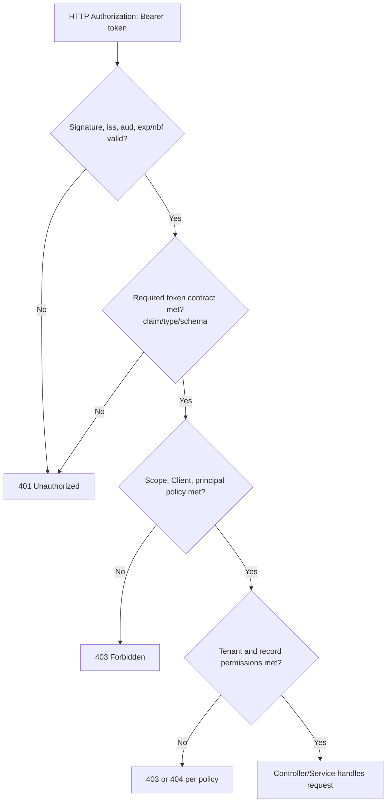

# Enforcing Tenant, Client, or Token Type Constraints When the Contract Requires It

## 1. Why Might a Valid Access Token Still Be Rejected by an API?

Imagine a SaaS platform with a REST API managing invoices:

```http
GET /api/tenants/tenant-alpha/invoices/inv-42 HTTP/1.1
Host: invoices.example.com
Authorization: Bearer <access-token>
```

Spring Security can verify the JWT access token cleanly: valid signature, trusted issuer, unexpired, and holding `SCOPE_invoices.read`. Yet the API must still answer more specific questions:

1. **Tenant:** Does the token grant access to `tenant-alpha` data or a different tenant?
2. **Client:** Which application received the token? Is this endpoint restricted to a pre-registered set of Clients?
3. **Token type:** Is this genuinely an **access token for an API**, or an OIDC ID token with a valid signature that must not be used to access resources?
4. **Principal context:** Does the token represent a user, a machine-to-machine service, or a specialized delegation? Does that affect endpoint policy?

These questions belong to the **access token contract** between the Authorization Server and the Resource Server. A contract can specify mandatory claims or JOSE header parameters, acceptable values, and how non-conforming tokens must be handled.

Example of a JWT access token issued under a system-specific convention:

```json
{
  "iss": "https://id.example.com/realms/shop",
  "sub": "user-417",
  "aud": ["invoices-api"],
  "iat": 1893455100,
  "exp": 1893456000,
  "client_id": "portal-web",
  "scope": "invoices.read",
  "tenant_id": "tenant-alpha",
  "principal_type": "user"
}
```

Here `tenant_id` and `principal_type` are **custom claims**, not universal requirements on every JWT. `client_id` semantics depend on the issuer's token profile. The `exp` value is merely illustrative, not from a real token.

If the Client changes the URL to `/api/tenants/tenant-beta/...`, even though the JWT remains valid with invoice-reading scope, the API **must never** allow access to Beta. Similarly, if the token carries `client_id=unknown-app` while the endpoint contract requires an approved Client, the API must enforce policy.

### Lesson Objectives

After this lesson, you will be able to:

- Distinguish **token validity checks**, **claim contract checks**, **endpoint authorization**, and **object-level authorization**.
- Determine when to constrain `tenant_id`, `client_id`, or access token type.
- Understand how JOSE `typ` differs from `token_type=Bearer`, `grant_type`, and custom claims.
- Configure `JwtDecoder` with `OAuth2TokenValidator<Jwt>` in Spring Security.
- Design tenant isolation and client allowlists without trusting Client-asserted headers or URL paths.
- Interpret `401`, `403`, and `404` responses accurately and design test cases.

## 2. What Does "When the Contract Requires It" Mean?

OAuth 2.0 does not require every access token to share the same format or claim set. An access token may be a **JWT** or an **opaque token**. Claims like `tenant_id`, `organization_id`, `client_id`, `azp`, `roles`, and `principal_type` can only be relied upon when the Resource Server knows **which issuer produces them**, **their exact semantics**, **their data types**, and **what guarantees back them**.

A token contract should document:

| Contract Element | Example | What Must the Resource Server Do? |
|---|---|---|
| Issuer | `https://id.example.com/realms/shop` | Trust only configured issuers |
| Audience | `invoices-api` | Reject tokens issued for other APIs |
| Validity window | `exp`, `nbf` | Accept only currently valid tokens |
| Token type | JWT access token per profile with `typ=at+jwt` | Accept only the profile's token type if required by contract |
| Active tenant | Non-empty string `tenant_id` | Verify claim and enforce tenant isolation on data access |
| Issued-to Client | `client_id` | Validate Client identity per issuer and policy |
| Scopes | `invoices.read`, `invoices.write` | Map to authorities and apply endpoint rules |
| Principal kind | `principal_type=user` or `service` | Trust only if managed and strictly defined by the issuer |
| Business permissions | Owner, tenant role, allowed organization | Enforce in Service/Repository or authorization layer |

Never add a custom validator simply because you spotted a claim in a few sample tokens. First establish **whether the API actually requires that claim on every token or only on specific operations**.

For instance:

- `/api/tenants/{tenantId}/invoices/**` requires a tenant context.
- `/api/internal/billing-sync` may require the Client to belong to an approved service list.
- `/api/public/health` does not need an access token.
- A platform administration endpoint has its own policy, possibly without a single fixed tenant yet requiring a tightly controlled cross-tenant grant.

**Never turn an endpoint-specific policy into a global constraint that rejects valid tokens in other scenarios.** Put a rule in the decoder when it applies to every token accepted by the API, or in the authorization layer when it applies only to a specific route or operation.

## 3. Three Layers of Defense That Must Not Be Conflated

In a Spring Security Resource Server, keep these three layers distinct:

### 3.1. Layer A: Token Authentication and Mandatory Structural/Contract Checks

Inside `JwtDecoder` or opaque token introspection:

- Are the signature and algorithm accepted?
- Does `iss` match a trusted issuer?
- Is the token valid per `exp` and `nbf`?
- Does `aud` match this Resource Server?
- If **every JWT access token must carry** `tenant_id` or `client_id`, is that claim present and properly typed?
- If the profile mandates a token type in the JOSE header, does `typ` match?

If a token fails authentication or mandatory validators, the Resource Server typically returns **`401 Unauthorized`** with an appropriate Bearer error, because the token **is not accepted for authentication**.

### 3.2. Layer B: Endpoint and Client Authorization

After `Authentication` is established:

- Does the GET endpoint require `SCOPE_invoices.read`?
- Is an internal endpoint restricted to `billing-worker` or registered Clients?
- Is the token a `service` principal if the endpoint allows only services?
- Does the user hold the required role **within the active tenant**?

If the token authenticates cleanly yet lacks permission for the endpoint, the typical response is **`403 Forbidden`**.

### 3.3. Layer C: Resource-Level Authorization

When reading `inv-42`, the Service/Repository must check:

- Which tenant owns the invoice?
- Is the caller allowed to access that tenant?
- Does the caller own the invoice or hold a role permitted to view it?
- Is the record within the data scope permitted to that Client/service?

A valid token with the right tenant and scope can still be denied if the caller does not own the record. The API may return `403` or `404` per its policy on hiding resource existence.



**Core point:** A signed and verified claim is **trustworthy data from the issuer**, not automatic **permission to access every resource** referenced by that claim.

## 4. Enforcing Tenant Constraints for Multi-Organization API Data

### 4.1. What Is a Tenant?

In multi-tenant SaaS, a **tenant** is an isolated customer/organization boundary separating data and permissions. For example:

- `tenant-alpha`: Alpha organization owning invoice `inv-42`.
- `tenant-beta`: Beta organization owning invoice `inv-57`.

`tenant_id` is not a mandatory registered JWT claim. An Authorization Server might use `tid`, `org_id`, a namespaced URI claim, or a custom structure. Never treat two claim names as equivalent unless the contract explicitly defines them so.

A good tenant ID is stable, unique within the application domain, and directly cross-referenced in business data; avoid using email domains or display names as security identifiers if they can change.

### 4.2. A Token Bound to Exactly One Tenant

A simple contract:

```json
{
  "sub": "user-417",
  "aud": ["invoices-api"],
  "scope": "invoices.read",
  "tenant_id": "tenant-alpha"
}
```

When accessing tenant-bound resources, the Resource Server must enforce at minimum:

```text
tokenTenant == requestedTenant   (if tenant appears in URL)
tokenTenant == resourceTenant    (the data record's tenant)
```

Add ownership or tenant-specific role checks when required by business rules. `tenant_id` in the JWT should be trusted only after verifying the token and confirming the issuer **is authorized to assert that tenant for the principal** under the issuance contract.

### 4.3. Request Tenant Must Never Override Token Tenant

Dangerous example:

```http
GET /api/tenants/tenant-beta/invoices/inv-57 HTTP/1.1
Authorization: Bearer <token-of-tenant-alpha>
X-Tenant-ID: tenant-beta
```

`tenant-beta` in the URL path or header is **Client-supplied input**. It indicates which tenant the caller is asking for, never proving the caller has access to Beta.

With a single-tenant token, the API must reject whenever the requested tenant differs from the verified `tenant_id`.

With a multi-tenant token, the request must be checked against **permitted tenants scoped by exact permissions**, rather than checking an arbitrary list without knowing which permissions apply to which tenant.

### 4.4. Including Tenant in Data Queries

Error-prone query:

```sql
SELECT * FROM invoices
WHERE id = :invoice_id;
```

Safer query for tenant-bound data:

```sql
SELECT id, tenant_id, owner_subject, amount
FROM invoices
WHERE id = :invoice_id
  AND tenant_id = :verified_tenant_id;
```

If an endpoint lets users view only their own invoices:

```sql
SELECT id, tenant_id, owner_subject, amount
FROM invoices
WHERE id = :invoice_id
  AND tenant_id = :verified_tenant_id
  AND owner_subject = :verified_subject;
```

When writing data, `tenant_id` must also come from the authorized security context rather than trusting a `tenantId` field inside the JSON body. Foreign references to customers, products, attachments, and reports must likewise enforce matching tenants.

A JWT with `tenant_id=tenant-alpha` cannot prevent data leaks if the Repository still queries solely by `id` and returns a Beta record.

### 4.5. Multiple Tenants in One Token

Some issuers emit:

```json
{
  "allowed_tenants": ["tenant-alpha", "tenant-beta"],
  "scope": "invoices.read"
}
```

This is only an illustrative custom claim. The API must identify the active requested tenant, confirm it belongs to the allowed set, and then query **strictly within that tenant**.

If permissions differ between two tenants (read-only in Alpha, write-only in Beta), a flat scope string plus a tenant array cannot express that permission matrix accurately. Use single-tenant tokens or a per-tenant permission claim model guaranteed by the issuer and understood by the API.

### 4.6. Membership Can Change After Token Issuance

A signed JWT can remain unexpired after a user is removed from a tenant. Signature verification does not refresh live membership state. If near-instant revocation is required, design short token lifetimes, introspection/entitlement checks, or appropriate revocation mechanisms.

**Tenant takeaway:** Validating the claim in the decoder ensures the token conforms to the contract; filtering by tenant in the Service/Repository enforces true data isolation.

## 5. Enforcing OAuth Client Constraints When Required

### 5.1. `client_id` Differs from `sub`

An OAuth **Client** is an application registered with the Authorization Server. `client_id` identifies the Client; `sub` identifies the token subject per the issuer's profile.

The two fields can differ:

```json
{
  "sub": "user-417",
  "client_id": "portal-web",
  "scope": "invoices.read"
}
```

Or in Client Credentials, a system might issue:

```json
{
  "sub": "billing-worker",
  "client_id": "billing-worker",
  "scope": "invoices.reconcile"
}
```

Never assume every `sub` is a user ID, or that every token with `client_id` comes from Client Credentials. Grant type describes how the token was obtained and is not required to appear inside the access token.

Some issuers use `azp` (*authorized party*), `appid`, or another profile-specific claim. In particular, `azp` has OIDC-specific semantics in certain contexts; **never swap `azp` and `client_id` interchangeably** unless the contract defines them so.

### 5.2. When Is a Client Allowlist Needed?

Suppose `POST /api/internal/reconcile` may only be called by the internal `billing-worker` app, even if another Client happens to hold a similarly named scope.

You can enforce:

```text
Require:
  access token valid for invoices-api
  scope includes invoices.reconcile
  client_id == billing-worker
  principal_type == service (if AS commits to this claim)
  tenant/resource permission satisfies operation
```

Scopes represent **granted permissions**, whereas Client ID represents **the application that received the token**. Combining both is valuable when sensitive operations are restricted to one or a few specific applications.

If an endpoint allows several Clients, maintain a governed allowlist. Never trust `client_id` from a self-asserted header, query string, or body in place of the issuer-verified claim.

### 5.3. Limits of Client Constraints

Checking `client_id` inside a JWT **does not prove** that the Client application process itself is currently sending the HTTP request while holding valid credentials. With a **Bearer token**, anyone possessing an unexpired token can present it to the Resource Server unless sender-constraining is used.

Therefore:

- Protect tokens in storage and transmit over HTTPS.
- Consider short-lived access tokens and revocation mechanisms where needed.
- If the system must prove the current caller holds the Client's private key or certificate, adopt sender-constrained tokens such as mTLS-bound access tokens or DPoP where supported, verifying the binding at the Resource Server. **Inspecting `client_id` alone never replaces sender-constraining.**

Never confuse **the Client to which the token was issued** with **cryptographic proof that the current HTTP sender is that Client**.

### 5.4. Global Validation or Endpoint Authorization?

Two distinct scenarios:

**API-wide contract:** "This Resource Server accepts tokens issued only for Clients A and B." Enforce the Client allowlist inside `JwtDecoder`; tokens for Client C violate the token contract and typically receive `401`.

**Endpoint contract:** "The API generally serves multiple Clients, but `/api/internal/reconcile` is reserved for Client B." Authenticate valid tokens generally first, then enforce Client ID + scope at endpoint authorization. When Client A calls that endpoint with an otherwise valid token, it typically receives `403`.

Picking the wrong layer blurs invalid tokens with valid tokens lacking authorization on a single route.

## 6. Enforcing Token Type: An Access Token Is Not an ID Token

### 6.1. Why Validate Token Type?

An OpenID Provider can simultaneously issue:

- **ID tokens:** for the OIDC Client to verify user authentication.
- **Access tokens:** for the Resource Server to authorize API calls.

Both may be JWTs with the same `iss` and signed by the same issuer keys. If an API checks only signature and issuer without verifying audience and token type per contract, an ID token could be mistakenly accepted as an access token.

**Never send an ID token as an access token in `Authorization: Bearer ...`.**

### 6.2. `typ` Is a JOSE Header Parameter

In a JWS Compact JWT, the header may look like:

```json
{
  "alg": "RS256",
  "kid": "signing-key-11",
  "typ": "at+jwt"
}
```

`typ` indicates the JOSE/JWT object type. Under **JWT Profile for OAuth 2.0 Access Tokens** (RFC 9068), JWT access tokens use `typ` equal to `at+jwt` or `application/at+jwt` per profile.

An OIDC ID token normally does not carry `typ=at+jwt` under that convention. However, **not every JWT access token in the wild follows RFC 9068**: many issuers emit `typ=JWT` or follow different conventions. Never require `at+jwt` unilaterally unless the AS/API contract guarantees it.

| Value / Attribute | Meaning | Does It Prove This Is an API Access Token? |
|---|---|---|
| `typ=at+jwt` | Header type per compliant JWT access token profile | Helpful condition when the issuer follows the profile, still requiring signature/claim checks |
| `typ=JWT` | Generic JWT indicator | Insufficient to distinguish access tokens from ID tokens |
| `token_type=Bearer` | Typically in the **token endpoint response** | Describes Bearer usage, not a JWT inner token-type claim |
| `grant_type=authorization_code` | Token request parameter | Does not prove JWT token type by itself |
| `principal_type=service` | Custom AS claim, if present | Not a standard way to distinguish access tokens from ID tokens |
| `aud` includes API | Token targets the Resource Server | Crucial check, though profile context and extra checks still matter |

In particular, `typ` in the header **can be read before signature verification**. Never rely on it for access decisions before the decoder finishes verifying the token. In JWS Compact, the protected header is covered by the signature; validators must only trust it once the signature and remaining checks pass.

### 6.3. Two Approaches to Checking Token Type

**Approach A — Explicit JWT access token profile:** The API and AS agree that signed JWT access tokens carry `typ=at+jwt` and required profile claims. The Resource Server configures its JWT processor to permit that type and validates `typ`.

**Approach B — Custom issuer contract:** When the AS emits JWT access tokens with `typ=JWT`, the API must rely on other trustworthy constraints such as issuer, audience, access-token-specific claims, scopes, client, and AS-governed conventions. Never look at `typ=JWT` alone and assume proper purpose.

In both approaches, restrict signing algorithms and verification keys independently. Token-supplied `alg` or `kid` headers must never expand the set of keys or algorithms trusted by the API.

## 7. Design Principles for Claim Validators

A custom validator should satisfy these properties:

1. **Runs after signature verification:** Never rely on self-decoded payloads before verification.
2. **Backed by an explicit contract:** Claim name, data type, comparison rule, and allowed values are well defined.
3. **Fail closed when required:** If a mandatory claim is missing or mistyped, reject.
4. **Do not guess grant type:** Avoid inferring grant flows solely from `sub` format or `client_id` presence.
5. **Do not drop standard validators:** When adding tenant/client/type checks, keep issuer, timestamps, audience, and algorithm/signature checks.
6. **Do not replace resource permissions:** Holding a tenant claim does not prove record ownership.
7. **Apply at the right scope:** Global validators for token-level invariants; authorization managers/services for endpoint-specific rules.
8. **Anchor to each issuer's contract:** When trusting multiple issuers, configure claim names and semantics per issuer.

### 7.1. Data Type Considerations

Suppose the contract states:

```text
tenant_id:
  required: true
  type: string
  nonempty: true

client_id:
  required: true
  type: string
  nonempty: true
```

Do not accept:

```json
{"tenant_id": ["tenant-alpha", "tenant-beta"]}
```

as a valid tenant string if the contract permits only a string. Similarly, never coerce numbers, arrays, or objects via `toString()` and treat them as security-critical tenant IDs.

Tenant values should follow a clear namespace/format, optionally bounded in length. Still, **valid formatting does not prove the tenant exists or that the principal still belongs to it**; that must be ensured by the AS at issuance and/or checked by the API against current authorization data.

### 7.2. Should Token Profile Be Checked at the Decoder Layer?

When token type is mandatory across the entire Resource Server, a JWT validator can check the `typ` header after the token is verified. Depending on your Spring Security and Nimbus version and configuration, default `typ` handling may reject tokens before custom validators run.

Thus, if the AS emits `typ=at+jwt`, configure the decoder to be **compatible with that token profile** alongside an explicit type validator—never add a validator while ignoring the library's built-in type behavior. Section 9 illustrates this for versions offering `validateType(false)`.

## 8. Configuring Spring Security to Validate Issuer, Audience, Tenant, and Client

This section assumes the Resource Server accepts **JWT access tokens**, trusts one issuer, expects audience `invoices-api`, and **every accepted JWT must carry valid `tenant_id` and `client_id`**. If any endpoint accepts tenant-less platform-level tokens, design a separate flow so the global validator is not overly restrictive.

### 8.1. Dependencies

With Spring Boot + Gradle:

```groovy
dependencies {
    implementation 'org.springframework.boot:spring-boot-starter-web'
    implementation 'org.springframework.boot:spring-boot-starter-security'
    implementation 'org.springframework.boot:spring-boot-starter-oauth2-resource-server'
}
```

Spring Boot manages compatible Spring Security versions via the project's dependency management.

### 8.2. Trusted Issuer

Example in `application.yml`:

```yaml
spring:
  security:
    oauth2:
      resourceserver:
        jwt:
          issuer-uri: https://id.example.com/realms/shop
```

This URI is a placeholder for your real issuer. `issuer-uri` must match the `iss` published by the AS. Never take an issuer from an HTTP header or unverified `iss` claim and trust that URL automatically.

### 8.3. `JwtDecoder` Bean Combining Validators

Below is a concrete example enforcing three API-wide conditions: **audience**, **properly typed tenant claim**, and **allowlisted Client ID**.

```java
package com.example.invoices;

import java.util.Set;
import org.springframework.context.annotation.Bean;
import org.springframework.context.annotation.Configuration;
import org.springframework.security.oauth2.core.DelegatingOAuth2TokenValidator;
import org.springframework.security.oauth2.core.OAuth2Error;
import org.springframework.security.oauth2.core.OAuth2TokenValidator;
import org.springframework.security.oauth2.core.OAuth2TokenValidatorResult;
import org.springframework.security.oauth2.jwt.Jwt;
import org.springframework.security.oauth2.jwt.JwtDecoder;
import org.springframework.security.oauth2.jwt.JwtDecoders;
import org.springframework.security.oauth2.jwt.JwtValidators;
import org.springframework.security.oauth2.jwt.NimbusJwtDecoder;

@Configuration
public class JwtValidationConfig {

    private static final String ISSUER =
        "https://id.example.com/realms/shop";

    private static final String EXPECTED_AUDIENCE = "invoices-api";

    // Example: API accepts access tokens only from two approved Clients.
    private static final Set<String> ALLOWED_CLIENTS =
        Set.of("portal-web", "billing-worker");

    private static OAuth2TokenValidatorResult reject(String reason) {
        return OAuth2TokenValidatorResult.failure(
            new OAuth2Error("invalid_token", reason, null));
    }

    @Bean
    JwtDecoder jwtDecoder() {
        NimbusJwtDecoder decoder =
            (NimbusJwtDecoder) JwtDecoders.fromIssuerLocation(ISSUER);

        OAuth2TokenValidator<Jwt> audience = jwt ->
            jwt.getAudience().contains(EXPECTED_AUDIENCE)
                ? OAuth2TokenValidatorResult.success()
                : reject("Invalid audience");

        OAuth2TokenValidator<Jwt> tenantClaim = jwt -> {
            Object value = jwt.getClaims().get("tenant_id");

            if (!(value instanceof String tenantId)) {
                return reject("Invalid tenant_id type");
            }

            if (tenantId.isBlank() || tenantId.length() > 100) {
                return reject("Invalid tenant_id value");
            }

            return OAuth2TokenValidatorResult.success();
        };

        OAuth2TokenValidator<Jwt> allowedClient = jwt -> {
            Object value = jwt.getClaims().get("client_id");

            if (!(value instanceof String clientId)) {
                return reject("Missing client_id");
            }

            return ALLOWED_CLIENTS.contains(clientId)
                ? OAuth2TokenValidatorResult.success()
                : reject("Client is not allowed");
        };

        decoder.setJwtValidator(
            new DelegatingOAuth2TokenValidator<>(
                JwtValidators.createDefaultWithIssuer(ISSUER),
                audience,
                tenantClaim,
                allowedClient
            ));

        return decoder;
    }
}
```

Explanation:

- `JwtDecoders.fromIssuerLocation(ISSUER)` builds a decoder anchored to the trusted issuer and appropriate key-retrieval mechanism.
- `JwtValidators.createDefaultWithIssuer(ISSUER)` preserves essential issuer and timestamp validators.
- `audience` rejects tokens not issued for `invoices-api`.
- `tenantClaim` permits only non-blank string `tenant_id` values within a length limit.
- `allowedClient` requires `client_id` to belong to the approved Client set.
- `DelegatingOAuth2TokenValidator` composes all checks; tokens are rejected if any mandatory condition fails.

This illustrates a **global Client allowlist** contract. If only `/api/internal/reconcile` restricts Clients, do not put `allowedClient` into the global decoder; enforce it at endpoint authorization instead (Section 10).

**Never read `jwt.getClaims().get(...)` before the decoder verifies the token**, or instantiate decoders dynamically from an untrusted JWT's `iss`. Claim names must also match your real token contract.

### 8.4. `SecurityFilterChain` for Endpoints

```java
package com.example.invoices;

import org.springframework.context.annotation.Bean;
import org.springframework.context.annotation.Configuration;
import org.springframework.http.HttpMethod;
import org.springframework.security.config.Customizer;
import org.springframework.security.config.annotation.web.builders.HttpSecurity;
import org.springframework.security.config.http.SessionCreationPolicy;
import org.springframework.security.web.SecurityFilterChain;

@Configuration
public class ApiSecurityConfig {

    @Bean
    SecurityFilterChain apiSecurity(HttpSecurity http) throws Exception {
        return http
            .csrf(csrf -> csrf.disable())
            .sessionManagement(session ->
                session.sessionCreationPolicy(SessionCreationPolicy.STATELESS))
            .authorizeHttpRequests(auth -> auth
                .requestMatchers("/api/public/**").permitAll()
                .requestMatchers(HttpMethod.GET, "/api/tenants/*/invoices/**")
                    .hasAuthority("SCOPE_invoices.read")
                .requestMatchers(HttpMethod.POST, "/api/internal/reconcile")
                    .hasAuthority("SCOPE_invoices.reconcile")
                .anyRequest().denyAll()
            )
            .oauth2ResourceServer(oauth2 ->
                oauth2.jwt(Customizer.withDefaults()))
            .build();
    }
}
```

Under Spring Security's standard mapping, `scope` or `scp` becomes authorities prefixed with `SCOPE_`. If the AS uses a different format, customize `JwtAuthenticationConverter`.

Here:

- `JwtDecoder` verifies the token and global claim profile.
- `SecurityFilterChain` enforces scopes per endpoint.
- Controller/Service enforces tenant matching, Client-specific permissions, and record access.

This example uses `STATELESS` and disables CSRF for a pure Bearer-token REST API in the `Authorization` header with **no cookies used for automatic authentication**. If your app also uses session cookies, design CSRF accordingly.

## 9. Checking `typ=at+jwt` When the AS Follows the JWT Access Token Profile

### 9.1. Prerequisites

Suppose the AS declares that JWT access tokens follow the profile requiring `typ` in:

```text
at+jwt
application/at+jwt
```

The Resource Server must ensure its decoder **accepts the expected profile**, while **rejecting generic `typ=JWT`** as an explicitly typed access token unless the contract states otherwise.

Spring Security/Nimbus checks token types before or during decoding depending on version. On versions exposing `NimbusJwtDecoder...validateType(false)`, you can delegate JWT type checking to an application-declared validator. **Never disable default type validation and forget to add the replacement validator.**

### 9.2. Example Token-Type Validator

Sample for versions supporting the `validateType(false)` builder option:

```java
package com.example.invoices;

import java.util.Set;
import org.springframework.context.annotation.Bean;
import org.springframework.context.annotation.Configuration;
import org.springframework.security.oauth2.core.DelegatingOAuth2TokenValidator;
import org.springframework.security.oauth2.core.OAuth2Error;
import org.springframework.security.oauth2.core.OAuth2TokenValidator;
import org.springframework.security.oauth2.core.OAuth2TokenValidatorResult;
import org.springframework.security.oauth2.jwt.Jwt;
import org.springframework.security.oauth2.jwt.JwtDecoder;
import org.springframework.security.oauth2.jwt.JwtValidators;
import org.springframework.security.oauth2.jwt.NimbusJwtDecoder;

@Configuration
public class AccessTokenTypeConfig {

    @Bean
    JwtDecoder typedAccessTokenDecoder() {
        String issuer = "https://id.example.com/realms/shop";

        NimbusJwtDecoder decoder = NimbusJwtDecoder
            .withIssuerLocation(issuer)
            .validateType(false)
            .build();

        OAuth2TokenValidator<Jwt> accessTokenType = jwt -> {
            Object value = jwt.getHeaders().get("typ");
            boolean accepted =
                value instanceof String type
                    && Set.of("at+jwt", "application/at+jwt")
                        .contains(type);

            return accepted
                ? OAuth2TokenValidatorResult.success()
                : OAuth2TokenValidatorResult.failure(
                    new OAuth2Error(
                        "invalid_token", "Unexpected token type", null));
        };

        OAuth2TokenValidator<Jwt> audience = jwt ->
            jwt.getAudience().contains("invoices-api")
                ? OAuth2TokenValidatorResult.success()
                : OAuth2TokenValidatorResult.failure(
                    new OAuth2Error(
                        "invalid_token", "Invalid audience", null));

        decoder.setJwtValidator(
            new DelegatingOAuth2TokenValidator<>(
                JwtValidators.createDefaultWithIssuer(issuer),
                audience,
                accessTokenType
            ));

        return decoder;
    }
}
```

**This replaces the decoder from Section 8.3—it is not a second bean to declare alongside it.** In real usage, **combine** any required tenant and client validators into this same decoder; `typedAccessTokenDecoder` alone does not enforce tenant/client contracts.

`validateType(false)` exists only on Spring Security versions providing that builder option; use your project version's exact API. Other decoder setups perform default type validation differently. What stays constant is **enforcing explicit type checks while keeping signature, issuer, audience, and time validators**.

Furthermore, a JWT access token profile may mandate additional claims or data types. When adopting RFC 9068, enforce the **full profile contract**, not `typ` alone.

### 9.3. Never Use `typ` as an Arbitrary Bypass Branch

Conceptually unsafe rule:

```text
if header.typ == "at+jwt":
    allow API call
```

Anyone can put `at+jwt` inside an unsigned header. The check is meaningful **only after verifying the token against trusted keys and passing all claim validators**.

## 10. Enforcing Client Constraints Per Endpoint

Suppose the Resource Server accepts valid tokens from both `portal-web` and `billing-worker`, yet the reconciliation endpoint is strictly for `billing-worker`. Instead of rejecting `portal-web` globally at the decoder, write a custom `AuthorizationManager<RequestAuthorizationContext>`.

### 10.1. Example Client and Scope Policy

```java
package com.example.invoices;

import java.util.function.Supplier;
import org.springframework.security.authorization.AuthorizationDecision;
import org.springframework.security.authorization.AuthorizationManager;
import org.springframework.security.core.Authentication;
import org.springframework.security.oauth2.server.resource.authentication.JwtAuthenticationToken;
import org.springframework.security.web.access.intercept.RequestAuthorizationContext;

public final class BillingClientAuthorizationManager
        implements AuthorizationManager<RequestAuthorizationContext> {

    @Override
    public AuthorizationDecision check(
            Supplier<Authentication> authentication,
            RequestAuthorizationContext context) {

        Authentication auth = authentication.get();

        if (!(auth instanceof JwtAuthenticationToken jwtAuth)
                || !auth.isAuthenticated()) {
            return new AuthorizationDecision(false);
        }

        Object clientId =
            jwtAuth.getToken().getClaims().get("client_id");

        boolean allowedClient = "billing-worker".equals(clientId);

        boolean allowedScope = auth.getAuthorities().stream()
            .anyMatch(authority ->
                "SCOPE_invoices.reconcile"
                    .equals(authority.getAuthority()));

        return new AuthorizationDecision(
            allowedClient && allowedScope);
    }
}
```

This checks the Client ID from the **verified JWT** inside `JwtAuthenticationToken`. If a valid token belongs to `portal-web`, the manager returns `false` and the endpoint typically responds with `403`.

In `SecurityFilterChain`, wire the manager on the internal route:

```java
.requestMatchers(HttpMethod.POST, "/api/internal/reconcile")
    .access(new BillingClientAuthorizationManager())
```

Replace the plain scope rule in Section 8.4 with this line to enforce **both Client ID and scope** on the internal endpoint.

In real applications, you can also check an AS-managed `principal_type`, internal roles, allowed tenants, or live Client registration status. Client constraints still do not replace sender-constrained tokens if your threat model requires proof of key possession.

### 10.2. Why Never Trust an `X-Client-Id` Header?

A Client can send:

```http
POST /api/internal/reconcile HTTP/1.1
Authorization: Bearer <token-of-portal-web>
X-Client-Id: billing-worker
```

`X-Client-Id` is caller-controlled input. If an API checks that header instead of the verified claim for Client allowlisting, any caller can pretend to be `billing-worker`.

Use an issuer-backed claim or a properly designed Client authentication / sender-constraining mechanism. Never infer Client ID from `User-Agent`, `Origin`, or IP addresses unless they belong to a formal trust model.

## 11. Enforcing Tenant Constraints in Controllers and Repositories

### 11.1. Reading the Verified JWT

A Controller receives `Jwt` via `@AuthenticationPrincipal`:

```java
package com.example.invoices;

import java.util.UUID;
import org.springframework.security.core.annotation.AuthenticationPrincipal;
import org.springframework.security.oauth2.jwt.Jwt;
import org.springframework.web.bind.annotation.GetMapping;
import org.springframework.web.bind.annotation.PathVariable;
import org.springframework.web.bind.annotation.RequestMapping;
import org.springframework.web.bind.annotation.RestController;

@RestController
@RequestMapping("/api/tenants/{tenantId}/invoices")
public class InvoiceController {

    private final InvoiceService invoiceService;

    public InvoiceController(InvoiceService invoiceService) {
        this.invoiceService = invoiceService;
    }

    @GetMapping("/{invoiceId}")
    public InvoiceDto getInvoice(
            @PathVariable String tenantId,
            @PathVariable UUID invoiceId,
            @AuthenticationPrincipal Jwt jwt) {

        String tokenTenant =
            jwt.getClaimAsString("tenant_id");

        if (!tokenTenant.equals(tenantId)) {
            throw new org.springframework.security.access.AccessDeniedException(
                "Tenant access denied");
        }

        return invoiceService.findVisibleInvoice(
            invoiceId, tokenTenant, jwt.getSubject());
    }
}
```

This assumes `JwtDecoder` has already required `tenant_id` to be a non-blank string. If the decoder does not guarantee it, check `tokenTenant != null` before calling `.equals(...)`.

`tokenTenant.equals(tenantId)` validates the **requested tenant**. It does not replace filtering by tenant in data queries.

### 11.2. Querying the Right Tenant

Spring Data JPA example:

```java
import java.util.Optional;
import java.util.UUID;
import org.springframework.data.jpa.repository.JpaRepository;

public interface InvoiceRepository
        extends JpaRepository<InvoiceEntity, UUID> {

    Optional<InvoiceEntity> findByIdAndTenantIdAndOwnerSubject(
        UUID id, String tenantId, String ownerSubject);
}
```

Service sketch:

```java
InvoiceEntity invoice = repository
    .findByIdAndTenantIdAndOwnerSubject(
        invoiceId, verifiedTenant, verifiedSubject)
    .orElseThrow(() -> new ResponseStatusException(
        HttpStatus.NOT_FOUND, "Invoice not found"));

return mapper.toDto(invoice);
```

`InvoiceEntity`, `InvoiceDto`, and `mapper` are illustrative domain types. In a real project, define the corresponding JPA mappings, field names, and business models.

Include the tenant predicate directly in the query from the start, rather than fetching by ID across all tenants and hoping every code path remembers to verify tenant afterward.

### 11.3. Creating or Updating Data

Given a request:

```http
POST /api/tenants/tenant-alpha/invoices HTTP/1.1
Authorization: Bearer <token-tenant-alpha>
Content-Type: application/json

{
  "tenantId": "tenant-beta",
  "customerId": "customer-123",
  "amount": 250
}
```

Never take `tenantId` from the request body to assign record ownership. The server must use the authorized tenant and verify that `customerId` belongs to the same tenant or may be referenced under policy.

On updates and deletes, include the tenant predicate in SQL too:

```sql
UPDATE invoices
SET status = :new_status
WHERE id = :invoice_id
  AND tenant_id = :verified_tenant_id;
```

Apply the same rule across caches, search indexes, exports, file storage, and event consumers. If a cache key uses only the invoice ID, a Beta request could accidentally read Alpha's cached data even if the Controller checks tenants.

## 12. Opaque Access Tokens: Enforcing Claims via Introspection

Not all access tokens are JWTs. With an **opaque token**, the Resource Server typically calls a **trusted introspection endpoint** to verify whether the token is active and retrieve attributes.

Spring Boot example:

```yaml
spring:
  security:
    oauth2:
      resourceserver:
        opaque-token:
          introspection-uri: https://id.example.com/oauth2/introspect
          client-id: INTROSPECTION_CLIENT_ID_FROM_ENV
          client-secret: INTROSPECTION_CLIENT_SECRET_FROM_ENV
```

`...FROM_ENV` values are placeholders. In deployments, inject credentials via environment variables or a secret manager—never store real secrets in source control.

Illustrative introspection response:

```json
{
  "active": true,
  "iss": "https://id.example.com/realms/shop",
  "sub": "user-417",
  "client_id": "portal-web",
  "aud": ["invoices-api"],
  "scope": "invoices.read",
  "tenant_id": "tenant-alpha",
  "exp": 1893456000
}
```

Real responses may carry a different set of fields. The API may rely only on fields the AS actually provides by contract. You cannot read JOSE `typ` on an opaque token like a JWT; if token types must be distinguished, use trusted metadata or mechanisms exposed by the AS.

Keep in mind:

- Choose the introspection endpoint from trusted configuration; never send opaque tokens to arbitrary servers.
- `active=true` is one prerequisite—it does not grant all scopes or resource permissions.
- If a tenant-bound endpoint requires `tenant_id` and introspection omits it, reject per contract or adjust authorization; never substitute an HTTP header for tenant.
- Under Opaque Token authentication, the principal type differs from `Jwt`; align Controllers and converters with the actual `Authentication` type.

## 13. Multi-Issuer: Same Claim Name Does Not Guarantee Same Semantics

Suppose `invoices-api` trusts two issuers:

```text
https://login.alpha.example/realms/main
https://login.beta.example/realms/main
```

Issuer Alpha emits `tenant_id` as a UUID; Issuer Beta emits `org_id` as a string identifier. If the API assumes every token uses `tenant_id` with identical semantics, valid Beta tokens may be wrongly rejected or mapped to the wrong data scope.

A multi-issuer system must:

1. Select decoders strictly from a governed **issuer allowlist**.
2. Verify signature, issuer, and audience **using the selected issuer's own configuration**.
3. Map claims into a well-defined internal principal model, such as `VerifiedTenantContext` or `VerifiedClientIdentity`.
4. Preserve explicit namespacing: the pair `(iss, sub)` is often needed to distinguish colliding subjects across two issuers.
5. Never grant cross-tenant access merely because Client or user IDs share the same string.

When mapping Issuer Beta's `org_id` to an internal tenant, use a trusted configured mapping—never a self-asserted `org_id` from the HTTP request.

### 13.1. Client IDs Can Collide Across Issuers

Example:

```text
Issuer Alpha: client_id = billing-worker
Issuer Beta:  client_id = billing-worker
```

These two Clients are **not automatically the same application**. If the API restricts Clients, check **both issuer and client ID**, or map to a governed internal Client identifier.

In a single-issuer system, an allowlist of `client_id` values may suffice. Across multiple issuers, identically named `client_id` values in different namespaces can cause cross-tenant privilege leaks if not separated.

## 14. Distinguishing HTTP Outcomes During Claim Validation

| Case | Detecting Layer | Typical Outcome |
|---|---|---|
| No token on a protected endpoint | Authentication | `401` |
| Invalid signature or issuer | `JwtDecoder` | `401` |
| Expired token | JWT validator | `401` |
| Right issuer, wrong audience | Audience validator | `401` |
| API-wide contract requires `tenant_id`, token missing/mistyped | JWT claim validator | `401` |
| API-wide contract accepts only registered Clients, unknown Client | JWT claim validator | `401` |
| JWT access token contract requires `typ=at+jwt`, wrong type | Decoder/type validator | `401` |
| Valid token lacking `SCOPE_invoices.read` | Endpoint authorization | `403` |
| Valid token with scope, Client barred from reconcile endpoint | Endpoint authorization manager | `403` |
| Valid Alpha token attempting to access tenant Beta | Tenant authorization | `403` or `404` per policy |
| Valid token and tenant, caller does not own the invoice | Object-level authorization | `403` or `404` |
| Valid token, Client, tenant, type, and data permissions | Controller/Service | Appropriate `2xx` |

Notice how **layer selection** shapes the response. Enforcing a rule as a global token validator turns violations into `401`. Enforcing it on a specific endpoint after token authentication turns violations into `403`.

Exact HTTP codes also depend on exception handlers and authorization structure. Regardless of status code, **never return data beyond authorized boundaries**.

## 15. Contract Test Suite

When preparing live tests against an approved issuer and test tokens, structure these cases:

### 15.1. Sample Tokens to Prepare

- **Token A:** `aud=invoices-api`, `tenant_id=tenant-alpha`, `client_id=portal-web`, `scope=invoices.read`, contract-compliant `typ`.
- **Token B:** Same as A except `tenant_id=tenant-beta`.
- **Token C:** Valid except missing `tenant_id` when required API-wide.
- **Token D:** Valid except `tenant_id` is an array instead of a string.
- **Token E:** Valid except `client_id` is outside the allowlist.
- **Token F:** Valid except missing `scope=invoices.read`.
- **Token G:** Valid signature except wrong `aud`.
- **Token H:** An ID token or JWT with the wrong `typ` per API contract.
- **Token I:** Valid for `billing-worker` with `invoices.reconcile`.

To test claim errors accurately, sign fixture tokens with a **trusted test key** or obtain them from a test Authorization Server. Never manually edit the payload of an already-signed JWT expecting to isolate a claim error: the signature breaks first.

### 15.2. Illustrative HTTP Requests

```bash
# Endpoint requiring a valid JWT and invoice-read scope.
curl -i \
  -H "Authorization: Bearer $TOKEN_A" \
  'https://invoices.example.com/api/tenants/tenant-alpha/invoices/inv-42'

# Alpha token requesting Beta's resource.
curl -i \
  -H "Authorization: Bearer $TOKEN_A" \
  'https://invoices.example.com/api/tenants/tenant-beta/invoices/inv-57'

# Token missing scope.
curl -i \
  -H "Authorization: Bearer $TOKEN_F" \
  'https://invoices.example.com/api/tenants/tenant-alpha/invoices/inv-42'
```

Shell variables above represent prepared test tokens. Never commit real tokens into docs, logs, or source control; test strictly over HTTPS.

### 15.3. Expectation Matrix

| Case | Expected Result |
|---|---|
| A reads an Alpha invoice owned by the user | `2xx` success |
| A reads a Beta invoice | Denied due to tenant mismatch |
| B reads a Beta invoice with proper permissions | `2xx` if ownership/role pass |
| C missing required tenant claim | `401` if global validator is active |
| D mistyped tenant claim | `401` |
| E Client outside global allowlist | `401` if global client validator is active |
| F missing scope | `403` |
| G wrong audience | `401` |
| H wrong required token type | `401` |
| Valid `portal-web` token calls `billing-worker`-only endpoint | `403` |
| I calls reconcile endpoint with valid tenant/permissions | Appropriate `2xx` |
| Valid token, user does not own invoice in same tenant | `403` or `404` per policy |

### 15.4. Distinguishing Spring Security Test `with(jwt())` From Real Signed Tokens

Using `MockMvc` and `spring-security-test` `with(jwt())` tests scope/Client/tenant authorization with a simulated principal. However, it **does not verify signatures and does not execute `JwtDecoder` fully**.

To test `OAuth2TokenValidator<Jwt>`, write direct decoder/validator tests or integration tests using test keys/JWKS to prove tokens with bad `iss`, `aud`, `typ`, or claim types are rejected. Listing test scenarios is guidance for learners; you cannot claim a system satisfies these checks without actually running the tests.

## 16. Common Implementation Mistakes

### 16.1. Checking Only That `tenant_id` Exists

A token has `tenant_id=tenant-alpha`, yet the Controller calls `findById(invoiceId)` without filtering by tenant. The API can return Beta data if a caller guesses or knows the ID.

**Fix:** Validate requested vs. resource tenant, include the tenant predicate in queries, and check ownership/tenant roles.

### 16.2. Falling Back to a Request Header When the Tenant Claim Is Missing

A request sends a caller-supplied `X-Tenant-ID`. If the token lacks a required tenant claim and the server falls back to the header, callers can choose any tenant.

**Fix:** Reject non-conforming tokens or require a separate authenticated/authorized tenant-selection mechanism.

### 16.3. Confusing `azp` with `client_id`

One IdP emits `azp`, another emits `client_id`. Code that arbitrarily falls back with `azp ?: client_id` without understanding each issuer's semantics can misauthorize requests.

**Fix:** Define mappings per token profile and issuer, verifying both issuer namespace and Client registration.

### 16.4. Treating Client Credentials Tokens as End-User Tokens

`sub` in Client Credentials may represent a Client or service. Using that `sub` as a user ID and matching against owner columns can grant unintended access.

**Fix:** Use explicit principal/Client type contracts; never guess grant types from token appearance.

### 16.5. Checking `client_id` and Assuming the HTTP Sender Is That Client

Bearer tokens can be stolen and replayed. `client_id` tells which Client received the token, not whether the current caller possesses the Client's secret or key.

**Fix:** Secure token storage, use HTTPS, keep short lifetimes/revocation, and adopt sender-constrained tokens when proof of sender identity is required.

### 16.6. Relying Only on `typ=JWT`

`JWT` is a generic format label that appears across many JWT kinds. It does not prove a token is allowed to call your API.

**Fix:** Enforce audience, appropriate profile/type, issuer, signature, and permissions; enforce `at+jwt` strictly when committed by contract.

### 16.7. Switching `alg`/`typ` Without Configuring a Compatible Decoder

When the Authorization Server switches to a JWT access token profile with `typ=at+jwt`, default decoders on some versions reject the type before custom validators run.

**Fix:** Configure type validation to match your library version and profile; whenever disabling default type validation, always add the replacement validator.

### 16.8. Setting the Client Allowlist Too Broadly

For example, letting any Client with `invoices.reconcile` call the reconcile endpoint. If the AS ever grants that scope to another Client, the internal API becomes exposed.

**Fix:** On sensitive endpoints, enforce both scopes and trusted Client identity / principal type; the AS must also tightly govern scope issuance.

### 16.9. Checking `client_id` in a Single Namespace Across Multiple Issuers

Client `billing-worker` from Issuer A is not automatically the same Client as `billing-worker` from Issuer B.

**Fix:** Match `(issuer, client_id)` pairs or map to governed internal Client identifiers.

### 16.10. Dropping Standard Validators When Adding a Claim Validator

Calling `decoder.setJwtValidator(tenantValidator)` replaces default validators and can drop issuer/timestamp checks depending on how the decoder was built.

**Fix:** Compose all required validators—such as `JwtValidators.createDefaultWithIssuer(issuer)` alongside audience, tenant, client, and type validators per contract.

## 17. Self-Check Questions

**Question 1.** A JWT has a valid signature, is unexpired, and has `scope=invoices.read`. If the token belongs to tenant Alpha while the URL requests tenant Beta, may the API allow it?

**Answer:** No, unless the principal holds Beta permissions. Always compare the requested tenant against the verified tenant scope and the data's tenant; invoice-read scope never grants cross-tenant access on its own.

**Question 2.** When should a missing `tenant_id` return `401`, and when should it return `403`?

**Answer:** If `tenant_id` is mandatory on **every token** under the decoder contract, missing it fails token validation and typically returns `401`. If the token authenticates validly for the API overall yet a tenant-bound endpoint requires tenant permissions the principal lacks, it typically returns `403`.

**Question 3.** Why does `client_id` not prove the HTTP request was sent by the legitimate Client process?

**Answer:** With a Bearer token, anyone holding an unexpired token can replay it. `client_id` states which Client received the token from the issuer; proving the sender owns a key or certificate requires sender-constraining.

**Question 4.** May an ID token with a valid signature and issuer be used as an access token?

**Answer:** No. Resource Servers require access tokens issued for the API with the proper audience, token profile, and permissions. An ID token conveys authentication results to an OIDC Client.

**Question 5.** Does `typ=JWT` prove a token is an OAuth 2.0 access token?

**Answer:** No. That is a generic JWT type. When the AS follows RFC 9068 and the contract mandates it, enforce `at+jwt`/`application/at+jwt` alongside other validations.

**Question 6.** Why must you keep `JwtValidators.createDefaultWithIssuer(...)` when adding a tenant validator?

**Answer:** So you do not accidentally drop essential issuer and expiration checks. A properly typed tenant claim never replaces signature, issuer, audience, or time validity.

**Question 7.** An API trusts multiple issuers. Do two tokens with `client_id=billing-worker` necessarily belong to the same Client?

**Answer:** No. Client IDs are namespaced by issuer/AS. Bind checks to `(issuer, client_id)` or map to governed internal identifiers.

**Question 8.** Why does testing only `with(jwt())` fail to prove the decoder blocks tokens with the wrong `typ`?

**Answer:** `with(jwt())` injects a mock authentication in Security Test. It skips signature verification, JWKS, and full `JwtDecoder` processing; test the decoder/validators directly or run integration tests with JWTs signed by test keys.

## 18. Conclusion

Constraining **tenant**, **client**, and **token type** is a vital extension of the access token contract whenever an API has specialized requirements. Not every system needs the same claim names or profile structure; these rules work only when the Authorization Server and Resource Server agree on how each attribute is issued, defined, and validated.

In a Spring Security OAuth 2.0 Resource Server, keep three layers distinct:

1. **Token authentication:** signature, issuer, audience, timestamps, and mandatory claims/type across the token profile.
2. **Endpoint authorization:** scopes, allowed Clients, principal types, and operation-level policies.
3. **Resource authorization:** record tenant, ownership, tenant roles, and data boundaries.

**A valid JWT does not grant unrestricted access to arbitrary resources.** Only when claims are verified, contract-compliant, and bound to the actual request and data can the Resource Server make sound authorization decisions.
