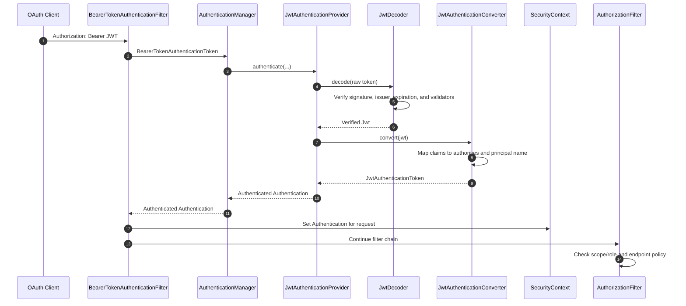

# JwtAuthenticationConverter and Converting Tokens into Authentication

In a **Spring Security OAuth 2.0 Resource Server**, a JWT access token sent via the HTTP header `Authorization: Bearer ...` does not directly become the request's identity and access permissions. Spring Security must first **verify the token**, then convert the verified claims into an **`Authentication`** object for the rest of the application to use.

**`JwtAuthenticationConverter`** is the component that performs that conversion step in Spring Security's JWT authentication flow. It decides:

1. Which claims are interpreted as **`GrantedAuthority`** instances, typically `SCOPE_*` permissions.
2. Which claim is used as the **principal name** when calling `Authentication.getName()`.
3. The returned authentication object, which by default is **`JwtAuthenticationToken`**.

Key distinction: **the converter is not a JWT signature verifier** and **does not decide by itself whether an API can be accessed**. It runs within `JwtAuthenticationProvider` **after** `JwtDecoder` returns a verified JWT. The final decision belongs to authorization rules and business permission checks.

This lesson focuses on **Principal and identity** in a Spring Security Servlet Resource Server, while explaining how to read scopes, roles, and custom claims without confusing user identity with OAuth client identity.

> **Running example:** The Authorization Server has issuer `https://login.example.com`; Orders API is a Resource Server with audience `orders-api`. An access token with scope `orders.read` is allowed to call the order-reading endpoint, but permissions on each individual order must still be checked at the business layer.

## 1. Four Easily Confused Objects in a JWT Resource Server

| Object | What Is It? | What Information Does It Hold? | Security Role |
|---|---|---|---|
| **JWT access token** | Bearer credential string issued by the Authorization Server | Header, payload claims, signature/MAC | Untrusted input data upon receiving the request |
| **`Jwt`** | Spring Security object representing a token decoded/verified by `JwtDecoder` | Token value, headers, claims, `sub`, `iss`, `exp`, etc. | Supplies verified claims to the converter |
| **`JwtAuthenticationToken`** | `Authentication` result for a JWT | Principal is `Jwt`, principal name, authorities, authentication details | Placed in `SecurityContext` for the rest of Spring Security to use |
| **`GrantedAuthority`** | A permission/privilege represented as a string | For example `SCOPE_orders.read`, `ROLE_ORDER_MANAGER` | Checked by authorization rules |

**Principal** and **authorities** are not the same thing:

- *Principal* answers: “Which subject does this request represent?”
- *Authorities* answers: “Which permissions has the subject been granted in the current authentication context?”
- *Authentication* bundles these pieces together with authentication status so Spring Security can process them.
- *Authorization* decides whether a specific action is permitted based on the authentication and resource context.

Do not assume that a JWT with `sub=user-42` means user-42 is allowed to call every API. That still depends on audience, scopes, roles, tenant, and business conditions.

## 2. Processing Chain: How Does a JWT Reach JwtAuthenticationConverter?

Typical flow in **Servlet / Spring MVC**:



Step-by-step explanation:

1. `BearerTokenAuthenticationFilter` extracts the token string from the request via `BearerTokenResolver` (typically the `Authorization` header).
2. The filter creates a `BearerTokenAuthenticationToken`, an unverified authentication request.
3. `AuthenticationManager` delegates the request to the appropriate `JwtAuthenticationProvider`.
4. `JwtAuthenticationProvider` calls `JwtDecoder.decode(token)`.
5. The decoder verifies the signature, algorithm, timestamps, and configured claim validators such as `iss` and `aud`.
6. Once the decoder succeeds, the provider calls `JwtAuthenticationConverter` to build the `Authentication`.
7. `JwtAuthenticationToken` is placed in `SecurityContext`, and authorization rules then evaluate permissions.
8. Requests lacking permissions are denied even when the token signature is valid.

**Important:** the converter only processes claims **after the decoder has completed verification**; it does not take a JSON payload sent by a client and treat it as a trusted source.

### 2.1. A Decodable JWT Does Not Mean Authenticated

A JWS-signed JWT typically has three segments: `header.payload.signature`. A client can Base64URL-decode the payload without needing any key. However, decoding only **reads claims**; it does not prove the JWT was issued by a trusted issuer.

For example, suppose a token has payload:

```json
{
  "sub": "user-42",
  "scope": "orders.write",
  "aud": "orders-api"
}
```

If a client alters `scope` from `orders.read` to `orders.write`, the JSON remains readable, yet the original signature is no longer valid. A properly configured `JwtDecoder` will reject it before the converter can create `SCOPE_orders.write`.

Skipping the decoder and building an `Authentication` from an unverified payload breaks the trust boundary. **Never use `JwtAuthenticationConverter` as a standalone JWT verifier.**

## 3. What Does JwtAuthenticationToken Contain?

`JwtAuthenticationToken` implements Spring Security's `Authentication` model for JWTs. After the provider authenticates successfully, its properties mean:

| API | Typical Value | Note |
|---|---|---|
| `authentication.getPrincipal()` | The `Jwt` object | Principal is **not by default a `UserDetails`** or database user entity. |
| `authentication.getName()` | Value of the `sub` claim by default | The claim used as the name can be changed via `setPrincipalClaimName(...)`. |
| `authentication.getAuthorities()` | Collection of `GrantedAuthority`, e.g., `SCOPE_orders.read` | Created by the authorities converter from verified claims. |
| `authentication.isAuthenticated()` | `true` once the provider authenticates successfully | Does not mean access is granted to all endpoints. |
| `jwtAuthenticationToken.getToken()` | Verified `Jwt` | Token value is a sensitive bearer credential. |
| `jwtAuthenticationToken.getTokenAttributes()` | Token claims | Never return all claims to clients or dump them to logs. |

In Java, you can inspect the Authentication type's semantics:

```java
import org.springframework.security.core.Authentication;
import org.springframework.security.oauth2.server.resource.authentication.JwtAuthenticationToken;

if (authentication instanceof JwtAuthenticationToken jwtAuth) {
    System.out.println(jwtAuth.getName());
    // Log only values permitted by privacy policy.
    // Never log raw JWTs or full claims.
}
```

The snippet illustrates the API, not a recommendation to log subject names everywhere.

### 3.1. Principal Object vs. Principal Name

With the default configuration:

```text
Principal object  : Jwt
Principal name    : value of "sub"
GrantedAuthorities: permissions mapped from "scope" or "scp"
```

This explains why:

- `@AuthenticationPrincipal Jwt jwt` works out of the box in a JWT Resource Server.
- `Authentication.getName()` is typically the `sub` identifier string.
- `@AuthenticationPrincipal UserDetails user` **does not automatically work** merely because the request carried an access token.
- `JwtAuthenticationToken.getToken()` returns the decoded/verified JWT, not a user object loaded from a database.

If the application needs a full user profile, fetch it via an authorized service after authentication rather than stuffing every personal attribute into the JWT for convenience.

## 4. Default Behavior of JwtAuthenticationConverter

Without custom configuration, Spring Security typically:

1. Uses the `sub` claim as the **principal name**.
2. Uses `JwtGrantedAuthoritiesConverter` to read supported scope claims, usually `scope` or `scp`.
3. Prepends the `SCOPE_` prefix to extracted scopes.
4. Returns a `JwtAuthenticationToken` with `Jwt` as principal and the corresponding authorities.

Example access token:

```json
{
  "iss": "https://login.example.com",
  "sub": "user-42",
  "aud": ["orders-api"],
  "exp": 2000000000,
  "iat": 1999996400,
  "scope": "orders.read orders.write"
}
```

After the decoder verifies the token:

```text
authentication.getPrincipal()    -> Jwt
authentication.getName()         -> "user-42"
authentication.getAuthorities()  -> [
                                    "SCOPE_orders.read",
                                    "SCOPE_orders.write"
                                   ]
```

The timestamps above only illustrate a payload. For a request to actually succeed, the token also needs a valid signature, issuer, audience, expiration, and any validity constraints at the moment the API is called.

### 4.1. Mapping Rules for `scope` and `scp`

Authorization Servers may represent scopes as a space-delimited string or as a list of strings:

**Space-delimited OAuth scope string:**

```json
{
  "scope": "orders.read orders.write"
}
```

**Scope list:**

```json
{
  "scp": ["orders.read", "orders.write"]
}
```

With the default converter supporting these formats, the values above produce authorities prefixed with `SCOPE_`.

Do not assume:

- That Spring automatically merges **both** `scope` and `scp` if a token carries both claims; the converter picks a claim according to its active rule, so standardize on one issuer contract.
- That Spring automatically reads `roles`, `permissions`, `groups`, or nested JSON to grant permissions.
- That any claim named `admin` or `is_admin` is automatically treated as a role.

Custom fields require an **intentional converter**, not adding a claim and hoping authorization understands it automatically.

### 4.2. `hasAuthority` vs. `hasRole`

Spring Security distinguishes:

```java
.hasAuthority("SCOPE_orders.read")
```

from:

```java
.hasRole("ORDER_MANAGER")
```

- `hasAuthority("SCOPE_orders.read")` checks for an authority with that exact name.
- `hasRole("ORDER_MANAGER")` by default convention checks for `ROLE_ORDER_MANAGER`; pass `ORDER_MANAGER` without adding `ROLE_` again.
- `hasAuthority("ROLE_ORDER_MANAGER")` can also check the full name directly if the application prefers showing the prefix explicitly.

**Do not equate scopes with roles**:

| Kind | Example | Typical Meaning |
|---|---|---|
| OAuth scope | `orders.read` | Permission granted to an **OAuth client** to access a functional area of the API |
| Authority in Spring | `SCOPE_orders.read` | Internal representation of the scope used during authorization |
| Business role | `ORDER_MANAGER` | Role in the organization's or application's permission model |
| Role authority | `ROLE_ORDER_MANAGER` | Representation of a role when the application explicitly converts it into an authority |

A token with `scope=orders.read` does not carry `ROLE_ORDER_MANAGER`, and an admin role alone does not guarantee the token has an allowed audience or scope for the API.

## 5. Basic Resource Server Configuration

A Spring Boot 3.x / Spring Security 6.x project using Servlet/Spring MVC, with example Gradle dependencies:

```groovy
dependencies {
    implementation 'org.springframework.boot:spring-boot-starter-web'
    implementation 'org.springframework.boot:spring-boot-starter-security'
    implementation 'org.springframework.boot:spring-boot-starter-oauth2-resource-server'
}
```

Example `application.yml`:

```yaml
spring:
  security:
    oauth2:
      resourceserver:
        jwt:
          issuer-uri: https://login.example.com
          audiences:
            - orders-api
```

- `issuer-uri` identifies the issuer trusted by the JWT decoder and is used for discovery/JWKS as supported by the provider.
- `audiences` is applied only by Spring Boot versions that support this property. If your project uses another version or a custom `JwtDecoder`, configure an `aud` validator yourself.
- This configuration governs **JWT verification**, not the authorities converter.
- If the API requires RFC 9068 JWT access tokens, also verify token type `at+jwt` and profile-required claims; the converter does not enforce those checks.

A simple security chain:

```java
package com.example.orders.security;

import org.springframework.context.annotation.Bean;
import org.springframework.context.annotation.Configuration;
import org.springframework.http.HttpMethod;
import org.springframework.security.config.Customizer;
import org.springframework.security.config.annotation.web.builders.HttpSecurity;
import org.springframework.security.web.SecurityFilterChain;

@Configuration
public class OrdersResourceServerSecurity {

    @Bean
    SecurityFilterChain apiChain(HttpSecurity http) throws Exception {
        return http
            .securityMatcher("/api/**")
            .authorizeHttpRequests(auth -> auth
                .requestMatchers(HttpMethod.GET, "/api/orders/**")
                    .hasAuthority("SCOPE_orders.read")
                .requestMatchers(HttpMethod.POST, "/api/orders/**")
                    .hasAuthority("SCOPE_orders.write")
                .anyRequest().authenticated()
            )
            .oauth2ResourceServer(oauth2 ->
                oauth2.jwt(Customizer.withDefaults())
            )
            .build();
    }
}
```

When a request sends `Authorization: Bearer ...`:

1. Spring extracts the token.
2. The JWT decoder verifies the token.
3. The default `JwtAuthenticationConverter` creates a `JwtAuthenticationToken`.
4. `AuthorizationFilter` checks `SCOPE_orders.read` or `SCOPE_orders.write` per endpoint.

**Only URLs matching `securityMatcher("/api/**")` belong to this chain.** In a real application, remaining URLs need appropriate security chains or fallback policies.

## 6. Customizing the Principal Name with setPrincipalClaimName

By default `Authentication.getName()` reads the `sub` claim. Some systems prefer displaying another claim such as `preferred_username`.

Example payload:

```json
{
  "iss": "https://login.example.com",
  "sub": "9a5d25f5-f392-4a30-93d2-928ab1b3fc1d",
  "preferred_username": "lan.nguyen",
  "email": "lan@example.com",
  "scope": "orders.read"
}
```

You can configure:

```java
import org.springframework.context.annotation.Bean;
import org.springframework.security.oauth2.server.resource.authentication.JwtAuthenticationConverter;

@Bean
JwtAuthenticationConverter jwtAuthenticationConverter() {
    JwtAuthenticationConverter converter = new JwtAuthenticationConverter();
    converter.setPrincipalClaimName("preferred_username");
    return converter;
}
```

When this converter is wired into the Resource Server, `Authentication.getName()` will be based on `preferred_username` per the token contract, while **`authentication.getPrincipal()` remains `Jwt`**.

### 6.1. When Should You Keep `sub`?

For data authorization, prioritize a **stable identifier**:

- `sub` is usually the subject identifier within the issuer's scope.
- `preferred_username` can change when a user renames their login.
- `email` can change, may be unverified, or may be recycled under issuer policies.
- Display names/nicknames are not necessarily unique.

Therefore, if your goal is a **key linking to a user record**, use the **`(iss, sub)`** pair or a confirmed stable application identifier rather than defaulting to `preferred_username`/`email`.

You can keep `sub` as the principal name and read `preferred_username` separately for UI display when genuinely needed. Do not change `principalClaimName` merely to “make logs easier to read” if it could affect authorization checks or service-level identification.

### 6.2. What If the Principal Name Claim Is Missing?

Some access tokens (especially machine-to-machine tokens) do not contain `preferred_username`. If the converter is configured to read the name from that claim, the result may not meet the application's expectations and, depending on version/converter, may cause errors or an unusable name.

Better handling:

1. Choose a claim that the **issuer contract guarantees is present** in the token types accepted by the API.
2. If you need a stable identity, prefer `sub` within the issuer context.
3. If multiple token types exist, distinguish client-credentials vs. user-delegated policies before choosing name mapping.
4. When a required claim is missing, reject the token via an appropriate validator rather than silently creating a bogus principal.

**`setPrincipalClaimName` does not verify whether the claim exists, is unique, or has the right type** per business rules. A converter does not replace a validator.

## 7. Customizing Authorities from Another Claim

Some Authorization Servers emit a permissions list under `permissions` instead of `scope`:

```json
{
  "iss": "https://login.example.com",
  "sub": "user-42",
  "aud": ["orders-api"],
  "permissions": [
    "orders.read",
    "orders.export"
  ]
}
```

If this is an **agreed contract** between the AS and Orders API, you can instruct `JwtGrantedAuthoritiesConverter` to read that claim.

```java
import org.springframework.context.annotation.Bean;
import org.springframework.security.oauth2.server.resource.authentication.JwtAuthenticationConverter;
import org.springframework.security.oauth2.server.resource.authentication.JwtGrantedAuthoritiesConverter;

@Bean
JwtAuthenticationConverter customPermissionsConverter() {
    JwtGrantedAuthoritiesConverter grantedAuthorities =
        new JwtGrantedAuthoritiesConverter();

    grantedAuthorities.setAuthoritiesClaimName("permissions");
    grantedAuthorities.setAuthorityPrefix("PERMISSION_");

    JwtAuthenticationConverter jwtConverter =
        new JwtAuthenticationConverter();
    jwtConverter.setJwtGrantedAuthoritiesConverter(grantedAuthorities);

    // Keep the default principal name based on sub.
    return jwtConverter;
}
```

Result:

```text
JWT claim: ["orders.read", "orders.export"]

GrantedAuthorities:
  PERMISSION_orders.read
  PERMISSION_orders.export
```

An endpoint can check:

```java
.requestMatchers("/api/export/**")
    .hasAuthority("PERMISSION_orders.export")
```

**Very important:** changing `authoritiesClaimName` to `permissions` stops this converter from **reading scopes from `scope/scp` by default** to create `SCOPE_*`. If `SecurityFilterChain` still checks `hasAuthority("SCOPE_orders.read")`, requests can receive `403` even with a valid JWT.

If the API needs **both scopes and permissions/roles**, build an intentionally combined converter as shown in the next section.

### 7.1. Changing the Prefix for Scopes

If you still use `scope` but want a custom authority name:

```java
JwtGrantedAuthoritiesConverter grantedAuthorities =
    new JwtGrantedAuthoritiesConverter();

grantedAuthorities.setAuthoritiesClaimName("scope");
grantedAuthorities.setAuthorityPrefix("SCOPE_");
```

In practice, `SCOPE_` is already the common default prefix. If you change it to `AUTH_`:

```java
grantedAuthorities.setAuthorityPrefix("AUTH_");
```

then `orders.read` becomes `AUTH_orders.read`. Every `hasAuthority(...)` and `@PreAuthorize(...)` must align with the new prefix.

**Do not drop the prefix just to make strings shorter** if the system has both scopes and roles. Clear prefixes prevent confusion between permission kinds and avoid name collisions.

### 7.2. String Formats and Delimiters

Some issuers return scope-like claims as a string with a custom delimiter. `JwtGrantedAuthoritiesConverter` provides `setAuthoritiesClaimDelimiter(...)` in supporting Spring Security versions (such as 6.1+) to override the default delimiter.

Example usable **only when the issuer actually emits this claim**:

```java
JwtGrantedAuthoritiesConverter permissions =
    new JwtGrantedAuthoritiesConverter();

permissions.setAuthoritiesClaimName("permissions");
permissions.setAuthoritiesClaimDelimiter(",");
permissions.setAuthorityPrefix("PERMISSION_");
```

With claim:

```json
{
  "permissions": "orders.read,orders.export"
}
```

Do not apply a custom delimiter to the standard OAuth `scope` claim just because one client sent malformed data. Standard OAuth string scopes are space-delimited; fix the issuance contract at the Authorization Server if the format is wrong.

## 8. Combining Scopes and Roles in One JwtAuthenticationConverter

A practical scenario is an access token carrying both **OAuth scopes** and **business roles** in a separate claim.

Example:

```json
{
  "iss": "https://login.example.com",
  "sub": "user-42",
  "aud": ["orders-api"],
  "scope": "orders.read orders.write",
  "realm_access": {
    "roles": ["ORDER_VIEWER", "ORDER_MANAGER"]
  }
}
```

The default `JwtGrantedAuthoritiesConverter` does not extract the nested `realm_access.roles` path automatically. If the API needs these roles, write a custom `Converter<Jwt, Collection<GrantedAuthority>>`:

```java
package com.example.orders.security;

import java.util.Collection;
import java.util.LinkedHashSet;
import java.util.Map;
import java.util.Set;

import org.springframework.core.convert.converter.Converter;
import org.springframework.security.core.GrantedAuthority;
import org.springframework.security.core.authority.SimpleGrantedAuthority;
import org.springframework.security.oauth2.jwt.Jwt;
import org.springframework.security.oauth2.server.resource.authentication.JwtGrantedAuthoritiesConverter;

public final class OrdersAuthoritiesConverter
        implements Converter<Jwt, Collection<GrantedAuthority>> {

    private static final Set<String> ALLOWED_ROLES = Set.of(
        "ORDER_VIEWER",
        "ORDER_MANAGER"
    );

    private final JwtGrantedAuthoritiesConverter scopes =
        new JwtGrantedAuthoritiesConverter();

    @Override
    public Collection<GrantedAuthority> convert(Jwt jwt) {
        Set<GrantedAuthority> result = new LinkedHashSet<>();

        // Keep OAuth scopes with default mapping: SCOPE_*
        result.addAll(scopes.convert(jwt));

        // Interpret roles strictly per the verified contract with the issuer.
        Object claim = jwt.getClaim("realm_access");
        if (claim instanceof Map<?, ?> realm) {
            Object rawRoles = realm.get("roles");
            if (rawRoles instanceof Collection<?> roleNames) {
                for (Object item : roleNames) {
                    if (item instanceof String role
                            && ALLOWED_ROLES.contains(role)) {
                        result.add(
                            new SimpleGrantedAuthority("ROLE_" + role)
                        );
                    }
                }
            }
        }

        return result;
    }
}
```

Register this converter:

```java
import org.springframework.context.annotation.Bean;
import org.springframework.security.oauth2.server.resource.authentication.JwtAuthenticationConverter;

@Bean
JwtAuthenticationConverter ordersJwtAuthenticationConverter() {
    JwtAuthenticationConverter converter =
        new JwtAuthenticationConverter();

    converter.setJwtGrantedAuthoritiesConverter(
        new OrdersAuthoritiesConverter()
    );

    return converter;
}
```

For the verified sample payload, the authorities will include:

```text
SCOPE_orders.read
SCOPE_orders.write
ROLE_ORDER_VIEWER
ROLE_ORDER_MANAGER
```

**Why have an `ALLOWED_ROLES` allowlist?**

- Prevents blindly mapping arbitrary strings into new permissions.
- Clarifies which roles actually have meaning for Orders API.
- Reduces the risk of unintended privileges when the issuer adds new groups/roles.
- Makes permission changes reviewable in the Resource Server instead of treating any arbitrary claim as a safe policy.

An allowlist is only one defense layer. If the issuer is misconfigured or signing keys are compromised, every claim in the JWT becomes untrustworthy; protect the issuer, signing keys, audience, and delegation rules at the source.

### 8.1. Wiring the Converter into SecurityFilterChain

Once you have the `JwtAuthenticationConverter` bean:

```java
package com.example.orders.security;

import org.springframework.context.annotation.Bean;
import org.springframework.context.annotation.Configuration;
import org.springframework.http.HttpMethod;
import org.springframework.security.config.annotation.web.builders.HttpSecurity;
import org.springframework.security.oauth2.server.resource.authentication.JwtAuthenticationConverter;
import org.springframework.security.web.SecurityFilterChain;

@Configuration
public class OrdersSecurityConfiguration {

    @Bean
    SecurityFilterChain ordersApiChain(
            HttpSecurity http,
            JwtAuthenticationConverter ordersJwtAuthenticationConverter)
            throws Exception {

        return http
            .securityMatcher("/api/**")
            .authorizeHttpRequests(auth -> auth
                .requestMatchers(HttpMethod.GET, "/api/orders/**")
                    .hasAuthority("SCOPE_orders.read")
                .requestMatchers(HttpMethod.POST, "/api/orders/**")
                    .hasAuthority("SCOPE_orders.write")
                .requestMatchers(HttpMethod.DELETE, "/api/orders/**")
                    .hasRole("ORDER_MANAGER")
                .anyRequest().authenticated()
            )
            .oauth2ResourceServer(oauth2 -> oauth2
                .jwt(jwt -> jwt
                    .jwtAuthenticationConverter(
                        ordersJwtAuthenticationConverter
                    )
                )
            )
            .build();
    }
}
```

In this example:

- `GET` requires scope `orders.read`.
- `POST` requires scope `orders.write`.
- `DELETE` requires role `ORDER_MANAGER` mapped by the converter to `ROLE_ORDER_MANAGER`.
- The Resource Server must still check `iss`, `aud`, signature, expiration, and **per-record** permissions in the service.

This is an **illustrative mapping example**, not a recommendation that every `DELETE` request needs only a role without a scope. Sensitive endpoints may require **both role and scope** plus business checks:

```java
import org.springframework.security.access.prepost.PreAuthorize;

@PreAuthorize(
    "hasAuthority('SCOPE_orders.delete') and hasRole('ORDER_MANAGER')"
)
public void deleteOrder(String orderId) {
    // Service must verify tenant/ownership/order status.
}
```

To use `@PreAuthorize`, enable appropriate method security (such as `@EnableMethodSecurity` in Spring Security config) and invoke via Spring proxies as normal. Route-level and method-level rules must be designed consistently.

### 8.2. Should You Accept Nested Roles from Every Issuer?

No. Claims like `realm_access.roles`, `resource_access`, or `groups` are typically **conventions of a specific identity provider**, not a universal JWT structure mandated by RFCs.

In multi-issuer systems:

- First verify the token's `iss` and `aud`.
- Each issuer may use its own claim format; the converter must not interpret out-of-contract data.
- A realm-wide role does not automatically translate to an Orders API role.
- Distinguish **client**, **tenant**, and **resource** roles to avoid cross-application privilege escalation.
- Never apply one converter that reads all roles from all issuers and merges them into elevated privileges merely because role names happen to match.

## 9. Principals in User vs. Machine-to-Machine Flows

In OAuth 2.0, not every access token represents an **end user**.

### 9.1. Authorization Code: Token Representing a User Under Delegation

Example of a user-delegated access token:

```json
{
  "iss": "https://login.example.com",
  "sub": "user-42",
  "client_id": "web-orders",
  "aud": ["orders-api"],
  "scope": "orders.read"
}
```

Meaning:

- `sub=user-42` is the subject identified by the issuer.
- `client_id=web-orders` is the OAuth client that received the token.
- `aud=orders-api` is the Resource Server allowed to accept it.
- `scope=orders.read` is the granted permission.

**Never use `client_id` as the user's name** when the API processes data by user identity. `client_id` describes the application/client, not the owner of personal data.

### 9.2. Client Credentials: Token Representing an Application

A `client_credentials` token may look like:

```json
{
  "iss": "https://login.example.com",
  "sub": "inventory-worker",
  "client_id": "inventory-worker",
  "aud": ["orders-api"],
  "scope": "orders.read"
}
```

Here `sub` can represent an application/service per the issuer contract, with no interactive human user. `Authentication.getName()` will be a machine identifier when mapped from `sub`.

Things to avoid:

- Letting a `client_credentials` token access user data because `getName()` happens to match a username.
- Assuming `@AuthenticationPrincipal Jwt` always contains an email or user profile.
- Assigning `ROLE_USER` to every M2M token without checking grant/subject/client policies.
- Treating `sub` as a global identifier across issuers.

The **`(issuer, subject)`** pair along with client/grant context is a much better foundation for identifying the caller when a system serves multiple issuers or multiple token types.

### 9.3. The Principal Name May Not Be a Business Identifier

`Authentication.getName()` is a convenient principal name for Spring Security, **not a default database foreign key**. It can change if the converter changes `principalClaimName` or the issuer model changes.

If the application needs to link an OAuth subject to an internal user, add a dedicated mapping layer:

```text
Verified JWT
  issuer + subject
       ↓
Trusted identity mapping table / domain service
       ↓
internalUserId or servicePrincipalId
       ↓
Check tenant and data permissions
```

Do not copy the email claim into the database as a unique identity key merely because email is human-readable.

## 10. Reading Authentication in a Controller

### 10.1. Obtaining Jwt via @AuthenticationPrincipal

```java
package com.example.orders.api;

import java.util.Map;

import org.springframework.security.core.annotation.AuthenticationPrincipal;
import org.springframework.security.oauth2.jwt.Jwt;
import org.springframework.web.bind.annotation.GetMapping;
import org.springframework.web.bind.annotation.RestController;

@RestController
public class IdentityController {

    @GetMapping("/api/me")
    public Map<String, String> me(@AuthenticationPrincipal Jwt jwt) {
        // Token has passed through the Resource Server's JwtDecoder and provider.
        return Map.of(
            "subject", jwt.getSubject(),
            "issuer", jwt.getIssuer().toString()
        );
    }
}
```

This example assumes the endpoint requires authentication and the JWT satisfies the `sub`/`iss` contract. Never return the raw `Jwt` or `jwt.getClaims()` in production responses: tokens can contain authorization metadata or personal data that should not be exposed more broadly.

### 10.2. Obtaining Authentication to Inspect Name and Authorities

```java
package com.example.orders.api;

import java.util.List;
import java.util.Map;

import org.springframework.security.core.Authentication;
import org.springframework.web.bind.annotation.GetMapping;
import org.springframework.web.bind.annotation.RestController;

@RestController
class AuthInfoController {

    @GetMapping("/api/auth-summary")
    Map<String, Object> summary(Authentication authentication) {
        List<String> authorities = authentication.getAuthorities()
            .stream()
            .map(a -> a.getAuthority())
            .toList();

        return Map.of(
            "name", authentication.getName(),
            "authorities", authorities
        );
    }
}
```

This snippet illustrates the mapping result. In real systems, returning all authorities can expose internal permission structures; restrict such endpoints to test/debug environments or return only what the UI genuinely needs per policy.

### 10.3. Authentication in SecurityContextHolder

In synchronous Servlet service layers, you can access:

```java
import org.springframework.security.core.Authentication;
import org.springframework.security.core.context.SecurityContextHolder;

Authentication authentication =
    SecurityContextHolder.getContext().getAuthentication();
```

Understand the limitations:

- `SecurityContext` is normally scoped to the **request processing context**; do not treat it as a persistent login session.
- With async processing or application-managed threads, propagating `SecurityContext` requires proper mechanisms; never assume `ThreadLocal` is present on every worker thread.
- For bearer-based APIs, clients normally send an access token on **every request**; never rely on a previous request being authenticated to make a subsequent request valid.
- In business logic, prefer passing the necessary identity/authorization context through explicit interfaces rather than letting every service read raw JWTs arbitrarily.

## 11. Do Opaque Tokens Use JwtAuthenticationConverter?

**Not in the default flow.** When a Resource Server uses opaque token introspection:

```text
BearerTokenAuthenticationFilter
    → OpaqueTokenAuthenticationProvider
    → OpaqueTokenIntrospector
    → BearerTokenAuthentication
```

The principal is typically `OAuth2AuthenticatedPrincipal` with attributes/authorities supplied by the introspector or matching converter; it is not a `Jwt` produced by `JwtAuthenticationConverter`.

Sample opaque configuration:

```yaml
spring:
  security:
    oauth2:
      resourceserver:
        opaquetoken:
          introspection-uri: https://login.example.com/oauth2/introspect
          client-id: orders-api-introspection
          client-secret: REPLACE_WITH_SECRET_FROM_MANAGER
```

The client secret above is a placeholder only, not a real credential. In deployment, retrieve secrets from an appropriate secret manager or environment variables; never commit them to a repository.

**Never force an opaque token through `JwtAuthenticationConverter`** blindly just to reuse logic. If both JWT and opaque flows need shared permission policies, extract domain mapping behind an appropriate abstraction while keeping each authentication path independent.

## 12. Authentication Differs from Authorization

In `SecurityFilterChain`:

```java
.authorizeHttpRequests(auth -> auth
    .requestMatchers("/api/public/**").permitAll()
    .requestMatchers("/api/orders/**")
        .hasAuthority("SCOPE_orders.read")
    .anyRequest().authenticated()
)
```

There are two separate questions:

1. **Authentication:** Is the token valid? Who is the principal? Which authorities did the converter produce?
2. **Authorization:** To call this path, does the authentication satisfy the rule?

Common outcomes:

| Scenario | Status | Interpretation |
|---|---|---|
| No Bearer token on a protected endpoint | Typically `401` | Unauthenticated |
| Token with invalid signature, issuer, audience, or expired | Typically `401 invalid_token` | Rejected by `JwtDecoder`/provider before reaching a trusted converter step |
| Valid token having only `SCOPE_orders.read` when endpoint requires `SCOPE_orders.write` | Typically `403 Forbidden` | Authentication valid, but authority missing |
| Valid token, matching scope, but subject cannot read order 42 | `403` or `404` per policy | Object-level permission check required |
| Valid token, converter points to wrong permissions claim leaving authorities empty | Typically `403` on protected endpoints | Claim-to-authority contract mismatch, not a signature error |
| Valid token, all permissions satisfied | Reaches controller | Service still checks tenant/ownership |

A common mistake is **relaxing the decoder** because the API returns `403`. The right fix is inspecting whether the token was verified, which authorities were produced, and which authority the endpoint requires—never disabling signature/issuer/audience validation to resolve missing permissions.

### 12.1. Sufficient Scope Does Not Guarantee Record Access

For example, `SCOPE_orders.read` permits calling the order-reading API, yet a user with `sub=user-42` is not automatically allowed to view orders belonging to someone else.

The service layer still needs to check:

```java
public OrderDto readOrder(
        String orderId,
        Authentication authentication) {

    Order order = orderRepository.findById(orderId)
        .orElseThrow(OrderNotFoundException::new);

    if (!orderAccessPolicy.canRead(authentication, order)) {
        throw new AccessDeniedException("Not allowed");
    }

    return orderMapper.toDto(order);
}
```

This is an abbreviated business example assuming domain classes exist. The converter **does not replace** authorization queries by owner, tenant, or resource state.

## 13. Filtering Authorities by Issuer, Audience, and Tenant

The converter receives a `Jwt` already passed through the decoder, yet **having verified claims** does not automatically mean those claims confer **permissions in Orders API**.

For instance, two tokens may both contain:

```json
{
  "roles": ["ADMIN"]
}
```

They can mean very different things:

- Issuer A: `ADMIN` administers Orders API.
- Issuer B: `ADMIN` only administers a login portal.
- Issuer A, tenant X: `ADMIN` applies only to tenant X.
- Issuer A, token issued for Billing API: `ADMIN` is not a permission for Orders API.

**Unconditionally adding `ROLE_ADMIN` from any `roles` claim is a dangerous decision.**

Good design requires:

1. Verifying the exact **`iss`** against an allowlist of permitted issuers.
2. Verifying the token was issued for **`aud=orders-api`**.
3. Confirming the right access token type/profile; rejecting ID tokens.
4. Understanding which **resource** and **tenant** a role/scope claim belongs to.
5. Mapping with an allowlist/application-specific permission names.
6. Enforcing per-record/tenant permissions in the authorization layer, not relying solely on a role string.

In multi-tenant setups, never create a global `ROLE_ADMIN` authority that drops tenant scope; use tenant-scoped permissions or enforce tenant checks on resources inside service policies.

## 14. Issues with `sub`, `email`, and `preferred_username` Claims

| Claim | Suitable as Principal Name? | Risks / Considerations |
|---|---|---|
| `sub` | **Usually the most stable choice within an issuer** | Not automatically global across issuers; may represent a service in `client_credentials` |
| `preferred_username` | Use when a readable name is needed and guaranteed by contract | Can change, may not be unique, may be missing on machine tokens |
| `email` | Should not be used as a default business identity key | Can change, leaks personal info, not guaranteed to be verified |
| `client_id` | Meaningful for OAuth client policies | Does not represent an end-user identity |
| `name` / `given_name` | Suitable for display | Neither stable nor unique |
| Custom `employee_id` claim | Usable when guaranteed by issuer/contract | Requires namespace rules, data type, stability, and attribute checks |

OIDC also defines **pairwise subjects** to prevent unwanted identity correlation across clients. Thus, never assume every issuer/client emits `sub` with identical cross-app semantics.

If the application genuinely needs to display a name on the frontend, fetch an authorized profile or use a dedicated display claim **separate** from the security identity key.

## 15. Do Not Confuse Access Tokens with ID Tokens

An OIDC **ID token** is a JWT intended for an **OAuth/OIDC client** to verify a login outcome. An **access token** is intended for a Resource Server to enforce API access permissions.

Both can:

- Be three-part JWTs.
- Be signed by the same issuer and the same public key set.
- Contain `sub`, `iss`, `exp`, and identifying claims.

If a Resource Server relies solely on signature checks and a converter to build `JwtAuthenticationToken`, it risks accepting an ID token as API authorization.

Verify:

- Is the token the right **access token type** accepted by the API?
- Does `aud` contain the expected Resource Server identifier?
- Does `iss` match the expected issuer?
- Is the token unexpired and compliant with the agreed token profile?
- Were scopes/authorities actually granted for calling the API?

When adopting the **RFC 9068 JWT access token** profile, check JOSE `typ=at+jwt` or `application/at+jwt` alongside required claims. **`JwtAuthenticationConverter` does not perform all of these checks itself**: configure appropriate validators/decoders.

## 16. Testing JwtAuthenticationConverter in Isolation

One advantage of the converter is that **mapping rules** can be tested independently of networks, JWKS, and HTTP.

### 16.1. Unit Testing Default Scope Mapping

JUnit 5 example using a test-constructed `Jwt`:

```java
package com.example.orders.security;

import java.util.Set;
import java.util.stream.Collectors;

import org.junit.jupiter.api.Test;
import org.springframework.security.core.GrantedAuthority;
import org.springframework.security.oauth2.jwt.Jwt;
import org.springframework.security.oauth2.server.resource.authentication.JwtAuthenticationConverter;
import org.springframework.security.oauth2.server.resource.authentication.JwtAuthenticationToken;

import static org.assertj.core.api.Assertions.assertThat;

class JwtAuthenticationConverterTest {

    @Test
    void mapsScopeToAuthoritiesAndSubjectToName() {
        Jwt jwt = Jwt.withTokenValue("test-token-value")
            .header("alg", "RS256")
            .claim("sub", "user-42")
            .claim("scope", "orders.read orders.write")
            .build();

        JwtAuthenticationConverter converter =
            new JwtAuthenticationConverter();

        JwtAuthenticationToken authentication =
            (JwtAuthenticationToken) converter.convert(jwt);

        Set<String> names = authentication.getAuthorities()
            .stream()
            .map(GrantedAuthority::getAuthority)
            .collect(Collectors.toSet());

        assertThat(authentication.getName()).isEqualTo("user-42");
        assertThat(names).contains(
            "SCOPE_orders.read",
            "SCOPE_orders.write"
        );
        assertThat(authentication.getPrincipal()).isSameAs(jwt);
    }
}
```

This is a **converter unit test**; `Jwt.withTokenValue(...)` constructs a test JWT object **without running actual signature verification**. Passing proves the mapping works, **not that the Resource Server blocks forged JWTs**.

### 16.2. Unit Testing Custom Roles

Using `OrdersAuthoritiesConverter` from earlier:

```java
@Test
void mapsOnlyAllowedRolesFromRealmAccess() {
    Jwt jwt = Jwt.withTokenValue("test-token-value")
        .header("alg", "RS256")
        .claim("sub", "user-42")
        .claim("scope", "orders.read")
        .claim("realm_access", Map.of(
            "roles", List.of("ORDER_MANAGER", "UNEXPECTED_SUPER_ADMIN")
        ))
        .build();

    OrdersAuthoritiesConverter converter =
        new OrdersAuthoritiesConverter();

    Set<String> authorities = converter.convert(jwt)
        .stream()
        .map(GrantedAuthority::getAuthority)
        .collect(Collectors.toSet());

    assertThat(authorities).contains(
        "SCOPE_orders.read",
        "ROLE_ORDER_MANAGER"
    );

    assertThat(authorities)
        .doesNotContain("ROLE_UNEXPECTED_SUPER_ADMIN");
}
```

This test snippet sits inside a test class with imports for `Map`, `List`, `Set`, `Collectors`, and AssertJ/JUnit as shown above.

Include business edge cases:

| Test Case | Expectation |
|---|---|
| `scope` present as a string | Creates matching `SCOPE_*` authorities |
| `scp` present as a list | Creates `SCOPE_*` authorities per supported structure |
| No scope claim present | Does not invent `SCOPE_*` authorities |
| `roles` contains a role outside the allowlist | Does not grant unlisted authorities |
| `realm_access` is not a map | Converter handles safely without granting unexpected roles |
| `preferred_username` missing | Handled by contract/validator rather than faking a name |
| Machine-to-machine token | Principal name and permissions reflect service/client policy, not human user assumptions |
| Same role name across different issuers/tenants | Mapped strictly per authorized issuer/tenant policy |

### 16.3. Integration Tests Differ from Converter Unit Tests

With `MockMvc`, `SecurityMockMvcRequestPostProcessors.jwt()` creates a mock authentication to test endpoint authorization:

```java
mvc.perform(
    get("/api/orders/42")
        .with(jwt().authorities(
            new SimpleGrantedAuthority("SCOPE_orders.read")
        ))
).andExpect(status().isOk());
```

This test is useful for **authorization**, yet it does not prove the converter actually runs on a JWT parsed from a header and does not verify real JWT signatures. To test the end-to-end flow:

1. Send an HTTP request with an `Authorization: Bearer <test JWT>` header.
2. Use a controlled test issuer/JWKS or `JwtDecoder` configured for integration testing.
3. Ensure the real filter chain invokes the provider and converter.
4. Verify tokens with bad signature/issuer/audience fail with `401`.
5. Verify valid tokens lacking mapped permissions fail with `403`.
6. Verify valid tokens with sufficient permissions reach the controller.
7. Verify token profile rules (such as rejecting ID tokens) per contract.

Never treat a `jwt()` test that injects authentication directly as proof that JWT validation is properly configured.

## 17. Common Errors and How to Locate the Right Layer

### Error 1 — Valid JWT Yet Endpoint Always Returns 403

The cause may be the converter reading the wrong claim:

```json
{
  "scope": "orders.read"
}
```

while configured with:

```java
grantedAuthorities.setAuthoritiesClaimName("permissions");
```

Then the converter ignores `scope` and does not produce `SCOPE_orders.read`.

**Fix:** inspect the claims contract and converter mapping; never disable signature checks or switch the endpoint to `permitAll()`.

### Error 2 — Admin Role Is in the Token Yet `hasRole("ADMIN")` Fails

JWT:

```json
{
  "roles": ["ADMIN"]
}
```

By default Spring does not turn this claim into `ROLE_ADMIN`. You need an explicit role converter and must verify the role targets the right audience/tenant and is permitted for the API.

### Error 3 — `getName()` Is a UUID Instead of an Email

This is typically normal behavior: the principal name comes from `sub`, which may be a UUID.

If you need an email for display, read it from the appropriate source. If you change `principalClaimName("email")`, understand the risks of email changes or absence; never use email as an identity key just for a prettier name.

### Error 4 — `@AuthenticationPrincipal UserDetails` Is Null

JWT Resource Server defaults to `Jwt` as the principal. `UserDetails` is not automatically loaded from a database.

Use `@AuthenticationPrincipal Jwt` or `Authentication`. If the application needs a custom domain principal, build a dedicated converter with a custom `Authentication` and a controlled identity lookup/matching mechanism rather than guessing from claims.

### Error 5 — Tokens from Another Issuer Still Emit the Same Role

Two issuers can use the same `ADMIN` string with different meanings. If the API skips issuer/audience checks or the converter ignores namespacing, out-of-contract tokens can gain unintended privileges.

Set up an issuer allowlist, thorough validators, and resource/tenant-scoped mapping.

### Error 6 — JWT Decoder Returns 401 and Changing the Converter Does Nothing

`401 invalid_token` usually means the token failed verification such as signature, expiration, issuer, audience, or token profile. The converter normally **has not even run** when the decoder rejects the token.

Diagnose the `JwtDecoder`, keys, and claim validators before looking at authority mapping.

### Error 7 — API Uses Opaque Tokens Yet the JWT Converter Never Runs

Opaque Resource Servers use a different provider and principal. Configure introspection/authority policies for opaque tokens; `JwtAuthenticationConverter` is not part of that default flow.

### Error 8 — Custom Converter Accidentally Drops Scopes

When `setJwtGrantedAuthoritiesConverter(...)` receives a converter that only reads roles without calling `JwtGrantedAuthoritiesConverter` for scopes, `SCOPE_*` authorities disappear. If the API still requires scopes, requests fail with `403`.

When combining them, **merge** scope and role outputs per contract, as in `OrdersAuthoritiesConverter`.

## 18. Designing Safe Identity from Access Tokens

You can follow a clear decision chain:

```text
Token received via Authorization: Bearer
                |
                v
       JwtDecoder verifies token
    signature / iss / aud / exp / typ
                |
                v
        JwtAuthenticationConverter
                |
        +-------+--------+
        |                |
        v                v
  Principal name    GrantedAuthorities
  (sub by default)  Controlled SCOPE_* / ROLE_*
        |                |
        +-------+--------+
                |
                v
        JwtAuthenticationToken
                |
                v
           SecurityContext
                |
                v
        Authorization policies
      route, method, tenant, ownership
```

When building real systems, ask:

1. **Which access token is this?** Which JWT profile, issuer, audience, and algorithm?
2. **Who does `sub` represent?** A human user, an application, or a delegated/exchanged subject?
3. **Is the principal name stable?** Should `(iss, sub)` or an internal ID be used?
4. **Which permission claims are allowed to be interpreted?** `scope`, `scp`, `roles`, `permissions`—and what are their structure and namespace?
5. **Are roles scoped to the right API/tenant?** Never grant access solely because a role name matches.
6. **Does the API require scopes, roles, or both?** Mapping must match endpoint and service policies.
7. **Which data must never be logged or returned?** Bearer tokens, PII, sensitive metadata.
8. **Are mapping unit tests separated from verification integration tests?** Both must be clearly understood.

## 19. References

- [Spring Security — OAuth 2.0 Resource Server JWT](https://docs.spring.io/spring-security/reference/servlet/oauth2/resource-server/jwt.html): JWT decoding, scope mapping, and authority customization.
- [Spring Security API — JwtAuthenticationConverter](https://docs.spring.io/spring-security/site/docs/current/api/org/springframework/security/oauth2/server/resource/authentication/JwtAuthenticationConverter.html): `setJwtGrantedAuthoritiesConverter` and `setPrincipalClaimName`.
- [Spring Security API — JwtGrantedAuthoritiesConverter](https://docs.spring.io/spring-security/site/docs/current/api/org/springframework/security/oauth2/server/resource/authentication/JwtGrantedAuthoritiesConverter.html): claim name, prefix, and authority splitting.
- [Spring Security API — JwtAuthenticationToken](https://docs.spring.io/spring-security/site/docs/current/api/org/springframework/security/oauth2/server/resource/authentication/JwtAuthenticationToken.html): JWT authentication result.
- [RFC 7519 — JSON Web Token](https://www.rfc-editor.org/rfc/rfc7519): registered claims such as `sub`, `iss`, `aud`, `exp`.
- [RFC 9068 — JWT Profile for OAuth 2.0 Access Tokens](https://www.rfc-editor.org/rfc/rfc9068): structure and validation of access tokens under a standard profile.
- [RFC 8725 — JWT Best Current Practices](https://www.rfc-editor.org/rfc/rfc8725): preventing token confusion, algorithm constraints, and validation requirements.

**Remember:** `JwtDecoder` decides **whether a token is trustworthy**; `JwtAuthenticationConverter` decides **how verified claims are represented as a principal name and authorities**; `AuthorizationFilter` and business policies decide **whether the request is permitted to perform a specific action**. Keeping these three responsibilities distinct is the foundation for safe JWT identity and authorization handling in a Spring Security Resource Server.
