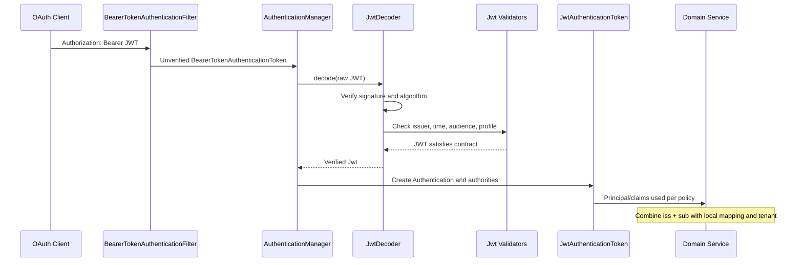

# Subjects Must Be Scoped Within Their Issuer

## 1. Core Problem: `sub` Is Not a Globally Unique User Identifier

In a **Spring Security OAuth 2.0 / OIDC Resource Server**, a JWT access token typically contains claims such as:

```json
{
  "iss": "https://identity.example.com/realms/shop",
  "sub": "user-0042",
  "aud": ["orders-api"],
  "scope": "orders.read",
  "iat": 1910000000,
  "exp": 1910003600
}
```

Two fields are especially critical when identifying the subject:

- **`iss` — issuer:** identifies the entity that issued the token, typically the URL of the Authorization Server / OpenID Provider.
- **`sub` — subject:** identifies the principal described by the token **within the context of the issuer**.

For JWTs issued by different issuers, you cannot assume `sub="user-0042"` from issuer A is the same person as `sub="user-0042"` from issuer B. A safer external identity key is the **`(iss, sub)` pair**.

```text
Issuer A: https://identity-a.example.com
  sub = user-0042
  => (https://identity-a.example.com, user-0042)

Issuer B: https://identity-b.example.com
  sub = user-0042
  => (https://identity-b.example.com, user-0042)

Same sub value, yet NO proof it is the same subject.
```

The converse is also true: one real person may appear with **multiple different subject identifiers**, especially when signing in across multiple issuers, multiple accounts, or OIDC pairwise identifiers. Never use email or username to automatically conclude that those identities belong to the same person.

**Core design rule:** when storing or comparing identifiers from OAuth 2.0/OIDC tokens, keep **issuer + subject** together and trust both values only after the Resource Server has verified the access token per contract.

## 2. Meaning of Subject in JWT and OIDC

### 2.1. JWT `sub` per RFC 7519

According to **RFC 7519**, the `sub` claim identifies the principal that is the subject of the JWT. The specification requires the subject value to be **locally unique within the issuer's context** or globally unique. Therefore, in a multi-issuer system, storing `sub` alone without the issuer loses the identity scope.

In general JWTs, `sub` is a registered claim, yet it is not required to appear in every JWT outside a specific profile. Profiles such as **OIDC ID Token** or **RFC 9068 JWT access token** define specific requirements regarding the presence and semantics of `sub`.

For example:

```json
{
  "iss": "https://auth.example.com/tenant-a",
  "sub": "839204",
  "aud": "orders-api",
  "exp": 1910003600
}
```

`839204` may be an internal identifier assigned by issuer `tenant-a`. It is **not necessarily** an ID in the `orders-api` database, an email, a phone number, or a UUID generated by the API.

### 2.2. OIDC `sub` Has Stricter Semantics

In OpenID Connect, `sub` in an **ID Token** is the subject identifier at the OpenID Provider. OIDC Core specifies that the subject identifier is **stable, unique within the issuer, and never reassigned to another user** under the profile's conditions.

To identify a user received by an OIDC Client from an OP, the `(iss, sub)` pair is a foundational key. However, **an ID Token for an OIDC Client is not a Bearer access token for a Resource Server**. When an API receives an access token, it must verify the access-token contract before using `iss`/`sub` to identify the principal.

### 2.3. Does `sub` Always Refer to an End User?

**No.** In OAuth 2.0, an access token can represent:

- **Resource owner / end user** in user-delegated flows.
- **Client/service principal** when using `client_credentials`.
- Another specific subject defined by the token profile and Authorization Server contract.

Example token for a service:

```json
{
  "iss": "https://auth.example.com",
  "sub": "batch-import-service",
  "client_id": "batch-import-service",
  "aud": "orders-api",
  "scope": "orders.sync",
  "exp": 1910003600
}
```

Do not interpret `sub=batch-import-service` as “a user named batch-import-service”, and do not look up a user record by that string. The API must know which **principal kinds** are accepted per endpoint and how to interpret `sub` per issuer/profile.

Some access tokens set `sub` equal to `client_id` under the issuer's contract, especially in client-credentials flows. However, do not treat that as an invariant rule across all Authorization Servers.

## 3. Issuer Scope: Why Overlapping `sub` Values Are Normal

Suppose the API accepts tokens from two realms:

```text
https://login.example.com/realms/customers
https://login.example.com/realms/partners
```

Both issue `sub="123"`. These could be two independent accounts, two organizations, two different people, or two service principals. **Sharing a host does not make separate realms the same issuer**.

| Issuer | Subject | Sensible Identity Key | Can They Be Assumed to Be the Same Subject? |
|---|---|---|---|
| `https://login.example.com/realms/customers` | `123` | `(customers-issuer, 123)` | Do not infer |
| `https://login.example.com/realms/partners` | `123` | `(partners-issuer, 123)` | Do not infer |
| `https://login.example.com/realms/customers` | `456` | `(customers-issuer, 456)` | Do not infer |
| `https://login.example.com/realms/customers` | `123` in another token | Same issuer/subject pair | May be the same subject per issuer contract, once each token is verified |

Within a single issuer, `sub` can persist across multiple logins or multiple access tokens. Nevertheless, a new token may carry different `aud`, `scope`, `client_id`, `exp`, or context; **same subject does not mean same permissions**.

### What Bugs Happen When Subjects Collide Due to Improper Storage?

Dangerous design:

```sql
CREATE TABLE external_users (
    subject VARCHAR(255) PRIMARY KEY,
    local_user_id UUID NOT NULL
);
```

When issuer A creates a record `sub=123`, and later issuer B sends a token also carrying `sub=123`, the application may:

1. Look up A's local user.
2. Grant account B access to A's permissions and data.
3. Record audit logs under the wrong identity.
4. Cross tenant boundaries or leak user data.

This is **identity collision / account confusion**, not merely a “duplicate name” issue. It can lead to severe authorization flaws.

## 4. How Is the Issuer Identifier Precisely Determined?

`iss` is usually a URL such as:

```text
https://identity.example.com/realms/shop
```

This value must be matched against the issuer **that the Resource Server is configured to trust**, not a host guessed from the request or JWT header.

Distinguish:

| Concept | Example | Purpose |
|---|---|---|
| Issuer identifier | `https://identity.example.com/realms/shop` | Identity of the issuing party |
| OIDC discovery URL | `https://identity.example.com/realms/shop/.well-known/openid-configuration` | Fetching issuer metadata |
| JWKS URI | `https://identity.example.com/realms/shop/protocol/openid-connect/certs` | Fetching public signing keys |
| Token endpoint | `https://identity.example.com/realms/shop/protocol/openid-connect/token` | Client requesting access/refresh tokens |
| JWT `sub` | `user-0042` | Subject within the issuer |
| JWT `aud` | `orders-api` | Intended recipient of the token |

Never use the JWKS endpoint, token endpoint, or discovery URL as the issuer part of an identity key. If metadata and the JWT both declare issuer `https://identity.example.com/realms/shop`, use **that exact issuer identifier**.

### 4.1. Why Should You Not Arbitrarily Normalize Issuer URLs?

The following strings may **not be equivalent under issuer matching rules**:

```text
https://identity.example.com/realms/shop
https://identity.example.com/realms/shop/
http://identity.example.com/realms/shop
https://identity.example.com/realms/other
https://identity-internal:8080/realms/shop
```

Do not strip trailing `/` characters, drop realm paths, change the scheme, or swap a public hostname for an internal hostname when comparing issuers. In OIDC and OAuth profiles, follow the **exact issuer identifier** published by the provider.

If the system uses a reverse proxy or Kubernetes, having the Resource Server fetch JWKS over an internal address **does not mean the issuer identifier should also change to the internal address**. JWT issuance and metadata contracts must agree on the issuer.

### 4.2. Issuer Trust Must Exist Before Reading the Token

Broken trust boundary:

```text
Client sends JWT with iss=https://new-idp.example
    |
    v
API automatically fetches https://new-idp.example/.well-known/...
    |
    v
API trusts new-idp's JWKS
    |
    v
API accepts signatures controlled by new-idp itself
```

That mechanism **trusts any issuer self-declared by the token**. An attacker could stand up their own issuer, sign a token, and have the API accept it. The API must maintain its list of accepted issuers **from trusted configuration**, never expanding it from unverified `iss` claims.

## 5. Subject Is Identity, Not Email or Display Name

Common claims:

```json
{
  "iss": "https://identity.example.com",
  "sub": "c38f1a",
  "preferred_username": "linh",
  "name": "Linh Tran",
  "email": "linh@example.com",
  "email_verified": true
}
```

Do not conflate them:

- **`sub`** is the subject identifier assigned by the issuer per contract.
- **`preferred_username`** is a display/login name that can change and is not necessarily unique.
- **`name`** is display metadata.
- **`email`** is a contact address; it can change, be recycled, or be shared across accounts.
- **`email_verified`** follows the provider's email verification rules and does not prove that two subjects from two issuers belong to the same account-linking principal.

Example of two issuers returning:

```text
Issuer A:
  sub = 001
  email = kim@example.com

Issuer B:
  sub = xyz
  email = kim@example.com
```

**Never auto-merge accounts** simply because their emails match, even if both tokens claim `email_verified=true`. The accounts may belong to two different people, follow different verification policies, or a user may have lost control of an older address.

### What If a User Changes Their Email?

A sound architecture does not use email as the primary foreign key for identity. If a user changes their email while `(iss, sub)` remains unchanged, the local account is still identified consistently. Email can be updated as a verified profile attribute under an appropriate sync policy.

### What If a User Changes Their Username?

Similarly, `preferred_username` or a display username is a UX convenience attribute and should not be treated as a stable principal identifier. If you want human-readable names in logs or UI, still retain an **immutable identity key** at the business layer.

## 6. OIDC Public Subjects and Pairwise Subjects

OpenID Connect defines two **subject identifier** types:

1. **Public subject identifier:** the OP may issue the same `sub` for a user across different clients, depending on configuration.
2. **Pairwise subject identifier:** the OP generates distinct subject identifiers for the same end user across different **sectors** to limit cross-application identity correlation.

Illustrative example:

```text
One end user at OP:
  issuer = https://accounts.example.com

OIDC Client A / sector A:
  sub = pair-82fb

OIDC Client B / sector B:
  sub = pair-19cd

Both may be the same person at the OP.
Yet Client A cannot infer the identity at Client B.
```

### 6.1. Pairwise Subjects Can Differ by Sector

In OIDC, the **sector identifier** helps the OP decide which group of clients receives correlated subject identifiers. An implementation may use the host of the redirect URI or a registered `sector_identifier_uri` per OIDC rules.

Consequences:

- The same end user can receive different `sub` values in two applications.
- Two clients sharing a sector per contract may receive matching subject identifiers from the OP, though you cannot assume every client does.
- Never use email or username to “recover” a global ID when the OP intentionally issues pairwise identifiers for privacy.
- Do not treat every difference in `sub` within the same issuer as a bug: check **client/sector context, token profile, and OP contract**.

### 6.2. Is the `(iss, sub)` Pair Enough in All Cases?

This pair is a **strong key for identifying the subject as presented by the issuer**. Still, there are limits:

- Under OIDC pairwise subjects, one person may have multiple subject identifiers across sectors.
- When a Resource Server receives an **access token**, do not assume `sub` has the same format or derivation as `sub` in an ID token at another client.
- An issuer may issue tokens for service principals rather than human users.
- One principal may belong to multiple tenants or hold different roles per resource.

Thus, **`(iss, sub)` identifies the external principal per contract**, while whether multiple external principals map to **the same local person/account** is a separate decision requiring explicit evidence and an authorized workflow.

## 7. Separating Issuer, Subject, Audience, and Tenant

Many systems combine **federated identity** with **multi-tenant authorization**. Four concepts must be kept distinct:

```text
iss       : Who issued the credential?
sub       : Which subject at that issuer does the credential describe?
aud       : Which Resource Server is the credential intended for?
tenant_id : Which organization/data partition is the subject operating in?
```

Example JWT:

```json
{
  "iss": "https://login.example.com/realms/shared",
  "sub": "user-0042",
  "aud": "orders-api",
  "tenant_id": "tenant-blue",
  "scope": "orders.read"
}
```

**Never use `tenant_id` in place of `iss` or `sub`**. The same subject may participate in multiple tenants. Two different issuers may also both emit `tenant_id=tenant-blue`; the tenant claim only carries meaning within its corresponding trust contract.

Example relationship:

```text
External principal:
  issuer = https://login.example.com/realms/shared
  subject = user-0042

Local account:
  local_user_id = 76a9... (UUID in the application database)

Memberships:
  local_user_id -> tenant-blue (orders.read)
  local_user_id -> tenant-green (orders.admin)
```

When a user calls `GET /api/tenants/tenant-blue/orders/10`, the application must check **membership and permissions on that specific order**. Having the same `(iss, sub)` does not grant blanket access across every tenant.

### Why Are Both Issuer Scope and Tenant Scope Important?

- **Issuer scope** prevents principal confusion across AS/OPs outside the same trust domain.
- **Tenant scope** prevents the same principal from crossing organizational data boundaries.
- **Audience scope** prevents tokens issued for another API from being replayed against the current API.

These three layers complement one another; none replaces the others.

## 8. Where the Principal Sits in Spring Security Resource Server

In a Servlet Resource Server accepting JWT access tokens, the typical chain is:



Key components:

| Component | Role |
|---|---|
| `BearerTokenAuthenticationFilter` | Extracts Bearer credential and creates authentication request |
| `JwtAuthenticationProvider` | Delegates to `JwtDecoder` to validate JWT and build authentication result |
| `NimbusJwtDecoder` | Verifies JWS and runs token validators |
| `JwtIssuerValidator` | Checks `iss` matches expected issuer |
| `JwtAuthenticationConverter` | Converts verified JWT into principal/authorities |
| `JwtAuthenticationToken` | `Authentication` representing the verified JWT |
| `SecurityContextHolder` | Provides the request's authentication in the security context |
| `AuthorizationFilter` and domain services | Enforce endpoint and object-level permissions |

### 8.1. `Authentication.getName()` Usually Returns Only the Subject

In a standard JWT Resource Server setup, `JwtAuthenticationToken.getName()` typically takes the principal name from the **`sub`** claim (or another claim configured in the converter).

For example:

```java
Authentication authentication =
        SecurityContextHolder.getContext().getAuthentication();

String name = authentication.getName();
```

If `name="user-0042"`, that value **does not include the issuer**. In a single-issuer API, that name is sometimes enough for display; in a multi-issuer API, using `authentication.getName()` alone as a database key risks identity collisions.

To identify an external principal accurately, extract **both `Jwt.getIssuer()` and `Jwt.getSubject()` from the verified JWT**. Never rely solely on `getName()`, which only reflects a single claim name.

### 8.2. `JwtAuthenticationToken` Differs from `BearerTokenAuthenticationToken`

`BearerTokenAuthenticationToken` is created from the raw Bearer credential **before authentication**. At that stage, `getPrincipal()` may still just be the token string; never use it as a user ID.

`JwtAuthenticationToken` is the result after the JWT is accepted by the decoder/provider. It carries a `Jwt` with claims verified per configuration and mapped authorities. Use this object to derive `(iss, sub)` **after** critical validators have executed.

## 9. Configuring Issuer, Audience, and Subject in a JWT Resource Server

Suppose `orders-api` accepts only access tokens issued by:

```text
https://identity.example.com/realms/shop
```

A basic Spring Boot configuration:

```yaml
spring:
  security:
    oauth2:
      resourceserver:
        jwt:
          issuer-uri: https://identity.example.com/realms/shop
```

In the application, a security chain can configure:

```java
import org.springframework.context.annotation.Bean;
import org.springframework.context.annotation.Configuration;
import org.springframework.http.HttpMethod;
import org.springframework.security.config.Customizer;
import org.springframework.security.config.annotation.web.builders.HttpSecurity;
import org.springframework.security.web.SecurityFilterChain;

@Configuration
public class OrdersSecurityChain {

    @Bean
    SecurityFilterChain api(HttpSecurity http) throws Exception {
        return http
                .securityMatcher("/api/**")
                .authorizeHttpRequests(auth -> auth
                        .requestMatchers(HttpMethod.GET, "/api/orders/**")
                            .hasAuthority("SCOPE_orders.read")
                        .anyRequest().authenticated())
                .oauth2ResourceServer(oauth2 ->
                        oauth2.jwt(Customizer.withDefaults()))
                .build();
    }
}
```

`issuer-uri` helps the framework establish issuer trust and discovery/JWKS per configuration and Spring Security version. However, the **Resource Server still needs a complete access token contract**, especially **API audience**, token lifetime, and token purpose/profile. If an OIDC ID token is sent instead of an access token, both `iss` and the signature may pass while `aud` does not target the API.

### 9.1. Building a JWT Decoder and Validating Claims Thoroughly

The example below requires JWTs signed with `RS256`, issued by a fixed issuer, containing `orders-api` in audience, and having a non-blank subject:

```java
import org.springframework.context.annotation.Bean;
import org.springframework.context.annotation.Configuration;
import org.springframework.security.oauth2.core.DelegatingOAuth2TokenValidator;
import org.springframework.security.oauth2.core.OAuth2Error;
import org.springframework.security.oauth2.core.OAuth2TokenValidator;
import org.springframework.security.oauth2.core.OAuth2TokenValidatorResult;
import org.springframework.security.oauth2.jose.jws.SignatureAlgorithm;
import org.springframework.security.oauth2.jwt.Jwt;
import org.springframework.security.oauth2.jwt.JwtDecoder;
import org.springframework.security.oauth2.jwt.JwtValidators;
import org.springframework.security.oauth2.jwt.NimbusJwtDecoder;

@Configuration
public class JwtValidationConfig {

    private static final String ISSUER =
            "https://identity.example.com/realms/shop";

    private static final String JWKS_URI =
            "https://identity.example.com/realms/shop/protocol/openid-connect/certs";

    @Bean
    JwtDecoder jwtDecoder() {
        NimbusJwtDecoder decoder = NimbusJwtDecoder
                .withJwkSetUri(JWKS_URI)
                .jwsAlgorithm(SignatureAlgorithm.RS256)
                .build();

        OAuth2TokenValidator<Jwt> issuerAndTime =
                JwtValidators.createDefaultWithIssuer(ISSUER);

        OAuth2TokenValidator<Jwt> audience = jwt ->
                jwt.getAudience().contains("orders-api")
                    ? OAuth2TokenValidatorResult.success()
                    : invalid("Access token is not intended for orders-api");

        OAuth2TokenValidator<Jwt> subject = jwt ->
                jwt.getSubject() != null
                        && !jwt.getSubject().isBlank()
                    ? OAuth2TokenValidatorResult.success()
                    : invalid("Access token must contain a subject");

        decoder.setJwtValidator(
                new DelegatingOAuth2TokenValidator<>(
                        issuerAndTime, audience, subject));

        return decoder;
    }

    private static OAuth2TokenValidatorResult invalid(String message) {
        return OAuth2TokenValidatorResult.failure(
                new OAuth2Error("invalid_token", message, null));
    }
}
```

Key points:

1. `JWKS_URI` is a **preconfigured trusted key source**, never taken from a URL self-declared in the JWT.
2. `jwsAlgorithm(RS256)` restricts the JWS algorithm accepted by the Resource Server.
3. `JwtValidators.createDefaultWithIssuer` preserves issuer checks and default token validity validators; `JwtIssuerValidator` alone does not validate all claims.
4. The audience validator requires the token to target `orders-api`, not an OIDC Client or another API.
5. The subject validator verifies **the presence and non-emptiness of `sub` per this API's contract**. Not every JWT in general must have `sub`; the API/profile decides this requirement.
6. `setJwtValidator` replaces the entire validator set on the decoder, so preserve essential default checks when adding custom rules.

If the issuer emits JWT access tokens per **RFC 9068**, the Resource Server also needs to verify token type/profile and other required claims of that profile. If the provider uses a custom profile, enforce the actual rules; never assume every JWT carrying `sub` is an access token.

### 9.2. What Happens If `iss` and `sub` “Look Right” While the Signature Is Invalid?

`JwtDecoder` must reject the signature before treating any claims as trustworthy. An attacker can craft a JWT containing:

```json
{
  "iss": "https://identity.example.com/realms/shop",
  "sub": "user-0042",
  "aud": "orders-api",
  "scope": "orders.write"
}
```

Putting those values in JSON **does not prove** the token was issued by the real issuer. Only after the JWT passes signature, issuer, lifetime, and contract validators may the API use `(iss, sub)` to look up a local identity.

## 10. Creating a Data Type Representing `(issuer, subject)`

In business code, build a **value object** instead of passing an unsourced `sub` string.

Java example using a `record`:

```java
import java.net.URI;
import java.util.Objects;

public record ExternalPrincipalKey(String issuer, String subject) {

    public ExternalPrincipalKey {
        Objects.requireNonNull(issuer, "issuer");
        Objects.requireNonNull(subject, "subject");

        if (issuer.isBlank() || subject.isBlank()) {
            throw new IllegalArgumentException(
                    "issuer and subject must not be blank");
        }
    }

    public static ExternalPrincipalKey fromValidatedJwt(
            org.springframework.security.oauth2.jwt.Jwt jwt) {

        URI jwtIssuer = jwt.getIssuer();
        String jwtSubject = jwt.getSubject();

        if (jwtIssuer == null || jwtSubject == null) {
            throw new IllegalArgumentException(
                    "Verified JWT must contain iss and sub");
        }

        return new ExternalPrincipalKey(
                jwtIssuer.toString(),
                jwtSubject);
    }
}
```

**Significance:**

- Code must carry **both components** everywhere an external identity is used.
- The `record` automatically provides `equals` and `hashCode` over both `issuer` and `subject`.
- Using `String` for `issuer` preserves the exact identifier string without stripping hostnames or dropping realm paths.
- `fromValidatedJwt` must only be called on a `Jwt` that has already passed the **Resource Server's Spring Security JwtDecoder and validators**. This method itself does not verify signatures.
- Distinguish principal kinds in your architecture if the application accepts both user access tokens and client-credentials access tokens.

Example:

```java
ExternalPrincipalKey customerA = new ExternalPrincipalKey(
        "https://id.example.com/realms/customers", "123");

ExternalPrincipalKey partnerB = new ExternalPrincipalKey(
        "https://id.example.com/realms/partners", "123");

boolean same = customerA.equals(partnerB); // false
```

This is an identity equality check; it does not authenticate credentials.

### 10.1. Avoid Ambiguous String Concatenation

Sometimes applications write:

```java
String identity = issuer + ":" + subject;
```

However, concatenating strings without escaping or length-prefixing rules can become ambiguous if a component contains the delimiter, and is awkward to query in databases.

Prefer **two separate fields** or a value object implementing `equals`/`hashCode` over both values. If an external system requires a single string key, define unambiguous encoding and versioning rules, or map the pair to a **local UUID**.

## 11. Data Model: Mapping External Principals to Local Accounts

A business system should not use JWT `sub` directly as the primary key of its user table. Instead, maintain:

- **Local user/account ID** generated by the system, stable inside the database.
- **External identities** linking internal accounts to `(issuer, subject)` pairs.
- **Membership/authorization** per tenant and resource.

Conceptual PostgreSQL SQL example:

```sql
CREATE TABLE app_users (
    id UUID PRIMARY KEY,
    display_name VARCHAR(200)
);

CREATE TABLE external_identities (
    id BIGINT GENERATED ALWAYS AS IDENTITY PRIMARY KEY,
    issuer VARCHAR(512) NOT NULL,
    subject VARCHAR(512) NOT NULL,
    app_user_id UUID NOT NULL REFERENCES app_users(id),

    CONSTRAINT uq_external_principal
        UNIQUE (issuer, subject)
);

CREATE INDEX idx_external_identities_app_user
    ON external_identities(app_user_id);

CREATE TABLE tenant_memberships (
    app_user_id UUID NOT NULL REFERENCES app_users(id),
    tenant_id UUID NOT NULL,
    membership_status VARCHAR(32) NOT NULL,
    PRIMARY KEY (app_user_id, tenant_id)
);
```

In this model:

```text
JWT access token (verified)
  iss = https://id-a.example.com
  sub = 8932
      |
      v
external_identities(issuer, subject)
      |
      v
app_user_id = 0e91... internal UUID
      |
      v
tenant_memberships / domain permissions
      |
      v
Permissions on a specific order
```

**Benefits:**

1. Two issuers sharing the same `sub` do not collide.
2. Local user IDs are decoupled from how providers format subjects.
3. Account linking can be supported through a dedicated verification workflow rather than auto-merging by email.
4. Tenant permissions and user status can be stored independently of claims.
5. If an issuer changes during a migration, old and new identities can be mapped through a controlled process.

### 11.1. Should `tenant_id` Be Part of the External Identity Unique Key?

If an **issuer genuinely uses the same `sub` for the same principal across tenants**, `(issuer, sub)` already identifies the principal, while tenant memberships are stored separately. Do not add tenant to the identity key just to mask missing tenant authorization.

If a provider's contract gives subjects a narrower context (such as a provider-specific account namespace), explicitly model that **subject-issuing context** per provider documentation. Never assume every `tenant_id` claim in a token is a canonical part of `sub`.

### 11.2. Managing Issuer Migrations

If a provider migrates from:

```text
https://id.old.example.com/realms/shop
```

to:

```text
https://id.new.example.com/realms/shop
```

the two issuer strings are **two distinct identifiers**. Never simply rewrite the URL in the database and assume every `sub` still corresponds, because the provider may also change subject policies, keys, or realms.

Define a trustworthy migration process: issuer-confirmed mapping, newly issued tokens from a trusted issuer, change auditing, rollback, and completion criteria. Rebinding a local account must rest on evidence, not merely “matching `sub`”.

## 12. Using the Issuer–Subject Pair in Controllers and Services

Suppose `/api/me` runs after Spring Security has authenticated the JWT and the Resource Server enforces appropriate issuer/audience validators. The controller can receive the verified `Jwt` from the security context.

Example:

```java
import org.springframework.security.core.annotation.AuthenticationPrincipal;
import org.springframework.security.oauth2.jwt.Jwt;
import org.springframework.web.bind.annotation.GetMapping;
import org.springframework.web.bind.annotation.RestController;

@RestController
public class MyAccountController {

    private final IdentityDirectory identityDirectory;

    public MyAccountController(IdentityDirectory identityDirectory) {
        this.identityDirectory = identityDirectory;
    }

    @GetMapping("/api/me")
    public MyAccountResponse me(@AuthenticationPrincipal Jwt jwt) {
        if (jwt == null) {
            throw new IllegalStateException(
                    "This endpoint requires JWT authentication");
        }

        ExternalPrincipalKey key =
                ExternalPrincipalKey.fromValidatedJwt(jwt);

        LocalAccount account = identityDirectory
                .findByExternalPrincipal(key)
                .orElseThrow(() ->
                        new AccountNotProvisionedException());

        return new MyAccountResponse(account.id(), account.displayName());
    }
}
```

In this example, `IdentityDirectory`, `LocalAccount`, `MyAccountResponse`, and `AccountNotProvisionedException` are **hypothetical application components** to be defined for your domain. The snippet focuses on deriving the identity key, not a standalone buildable project.

Responsibilities:

- **Spring Security:** verifies JWT, issuer, audience, lifetime, and access-token profile.
- **Controller/service:** looks up the local account using both issuer and subject.
- **Domain authorization:** checks user permissions for each tenant, order, or resource.

If a token belongs to a **client-credentials/service principal**, a user-oriented `/api/me` endpoint may be inappropriate. Decide whether an endpoint accepts service principals before mapping into `app_users`.

### Never Rely on `authentication.getName()` as the Sole Lookup Key

Dangerous example in a multi-issuer setup:

```java
String subject = authentication.getName();
User user = userRepository.findByExternalSubject(subject);
```

If two issuers both emit `subject=123`, the query can return the wrong user. Replace it with a lookup by **`(issuer, subject)`**, or the local account ID mapped after token verification.

## 13. Should You Change `Authentication.getName()` to a Composite Identifier?

In Spring Security, `JwtAuthenticationConverter` can change which claim becomes the principal name:

```java
JwtAuthenticationConverter converter =
        new JwtAuthenticationConverter();

converter.setPrincipalClaimName("sub");
```

However, setting the principal claim name to `sub` **does not make it unique across issuers**. If you use `preferred_username`, values are even more mutable or prone to collision.

You can write a custom `Converter<Jwt, AbstractAuthenticationToken>` to format the principal per custom policy, though that is not always necessary. A cleaner and easier-to-control pattern is:

1. Keep `JwtAuthenticationToken` as the authentication result.
2. From the verified `Jwt`, construct `ExternalPrincipalKey(issuer, subject)`.
3. Map this pair to a **local account ID** in a service.
4. Use the local account ID and tenant permissions as business keys.

Do not expose a naive `issuer + "|" + sub` string as a public identifier without stable encoding rules. Even more importantly, never log raw JWT tokens to “identify” users.

## 14. When the Token Is an OIDC ID Token Instead of an Access Token

The same OpenID Provider can issue:

**ID token for an OIDC Client:**

```json
{
  "iss": "https://identity.example.com/realms/shop",
  "sub": "user-0042",
  "aud": "web-client",
  "nonce": "client-login-nonce",
  "exp": 1910003600
}
```

**Access token for a Resource Server:**

```json
{
  "iss": "https://identity.example.com/realms/shop",
  "sub": "user-0042",
  "aud": "orders-api",
  "scope": "orders.read",
  "exp": 1910003600
}
```

The `(iss, sub)` pair may match in this example, yet **the token purpose is not the same**:

- An ID token is used at the **OIDC Client / Relying Party** to verify a login event.
- An access token is used at the **Resource Server** to access APIs within granted scopes.

Never accept an ID token in place of an access token just because `iss`/`sub` match. The API must verify audience `aud`, token profile (such as RFC 9068 `typ=at+jwt` when used), signature, expiration, and permissions.

### What If OIDC `sub` and Access-Token `sub` Differ?

Do not alter tokens or force the two subjects into one person automatically. First check:

- Does the OIDC Provider use pairwise subjects?
- Which profile does the access token follow? Is `sub` for an end user or a client/service?
- Were the tokens truly issued by the same issuer?
- Do the two tokens serve different clients/audiences?
- Does the provider offer an official identity-linking mechanism?

For account-linking flows, require trustworthy signals from the issuer, explicit user authentication of both accounts, or an authorized administrative workflow depending on business risk.

## 15. Client Credentials and Service Principal Identity

An API may receive both user-delegated tokens and machine-to-machine tokens.

Example user access token:

```json
{
  "iss": "https://auth.example.com",
  "sub": "person-777",
  "client_id": "shop-web",
  "aud": "orders-api",
  "scope": "orders.read",
  "exp": 1910003600
}
```

Example service access token:

```json
{
  "iss": "https://auth.example.com",
  "sub": "fulfillment-worker",
  "client_id": "fulfillment-worker",
  "aud": "orders-api",
  "scope": "orders.sync",
  "exp": 1910003600
}
```

When both are accepted by the issuer and verified by the Resource Server, `(iss, sub)` is still needed to prevent collisions across issuers, yet their **business semantics** differ.

| Endpoint | Required Principal | Checks to Enforce |
|---|---|---|
| `GET /api/orders/me` | End user | Valid user context and permissions on the account/orders |
| `POST /api/orders/sync` | Service `fulfillment-worker` | Authorized service principal and `orders.sync` |
| `POST /api/admin/users` | Admin user or explicitly authorized service | Policies per principal type and tenant |
| `GET /api/tenants/{id}/orders` | User or service per contract | Tenant binding, audience, scope, and tenant permissions |

Never write conditions like:

```text
if (jwt.sub != null) -> this is a logged-in human user
```

`sub` only identifies **the subject per token profile**. With client credentials, it may be a client/application principal. If the domain needs to distinguish them, model `PrincipalType.USER` and `PrincipalType.SERVICE` from verified data sources and the issuer contract rather than guessing from the shape of `sub`.

## 16. Multi-Issuer in Spring Security

When a Resource Server trusts multiple issuers, each issuer needs its **own key set and validators**:

```text
Trusted issuer A
  https://login-a.example.com
       |
       +-- JWKS A
       +-- JWT iss=A
       +-- audience orders-api
       +-- subject namespace A

Trusted issuer B
  https://login-b.example.com
       |
       +-- JWKS B
       +-- JWT iss=B
       +-- audience orders-api
       +-- subject namespace B

Unknown issuer
       |
       +-- Reject
```

Spring Security Servlet provides mechanisms such as `AuthenticationManagerResolver<HttpServletRequest>` and multi-tenant JWT support depending on version to pick the right authentication manager/decoder. When an unverified JWT's `iss` must be read as a routing hint, only select among **allow-listed issuers** and then verify the signature and re-check `iss`.

### 16.1. Never Expand Trust Using the Issuer String from the Token

Wrong:

```text
parse JWT -> read iss
    |
    v
download iss + "/.well-known/openid-configuration"
    |
    v
trust whatever JWKS returned
```

Sound in principle:

```text
parse JWT -> read iss only as routing hint
    |
    v
is iss in the configured issuer allow-list?
    | NO -> reject
    | YES
    v
selected issuer's decoder
    |
    v
verify signature, issuer, audience, token profile, expiry
    |
    v
map (iss, sub) -> local principal
```

To avoid key confusion across issuers, never pool JWKs from all issuers together and look up solely by `kid` (key ID), because `kid` values can collide across issuers.

### 16.2. Subjects Are Scoped by Issuer, Not by Host

Even when two realms share a host:

```text
https://id.example.com/realms/tenant-a
https://id.example.com/realms/tenant-b
```

they can be two independent issuers with distinct subject namespaces and policies. Compare the **full issuer identifier**; never treat `id.example.com` as representing every realm.

## 17. Federation: Upstream Identity and Token Issuer Can Differ

In an **identity broker / federation** architecture, an API may receive access tokens from an internal Authorization Server while the user actually logs in via Google, Microsoft, or another IdP.

Example:

```text
User -> Upstream IdP
           |
           v
   Identity Broker / Authorization Server
       issuer = https://auth.company.example
       subject = broker-user-381
           |
           v
   Access token for orders-api
       iss = https://auth.company.example
       sub = broker-user-381
           |
           v
   Orders Resource Server
```

The Resource Server is validating the **broker/AS token**, so the issuer used for the identity key is the **verified token's `iss`**, not the upstream IdP substituted simply because a profile claim says `idp=google`.

One person may have multiple upstream identities linked by the broker to a single broker subject. Those linking rules belong to the broker or account-management policy and cannot be inferred by matching emails.

### Should You Store Upstream Issuer + Upstream Sub?

It may be needed if the application directly manages identity federation. However, rely only on information **supplied and verified by an authoritative party**. Never pull arbitrary `upstream_iss`/`upstream_sub` custom claims to bypass token issuer boundaries.

If the broker provides contractually guaranteed identity links, clearly distinguish:

- **Token issuer / token subject**: basis for authenticating the current access token.
- **Federated upstream identity**: linking metadata, used according to dedicated policies.
- **Local account ID**: internal identifier used for business data.

## 18. Subject Changes Over Time: Handling the Account Lifecycle

Identity design requires not only uniqueness, but also lifecycle management.

### 18.1. Subject Stability Within an Issuer

Under OIDC, an OP must not reassign a subject identifier to a different end user. Therefore, **`sub` must not be casually reused**. Even so, the Resource Server must follow the actual token profile and provider contract; never assume every custom JWT provider guarantees OIDC stable subject semantics.

### 18.2. Disabled Accounts

A signed JWT access token can remain valid until `exp` even if the user's account was disabled after issuance. `(iss, sub)` alone does not reflect current account status.

If the system requires immediate access revocation, adopt complementary strategies such as short token TTLs, introspection, session revocation, user-status lookups, or local account blocking policies depending on architecture. Never try to solve this by randomly changing `sub`.

### 18.3. Deleting and Recreating Users at the Issuer

With OIDC-compliant issuers, subjects are never reassigned to another user. If a custom provider violates that rule, any system keyed on `(iss, sub)` risks account takeover upon identifier reassignment. Verify the provider's uniqueness/non-reassignment guarantees and plan lifecycle handling accordingly.

### 18.4. Switching Realms or OPs

When the issuer changes, the identity key pair changes even if `sub` stays the same. Controlled account-linking or migration is required. Never normalize the issuer away or link by email just to preserve data continuity.

## 19. Permissions Cannot Be Inferred from the Identity Pair

Even when two tokens share the same `iss` and `sub`:

```text
Token 1: scope=orders.read,  aud=orders-api
Token 2: scope=orders.write, aud=orders-api
Token 3: scope=profile,      aud=userinfo-api
```

they **do not carry the same permissions or target audience**. Subject identity only answers **“Who?”**, while authorization answers **“What is that subject allowed to do on which resource?”**.

In an application service, follow:

```text
Authenticated access token
        |
        v
(issuer, subject) -> local account
        |
        v
Token authorities + tenant membership + domain policy
        |
        v
Allowed / Denied for this specific resource
```

Example SQL querying an order by local user and tenant:

```sql
SELECT *
FROM orders
WHERE id = :order_id
  AND tenant_id = :authorized_tenant_id
  AND owner_user_id = :local_user_id;
```

This restricts data by object ownership rather than checking only `ROLE_USER` or `scope=orders.read`. In complex systems, access may depend on membership, delegation, or service policies; queries must reflect the real domain model.

## 20. Different Identity Types to Keep in Mind

A system may handle multiple principal types beyond a JWT Resource Server:

| Context | Typical Authentication / Principal | How Identity Should Be Understood |
|---|---|---|
| JWT Resource Server | `JwtAuthenticationToken`, principal is `Jwt` | Use verified JWT `iss` + `sub` |
| Opaque Resource Server | `BearerTokenAuthentication`, principal from introspection | Rely on trusted introspection metadata and issuer/resource contract |
| OIDC Login | `OAuth2AuthenticationToken` and `OidcUser` | Use OIDC ID token `iss` + `sub` in the RP role |
| Internal form login | `UsernamePasswordAuthenticationToken` or custom auth | Identity from local user store; does not inherently have `iss` |
| Client credentials JWT | `JwtAuthenticationToken` for a service | `sub` may be a service/client principal, not automatically a user |

**Never funnel every authentication into a single `getName()` call and look up a users table**, especially when a backend uses both `oauth2Login()` and `oauth2ResourceServer()`. Token recipients and identity policies differ.

### Opaque Tokens Do Not Have a Directly Readable JWT `iss`

An opaque access token does not expose `iss` or `sub` claims directly to the Resource Server. APIs usually call **RFC 7662 Token Introspection** at a trusted AS. The introspection response may include `sub`, `iss`, `aud`, and other metadata, though not every field is mandatory under RFC 7662.

When building an identity key for an opaque token, rely on a **trusted introspection source** and agreed metadata/profile fields. Never try to decode an opaque string as a JWT, and never assume `token_type=Bearer` implies anything about the principal or issuer.

## 21. Scenario Matrix for Issuer-Scoped Identity

The table below presents **design scenarios**, not executed test results.

| Scenario | Recommended Identity / Policy | Mistake to Avoid |
|---|---|---|
| Two different issuers both emit `sub=123` | Two distinct external principal keys | Merging by `sub` |
| One issuer emits `sub=123` across multiple access tokens | Same external principal once tokens are valid | Assuming same subject means same scopes |
| One person has accounts at two issuers | Link only through a trusted workflow | Auto-linking by email |
| OIDC pairwise subject differs across two sectors | Respect distinct identifiers | Assuming the provider issued a wrong ID |
| JWT has `sub` yet lacks `iss` required by the API | Reject per token profile | Using `sub` alone |
| JWT claims right `iss` yet fails signature | Reject as cryptographically unverified | Trusting claims after Base64URL decode |
| JWT signature and issuer valid yet `aud` wrong | Reject due to wrong recipient | Accepting tokens meant for another API |
| OIDC ID token shares `iss`/`sub` with access token | Do not substitute for access token | Accepting ID token on API calls |
| Client-credentials token has `sub=service-id` | Handle as service principal per profile | Querying end-users table |
| Issuer changes public hostname | Requires migration/trust policy | Treating old and new issuer as identical |
| JWKS rotates signing key while `iss`/`sub` stay unchanged | Identity remains stable if token is valid | Using `kid` as user ID |
| Same user belongs to two tenants | One principal with multiple memberships | Granting all tenant permissions by default |
| Two realms on same host have `sub=123` | Two independent issuer namespaces | Comparing hostname only |
| User changes `email` while `iss`/`sub` stay unchanged | External identity still matches | Using email as PK |
| Local account disabled while JWT is unexpired | Enforce revocation/account-status policy | Assuming `sub` alone suffices for access |
| Opaque token introspection lacks required identity info | Align contract or reject | Guessing from opaque string |

## 22. Designing Tests and Notable Boundaries

When writing tests for the identity-mapping layer, useful cases include:

### 22.1. Two Issuers, Same Subject Must Produce Different Identity Keys

```java
ExternalPrincipalKey first = new ExternalPrincipalKey(
        "https://issuer-a.example.com", "123");

ExternalPrincipalKey second = new ExternalPrincipalKey(
        "https://issuer-b.example.com", "123");

assert !first.equals(second);
```

This snippet tests value-object equality semantics, not JWT signature verification.

### 22.2. One Issuer, Same Subject Must Match Identity Key

```java
ExternalPrincipalKey first = new ExternalPrincipalKey(
        "https://issuer-a.example.com", "123");

ExternalPrincipalKey second = new ExternalPrincipalKey(
        "https://issuer-a.example.com", "123");

assert first.equals(second);
```

### 22.3. Issuers with Different Paths Must Not Match

```java
ExternalPrincipalKey first = new ExternalPrincipalKey(
        "https://id.example.com/realms/customer", "123");

ExternalPrincipalKey second = new ExternalPrincipalKey(
        "https://id.example.com/realms/admin", "123");

assert !first.equals(second);
```

### 22.4. Integration Authentication Must Pass Through Real Decoders When Verifying Trust

Spring Security Test provides helpers like the `jwt()` request post-processor to create mock authentications, which is great for testing authorization. However, it can **bypass real decoder/JWKS/issuer verification**.

If you need to prove that a JWT with an invalid issuer is rejected by the API, write a test that passes through the **Resource Server authentication filter + decoder/validators** using test keys and tokens, or unit-test `JwtIssuerValidator` directly for issuer rules. Never infer from a mock JWT that production actually validates `iss`.

These items describe test design only; they do not imply this lesson executed tests.

## 23. Safety Rules for Logging and Handling Personal Data

`sub` can be a persistent personal identifier. Paired with issuer, it becomes an external personal identifier. Although not a password, it must still be handled under your organization's privacy and security policies.

- **Never log raw Bearer JWTs** or the `Authorization` header; a bearer token is a replayable credential.
- For auditing, store the **local account ID** or identity key in access-controlled audit systems; avoid broadcasting `sub` across all logs and analytics.
- Never use `sub` as a display name or email address unless the provider guarantees such semantics.
- Restrict who and which applications can query the external-identities mapping.
- If using hashing or pseudonymization for analytics, specify input normalization, collision avoidance, salt/key management, and linkability; hashing does not replace access control.
- Distinguish storing an external principal key for authentication from using it for cross-service user tracking. Respect OIDC pairwise subject design.
- Govern account linking, deletion, and auditing to prevent merging data from two independent subjects.

When logging an issuer mismatch error, emit a standardized error code such as `jwt_issuer_mismatch` instead of logging the entire token. Claims from an unverified token may be attacker-controlled and must be treated as untrusted data when logged.

## 24. Common Misconceptions and How to Fix Them

| Misconception | Correct Understanding |
|---|---|
| “`sub` is always a global ID.” | `sub` is issuer-scoped or globally unique per profile; use `(iss, sub)` for external identity |
| “Identical `sub` means the same person.” | Across issuers there is no basis for that; a linking workflow is required |
| “`email_verified=true` is enough to merge accounts.” | No; email is not an identity key and verification policies vary |
| “`Authentication.getName()` works as a user PK in a multi-issuer API.” | Usually just `sub` or a claim name; use issuer + subject or a local ID |
| “`issuer` is just the hostname.” | An issuer identifier can include paths/realms and must match exactly |
| “Any token from the same issuer can call the API.” | Must match access-token profile, audience, expiry, and scopes |
| “`sub` is always a human user.” | In client credentials, the subject may be a client/service |
| “Same issuer and sub means same permissions.” | Permissions depend on each token, audience, tenant, and domain policy |
| “Different OIDC pairwise `sub` values are a bug.” | Different sectors intentionally receive distinct `sub` values |
| “Key rotation changes identity.” | Key rotation is part of signing lifecycle; subject and issuer stay intact |
| “Changing the issuer URL doesn't affect identity.” | Issuer is part of the external key; migration must be controlled |
| “You can take the issuer URL straight from the token and trust its JWKS.” | Trust only allow-listed issuers; token claims are untrusted beforehand |
| “Opaque tokens definitely expose `iss`/`sub`.” | Requires introspection metadata matching the contract |
| “Base64URL-decoding the JWT for `sub` is enough.” | Must verify signature and validators before trusting claims |

## 25. Design Principles to Remember

1. **Identify an external subject by the `(iss, sub)` pair**, never by `sub` alone.
2. **Extract that pair only from a verified token**: signature, algorithm, issuer, validity window, audience, and token profile must meet API requirements.
3. **Never dynamically trust an arbitrary issuer self-declared in a JWT**. Multi-issuer setups require an allow-list and per-issuer key sources.
4. **Never substitute email, username, display name, or `client_id` for `sub`** without an explicit contract. `client_id` identifies the client; `sub` identifies the subject per profile.
5. **Never assume `sub` is always human**. User-delegated and machine-to-machine access tokens require distinct principal models and policies.
6. **Understand OIDC public/pairwise subjects**: one person can have multiple `sub` values across sectors or issuers; never fabricate a global identity by guesswork.
7. **Maintain a separate local account ID**, mapping external identities in a table with a unique key on `(issuer, subject)`.
8. **Separate identity from authorization**. Membership, scopes, audience, and resource/tenant permissions must still be verified separately.
9. **Manage account linking and issuer migrations under strict controls**. Never auto-merge accounts by email or matching `sub`.
10. **Protect identity data in logs and storage**; never log raw access tokens.

You can visualize the verification mindset as follows:

```text
                      ACCESS TOKEN FROM CLIENT
                                |
                                v
               JwtDecoder / trusted introspection
                signature/status + issuer
                  audience + time + profile
                                |
                                v
                      Trusted claims/metadata
                                |
                                v
                      External identity key
                         (issuer, subject)
                                |
                                v
                   Local account / service principal
                                |
                                v
                    Tenant membership + permissions
                                |
                                v
                   Authorization for this resource
```

**Conclusion:** `sub` only carries valid identity meaning together with a **trusted issuer and token profile**. In a Spring Security OAuth 2.0/OIDC Resource Server, the `(iss, sub)` pair protects the system against cross-issuer subject collisions; local account mapping and authorization then decide whether that subject is permitted to perform a specific operation.

## 26. References

- **RFC 7519 — JSON Web Token (JWT)**: `iss`, `sub`, subject uniqueness within the issuer scope, and JWT claims. https://www.rfc-editor.org/rfc/rfc7519
- **OpenID Connect Core 1.0 — Subject Identifier**: `sub`, public/pairwise subjects, and stability requirements in OIDC. https://openid.net/specs/openid-connect-core-1_0.html
- **OpenID Connect Discovery 1.0**: issuer identifier, provider configuration, and JWKS URI. https://openid.net/specs/openid-connect-discovery-1_0.html
- **RFC 8414 — OAuth 2.0 Authorization Server Metadata**: issuer identifying the Authorization Server and metadata discovery. https://www.rfc-editor.org/rfc/rfc8414
- **RFC 8725 — JWT Best Current Practices**: issuer/audience validation, token substitution, and trust boundaries. https://www.rfc-editor.org/rfc/rfc8725
- **RFC 9068 — JWT Profile for OAuth 2.0 Access Tokens**: `sub` claim requirements and interpretation in the access-token profile. https://www.rfc-editor.org/rfc/rfc9068
- **RFC 7662 — OAuth 2.0 Token Introspection**: metadata for opaque access tokens. https://www.rfc-editor.org/rfc/rfc7662
- **Spring Security Reference — OAuth 2.0 Resource Server JWT (Servlet)**: `issuer-uri`, `JwtDecoder`, JWT claims, and authorities. https://docs.spring.io/spring-security/reference/servlet/oauth2/resource-server/jwt.html
- **Spring Security Reference — OAuth 2.0 Resource Server**: JWT/opaque authentication architecture. https://docs.spring.io/spring-security/reference/servlet/oauth2/resource-server/index.html
- **Spring Security API — `JwtAuthenticationToken`**: principal name, JWT, and authorities. https://docs.spring.io/spring-security/site/docs/current/api/org/springframework/security/oauth2/server/resource/authentication/JwtAuthenticationToken.html
