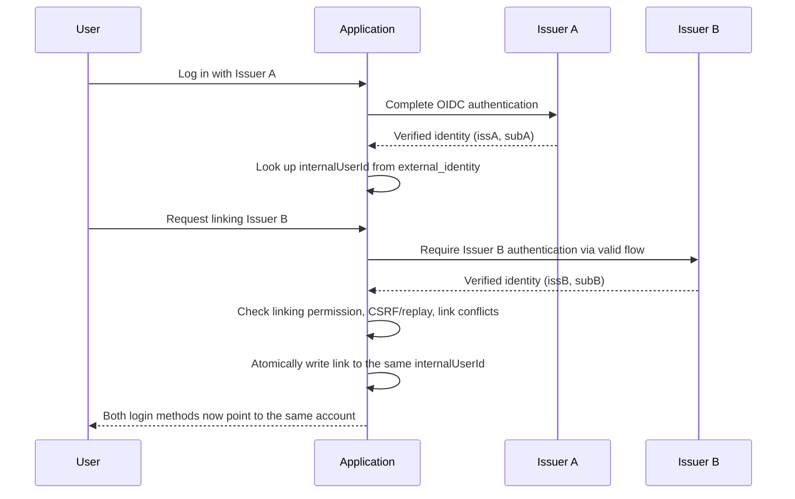
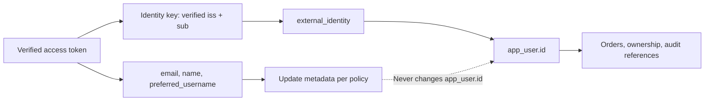

# Do Not Use Email or Display Name as a Stable Identifier Without a Contract

## 1. Principal Identification Is a Contract, Not a “Human-Looking” String

In a **Spring Security OAuth 2.0 / OIDC Resource Server**, after an access token is verified, Spring Security creates an `Authentication` object representing the **principal**: the subject identified within the request context. A principal can be a **user**, a **service account**, or another subject kind according to the Authorization Server's contract.

A JWT access token may contain:

```json
{
  "iss": "https://login.example.test/realms/shop",
  "sub": "a8f37c21-12d4-47f6-9980-e1fd0aa9e442",
  "aud": ["orders-api"],
  "scope": "orders:read",
  "email": "linh.nguyen@example.test",
  "email_verified": true,
  "preferred_username": "linh.nguyen",
  "name": "Nguyen Linh",
  "iat": 1893452400,
  "exp": 1893456000
}
```

This is a **hypothetical payload for illustration**, not a usable signed JWT. These claims serve different purposes:

- `iss` (issuer): the party that issued the JWT.
- `sub` (subject): the subject identifier declared by the issuer.
- `aud`: the resource intended to receive the token.
- `scope`: the permissions/scopes granted to the access token.
- `email`, `preferred_username`, `name`: may be helpful for contact or display, **yet do not inherently guarantee stability, uniqueness, or non-reuse**.

For example, suppose a system stores order ownership using `email`:

```text
orders.owner_email = "linh.nguyen@example.test"
```

When the user changes their email, the old email is reclaimed, or someone else receives that address, the “who owns this order” link can break or—worse—bind to the wrong person. If stored by display name, the problem is even greater: thousands of people can share the same name and anyone can change their name at any time.

> **Core principle:** Never use `email`, `name`, `preferred_username`, or `Authentication.getName()` as an immutable identifier key **without an explicit contract** with the issuer covering uniqueness, lifecycle, scope, and non-reuse. In the standard OIDC model, start with the **`(iss, sub)` pair** for external identity; link that pair to an application-managed **stable internal ID**.

## 2. Why Does “Recognizing a Person” Differ from “Having a Stable Identifier”?

Many values help humans recognize one another in a UI, yet are unsuitable as long-term storage or authorization keys.

| Attribute | What Is It Used For? | Should It Automatically Serve as an Identity Key? |
| --- | --- | --- |
| `sub` | Subject identifier issued by the issuer. | **Conditionally:** typically used together with `iss`, in the right context and per issuer contract. |
| `iss` | Identifies the identity domain/issuer. | Not sufficient alone; must be paired with the corresponding subject. |
| `email` | Sending notifications, contacting, or display. | **Not by default.** Can change, is not guaranteed to be present, and can be recycled. |
| `email_verified` | Issuer's statement that the address passed their verification workflow. | No. Does not prove the email is immutable or permanently unique. |
| `preferred_username` | Login name/handle preferred by the user. | Not by default. Can be changed or reassigned to someone else. |
| `name` | Full name for display. | No. Duplicates and arbitrary changes occur. |
| `given_name`, `family_name` | Name components for UI display. | No. Mutable and non-unique. |
| `picture` | Avatar image URL. | No. URLs can change, expire, or require new authorization. |
| `client_id` | OAuth 2.0 client identifier. | Suitable for distinguishing clients per contract; **never replaces** user subject. |
| `jti` | Identifier of a specific JWT/token. | No. New tokens usually receive new `jti` values, not the user's ID. |
| `aud` | Resource receiving the JWT. | No. Audience is not a user identity. |
| `tenant_id` | Tenant context per issuer/API contract. | A data boundary/scope; never substitutes for `sub` by default. |

### 2.1. An Example of Attributes Changing While the User Remains the Same

**First login:**

```json
{
  "iss": "https://login.example.test/realms/shop",
  "sub": "user-4be18",
  "email": "linh.old@example.test",
  "name": "Nguyen Linh"
}
```

**Second login:**

```json
{
  "iss": "https://login.example.test/realms/shop",
  "sub": "user-4be18",
  "email": "linh.new@example.test",
  "name": "Linh Nguyen"
}
```

Assuming the issuer guarantees `sub` stability within this issuer domain, both sessions belong to the **same external subject**. If the system used `email` as the primary key, it could create **two internal accounts** for one person or cause the user to lose access to their history.

### 2.2. Two Different People Can Share the Same Display Information

```json
{
  "iss": "https://login.example.test/realms/shop",
  "sub": "user-111",
  "email": "support@example.test",
  "name": "Support Team"
}
```

```json
{
  "iss": "https://login.example.test/realms/shop",
  "sub": "user-222",
  "email": "support@example.test",
  "name": "Support Team"
}
```

This example illustrates that an issuer can return overlapping contact/display info. Even though some providers enforce unique email policies, **the Resource Server must not assume every issuer does**. Two distinct subjects must still be treated as two separate identities unless an authenticated and approved **identity-linking workflow** says otherwise.

## 3. `sub` and `iss`: The Foundation of OIDC Identity

In OpenID Connect, `sub` is the subject identifier issued by an OpenID Provider to an End-User. It is designed to be stable and never reassigned **within the scope defined by the OP**, and must be combined with `iss` to form a globally unambiguous subject identifier in the appropriate OIDC context.

Example:

```text
Identity A
  iss = https://login-a.example.test
  sub = 12345

Identity B
  iss = https://login-b.example.test
  sub = 12345
```

**These two pairs do not automatically represent the same person**, even though `sub` matches. Issuer A and issuer B are two separate **identity domains**. A single ID like `"12345"` is insufficient as a key in a multi-issuer system.

An external identity key should be modeled logically as:

```text
ExternalIdentityKey = (issuer, subject)
```

In a multi-tenant system where the issuer uses per-tenant subject namespaces, you must also include the **contractual tenant identifier** or use separate issuers/realms as appropriate. Never guess namespace rules from emails or tenant display names.

### 3.1. Properties of `sub` to Understand Properly

- `sub` is typically an **opaque identifier**: never attempt to parse it, infer business meaning from it, or rely on it “looking like a UUID”.
- `sub` is a **case-sensitive** string; do not automatically lowercase, trim, or alter characters unless the issuer explicitly specifies such normalization.
- `iss` is an issuer URI bound by validators, not any URL sent by a client. Use the verified issuer value from trusted configuration.
- Subject has meaning within the **issuer domain**, not as a global user ID valid across all IdPs.
- When changing issuers, switching tenants/realms, or changing subject policies, `sub` can change. You need an **evidence-backed migration/linking workflow**, rather than auto-connecting two records because their emails match.

### 3.2. Public and Pairwise Subject Identifiers

OIDC defines two commonly referenced subject identifier models:

**Public subject identifier:** the same End-User can receive the same `sub` across multiple clients of the same OP, depending on OP policy.

**Pairwise subject identifier:** the OP may issue a different `sub` for the same End-User across different **sector identifiers**. The goal is to limit unrelated clients from correlating identities via a shared identifier.

Example:

```text
OP = https://login.example.test

Web App A (sector A):
  sub = pairwise-a-913

Web App B (sector B):
  sub = pairwise-b-472
```

You must not conclude that two different `sub` values definitely represent two different people **across client/sector boundaries**; nor should you auto-link them by email. If the product needs to recognize the same person across two applications, use an IdP contract or a user-authorized account-linking flow.

**Warning when combining an OIDC Client and an OAuth2 Resource Server:** `sub` in an OIDC **ID token** and `sub` in an **access token** do not automatically carry identical semantics across every provider, especially with custom token profiles, service principals, or sector-based pairwise subjects. The API must rely on the **access-token contract for its own resource**. Never take `sub` from an ID token and assume it always matches the subject of every downstream access token.

## 4. What Do `email` and `email_verified` Not Guarantee?

### 4.1. Email Is Not an Immutable Identifier

Normal real-world events include:

1. A user switches from a personal email to a work email.
2. A company changes its domain name and email aliases change.
3. A user changes their first or last name and updates their email.
4. A mailbox is closed and the address is later assigned to someone else.
5. Multiple accounts share a common contact address or group alias.
6. An identity provider returns privacy-relay, proxy, or disposable email addresses.
7. An access token **has no `email` claim**, because this claim is not required in every profile.

If an application stores `email` as a foreign key for access permissions, these scenarios create the risk that “changing contact details changes ownership”.

### 4.2. `email_verified` Has Limited Meaning

In OIDC, `email_verified: true` means the OP asserts that it completed its email verification procedure at some point according to its own mechanism. It does **not** guarantee that:

- The email will never change.
- The email is unique across the entire system or across all issuers.
- The email address will never be recycled for another person.
- The subject still controls that mailbox right now if the data is stale.
- Two accounts sharing an email belong to the same person.

`email_verified` can be helpful for sending emails, verifying a contact method, or **controlled account-linking** steps, yet **must never automatically turn email into an identity key**.

### 4.3. Never Use Email Domains as Proof of Tenant or Role

Example:

```java
// UNSAFE as a general authorization rule:
if (email.endsWith("@example-company.test")) {
    grantAdminAccess();
}
```

An email domain is contact metadata and can be affected by issuance policies, aliases, or stale data. Organization membership, admin roles, and tenant access must be confirmed by **contractually guaranteed claims**, API/IdP group memberships, or a trusted policy engine. Even when an email is verified, that never grants administrator privileges on its own.

## 5. `name` and `preferred_username` Are Strictly UI Metadata

In OIDC, `name` can be a full display name; `preferred_username` can be a nickname or login handle. They must not be used as:

- Primary keys or foreign keys in business tables.
- Long-lived cache keys for access permissions.
- System-wide user deduplication keys.
- Criteria for automatically merging multiple OIDC accounts into one user.
- Conditions allowing a user to read someone else's data.
- Immutable IDs in audit logs.

Example of two people with the same name:

```text
sub=user-a, name="Nguyen Van An"
sub=user-b, name="Nguyen Van An"
```

If `name` is used to look up order owners, the application cannot tell the two people apart. If `preferred_username` is used and the provider allows handle changes, the system can lose data links or confuse the user with whoever claims the old handle.

**Separate them as follows:**

```text
identity_key   = (verified issuer, verified subject)
local_user_id  = application-generated UUID, used for foreign keys
display_name   = updatable metadata
contact_email  = metadata updatable and verified per policy
```

Display metadata can be refreshed on login or via profile sync, yet must never decide whether a new user can take over old records.

## 6. How Does Spring Security Represent the Principal?

In Spring Security, `Authentication` describes an authenticated subject and its accompanying authorities:

```java
Authentication authentication =
        SecurityContextHolder.getContext().getAuthentication();

String name = authentication.getName();
Collection<? extends GrantedAuthority> authorities =
        authentication.getAuthorities();
```

This snippet assumes execution within a request already processed by Spring Security. **`getName()` is not a business-level immutable identity guarantee.** Its value depends on the `Authentication` type and converter:

| Context | Typical Principal | Returned Name |
| --- | --- | --- |
| JWT Resource Server | `JwtAuthenticationToken` from verified JWT. | Usually based on `sub` by default, if issuer/token supplies that claim. |
| JWT Resource Server with custom converter | `JwtAuthenticationToken` with configured principal claim. | Could be `preferred_username` or another claim if developers changed mapping. |
| OIDC Login Client | `OAuth2AuthenticationToken` with `OidcUser`. | Depends on `OidcUser` / client registration and name attribute. |
| Basic/form authentication | Username/password principal. | Typically the login system's username. |
| Opaque Resource Server | Principal from introspection. | Depends on introspector/provider and mapping. |

Therefore, in JWT-based APIs, extract **verified issuer and subject explicitly**, rather than relying on a single name string without knowing its source.

### 6.1. `JwtAuthenticationToken` and the Principal Claim Name

In a JWT Resource Server, `JwtAuthenticationConverter` can configure which claim supplies the name of `Authentication`:

```java
JwtAuthenticationConverter converter = new JwtAuthenticationConverter();
converter.setPrincipalClaimName("preferred_username");
```

With this setup, `Authentication.getName()` can become `preferred_username`. Changing it can help logging or display in some systems, **yet it does not make username a stable identity key**.

An existing application containing:

```java
String ownerId = authentication.getName();
orderRepository.findByOwnerId(ownerId);
```

can break silently when switching the principal claim from `sub` to `preferred_username`. A more resilient design introduces a dedicated **identity mapping** layer built on verified identifiers and storing internal keys.

### 6.2. Controllers Reading Verified Claims

In a JWT Resource Server, Spring Security can inject the principal's `Jwt`:

```java
@RestController
class AccountController {

    @GetMapping("/api/me")
    Map<String, Object> me(@AuthenticationPrincipal Jwt jwt) {
        String issuer = jwt.getIssuer().toString();
        String subject = jwt.getSubject();

        return Map.of(
                "issuer", issuer,
                "subject", subject);
    }
}
```

In this example, the request must pass through **`BearerTokenAuthenticationFilter`, `JwtAuthenticationProvider`, `JwtDecoder`, and configured validators** before reaching the controller. `@AuthenticationPrincipal Jwt` does not validate a JWT if the security filter chain is bypassed; trustworthiness comes from the full upstream authentication pipeline.

Not every API should expose issuer/subject in a public response as in this illustration. In real deployments, return only identity fields the application has a legitimate reason and permission to disclose to the client.

## 7. Establish the Trust Boundary Before Reading Identity

Never read `sub` from an arbitrary JWT and use it to query the database right away:

```java
// WRONG: merely Base64URL-decode payload and trust sub.
String[] parts = token.split("\\.");
String payloadJson = new String(
        Base64.getUrlDecoder().decode(parts[1]),
        StandardCharsets.UTF_8);
// Using sub from payloadJson to look up owner is unsafe.
```

An attacker can craft a payload containing a victim's `sub`. The Resource Server may trust the principal **only after**:

1. Receiving the Bearer credential via a supported channel/mechanism.
2. Verifying the **JWS signature**, algorithm, and trusted issuer's public keys/JWKS (or using trusted introspection for opaque tokens).
3. Verifying **`iss`** matches an allowed issuer.
4. Verifying **`aud`** includes the receiving resource API.
5. Verifying **`exp`**, **`nbf`**, and required time checks.
6. Verifying **token type/profile**; rejecting OIDC ID tokens sent as access tokens.
7. Checking **scopes/authorities**, tenant, and business policies.

`iss` in an unverified JWT is purely sender-supplied data. When supporting multiple issuers, you may inspect `iss` first solely to route **within a preconfigured allowlist**, and the chosen decoder must still verify the signature and re-check the issuer. Never automatically trust an arbitrary issuer/JWKS URL declared by the token.

### 7.1. Example `JwtDecoder` Checking Issuer and Audience

```java
@Configuration
class JwtValidationConfig {

    private static final String ISSUER =
            "https://login.example.test/realms/shop";
    private static final String EXPECTED_AUDIENCE = "orders-api";

    @Bean
    JwtDecoder jwtDecoder() {
        NimbusJwtDecoder decoder =
                NimbusJwtDecoder.withIssuerLocation(ISSUER).build();

        OAuth2TokenValidator<Jwt> standard =
                JwtValidators.createDefaultWithIssuer(ISSUER);

        OAuth2TokenValidator<Jwt> audience = jwt ->
                jwt.getAudience().contains(EXPECTED_AUDIENCE)
                        ? OAuth2TokenValidatorResult.success()
                        : OAuth2TokenValidatorResult.failure(
                                new OAuth2Error(
                                        "invalid_token",
                                        "JWT audience is not orders-api",
                                        null));

        decoder.setJwtValidator(
                new DelegatingOAuth2TokenValidator<>(
                        standard, audience));
        return decoder;
    }
}
```

This snippet illustrates `JwtDecoder`, `NimbusJwtDecoder`, `JwtValidators`, `OAuth2TokenValidator`, and `OAuth2Error`; imports are omitted to focus on policy. In production projects, add algorithm constraints, access-token profile checks, and required claims according to your issuer and Spring Security version.

Specifically, **ID tokens** signed by the same OIDC Provider target the **OIDC Client**, not the Resource Server; an audience validator and appropriate token profile checks prevent the API from accepting ID tokens by mistake.

## 8. Recommended Data Model: Internal ID and External Identity Links

Instead of storing email as the data ownership key, design a stable **internal user ID** and an external identity mapping table:

```text
app_user
  id                 UUID PRIMARY KEY
  display_name       TEXT          -- mutable metadata
  contact_email      TEXT          -- mutable metadata
  created_at         TIMESTAMP

external_identity
  id                 UUID PRIMARY KEY
  user_id            UUID REFERENCES app_user(id)
  issuer             TEXT NOT NULL
  subject            TEXT NOT NULL
  created_at         TIMESTAMP
  UNIQUE (issuer, subject)

orders
  id                 UUID PRIMARY KEY
  owner_user_id      UUID REFERENCES app_user(id)
  ...
```

Here:

- `app_user.id` is the business identifier issued and controlled by the **application**.
- `external_identity.issuer` + `subject` identifies a principal from an IdP.
- One internal user can link multiple external identities **only through a valid linking workflow**.
- `orders.owner_user_id` does not change when email, nickname, or display name changes.
- `UNIQUE(issuer, subject)` prevents one external identity from being linked simultaneously to two internal users.

This is an **illustrative logical schema**; actual DDL depends on your database, collation, and multi-tenant policies. The `issuer`/`subject` columns should be matched according to canonicalization rules defined in the contract, avoiding collations that unintentionally fold case.

### 8.1. Why Not Use `sub` as the Primary Key of `app_user`?

An application with a single stable issuer could use `sub` as a logical key within that scope. However, an internal ID decouples **business data lifecycle** from:

- Migrating OIDC Providers or changing realms/issuers.
- Linking multiple logins belonging to the same person.
- Per-client/sector pairwise identifiers.
- Historical data syncing and importing.
- Accounts created before an external identity exists.

When a user switches IdPs, a new external identity link can be attached to the same `app_user.id` once ownership of the identity is verified. Order tables keep referencing the existing internal ID.

### 8.2. Illustrative Entity and Repository

```java
public record ExternalIdentityKey(String issuer, String subject) {
    public ExternalIdentityKey {
        if (issuer == null || issuer.isBlank()
                || subject == null || subject.isBlank()) {
            throw new IllegalArgumentException(
                    "Issuer and subject must be present");
        }
    }
}

public interface ExternalIdentityRepository {
    Optional<UUID> findInternalUserId(ExternalIdentityKey identity);

    // Creating a link must use a transaction and unique constraint.
    void link(ExternalIdentityKey identity, UUID internalUserId);
}
```

When calling the repository, construct `ExternalIdentityKey` only from the **authenticated principal**, never from query parameters `?sub=...` or client-supplied headers like `X-User-Email`.

The repository above is an example domain-layer interface, **not a Spring Data repository whose implementation is auto-generated**. Real environments require an implementation/JPA entity/schema, transactions, and conflict handling.

## 9. From JWT to Internal User in a Resource Server

Suppose an endpoint needs to read data for the current user. The application can implement a principal-mapping service:

```java
@Service
public class CurrentUserResolver {
    private final ExternalIdentityRepository identityRepository;

    public CurrentUserResolver(
            ExternalIdentityRepository identityRepository) {
        this.identityRepository = identityRepository;
    }

    public UUID requireInternalUserId(Jwt jwt) {
        if (jwt == null || jwt.getIssuer() == null
                || jwt.getSubject() == null
                || jwt.getSubject().isBlank()) {
            throw new AccessDeniedException(
                    "No stable external subject was provided");
        }

        ExternalIdentityKey key = new ExternalIdentityKey(
                jwt.getIssuer().toString(),
                jwt.getSubject());

        return identityRepository.findInternalUserId(key)
                .orElseThrow(() -> new AccessDeniedException(
                        "External subject has no linked user"));
    }
}
```

Example controller:

```java
@RestController
class MyOrdersController {
    private final CurrentUserResolver currentUserResolver;
    private final OrderService orderService;

    public MyOrdersController(
            CurrentUserResolver currentUserResolver,
            OrderService orderService) {
        this.currentUserResolver = currentUserResolver;
        this.orderService = orderService;
    }

    @GetMapping("/api/orders/mine")
    public List<OrderDto> myOrders(@AuthenticationPrincipal Jwt jwt) {
        UUID localUserId =
                currentUserResolver.requireInternalUserId(jwt);
        return orderService.findOrdersOwnedBy(localUserId);
    }
}
```

This example assumes `OrderService` and `OrderDto` are application types; imports are omitted. `CurrentUserResolver` does not verify the JWT itself—it **relies on the security chain having already validated the token**. The actual endpoint still needs `SCOPE_orders:read` and data ownership enforcement.

### 9.1. Configuring the Endpoint with the Required Scope

```java
@Bean
SecurityFilterChain apiSecurity(HttpSecurity http) throws Exception {
    return http
            .authorizeHttpRequests(auth -> auth
                    .requestMatchers(HttpMethod.GET, "/api/orders/**")
                        .hasAuthority("SCOPE_orders:read")
                    .anyRequest().authenticated())
            .oauth2ResourceServer(oauth2 ->
                    oauth2.jwt(Customizer.withDefaults()))
            .build();
}
```

Spring Security typically converts `scope` or `scp` from a JWT access token into `SCOPE_...` authorities. If the provider uses a custom claim, add a contract-compliant converter. **Never grant `SCOPE_orders:read` just because an email belongs to a particular domain**, and never allow access to all records solely for holding the scope. Ownership rules in `OrderService` must continue to apply.

### 9.2. For New Users Without an External Identity Link Yet

When `findInternalUserId` finds no match, **do not auto-merge accounts by email**. Depending on business requirements:

- The API can reject the request and require onboarding/provisioning first.
- A trusted provisioning service can create a new `app_user` and `external_identity` inside a transaction.
- On identity key conflicts, rely on unique constraints and concurrency handling; never create two users because two initial requests arrived simultaneously.
- If the email already exists in a legacy user table, run a verified linking flow rather than transferring ownership to the new principal automatically.

Having `email_verified=true` does not replace verifying which internal account is allowed to be linked.

## 10. Account Linking: Same Email Does Not Mean Same Account

A product may support signing in through multiple OIDC Providers, for example:

```text
Login A:
  issuer  = https://login-company.example.test
  subject = employee-123
  email   = linh@example.test

Login B:
  issuer  = https://login-social.example.test
  subject = social-987
  email   = linh@example.test
```

Never automatically conclude that these two logins are **the same person** simply because their emails match. Nor should you automatically merge two internal users that already hold sensitive data.

### 10.1. A Safer Linking Flow



Real workflows must defend against **account takeover**, session fixation, CSRF, replay attacks, and race conditions. Attaching a new identity to an active session may require **reauthentication** or an extra verification step depending on risk level.

### 10.2. A Recycled Email Can Cause Account Takeover

Suppose:

1. Person A once owned `old@example.test` and created an account holding sensitive data.
2. A stops using that email, yet the application still stores `owner_email`.
3. Person B later obtains that email address from the mail provider.
4. B logs in with an IdP that emits `email=old@example.test`.
5. The application auto-links B to A's account based on the matching email.

This is an **account takeover** vulnerability. The design fix is storing ownership by internal ID, linking external identities by verified subject, and allowing account merges only through workflows with proof of ownership.

### 10.3. What Should Happen If an IdP Changes `sub`?

If a provider changes `sub` during a migration, do not turn `email` into an uncontrolled “bridge”. Use one of these proper methods:

- An old-to-new mapping table provided by the issuer over a trusted channel with verification policies.
- Having the user authenticate both old and new identities within a valid linking session.
- A verified, approved, and audited account recovery workflow.

Migration documentation must specify **old/new issuers, subject namespaces, tenant scope, uniqueness, and conflict/missing handling**.

## 11. Service Principals: Not Every `sub` Is a Human User

OAuth 2.0 supports the **Client Credentials** flow for machine-to-machine (M2M) API calls. In this case there is no direct End-User. The JWT access token may carry `client_id`, a `sub` defined by the issuer in its own convention, or equivalent service identity claims.

Example:

```json
{
  "iss": "https://login.example.test/realms/shop",
  "sub": "billing-batch-service",
  "client_id": "billing-batch-service",
  "aud": ["orders-api"],
  "scope": "orders:reconcile",
  "exp": 1893456000
}
```

**Do not** automatically create a personal `app_user` from an M2M token's `sub` simply because code assumes every JWT represents a person. Your contract must state:

- Does the token represent an **End-User**, a **client/service**, or either depending on context?
- Which claim identifies the user and which identifies the OAuth client?
- For client credentials, should service principals map to a separate **`service_account`**?
- Are service permissions the same as user permissions? Is delegation checking required?
- Must audits record whether the actual actor was a user or a service?

### 11.1. Classify Principals Before Mapping

An internal model can distinguish:

```text
AuthenticatedActor
  kind = HUMAN | SERVICE
  issuer
  stableExternalId
  internalUserId?        // only for linked humans
  internalServiceId?     // only for registered services
  clientId?
  authorities
```

Here `kind` is an **application-internal concept**, not a claim supplied automatically by every Authorization Server. Determine actor kind from contractually guaranteed claims/flows and proper validation—never merely guess from whether `sub` contains the word `service`.

An API sharing endpoints between humans and services needs clear policies on what each actor kind may do. Never let a service token access personal data by assigning a dummy default email.

## 12. Multi-Tenant: Identity and Data Scope Must Be Separated

In a multi-tenant application, `(iss, sub)` identifies the subject, while **the subject's permissions in a tenant** remain a separate relationship.

```text
app_user:
  user_id = 74f...

external_identity:
  issuer = https://login.example.test
  sub = user-4be18
  user_id = 74f...

tenant_membership:
  tenant_id = tenant-42
  user_id = 74f...
  role = order_reader

orders:
  tenant_id = tenant-42
  owner_user_id = 74f...
```

A token with `tenant_id="tenant-42"` does not automatically allow the user to view **all** orders in that tenant. The API must still verify roles, scopes, ownership, and query filters:

```sql
SELECT *
FROM orders
WHERE tenant_id = :authorized_tenant_id
  AND owner_user_id = :current_user_id;
```

Both parameters must come from the **authenticated and authorized context**, never trusted unconditionally from client-selected query parameters. If the API lets users pick a tenant via URL/header, verify the user holds permissions in that tenant before running the query.

### 12.1. Issuer and Subject May Vary by Tenant

An IdP may issue a separate issuer/realm per tenant, or use a single issuer with per-tenant `sub` namespaces. **No single rule fits every provider**. The contract must define:

- Is `sub` unique across the entire issuer or only within an issuer–tenant pair?
- When moving a user to another tenant, does `sub` stay the same?
- Are tenant permissions issued in the access token or looked up via a policy service?
- Can a human principal belong to multiple tenants?

If the issuer does not guarantee `sub` uniqueness across the entire issuer, **include the contractual namespace in the business key**, rather than falling back to email.

## 13. Updating Profile Information Without Changing Ownership

A profile-sync flow should treat email and display name as **mutable attributes**:



Example workflow:

1. Resolve `app_user.id` via the verified external identity key.
2. Read profile claims from **contract-approved sources**: ID token/UserInfo when the app acts as an OIDC Client, or access token/introspection if the issuer guarantees those claims for the API.
3. Check whether claims are present and properly typed; if absent, do not automatically wipe existing contact data.
4. Update `display_name` and `contact_email` per application policy and audit important changes.
5. **Never modify `orders.owner_user_id` simply because a new email appeared.**
6. Never add a new external identity link solely because emails match.

**Note:** Not every access token contains `email` or `name`. An API must never assume standard OIDC scopes like `email`/`profile` automatically inject those claims into **access tokens**. ID tokens and UserInfo are profile sources for OIDC Clients; Resource Servers need an explicit contract specifying which claims appear in access tokens.

## 14. Which Identifiers Should Audits, Caches, and Logs Use?

### 14.1. Audit Logs

Logs of sensitive actions should attach a stable identifier:

```text
event_id        = evt-10001
action          = ORDER_CANCEL
actor_kind      = HUMAN
internal_user_id = 74f...
issuer          = https://login.example.test/realms/shop
subject         = user-4be18
order_id        = order-123
timestamp       = ...
```

Display names and emails may be added as **snapshot metadata** if genuinely required and allowed by data protection policies, yet must never serve as the sole actor lookup key. If a subject changes in a migration, keep mapping/audit history to investigate according to the identifier valid at that point in time.

### 14.2. Cache Keys and Authorization Decisions

A permission cache keyed by email:

```text
permissions:linh@example.test
```

risks key collisions when emails change or get recycled. Key caches by **trusted principal and resource/policy context**, such as:

```text
permissions:<issuer-id>:<subject-id>:<tenant-id>:<policy-version>
```

This example only illustrates logical components; real implementations require safe encoding or hashing to prevent delimiter collisions, PII leakage, and high cardinality. If a user links multiple IdPs to the same internal user, domain caches can use the internal ID while still controlling scopes, tenants, token lifetimes, and invalidation.

Never store raw access tokens as cache keys or log keys.

### 14.3. Contact Details and Privacy

Email is personal data. Collect and store it only for legitimate purposes, enforcing access restrictions and retention limits. JWS-signed JWTs **do not encrypt their payload by default**: email/name data in an access token can be read by anyone holding the token. Avoid packing unnecessary profile attributes into access tokens meant for Resource Servers.

## 15. Process for Choosing an Identity Key in a Project

For each issuer/API, write down a **principal identity contract**. Example:

```yaml
identity_contract:
  issuer: https://login.example.test/realms/shop
  accepted_token_kind: oauth2-access-token
  expected_audience: orders-api
  human_subject:
    claim: sub
    type: string
    unique_within: issuer
    case_sensitive: true
    reuse_policy: never-reuse-within-issuer
  service_subject:
    claim: client_id
    type: string
    meaning: oauth-client-id
  local_mapping:
    human_key: [issuer, sub]
    service_key: [issuer, client_id]
    internal_user_id: uuid
    internal_service_id: uuid
  metadata_only:
    - email
    - email_verified
    - preferred_username
    - name
    - picture
  account_linking:
    automatic_link_by_email: false
    require_verified_identity_flow: true
```

This is an **illustrative contract document**, not a Spring Boot configuration automatically read by the framework. It documents commitments **the issuer must actually uphold**; if the issuer does not guarantee `never-reuse` or the stated subject namespace, never write down that guarantee out of wishful thinking.

### 15.1. Questions to Ask the Issuer

1. Is `sub` unique across the entire issuer, per tenant, or per sector?
2. Can `sub` ever be reassigned to someone else after an account is deleted?
3. Can `sub` change during migrations, federation, or realm changes?
4. Does the access token carry an End-User subject or a client subject? How are they distinguished by grant/profile?
5. Which claim is considered a stable client/service identifier?
6. Can `email` be missing, changed, or recycled? Under what policy is `email_verified` set?
7. What is each issuer's public/pairwise subject policy? Does it differ by client/sector?
8. Is there an official API providing old-to-new mappings when switching issuers?
9. Which claims are emitted in access tokens, ID tokens, and UserInfo respectively?
10. In multi-tenant setups, how are subject namespaces and tenant authorization bound together?

If any answer is unclear, **never assume email or display name is a stable identifier**. Designing internal IDs and identity links reduces reliance on uncommitted fields.

## 16. Example Migration Away from Email-Based Ownership

Suppose a legacy system has:

```text
app_user:
  email (PRIMARY KEY)
  display_name

orders:
  owner_email (FOREIGN KEY → app_user.email)
```

The new design targets:

```text
app_user:
  id (PRIMARY KEY)
  contact_email
  display_name

external_identity:
  issuer
  sub
  user_id
  UNIQUE (issuer, sub)

orders:
  owner_user_id (FOREIGN KEY → app_user.id)
```

### 16.1. Safe Migration Steps

**Step 1 — Finalize the identity contract.** Clarify issuer, subject, tenant namespace, how legacy accounts link, and which fields are mutable. Never run a migration assuming `email` is unique.

**Step 2 — Add internal IDs and the external identity table.** Introduce internal UUIDs and a link table with a unique constraint, supporting transactions and auditing.

**Step 3 — Backfill ownership data.** Map legacy order records to internal IDs **based on verified account relationships or trustworthy internal data**. Handle duplicates and ambiguities individually instead of picking a user by name or email automatically.

**Step 4 — Roll out controlled dual-reads.** New application code prefers `owner_user_id` and maintains a transitional fallback only where genuinely needed, without granting permissions from unmapped emails. Emit logs/alerts for missing links.

**Step 5 — Cut over completely to internal IDs.** Once all data is verified and clients are upgraded, stop using `owner_email` as an authorization key. Keep email solely for contact or display.

**Step 6 — Safely retire legacy columns.** Do not drop old columns before checking reporting, auditing, queues, and historical data pipelines.

### 16.2. Why Not Backfill Solely by Email?

If legacy data contains two accounts sharing an email, changed emails, or addresses reassigned to new people, an automated backfill can transfer ownership of sensitive data. Treat this as a **data integrity + security** problem, not just a SQL join.

Where evidence is insufficient, it is safer to **flag records for review** under a recovery/verification workflow rather than guessing and assigning the wrong owner.

## 17. Testing Identity and Ownership

Testing should cover both **identity mapping** and **authorization**, not just asserting HTTP 200.

| Scenario | Expectation |
| --- | --- |
| Same `iss`, same `sub`, changed `email` | Maps to the **same internal user ID**. |
| Same `iss`, same `sub`, changed `name` | Still the same internal user; only display metadata updates. |
| Different `sub`, same `email` | **Never auto-merge** accounts. |
| Different `iss`, same `sub` | Two distinct external identity keys. |
| Different issuers, same email, both `email_verified=true` | Do not auto-link without an account-linking flow. |
| JWT with victim's `sub` but invalid signature | Authentication rejected; no lookup or access using forged `sub`. |
| JWT with valid signature but wrong `aud` | Token rejected; no trusted principal created for this API. |
| OIDC ID token with same `sub` but not an API access token | Rejected by audience/token profile. |
| Missing `sub` when API requires human identity | Fail-closed; never fall back to email to identify user. |
| Client Credentials token with no End-User | Mapped per service principal contract; never creates personal user from email. |
| Two concurrent provisioning requests for same `(iss, sub)` | Only one identity link created via transaction/unique constraint. |
| Two people with identical display names | No cross-user data access. |
| Tenant A user sends Tenant B in URL | Rejected without Tenant B membership/permission. |
| Old email reassigned to someone else | Ownership of historical data does not transfer. |
| OIDC Provider migration | Linked via trustworthy evidence, preserving internal user ID and audit trail. |

### 17.1. Do Not Confuse Mock Authentication with Real JWT Verification

In Spring Security Test, `MockMvc` can use:

```java
mockMvc.perform(get("/api/orders/mine")
        .with(jwt()
                .jwt(jwt -> jwt
                        .issuer("https://login.example.test/realms/shop")
                        .subject("user-123"))
                .authorities(new SimpleGrantedAuthority(
                        "SCOPE_orders:read"))))
        .andExpect(status().isOk());
```

This illustrates how to **mock a JWT principal** for testing controllers/authorization, assuming the repository already holds the matching identity link and the endpoint returns valid data. **It does not prove the JWT was signed or that `JwtDecoder` validated the real issuer/audience**. To test signatures and claims, write integration tests that pass through the decoder with appropriate test tokens and keys.

In business-ownership tests, create **two different principals sharing the same email** and assert neither can view the other's data.

### 17.2. Test Permission Conditions Separately from Identity

A principal with a valid external identity may still be denied permission to read an order because:

- Missing `SCOPE_orders:read`.
- Not a member of the required tenant.
- Not the owner of the record.
- Internal account suspended by policy.
- Token has a valid subject yet the client is not allowed to perform this action.

**Identifying who is calling** and **what they are allowed to do** are two separate decisions. Never let matching emails bypass permission checks.

## 18. HTTP 401 vs. 403: At Which Stage Is Identity Rejected?

| Case | Stage Blocked | Typical Response |
| --- | --- | --- |
| No Bearer token sent to a protected endpoint | Missing credential | **401**, typically `WWW-Authenticate: Bearer`. |
| JWT with bad signature/issuer/audience/expired | Authentication | **401 invalid_token**. |
| Valid token missing `sub` required by access-token profile | Token/claim validation if API defines validator | **401 invalid_token**. |
| Valid token with `sub` but no internal identity link | Domain authorization/onboarding policy | **403** or custom onboarding response per app contract. |
| Valid token, internal user exists, but missing scope | Authorization | **403** and possibly `insufficient_scope`. |
| Valid token, user has scope, but does not own data | Object-level authorization | **403/404** or appropriate denial policy. |

If an application must guarantee `sub` is present for **every** JWT access token on a human-user-only API, add an `OAuth2TokenValidator<Jwt>` requiring the claim to be present and properly typed so missing claims fail at authentication. However, **never apply a “human sub required” validator to all service tokens** if the contract permits different machine principals.

### 18.1. Example Subject Validator for a Custom Contract

```java
OAuth2TokenValidator<Jwt> requireSubject = jwt -> {
    String subject = jwt.getSubject();
    if (subject != null && !subject.isBlank()) {
        return OAuth2TokenValidatorResult.success();
    }

    return OAuth2TokenValidatorResult.failure(
            new OAuth2Error(
                    "invalid_token",
                    "Token has no subject required by this API",
                    null));
};
```

This validator illustrates an **API requiring a subject**; it does not determine whether the subject is an End-User or a service. To distinguish those two, add token-profile/claim policies from the issuer rather than merely checking whether `sub` is non-empty.

## 19. Anti-Patterns to Avoid

### 19.1. Using Email as Owner ID

`orders.owner_email` causes ownership to shift whenever contact details change. Use internal user IDs mapped via external identities.

### 19.2. Using `Authentication.getName()` as a Permanent Key

`getName()` depends on implementation and converters; it can change from `sub` to username. Know your principal semantics and rely on an explicit identity contract.

### 19.3. Auto-Linking Accounts When `email_verified=true`

Verified email reflects the issuer's verification statement, not proof that two accounts or two IdPs belong to the same person at all times. Use a verified linking flow.

### 19.4. Lowercasing or Reformatting `sub` Arbitrarily

`sub` is opaque and case-sensitive per issuer semantics. Uncontracted string transformations can cause identity collisions or broken links.

### 19.5. Dropping `iss` and Storing Only `sub`

Two issuers can issue identical `sub` values. When accepting multiple IdPs, omitting `iss` invites collisions and misattribution.

### 19.6. Reading Claims from Unverified JWTs

JWT payloads can be forged by attackers. Only use `sub`, email, roles, or tenant as domain logic inputs **after authentication** and proper profile/audience validation.

### 19.7. Using an ID Token as an Access Token

OIDC ID tokens target the OIDC Client; Resource Servers require access tokens targeting the API. Never treat matching `sub` or `iss` as enough to accept the wrong token type.

### 19.8. Treating Every `sub` as an End-User

Client credentials and workload tokens can represent services/clients. Rely on the token profile and issuer contract to determine actor kind.

### 19.9. Merging Two Users Because Display Names Match

`name` or `preferred_username` can collide or change. Account merging is a security-sensitive operation, not a string comparison.

### 19.10. Using Email Domains to Grant Admin Privileges

An email domain does not guarantee membership or role. Permissions must come from trusted policies and authoritative data.

## 20. Practical Scenarios

### Scenario A — Changing Email After Orders Already Exist

A user has external identity `(issA, sub1)` linked to `user_id=U1`. When their email changes, update `app_user.contact_email` while keeping `U1` and `orders.owner_user_id` intact. The user continues viewing their orders without disruption.

### Scenario B — Two Issuers Emit the Same `sub`

Issuer A issues `sub=100` for Alice. Issuer B issues `sub=100` for Bob. If the external identity key only stores `sub`, the application could merge Alice and Bob. Keying by `(iss, sub)` keeps them separate.

### Scenario C — Two Accounts Share an Email

Users A and B have distinct `sub` values and share `email=support@example.test`. The repository does not auto-link them to the same internal ID; any merge requires an authorized workflow.

### Scenario D — Changing `preferred_username`

A user renames their username from `linh.n` to `linh.dev`. If business logic relies on `Authentication.getName()` after a converter switches to `preferred_username`, owner lookups can break. Use verified issuer/subject and internal IDs to stay independent of display attributes.

### Scenario E — Same Person Across Two OIDC Sectors

The OP issues different pairwise subjects for the same person across two applications. You cannot compare `sub` alone to conclude cross-sector sameness, nor auto-merge by email. When shared accounts are needed, use mapping/consent mechanisms supported by the OP and product.

### Scenario F — Machine Token Calling a User Endpoint

A workload using Client Credentials sends a token with `client_id=billing-batch` to `/api/orders/mine`. There is no user subject per contract. The API should reject it or route workloads to dedicated service endpoints/policies rather than using `billing@example.test` as a fallback user ID.

### Scenario G — User Has the Same `sub` in a Token Intended for Another API

A user owns `sub=user-1` in a token with `aud=payments-api`. The Orders API must never read `sub` and query `orders.owner_user_id` before verifying audience. Tokens targeting another resource must be rejected during authentication.

## 21. Self-Check Questions

**1. Can email be used as a user identity key solely because `email_verified=true`?** No. There must be a contract governing uniqueness, lifecycle, mutability/reuse, and linking workflows.

**2. Why are both `iss` and `sub` typically stored?** Because `sub` is scoped to the issuer's namespace; two issuers can assign the same subject value to two different people.

**3. Is `sub` always a UUID?** No. It is an opaque identifier per issuer contract; never parse or normalize it arbitrarily.

**4. Can `name` be used as a foreign key?** No. Display names can collide and change.

**5. Is Spring Security `Authentication.getName()` always an immutable user ID?** No. It depends on the `Authentication` type and principal claim converter.

**6. Why maintain a separate `app_user.id`?** So business data keeps a stable key when external identities, emails, issuers, or login mechanisms change.

**7. If two IdPs return the same verified email, are they definitely the same person?** No. Verified account linking protected against takeover is required.

**8. What is the impact of pairwise `sub`?** One person can receive different subjects across different sectors; identities cannot be correlated automatically across sectors.

**9. Can a JWT with a valid signature but wrong `aud` be used to look up a user?** No. The API must verify the token was issued for this specific resource before relying on `sub`.

**10. Does a Client Credentials token always represent an End-User?** No. It typically represents an OAuth client/service; a separate actor-kind contract is needed.

**11. When a user changes their email, do order owners need updating?** No, provided ownership is stored using an internal user ID.

**12. During an issuer migration, can accounts be auto-linked by email to avoid asking users?** Not by default. Use trusted mappings, a dual-identity verification flow, or a verified recovery process.

## 22. Standards and Concepts to Reference

- **OpenID Connect Core 1.0:** `sub`, `iss`, `email`, `email_verified`, `preferred_username`, `name`, and public/pairwise subject identifier models.
- **RFC 7519 — JSON Web Token (JWT):** registered claims such as `iss`, `sub`, `aud`, `exp`, and `jti`.
- **RFC 8725 — JWT Best Current Practices:** preventing cross-context JWT confusion, issuer/audience binding, and token validation.
- **RFC 9068 — JWT Profile for OAuth 2.0 Access Tokens:** JWT access token semantics when adopting the profile, including subject/client/resource claims.
- **RFC 6749 — OAuth 2.0 Authorization Framework:** Client Credentials, scopes, and roles of OAuth Client, Authorization Server, and Resource Server.
- **RFC 6750 — OAuth 2.0 Bearer Token Usage:** how Resource Servers receive and validate Bearer access tokens.
- **RFC 7662 — OAuth 2.0 Token Introspection:** validating opaque access tokens via introspection instead of `JwtDecoder`.
- **Spring Security — OAuth 2.0 Resource Server JWT:** `BearerTokenAuthenticationFilter`, `JwtAuthenticationToken`, `JwtDecoder`, `JwtAuthenticationConverter`, and `@AuthenticationPrincipal Jwt`.
- **Spring Security — OAuth2 Login/OIDC:** `OidcUser` and distinguishing OIDC Client ID tokens from Resource Server access tokens.

**Conclusion:** A principal is an **identity verified under a contract**. `email`, `name`, and `preferred_username` are useful for display, search, or contact, yet are not inherently stable, unique, or immune to reuse. In OIDC systems, start with **verified issuer + subject** in the right namespace and link them to an **internal user ID**; when dealing with service principals, pairwise subjects, multi-tenancy, or issuer migrations, enforce dedicated contracts and workflows. **Never compromise data ownership and access boundaries simply because two email or display-name strings look identical.**
