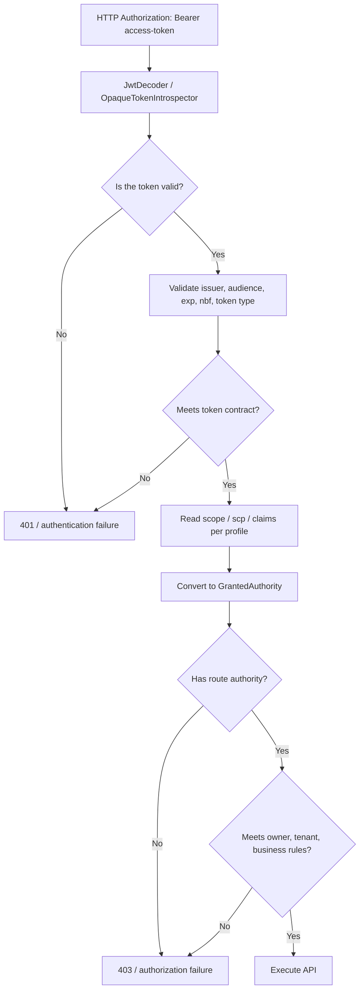
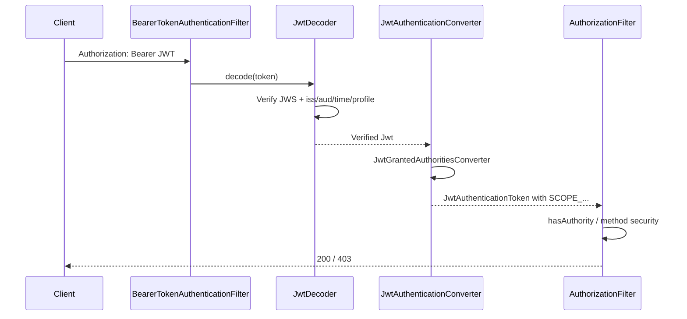

# Claims `scope`, `scp`, and Issuer Data Shapes

In **Spring Security OAuth 2.0 / OIDC Resource Server**, an access token does not just need a valid signature: it must also describe **the permissions the Authorization Server granted** so the API knows which requests are allowed. In OAuth 2.0, the most common concept is **scope**. In a JWT access token, scopes may be placed in the `scope` claim, the `scp` claim, or an issuer-specific structure. When Spring Security receives the token, it can convert that data into **`GrantedAuthority`** instances, then use `hasAuthority(...)`, `hasRole(...)`, method security, and business policies to protect endpoints.

The tricky part is not the authorization check statement itself, but the **data contract**:

- Is `scope` a space-separated string or an array?
- Is `scp` a string or a list? What if both `scope` and `scp` are present?
- Do `roles`, `permissions`, `groups`, `realm_access`, or `resource_access` mean the same thing as scope?
- Does Spring Security combine these claims automatically, or does it require a configured converter?
- Once a token has a valid signature and valid scope, is it allowed to operate on every record?

This lesson explains how to interpret fields according to the **issuer's token profile**, Spring Security's default mapping behavior, explicit mapping configuration, Java examples, and how to test key scenarios.

> **Scope:** Examples use Java 17+, Spring Boot 3.x, Spring Security 6.x, and a hypothetical `orders-api`. Sample JSON claims are not valid signed JWTs. Scope names, issuers, and endpoints are for learning purposes only; when applying in practice, check the documentation of your actual Authorization Server.

## 1. What is a scope and how does it differ from an authority?

In OAuth 2.0, scope is how **a client requests and an Authorization Server grants an access range**. For example, a client asks for the ability to read and create orders, but the Authorization Server may grant only read access:

```text
Requested scopes: orders:read orders:write
Granted scopes:   orders:read
```

In OAuth 2.0, the standard representation of a scope value is a **space-separated list of scope tokens**, where each scope token itself contains no spaces. Scope names are defined by the Authorization Server and the resource, such as `orders:read`, `orders:write`, `profile`, or `inventory.read`.

**A scope is not the same thing as a `GrantedAuthority`.** A scope is protocol/token-issuance data; a `GrantedAuthority` is a **Spring Security** object representing a permission that application code can check.

| Concept | Created/defined by | Example | Role |
|---|---|---|---|
| **OAuth scope** | Authorization Server and API contract | `orders:read` | Range of operations granted to the access token. |
| **JWT claim** | Issuer per token profile | `"scope":"orders:read"` | How the range is carried inside the token. |
| **Spring authority** | Resource Server / converter | `SCOPE_orders:read` | Permission name in `Authentication.getAuthorities()`. |
| **Spring role** | Application convention | `ROLE_ADMIN` | A form of authority with the `ROLE_` prefix in many `hasRole` expressions. |
| **Business permission** | Business policy | "Read only one's own orders" | May require DB/tenant lookup; not automatically guaranteed by scope. |

A scope can express an **operation-type** permission, such as "read orders", but it **does not automatically grant** permission to read every customer's orders. For multi-tenant APIs or APIs containing personal data, scopes usually need to be combined with owner, tenant, resource state, and additional rules.

### 1.1. Authorization decisions span multiple layers



**Never map authorities from an unverified JWT payload.** The first two segments of a JWS Compact token are only Base64URL-encoded; a client can craft a JSON string containing `"scope":"admin"` on its own, but it cannot pass signature verification against a trusted key.

## 2. The `scope` claim: the standardized representation

OAuth 2.0 defines scope as a string of space-separated scope tokens. Under the **JWT Profile for OAuth 2.0 Access Tokens (RFC 9068)**, the `scope` claim is an optional claim representing the OAuth scopes assigned to the token; when present, it is a **space-separated string of scope values**.

Example JWT access token (decoded payload):

```json
{
  "iss": "https://auth.example.test/realms/orders",
  "sub": "alice",
  "aud": ["orders-api"],
  "client_id": "web-portal",
  "scope": "orders:read orders:write",
  "iat": 1890000000,
  "exp": 1890003600
}
```

For `orders-api`, once the token is valid, the two scopes can be mapped:

```text
scope = "orders:read orders:write"
        │             │
        ▼             ▼
SCOPE_orders:read  SCOPE_orders:write
```

Rules to remember:

1. **`scope` is the claim name; `orders:read` is a scope value.** `scope` is not the permission name in Spring.
2. Scope names have meaning within the **contract between the issuer and the Resource Server**. `read` does not universally mean reading all data across all APIs.
3. Scope names are typically **case-sensitive**. `orders:read`, `Orders:Read`, and `ORDERS:READ` are not automatically equivalent.
4. Space is the **delimiter** in the standard representation. Commas are not standard scope delimiters in RFC 6749; `"orders:read,orders:write"` does not mean the same thing as `"orders:read orders:write"`.
5. Do not assume every access token has `scope`: an Authorization Server can issue tokens without scopes, use opaque tokens, or use a different profile. Behavior when the claim is absent must be defined by policy.
6. `openid`, `profile`, and `email` frequently appear in a client's OIDC request; this does not mean they grant permission to read `orders-api` data. An OIDC scope is not a business permission unless the API defines it as such.

### 2.1. Requested scopes and granted scopes are two different events

A client can send an authorization request:

```text
scope=openid%20profile%20orders%3Aread%20orders%3Awrite
```

The Authorization Server may decide to grant only `orders:read` along with appropriate OIDC scopes. The API must rely on **the permissions actually granted and committed by the issuer in the access token/introspection response**, not on the scopes the client requested in the earlier URL.

Even a properly signed access token grants no permissions beyond what the token itself, the issuer, and the resource policy allow. Never trust a `scope` query parameter sent by the client to the API to elevate privileges.

### 2.2. Missing claims, empty values, and wrong data types

| Payload | Meaning for a string-typed `scope` profile | Safe handling |
|---|---|---|
| `"scope": "orders:read"` | One scope was granted. | Convert to `SCOPE_orders:read` if the profile/API accepts it. |
| `"scope": "orders:read orders:write"` | Two scopes. | Split according to the standard representation. |
| `"scope": ""` | No usable scopes. | Do not invent any authorities. |
| No `scope` | No information in this claim. | Do not grant scope-required permissions; another profile claim may apply if contracted. |
| `"scope": ["orders:read","orders:write"]` | **Wrong type for the `scope` claim in RFC 9068.** | If the issuer uses a custom profile, document it explicitly and use a matching parser; do not call this standard RFC 9068 representation. |
| `"scope": "orders:read,orders:write"` | Not a space-separated list. | Do not automatically turn commas into spaces unless specified by the issuer contract. |
| `"scope": {"read":true}` | Not a standard scope string. | Fail closed or grant no authorities; consider rejecting the token per contract. |

**Important rejection point:** a token with a malformed `scope` type may be treated as a profile-violating token right during JWT validation (typically `401`); if the token is valid per the profile but lacks the corresponding authority, the endpoint requiring the scope will reject authorization (typically `403`). These are two different policies, and **neither may grant extra permissions**.

## 3. The `scp` claim and issuer-specific variants

`scp` is a claim name used by many access token issuers to express scopes. It is **not a mandatory standard claim name for every OAuth 2.0 JWT access token**. There are two common representations, depending on the issuer and token version:

**String form:**

```json
{
  "iss": "https://identity.example.test/",
  "aud": ["orders-api"],
  "sub": "alice",
  "scp": "orders:read orders:write"
}
```

**Array form:**

```json
{
  "iss": "https://identity.example.test/",
  "aud": ["orders-api"],
  "sub": "alice",
  "scp": ["orders:read", "orders:write"]
}
```

Both are **forms encountered across different systems**, not a promise that a specific issuer will emit both. For example, in Microsoft identity platform/Entra ID, the `scp` claim in many access tokens is used for **delegated permissions**, typically as a space-separated string; application permissions are usually represented differently, such as via `roles`. Do not apply this rule to another IdP without reading its own documentation.

### 3.1. Quick comparison table

| Input data | Where commonly seen | Can be mapped to |
|---|---|---|
| `"scope": "orders:read orders:write"` | OAuth tokens / RFC 9068 JWT access tokens. | `SCOPE_orders:read`, `SCOPE_orders:write`. |
| `"scp": "orders:read orders:write"` | Access tokens from certain IdPs. | `SCOPE_...` authorities if the contract says these are scopes. |
| `"scp": ["orders:read", "orders:write"]` | Some custom token profiles. | `SCOPE_...` authorities if the converter supports arrays. |
| `"scope": ["orders:read","orders:write"]` | Vendor-specific, **differs from RFC 9068**. | Must have an explicit agreement before reading as a scope list. |
| `"permissions": ["read:orders"]` | Custom permission profiles. | `PERM_read:orders` or another authority per policy; not necessarily a scope. |
| `"roles": ["orders-admin"]` | Application roles or vendor-defined roles. | Can become `ROLE_...` if a safe mapping is defined. |
| `"resource_access": {"orders-api":{"roles":["viewer"]}}` | Some issuers with per-resource/client authorization claims. | Only roles intended for `orders-api`, with a dedicated converter. |
| `"realm_access": {"roles":["user","admin"]}` | Some issuers using realm-level roles. | Do not treat every realm role as an admin permission for the API. |

You should define **one token contract per issuer/profile**: which claim is read, supported data types, scope token syntax, meaning of each value, and policy when missing/invalid. "Having the same name" does not prove "having the same permissions".

### 3.2. When both `scope` and `scp` are present

Example:

```json
{
  "iss": "https://auth.example.test/realms/orders",
  "aud": ["orders-api"],
  "scope": "orders:read",
  "scp": ["orders:write"]
}
```

There are at least three possible policies—but one must be **defined upfront**:

- **Profile A:** only `scope` is the authoritative source; `scp` has no API authorization meaning.
- **Profile B:** only `scp` is the authoritative source; `scope` only exists for compatibility and is unused.
- **Profile C:** both are guaranteed by the issuer to have a clear relationship; the application checks them for consistency before converting to authorities.

**Do not automatically merge** them into `orders:read + orders:write` merely because both claim names exist. Merging can cause unintended privilege escalation when one claim is metadata or belongs to another resource. If an issuer migrates its schema from `scope` to `scp`, create a versioned/profile-based migration plan and test both old and new tokens instead of silently falling back in all cases.

## 4. How does Spring Security turn scopes into authorities?

A typical JWT Resource Server flow:



Spring Security provides **`JwtGrantedAuthoritiesConverter`** to turn a claim containing scopes into a set of `GrantedAuthority` objects. With the default configuration in Spring Security 6.x, the converter typically:

1. Looks for a well-known authorities claim, checking **`scope` then `scp`**.
2. Reads either a delimiter-separated scope string or a compatible collection.
3. Creates an authority prefixed with **`SCOPE_`** for each value.
4. Places the collection of authorities into **`JwtAuthenticationToken`**.

For example, with:

```json
{"scope": "orders:read orders:write"}
```

Logical result:

```text
Authentication.getAuthorities():
  SCOPE_orders:read
  SCOPE_orders:write
```

These are **authority names inside the Spring application**, not new claims written back into the JWT. The Resource Server does not re-sign the token just because it mapped scopes.

### 4.1. The default converter does not automatically aggregate all claims

Notably, the default `JwtGrantedAuthoritiesConverter` **picks one claim** among well-known claim names; it **does not promise to merge `scope` and `scp`**, and it does not automatically read `roles`, `permissions`, `groups`, or nested roles inside `resource_access`.

If a token contains both `scope` and `scp`, the default configuration may read `scope` first. Do not rely on this as an undocumented security rule; configure the source claim explicitly if your issuer has a custom profile.

Values converted into authorities by the converter **do not by themselves verify** that the scope is valid for the current API. That depends on the JWT decoder (issuer/audience/token type) and the application's authorization contract.

### 4.2. Prefix conventions: `SCOPE_` and `ROLE_`

Spring Security distinguishes:

```java
.hasAuthority("SCOPE_orders:read")
.hasRole("ADMIN")
```

With default conventions, `hasRole("ADMIN")` typically looks for the authority **`ROLE_ADMIN`**. It **does not look for `SCOPE_ADMIN`**.

| JWT claim and converter | Generated authority | Correct check |
|---|---|---|
| `"scope":"orders:read"` + default | `SCOPE_orders:read` | `hasAuthority("SCOPE_orders:read")` |
| `"scp":["orders:read"]` + default | `SCOPE_orders:read` | `hasAuthority("SCOPE_orders:read")` |
| `"roles":["ADMIN"]` + custom role converter | `ROLE_ADMIN` | `hasRole("ADMIN")` or `hasAuthority("ROLE_ADMIN")` |
| `"permissions":["approve:order"]` + custom converter | `PERM_approve:order` | `hasAuthority("PERM_approve:order")` |

**Do not change the `SCOPE_` prefix to `ROLE_` just to make `hasRole` expressions work**, if scopes and roles actually have different meanings. It is better to keep them distinct so reviewers reading the code can tell where a permission came from.

## 5. Setting up a basic JWT Resource Server

Example of `orders-api` requiring an access token with audience `orders-api` and scope `orders:read` for order-reading endpoints.

### 5.1. Maven dependencies

In a Spring Boot 3.x project using the Boot parent/BOM for version management:

```xml
<dependencies>
    <dependency>
        <groupId>org.springframework.boot</groupId>
        <artifactId>spring-boot-starter-web</artifactId>
    </dependency>
    <dependency>
        <groupId>org.springframework.boot</groupId>
        <artifactId>spring-boot-starter-security</artifactId>
    </dependency>
    <dependency>
        <groupId>org.springframework.boot</groupId>
        <artifactId>spring-boot-starter-oauth2-resource-server</artifactId>
    </dependency>
    <dependency>
        <groupId>org.springframework.boot</groupId>
        <artifactId>spring-boot-starter-test</artifactId>
        <scope>test</scope>
    </dependency>
    <dependency>
        <groupId>org.springframework.security</groupId>
        <artifactId>spring-security-test</artifactId>
        <scope>test</scope>
    </dependency>
</dependencies>
```

### 5.2. Configuring issuer and audience

```yaml
spring:
  security:
    oauth2:
      resourceserver:
        jwt:
          issuer-uri: https://auth.example.test/realms/orders
          audiences:
            - orders-api
```

With issuer/JWKS properly configured, Spring Security uses `JwtDecoder` to verify the signature and JWT validators. Audience is **the resource the token must be intended for**, not the client ID that requested the token. If an ID Token has the frontend client as its audience, the API must reject that ID Token instead of treating it as an access token.

**Token profile note:** RFC 9068 JWT access tokens have additional requirements for token type (`typ=at+jwt` or the corresponding value) and mandatory claims. The issuer/audience configuration above does not necessarily enforce the full RFC 9068 profile in every Spring version. If your system claims RFC 9068 compliance, configure a validator for the corresponding profile (e.g., `JwtValidators.createAtJwtValidator()` in versions that support it) and test against token substitution.

### 5.3. Security filter chain using default scopes

```java
package com.example.orders.security;

import org.springframework.context.annotation.Bean;
import org.springframework.context.annotation.Configuration;
import org.springframework.http.HttpMethod;
import org.springframework.security.config.Customizer;
import org.springframework.security.config.annotation.web.builders.HttpSecurity;
import org.springframework.security.config.annotation.web.configurers.AbstractHttpConfigurer;
import org.springframework.security.config.http.SessionCreationPolicy;
import org.springframework.security.web.SecurityFilterChain;

@Configuration
public class ApiSecurityConfig {

    @Bean
    SecurityFilterChain apiSecurity(HttpSecurity http) throws Exception {
        return http
            // Only suitable for stateless APIs not authenticated with session cookies.
            .csrf(AbstractHttpConfigurer::disable)
            .sessionManagement(session -> session
                .sessionCreationPolicy(SessionCreationPolicy.STATELESS))
            .authorizeHttpRequests(auth -> auth
                .requestMatchers(HttpMethod.GET, "/api/public/ping")
                    .permitAll()
                .requestMatchers(HttpMethod.GET, "/api/orders/**")
                    .hasAuthority("SCOPE_orders:read")
                .requestMatchers(HttpMethod.POST, "/api/orders")
                    .hasAuthority("SCOPE_orders:write")
                .anyRequest().denyAll())
            .oauth2ResourceServer(oauth ->
                oauth.jwt(Customizer.withDefaults()))
            .build();
    }
}
```

Here:

- `GET /api/orders/42` requires `SCOPE_orders:read`.
- `POST /api/orders` requires `SCOPE_orders:write`.
- A valid token with only `orders:read` still cannot `POST`.
- Missing token or token failing authentication/validation: typically `401`.
- Valid token lacking the required authority: typically `403`.
- `GET /api/orders/42` must still check owner/tenant if this is personal data.

Do not copy `csrf(...disable)` into an application with cookie/session authentication without a dedicated CSRF assessment.

## 6. Configuring `JwtGrantedAuthoritiesConverter` per issuer

If the issuer uses a standard space-separated `scope` string, the default configuration may already suffice. However, when the contract specifies `scp` or another claim, you should configure the **exact claim name**.

### 6.1. Reading only `scp`

For example, the issuer commits to:

```json
{
  "iss": "https://identity.example.test",
  "aud": ["orders-api"],
  "scp": ["orders:read", "orders:write"]
}
```

Explicit converter configuration:

```java
package com.example.orders.security;

import org.springframework.context.annotation.Bean;
import org.springframework.context.annotation.Configuration;
import org.springframework.security.oauth2.server.resource.authentication.JwtAuthenticationConverter;
import org.springframework.security.oauth2.server.resource.authentication.JwtGrantedAuthoritiesConverter;

@Configuration
class JwtAuthorityConfig {

    @Bean
    JwtAuthenticationConverter jwtAuthenticationConverter() {
        JwtGrantedAuthoritiesConverter scopes =
            new JwtGrantedAuthoritiesConverter();

        scopes.setAuthoritiesClaimName("scp");
        scopes.setAuthorityPrefix("SCOPE_");

        JwtAuthenticationConverter authenticationConverter =
            new JwtAuthenticationConverter();
        authenticationConverter.setJwtGrantedAuthoritiesConverter(scopes);

        return authenticationConverter;
    }
}
```

Then wire the bean into the JWT Resource Server:

```java
@Bean
SecurityFilterChain apiSecurity(
        HttpSecurity http,
        JwtAuthenticationConverter jwtAuthenticationConverter
) throws Exception {
    return http
        .authorizeHttpRequests(auth -> auth
            .requestMatchers("/api/orders/**")
                .hasAuthority("SCOPE_orders:read")
            .anyRequest().denyAll())
        .oauth2ResourceServer(oauth -> oauth
            .jwt(jwt -> jwt
                .jwtAuthenticationConverter(jwtAuthenticationConverter)))
        .build();
}
```

These two snippets **show parts that should be combined into a single SecurityFilterChain configuration**; do not create two competing filter chain beans for the same set of paths. The second snippet simplifies route policies to focus on the converter; in a real implementation, retain proper HTTP method constraints, stateless/CSRF settings, and deny-by-default rules.

### 6.2. If the issuer uses a differently named claim

For example, an issuer defines:

```json
{
  "authorities": ["orders:read", "orders:write"]
}
```

You can read that claim using:

```java
JwtGrantedAuthoritiesConverter converter =
    new JwtGrantedAuthoritiesConverter();

converter.setAuthoritiesClaimName("authorities");
converter.setAuthorityPrefix("SCOPE_");
```

However, only do this if the issuer **commits that `authorities` truly carries the scope semantics of this API**. The name `authorities` is a common technical name and does not guarantee the data contains OAuth scopes. If it contains roles or other permissions, map it with an appropriate prefix and clearer policy.

### 6.3. Delimiter for string-typed claims

Spring Security 6.1+ supports `setAuthoritiesClaimDelimiter(String)` on `JwtGrantedAuthoritiesConverter`, accepting a **regex** used to split the claim string. For example, if an issuer is confirmed to return a scope string containing multiple kinds of whitespace:

```java
JwtGrantedAuthoritiesConverter converter =
    new JwtGrantedAuthoritiesConverter();

converter.setAuthoritiesClaimName("scp");
converter.setAuthorityPrefix("SCOPE_");
converter.setAuthoritiesClaimDelimiter("\\s+");
```

**Do not arbitrarily apply a regex that splits on commas too**, such as `[,\\s]+`, unless the issuer explicitly defines commas as delimiters. In standard OAuth, scope lists use spaces; a broader parser could misinterpret a single granted string as multiple permissions that the issuer never granted.

Changing the delimiter applies to **string values**; when the claim is an array/collection, the converter handles elements via a separate code path. The actual data type must be verified in the token contract and tests.

### 6.4. Do not change `authorityPrefix` to fix a role bug

You can set:

```java
converter.setAuthorityPrefix("");
```

Then the authority is `orders:read` instead of `SCOPE_orders:read`. This is a technical choice, not wrong if the entire system deliberately adopts it. However, removing the prefix makes it harder to tell whether a permission came from a scope or from a role/custom permission, and can cause naming collisions.

If you change the prefix, you must update **all** `hasAuthority` checks, method security, tests, docs, and corresponding policies. Do not change the prefix locally just to make one endpoint start returning `200`.

## 7. Issuer data shapes: designing a mapper per profile

Some issuers use more deeply structured claims, for example:

```json
{
  "iss": "https://auth.example.test/realms/orders",
  "aud": ["orders-api"],
  "sub": "alice",
  "scope": "orders:read",
  "permissions": ["approve:order", "export:orders"],
  "realm_access": {
    "roles": ["user", "auditor"]
  },
  "resource_access": {
    "orders-api": {
      "roles": ["VIEWER", "SUPPORT"]
    },
    "payments-api": {
      "roles": ["ADMIN"]
    }
  }
}
```

These structures are **vendor/application-specific examples**, not mandatory standard JWT shapes. In particular, `resource_access.payments-api.roles = ["ADMIN"]` **cannot automatically turn into admin privileges for `orders-api`**. You must select the right resource and understand what each role means.

There are three common strategies:

1. **Use scopes only** from `scope`/`scp`: simple, ensures routes rely on OAuth permissions while custom roles/permissions do not participate in authorization yet.
2. **Use a single dedicated claim** guaranteed by the issuer: e.g., a token profile for an API with independent `permissions`; the converter and policy must match the schema.
3. **Intentionally combine** scope + roles/permissions: only when the issuer and contract define the relationship between permission types, trusted sources, and conflict resolution.

There is no universal rule that scopes must always be added to roles, or that roles must take precedence over scopes. The decision depends on the API's permission model.

### 7.1. Example converter combining `scope` and an allowlisted permissions list

Suppose **a single trusted issuer** issues:

- `scope` as a standard scope string, used for HTTP-level permissions.
- `permissions` as an **array of strings**, used only to grant application-action permissions from a **predefined list of names**.

An illustrative converter showing how to interpret both sources **after the JWT has been verified**:

```java
package com.example.orders.security;

import java.util.Collection;
import java.util.LinkedHashSet;
import java.util.Set;
import java.util.stream.Collectors;

import org.springframework.core.convert.converter.Converter;
import org.springframework.security.core.GrantedAuthority;
import org.springframework.security.core.authority.SimpleGrantedAuthority;
import org.springframework.security.oauth2.jwt.Jwt;
import org.springframework.security.oauth2.server.resource.authentication.JwtGrantedAuthoritiesConverter;

public final class OrdersAuthoritiesConverter
        implements Converter<Jwt, Collection<GrantedAuthority>> {

    private static final Set<String> ALLOWED_PERMISSIONS = Set.of(
        "approve:order",
        "export:orders"
    );

    private final JwtGrantedAuthoritiesConverter scopes =
        new JwtGrantedAuthoritiesConverter();

    public OrdersAuthoritiesConverter() {
        // Contract of this issuer: OAuth scopes live in the "scope" claim.
        scopes.setAuthoritiesClaimName("scope");
        scopes.setAuthorityPrefix("SCOPE_");
    }

    @Override
    public Collection<GrantedAuthority> convert(Jwt jwt) {
        Set<String> authorityNames = new LinkedHashSet<>();

        Collection<GrantedAuthority> scopeAuthorities = scopes.convert(jwt);
        if (scopeAuthorities != null) {
            for (GrantedAuthority authority : scopeAuthorities) {
                authorityNames.add(authority.getAuthority());
            }
        }

        Object rawPermissions = jwt.getClaim("permissions");
        if (rawPermissions instanceof Collection<?> values) {
            for (Object value : values) {
                if (value instanceof String permission
                        && ALLOWED_PERMISSIONS.contains(permission)) {
                    authorityNames.add("PERM_" + permission);
                }
            }
        }

        return authorityNames.stream()
            .map(SimpleGrantedAuthority::new)
            .collect(Collectors.toList());
    }
}
```

Wire into `JwtAuthenticationConverter`:

```java
JwtAuthenticationConverter authenticationConverter =
    new JwtAuthenticationConverter();
authenticationConverter.setJwtGrantedAuthoritiesConverter(
    new OrdersAuthoritiesConverter());
```

And apply it:

```java
@PreAuthorize("hasAuthority('PERM_approve:order')")
public void approveOrder(String orderId) {
    // Also check owner, tenant, order status, and limits.
}
```

**Significance of the allowlist in the example:** the issuer may send new permissions during upgrades, yet the API only grants authorities that the application already knows and allows. This prevents arbitrary strings in a claim from becoming special permissions inside the application.

The pattern above **does not enforce schema validation** on `permissions`: if the claim is not a collection or contains non-string elements, the example simply does not map them. When the contract requires a claim to be present and properly typed for a token to be valid, add a token-profile validator and reject at authentication time instead of silently omitting authorities.

Ensure this converter bean is only used for issuers/profiles where `permissions` has the committed meaning. If serving multiple issuers, do not apply one mapper to every JWT merely because they happen to have fields with the same name.

### 7.2. Targeted example with nested resource-scoped roles

Suppose the issuer uses the `resource_access` claim and requires the API to read only roles under the `orders-api` key. Converter design steps:

```text
resource_access
  └─ orders-api
      └─ roles
          ├─ VIEWER
          └─ SUPPORT

=> Defined mapping:
   VIEWER  -> ROLE_ORDERS_VIEWER
   SUPPORT -> ROLE_ORDERS_SUPPORT

Do not read roles from payments-api.
Do not turn ADMIN of another resource into ROLE_ADMIN.
```

A Java helper demonstrating type-safe extraction:

```java
private static Set<String> extractOrdersRoles(Jwt jwt) {
    Object raw = jwt.getClaim("resource_access");
    if (!(raw instanceof java.util.Map<?, ?> resources)) {
        return Set.of();
    }

    Object rawOrders = resources.get("orders-api");
    if (!(rawOrders instanceof java.util.Map<?, ?> orders)) {
        return Set.of();
    }

    Object rawRoles = orders.get("roles");
    if (!(rawRoles instanceof java.util.Collection<?> roles)) {
        return Set.of();
    }

    Set<String> mapped = new java.util.HashSet<>();
    for (Object role : roles) {
        if ("VIEWER".equals(role)) {
            mapped.add("ROLE_ORDERS_VIEWER");
        } else if ("SUPPORT".equals(role)) {
            mapped.add("ROLE_ORDERS_SUPPORT");
        }
    }
    return mapped;
}
```

This helper can be called **inside a custom converter whose issuer is already verified**. It only returns authority names; to use them with Spring, create `SimpleGrantedAuthority` instances. Do not write a converter that "recursively walks every field named `roles`" because it could pick up permissions belonging to other resources.

### 7.3. Other claims are not automatically authorities

Some data groups commonly found in tokens:

| Claim | Typically describes | What not to assume |
|---|---|---|
| `sub` | Subject/user or service depending on grant. | Every `sub` is a user with data access. |
| `client_id` | OAuth client that requested the access token per the corresponding profile. | Client ID automatically grants admin access or proves the current Bearer presenter is the original client. |
| `azp` | *Authorized party* in an OIDC ID Token; issuer-specific if present in an access token. | `azp` always equals scope/client role. |
| `aud` | Resource/API permitted to receive the token. | Audience is a scope or role. |
| `groups` | Groups in the IdP. | A group named "admins" is automatically an admin of every API. |
| `roles` | Roles defined by the issuer/application. | Roles always have a `ROLE_` prefix or apply to all resources. |
| `tenant_id` | Tenant/organization per contract. | Having a tenant ID grants access to all data in that tenant. |
| `act` | Actor in token exchange per RFC 8693. | Actor always inherits all permissions of the subject. |
| `cnf` | Proof-of-possession binding in some tokens. | Seeing `cnf` alone means DPoP/mTLS has already been verified. |

If authorization data changes continuously (a user's role is revoked, a tenant changes owners, a contract is disabled), a still-valid JWT may contain stale permissions. The system needs a strategy for token TTL, token refresh/reauthorization, or live business-state lookups to meet product permission freshness requirements.

## 8. Scopes across different grants

Even with the same scope name, the combined meaning with `sub` and `client_id` can differ.

### 8.1. Authorization Code + PKCE: user and client

```json
{
  "iss": "https://auth.example.test/realms/orders",
  "sub": "alice",
  "client_id": "web-portal",
  "aud": ["orders-api"],
  "scope": "orders:read"
}
```

Illustrative token:

- `sub=alice`: represented user.
- `client_id=web-portal`: OAuth client that requested the token.
- `scope=orders:read`: granted operation range.
- `aud=orders-api`: intended API receiving the token.

The API only allows Alice to read **Alice's orders** or orders that business policy confirms Alice is authorized to view. `orders:read` does not prove Alice owns order `42`.

### 8.2. Client Credentials: service-to-service

```json
{
  "iss": "https://auth.example.test/realms/orders",
  "sub": "partner-batch-subject",
  "client_id": "partner-batch",
  "aud": ["orders-api"],
  "scope": "orders:import"
}
```

In this grant, there is typically no logged-in user. `sub` may be a workload identifier and should not be treated as a user. `orders:import` may allow importing data under a partner contract, but you still need to check allowed clients, tenant/quotas, idempotency, and data policies.

**Do not use a scope in a service token to infer that the service may act on behalf of every user** without an explicit delegation/token exchange model.

### 8.3. Delegated permissions and application permissions

Some issuers, such as Microsoft identity platform, distinguish:

- **Delegated access**: token represents user + client, and may carry `scp`.
- **Application access**: client/service calls on its own without a user, typically carrying `roles` for application permissions.

This is a **vendor-specific** example. Do not hardcode a rule like "a token without `scp` is always a service token" in a multi-issuer system. A token lacking `scp` could also be a token with no permissions or a different profile; you must combine issuer, grant/context, and token contract.

### 8.4. Token Exchange and scope attenuation

In a multi-service call chain, an API Gateway may exchange a token to call a backend. The new token may have **narrower** scopes, a different audience, or an actor (`act`) claim per RFC 8693. The backend must check **the scopes on the new token it receives**, rather than taking the initial token's scope list from the client or gateway by default.

Example:

```text
Frontend token:
  aud = gateway-api
  scope = orders:read orders:write

Exchanged token for orders-api:
  aud = orders-api
  scope = orders:read
  sub = alice
  act = gateway-service
```

`orders-api` should only accept the `orders:read` permission from the verified second token and evaluate delegation per policy. Do not allow `orders:write` simply because the original client requested it.

## 9. Scopes and roles can be combined, but the trust order must be clear

A system can be designed with:

- **Scope**: OAuth operation type granted to the client, e.g., `orders:write`.
- **Role**: organizational role held by the principal, e.g., `ROLE_ORDERS_MANAGER`.
- **Ownership/tenant**: responsible entity and specific data scope.

Example checking two independent conditions:

```java
@PreAuthorize(
    "hasAuthority('SCOPE_orders:write') " +
    "and hasAuthority('ROLE_ORDERS_MANAGER')")
public void changeOrderStatus(String orderId, String newStatus) {
    // Also check tenant, valid state transitions, and access to the specific order.
}
```

The condition above requires **both scope and role**. That is an application policy, not a default OAuth rule.

If the API allows **either** permission, use an `or` expression intentionally; however, evaluate whether a role should truly substitute for a scope that constrains client permissions. A user account with a manager role does not necessarily make any arbitrary OAuth client eligible to obtain a token with `orders:write`.

### 9.1. Enabling method security

```java
import org.springframework.context.annotation.Configuration;
import org.springframework.security.config.annotation.method.configuration.EnableMethodSecurity;

@Configuration
@EnableMethodSecurity
class MethodSecurityConfig {
}
```

Example service:

```java
import org.springframework.security.access.prepost.PreAuthorize;
import org.springframework.stereotype.Service;

@Service
public class OrderService {

    @PreAuthorize("hasAuthority('SCOPE_orders:read')")
    public OrderDto getOrder(String orderId) {
        // Illustrative example; real APIs must check owner/tenant.
        return loadAndAuthorizeOrder(orderId);
    }

    private OrderDto loadAndAuthorizeOrder(String orderId) {
        throw new UnsupportedOperationException("Implement domain policy");
    }
}
```

This service snippet is only a skeleton to demonstrate method security, not a complete application. Do not rely solely on `@PreAuthorize("hasAuthority('SCOPE_orders:read')")` to return every order in the database. Owner/tenant checks must happen **in the same business execution path** before returning data.

### 9.2. Do not confuse the principal name with the client name

`JwtAuthenticationToken#getName()` by default typically relies on `sub`. It does not default to `client_id`, `azp`, or scope. If a policy needs to know **which client was issued the token**, read the verified claim per the token profile and validate its data type.

For a request with:

```text
sub       = alice
client_id = mobile-app
scope     = orders:read
```

the principal can still be Alice, while the client is the mobile app. Do not use `client_id` as the order's owner ID.

## 10. Opaque access tokens: scopes live in the introspection response

Not all access tokens are JWTs. With an **opaque token**, the Resource Server typically calls the Authorization Server's OAuth 2.0 Token Introspection endpoint and receives a result like:

```json
{
  "active": true,
  "iss": "https://auth.example.test/realms/orders",
  "sub": "alice",
  "aud": ["orders-api"],
  "client_id": "web-portal",
  "scope": "orders:read",
  "exp": 1890003600
}
```

Per RFC 7662, `active` is a required field; `scope` is an optional field if provided by the AS. Even though the access token itself cannot be read directly, the Resource Server can still convert scopes from the introspection result into Spring authorities, usually prefixed with `SCOPE_` under default configuration.

Important points:

- **Only trust introspection results from a trusted Authorization Server** over HTTPS with proper client authentication.
- `active=true` does not automatically grant access to every endpoint. You still need to check scopes/roles and resource/audience constraints per contract.
- The `scope` field in the response may be absent. Do not invent `orders:read` if introspection returns no permission data.
- A custom introspection principal is not necessarily a `JwtAuthenticationToken`. With opaque tokens, claim-reading logic must match the `Authentication`/principal type and introspection contract.
- Do not treat `JwtGrantedAuthoritiesConverter` as if it automatically runs for opaque tokens; that converter is for JWTs. If custom mapping is needed for opaque tokens, customize `OpaqueTokenIntrospector` or an appropriate authentication converter.

DSL example (an **alternative option**, not enabled unconditionally alongside JWT at the same time):

```java
.oauth2ResourceServer(oauth ->
    oauth.opaqueToken(Customizer.withDefaults()))
```

When an application genuinely needs to support both JWT and opaque tokens, design an explicit **authentication-mechanism selection policy** rather than arbitrarily trying multiple decoders and accepting whichever does not throw an error.

## 11. Security requirements when handling scope data

### 11.1. Only convert claims from verified tokens

Never use code like:

```java
// DO NOT USE: merely decoding the JWT payload as JSON and granting permissions.
String payload = base64UrlDecode(rawJwt.split("\\.")[1]);
String scope = parseJson(payload).get("scope");
grantAuthority("SCOPE_" + scope);
```

Unverified payload data can be arbitrarily forged by an attacker. Spring Security must decode/verify the JWT using a trusted public key/JWKS and validate issuer/audience/time before running the converter to build `Authentication`.

### 11.2. Do not accept an ID Token in place of an access token

In OIDC, an **ID Token** serves the OIDC client to verify login information and typically has the **client ID** as its audience. An **access token** is used to call a Resource Server and must have the appropriate audience and token type.

An ID Token can be signed by the same issuer and contain `sub`, `email`, `azp`, or user info. If the Resource Server does not check audience and token type, it is vulnerable to **cross-JWT confusion**. Never infer that because a token has a valid signature and looks like a JWT, it should be accepted as an API credential. If using RFC 9068, enforce the proper access token profile, including `typ` and required claims.

### 11.3. Do not turn all claims into permissions

Restrict permissions to well-defined values:

- Correct issuer and token profile.
- Correct API audience.
- Chosen claim matches the committed schema/data type.
- Authority names follow a consistent prefix/naming contract.
- For custom roles/permissions, extract only values granted for the appropriate resource/tenant.
- If distinguishing client vs. user is required, verify `client_id`/`sub` per grant and issuer.
- Missing or ambiguous permission data: **grant no additional permissions**.

If using a permission enum/allowlist, design a rollout path when adding new scopes: the API only enables usage after code, policy, and tests are ready. Do not accept newly added privilege names in tokens as "implicitly effective" authorities on endpoints with broad roles.

### 11.4. Authority prefixes and naming conflicts

Suppose the issuer has a scope named `ADMIN`. With the default converter, the authority is **`SCOPE_ADMIN`**, not **`ROLE_ADMIN`**. If a custom converter accidentally drops the prefix while routes use `hasRole("ADMIN")`, authors may accidentally confuse OAuth permissions with application roles.

Keep namespaces clear:

```text
SCOPE_orders:read
SCOPE_orders:write
ROLE_ORDERS_MANAGER
PERM_approve:order
```

Never allow the same authority name to be produced from two sources with different meanings without an explicit contract.

## 12. Testing mappings in Spring Security

For converters, separate tests into layers:

1. **Converter unit tests**: string claims, arrays, missing claims, wrong types, case sensitivity, claim precedence.
2. **Web/method authorization tests**: mocked valid tokens with missing or sufficient authorities.
3. **JwtDecoder integration tests**: signature, issuer, audience, token type, and validators working properly with JWTs signed by a test key.
4. **Authorization Server contract tests**: obtain sample tokens from the real issuer and verify claim shapes for each grant/client/token profile.

### 12.1. Unit testing `JwtGrantedAuthoritiesConverter`

JUnit 5 example:

```java
package com.example.orders.security;

import static org.junit.jupiter.api.Assertions.assertEquals;

import java.util.List;
import java.util.Set;
import java.util.stream.Collectors;

import org.junit.jupiter.api.Test;
import org.springframework.security.core.GrantedAuthority;
import org.springframework.security.oauth2.jwt.Jwt;
import org.springframework.security.oauth2.server.resource.authentication.JwtGrantedAuthoritiesConverter;

class ScopeAuthoritiesTest {

    private final JwtGrantedAuthoritiesConverter converter =
        new JwtGrantedAuthoritiesConverter();

    @Test
    void mapsSpaceDelimitedScopeToAuthorities() {
        Jwt jwt = tokenWith("scope", "orders:read orders:write");

        assertEquals(Set.of(
            "SCOPE_orders:read",
            "SCOPE_orders:write"
        ), names(converter.convert(jwt)));
    }

    @Test
    void mapsScpCollectionWhenScopeIsMissing() {
        Jwt jwt = tokenWith("scp",
            List.of("orders:read", "orders:write"));

        assertEquals(Set.of(
            "SCOPE_orders:read",
            "SCOPE_orders:write"
        ), names(converter.convert(jwt)));
    }

    @Test
    void doesNotInventAuthoritiesFromMissingScope() {
        Jwt jwt = Jwt.withTokenValue("test")
            .header("alg", "RS256")
            .claim("sub", "alice")
            .build();

        assertEquals(Set.of(), names(converter.convert(jwt)));
    }

    private static Jwt tokenWith(String claimName, Object value) {
        return Jwt.withTokenValue("test")
            .header("alg", "RS256")
            .claim(claimName, value)
            .build();
    }

    private static Set<String> names(
        java.util.Collection<? extends GrantedAuthority> values) {
        return values.stream()
            .map(GrantedAuthority::getAuthority)
            .collect(Collectors.toSet());
    }
}
```

These unit tests verify **converting claims into authorities**; they do not prove the JWT was signed and verified. When testing malformed claim types per an issuer profile, add scenarios with a validator designed for that profile and verify the token is rejected at the right layer.

### 12.2. Testing when both `scope` and `scp` exist

If the application receives a token with both:

```json
{
  "scope": "orders:read",
  "scp": ["orders:write"]
}
```

Tests must clearly answer:

- If policy reads **`scope`**, the API must not unexpectedly grant `orders:write` from `scp`.
- If policy reads **`scp`**, the API must not unexpectedly grant `orders:read` from `scope`.
- If the token contract requires the two claims to match or be mutually exclusive, the validator must reject inconsistent cases.

Do not write tests assuming Spring automatically unions the two lists unless application policy defines that behavior.

### 12.3. Testing HTTP authorization with MockMvc

Spring Security Test provides `jwt()` to simulate an authenticated JWT. Example for route `GET /api/orders/{id}` requiring `SCOPE_orders:read`:

```java
import static org.springframework.security.test.web.servlet.request
    .SecurityMockMvcRequestPostProcessors.jwt;
import static org.springframework.test.web.servlet.request.MockMvcRequestBuilders.get;
import static org.springframework.test.web.servlet.result.MockMvcResultMatchers.status;

import org.junit.jupiter.api.Test;
import org.springframework.beans.factory.annotation.Autowired;
import org.springframework.boot.test.autoconfigure.web.servlet.AutoConfigureMockMvc;
import org.springframework.boot.test.context.SpringBootTest;
import org.springframework.security.core.authority.SimpleGrantedAuthority;
import org.springframework.test.web.servlet.MockMvc;

@SpringBootTest
@AutoConfigureMockMvc
class OrdersRoutePolicyTest {

    @Autowired
    MockMvc mvc;

    @Test
    void readScopePermitsOrderRoute() throws Exception {
        mvc.perform(get("/api/orders/42")
            .with(jwt().authorities(
                new SimpleGrantedAuthority("SCOPE_orders:read"))))
            // Assumes test fixture has a controller returning 200 for order 42.
            .andExpect(status().isOk());
    }

    @Test
    void writeScopeAloneDoesNotGrantRead() throws Exception {
        mvc.perform(get("/api/orders/42")
            .with(jwt().authorities(
                new SimpleGrantedAuthority("SCOPE_orders:write"))))
            .andExpect(status().isForbidden());
    }
}
```

This test template assumes a controller fixture exists for `/api/orders/42` and no other owner/tenant rules alter the outcome. `jwt().authorities(...)` supplies mocked authorities, so **it does not test the real `JwtGrantedAuthoritiesConverter`, signatures/JWKS, or audience**. Complement it with the converter unit tests above and integration tests using genuinely signed JWTs.

If you want to test a converter inside the request post-processor, Spring Security Test also offers overloads to configure an authorities converter depending on the version; however, the result is still mock authentication and does not replace cryptographic validation.

### 12.4. Negative test matrix

| Token / claim | Expectation |
|---|---|
| Fake JWT with `scope=orders:read` but invalid signature | Does not produce valid authentication; typically `401`. |
| Validly signed JWT whose `aud` does not contain `orders-api` | Rejected as an API credential; typically `401`. |
| Validly signed JWT with expired `exp` | Rejected; typically `401`. |
| Valid JWT without `scope`/`scp` | No default scope authorities; scope-protected routes reject. |
| `scope="orders:read"` | Read route is permitted if other policies also pass. |
| `scope="orders:write"` | Read route requiring `orders:read` returns `403`; write does not imply read. |
| `scope="orders:read,orders:write"` | Not treated as two scopes when the profile uses spaces. |
| `scp=["orders:read","orders:write"]` | Readable if the contract and converter support array form. |
| `scp` is a schema-violating object | No unintended authorities created; reject the profile if a required field has the wrong type. |
| Both `scope` and `scp` present and inconsistent | Handled per contract, not automatically unioned. |
| `roles=["ADMIN"]` with audience for another API | Rejected by the audience validator before roles take effect. |
| `resource_access.payments-api.roles=["ADMIN"]` | Does not grant admin permissions on `orders-api`. |
| Sufficient scope but user does not own the order | Rejected at business authorization. |
| Client Credentials access token with sufficient scope, but endpoint requires a user | Rejected per API subject/grant policy. |
| OIDC ID Token intended only for frontend | Rejected in place of a Bearer access token. |

A well-designed test suite must distinguish **401 (invalid credential)** from **403 (valid credential with insufficient permissions)**. Never substitute a `403` test with an invalidly signed token and conclude that scope policy works.

## 13. Multiple issuers, multiple token profiles

A Resource Server may be configured to accept access tokens from multiple issuers, but each issuer may represent permissions differently:

| Issuer/profile | Claim representing scope | Committed format | Mapper |
|---|---|---|---|
| `Issuer A / RFC9068` | `scope` | Space-separated string. | `JwtGrantedAuthoritiesConverter` reading `scope`. |
| `Issuer B / vendor delegated` | `scp` | Space-separated string. | Converter reading `scp`. |
| `Issuer C / custom JSON` | `scp` | Array of strings. | Converter/schema validator per issuer C. |
| `Issuer D / application roles` | `roles` | Array of strings, not scopes. | Map into a separate role namespace, if the contract allows. |

A common mistake is trying to build **one converter that reads every claim and merges all permissions**. When one issuer uses `scp` for delegated scopes and another uses `permissions` for business permissions, boundaryless merging can cause privilege escalation.

A safe design:

```text
Unverified token
    ↓
Match issuer against a fixed allowlist
    ↓
Verify signature using that issuer's JWKS/keys
    ↓
Validate iss, aud, exp, nbf, token profile
    ↓
Select converter by verified issuer/profile
    ↓
Normalize authorities into orders-api namespace
    ↓
Apply endpoint + business authorization
```

Never use an unverified `iss` to dynamically fetch an arbitrary JWKS URL, and never let `jku`/`x5u` JWT headers decide the key source. When using `JwtIssuerAuthenticationManagerResolver` for multi-issuer setups, restrict issuers to a trusted allowlist and ensure each `AuthenticationManager` has its corresponding decoder, validators, and authority converter.

### 13.1. Migrations between `scope` and `scp`

When an organization changes issuers or upgrades a token profile, follow these steps:

1. **Document the current contract**: claim name, data type, scope names, and usage sites.
2. **Define the new contract**: e.g., from `scope` string to `scp` array.
3. **Determine compatibility conditions**: which token/issuer versions use which claim; whether there is an overlap window.
4. **Implement converters per profile**, without falling back to "trust whichever claim happens to be present".
5. **Write tests using token fixtures** for both old and new profiles, including inconsistent dual-claim cases.
6. **Deploy consumers before changing the producer** if compatibility is needed while old tokens are still valid.
7. **Monitor 401/403 errors** and inconsistency alerts, avoiding logging raw tokens.
8. **Finish the migration** and remove legacy logic on schedule.

Do not wait until production starts returning `403` and temporarily disable scope checks to keep features working. Use the agreed versioned/issuer policy.

## 14. Common mistakes and how to fix them

### Mistake 1: Using `hasRole("orders:read")` for an OAuth scope

If the converter produces `SCOPE_orders:read`, `hasRole("orders:read")` looks for `ROLE_orders:read` by default and will not match. Use:

```java
.hasAuthority("SCOPE_orders:read")
```

or define a consistent custom converter/policy rather than changing all prefixes just because of a naming error.

### Mistake 2: Treating commas as standard OAuth delimiters

```json
{"scope":"orders:read,orders:write"}
```

In a profile using space-separated scope strings, this is not two separate scopes. Do not configure comma splitting unless the issuer explicitly defines that specific claim as a separate format.

### Mistake 3: Assuming `scope` and `scp` will always be merged

Spring Security's default `JwtGrantedAuthoritiesConverter` reads one well-known claim; it does not automatically turn all similarly named claims into a unified permission list. Choose the authoritative source per issuer/profile and test the case where both appear.

### Mistake 4: Treating all `roles` in a JWT as API admin

Roles may belong to a realm, a client, or another API. Only map roles located in the current resource's path/namespace, using an allowlist of permissions that the API actually understands.

### Mistake 5: Trusting scopes from an unverified payload

Decoding a JWT does not mean verifying a JWT. Signature verification and issuer/audience/time/token-type validation are required before the converter creates authorities.

### Mistake 6: Assuming a higher-privilege scope implies a lower-privilege one

Having `orders:write` does not automatically imply `orders:read`. If the API wants an inclusion relationship, define an explicit role hierarchy/policy and verify that it matches how the AS issues scopes. Never infer it from the scope name.

### Mistake 7: Treating user and service access tokens identically

The Client Credentials grant typically has no interactive user. Do not use a service's `sub` as a user ID to infer ownership; create a separate policy for workloads and validate client/tenant appropriately.

### Mistake 8: Dropping permissions when the converter misses a claim and letting requests pass via `authenticated()`

If an endpoint needs `orders:read`, require that authority. `authenticated()` only guarantees the request has a valid authentication; it does **not** guarantee the token has the order-reading scope. When default permissions are not defined, protect routes with deny-by-default.

### Mistake 9: Relying on MockMvc `jwt()` to prove signature validation

Mock JWTs help test authorization, not prove that JWKS and real signatures are verified. You need converter tests, decoder tests with a test keypair, and contract tests with the issuer.

### Mistake 10: Letting issuer-changed authority names automatically drive the entire application

Adding new roles/permissions from the IdP without a review process can alter API behavior unintentionally. Maintain a clearly understood list of permissions, versioned authorization policies, and negative tests.

## 15. Designing a handoff-ready scope contract

Before using claims in code, align with the Identity/API teams on a contract:

| Item | What to decide |
|---|---|
| **Issuer** | Trusted URI and signature verification/introspection approach. |
| **Audience** | Valid resource name, e.g., `orders-api`. |
| **Token type** | RFC 9068 JWT access token, vendor-specific JWT, or opaque token. |
| **Grant** | Authorization Code, Client Credentials, Token Exchange; meaning of `sub`/`client_id`. |
| **Source claim** | `scope`, `scp`, or another claim — explicitly specified per profile. |
| **Schema** | String or array; which delimiter; case sensitivity; handling null/empty/wrong types. |
| **Scope vocabulary** | List of `orders:read`, `orders:write`, `orders:import`... and their meanings. |
| **Spring mapping** | `SCOPE_` prefix or another convention; whether custom role/permission mapping exists. |
| **Endpoint policy** | Which routes need which permissions; AND/OR conditions; method security. |
| **Business policy** | Ownership, tenant, client allowlist, record status, and limits. |
| **Failure behavior** | Token violating profile → authentication failure; valid token missing permission → forbidden. |
| **Migration** | How to handle when the issuer switches `scope` ↔ `scp`, changes data types, or adds roles. |
| **Testing** | Converter unit tests, signed JWT integration tests, MockMvc routes, AS contract tests. |

A concrete endpoint contract can be expressed as:

```text
GET /api/orders/{id} is permitted when:
  - Bearer access token is verified by a trusted issuer.
  - Token is still valid and belongs to an allowed token profile.
  - audience contains orders-api.
  - Profile scope claim contains exact orders:read.
  - Principal is permitted to read order {id} in the matching tenant.
If a valid credential is missing -> reject authentication.
If credential is valid but lacks sufficient permissions -> reject authorization.
```

Expressing it this way separates **token validation**, **claim-to-authority conversion**, and **business authorization** into clear, independently testable responsibilities.

## 16. Takeaways

`scope` and `scp` can both be permission sources for a JWT access token, but they are not claim names with identical meanings and data types across all issuers:

- **`scope` per OAuth/RFC 9068**: a space-separated string listing scope tokens.
- **`scp`**: a claim name common in certain issuers, which may be a string or collection depending on the token contract.
- **Default `JwtGrantedAuthoritiesConverter`**: reads a well-known scope claim and creates authorities with the `SCOPE_` prefix; it does not automatically know custom roles/permissions and does not automatically union all claims.
- **Spring authorization**: `hasAuthority("SCOPE_orders:read")` checks an application authority; `hasRole("ADMIN")` uses a different role convention.
- **No implicit permissions** from seeing an attractive claim name, a valid `kid`, or decodable JSON. Only after the token passes trust/claim validators and the converter reads the expected schema can authorities participate in policy decisions.

Short diagram:

```text
Issuer authenticates + issues access token
         │
         ▼
scope / scp / roles / permissions (per token profile)
         │
         ▼
Resource Server verifies token, issuer, aud, time
         │
         ▼
Profile-specific converter
   ├── scope  -> SCOPE_orders:read
   ├── scp    -> SCOPE_orders:write
   ├── roles  -> ROLE_ORDERS_MANAGER (if defined)
   └── perms  -> PERM_approve:order (if defined)
         │
         ▼
HTTP/method authorization + owner/tenant policy
         │
         ▼
Allow or deny
```

### Technical references

- [RFC 6749 — The OAuth 2.0 Authorization Framework, Section 3.3](https://www.rfc-editor.org/rfc/rfc6749.html#section-3.3): syntax and semantics of scope.
- [RFC 9068 — JSON Web Token (JWT) Profile for OAuth 2.0 Access Tokens](https://www.rfc-editor.org/rfc/rfc9068.html): `scope` and claims of the JWT access token profile.
- [RFC 7662 — OAuth 2.0 Token Introspection](https://www.rfc-editor.org/rfc/rfc7662.html): `scope` in introspection responses.
- [RFC 7519 — JSON Web Token (JWT)](https://www.rfc-editor.org/rfc/rfc7519.html): issuer, audience, subject, and registered claims.
- [RFC 8725 — JWT Best Current Practices](https://www.rfc-editor.org/rfc/rfc8725.html): trust boundaries and preventing token confusion.
- [Spring Security — OAuth 2.0 Resource Server JWT](https://docs.spring.io/spring-security/reference/servlet/oauth2/resource-server/jwt.html): decoder, authority mapping, and custom converters.
- [Spring Security API — JwtGrantedAuthoritiesConverter](https://docs.spring.io/spring-security/site/docs/current/api/org/springframework/security/oauth2/server/resource/authentication/JwtGrantedAuthoritiesConverter.html): claim name, prefix, delimiter, and authority conversion.
- [Spring Security — Method Security](https://docs.spring.io/spring-security/reference/servlet/authorization/method-security.html): `@EnableMethodSecurity` and `@PreAuthorize`.
- [Spring Security — Opaque Token Resource Server](https://docs.spring.io/spring-security/reference/servlet/oauth2/resource-server/opaque-token.html): introspection and scope authorities.

**Practical conclusion:** before writing `hasAuthority(...)`, identify **which profile the issuer used to issue the token, which claim actually holds the permissions, and which resource each scope value applies to**. That is the foundation for Spring Security to build accurate authorities and prevent unintended privilege grants.
