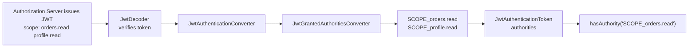

# The SCOPE_ Convention and Checking Corresponding Authorities

## 1. Problem: once an access token is valid, how does the API know what the caller may do?

A Spring Boot application acting as an **OAuth 2.0 Resource Server** receives a request to read an order:

```http
GET /api/orders/42 HTTP/1.1
Host: orders.example.com
Authorization: Bearer <access-token>
```

The access token may carry scopes granted by the Authorization Server:

```json
{
  "iss": "https://id.example.com/realms/shop",
  "sub": "user-417",
  "aud": ["orders-api"],
  "scope": "orders.read profile.read",
  "exp": 1893456000
}
```

After the Resource Server verifies the token, it must determine **which permissions in the token correspond to the permission required by the endpoint**. Under Spring Security Resource Server JWT's common default configuration, the `orders.read` scope is converted into a `GrantedAuthority` named:

```text
SCOPE_orders.read
```

Therefore, the rule:

```java
.hasAuthority("SCOPE_orders.read")
```

can protect the order-reading endpoint. A token with the `profile.read` scope but without `orders.read` will not satisfy this rule, even if the JWT's signature and issuer are completely valid.

This lesson explains **the `SCOPE_` convention**, where scope-to-authority conversion happens in Spring Security, how to write rules correctly, how to customize mapping when the issuer uses a different claim, and how to diagnose permission errors in a Resource Server.

### Learning objectives

After this lesson, you will be able to:

1. Distinguish **OAuth 2.0 scope**, **Spring Security GrantedAuthority**, **role**, and **permissions on a specific resource**.
2. Explain why `orders.read` becomes `SCOPE_orders.read` by default.
3. Configure `hasAuthority(...)`, `hasAnyAuthority(...)`, and `@PreAuthorize(...)` properly.
4. Use `JwtGrantedAuthoritiesConverter` and `JwtAuthenticationConverter` when the token contract uses a different claim name or prefix.
5. Distinguish **401 Unauthorized** from **403 Forbidden** across missing-token, invalid-token, and missing-scope scenarios.
6. Verify behavior using `curl`, Spring Security Test, and by inspecting authorities generated from JWTs.
7. Avoid treating an API-level scope as permission to view every order, every user, or every tenant.

## 2. What is an OAuth 2.0 scope?

In OAuth 2.0, a **scope** represents an access range requested by a Client and granted by the Authorization Server to an access token. It can represent the type of operation a Client or principal is allowed to perform on a resource/API.

For example:

| Illustrative scope | Application-defined meaning |
|---|---|
| `orders.read` | Read order information within permitted boundaries |
| `orders.write` | Create/modify orders within permitted boundaries |
| `orders.cancel` | Request order cancellation when business conditions are met |
| `profile.read` | Read permitted profile information |
| `reports.export` | Export reports per policy |
| `inventory.read` | Read inventory information |

Scope names and their specific meanings are defined in the **contract between the Authorization Server and the Resource Server**. There is no rule requiring every system to use the example scopes listed above.

Specifically:

- A scope is not synonymous with permission to access any arbitrary record.
- A scope does not automatically identify a tenant or resource owner.
- A scope is not a role like `ADMIN` or `USER`, although a system can map roles into other authorities in the authorization layer.
- The scopes in the issued **access token** may be narrower than the scopes the Client originally requested, depending on issuance policy.
- Scopes must come from a **verified** access token or introspection source, never from a header like `X-Scope` sent directly by the Client.

For example, having `orders.read` still does not allow `user-417` to read another user's order if business rules restrict access by owner or tenant.

### 2.1. Authorization Server grants scopes; Resource Server enforces them

The two parties have distinct responsibilities:

**Authorization Server**:

- Registers Clients and the scopes Clients are allowed to request.
- Determines which scopes may be granted to the Client/principal.
- Issues access tokens with scope information per its profile.
- Ensures issued claims reflect its policy.

**Resource Server**:

- Verifies the access token or introspects the token.
- Reads verified scopes and maps them to appropriate authorities.
- Enforces the right authorities at URLs/methods.
- Enforces business permissions per individual resource, tenant, or owner.

The Resource Server **does not self-grant a scope** just because a request includes `scope=orders.read` as a parameter. If a Client lacks a permission, fix the grant/token issuance process on the Authorization Server or the API policy per an approved design—never bypass authorization.

## 3. What is GrantedAuthority, and where does `SCOPE_` come from?

In Spring Security, an `Authentication` object typically carries:

- `principal`: the authenticated entity.
- `credentials`: authentication credentials, if retained.
- `authorities`: a collection of `GrantedAuthority` objects describing permissions used in authorization.

A `GrantedAuthority` has a string name; rules like `hasAuthority(...)` compare this name against the required string.

For a JWT Resource Server, Spring Security uses components such as:

- `JwtDecoder`: decodes and verifies the JWT.
- `JwtAuthenticationProvider`: authenticates Bearer tokens based on JWTs.
- `JwtAuthenticationConverter`: converts a verified `Jwt` into an `AbstractAuthenticationToken`, typically `JwtAuthenticationToken`.
- `JwtGrantedAuthoritiesConverter`: extracts scopes from claims and builds `GrantedAuthority` instances.

In the common default configuration, `JwtGrantedAuthoritiesConverter` looks up scopes from one of the well-known claims such as **`scope`** or **`scp`**, then prepends the **`SCOPE_`** prefix to each scope value.



### 3.1. Default mapping example

JWT payload:

```json
{
  "sub": "user-417",
  "scope": "orders.read orders.write profile.read"
}
```

Authorities typically generated:

```text
SCOPE_orders.read
SCOPE_orders.write
SCOPE_profile.read
```

When calling:

```java
.hasAuthority("SCOPE_orders.read")
```

Spring Security checks whether `Authentication.getAuthorities()` contains the matching authority.

**The `SCOPE_` prefix is not a required part of OAuth `scope` values.** It is a **Spring Security mapping convention** intended to distinguish scopes from other authority groups, such as `ROLE_...` or custom permissions.

### 3.2. String-typed `scope` claim

Many JWT access tokens represent scopes as a space-separated string:

```json
{
  "scope": "orders.read orders.write"
}
```

Under this convention, the string above contains **two distinct scopes**:

```text
orders.read
orders.write
```

It is not a single scope carrying the entire literal `"orders.read orders.write"`.

If the API requires `SCOPE_orders.read`, this token satisfies it. If the API requires `SCOPE_reports.export`, this token **does not satisfy it**.

### 3.3. Array-typed `scp` claim

Some issuers use `scp`:

```json
{
  "scp": ["orders.read", "orders.write"]
}
```

In Spring Security versions supporting the common default mapping, `JwtGrantedAuthoritiesConverter` can read a collection-typed `scp` claim and produce the corresponding authorities:

```text
SCOPE_orders.read
SCOPE_orders.write
```

**Do not assume every issuer emits the same claim or the same data type.** If a token only has `permissions`, `authorities`, or a nested permissions object, the default converter may not produce the authorities you expect.

### 3.4. What if a token has both `scope` and `scp`?

The default converter looks for a scope claim among the names it recognizes; you should not assume that all values in both claims will be automatically merged.

For example:

```json
{
  "scope": "orders.read",
  "scp": ["orders.write"]
}
```

The contract must specify which claim is the authoritative permission source. If the system needs to merge them, configure a custom converter with explicit rules and understand the security implications. Automatic merging can accidentally grant broader permissions than intended if the two claims carry different semantics.

## 4. What exactly does `hasAuthority` check?

A rule:

```java
.hasAuthority("SCOPE_orders.read")
```

is equivalent to the logical question:

```text
Does the current Authentication have a GrantedAuthority
whose getAuthority() == "SCOPE_orders.read"?
```

There is no built-in assumption that `orders.read` includes `orders.write` or vice versa. Any inheritance relationship between scopes, if desired, must be defined explicitly.

| Request's authorities | Rule | Outcome |
|---|---|---|
| `SCOPE_orders.read` | `hasAuthority("SCOPE_orders.read")` | Allowed at this rule layer |
| `SCOPE_orders.write` | `hasAuthority("SCOPE_orders.read")` | Denied |
| `SCOPE_orders.read` and `SCOPE_orders.write` | `hasAuthority("SCOPE_orders.write")` | Allowed at this rule layer |
| `ROLE_ADMIN` | `hasAuthority("SCOPE_orders.read")` | Denied, unless policy maps additional scopes |
| `orders.read` | `hasAuthority("SCOPE_orders.read")` | Denied due to string mismatch |
| No authorities | `hasAuthority("SCOPE_orders.read")` | Denied |

Here "Allowed" only means **passing the authority condition listed in the table**. Other checks such as issuer, audience, tenant, ownership, and business state may still reject the request.

### 4.1. Why not use `hasAuthority("orders.read")` by default?

With a token:

```json
{
  "scope": "orders.read"
}
```

Spring Security typically produces the authority **`SCOPE_orders.read`**, not `orders.read`.

Therefore:

```java
// Matches default mapping
.hasAuthority("SCOPE_orders.read")

// Does not match without a custom converter
.hasAuthority("orders.read")
```

If a token is valid but an endpoint consistently returns `403`, this is the first thing to check.

### 4.2. `hasAnyAuthority` is an OR condition

When accepting either of two scopes:

```java
.hasAnyAuthority(
    "SCOPE_orders.read",
    "SCOPE_orders.admin"
)
```

The rule above allows access if `Authentication` has **at least one** of the two authorities.

It does not require both to be present. If you need **AND** between two authorities, use an explicit expression or combined authorization manager, for example with method security:

```java
@PreAuthorize(
    "hasAuthority('SCOPE_orders.read') " +
    "and hasAuthority('SCOPE_orders.audit')"
)
```

Do not write `hasAnyAuthority` when the business requirement needs both permissions.

### 4.3. Scopes are exact-match strings

By standard convention, authority names are matched exactly:

```text
SCOPE_orders.read
SCOPE_Orders.Read
SCOPE_orders.READ
```

are different strings. Do not lowercase all scopes or perform prefix/suffix matching for "convenience" unless specified by the contract.

For example, `orders.*` does not automatically match `orders.read` in `hasAuthority`. If you need wildcards or pattern-based permissions, intentionally design an `AuthorizationManager` or permission evaluator rather than assuming that capability exists.

## 5. Do not confuse `hasAuthority` with `hasRole`

Spring Security offers two common helper groups:

- `hasAuthority("SCOPE_orders.read")`: matches an authority string exactly.
- `hasRole("ADMIN")`: under the default convention, looks for an authority prefixed with **`ROLE_`**, i.e., `ROLE_ADMIN`.

Example:

```java
.hasAuthority("SCOPE_orders.read")
.hasRole("ADMIN")
```

These two rules **are not equivalent**.

| Rule | Expected authority under standard convention |
|---|---|
| `hasAuthority("SCOPE_orders.read")` | `SCOPE_orders.read` |
| `hasAuthority("ROLE_ADMIN")` | `ROLE_ADMIN` |
| `hasRole("ADMIN")` | `ROLE_ADMIN` |
| `hasAuthority("orders.read")` | `orders.read` |

A JWT carrying:

```json
{
  "scope": "orders.read",
  "roles": ["ADMIN"]
}
```

**does not automatically** receive `ROLE_ADMIN` just because `roles` appears. The default scope converter focuses on `scope`/`scp`; to use a role claim, you must configure role mapping per the issuer contract.

A common mistake is writing:

```java
.hasRole("orders.read")
```

expecting Spring Security to check an OAuth scope. With the default role prefix, the code actually looks for `ROLE_orders.read`, not `SCOPE_orders.read`.

**Good convention:** Use `hasAuthority("SCOPE_...")` for OAuth scopes; use `hasRole("...")` when you genuinely have a role model mapped to `ROLE_...`.

## 6. Configuring SecurityFilterChain by scope

### 6.1. Dependencies

Example with a Spring Boot REST API and Gradle:

```groovy
dependencies {
    implementation 'org.springframework.boot:spring-boot-starter-web'
    implementation 'org.springframework.boot:spring-boot-starter-security'
    implementation 'org.springframework.boot:spring-boot-starter-oauth2-resource-server'
}
```

The project needs the Spring Boot plugin/dependency management matching the version of Spring Security in use.

### 6.2. Trusted issuer

In `src/main/resources/application.yml`:

```yaml
server:
  port: 8080

spring:
  security:
    oauth2:
      resourceserver:
        jwt:
          issuer-uri: https://id.example.com/realms/shop
```

The issuer address is an example; replace it with the real issuer approved for the API. Spring Security can fetch the appropriate key/metadata information and verify JWTs.

**Configuring only the issuer does not automatically guarantee the token was issued for the API's audience.** In real applications, bind `aud` and the token profile according to the contract. The main focus of this lesson is scope/authority mapping, without skipping token verification requirements.

### 6.3. SecurityFilterChain for an orders API

```java
package com.example.orders;

import org.springframework.context.annotation.Bean;
import org.springframework.context.annotation.Configuration;
import org.springframework.http.HttpMethod;
import org.springframework.security.config.Customizer;
import org.springframework.security.config.annotation.web.builders.HttpSecurity;
import org.springframework.security.config.http.SessionCreationPolicy;
import org.springframework.security.web.SecurityFilterChain;

@Configuration
public class ApiSecurityConfig {

    @Bean
    SecurityFilterChain apiSecurity(HttpSecurity http) throws Exception {
        return http
            .csrf(csrf -> csrf.disable())
            .sessionManagement(session ->
                session.sessionCreationPolicy(
                    SessionCreationPolicy.STATELESS))
            .authorizeHttpRequests(authorize -> authorize
                .requestMatchers("/api/public/**").permitAll()

                .requestMatchers(HttpMethod.GET, "/api/orders/**")
                    .hasAuthority("SCOPE_orders.read")

                .requestMatchers(HttpMethod.POST, "/api/orders")
                    .hasAuthority("SCOPE_orders.write")

                .requestMatchers(HttpMethod.DELETE, "/api/orders/**")
                    .hasAuthority("SCOPE_orders.cancel")

                .anyRequest().denyAll()
            )
            .oauth2ResourceServer(oauth2 ->
                oauth2.jwt(Customizer.withDefaults()))
            .build();
    }
}
```

Explanation:

1. `GET /api/public/**` or other public methods matching `/api/public/**` do not require `Authentication`.
2. `GET /api/orders/{id}` requires `SCOPE_orders.read`.
3. `POST /api/orders` requires `SCOPE_orders.write`.
4. `DELETE /api/orders/{id}` requires `SCOPE_orders.cancel`.
5. Requests not matching any allow rule are rejected by `anyRequest().denyAll()`.
6. `oauth2ResourceServer(...jwt(...))` enables Bearer JWT authentication.

Matchers are evaluated in order; specific rules should appear before general ones. Avoid `requestMatchers("/api/**").permitAll()` if the system has protected endpoints under `/api/**`.

`csrf.disable()` is suitable for REST APIs using **purely Bearer tokens sent in the Authorization header**, without cookies that automatically authenticate requests. If the application uses browser sessions/cookies, design CSRF protection according to the actual architecture.

### 6.4. An illustrative Controller

```java
package com.example.orders;

import java.util.Map;
import org.springframework.security.core.annotation.AuthenticationPrincipal;
import org.springframework.security.oauth2.jwt.Jwt;
import org.springframework.web.bind.annotation.GetMapping;
import org.springframework.web.bind.annotation.PathVariable;
import org.springframework.web.bind.annotation.RestController;

@RestController
public class OrderController {

    @GetMapping("/api/public/ping")
    public Map<String, String> ping() {
        return Map.of("status", "ok");
    }

    @GetMapping("/api/orders/{orderId}")
    public Map<String, String> getOrder(
            @PathVariable String orderId,
            @AuthenticationPrincipal Jwt jwt) {

        return Map.of(
            "orderId", orderId,
            "requestedBy", jwt.getSubject()
        );
    }
}
```

This Controller illustrates the `Authentication` flow after the scope is accepted. It is **not a production orders API**, because it does not query a database and does not check whether the caller has access to `orderId`.

In a real system, the Controller should delegate to a Service protected by ownership/tenant checks and query data within the user's authorized scope.

## 7. Verifying the actual authorities of a verified JWT

For learning and diagnosing mappings, you can inspect the list of authorities after the Resource Server validates a token:

```java
package com.example.orders;

import java.util.List;
import java.util.Map;
import org.springframework.security.core.Authentication;
import org.springframework.web.bind.annotation.GetMapping;
import org.springframework.web.bind.annotation.RestController;

@RestController
public class AuthoritiesController {

    @GetMapping("/api/debug/authorities")
    public Map<String, Object> authorities(Authentication authentication) {
        List<String> values = authentication.getAuthorities().stream()
            .map(granted -> granted.getAuthority())
            .sorted()
            .toList();

        return Map.of("authorities", values);
    }
}
```

If you want to test this in a development environment, you must **assign a dedicated protection rule for this endpoint**, for example:

```java
.requestMatchers(HttpMethod.GET, "/api/debug/authorities")
    .hasAuthority("SCOPE_debug.read")
```

placed before `anyRequest().denyAll()`. This is solely a **diagnostic** endpoint; it should not be left open or exposed publicly in production because the authority list can reveal authorization details.

If the JWT has:

```json
{
  "scope": "orders.read orders.write"
}
```

with the default converter, the typical list is:

```json
{
  "authorities": [
    "SCOPE_orders.read",
    "SCOPE_orders.write"
  ]
}
```

Still, reading the authority list **does not prove** the token was issued for the right audience, is unexpired, or grants access to a specific order; those layers must be verified separately.

## 8. Method security: using `@PreAuthorize` with `SCOPE_`

In addition to request matchers in `SecurityFilterChain`, Spring Security can enforce authorization on methods.

### 8.1. Enabling method security

With modern Spring Security configuration:

```java
package com.example.orders;

import org.springframework.context.annotation.Configuration;
import org.springframework.security.config.annotation.method.configuration.EnableMethodSecurity;

@Configuration
@EnableMethodSecurity
public class MethodSecurityConfig {
}
```

Once method security is enabled, you can write:

```java
package com.example.orders;

import org.springframework.security.access.prepost.PreAuthorize;
import org.springframework.stereotype.Service;

@Service
public class OrderService {

    @PreAuthorize("hasAuthority('SCOPE_orders.read')")
    public OrderDto getVisibleOrder(String orderId) {
        // Query and check permissions against the actual record.
        throw new UnsupportedOperationException("Demo only");
    }

    @PreAuthorize("hasAuthority('SCOPE_orders.write')")
    public OrderDto createOrder(CreateOrderRequest request) {
        // Save the record inside the verified tenant.
        throw new UnsupportedOperationException("Demo only");
    }
}
```

`OrderDto` and `CreateOrderRequest` are illustrative domain classes of the project, not built-in Spring Security classes.

`@PreAuthorize` on a Service ensures the permission policy is enforced when the method is invoked through Spring's method security mechanism. It does not replace resource-level checks inside the Service itself.

### 8.2. AND and OR conditions

Allow either of two authorities:

```java
@PreAuthorize(
    "hasAnyAuthority('SCOPE_orders.read', 'SCOPE_orders.admin')"
)
```

Require both authorities:

```java
@PreAuthorize(
    "hasAuthority('SCOPE_orders.read') " +
    "and hasAuthority('SCOPE_orders.audit')"
)
```

Allow reading when the scope is present and the record belongs to an authorized tenant, which may call an authorization service:

```java
@PreAuthorize(
    "hasAuthority('SCOPE_orders.read') " +
    "and @orderPermission.canRead(authentication, #orderId)"
)
public OrderDto getOrder(String orderId) {
    // ...
}
```

`orderPermission` is an application-defined bean responsible for verifying `orderId`, tenant, and business relationships. The example only illustrates expression syntax; this bean does not exist automatically in a project.

**Caution:** Method security expressions can reference `#orderId` when Spring knows the parameter name; the build environment must be configured to retain parameter names or use appropriate binding if parameter name metadata is unavailable at runtime.

## 9. Customizing the scope claim with JwtGrantedAuthoritiesConverter

Not every Authorization Server uses `scope` or `scp`. Suppose the issuer issues a JWT:

```json
{
  "sub": "user-417",
  "permissions": ["orders.read", "orders.write"]
}
```

If the contract states `permissions` is the permission source of the access token, the Resource Server must configure a converter to extract that specific claim.

### 9.1. Setting the claim name and prefix

For example, to preserve the `SCOPE_` convention even when the claim is named `permissions`:

```java
package com.example.orders;

import org.springframework.context.annotation.Bean;
import org.springframework.context.annotation.Configuration;
import org.springframework.security.oauth2.server.resource.authentication.JwtAuthenticationConverter;
import org.springframework.security.oauth2.server.resource.authentication.JwtGrantedAuthoritiesConverter;

@Configuration
public class JwtAuthorityMappingConfig {

    @Bean
    JwtAuthenticationConverter jwtAuthenticationConverter() {
        JwtGrantedAuthoritiesConverter scopeConverter =
            new JwtGrantedAuthoritiesConverter();

        // Only use this if the issuer actually emits a "permissions" claim
        // and the contract defines its elements as OAuth scopes.
        scopeConverter.setAuthoritiesClaimName("permissions");
        scopeConverter.setAuthorityPrefix("SCOPE_");

        JwtAuthenticationConverter converter =
            new JwtAuthenticationConverter();

        converter.setJwtGrantedAuthoritiesConverter(scopeConverter);
        return converter;
    }
}
```

Use this converter in `SecurityFilterChain`:

```java
private final JwtAuthenticationConverter jwtAuthenticationConverter;

// Constructor injection in the @Configuration class
public SecurityConfig(
        JwtAuthenticationConverter jwtAuthenticationConverter) {
    this.jwtAuthenticationConverter = jwtAuthenticationConverter;
}

// Inside HttpSecurity configuration:
.oauth2ResourceServer(oauth2 -> oauth2
    .jwt(jwt -> jwt
        .jwtAuthenticationConverter(jwtAuthenticationConverter)))
```

This snippet shows how to wire the converter into the DSL; place it inside a complete `@Configuration` class with proper constructors/beans according to your project structure. Do not accidentally declare two `SecurityFilterChain` beans with overlapping matchers.

With the claim:

```json
{
  "permissions": ["orders.read", "orders.write"]
}
```

the converter produces:

```text
SCOPE_orders.read
SCOPE_orders.write
```

**Risk to understand:** When calling `setAuthoritiesClaimName("permissions")`, the converter uses the configured `permissions` source rather than automatically combining it with every other claim. If the API also needs `scope`/`scp`, design a combined converter explicitly and only when the contract confirms it is valid.

### 9.2. Changing the prefix

A system may want to represent permissions that are not OAuth scopes:

```java
JwtGrantedAuthoritiesConverter converter =
    new JwtGrantedAuthoritiesConverter();

converter.setAuthoritiesClaimName("permissions");
converter.setAuthorityPrefix("PERMISSION_");
```

Then:

```text
permissions: ["orders.read"]
    ↓
PERMISSION_orders.read
```

Rules must change accordingly:

```java
.hasAuthority("PERMISSION_orders.read")
```

If you still write `hasAuthority("SCOPE_orders.read")`, authorization will fail because the strings do not match.

**Standardize the prefix across the entire project**: avoid changing the prefix in one filter chain while forgetting `@PreAuthorize` annotations, integration tests, or documentation.

### 9.3. When the issuer uses a string claim with a different delimiter

For example, a custom system emits:

```json
{
  "permissions": "orders.read,orders.write"
}
```

The default converter may not split properly on commas. In Spring Security versions that support `JwtGrantedAuthoritiesConverter#setAuthoritiesClaimDelimiter(...)`, you can set an appropriate delimiter regex:

```java
JwtGrantedAuthoritiesConverter converter =
    new JwtGrantedAuthoritiesConverter();

converter.setAuthoritiesClaimName("permissions");
converter.setAuthorityPrefix("PERMISSION_");
converter.setAuthoritiesClaimDelimiter(",");
```

This is a **custom configuration for a contract that differs from space-delimited standard scopes**; do not apply it by default to all OAuth access tokens. The exact setter API and conversion behavior depend on the Spring Security version, so use the API matching your project version.

If the claim is already a collection, string delimiter handling is unnecessary. Never call arbitrary `String.split(...)` on a JSON object whose type has not been verified.

### 9.4. Merging multiple claims must be intentional

Suppose a JWT has:

```json
{
  "scope": "orders.read",
  "roles": ["TENANT_ADMIN"]
}
```

To produce both `SCOPE_orders.read` and `ROLE_TENANT_ADMIN`, you need a composite converter **following issuer rules**. Conceptually:

```text
source scope:
  "orders.read"
  → SCOPE_orders.read

source roles:
  ["TENANT_ADMIN"]
  → ROLE_TENANT_ADMIN

result authorities:
  [SCOPE_orders.read, ROLE_TENANT_ADMIN]
```

Do not turn every string appearing in the JWT into an authority. `roles` might be roles in a specific tenant, while `scope` might apply to a designated resource. Ignoring those semantics easily leads to **privilege escalation**.

If using a composite converter, ensure every claim is checked for proper type and namespace, without unexpected duplicates, using only claims trusted per the issuer contract.

## 10. Scopes in opaque access tokens

OAuth access tokens do not have to be JWTs. An Authorization Server can issue an **opaque token**; the Resource Server calls an introspection endpoint to determine whether the token is active and retrieve scopes.

Spring Boot configuration example:

```yaml
spring:
  security:
    oauth2:
      resourceserver:
        opaque-token:
          introspection-uri: https://id.example.com/oauth2/introspect
          client-id: resource-server
          client-secret: REPLACE_WITH_SECRET_FROM_ENV
```

`REPLACE_WITH_SECRET_FROM_ENV` is just a placeholder; never put real secrets in committed source files. Real applications require environment variables or a proper secret manager.

An illustrative introspection response:

```json
{
  "active": true,
  "client_id": "shop-web",
  "sub": "user-417",
  "scope": "orders.read profile.read",
  "aud": ["orders-api"],
  "exp": 1893456000
}
```

With standard opaque-token Resource Server support, scope information is similarly mapped to authorities with the **`SCOPE_`** prefix according to the contract.

Therefore, the endpoint rule:

```java
.hasAuthority("SCOPE_orders.read")
```

can be used for both JWT and opaque tokens when both authentication modes produce identical authorities.

However, **`JwtGrantedAuthoritiesConverter` is for JWTs**, and does not automatically change how the opaque-token introspector builds authorities. If an opaque-token issuer uses a different claim, the application must customize introspection/principal/authority mapping accordingly—for instance, via an `OpaqueTokenIntrospector` appropriate for your Spring Security version.

Never Base64URL-decode an opaque token to extract scopes yourself, and never send tokens to an introspection endpoint specified by the Client. The introspection endpoint must come from trusted configuration.

## 11. Do not confuse scope with issuer, audience, or token type

An access token with:

```json
{
  "iss": "https://id.example.com/realms/shop",
  "aud": ["billing-api"],
  "scope": "orders.read"
}
```

should not be accepted by `orders-api` if the audience specifies `billing-api`, even though `orders.read` matches the authority name required by the API.

**The logical order must be clear:**

1. Was the token issued by a trusted issuer?
2. Are the signature/key/algorithm valid?
3. Is the token unexpired and accepted by all validators?
4. Was the token issued for the **right Resource Server**?
5. Is the token the right access token type/profile per contract?
6. Which authorities do the granted scopes map to?
7. Do endpoint, tenant, and resource permissions pass?

A `typ=JWT` header or `scope` claim does not replace token-type verification. An **OIDC ID token** issued to a Client cannot automatically become an API access token just because it also has a valid `iss` and signature.

### 11.1. Audience validator example

On compatible Spring Security versions, you can add an audience validator while retaining issuer/time validation:

```java
import org.springframework.context.annotation.Bean;
import org.springframework.context.annotation.Configuration;
import org.springframework.security.oauth2.core.DelegatingOAuth2TokenValidator;
import org.springframework.security.oauth2.core.OAuth2Error;
import org.springframework.security.oauth2.core.OAuth2TokenValidator;
import org.springframework.security.oauth2.core.OAuth2TokenValidatorResult;
import org.springframework.security.oauth2.jwt.Jwt;
import org.springframework.security.oauth2.jwt.JwtDecoder;
import org.springframework.security.oauth2.jwt.JwtDecoders;
import org.springframework.security.oauth2.jwt.JwtValidators;
import org.springframework.security.oauth2.jwt.NimbusJwtDecoder;

@Configuration
public class JwtValidationConfig {

    @Bean
    JwtDecoder jwtDecoder() {
        String issuer = "https://id.example.com/realms/shop";

        NimbusJwtDecoder decoder =
            (NimbusJwtDecoder) JwtDecoders.fromIssuerLocation(issuer);

        OAuth2TokenValidator<Jwt> audience = jwt ->
            jwt.getAudience().contains("orders-api")
                ? OAuth2TokenValidatorResult.success()
                : OAuth2TokenValidatorResult.failure(
                    new OAuth2Error(
                        "invalid_token", "Invalid audience", null));

        decoder.setJwtValidator(
            new DelegatingOAuth2TokenValidator<>(
                JwtValidators.createDefaultWithIssuer(issuer),
                audience
            ));

        return decoder;
    }
}
```

Key takeaway: **the `SCOPE_` convention only handles permission mapping**, and does not automatically check `aud`. A `SecurityFilterChain` using `hasAuthority("SCOPE_orders.read")` still needs an appropriate JWT validator to prevent tokens meant for other APIs from being accepted.

## 12. Scope is not permission on a specific order or tenant

Suppose two tenants, Alpha and Beta, share `orders-api`:

```text
Tenant Alpha:
  order-101 belongs to user-417

Tenant Beta:
  order-202 belongs to user-902
```

Token for user-417:

```json
{
  "sub": "user-417",
  "scope": "orders.read",
  "tenant_id": "tenant-alpha"
}
```

Spring Security creates `SCOPE_orders.read`. The endpoint rule `hasAuthority("SCOPE_orders.read")` lets the request proceed, but the Service must check that the order belongs to Alpha and the authorized user/role.

Wrong query:

```sql
SELECT * FROM orders
WHERE id = :order_id;
```

Query better aligned with tenant and owner:

```sql
SELECT id, tenant_id, owner_subject, status
FROM orders
WHERE id = :order_id
  AND tenant_id = :verified_tenant_id
  AND owner_subject = :verified_subject;
```

`verified_tenant_id` and `verified_subject` must be taken from the verified principal/permission source and the system's token contract. Never use `X-Tenant-ID` or `userId` from a query string as proof of access rights if Clients can freely modify them.

If a role is permitted to read all orders **within the same tenant**, the Service can have a dedicated policy branch for that role, but the tenant filter must still be enforced. Never assume `SCOPE_orders.read` means "read all orders across all tenants".

### 12.1. Client Credentials also have scopes

A token issued via Client Credentials can carry:

```json
{
  "sub": "billing-worker",
  "client_id": "billing-worker",
  "aud": ["orders-api"],
  "scope": "orders.read"
}
```

If the issuer and Resource Server have agreed on it, this scope can also be mapped to `SCOPE_orders.read`.

However, `sub` on a service token may be a Client identity rather than a user ID. The business layer must distinguish principal types and service tenant/object boundaries. **Having a scope does not prove the token represents a logged-in user.**

### 12.2. Scope does not prove the HTTP sender is the Client that was issued the token

An OAuth Bearer token can be replayed by whoever holds it within its validity window. `client_id` or scope inside a token tells what the Authorization Server granted; it does not prove that the current caller possesses the Client's key or certificate.

If you need to bind the token presenter to a key/certificate, design **sender-constrained tokens** and verify that mechanism per contract, rather than just adding a `SCOPE_...` authority.

## 13. Verifying results with curl

Suppose the application is running at `http://localhost:8080`, a real issuer is configured, and valid JWT access tokens are available.

### 13.1. Calling a public endpoint

```bash
curl -i http://localhost:8080/api/public/ping
```

If the Controller and policy are correct, the response can be:

```http
HTTP/1.1 200 OK
Content-Type: application/json

{"status":"ok"}
```

This only confirms the public route; it does not prove protected endpoints are secured.

### 13.2. Calling the order-reading endpoint without a token

```bash
curl -i http://localhost:8080/api/orders/42
```

Typically returns:

```http
HTTP/1.1 401 Unauthorized
WWW-Authenticate: Bearer
```

The request has no accepted authentication information. It has not reached the stage of having valid scope authorities.

### 13.3. Sending an invalid token

```bash
curl -i \
  -H 'Authorization: Bearer not-a-valid-jwt' \
  http://localhost:8080/api/orders/42
```

Typically returns `401 Unauthorized` with a Bearer challenge, which may include `error="invalid_token"`.

This is an **authentication failure**, distinct from a token that authenticates successfully but lacks `SCOPE_orders.read`.

### 13.4. Valid token missing the required scope

Suppose `ACCESS_TOKEN_WITHOUT_READ_SCOPE` is a token genuinely signed by the Authorization Server with valid issuer and audience, carrying only `profile.read`.

```bash
curl -i \
  -H "Authorization: Bearer $ACCESS_TOKEN_WITHOUT_READ_SCOPE" \
  http://localhost:8080/api/orders/42
```

Typical result:

```http
HTTP/1.1 403 Forbidden
WWW-Authenticate: Bearer error="insufficient_scope"
```

Header details may vary depending on the handler; what matters is that the token was authenticated, but lacks the endpoint's required permission.

**Never edit the scope inside an existing JWT's payload while keeping the old signature to test the 403 branch.** Modifying the payload invalidates the signature and usually causes a 401. Use a real token issued by the issuer with the missing scope, or use Security Test to mock `Authentication` for authorization tests.

### 13.5. Valid token with the required scope

Suppose `ACCESS_TOKEN_WITH_READ_SCOPE` has `scope=orders.read` and valid issuer/audience/expiration:

```bash
curl -i \
  -H "Authorization: Bearer $ACCESS_TOKEN_WITH_READ_SCOPE" \
  http://localhost:8080/api/orders/42
```

With the illustrative Controller in section 6.4 and no extra rules, the API can return:

```http
HTTP/1.1 200 OK
Content-Type: application/json

{"orderId":"42","requestedBy":"user-417"}
```

A real token may carry a different subject. In a business API, you must still verify that `orderId` actually belongs to the caller.

### 13.6. Expected results matrix

| Request | Token | Authorities after authentication | Typical result |
|---|---|---|---|
| `GET /api/public/ping` | None | None needed | `200` |
| `GET /api/orders/42` | None | No valid Authentication | `401` |
| `GET /api/orders/42` | Invalid signature token | No valid Authentication created | `401` |
| `GET /api/orders/42` | Valid issuer but wrong audience | Rejected by JWT validator | `401` |
| `GET /api/orders/42` | Valid token with only `profile.read` | `SCOPE_profile.read` | `403` |
| `GET /api/orders/42` | Valid token with `orders.read` | `SCOPE_orders.read` | `200` if other conditions pass |
| `POST /api/orders` | Token with only `orders.read` | `SCOPE_orders.read` | `403` |
| `POST /api/orders` | Token with `orders.write` | `SCOPE_orders.write` | Enters Controller if other conditions pass |
| `DELETE /api/orders/42` | Token with only `orders.write` | `SCOPE_orders.write` | `403` |
| `DELETE /api/orders/42` | Token with `orders.cancel` | `SCOPE_orders.cancel` | Enters Controller if other policies pass |

Note: The example Controller in section 6.4 only declares `GET`; to actually verify `POST`/`DELETE` execution, the project must implement the corresponding handlers and business checks. Rules in `SecurityFilterChain` do not automatically create REST endpoints.

## 14. Testing authorization with Spring Security Test

### 14.1. Dependencies

```groovy
dependencies {
    testImplementation 'org.springframework.boot:spring-boot-starter-test'
    testImplementation 'org.springframework.security:spring-security-test'
}
```

### 14.2. MockMvc verifying required authorities

Example using JUnit 5 and MockMvc:

```java
package com.example.orders;

import org.junit.jupiter.api.Test;
import org.springframework.beans.factory.annotation.Autowired;
import org.springframework.boot.test.autoconfigure.web.servlet.AutoConfigureMockMvc;
import org.springframework.boot.test.context.SpringBootTest;
import org.springframework.security.core.authority.SimpleGrantedAuthority;
import org.springframework.test.web.servlet.MockMvc;

import static org.springframework.security.test.web.servlet.request.SecurityMockMvcRequestPostProcessors.jwt;
import static org.springframework.test.web.servlet.request.MockMvcRequestBuilders.get;
import static org.springframework.test.web.servlet.result.MockMvcResultMatchers.jsonPath;
import static org.springframework.test.web.servlet.result.MockMvcResultMatchers.status;

@SpringBootTest
@AutoConfigureMockMvc
class ScopeAuthorizationTest {

    @Autowired
    MockMvc mvc;

    @Test
    void publicRouteWorksWithoutToken() throws Exception {
        mvc.perform(get("/api/public/ping"))
            .andExpect(status().isOk());
    }

    @Test
    void protectedRouteRequiresAuthentication() throws Exception {
        mvc.perform(get("/api/orders/42"))
            .andExpect(status().isUnauthorized());
    }

    @Test
    void protectedRouteRejectsMissingScope() throws Exception {
        mvc.perform(get("/api/orders/42")
                .with(jwt()
                    .jwt(token -> token.subject("user-417"))
                    .authorities(
                        new SimpleGrantedAuthority("SCOPE_profile.read"))))
            .andExpect(status().isForbidden());
    }

    @Test
    void protectedRouteAcceptsMatchingScope() throws Exception {
        mvc.perform(get("/api/orders/42")
                .with(jwt()
                    .jwt(token -> token.subject("user-417"))
                    .authorities(
                        new SimpleGrantedAuthority("SCOPE_orders.read"))))
            .andExpect(status().isOk())
            .andExpect(jsonPath("$.orderId").value("42"));
    }
}
```

These tests verify **authority-based policy** given a mocked JWT Authentication. When using `with(jwt()).authorities(...)`, they **set authorities directly**, and do not automatically verify that `JwtGrantedAuthoritiesConverter` reads the right claim from a real token.

To test how the converter turns `scope` into `SCOPE_`, test the converter directly or run integration tests through `JwtDecoder` with appropriately signed real tokens. Do not conclude that signatures, issuer, audience, or JWK rotation work properly solely because tests using `with(jwt())` pass.

### 14.3. Example testing the converter directly

In a simple unit test, you can build a test `Jwt` with a scope claim and invoke `JwtGrantedAuthoritiesConverter`:

```java
import java.time.Instant;
import java.util.List;
import org.junit.jupiter.api.Test;
import org.springframework.security.oauth2.jwt.Jwt;
import org.springframework.security.oauth2.server.resource.authentication.JwtGrantedAuthoritiesConverter;

import static org.assertj.core.api.Assertions.assertThat;

class ScopeMappingTest {

    @Test
    void mapsScopeIntoPrefixedAuthority() {
        Instant now = Instant.now();

        Jwt jwt = Jwt.withTokenValue("fake-for-unit-test")
            .header("alg", "RS256")
            .subject("user-417")
            .claim("scope", "orders.read orders.write")
            .issuedAt(now)
            .expiresAt(now.plusSeconds(60))
            .build();

        JwtGrantedAuthoritiesConverter converter =
            new JwtGrantedAuthoritiesConverter();

        List<String> actual = converter.convert(jwt).stream()
            .map(authority -> authority.getAuthority())
            .toList();

        assertThat(actual).contains(
            "SCOPE_orders.read",
            "SCOPE_orders.write"
        );
    }
}
```

This only **tests mapping claims already present on a `Jwt` object**. `Jwt.withTokenValue(...)` builds a test object, not a cryptographically signed token. To verify real tokens, use appropriate test decoders, keys, and issuers.

## 15. Diagnosing when a token is valid but the API returns 403

When encountering 403 on a protected endpoint, inspect each layer:

### 15.1. Does the real token actually contain the permission?

Decode the token **only in a trusted environment for inspection**, and never treat decoded output as authentication proof. Check:

- Does `scope` or `scp` exist?
- Is the exact scope `orders.read` present?
- Is the claim a space-delimited string or a collection?
- Did the Authorization Server actually grant the scope, or did the Client only **request** the scope without being granted it?

Never paste real Bearer tokens into public decoding websites or record raw tokens in tickets/logs.

### 15.2. Does the converter produce the authority the rule requires?

If the token has:

```json
{"scope":"orders.read"}
```

but the application configured the converter to read only `permissions`, `SCOPE_orders.read` may be missing.

If the converter prefix was changed to `PERMISSION_`, the rule `hasAuthority("SCOPE_orders.read")` will no longer match either.

### 15.3. Was `hasRole` used by mistake?

`hasRole("orders.read")` typically looks for `ROLE_orders.read`, not `SCOPE_orders.read`. For OAuth scopes, use `hasAuthority("SCOPE_orders.read")` by default.

### 15.4. Do the matcher's HTTP method and path match?

`GET /api/orders/42` and `POST /api/orders` require different scopes in the example configuration. An earlier wildcard rule can cause a request to match an unintended policy.

### 15.5. Is method security or another domain policy rejecting the request?

Even if the endpoint passes `SCOPE_orders.read`, a Service `@PreAuthorize` demanding extra permissions, or a tenant/ownership query returning no record, can still reject the request. Do not look only at the endpoint authority and assume everything must succeed.

### 15.6. Never turn 403 into 200 by removing the rule

If the Client genuinely lacks `orders.read`, the right fix is to review the grant contract on the AS/Client and the API decision. Replacing `hasAuthority(...)` with `permitAll()` to "fix a 403 error" can expose data.

## 16. Common mistakes

| Mistake | Consequence | How to fix |
|---|---|---|
| Using `hasAuthority("orders.read")` with the default converter | 403 due to missing prefix | Use `SCOPE_orders.read` |
| Using `hasRole("orders.read")` | Spring looks for `ROLE_orders.read` | Use `hasAuthority("SCOPE_orders.read")` |
| Assuming `orders.write` includes `orders.read` | Grants or denies permissions unexpectedly | Define permission relationships explicitly |
| Using `hasAnyAuthority` when both scopes are needed | Allows access when only one permission is present | Use an appropriate AND condition |
| Reading the wrong `scope`/`scp` claim | Valid token has no authorities | Configure the converter per issuer contract |
| Changing prefix without updating matchers | 403 across multiple endpoints | Keep prefix synchronized across converter and policies |
| Blindly merging all roles/permissions into authorities | Risk of privilege escalation | Map claims per contract, per namespace |
| Accepting an `X-Scope` claim from the request | Client self-declares permissions | Only use verified access tokens |
| Checking only scope and ignoring `aud` | Tokens for another API may be accepted | Add audience validation |
| Using an ID token as an access token | Wrong purpose and intended recipient | Only accept access tokens intended for the API |
| Having `orders.read` and reading all orders | Broken Object Level Authorization | Enforce owner/tenant checks and scoped queries |
| Assuming `sub` is always a user | Service tokens get mistaken for user tokens | Use the appropriate principal/grant contract |
| Using only `with(jwt())` to validate the decoder | Signature and JWT parsing are untested | Test decoder/validator and real tokens separately |
| Logging access tokens when debugging 403 | Leaks Bearer tokens | Log authorities/error codes safely |
| Disabling CSRF for all web apps | Can create risks when cookies/sessions are used | Evaluate according to actual authentication mechanisms |

### 16.1. Key takeaways on 401 vs. 403

**401 Unauthorized** typically occurs when:

- An endpoint requires `Authentication` and the request has no Bearer token.
- The Bearer token has an invalid signature/issuer, is expired, or fails a required validator.
- The token has the wrong audience if the Resource Server configures an audience validator.

**403 Forbidden** typically occurs when:

- The token is valid but lacks `SCOPE_orders.read`.
- The authenticated principal is not permitted to invoke the operation or lacks the required role.
- Specific tenant/resource access fails, if the application chooses to respond with 403.

An API may return 404 instead of 403 for resources the caller is not allowed to know exist. However, do not confuse returning 404 with having scope checks configured properly.

## 17. Designing scopes and authorities intentionally

When designing scopes for a new system, useful principles include:

1. **Name by action and resource** — `orders.read` and `orders.write` are easier to reason about than an overly broad scope like `all`.
2. **Grant least privilege** — Clients that only read data do not need `orders.write`.
3. **Keep scopes tied to the right audience/API** — sharing an issuer does not make every scope valid for every Resource Server.
4. **Distinguish Clients from users** — Client Credentials can carry scopes without a user owner.
5. **Separate record-level permissions** — endpoint scopes go alongside tenant/ownership/permission checks.
6. **Keep prefixes consistent** — if using `SCOPE_`, all rules and converters must follow it.
7. **Express AND/OR clearly** — avoid `hasAnyAuthority` for operations requiring multiple conditions.
8. **Manage mappings per issuer** — especially when multiple ASes issue different token formats.
9. **Test negative branches too** — missing token, invalid token, missing scope, right scope with wrong tenant/owner.
10. **Never automatically expand permissions from unfamiliar claims** — only use claims defined by the contract.

A well-run system typically keeps brief documentation for each scope:

```text
Scope: orders.read

Issuer: https://id.example.com/realms/shop
Audience: orders-api
Allowed operations: GET /api/orders/{id}
Resource restriction: current user's orders within verified tenant
Default Spring authority: SCOPE_orders.read
```

That way, the API developers, Authorization Server configuration team, and QA team share the same understanding of **what the granted scope means** and **how the Resource Server enforces it**.

## 18. Self-check questions

**Question 1.** A JWT access token has `scope="orders.read profile.read"`. With the default converter, what authorities does the Resource Server typically have?

**Answer:** `SCOPE_orders.read` and `SCOPE_profile.read`.

**Question 2.** Why might `hasAuthority("orders.read")` return 403 even when the JWT has the `orders.read` scope?

**Answer:** Because the default converter adds the `SCOPE_` prefix, making the actual authority `SCOPE_orders.read`.

**Question 3.** Does `hasRole("ADMIN")` check `SCOPE_ADMIN`?

**Answer:** No. Under the default role convention, it checks `ROLE_ADMIN`. Scope authorities require `hasAuthority("SCOPE_...")`.

**Question 4.** A token has `orders.read` but not `orders.write`. Is a `POST /api/orders` request requiring `SCOPE_orders.write` allowed?

**Answer:** No. The token may authenticate successfully, but the endpoint will deny authorization, typically with 403.

**Question 5.** Does `hasAnyAuthority("SCOPE_orders.read", "SCOPE_orders.admin")` require both scopes?

**Answer:** No. It is an OR condition; matching just one authority is enough.

**Question 6.** When the issuer uses a `permissions` claim instead of `scope`, what should you do?

**Answer:** Define a clear claim contract and configure `JwtGrantedAuthoritiesConverter#setAuthoritiesClaimName("permissions")` with an appropriate prefix; never blindly trust arbitrary claims containing string lists.

**Question 7.** Does having `SCOPE_orders.read` allow a user to read orders from another tenant?

**Answer:** Not by default. You must verify the record's tenant and owner/role alongside endpoint authorities.

**Question 8.** Should an API accept a token with the wrong audience just because it has `SCOPE_orders.read`?

**Answer:** No. Audience must be verified independently; the token must be issued for the right Resource Server.

**Question 9.** Does using `with(jwt()).authorities(...)` in MockMvc verify that real JWTs are properly signed?

**Answer:** No. It mocks `Authentication`/authorities to test authorization. You need decoder/validator tests or integration tests with genuinely signed tokens to verify JWT validation.

**Question 10.** Does `JwtGrantedAuthoritiesConverter` directly handle opaque access tokens?

**Answer:** Not directly. It is for JWTs; opaque tokens use the corresponding introspection and authority mapping mechanism.

## 19. Conclusion

The **`SCOPE_`** convention is the bridge between the **OAuth 2.0 scope** granted in an access token and the **`GrantedAuthority`** used by Spring Security for authorization. With the common default mapping, the `orders.read` scope becomes the `SCOPE_orders.read` authority, and the API checks it via `hasAuthority("SCOPE_orders.read")`.

To implement this correctly, align the `scope`/`scp` source claim, the converter prefix, and the authority strings in `SecurityFilterChain` or `@PreAuthorize`. If an issuer uses a different claim, configure `JwtGrantedAuthoritiesConverter` and `JwtAuthenticationConverter` according to the defined contract; never change prefixes arbitrarily or confuse `hasRole` with OAuth scopes.

Finally, **scopes do not replace token verification, audience validation, or data-level authorization**. The Resource Server must verify the token first, check the corresponding authority for the operation, and enforce tenant, owner, and business rules before returning any resource.
