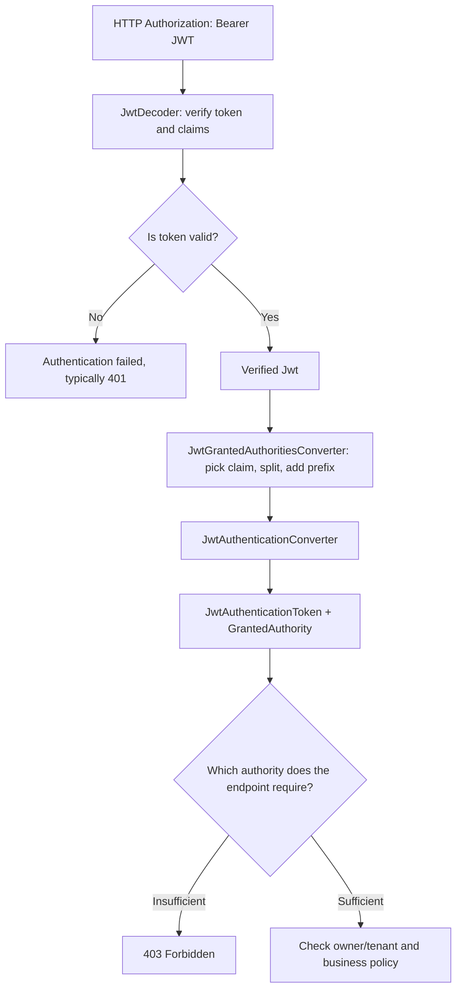
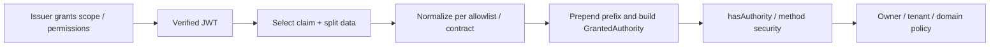

# Changing Prefixes, Splitting Values, and Normalizing Permission Names

In **Spring Security OAuth 2.0 Resource Server**, an access token can contain scopes or permissions granted by the Authorization Server. However, **claims inside a JWT do not automatically become `GrantedAuthority` instances**. After the JWT is verified, Spring Security uses a converter to extract permission data from the token, split the values, and attach the appropriate prefix. The result is a list of authorities that `hasAuthority(...)`, `hasAnyAuthority(...)`, or method security can check.

Three seemingly simple operations — **changing the prefix**, **changing the delimiter**, and **normalizing permission names** — can alter the entire authorization outcome. For instance, if a token carries the `orders.read` scope yet the application converts it to `PERM_orders.read`, a rule still checking `SCOPE_orders.read` will deny the request even if the JWT has a valid signature. Conversely, if normalization is overly broad and accidentally turns a weak scope into a strong authority, the API may over-grant privileges.

This lesson focuses on controlling this process in **Spring Boot 3 / Spring Security 6**, particularly via `JwtGrantedAuthoritiesConverter` and `JwtAuthenticationConverter`. Custom delimiter syntax via `setAuthoritiesClaimDelimiter` applies to Spring Security **6.1 and later**; older versions require a custom converter or an appropriate upgrade.

## 1. Where authority mapping sits in the Resource Server flow

A valid JWT may contain an illustrative payload:

```json
{
  "iss": "https://identity.example.com/realms/shop",
  "sub": "user-123",
  "aud": ["orders-api"],
  "scope": "orders.read orders.write",
  "exp": 1900000000
}
```

The payload above **is not a signed JWT**. The Resource Server only trusts claims after the decoder verifies the token against issuer, signature, timestamps, audience, and any other mandatory constraints.

Main flow:



`JwtDecoder` answers **whether the token is accepted**. `JwtGrantedAuthoritiesConverter` answers **given a valid token, which authorities are produced**. `authorizeHttpRequests` and method security answer **whether those authorities are sufficient to call this endpoint**.

A valid JWT **does not mean** the caller is allowed to do everything mentioned in the claims. The Resource Server must configure clearly how scopes are interpreted, and still verify permissions for the specific resource.

## 2. `scope`, `scp`, and `GrantedAuthority` are not the same thing

In OAuth 2.0, a scope is a string representing the granted permission range. An Authorization Server usually puts scopes into an access token in one of formats such as:

```json
{
  "scope": "orders.read orders.write"
}
```

or:

```json
{
  "scp": ["orders.read", "orders.write"]
}
```

Spring Security provides `JwtGrantedAuthoritiesConverter`, which by default typically looks for a recognized scope claim (`scope` or `scp`) and builds authorities prefixed with `SCOPE_`:

```text
JWT claim: scope = "orders.read orders.write"
                 |
                 v
Authorities:
  SCOPE_orders.read
  SCOPE_orders.write
```

Example permission checks:

```java
.requestMatchers(HttpMethod.GET, "/api/orders/**")
    .hasAuthority("SCOPE_orders.read")
.requestMatchers(HttpMethod.POST, "/api/orders")
    .hasAuthority("SCOPE_orders.write")
```

| Concept | Example | Source |
| --- | --- | --- |
| Scope in access token | `orders.read` | Granted by the Authorization Server per token contract. |
| Claim carrying scopes | `scope`, `scp` | Issuer's token profile. |
| Authority after conversion | `SCOPE_orders.read` | Spring Security converter. |
| Endpoint rule | `hasAuthority("SCOPE_orders.read")` | Defined by the Resource Server. |
| Per-record permission | Does order 42 belong to this user/tenant? | Service/domain policy, often using additional data. |

**The `SCOPE_` prefix is a Spring Security convention**, not a mandatory part of every scope value an Authorization Server must issue. Do not ask the issuer to put `SCOPE_` into claims just because the application uses this prefix by default; if you want a different convention, configure the mapping explicitly in the Resource Server.

## 3. Three core configuration knobs of `JwtGrantedAuthoritiesConverter`

This object supports three dedicated customizations:

| Method | What it changes | Example |
| --- | --- | --- |
| `setAuthorityPrefix(String)` | Prefix prepended before **each permission** after splitting. | `SCOPE_` → `PERM_` or empty string. |
| `setAuthoritiesClaimName(String)` | Which claim is read to build authorities. | `scope` → `permissions`. |
| `setAuthoritiesClaimDelimiter(String)` | **Regex** used to split when the claim value is a **string**. | Whitespace → comma. Spring Security 6.1+. |

These three operations are independent:

```text
1. Select claim: "permissions"
2. Read value: "orders.read,orders.write"
3. Split by regex ","
4. Prepend prefix "PERM_"
5. Create GrantedAuthority:
   PERM_orders.read
   PERM_orders.write
```

Do not confuse `setAuthoritiesClaimDelimiter` with splitting the **entire** JWT payload or header. It only affects how the converter reads a string-typed permission claim. When the issuer emits a claim as a list, element extraction is handled by the converter's collection path, with no single string to `split`.

## 4. Changing the prefix: from `SCOPE_` to `PERM_`

Suppose a system has an internal convention where all API permissions are called `PERM_*`, while access tokens still emit standard scopes:

```json
{
  "scope": "orders.read orders.write"
}
```

We create a `JwtAuthenticationConverter`:

```java
import org.springframework.context.annotation.Bean;
import org.springframework.context.annotation.Configuration;
import org.springframework.security.oauth2.server.resource.authentication.JwtAuthenticationConverter;
import org.springframework.security.oauth2.server.resource.authentication.JwtGrantedAuthoritiesConverter;

@Configuration
public class AuthorityMappingConfig {

    @Bean
    JwtAuthenticationConverter jwtAuthenticationConverter() {
        JwtGrantedAuthoritiesConverter scopes =
            new JwtGrantedAuthoritiesConverter();

        scopes.setAuthorityPrefix("PERM_");

        JwtAuthenticationConverter converter =
            new JwtAuthenticationConverter();
        converter.setJwtGrantedAuthoritiesConverter(scopes);
        return converter;
    }
}
```

Expected result:

```text
scope = "orders.read orders.write"

PERM_orders.read
PERM_orders.write
```

At the same time, rules must use **the same naming system**:

```java
.requestMatchers(HttpMethod.GET, "/api/orders/**")
    .hasAuthority("PERM_orders.read")
.requestMatchers(HttpMethod.POST, "/api/orders")
    .hasAuthority("PERM_orders.write")
```

Changing the prefix on the converter while keeping the old `hasAuthority("SCOPE_orders.read")` rule will cause callers with the right permission **to still get 403**. Never fix this by loosening the rule to `.authenticated()` to "make the error go away"; restore consistency between the converter and the policy.

### Can the prefix be set to empty?

Yes:

```java
scopes.setAuthorityPrefix("");
```

Then the authority is simply `orders.read`, without `SCOPE_`. However, this change requires all related policies to check `hasAuthority("orders.read")`; if prefixes are still used in method security, they will not match. You must also avoid **namespace collisions** between scopes and roles when dropping prefixes.

For example, an issuer emits a scope named `ADMIN`, while the system also has a role `ADMIN`. If both are normalized into the `ADMIN` authority without context, permissions from two distinct sources can get mixed up. Separate prefixes per source and permission semantics keep boundaries clearer.

## 5. `hasAuthority(...)` is not synonymous with `hasRole(...)`

Spring Security has two common ways of checking permissions:

```java
hasAuthority("SCOPE_orders.read")
hasAuthority("PERM_orders.read")
hasRole("ADMIN")
```

`hasAuthority(...)` checks **the exact authority string** present on `Authentication`. `hasRole("ADMIN")`, under the common Spring Security convention, checks for `ROLE_ADMIN`—that is, with the **role** prefix. Depending on framework configuration and authorization API usage, the role prefix can be customized separately.

| Generated by token/converter | Matching check | Check that does not match automatically |
| --- | --- | --- |
| `SCOPE_orders.read` | `hasAuthority("SCOPE_orders.read")` | `hasRole("orders.read")`. |
| `PERM_orders.read` | `hasAuthority("PERM_orders.read")` | `hasAuthority("SCOPE_orders.read")`. |
| `ROLE_ADMIN` | `hasRole("ADMIN")`, or `hasAuthority("ROLE_ADMIN")` by default. | `hasAuthority("ADMIN")`. |
| `orders.read` | `hasAuthority("orders.read")` | `hasAuthority("SCOPE_orders.read")`. |

**Changing `JwtGrantedAuthoritiesConverter#setAuthorityPrefix` does not mean you changed Spring Security's global role prefix.** Configurations involving `GrantedAuthorityDefaults` or other role mechanisms address a separate layer, and exact effects can vary by API/version. When mapping OAuth scopes, the most predictable approach is `hasAuthority` with the exact name.

## 6. Changing the delimiter: whitespace default vs. comma cases

For a scope string following standard OAuth convention:

```json
{
  "scope": "orders.read orders.write"
}
```

Values are separated by whitespace. Spring Security typically uses a whitespace regex in the default converter to extract two independent authorities:

```text
SCOPE_orders.read
SCOPE_orders.write
```

However, a custom issuer might emit a claim:

```json
{
  "permissions": "orders.read,orders.write"
}
```

If whitespace delimiting is still used, the converter may treat **the entire string** `orders.read,orders.write` as **a single value**, generating an authority that does not match rules for `orders.read` or `orders.write`.

With **Spring Security 6.1+**, you can set a delimiter regex:

```java
JwtGrantedAuthoritiesConverter permissions =
    new JwtGrantedAuthoritiesConverter();

permissions.setAuthoritiesClaimName("permissions");
permissions.setAuthorityPrefix("PERM_");
permissions.setAuthoritiesClaimDelimiter(",");
```

Result:

```text
permissions = "orders.read,orders.write"

PERM_orders.read
PERM_orders.write
```

If the issuer allows whitespace around commas:

```json
{
  "permissions": "orders.read, orders.write ,reports.export"
}
```

use a splitting regex:

```java
permissions.setAuthoritiesClaimDelimiter("\\s*,\\s*");
```

In a Java string literal, `\\s` represents regex `\s`, meaning a whitespace character. Because this is a **regular expression**, characters like `.` or `|` if used as delimiters must be escaped properly rather than passed raw assuming they are plain literal characters.

### A delimiter does not normalize all data automatically

| Input claim | Delimiter | Important note |
| --- | --- | --- |
| `"orders.read orders.write"` | `"\\s+"` | Splits into two scopes when data is whitespace-delimited. |
| `"orders.read,orders.write"` | `","` | Splits into two values when the issuer uses commas. |
| `"orders.read, orders.write"` | `"\\s*,\\s*"` | Splits on commas and adjacent whitespace. |
| `"orders.read;orders.write"` | `";"` | Use only if the issuer contract defines semicolons. |
| `"orders.read|orders.write"` | `"\\|"` | Regex character `|` must be escaped; not a standard delimiter by default. |

Do not turn every punctuation character into a delimiter for "flexibility". A scope can contain `:` or `.` **as a valid part of the permission name**. Follow the issuer's token-issuance contract rather than guessing from string appearance.

## 7. List-typed claims: do not turn them into strings just to split them

Another issuer might emit:

```json
{
  "permissions": [
    "orders.read",
    "orders.write",
    "reports.export"
  ]
}
```

This is already a **list of three values**. `JwtGrantedAuthoritiesConverter` supports collection-typed data sources in JWTs and creates authorities from the elements, rather than requiring them to be joined into a comma-separated string and split.

```java
JwtGrantedAuthoritiesConverter permissions =
    new JwtGrantedAuthoritiesConverter();

permissions.setAuthoritiesClaimName("permissions");
permissions.setAuthorityPrefix("PERM_");
```

Result:

```text
PERM_orders.read
PERM_orders.write
PERM_reports.export
```

Setting `setAuthoritiesClaimDelimiter(",")` is primarily for **string-typed claims**. It should not be viewed as an instruction forcing collections to change format.

In practice, the API must verify the data-type contract: `permissions` might be a string, a string array, or completely absent. **If a required permission claim has the wrong type**, the safe approach is not to grant unexpected authorities—or to reject the token via a validator per policy—rather than coercing every JSON object into a permission string.

## 8. Changing claim names: `scope`, `scp`, `permissions`, and vendor-specific claims

By default, `JwtGrantedAuthoritiesConverter` knows common scope claims such as `scope`/`scp`. With tokens issued by a specific provider, the claim name may differ:

```json
{
  "authorities": ["orders.read", "orders.write"]
}
```

or:

```json
{
  "https://api.example.com/permissions": [
    "orders.read"
  ]
}
```

A custom claim name can be selected with:

```java
JwtGrantedAuthoritiesConverter granted =
    new JwtGrantedAuthoritiesConverter();

granted.setAuthoritiesClaimName("authorities");
```

Note that when calling `setAuthoritiesClaimName("authorities")`, this converter **reads only the specified claim** instead of automatically merging `scope`, `scp`, and `authorities`. If all three sources are needed, build a **composite converter** with explicit merging rules.

Questions to answer before customizing:

1. Is this claim issued by a **trusted issuer** or does it come from a caller-controlled source?
2. Does the claim hold OAuth permissions, business roles, tenant entitlements, or information with no authorization meaning?
3. Are the claim name and type consistent across user/client-credentials token profiles?
4. Are there permissions that must be **ignored** because the API does not understand them or the issuer is not permitted to grant them?
5. Must `aud` be verified for this API before using the claim as an authority?

Changing the claim name does not replace signature, issuer, audience, timestamp verification, or domain-level permission checks. If the application accepts multiple issuers, the same `permissions` claim may carry **different semantics**; never merge unconditionally.

## 9. Wiring `JwtAuthenticationConverter` into `SecurityFilterChain`

Defining a converter bean **should not be assumed to automatically apply to every filter chain**. With a JWT Resource Server, wire the converter into the DSL explicitly.

A complete example with a comma-delimited `permissions` string claim:

```gradle
dependencies {
    implementation 'org.springframework.boot:spring-boot-starter-security'
    implementation 'org.springframework.boot:spring-boot-starter-oauth2-resource-server'
}
```

```yaml
spring:
  security:
    oauth2:
      resourceserver:
        jwt:
          issuer-uri: https://identity.example.com/realms/shop
```

```java
import org.springframework.context.annotation.Bean;
import org.springframework.context.annotation.Configuration;
import org.springframework.http.HttpMethod;
import org.springframework.security.config.Customizer;
import org.springframework.security.config.annotation.web.builders.HttpSecurity;
import org.springframework.security.config.http.SessionCreationPolicy;
import org.springframework.security.oauth2.server.resource.authentication.JwtAuthenticationConverter;
import org.springframework.security.oauth2.server.resource.authentication.JwtGrantedAuthoritiesConverter;
import org.springframework.security.web.SecurityFilterChain;

@Configuration
public class ApiSecurityConfig {

    @Bean
    JwtAuthenticationConverter jwtAuthenticationConverter() {
        JwtGrantedAuthoritiesConverter permissions =
            new JwtGrantedAuthoritiesConverter();
        permissions.setAuthoritiesClaimName("permissions");
        permissions.setAuthorityPrefix("PERM_");
        permissions.setAuthoritiesClaimDelimiter("\\s*,\\s*");

        JwtAuthenticationConverter converter =
            new JwtAuthenticationConverter();
        converter.setJwtGrantedAuthoritiesConverter(permissions);
        return converter;
    }

    @Bean
    SecurityFilterChain apiChain(
            HttpSecurity http,
            JwtAuthenticationConverter jwtAuthenticationConverter)
            throws Exception {

        return http
            .securityMatcher("/api/**")
            .csrf(csrf -> csrf.disable())
            .sessionManagement(session -> session
                .sessionCreationPolicy(SessionCreationPolicy.STATELESS))
            .authorizeHttpRequests(auth -> auth
                .requestMatchers(HttpMethod.GET, "/api/orders/**")
                    .hasAuthority("PERM_orders.read")
                .requestMatchers(HttpMethod.POST, "/api/orders")
                    .hasAuthority("PERM_orders.write")
                .anyRequest().denyAll())
            .oauth2ResourceServer(oauth2 -> oauth2
                .jwt(jwt -> jwt.jwtAuthenticationConverter(
                    jwtAuthenticationConverter)))
            .build();
    }
}
```

In this configuration:

- JWTs are verified by the `JwtDecoder` provided by Boot or the application.
- The converter reads only the `permissions` claim, splits by comma regex, and prepends `PERM_`.
- `SecurityFilterChain` enforces the exact authorities created by the converter.
- `/api/**` scopes this chain; other URLs need appropriate policies/chains so nothing slips through.
- `csrf.disable()` assumes a stateless API using Bearer tokens explicitly passed in headers, not relying on browser-auto-sent cookies. For session/cookie logins, design CSRF protection differently.

The custom delimiter example requires Spring Security **6.1+**. If the application uses Spring Security 6.0 or 5.x, check the version's API and write a matching converter rather than copying a non-existent method.

## 10. Normalizing permission names: defining an internal vocabulary

In architectures with multiple services and multiple Authorization Servers, permissions may be named using different conventions:

```text
orders:read
orders.read
read:orders
ORDER_READ
order.read
```

These values are **not automatically equivalent**. If the API wants to use a canonical name, such as `orders.read`, there must be a **clearly reviewed mapping contract**:

| Name emitted by issuer | Internal authority name | Interpretation |
| --- | --- | --- |
| `orders:read` | `PERM_orders.read` | Approved alias. |
| `orders.read` | `PERM_orders.read` | Canonical name. |
| `read:orders` | `PERM_orders.read` | Map only if the issuer actually defines the same permission. |
| `orders:write` | `PERM_orders.write` | Distinct from read permission. |
| `orders.admin` | Do not auto-map to `orders.write`. | Admin permission may be broader; requires its own policy. |
| `*` | Grant no default permission. | Wildcards require a contract and special handling, never arbitrary expansion. |

A **permission vocabulary** should answer:

- Are permission names case-sensitive or case-insensitive?
- What do separators in permission names mean? How does `orders.read` differ from `orders:read`?
- Are `PERM_`, `SCOPE_`, and `ROLE_` prefixes used to distinguish permission types?
- Are permissions bound to a tenant, resource type, or actor type?
- Who owns the canonical list and versions changes?
- What compatibility plan governs migrating old permissions to new ones?

The goal of normalization is **reducing confusion**, not turning unfamiliar scopes into familiar permissions via overly broad string manipulation.

## 11. Do not auto-normalize with arbitrary character replacements

A common temptation:

```java
String normalized = rawPermission
    .trim()
    .toLowerCase()
    .replace(':', '.')
    .replace('_', '.');
```

This snippet is an **anti-pattern** without an explicit contract. It can collapse two permissions with different semantics into one. For example, `orders:admin` and `orders.admin` may not be equivalent; `READ` might not match `read` per the issuer; underscores may be part of an official name.

Concrete risks:

| Practice | Risk |
| --- | --- |
| Lowercasing all permissions automatically | Merges two values the issuer treats as distinct. |
| Replacing all `:`/`_`/`-` with `.` | Erases namespace distinctions or grants the wrong permission. |
| Prepending `ROLE_` to any `roles` claim | Lets an unprivileged claim become an application role. |
| Stripping prefixes from all authorities | Mixes roles and OAuth scopes in the same namespace. |
| Using `contains("admin")` to classify permissions | Assigns admin rights to strings that are not admin permissions. |
| Accepting wildcards via `startsWith` | Grants broader access than the token value permits. |

A safer direction is an **allowlist or explicit mapping table per issuer and token profile**. If a permission is unrecognized, do not create an authority for it; if a mandatory claim has an invalid format, the application can reject the JWT right at token validation per policy.

## 12. Example custom converter normalizing with an allowlist

Suppose the API wants to accept a string-array `permissions` claim with names that may be `orders:read`, `orders:write`, or canonical names. The API defines the mapping:

```text
orders:read   -> PERM_orders.read
orders.read   -> PERM_orders.read
orders:write  -> PERM_orders.write
orders.write  -> PERM_orders.write
```

Instead of rewriting punctuation blindly, we only grant authorities present in the allowlist:

```java
import java.util.ArrayList;
import java.util.Collection;
import java.util.LinkedHashSet;
import java.util.List;
import java.util.Map;
import java.util.Set;

import org.springframework.context.annotation.Bean;
import org.springframework.core.convert.converter.Converter;
import org.springframework.security.core.GrantedAuthority;
import org.springframework.security.core.authority.SimpleGrantedAuthority;
import org.springframework.security.oauth2.jwt.Jwt;
import org.springframework.security.oauth2.server.resource.authentication.JwtAuthenticationConverter;

@Bean
JwtAuthenticationConverter canonicalPermissionConverter() {
    Map<String, String> allowedAliases = Map.of(
        "orders:read", "orders.read",
        "orders.read", "orders.read",
        "orders:write", "orders.write",
        "orders.write", "orders.write"
    );

    Converter<Jwt, Collection<GrantedAuthority>> canonical =
        jwt -> {
            Object raw = jwt.getClaim("permissions");
            if (!(raw instanceof Collection<?> entries)) {
                return List.of();
            }

            Set<GrantedAuthority> result = new LinkedHashSet<>();
            for (Object entry : entries) {
                if (!(entry instanceof String value)) {
                    continue;
                }
                String normalized = allowedAliases.get(value);
                if (normalized != null) {
                    result.add(
                        new SimpleGrantedAuthority("PERM_" + normalized));
                }
            }
            return new ArrayList<>(result);
        };

    JwtAuthenticationConverter result =
        new JwtAuthenticationConverter();
    result.setJwtGrantedAuthoritiesConverter(canonical);
    return result;
}
```

This is an **illustrative bean** placed in a configuration class with appropriate imports; it must be wired into the DSL via `.jwtAuthenticationConverter(canonicalPermissionConverter)`. The token must already pass `JwtDecoder` before the converter runs.

Useful properties:

- Only two canonical permissions are allowed on this API.
- `orders:read` and `orders.read` are unified **because of an explicit mapping**.
- Other permissions, `null`, or non-string elements do not create unintended authorities.
- Uses a `Set` to prevent duplicate authorities when a token contains both an alias and the canonical name.
- Does not turn `orders.admin` or a wildcard into write permission.

If the issuer's token profile treats an **invalid claim type** as a mandatory error, design a JWT validator to reject the token instead of just producing an empty authority set. Either way, never grant authorities based on unrecognized values.

### When you want to keep OAuth scopes and add permissions

The converter above only maps the `permissions` claim. If `scope`/`scp` is still needed, explicitly **combine** the results of the default scope converter and the custom converter per policy:

```java
JwtGrantedAuthoritiesConverter scopes =
    new JwtGrantedAuthoritiesConverter();

Converter<Jwt, Collection<GrantedAuthority>> combined =
    jwt -> {
        Set<GrantedAuthority> result = new LinkedHashSet<>();
        result.addAll(scopes.convert(jwt));
        result.addAll(canonical.convert(jwt));
        return new ArrayList<>(result);
    };
```

This snippet lives in the same method context where `canonical` is defined, requiring `JwtGrantedAuthoritiesConverter` imported; then pass `combined` to `JwtAuthenticationConverter#setJwtGrantedAuthoritiesConverter`. `LinkedHashSet` eliminates duplicates, but **does not resolve semantic conflicts**. If an issuer is not authorized to grant a group of roles/permissions, do not merge them just because they appear in the JWT.

## 13. Normalizing per issuer when the system uses multiple Authorization Servers

An API may trust more than one issuer:

```text
https://identity-a.example.com
https://identity-b.example.com
```

Two issuers both emitting `"permissions": ["admin"]` are not necessarily both allowed to grant `ROLE_ADMIN` on the API. Issuer A's contract may define `admin` as system-wide administration; Issuer B may use `admin` for a provider-specific dashboard.

Example mapping principle:

| Issuer | Value in token | Permitted API authority |
| --- | --- | --- |
| Issuer A approved to grant API admin rights | `orders:manage` | `PERM_orders.manage`. |
| Issuer A | `orders:read` | `PERM_orders.read`. |
| Issuer B only permitted to grant reporting rights | `reports:view` | `PERM_reports.read`. |
| Issuer B | `orders:manage` | **Do not grant**, if outside Issuer B's contract. |

Never take the `iss` claim from an **unverified** JWT and dynamically query an arbitrary JWKS URL to accept the token. The Resource Server must confirm the issuer is in a trusted list and use its corresponding decoder/`AuthenticationManager` before applying issuer-specific mapping.

With multiple tenants, also distinguish global permissions from tenant-scoped permissions. For instance, `PERM_orders.read` does not automatically permit reading orders of every tenant; policies must check the requested tenant and the caller's relationship to that tenant.

## 14. Naming rules: permission, scope, role, and entitlement

A large project should decide **which kind of permission is represented at which layer**, rather than naming things ad hoc across every API:

| Information type | Example | Role |
| --- | --- | --- |
| **OAuth scope** | `orders.read` | Access range granted to the access token per Authorization Server contract. |
| **Application permission** | `PERM_orders.read` | Normalized authority for API policies. |
| **Role** | `ROLE_SUPPORT` | Role/permission group in the application; may require trusted mapping. |
| **Resource entitlement** | "Allowed to view orders of branch X." | Data-driven policy, not necessarily packed entirely into the JWT. |
| **Identity metadata** | `sub`, `client_id`, `tenant_id`. | Explains who the caller is / which context applies; not a permission on its own. |

A maintainable vocabulary can adopt a pattern like:

```text
<resource>.<action>

orders.read
orders.write
reports.export
inventory.sync
```

This avoids vague names like `read`, `edit`, or `admin` when an API has many resources. However, this is **only a design example**, not a scope format mandated by OAuth 2.0. If a system already has a stable scope contract, weigh backward compatibility when changing it.

For permissions that need to distinguish caller types, separate policies can be designed for **user** and **service**. Having the same `scope` does not automatically make a service token act on behalf of a user, nor does it allow a user token to run service-only batch jobs.

## 15. Handling scopes with extra whitespace, empty values, duplicates, and wrong types

In practice, issuers or adapters may return inconsistent data:

```json
{
  "permissions": "orders.read, orders.write, orders.read"
}
```

Or:

```json
{
  "permissions": ["orders.read", "", "orders.write", 123]
}
```

With a trusted issuer whose input violates the contract, make explicit decisions:

**Empty values:** Never create `PERM_` as a meaningless authority. If using the standard converter, check behavior when a delimiter creates empty tokens; for irregular data, consider a custom converter/validator.

**Whitespace around delimiters:** Use a regex matching the issuer's **contract**; do not trim and rewrite every character without reason.

**Duplicate permissions:** Logically, repeating the same authority grants no extra privileges; use a set to deduplicate and reduce noise in logs/tests.

**Wrong types:** Never convert the number `123` or a JSON object into a permission string. If the permission is mandatory for the token profile, enforce a strict validator; if optional, ignore it and **never grant implicit permissions**.

**Wrong casing:** Never call `.toLowerCase()` or `.toUpperCase()` automatically unless the issuer contract specifies that exact normalization.

**Unknown permissions:** Ignore or reject per policy; never create an authority with a name the Resource Server does not understand and let a broad rule accidentally accept it.

Separate **syntactic normalization** (e.g., trimming around commas defined in the token contract) from **semantic normalization** (deciding whether two permission names are equivalent). The latter requires an approved mapping.

## 16. Changing a prefix changes the API's internal contract

Suppose previously the API used:

```text
JWT scope: orders.read
GrantedAuthority: SCOPE_orders.read
Rule: hasAuthority("SCOPE_orders.read")
```

After changing:

```text
JWT scope: orders.read
GrantedAuthority: PERM_orders.read
Rule: hasAuthority("PERM_orders.read")
```

**The access token does not necessarily need to change**, but every place referencing the authority in the application may need updating:

- `authorizeHttpRequests()` in `SecurityFilterChain`.
- `@PreAuthorize`, `@PostAuthorize`, and method security expressions.
- Custom `AuthorizationManager` implementations or service-layer policies.
- Tests expecting specific authority strings.
- Components inspecting `Authentication.getAuthorities()` to make decisions.

In a multi-service system, if each service picks its own prefix, the same token can produce different authorities across APIs. That can be acceptable if **each Resource Server has its own contract**, but document it clearly to avoid copying rules from one service to another.

### Migrations should have clear transition states

A migration strategy can look like:

1. Define the canonical name set and mapping for each issuer/token profile.
2. Inventory existing `SCOPE_*`/`ROLE_*` rules.
3. Write converters and tests to map the new authorities accurately without expanding privileges.
4. Update rules together with the converter in a controlled rollout.
5. If both authority names must be supported temporarily, bound the window, scope, and compatibility cases.
6. After cutover, remove unneeded old aliases/permissions to avoid confusing authorization policies.

Do not leave `hasAnyAuthority("SCOPE_orders.write", "PERM_orders.write")` in place indefinitely just because a migration is unfinished; keeping dual namespaces around obscures the true permission source.

## 17. Method security and consistency with the filter chain

Some applications enforce rules both at the HTTP layer and in the service layer:

```java
@EnableMethodSecurity
```

```java
@PreAuthorize("hasAuthority('PERM_orders.read')")
public OrderDto findOrder(long orderId) {
    return orderQuery.findVisibleOrder(orderId);
}
```

If the converter was switched to `PERM_*`, yet the web layer requires `SCOPE_orders.read` while the service requires `PERM_orders.read`, requests will be blocked early by the filter chain. Conversely, if the web layer only checks `.authenticated()` and the service checks `PERM_orders.read`, the service can still reject, but **only call paths passing through the protected method are checked**.

Make the boundaries explicit:

```text
Authentication: Is the JWT valid?
Authority mapping: Which permission names are produced per contract?
Web authorization: Which authority does this endpoint require?
Method authorization: Which authority does this operation require?
Domain authorization: Which records may the caller view/edit?
```

These are complementary layers. Having `PERM_orders.read` does not mean the caller may view all orders; the service must check owner, tenant, or object-level authorization policies.

## 18. Testing permission conversion independently of JWT verification

When changing prefixes/delimiters, test the **converter** directly with a synthetic `Jwt` in a unit test, then test authorization via Spring Security Test.

Example testing a comma-delimited converter:

```java
import static org.assertj.core.api.Assertions.assertThat;

import java.time.Instant;
import java.util.List;

import org.junit.jupiter.api.Test;
import org.springframework.security.core.GrantedAuthority;
import org.springframework.security.oauth2.jwt.Jwt;
import org.springframework.security.oauth2.server.resource.authentication.JwtGrantedAuthoritiesConverter;

class PermissionConversionTest {

    @Test
    void splitsCsvClaimAndAddsPrefix() {
        JwtGrantedAuthoritiesConverter converter =
            new JwtGrantedAuthoritiesConverter();

        converter.setAuthoritiesClaimName("permissions");
        converter.setAuthorityPrefix("PERM_");
        converter.setAuthoritiesClaimDelimiter("\\s*,\\s*");

        Jwt jwt = Jwt.withTokenValue("test-value")
            .header("alg", "RS256")
            .claim("permissions", "orders.read, orders.write")
            .issuedAt(Instant.parse("2026-01-01T00:00:00Z"))
            .expiresAt(Instant.parse("2030-01-01T00:00:00Z"))
            .build();

        List<String> names = converter.convert(jwt).stream()
            .map(GrantedAuthority::getAuthority)
            .sorted()
            .toList();

        assertThat(names).containsExactly(
            "PERM_orders.read",
            "PERM_orders.write"
        );
    }
}
```

This test shows the converter generates the expected authorities from a `Jwt` object with mocked claims. **It does not test JWT signatures**, because `Jwt.withTokenValue(...)` only constructs a test object without invoking `JwtDecoder`.

A policy test with MockMvc:

```java
import static org.springframework.security.test.web.servlet.request.SecurityMockMvcRequestPostProcessors.jwt;
import static org.springframework.test.web.servlet.request.MockMvcRequestBuilders.get;
import static org.springframework.test.web.servlet.result.MockMvcResultMatchers.status;

// Example inside a @SpringBootTest with MockMvc and endpoint /api/orders/42.
mvc.perform(get("/api/orders/42").with(jwt()
        .authorities(() -> "PERM_orders.read")))
    .andExpect(status().isOk());
```

This assumes the endpoint and test data allow the caller to view order 42; in a real application, provide proper fixtures and real or mocked controllers/services matching the test goal. `jwt().authorities(...)` **directly assigns mocked authorities**, so it also **does not prove the custom `JwtGrantedAuthoritiesConverter` is wired properly in the Spring Security DSL**.

To verify the end-to-end path, send a real JWT signed with a test key/JWK Set through the Resource Server with the configured decoder and converter, and assert HTTP status and authorities. Never replace decoder verification with tests using only mocked `Jwt` objects.

## 19. Test scenario table for changing prefixes and delimiters

| Token/claim | Converter/policy | Expectation |
| --- | --- | --- |
| `scope = "orders.read orders.write"` | Default `SCOPE_` prefix. | Two authorities: `SCOPE_orders.read`, `SCOPE_orders.write`. |
| Claim above | Prefix changed to `PERM_`. | Two authorities: `PERM_orders.read`, `PERM_orders.write`. |
| `permissions = "orders.read,orders.write"` | Claim `permissions`, comma delimiter, prefix `PERM_`. | Two independent authorities. |
| `permissions = "orders.read, orders.write"` | Delimiter `"\\s*,\\s*"`. | No whitespace retained as part of permission names. |
| `permissions = ["orders.read","orders.write"]` | Collection-typed claim. | Each element becomes the corresponding authority. |
| `permissions` claim absent | Setter selects only `permissions`. | Does not fall back to scopes from other claims. |
| Both `scope` and `permissions` present | Custom `JwtGrantedAuthoritiesConverter` only. | Does not automatically merge both sources. |
| Both `scope` and `permissions` present | Explicit composite converter. | Merges per defined allowlist/policy. |
| `orders:read` and `orders.read` | Explicit alias allowlist. | Both map to canonical `PERM_orders.read` if contract allows. |
| Unknown `orders.admin` | Allowlist permits only read/write. | Does not create an unintended admin authority. |
| Malformed `permissions` type | Policy requires string array. | Drops invalid entries or rejects token per validator. |
| JWT with right permissions but wrong `aud` | Decoder has audience validator. | Rejected at authentication before mapping. |
| JWT with right authority but wrong owner | Service owner/tenant policy. | Rejected at domain authorization. |

A useful test suite must cover both **granted permissions** and **permissions that must be denied**. If you only test tokens with read access returning 200, you will not know whether broad scopes, wrong claims, or unfamiliar permission names are being mapped into unintended privileges.

## 20. Common configuration errors

### 20.1. Adding the prefix on both the issuer and converter

If a token contains:

```json
{ "scope": "SCOPE_orders.read" }
```

and the converter still prepends `SCOPE_`, the authority becomes:

```text
SCOPE_SCOPE_orders.read
```

Under standard contracts, the issuer should emit the `orders.read` scope, while `SCOPE_` is the authority prefix created by the Resource Server. If a contract genuinely uses prefixed token values, align the mapping accordingly rather than adding the prefix twice.

### 20.2. Changing the prefix and forgetting `@PreAuthorize`

The converter produces `PERM_orders.write`, yet a method still uses:

```java
@PreAuthorize("hasAuthority('SCOPE_orders.write')")
```

As a result, valid requests get 403. Update both the security chain and method-level policies; never loosen rules to `.permitAll()` to hide a mapping bug.

### 20.3. Selecting a custom claim and losing default scopes

Calling `setAuthoritiesClaimName("permissions")` means that converter instance no longer automatically reads `scope`/`scp`. If you want both, combine them with an explicit converter or maintain two separate authority sources per contract.

### 20.4. Changing the delimiter without checking list formatting

If the issuer already emits `scp` as an array, a comma delimiter is unnecessary. If the claim is a space-separated OAuth string while the converter is configured to split only on commas, the entire scope string turns into **one broken authority**.

### 20.5. Merging permissions from multiple issuers without distinguishing sources

Two providers both emitting `admin` do not guarantee identical permissions. Mapping must be constrained by verified issuer and the token profile allowed by the API.

### 20.6. Trusting role claims from headers or misused ID Tokens

Never turn `X-Role: ADMIN` from an HTTP request into `ROLE_ADMIN`. The Resource Server must use an appropriate access token with verified signature, issuer, audience, and purpose; **an OIDC ID Token meant for a Client is not automatically an access token for an API**.

### 20.7. Assuming `getAuthorities()` always reflects the latest permissions

`JwtAuthenticationToken.getAuthorities()` is typically built from claims at the time the JWT is authenticated. If a user's permissions are revoked right after token issuance, the old JWT may not reflect that change yet. When immediate revocation is needed, design token lifetimes, introspection/revocation, online checks, or dedicated policies; changing prefixes does not solve freshness.

## 21. Diagnosing 401, 403, and empty authorities

When the API returns errors, determine **which layer failed**:

| Symptom | What may be happening | What to check |
| --- | --- | --- |
| `401 Unauthorized` | Invalid JWT signature, issuer, timestamp, audience, or missing/invalid credential. | `JwtDecoder`, token validators, Bearer mechanism. |
| `403 Forbidden` | Valid JWT, but authorities do not match or resource policy rejects. | Converter, prefix, delimiter, claim name, rules, and owner/tenant. |
| Empty `getAuthorities()` | Selected claim is missing, wrong type, or converter cannot read it. | Token profile, `setAuthoritiesClaimName`, claim type. |
| One authority holds the entire comma-separated string | Delimiter mismatch. | `setAuthoritiesClaimDelimiter` and actual string format. |
| Authority has `SCOPE_SCOPE_...` | Prefix already exists in token while converter prepends it again. | Issuer contract and prefix mapping. |
| `hasRole` does not match | Authorities are `PERM_*` or `SCOPE_*`, not `ROLE_*`. | Use `hasAuthority` with the exact name or design a dedicated role mapping. |
| Pod A allows, pod B denies | Possibly differing converter versions, rollout config, token validation, or permission data. | Compare config per instance; do not assume it is only JWKS. |

When logging, you may log **mapped authority names** and issuer aliases per policy, but avoid logging raw access tokens, `Authorization` headers, or full sensitive claims. Be cautious with permission strings declared in tokens before type validation to avoid log injection or excessive metric cardinality.

Code snippet to inspect authorities of an authenticated caller:

```java
Collection<String> names = authentication.getAuthorities()
    .stream()
    .map(GrantedAuthority::getAuthority)
    .toList();
```

These are the authorities **after conversion**. If the goal is to find a delimiter bug, inspect the token profile emitted by the issuer and the converter wired in the JWT DSL rather than printing the raw JWT into logs.

## 22. When receiving opaque access tokens, do not use `JwtGrantedAuthoritiesConverter`

With a JWT Resource Server:

```text
JwtDecoder
 -> Jwt
 -> JwtGrantedAuthoritiesConverter / JwtAuthenticationConverter
 -> JwtAuthenticationToken
```

With an **opaque token** via introspection:

```text
OpaqueTokenIntrospector
 -> OAuth2AuthenticatedPrincipal + attributes/authorities
 -> BearerTokenAuthentication
```

Therefore, changing `JwtGrantedAuthoritiesConverter` **does not automatically change authorities for opaque tokens**. For opaque tokens, customize mapping inside the introspector or the corresponding authentication/provider mechanism, depending on the Spring Security version and introspection contract.

The common principle remains: **the permission source must be trusted and authority names must match policy**. An application supporting both JWTs and opaque tokens should not assume both pipelines automatically produce identical prefixes just because clients send Bearer tokens.

## 23. Long-term design principles for authority mapping

For a Resource Server with many endpoints, a controllable approach is:

1. **Define the issuer contract clearly:** claim names, string/array format, delimiters, and semantics of each scope.
2. **Choose an internal authority vocabulary:** `SCOPE_*`, `PERM_*`, or another structure; avoid mixing roles and scopes without context.
3. **Apply converters explicitly:** `JwtGrantedAuthoritiesConverter` when only claim/prefix/delimiter changes are needed; custom converters when aliases or multiple permission sources are needed.
4. **Allow only approved normalization:** explicit mappings, never "rewrite every punctuation mark" for convenience.
5. **Keep token verification independent:** `JwtDecoder` must still check issuer, signature, timestamps, audience, and token profile.
6. **Keep rules aligned with actual authorities:** `hasAuthority`, method security, tests, and service policies.
7. **Never skip data-level checks:** scope `orders.read` does not replace owner/tenant authorization.
8. **Test rejection cases too:** missing claim, wrong delimiter, duplicate prefix, unknown permission, multiple issuers, wrong audience, and expired token.
9. **Version and review changes:** renaming authorities changes security behavior and requires clear migration and rollback plans.

Summary of responsibility boundaries:



**Core point:** Changing the prefix changes **authority names**, changing the delimiter changes **how a string claim is read**, and normalizing permission names changes **how semantics are interpreted**. `JwtGrantedAuthoritiesConverter` handles common syntactic adjustments well; when aliases, multiple issuers, or multiple permission sources are required, use a converter with explicit mappings and fail closed on unrecognized values. Ultimately, all authorities are only valid within the bounds of a verified JWT and the Resource Server's authorization policy.
