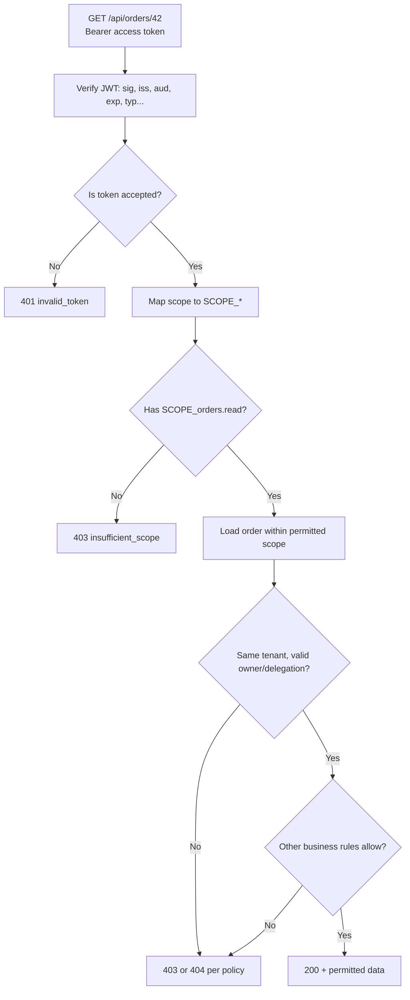

# Scope Is Only One Part of Resource Access Conditions

In **Spring Security OAuth 2.0 / OIDC Resource Server**, an access token may contain scopes such as `orders.read` or `orders.write`. Spring Security typically converts these scopes into `SCOPE_`-prefixed authorities, allowing us to configure:

```java
.requestMatchers(HttpMethod.GET, "/api/orders/**")
    .hasAuthority("SCOPE_orders.read")
```

This configuration is helpful, yet **it does not mean every principal with `orders.read` may view every order**. It only answers part of the question: *was the token granted permission to perform the "read orders" category of operations?* A secure API must also determine **which order**, **which tenant**, **who the principal is**, **who is presenting the token**, **what state the resource is in**, and **whether current business policy allows access**.

For example, a verified JWT access token has:

```json
{
  "iss": "https://login.example.com",
  "sub": "customer-42",
  "aud": ["orders-api"],
  "client_id": "storefront-web",
  "scope": "orders.read",
  "exp": 2000000000
}
```

Having `orders.read` does not mean `customer-42` can read order `order-9001` belonging to `customer-99`. If the API checks the scope and then queries and returns data for any `orderId` sent by the client, it is exposed to **Broken Object Level Authorization (BOLA)**, also known as a form of **Insecure Direct Object Reference (IDOR)**.

**Key message:** scope is **an authorization constraint at the token and API level**, not a complete declaration of permissions on individual data objects.

> **Lesson context:** Authorization Server at `https://login.example.com`; Orders API is the Resource Server with audience `orders-api`; OAuth clients include `storefront-web` and `nightly-worker`. Java examples target Spring Boot 3.x / Spring Security 6.x on the Servlet stack. Identifiers and codes only illustrate contracts, not real tokens or production deployments.

## 1. Understanding "scope" properly in OAuth 2.0

OAuth 2.0 lets a client request an access permission range using the `scope` parameter. The Authorization Server decides which scopes are granted based on the client, grant, user permissions, and system policies.

For example, a client requests:

```http
GET /authorize?response_type=code&
  client_id=storefront-web&
  redirect_uri=https%3A%2F%2Fapp.example.com%2Fcallback&
  scope=orders.read&
  state=RANDOM_STATE&
  code_challenge=PKCE_CHALLENGE&
  code_challenge_method=S256 HTTP/1.1
Host: login.example.com
```

After a valid OAuth authorization flow, the issued token may have:

```json
{
  "scope": "orders.read"
}
```

**The value `orders.read` is not a universal standard permission understood identically by every API.** It is a system-defined permission name. The Authorization Server and Orders API must agree on its meaning—for example, "allow the client to call read operations on orders that the principal actually has permission to view".

### 1.1. Scope describes the permission range *granted to the access token*

Statements to distinguish:

- **Client requests a scope:** the client wants access within a certain range.
- **Authorization Server grants a scope:** the AS actually approves a permission set appropriate for the client, subject, grant, and policy.
- **Resource Server checks a scope:** the API ensures the token was granted the permission required for the endpoint being called.
- **Business logic checks the resource:** the API checks whether the subject may actually perform that action on **the specific object**.

These are four related responsibilities, yet **they are not identical**. A token must not be treated as a "blanket pass" just because its `scope` claim contains a matching string.

### 1.2. Scope is not synonymous with role, per-object permission, or ownership

| Concept | Question it answers | Example |
|---|---|---|
| **Scope** | Which operation/API category was granted to the access token? | `orders.read` |
| **Spring authority** | Which permission does Spring Security map the scope/role into? | `SCOPE_orders.read` |
| **Role** | Which role does the principal hold in the system/context? | `ORDER_MANAGER` |
| **Resource ownership** | Who owns or is shared on the order? | `ownerSub=customer-42` |
| **Tenant boundary** | Which tenant boundary does the object belong to? | `tenantId=tenant-a` |
| **Attribute-based policy** | Do attributes of subject, resource, action, and context allow it? | Only view one's own paid orders |
| **Audience** | Which Resource Server was the token issued for? | `aud=orders-api` |
| **Authentication context** | How and when was the principal authenticated? | `auth_time`, `acr`, `amr` per contract |

Scope is **one input to the access decision**, not the final result.

## 2. The intersection of multiple conditions produces access

A simple, useful model for design:

```text
ALLOW(request, token, resource) =
    token_cryptographically_valid
AND token_issuer_trusted
AND token_audience_matches_api
AND token_not_expired
AND token_type_and_claims_accepted
AND required_scope_present
AND subject_or_client_authorized
AND resource_belongs_to_allowed_tenant
AND subject_has_permission_on_resource
AND business_policy_allows_action
```

This is a **decision model**, not a rigid OAuth specification or Spring Security function name. A system may add or remove conditions depending on security goals. The core point is that **the scope condition is only one of many conditions that must hold simultaneously**.

### 2.1. Three layers of checks

Access decisions can be viewed across three layers:

| Layer | Example questions | Typical components |
|---|---|---|
| **Token authentication** | Valid signature? Right issuer/audience? Token still valid? | `BearerTokenAuthenticationFilter`, `JwtAuthenticationProvider`, `JwtDecoder`, validators |
| **Functional authorization** | Does token have `orders.read`? Is client or principal in an allowed group? | `AuthorizationFilter`, `hasAuthority`, `@PreAuthorize` |
| **Resource authorization** | May this user view **order 42**? Matching tenant/owner? Is order locked? | Domain service, policy service, repository queries, method security |

**Common mistake:** configuring layers 1 and 2 fairly thoroughly while missing layer 3. This is the root of many vulnerabilities allowing users to read/modify others' data by changing an ID in the URL.

### 2.2. A request traversing the layers



In a real application, tenant/ownership checks can happen right inside the database query rather than loading the object and checking afterward. Which approach fits best depends on security, performance, and data governance requirements.

## 3. How does Spring Security turn scopes into authorities?

With a JWT Resource Server, scopes typically live in the `scope` or `scp` claim. Example:

```json
{
  "scope": "orders.read orders.write"
}
```

or:

```json
{
  "scp": ["orders.read", "orders.write"]
}
```

Once the decoder has verified the JWT, `JwtAuthenticationConverter` runs its authorities conversion; default configuration typically produces:

```text
JWT scope:        orders.read
Spring authority: SCOPE_orders.read
```

You can use:

```java
.hasAuthority("SCOPE_orders.read")
```

to require that scope.

### 3.1. What does Authentication contain after mapping?

Suppose the token is accepted; the result is typically a `JwtAuthenticationToken`:

```text
Authentication:
  principal  = verified Jwt
  name       = sub (by default)
  authorities:
    - SCOPE_orders.read
```

This means **the token has been authenticated** and its scopes mapped, yet the `Authentication` object does not carry full permissions for every individual order.

Application APIs also need to use:

- `Jwt#getIssuer()` or the verified issuer.
- `Jwt#getSubject()` (with subject semantics matching the grant/profile).
- `Jwt#getAudience()` (already verified by validators).
- `Jwt#getClaimAsString("tenant_id")` **if** the contract designates it as a trusted claim and the issuer is permitted to issue it.
- Data from the business database: owner, tenant, order status, delegation relationships.

### 3.2. Roles do not automatically accompany scopes

A JWT can contain `roles` or `groups`, but Spring Security does not automatically understand arbitrary custom role claims. If the API wants to use roles, design a **controlled converter** defining namespaces and semantics per issuer/resource.

Do not convert every `ADMIN` string from any issuer into `ROLE_ADMIN` and allow access across every tenant. **Role is an additional condition**, and does not remove audience, scope, and object-level permission requirements.

### 3.3. Token scope differs from direct user permissions

A user may have internal permission to view their own orders, yet the current token **was not granted** `orders.read`. In that case, the API must reject for missing scope.

Conversely, if the token has `orders.read` while the user does not own order 42, the API must reject as well.

You can think of the final decision as **the intersection of permissions granted to the token and the principal's actual permissions**, never the union of the two to "widen" access.

## 4. BOLA/IDOR example: checking only scope and reading by ID

Suppose an endpoint:

```http
GET /api/orders/42 HTTP/1.1
Host: api.example.com
Authorization: Bearer <VALID_ACCESS_TOKEN>
```

The token has `scope=orders.read`, belonging to subject `customer-42`. However, order 42 belongs to `customer-99`.

### 4.1. Insecure handling pattern

```java
@GetMapping("/api/orders/{orderId}")
@PreAuthorize("hasAuthority('SCOPE_orders.read')")
public OrderDto getOrder(@PathVariable String orderId) {
    // Does not check order owner or tenant.
    return orderService.findById(orderId);
}
```

This is an example **intentionally missing resource checks**, not code to use. If `orderService.findById` simply queries by ID and returns the record, anyone with `orders.read` can swap `orderId` to fetch someone else's order.

Hard-to-guess UUID IDs **do not solve authorization**. Whenever an ID leaks via a URL, log, email, or referer, the API still must decide whether the request has permission for that ID.

### 4.2. The proper requirements

The endpoint must satisfy all of these simultaneously:

1. Valid token intended for Orders API.
2. Token has `orders.read`.
3. Subject/client is permitted to perform this type of access.
4. Order belongs to a tenant the subject is allowed to operate in.
5. Subject owns the order, has valid sharing/delegation, or holds an admin role **scoped to the right tenant and boundary**.
6. All other business policies are satisfied.

If conditions 1–2 pass while 4–5 fail, the API **must not return data** merely because the endpoint is protected by `@PreAuthorize`.

## 5. Spring Security example: combining scope with per-order permissions

Let's build a simple example for a **user-delegated** access token where the issuer guarantees:

```json
{
  "iss": "https://login.example.com",
  "sub": "customer-42",
  "aud": ["orders-api"],
  "client_id": "storefront-web",
  "tenant_id": "tenant-a",
  "scope": "orders.read"
}
```

**Important assumption:** `tenant_id` is a claim issued by a trusted Authorization Server after checking the principal's membership/tenant context. It is **not** a header or query parameter self-declared by the client and trusted by the Resource Server.

### 5.1. Dependencies

Gradle Groovy DSL example for Spring MVC:

```groovy
dependencies {
    implementation 'org.springframework.boot:spring-boot-starter-web'
    implementation 'org.springframework.boot:spring-boot-starter-security'
    implementation 'org.springframework.boot:spring-boot-starter-oauth2-resource-server'
}
```

### 5.2. Resource Server verifying issuer/audience and route scopes

```yaml
spring:
  security:
    oauth2:
      resourceserver:
        jwt:
          issuer-uri: https://login.example.com
          audiences:
            - orders-api
```

`audiences` is supported in corresponding Spring Boot versions; if your project version does not support it or uses a custom decoder, configure a dedicated audience validator. When an API requires **RFC 9068 JWT access tokens**, also check JOSE `typ=at+jwt` and profile-required claims. **Never treat `issuer-uri` alone as sufficient for all token checks.**

Servlet `SecurityFilterChain` configuration:

```java
package com.example.orders.security;

import org.springframework.context.annotation.Bean;
import org.springframework.context.annotation.Configuration;
import org.springframework.http.HttpMethod;
import org.springframework.security.config.Customizer;
import org.springframework.security.config.annotation.web.builders.HttpSecurity;
import org.springframework.security.web.SecurityFilterChain;

@Configuration
public class ApiSecurityConfiguration {

    @Bean
    SecurityFilterChain apiChain(HttpSecurity http) throws Exception {
        return http
            .securityMatcher("/api/**")
            .authorizeHttpRequests(auth -> auth
                .requestMatchers(HttpMethod.GET, "/api/orders/**")
                    .hasAuthority("SCOPE_orders.read")
                .requestMatchers(HttpMethod.POST, "/api/orders/**")
                    .hasAuthority("SCOPE_orders.write")
                .anyRequest().authenticated()
            )
            .oauth2ResourceServer(oauth2 ->
                oauth2.jwt(Customizer.withDefaults())
            )
            .build();
    }
}
```

This configuration **only enforces functional permissions** and only protects URLs matching `/api/**`; the application needs separate policies for remaining URLs. Per-order authorization happens in the service layer.

### 5.3. Minimal data model

Abbreviated domain model example:

```java
package com.example.orders.domain;

public record Order(
    String id,
    String tenantId,
    String ownerIssuer,
    String ownerSubject,
    String status
) {}
```

Where:

- `id`: order identifier.
- `tenantId`: tenant owning the data.
- `ownerIssuer` and `ownerSubject`: owner principal identifier pair so identical `sub` values from different issuers are never confused.
- `status`: business state; may affect edit/cancel/refund conditions.

In a real system, ownership might be an internal customer ID, dealer relationship, organizational unit, or multi-party ACL. The record above only illustrates **where policies must be enforced**, not a mandatory schema prescription.

Repository:

```java
package com.example.orders.domain;

import java.util.Optional;

public interface OrderRepository {
    Optional<Order> findById(String orderId);
}
```

### 5.4. Building an object-level permission decision

```java
package com.example.orders.security;

import com.example.orders.domain.Order;
import org.springframework.security.oauth2.jwt.Jwt;
import org.springframework.stereotype.Component;

@Component
public class OrderAccessPolicy {

    public boolean canRead(Jwt jwt, Order order) {
        if (jwt == null || order == null) {
            return false;
        }

        String subject = jwt.getSubject();
        String tenant = jwt.getClaimAsString("tenant_id");

        if (subject == null || subject.isBlank()
                || tenant == null || tenant.isBlank()
                || jwt.getIssuer() == null) {
            return false;
        }

        // JWT issuer and audience have already been checked by JwtDecoder/validator.
        boolean sameTenant = tenant.equals(order.tenantId());
        boolean sameOwner =
            jwt.getIssuer().toString().equals(order.ownerIssuer())
            && subject.equals(order.ownerSubject());

        return sameTenant && sameOwner;
    }
}
```

This pattern follows the policy **"a customer can only view their own orders in the active tenant"**. If the application has admins or delegated agents, extend the policy **in a controlled way**, never assuming "admin role bypasses all tenants".

**Why check both issuer and subject?** `sub` only has meaning within an issuer; two issuers can use the same string `customer-42` for different entities. Using `(iss, sub)` prevents identity confusion when a system integrates multiple issuers.

**Why check tenant separately from owner?** Someone may own or be linked to a resource while operations must remain inside the currently accessed tenant. Multi-tenant models typically require checking both membership/tenant context and object permissions, not `sub` alone.

### 5.5. Service enforcing policy after passing scope

```java
package com.example.orders.domain;

import com.example.orders.security.OrderAccessPolicy;
import org.springframework.security.access.AccessDeniedException;
import org.springframework.security.core.Authentication;
import org.springframework.security.oauth2.server.resource.authentication.JwtAuthenticationToken;
import org.springframework.stereotype.Service;

@Service
public class OrderQueryService {

    private final OrderRepository repository;
    private final OrderAccessPolicy policy;

    public OrderQueryService(
            OrderRepository repository,
            OrderAccessPolicy policy) {
        this.repository = repository;
        this.policy = policy;
    }

    public Order getOrder(String orderId, Authentication authentication) {
        if (!(authentication instanceof JwtAuthenticationToken jwtAuth)) {
            throw new AccessDeniedException("JWT identity required");
        }

        Order order = repository.findById(orderId)
            .orElseThrow(() -> new OrderNotFoundException(orderId));

        if (!policy.canRead(jwtAuth.getToken(), order)) {
            throw new AccessDeniedException("Not allowed to read order");
        }

        return order;
    }
}
```

`OrderNotFoundException` is an application-defined domain exception mapped to HTTP 404. Real service classes typically also use transactions/repositories/mappers and should **return a DTO with only necessary fields** rather than returning entities directly.

Notes in the sample code:

- `JwtAuthenticationToken` was built **after the JWT decoder verified the token**.
- Do not take subject from a URL `userId` parameter to replace the principal.
- Do not let the client specify `tenant_id` and treat it as a permission.
- Ownership checks happen inside the **service**, independent of which single controller calls it.
- Throws `AccessDeniedException` when lacking permission; the API may choose to respond with `403`, or intentionally return `404` to reduce resource-existence leakage.

### 5.6. Controller receiving Authentication

```java
package com.example.orders.api;

import com.example.orders.domain.Order;
import com.example.orders.domain.OrderQueryService;
import org.springframework.security.core.Authentication;
import org.springframework.web.bind.annotation.GetMapping;
import org.springframework.web.bind.annotation.PathVariable;
import org.springframework.web.bind.annotation.RequestMapping;
import org.springframework.web.bind.annotation.RestController;

@RestController
@RequestMapping("/api/orders")
public class OrdersController {

    private final OrderQueryService queries;

    public OrdersController(OrderQueryService queries) {
        this.queries = queries;
    }

    @GetMapping("/{orderId}")
    public Order getOrder(
            @PathVariable String orderId,
            Authentication authentication) {
        return queries.getOrder(orderId, authentication);
    }
}
```

In a real application, map `Order` to `OrderDto` and return only publicly permitted properties. If the scope is missing, the request is normally blocked before the controller. If the scope is present yet ownership/tenant fails, the service denies it.

## 6. Authorizing directly in queries to reduce BOLA

The "load order → check owner → return/deny" approach helps explain the logic, yet many large systems want to ensure that **even the database query itself is scoped to the authorized resource boundary**.

Instead of:

```sql
SELECT * FROM orders WHERE id = :order_id;
```

you can use a query like:

```sql
SELECT *
FROM orders
WHERE id = :order_id
  AND tenant_id = :tenant_id
  AND owner_issuer = :issuer
  AND owner_subject = :subject;
```

The `:tenant_id`, `:issuer`, and `:subject` parameters must come from the **verified security context and controlled domain identity**, never directly from client-chosen headers or query parameters.

Benefits of scoped queries:

- Reduces the chance of accidentally returning data before running policy.
- Can report "resource not found within access scope", reducing leakage of ID existence.
- Often pairs cleanly with pagination and data filters.
- Can leverage appropriate indexes and database row-level security if supported by infrastructure.

Still, scoped queries **do not automatically guarantee** every business rule is safe: some actions need transaction state, delegated permissions, record versioning, state-transition guards, and tenant membership from another source.

### 6.1. Critical for list endpoints

`GET /api/orders/42` must check one ID; `GET /api/orders` must constrain **the entire returned result set**.

Wrong:

```java
return orderRepository.findAll();
```

letting everyone with `SCOPE_orders.read` view the entire list.

Better is an access-scoped query:

```text
findOrdersVisibleTo(issuer, subject, tenant, filters, pagination)
```

The application must handle pagination, sorting, filtering, and statistics within the same permission boundary. **Never filter records only on an already-fetched page** if total count, pagination, or aggregates still accidentally leak out-of-scope data.

### 6.2. Protect resource relationships, not just root resources

For example:

```http
GET /api/orders/42/items/7
```

If you verify ownership of order 42 yet query item 7 independently by ID without verifying that item 7 belongs to order 42, a user could view items from another order.

The query contract should enforce:

```sql
SELECT i.*
FROM order_items i
JOIN orders o ON o.id = i.order_id
WHERE o.id = :order_id
  AND i.id = :item_id
  AND o.tenant_id = :tenant_id
  AND o.owner_issuer = :issuer
  AND o.owner_subject = :subject;
```

This is the principle of checking **object-level authorization across both the resource and resource relationships**.

## 7. Combining scope with RBAC and ABAC

### 7.1. RBAC: Role-Based Access Control

An application with an `ORDER_MANAGER` role may allow handling assigned orders. Then:

```text
ALLOW_DELETE =
  token_has_scope("orders.delete")
  AND principal_has_role("ORDER_MANAGER")
  AND manager_assigned_to_order
  AND same_tenant
  AND order_status_allows_delete
```

Roles group responsibilities; conditions like "assigned to this order" and "same tenant" still belong to resource policy.

### 7.2. ABAC: Attribute-Based Access Control

ABAC evaluates attributes of:

- **Subject:** user ID, client ID, tenant membership, department, authentication level.
- **Resource:** owner, tenant, status, sensitivity level, region.
- **Action:** read, update, delete, refund, export.
- **Environment/context:** timestamp, workflow state, request origin, risk level per policy.

Example for refunds:

```text
ALLOW_REFUND =
  token_has_scope("orders.refund")
  AND user_has_role("FINANCE_OPERATOR")
  AND user_assigned_to_same_tenant
  AND order.status == "PAID"
  AND order.refundAmountWithinOperatorLimit
  AND transaction_not_already_refunded
```

The `orders.refund` scope is only the **first gate**. Without the subsequent conditions, an operator with a valid scope could refund the wrong object or violate the workflow.

### 7.3. Where should policies be centralized?

Depending on complexity, policies can reside in:

- **Domain/service layer:** fits ownership, tenant, business state, and data already in the DB.
- **Method security:** use `@PreAuthorize` or `AuthorizationManager` to bind permissions in services when expressions can safely call policies.
- **Policy engine/PDP:** when multiple services share complex rules needing centralized management.
- **Database row-level security:** adds a data-query protection layer without replacing all application authorization.

What matters is maintaining **a clear single source of truth for policies**, avoiding each controller writing its own inconsistent owner comparison.

## 8. Method security to combine scope and policy

Spring Security supports `@EnableMethodSecurity` and `@PreAuthorize`. You can check scopes on methods:

```java
package com.example.orders.security;

import org.springframework.context.annotation.Configuration;
import org.springframework.security.config.annotation.method.configuration.EnableMethodSecurity;

@Configuration
@EnableMethodSecurity
public class MethodSecurityConfiguration {
}
```

And:

```java
@PreAuthorize("hasAuthority('SCOPE_orders.read')")
public Order getOrder(String id, Authentication authentication) {
    // Inside the service, continue checking owner/tenant/status.
}
```

Or with a policy bean that explicitly handles resources:

```java
@PreAuthorize(
    "hasAuthority('SCOPE_orders.read') " +
    "and @ordersAuthorization.canReadOrder(authentication, #orderId)"
)
public OrderDto getOrder(String orderId) {
    // Read data after permission check in the method interceptor.
}
```

In the second approach, `ordersAuthorization` must be a registered bean responsible for querying/evaluating owner/tenant with trusted data and returning a boolean. Watch out for:

- If the policy queries the DB and the service queries it again, there may be a **race condition** or checks against differing states.
- For state-changing actions, enforce policy and update data inside **the same transaction/locking or conditional update**, rather than TOCTOU: "check at state A while updating state B".
- Spring method security operates through proxies/interceptors per configuration, so internal **self-invocation** within the same bean may skip the interceptor as expected.
- Critical logic must still run along every entry path; do not rely solely on a controller annotation if the service can also be called from scheduled jobs, message consumers, or GraphQL.

For complex object policies, many teams keep the scope check in `@PreAuthorize` and object access checks inside the service/repository to have full transaction and data access.

## 9. Audience and resource indicators: which API is the token intended for?

Before reading scopes, the Resource Server must know whether the token was issued **for itself**.

Example token:

```json
{
  "iss": "https://login.example.com",
  "aud": ["billing-api"],
  "scope": "orders.read"
}
```

Even though scope says `orders.read`, Orders API **must reject** it because `aud` does not contain `orders-api`. Scope does not replace audience.

Per RFC 8707, a client can indicate the target resource via the `resource` parameter; the Authorization Server decides the resulting audience and scopes. For JWT access tokens per RFC 9068, the profile also specifies token type `at+jwt` and required claims.

### 9.1. Does one scope have meaning across multiple APIs?

Identical scope names do not guarantee identical meanings. For example, `read` in Billing API might mean reading invoices, while `read` in Orders API means reading orders.

Therefore:

- Standardize namespaces such as `orders.read`, `billing.read`.
- Require `aud` to match the Resource Server.
- Never infer that all APIs are permitted just because the client received a token from the same issuer.
- If an access token contains multiple audiences, establish a **clear scope–resource contract**; avoid ambiguous `read` scopes shared across multiple APIs.

Scopes are only safe when **bound to issuer, audience, client, and resource policy context**.

## 10. Client credentials: there is not always a user

With `authorization_code`, an access token can represent a user under a delegated access model. With `client_credentials`, however, the token typically represents an **application or service**:

```json
{
  "iss": "https://login.example.com",
  "sub": "nightly-worker",
  "client_id": "nightly-worker",
  "aud": ["orders-api"],
  "scope": "orders.read"
}
```

You cannot apply a user-delegated token's `"ownerSubject == sub"` rule to every token type, because `nightly-worker` may need access to an authorized batch of orders for its job.

Design a dedicated policy:

```text
ALLOW_M2M_ORDER_EXPORT =
  token_is_valid
  AND aud == "orders-api"
  AND scope_contains("orders.export")
  AND client_id IN approved_batch_clients
  AND client_can_access_requested_tenant
  AND requested_dataset_matches_job_contract
```

**`scope=orders.read` does not prove a service may view all tenants.** If a batch service may only process tenant A, the Resource Server must verify tenant A from managed configuration/authorization rather than accepting an arbitrary `tenant=A` from the client.

### 10.1. Do not confuse `sub` with `client_id`

| Claim | User-delegated token | Machine-to-machine token |
|---|---|---|
| `sub` | Typically represents user/subject per issuer | May represent service/client |
| `client_id` | OAuth client receiving the token | Application executing `client_credentials` |
| `scope` | Permission range granted to the token | Permission range granted to the service token |
| Resource policy | Owner, membership, delegation, tenant | Allowed clients, jobs, tenants, data domains |

A `JwtAuthenticationToken.getName()` default relies on `sub`, which **does not guarantee the principal is an end-user**.

### 10.2. If an API supports both user and service tokens

Do not decide "which token is a service token" simply because `sub` looks like an application name. Establish an issuer-guaranteed contract—such as grant type, client, token class, or separate issuer—and have the Resource Server check it per policy.

Important: a custom `grant_type` claim is **not automatically** standardized or emitted by every Authorization Server. Rely on it only when the issuer contract guarantees its accuracy and the Resource Server verifies the issuer.

## 11. Tenant isolation: a valid scope can still leak data

Suppose a business provides a SaaS platform for multiple tenants:

- `tenant-a` has order 42.
- `tenant-b` has order 9001.
- A user in tenant A has `orders.read`.

If the endpoint executes:

```sql
SELECT * FROM orders WHERE id = :orderId;
```

without restricting by tenant, user A can read tenant B's order if they know its ID. This breaks **tenant isolation** despite a valid access token.

Minimum policy:

```text
token valid
AND scope includes orders.read
AND subject has active membership in requested tenant
AND order.tenantId == authorized tenant
AND subject has access to that order
```

### 11.1. Is a tenant claim enough?

A `tenant_id` claim in a JWT can help establish tenant context, **if the Authorization Server guarantees that the claim is accurate, appropriately fresh, and signed**.

However, if a user was just removed from a tenant, an older JWT may still contain the membership/tenant claim until it expires. If the system requires immediate revocation, use complementary mechanisms such as live membership status in DB/PDP, introspection, session/token revocation, or short token lifetimes.

**Signed claims protect integrity since issuance; they do not guarantee the claim data is still current at request time.**

### 11.2. Tenant from URL or header is target selection, not permission

Example:

```http
GET /api/tenants/tenant-b/orders/9001
X-Tenant-Id: tenant-b
Authorization: Bearer ...
```

The URL/header can specify **which tenant the client wishes to target**. The Resource Server must cross-check this selection against the set of tenants the principal is permitted to access; never treat a header or path parameter as proof of membership.

## 12. "read" and "write" scopes do not describe state policies

A token with `orders.write` can still be rejected:

- The order is already canceled or locked.
- The order belongs to another user/tenant.
- The modification exceeds limits.
- The workflow requires separate approval.
- The client is not of an allowed type for the action.
- Balance, inventory, or transaction status does not meet prerequisites.

Example:

```text
ALLOW_CANCEL(order) =
    token_has_scope("orders.write")
    AND current_subject_can_manage(order)
    AND order.status IN {"NEW", "CONFIRMED"}
    AND order.hasNoNonRefundableShipment()
```

These conditions **should not** be turned into hundreds of scopes like `orders.cancel.new.tenantA.limit100` when they are actually dynamic resource attributes. Scopes are suited to constraining **functional groups**; business policies enforce fine-grained data permissions.

## 13. Limitations of roles and claims embedded in JWTs

### 13.1. Roles can become stale

Suppose a JWT has:

```json
{
  "roles": ["ORDER_MANAGER"],
  "scope": "orders.read orders.write"
}
```

After the token is issued, the user's manager role is revoked. A locally verified JWT can still remain valid until expiration.

If business requirements tolerate permission-update latency up to the token's TTL, this risk may be acceptable. If revocation must take effect immediately, the Resource Server must fetch live permission state from a trusted source or implement an appropriate revocation mechanism.

### 13.2. Do not rely on role names alone

An `ADMIN` role in issuer/tenant A does not grant admin access over tenant B. You must verify:

- Which issuer granted the role?
- Which Resource Server does the role apply to?
- Which tenant or organization does the role belong to?
- Did the AS grant the role to the right subject/client?
- Is the role still active and scoped to the right action?

### 13.3. Deny-by-default principle

If mandatory attributes needed to determine access—such as tenant ID, issuer/subject mapping, or ownership record—are missing, never choose "allow because scope matches". **Deny by default** per explicit policy, log the error appropriately, and investigate the data/contract issue.

Avoid comparing `null == null` and concluding tenant/owner match. Verify presence, type, and valid values of mandatory attributes.

## 14. 401, 403, and 404: returning errors at the right layer

| Scenario | Meaning | Typical response |
|---|---|---|
| No Bearer token on an authenticated endpoint | No Authentication yet | **401 Unauthorized** |
| JWT invalid signature, issuer, audience, expired, or wrong token type | Invalid token | **401** / `invalid_token` |
| Valid token missing `orders.read` | Insufficient functional permission | **403 Forbidden** / `insufficient_scope` when appropriate |
| Valid token, sufficient scope, but wrong tenant | Rejected by resource policy | **403** or **404** per policy |
| Valid token, sufficient scope, but does not own order | Rejected by resource policy | **403** or **404** per policy |
| Valid token, all conditions met, but order does not exist | Resource not found | **404 Not Found** |
| Route permission met, but order locked from edits | State/business-domain policy | May be **403** or **409 Conflict** per contract |

**Why use 404 instead of 403 sometimes?** Returning `404` for resources outside the caller's access scope can reduce disclosure that an ID exists. Still, design it consistently with API semantics, audit logs, and product security choices; not every missing-permission error must become `404`.

If an API distinguishes 403 and 404 by checking existence first, evaluate **resource enumeration** risks via status codes, timing, counts, or differing messages.

### 14.1. Bearer challenges at the authentication layer

An invalid token typically results in:

```http
HTTP/1.1 401 Unauthorized
WWW-Authenticate: Bearer error="invalid_token"
```

A valid token missing a scope can produce:

```http
HTTP/1.1 403 Forbidden
WWW-Authenticate: Bearer error="insufficient_scope"
```

Exact header details depend on Spring Security, `AuthenticationEntryPoint`, and the configured `AccessDeniedHandler`. Never return raw JWTs, sensitive claims, or key details in error responses.

## 15. An illustrative matrix for the Orders API

Suppose Orders API requires:

- Issuer: `https://login.example.com`.
- Audience: `orders-api`.
- Read scope: `orders.read`.
- Customers may only view orders belonging to the same tenant and themselves.
- Operators may be assigned to manage certain orders under a dedicated policy.

| Token / Request | Scope | Requested object | Other conditions | Outcome |
|---|---|---|---|---|
| JWT with invalid signature | May contain `orders.read` in payload | Order 42 | Untrusted token | **401** |
| JWT with wrong audience | `orders.read` | Order 42 | Token issued for Billing API | **401** |
| Valid JWT without `orders.read` | Insufficient | Own order | Missing token permission | **403** |
| Valid JWT `customer-42` | `orders.read` | Order owned by `customer-42`, same tenant | Conditions met | Possibly **200** |
| Valid JWT `customer-42` | `orders.read` | Order owned by `customer-99` | Wrong owner | **403/404** |
| Valid JWT `customer-42` | `orders.read` | Own order but in a tenant not currently permitted | Wrong tenant/membership | **403/404** |
| Valid JWT `nightly-worker` | `orders.read` | Order in tenant not granted to job | M2M client lacks tenant permission | **403/404** |
| Valid JWT operator | `orders.write` | Assigned order, editable status | Valid role/assignment/tenant | May update |
| Valid JWT operator | `orders.write` | Unassigned order | Wrong assignment | **403** |

The "possibly 200" row still depends on the resource actually existing and other business conditions. Access cannot be decided by a single scope cell in the matrix.

## 16. Testing: include "right scope, wrong object" cases

Auth/authorization testing must not stop at "missing scope yields 403". For ID-based endpoints, cases with **valid scope yet no permission on the data** are especially critical.

### 16.1. Minimum test suite

| Test case | Data | Expected |
|---|---|---|
| No token | GET protected order | 401 |
| Token with wrong issuer/audience/signature | Even if payload has `orders.read` | 401 |
| Valid token missing scope | Read own order | 403 |
| Valid token with scope, matching owner/tenant | Read own order | Succeeds |
| Valid token with scope, **different owner** | Read another user's order | 403/404 |
| Valid token with scope, **different tenant** | Read another tenant's order | 403/404 |
| M2M token with scope, but client not permitted on endpoint | Unauthorized job | 403 |
| Has scope and role, wrong workflow state | Cancel completed order | Rejected by business policy |
| List/aggregate | Tenant A token | Zero tenant B records, counts, or stats |
| Nested resource | Order 42, item belonging to order 99 | Access denied |
| Revoked membership | Unexpired old JWT | Rejected per revocation contract if immediate effect required |

### 16.2. Unit testing object-level policy

Example focusing on `OrderAccessPolicy`, creating test `Jwt` objects:

```java
package com.example.orders.security;

import com.example.orders.domain.Order;
import org.junit.jupiter.api.Test;
import org.springframework.security.oauth2.jwt.Jwt;

import static org.assertj.core.api.Assertions.assertThat;

class OrderAccessPolicyTest {

    private final OrderAccessPolicy policy = new OrderAccessPolicy();

    @Test
    void deniesOtherOwnerEvenWhenTokenHasReadScope() {
        Jwt jwt = Jwt.withTokenValue("test-only")
            .header("alg", "RS256")
            .claim("iss", "https://login.example.com")
            .claim("sub", "customer-42")
            .claim("tenant_id", "tenant-a")
            .claim("scope", "orders.read")
            .build();

        Order otherOwner = new Order(
            "order-9001",
            "tenant-a",
            "https://login.example.com",
            "customer-99",
            "CONFIRMED"
        );

        assertThat(policy.canRead(jwt, otherOwner)).isFalse();
    }

    @Test
    void deniesOtherTenantEvenWhenOwnerMatches() {
        Jwt jwt = Jwt.withTokenValue("test-only")
            .header("alg", "RS256")
            .claim("iss", "https://login.example.com")
            .claim("sub", "customer-42")
            .claim("tenant_id", "tenant-a")
            .build();

        Order otherTenant = new Order(
            "order-9001",
            "tenant-b",
            "https://login.example.com",
            "customer-42",
            "CONFIRMED"
        );

        assertThat(policy.canRead(jwt, otherTenant)).isFalse();
    }
}
```

This is a **policy unit test**: `Jwt.withTokenValue(...)` creates a test JWT without verifying real signatures. Having the `scope` claim in the unit test only illustrates context; `OrderAccessPolicy` intentionally checks **object-level attributes**, while scope enforcement happens in `SecurityFilterChain`. Tests are needed for **both layers**.

### 16.3. Spring Security Test and MockMvc

You can use Spring Security Test's `jwt()` to simulate authentication for authorization tests:

```java
import static org.springframework.security.test.web.servlet.request
    .SecurityMockMvcRequestPostProcessors.jwt;
import static org.springframework.test.web.servlet.request
    .MockMvcRequestBuilders.get;
import static org.springframework.test.web.servlet.result
    .MockMvcResultMatchers.status;

import org.springframework.security.core.authority.SimpleGrantedAuthority;

mvc.perform(get("/api/orders/order-9001")
    .with(jwt()
        .jwt(token -> token
            .subject("customer-42")
            .claim("tenant_id", "tenant-a")
            .claim("iss", "https://login.example.com"))
        .authorities(
            new SimpleGrantedAuthority("SCOPE_orders.read")
        )))
    .andExpect(status().isForbidden());
```

This example **only expects `403` if the test database/service has `order-9001` belonging to another subject and the application maps the exception to Forbidden**. If the application intentionally hides resource existence with 404, expectations must follow the 404 contract. To make this an executable test, place it in a test class with `MockMvc` injected, configured test data, and proper imports.

**Important:** `jwt()` creates a test principal/authorities; it does not verify real signatures and does not prove `BearerTokenAuthenticationFilter` extracted the token properly from the HTTP header. To test token authentication end-to-end, send a Bearer header through the real filter chain using a controlled test issuer/JWKS or `JwtDecoder`.

### 16.4. Checking cross-tenant and list results

If using paginated endpoints, tests must verify:

- Every record belongs to the allowed tenant.
- `totalElements` and aggregates do not disclose other tenants.
- Client-supplied `ownerId` and `tenantId` filters cannot escalate access.
- Exports/background jobs do not return a broader scope than regular endpoints.
- Behavior for non-existent IDs vs. unauthorized IDs matches the error-disclosure policy.

## 17. Caution when using a custom JwtAuthenticationConverter

Many applications have custom claims:

```json
{
  "scope": "orders.read",
  "roles": ["ORDER_MANAGER"],
  "tenant_id": "tenant-a"
}
```

If you build a converter to turn `roles` into `ROLE_*`, enforce strict rules:

- Accept roles only from trusted issuers and audiences.
- Constrain roles by resource/tenant or map them through a domain policy.
- Do not turn arbitrary role strings into admin permissions.
- Do not accidentally **drop scope authorities** when replacing the default converter.
- Do not treat `tenant_id` as immutable proof of membership.
- Never use client-supplied claims outside a verified token to build authorities.

A `JwtAuthenticationToken` with `SCOPE_orders.read` and `ROLE_ORDER_MANAGER` still requires object-level policies. **Having more authorities never eliminates the need to verify the data itself**.

## 18. Redesigning scopes to avoid being overly broad

A single `orders.read` scope can carry many unclear meanings:

- View my own orders?
- View orders of an assigned support group?
- View all orders in a tenant?
- Export all orders across all tenants?

If one scope is used for all four cases, the authorization policy becomes hard to reason about.

One way to structure the contract:

| Scope | Operation type | Additional conditions |
|---|---|---|
| `orders.read` | Read orders | Owner, delegation, or assigned permission |
| `orders.write` | Create/edit orders | Tenant, owner/role, workflow status |
| `orders.export` | Export dataset | Approved client/role, tenant, data bounds, audit |
| `orders.refund` | Refund | Role, limits, payment status, step-up if required |

You do not need a separate scope for every `orderId`; dynamic per-record constraints should be expressed via ACL/ownership/policy.

At the same time, do not rely **exclusively** on roles instead of scopes: if a user holds a manager role while the OAuth client was only granted `orders.read`, the API must not open refund actions outside the access token's scope.

## 19. Principle of least privilege for both tokens and data

**Least privilege** has two dimensions:

1. **Token permissions:** issue minimal scopes, exact audience, reasonable TTL, restricted clients/grants.
2. **Object permissions:** query and return minimal data, strictly within permitted tenant/owner/delegation, verifying every state-changing operation.

If you minimize scopes without checking record permissions, an attacker can still read many users' data using a valid shared scope. If you only check ownership while letting tokens without the required scope pass, the Resource Server bypasses the limits granted by the Authorization Server to the client.

**Both are required.**

## 20. Common design mistakes

### Mistake 1 — "Having `orders.read` means you can read all orders"

Scope permits a category of operations; **it does not create ownership permissions**. Add tenant, owner, or delegation checks in the service/repository.

### Mistake 2 — "IDs are hard-to-guess UUIDs, so object policies aren't needed"

IDs can leak via links, logs, emails, events, referers, caches, or UIs. A UUID is an identifier, **not a capability token**, unless explicitly designed and protected as a credential.

### Mistake 3 — "`@PreAuthorize` on the controller makes the service safe"

A service can be called from another controller, scheduled job, event consumer, or internal path. Critical invariants belong in the service/policy or appropriate database security, not on a single entry point.

### Mistake 4 — "The JWT has a signed tenant claim, so checking current membership isn't needed"

A signed claim reflects data at token issuance time. If near-real-time membership revocation is required, use appropriate live state checks/updates; claims do not mutate when a user leaves a tenant.

### Mistake 5 — "An ADMIN role from any issuer is system-wide admin"

Roles require specific issuer/audience/resource/tenant scope. Never merge permissions across tenants or issuers merely by matching role name strings.

### Mistake 6 — "HTTP 403 is a scope error, so give the client more scopes"

`403` can come from ownership, tenant, business state, or method policy. Identify the right layer before granting more permissions; never "fix" a 403 by issuing `orders.*` or super-admin.

### Mistake 7 — "A batch service token is just like a user token"

Client credentials may have no end-user; subject/client policies differ from user-delegated ones. Never take a service's `sub` and match it loosely against user rows to grant permissions.

### Mistake 8 — "Checking GET is enough; POST/DELETE are the same"

Each action can have different policies. For state changes in particular, check the state machine, tenant, role, idempotency, and TOCTOU; never share a vague `canAccess` boolean across all actions.

## 21. A complete responsibility diagram

```text
OAuth Client
   |
   | Authorization: Bearer <access_token>
   v
Spring Security Resource Server
   |
   +--> BearerTokenAuthenticationFilter
   |        |
   |        +--> Extract access token string
   |
   +--> JwtAuthenticationProvider / JwtDecoder
   |        |
   |        +--> Signature, trusted issuer, audience,
   |             exp/nbf, token type, mandatory claims
   |
   +--> JwtAuthenticationConverter
   |        |
   |        +--> scope/scp -> SCOPE_*
   |        +--> controlled claims -> role/authority if needed
   |
   +--> AuthorizationFilter / @PreAuthorize
   |        |
   |        +--> Endpoint requires SCOPE_orders.read
   |
   +--> Domain Service / Object Policy
            |
            +--> Subject / client / tenant membership
            +--> Owner or valid delegation
            +--> Resource state and business conditions
            +--> Permission-scoped query / safe transaction
            |
            +--> ALLOW: return permitted data
            +--> DENY: 403/404 per policy
```

**Conclusion:** in Spring Security OAuth 2.0 Resource Server, scope is an important boundary between **permissions granted to the access token** and **capabilities the API permits to be called**. However, scope **does not know who owns which order**, does not confirm live tenant membership, does not capture all workflow rules, and does not replace per-object authorization. A secure system must combine **token validation + scope/authorities + subject/client policy + tenant/ownership/resource authorization**, and enforce those conditions on every path that reads or modifies data.

## 22. References

- [RFC 6749 — The OAuth 2.0 Authorization Framework](https://www.rfc-editor.org/rfc/rfc6749): meaning of scopes and issuance decisions.
- [RFC 6750 — OAuth 2.0 Bearer Token Usage](https://www.rfc-editor.org/rfc/rfc6750): bearer access token usage and `invalid_token` / `insufficient_scope` errors.
- [RFC 8707 — Resource Indicators for OAuth 2.0](https://www.rfc-editor.org/rfc/rfc8707): resource indicators to establish access token audience.
- [RFC 9068 — JWT Profile for OAuth 2.0 Access Tokens](https://www.rfc-editor.org/rfc/rfc9068): access-token claims, `aud`, and `scope` in the JWT profile.
- [Spring Security — OAuth 2.0 Resource Server JWT](https://docs.spring.io/spring-security/reference/servlet/oauth2/resource-server/jwt.html): `JwtDecoder`, scope mapping, `JwtAuthenticationConverter`.
- [Spring Security — Authorize HTTP Requests](https://docs.spring.io/spring-security/reference/servlet/authorization/authorize-http-requests.html): `authorizeHttpRequests`, `hasAuthority`, and Servlet authorization mechanisms.
- [Spring Security — Method Security](https://docs.spring.io/spring-security/reference/servlet/authorization/method-security.html): `@EnableMethodSecurity`, `@PreAuthorize`, and method-level policies.
- [OWASP API Security Top 10 — Broken Object Level Authorization](https://owasp.org/API-Security/editions/2023/en/0xa1-broken-object-level-authorization/): risks of insufficient object-level authorization checks.

When designing an endpoint, ask two **separate** questions: **"Was the token granted the scope for this operation?"** and **"Is this specific principal allowed to perform that operation on this specific resource?"** Only when both answers are verified against trusted sources should the Resource Server allow access.
