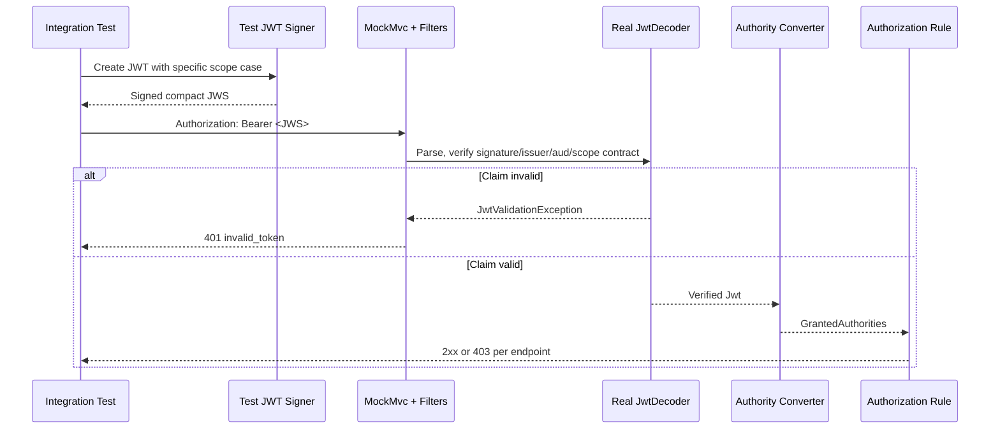
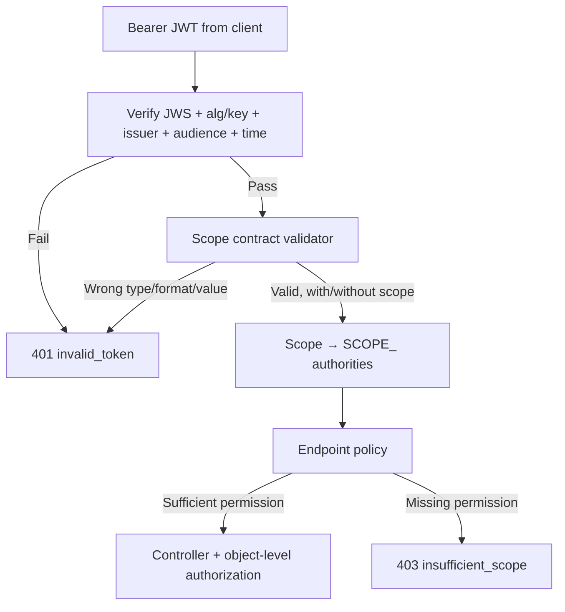

# Testing Authority Mapping with Missing, Multiple, and Invalid Scopes

## 1. Why test mapping scopes to authorities?

In a **Spring Security OAuth 2.0/OIDC Resource Server**, an HTTP request may carry a Bearer access token as a JWT. After verifying the token, Spring Security builds an `Authentication` containing `GrantedAuthority` instances to decide whether the request is permitted to access the endpoint.

For example, a JWT access token has the payload:

```json
{
  "iss": "https://login.example.test/realms/shop",
  "sub": "user-123",
  "aud": ["orders-api"],
  "scope": "orders:read orders:write",
  "exp": 1893456000
}
```

This is an **illustrative payload**, not a usable signed JWT. With the standard converter, the `scope` claim above becomes two Spring Security authorities:

```text
SCOPE_orders:read
SCOPE_orders:write
```

Endpoints may require:

```java
.requestMatchers(HttpMethod.GET, "/api/orders/**")
    .hasAuthority("SCOPE_orders:read")
.requestMatchers(HttpMethod.POST, "/api/orders/**")
    .hasAuthority("SCOPE_orders:write")
```

What needs testing is not merely "if the token has a scope, let it pass", but **the exact relationship between the issued claim, the generated authorities, and the permissions required by the API**.

Three groups of tokens are especially important:

1. **Missing scope:** the access token has no `scope`/`scp` claim or only an empty permission list. Does the system create any unintended authorities?
2. **Multiple scopes:** the token carries several independent permissions. Does the converter split each scope properly without mismerging or granting extra privileges?
3. **Invalid scope:** the claim has the wrong data type, contains unsupported permission names, uses the wrong delimiter, contains duplicate/conflicting values, or contains a string resembling an allowed scope. Will the API reject at the right layer or accidentally create dangerous authorities?

> **Security principle:** Scope mapping must be defined by **the issuer and API access-token contract**, not guessed from any field that looks like a "permission". When a scope is missing, do not grant that permission by default. When a claim violates the contract, enforce an explicit **fail-closed** policy.

## 2. Distinguishing scope, authority, and authorization

Three related yet non-identical concepts:

| Concept | Where does it live? | Example | Role |
| --- | --- | --- | --- |
| **Scope** | Access token or introspection response issued by the Authorization Server | `orders:read` | Authorization range issued under the OAuth 2.0 contract. |
| **GrantedAuthority** | Object inside Spring Security `Authentication` | `SCOPE_orders:read` | Normalized permission representation for expressions/authorization managers. |
| **Authorization rule** | Endpoint configuration, method security, or business policy | `hasAuthority("SCOPE_orders:read")` | Decides whether an authenticated request may access the capability/resource. |

Typical pipeline:

```mermaid
flowchart LR
    C["HTTP client<br/>Bearer access token"] --> F["BearerTokenAuthenticationFilter"]
    F --> P["JwtAuthenticationProvider"]
    P --> D["JwtDecoder<br/>signature, iss, aud, expiry, contract"]
    D --> CONV["JwtAuthenticationConverter"]
    CONV --> S["JwtGrantedAuthoritiesConverter<br/>scope/scp → authorities"]
    S --> CTX["SecurityContext<br/>Authentication"]
    CTX --> AUTH["AuthorizationFilter / Method Security"]
    AUTH --> RESULT["Allow or deny"]
```



The Resource Server must **authenticate the JWT first**; the converter maps claims from a JWT already accepted by the decoder. If you merely Base64URL-decode the payload and assign authorities, an attacker can inject `scope: "orders:write"` into a forged token.

**Important:** A token can be authenticated successfully **yet hold zero authorities**. This differs from having an invalid signature or issuer. Therefore, tests must distinguish **authentication errors (typically 401)** from **authorization errors (typically 403)**.

## 3. How does Spring Security map scopes by default?

For a JWT Resource Server, `JwtAuthenticationProvider` typically uses `JwtAuthenticationConverter`. This converter can use `JwtGrantedAuthoritiesConverter` to read common permission claims.

In standard Spring Security configuration:

- The `scope` or `scp` claim is treated as the source of scopes.
- When `scope` is a **string**, scope names are split using the delimiter configured on the converter, usually a space by default.
- When a claim is represented as a **collection of strings**, the converter can process each element as a scope; the issuer's actual contract must still be considered.
- Each scope name gets the **`SCOPE_`** prefix to become a `GrantedAuthority`.
- If no claim recognized by the converter is present, the result is usually an **empty authorities list**.

Examples:

| Claims in verified JWT | Authorities typically produced |
| --- | --- |
| `{"scope":"orders:read"}` | `SCOPE_orders:read` |
| `{"scope":"orders:read orders:write"}` | `SCOPE_orders:read`, `SCOPE_orders:write` |
| `{"scp":["orders:read","orders:write"]}` | `SCOPE_orders:read`, `SCOPE_orders:write` |
| Neither `scope` nor `scp` | No authorities from the scope converter. |
| `{"scope":"orders:read,orders:write"}` | **Does not automatically become two permissions** when commas are not the delimiter. |
| `{"scope":"orders:Read"}` | Not equal to `SCOPE_orders:read` because authority names are matched exactly. |

Claim precedence, string splitting, and behavior on wrong data types depend on the Spring Security implementation/version and converter customization. In particular, standard `JwtGrantedAuthoritiesConverter` typically prioritizes `scope` if both `scope` and `scp` appear; **do not assume both claims are automatically merged**.

### 3.1. `SCOPE_` and `ROLE_` do not substitute for each other

`hasAuthority("SCOPE_orders:read")` compares strictly against the created authority. `hasRole("ADMIN")` follows the `ROLE_` prefix convention and is not automatically inferred from `scope: "ADMIN"`.

Example:

```text
scope = "admin"
→ SCOPE_admin
≠ ROLE_ADMIN
```

A custom mapping turning every scope into `ROLE_ADMIN` can dangerously alter permission semantics. Scope-based authorization should be designed separately from user/tenant roles.

### 3.2. Avoid misinterpreting delimiters

In OAuth 2.0, a standard `scope` string is a **space-separated list of scope-tokens**:

```text
orders:read orders:write
```

Do not treat the following string as equivalent unless the issuer has a dedicated contract:

```text
orders:read,orders:write
```

A comma-containing string may be treated by the converter as **one single scope name**. Commas themselves are permitted characters inside a `scope-token` under OAuth syntax, so the core issue is **that scope does not exist in the API's permission contract**, not that every comma is a standard syntax error. Distinguish **valid grammar** from **recognized by the API**.

## 4. Defining rules before writing tests

Before writing tests, the Authorization Server and API teams should lock down:

| Contract question | Example convention for `orders-api` |
| --- | --- |
| Which claim carries permissions? | `scope` as a string, split by a single ASCII space. |
| Is the claim mandatory? | **Optional at token level**; endpoints needing permissions reject scopeless tokens. |
| Which scope names are allowed? | `orders:read`, `orders:write`, `orders:export`. |
| Is casing sensitive? | Yes: `orders:Read` does not equal `orders:read`. |
| Are duplicate scopes allowed? | Example convention: **no**; treated as a contract error. |
| Are other delimiters allowed? | No: commas are not treated as separators, nor tabs or two consecutive spaces. |
| Is array `scp` accepted? | In the example contract: **no**; providers using `scp` need a different validator/converter. |
| What if the scope is invalid? | Reject the token via a claim validator before building the principal. |
| What if the scope is valid but lacks endpoint access? | Authentication succeeds; authorization returns 403. |

This is an **intentionally strict example contract**, not a rule every Authorization Server must follow. Some issuers emit additional scopes beyond `orders-api` scopes (such as `openid` or scopes for other resources); if you want to accept such tokens, document clearly how **unfamiliar scopes** are handled instead of mechanically copying the example's allowlist.

### 4.1. Two policies for "invalid scope"

Not every case of "producing no usable authorities" must return 401.

**Policy A — Validator rejects claims violating the contract.** For instance, `scope` is a number, an object, uses an unaccepted delimiter, or contains a disallowed scope name. The API treats the access token as **invalid** and returns **401 invalid_token** in the JWT Resource Server flow.

**Policy B — Grant authorities only for recognized scopes.** The API may keep the token authenticated while ignoring unfamiliar scopes; if an endpoint requires a missing permission, it returns **403 Forbidden**. This is sometimes necessary when the issuer emits scopes for multiple services, but it requires a clear allowlist and must never auto-expand permissions.

To avoid ambiguity, this lesson uses **Policy A in the strict validator section** and tests **missing scopes** separately. In a real system, choose one policy per the issuer/token profile contract and apply it consistently.

## 5. Fundamental test matrix

Suppose `GET /api/orders` requires `SCOPE_orders:read`, and `POST /api/orders` requires `SCOPE_orders:write`.

| Token/case | Authorities after mapping | GET | POST |
| --- | --- | --- | --- |
| Valid token, **no `scope`/`scp`** | Empty | 403 | 403 |
| Valid token, `scope="orders:read"` | `SCOPE_orders:read` | Possibly 200 | 403 |
| Valid token, `scope="orders:write"` | `SCOPE_orders:write` | 403 | Possibly 2xx |
| Valid token, `scope="orders:read orders:write"` | Both authorities | Possibly 200 | Possibly 2xx |
| Valid token, `scope="orders:read orders:export"` | Read + export | Possibly 200 | 403 |
| Valid signature, wrong `scope` claim type | Does not reach converter if validator blocks | 401 | 401 |
| Token with unfamiliar scope rejected by contract validator | No Authentication built | 401 | 401 |
| Token with wrong `aud` | No Authentication built | 401 | 401 |
| Expired token or invalid signature | No Authentication built | 401 | 401 |

"Possibly 200/2xx" means **passing the endpoint's scope requirement**; the controller may still reject due to ownership, tenant, invalid input, or other business rules.

### 5.1. Three test layers must stay separated

| Layer | What is verified | What it cannot substitute for |
| --- | --- | --- |
| **Converter unit tests** | Which `GrantedAuthority` instances `scope`/`scp` claims turn into. | Does not prove JWT signatures or HTTP statuses. |
| **Validator unit tests** | Whether missing, wrong-type, malformed, or disallowed scopes are rejected per contract. | Does not prove the filter chain or signature verification ran. |
| **Security/integration tests** | Resource Server handling Bearer JWTs, mapping authorities, and returning HTTP 401/403/2xx per policy. | Cannot rely solely on `jwt()` mocks when testing the real decoder/signature. |

Separating layers helps pinpoint root causes: parsing bug, mapping bug, endpoint authorization, or JWT decoder.

## 6. Unit testing JwtGrantedAuthoritiesConverter with missing scopes

`JwtGrantedAuthoritiesConverter` can be tested directly without starting Spring Boot, a database, or an HTTP server.

JUnit Jupiter example:

```java
import static org.junit.jupiter.api.Assertions.assertEquals;
import static org.junit.jupiter.api.Assertions.assertTrue;

import java.util.Collection;
import java.util.Map;
import java.util.Set;
import java.util.stream.Collectors;

import org.junit.jupiter.api.Test;
import org.springframework.security.core.GrantedAuthority;
import org.springframework.security.oauth2.jwt.Jwt;
import org.springframework.security.oauth2.server.resource.authentication.JwtGrantedAuthoritiesConverter;

class JwtScopeMappingTest {

    private final JwtGrantedAuthoritiesConverter converter =
            new JwtGrantedAuthoritiesConverter();

    private Jwt jwt(Map<String, Object> claims) {
        return Jwt.withTokenValue("unit-test-only")
                .header("alg", "RS256")
                .claims(map -> map.putAll(claims))
                .build();
    }

    private Set<String> names(Jwt jwt) {
        Collection<GrantedAuthority> authorities = converter.convert(jwt);
        return authorities.stream()
                .map(GrantedAuthority::getAuthority)
                .collect(Collectors.toSet());
    }

    @Test
    void noScopeOrScpDoesNotGrantAuthorities() {
        Jwt token = jwt(Map.of(
                "sub", "user-123",
                "aud", java.util.List.of("orders-api")));

        assertTrue(names(token).isEmpty());
    }

    @Test
    void singleScopeCreatesOnlyOneAuthority() {
        Jwt token = jwt(Map.of("scope", "orders:read"));

        assertEquals(Set.of("SCOPE_orders:read"), names(token));
    }

    @Test
    void severalScopesCreateSeveralAuthorities() {
        Jwt token = jwt(Map.of(
                "scope", "orders:read orders:write orders:export"));

        assertEquals(Set.of(
                "SCOPE_orders:read",
                "SCOPE_orders:write",
                "SCOPE_orders:export"),
                names(token));
    }

    @Test
    void scpCollectionCanBeReadByDefaultConverter() {
        Jwt token = jwt(Map.of(
                "scp", java.util.List.of("orders:read", "orders:write")));

        assertEquals(Set.of(
                "SCOPE_orders:read",
                "SCOPE_orders:write"), names(token));
    }

    @Test
    void similarScopeNameDoesNotBecomeAnotherAuthority() {
        Jwt token = jwt(Map.of("scope", "orders:read-admin"));

        assertEquals(Set.of("SCOPE_orders:read-admin"), names(token));
        assertTrue(!names(token).contains("SCOPE_orders:read"));
    }
}
```

The code above illustrates common Spring Security APIs with JUnit 5; `Jwt.withTokenValue(...)` creates a `Jwt` object for unit testing, **does not sign a token**, and does not verify signatures.

Key takeaways:

- A token without `scope`/`scp` **does not invent default permissions**.
- Multiple scopes produce multiple independent authorities, not a single concatenated authority string.
- Similarly named scopes are not treated as matching names.
- A collection-typed `scp` can be handled by the default converter, yet **contract validation** must still decide whether the issuer is permitted to emit that format.
- Using `Set` in assertions focuses on authority names; other tests may use `List` when ordering is genuinely part of a custom mapper's contract.

### 6.1. Do not write assertions that only check count

Tests like this are weak:

```java
assertEquals(2, converter.convert(jwt).size());
```

It can pass when the converter produces two authorities with the **wrong names**. Assert **all authority names**—such as `{"SCOPE_orders:read","SCOPE_orders:write"}`—and assert the **absence** of unintended permissions.

### 6.2. A token missing scopes can still authenticate

If a JWT has valid signature, issuer, audience, expiration, and no global scope-required rule, a missing `scope` does not necessarily cause `JwtDecoder` to reject it. After authentication:

```text
Authentication.isAuthenticated() = true
Authentication.getAuthorities() = []
```

An `.authenticated()` endpoint will let the request pass even without scopes; an endpoint with `.hasAuthority("SCOPE_orders:read")` will reject it. Therefore, **tests for missing-scope tokens must hit at least one authority-protected endpoint**—calling only an `authenticated()` endpoint is not enough.

## 7. Multiple scopes: testing OR, AND, exact names, and no privilege escalation

A JWT access token has:

```json
{
  "scope": "orders:read orders:export"
}
```

The converter produces:

```text
SCOPE_orders:read
SCOPE_orders:export
```

The API may have three kinds of requirements:

**Require a single authority:**

```java
.requestMatchers(HttpMethod.GET, "/api/orders/**")
    .hasAuthority("SCOPE_orders:read")
```

**Require at least one of multiple authorities:**

```java
.requestMatchers("/api/orders/reports/**")
    .hasAnyAuthority("SCOPE_orders:read", "SCOPE_orders:export")
```

**Require multiple authorities simultaneously:**

```java
@PreAuthorize("""
    hasAuthority('SCOPE_orders:read')
    and hasAuthority('SCOPE_orders:export')
    """)
public Report exportOrders() {
    // ...
}
```

The method security example requires `@EnableMethodSecurity` enabled and appropriate authorization design. `hasAnyAuthority` is an **OR** relationship, whereas the `and` expression is an **AND** relationship. Tests must verify not only mapping, but also how policies consume the authority set.

| Token scopes | `hasAuthority(read)` | `hasAnyAuthority(read, export)` | `read AND export` |
| --- | --- | --- | --- |
| None | No | No | No |
| `orders:read` | Yes | Yes | No |
| `orders:export` | No | Yes | No |
| `orders:read orders:export` | Yes | Yes | Yes |
| `orders:write` | No | No | No |

**Do not assume permission hierarchy from scope names.** `orders:write` does not automatically include `orders:read`; `orders:read:all` does not automatically equal `orders:read`. If the API needs a hierarchy, define and test explicit hierarchy rules per business policy.

### 7.1. Testing duplicate scopes

Example:

```json
{ "scope": "orders:read orders:read" }
```

In terms of effective permissions, both values represent the same scope. However, duplicates can signal that the issuer emitted a token violating the contract or has a serialization bug. In a design:

- A converter/`Set` may normalize authorities to a single value when using set semantics.
- A strict contract validator may **reject tokens with duplicate scopes**.
- Another system may accept duplicates as redundant data without granting extra permissions.

There is no valid reason for duplicates to strengthen permissions. The next section illustrates **a validator rejecting duplicates**, as that is the chosen example contract.

## 8. Invalid scopes: categorize before writing expectations

"Invalid scope" can refer to several distinct problems:

| Category | Example | Why it matters |
| --- | --- | --- |
| Missing claim | Neither `scope` nor `scp` present. | May be valid when optional; grants no required authority. |
| Present but empty claim | `"scope": ""` | Contract may forbid empty claims and require omitting the claim when ungranted. |
| Wrong type | `"scope": 42` or `"scope": {"name":"orders:read"}` | Violates string contract; parsers/converters may behave differently. |
| Collection violating contract | `"scope": ["orders:read"]` when issuer commits to strings. | Converter may map it yet contract is still violated. |
| Wrong delimiter | `"scope": "orders:read,orders:write"` | Not two scopes when contract specifies space delimiters. |
| Irregular whitespace | `"scope": "orders:read  orders:write"` or tab | May create empty elements/tokenizer bugs; contract must specify. |
| Out-of-allowlist scope | `"scope": "orders:admin"` | Must not self-grant admin solely from a token-carried string. |
| Lookalike name | `"scope": "orders:Read"` or `"scope": "orders:read-all"` | Permission matching is case-sensitive, not substring matching. |
| Conflicting `scope` and `scp` | `scope=orders:read`, `scp=[orders:write]` | Must not auto-union two permission sources. |
| Wrongly typed list element | `"scp": ["orders:read", 7]` | Custom mapper may fail at runtime or cast unsafely. |
| Duplicate scope | `"scope": "orders:read orders:read"` | Needs explicit normalization/rejection rule. |

**Do not try to guess how to fix malformed tokens inside the converter**—for example, converting numbers to strings, splitting on every punctuation mark, or changing casing. Doing so can turn broken data into an unexpectedly valid authority.

### 8.1. Different handling between "unrecognized permission" and "invalid token"

If the validator allows tokens with unfamiliar scopes, the converter may still build `SCOPE_orders:admin`; that **does not grant access by itself** if no endpoint ever requires that authority. However, a broad or dynamic policy might accidentally allow it.

To keep boundaries clear in sensitive APIs, you can:

1. Define an **allowlist of scopes the issuer is permitted to emit for this API**.
2. Reject the JWT when the `scope` claim has the wrong type/format or out-of-contract values.
3. Only afterward let the converter build authorities.
4. Test explicitly that `ROLE_ADMIN` or `SCOPE_orders:write` never appears from non-equivalent claims.

If the issuer emits valid scopes unrelated to `orders-api`, the allowlist must cover **the full token profile the API is permitted to receive**, or use a deterministic strategy for ignoring unrelated scopes. Never use an overly narrow allowlist that breaks valid tokens in production.

## 9. Writing a fail-closed claim validator for a scope-string contract

This example assumes the Authorization Server uses only a **string**-typed `scope` claim and only emits three scopes—`orders:read`, `orders:write`, `orders:export`—for `orders-api`:

- Missing `scope`/`scp`: **valid at token level**, grants no authorities.
- When `scope` is present: must be a non-empty string, with names separated by **a single ASCII space**.
- Every scope name must be in the allowlist; duplicates are rejected per the example contract.
- `scp` must not appear: it is a different format outside the active contract.
- Contract-violating data triggers a JWT validation failure to stop authentication.

Java example:

```java
import java.util.HashSet;
import java.util.Map;
import java.util.Set;

import org.springframework.security.oauth2.core.OAuth2Error;
import org.springframework.security.oauth2.core.OAuth2TokenValidator;
import org.springframework.security.oauth2.core.OAuth2TokenValidatorResult;
import org.springframework.security.oauth2.jwt.Jwt;

public final class StrictScopeClaimValidator
        implements OAuth2TokenValidator<Jwt> {

    private static final Set<String> ALLOWED = Set.of(
            "orders:read", "orders:write", "orders:export");

    @Override
    public OAuth2TokenValidatorResult validate(Jwt jwt) {
        Map<String, Object> claims = jwt.getClaims();

        // This contract supports only "scope", not "scp".
        if (claims.containsKey("scp")) {
            return failure("Unsupported scp claim");
        }

        // Missing scope: valid at token layer, produces no permissions.
        if (!claims.containsKey("scope")) {
            return OAuth2TokenValidatorResult.success();
        }

        Object raw = claims.get("scope");
        if (!(raw instanceof String scopes) || scopes.isEmpty()) {
            return failure("scope must be a nonempty string");
        }

        // split(..., -1) keeps empty segments, catching consecutive spaces.
        String[] names = scopes.split(" ", -1);
        Set<String> seen = new HashSet<>();

        for (String name : names) {
            if (!ALLOWED.contains(name)) {
                return failure("Unknown or malformed scope");
            }
            if (!seen.add(name)) {
                return failure("Duplicate scope");
            }
        }

        return OAuth2TokenValidatorResult.success();
    }

    private static OAuth2TokenValidatorResult failure(String reason) {
        return OAuth2TokenValidatorResult.failure(
                new OAuth2Error("invalid_token", reason, null));
    }
}
```

In this example, `"orders:read  orders:write"` has an empty element and is rejected; `"orders:read\torders:write"` fails the allowlist; `"orders:read,orders:write"` is an unrecognized token name; `"orders:Read"` is also rejected. Choose strict rules like this when **the issuer has committed to a canonical format**.

### 9.1. Using the validator in NimbusJwtDecoder

```java
@Configuration
class OrdersJwtValidationConfig {

    private static final String ISSUER =
            "https://login.example.test/realms/shop";
    private static final String AUDIENCE = "orders-api";

    @Bean
    JwtDecoder jwtDecoder() {
        NimbusJwtDecoder decoder =
                NimbusJwtDecoder.withIssuerLocation(ISSUER).build();

        OAuth2TokenValidator<Jwt> defaults =
                JwtValidators.createDefaultWithIssuer(ISSUER);

        OAuth2TokenValidator<Jwt> audience = jwt ->
                jwt.getAudience().contains(AUDIENCE)
                        ? OAuth2TokenValidatorResult.success()
                        : OAuth2TokenValidatorResult.failure(
                                new OAuth2Error(
                                        "invalid_token",
                                        "Unexpected audience",
                                        null));

        OAuth2TokenValidator<Jwt> scope =
                new StrictScopeClaimValidator();

        decoder.setJwtValidator(
                new DelegatingOAuth2TokenValidator<>(
                        defaults, audience, scope));

        return decoder;
    }
}
```

Imports for `@Configuration`, `@Bean`, `JwtDecoder`, `NimbusJwtDecoder`, `JwtValidators`, and `DelegatingOAuth2TokenValidator` are omitted to highlight the logic. Builder APIs and default behaviors must match your actual Spring Security version.

**Design point:** The converter is responsible for **turning valid scopes into authorities**; the validator is responsible for **rejecting contract-violating tokens before building Authentication**. Never use a "lenient" converter to replace validation.

### 9.2. What if the issuer contract uses an scp array?

Some Authorization Servers emit:

```json
{
  "scp": ["orders:read", "orders:write"]
}
```

This can be a valid contract for another issuer. In that case:

- Define a **dedicated** validator expecting `scp` to be a list of nonempty strings.
- Reject non-string elements, empty elements, out-of-allowlist permissions, or conflicting fields per policy.
- Configure the converter to read `scp`, e.g., using `setAuthoritiesClaimName("scp")`.
- Test all token versions the issuer continues issuing during a migration window.

Do not reuse `StrictScopeClaimValidator` unmodified for an issuer that intentionally emits `scp`, because it **actively rejects** that format.

## 10. Unit testing the validator with missing, multiple, and malformed scopes

The following test group runs `StrictScopeClaimValidator` directly; it tests **the claim contract** without using JWT signatures.

```java
import static org.junit.jupiter.api.Assertions.assertFalse;
import static org.junit.jupiter.api.Assertions.assertTrue;

import java.util.List;
import java.util.Map;

import org.junit.jupiter.api.Test;
import org.springframework.security.oauth2.core.OAuth2TokenValidatorResult;
import org.springframework.security.oauth2.jwt.Jwt;

class StrictScopeClaimValidatorTest {

    private final StrictScopeClaimValidator validator =
            new StrictScopeClaimValidator();

    private Jwt token(Map<String, Object> claims) {
        return Jwt.withTokenValue("unit-test-only")
                .header("alg", "RS256")
                .claims(map -> map.putAll(claims))
                .build();
    }

    private boolean accepted(Map<String, Object> claims) {
        OAuth2TokenValidatorResult result =
                validator.validate(token(claims));
        return result.getErrors().isEmpty();
    }

    @Test
    void missingScopeIsAllowedAtTokenLevel() {
        assertTrue(accepted(Map.of("sub", "user-123")));
    }

    @Test
    void knownSingleAndMultipleScopesAreAccepted() {
        assertTrue(accepted(Map.of("scope", "orders:read")));
        assertTrue(accepted(Map.of(
                "scope", "orders:read orders:write")));
    }

    @Test
    void emptyScopeIsRejectedWhenClaimIsPresent() {
        assertFalse(accepted(Map.of("scope", "")));
        assertFalse(accepted(Map.of("scope", " ")));
    }

    @Test
    void invalidTypeIsRejected() {
        assertFalse(accepted(Map.of("scope", 42)));
        assertFalse(accepted(Map.of(
                "scope", List.of("orders:read"))));
        assertFalse(accepted(Map.of(
                "scope", Map.of("name", "orders:read"))));
    }

    @Test
    void wrongDelimiterOrUnknownScopeIsRejected() {
        assertFalse(accepted(Map.of(
                "scope", "orders:read,orders:write")));
        assertFalse(accepted(Map.of(
                "scope", "orders:read  orders:write")));
        assertFalse(accepted(Map.of(
                "scope", "orders:read\torders:write")));
        assertFalse(accepted(Map.of(
                "scope", "orders:admin")));
        assertFalse(accepted(Map.of(
                "scope", "orders:Read")));
    }

    @Test
    void duplicateScopeIsRejected() {
        assertFalse(accepted(Map.of(
                "scope", "orders:read orders:read")));
    }

    @Test
    void scpIsRejectedInThisScopeOnlyContract() {
        assertFalse(accepted(Map.of(
                "scp", List.of("orders:read"))));
        assertFalse(accepted(Map.of(
                "scope", "orders:read",
                "scp", List.of("orders:write"))));
    }
}
```

`Map.of(...)` does not allow `null` values; to test `scope: null`, use `HashMap` to construct a null claim in test data or check right at the JSON parser/decoder layer. Whether a null claim is rejected earlier by the decoder or caught by the validator, the key expectation is **no authorities created and the token is not treated as contract-compliant**.

### 10.1. Why validator tests do not prove real tokens get HTTP 401

`Jwt.withTokenValue("unit-test-only")` only creates an in-memory `Jwt` object. It has no valid JWS signature, does not pass through `BearerTokenAuthenticationFilter`, and does not invoke `JwtDecoder.decode(String)`.

The unit tests above prove the validator method **returns success/failure for claims**, not that the decoder has registered the validator or that the application returns the right HTTP status. Add wiring tests and HTTP tests as well.

## 11. MockMvc: testing endpoints once authorities are created

Suppose the API has the configuration:

```java
@Configuration
class OrdersSecurityConfig {

    @Bean
    SecurityFilterChain apiSecurity(HttpSecurity http) throws Exception {
        return http
                .authorizeHttpRequests(auth -> auth
                        .requestMatchers(HttpMethod.GET, "/api/orders/**")
                            .hasAuthority("SCOPE_orders:read")
                        .requestMatchers(HttpMethod.POST, "/api/orders/**")
                            .hasAuthority("SCOPE_orders:write")
                        .anyRequest().authenticated())
                .oauth2ResourceServer(oauth2 ->
                        oauth2.jwt(Customizer.withDefaults()))
                .build();
    }
}
```

MockMvc example with `spring-security-test`:

```java
import static org.springframework.security.test.web.servlet.request
        .SecurityMockMvcRequestPostProcessors.jwt;
import static org.springframework.test.web.servlet.request
        .MockMvcRequestBuilders.get;
import static org.springframework.test.web.servlet.result
        .MockMvcResultMatchers.status;

import org.junit.jupiter.api.Test;
import org.springframework.beans.factory.annotation.Autowired;
import org.springframework.boot.test.autoconfigure.web.servlet.AutoConfigureMockMvc;
import org.springframework.boot.test.context.SpringBootTest;
import org.springframework.security.core.GrantedAuthority;
import org.springframework.security.core.authority.SimpleGrantedAuthority;
import org.springframework.security.oauth2.server.resource.authentication
        .JwtGrantedAuthoritiesConverter;
import org.springframework.test.web.servlet.MockMvc;

@SpringBootTest
@AutoConfigureMockMvc
class OrdersAuthorizationTest {

    @Autowired
    MockMvc mockMvc;

    @Test
    void validAuthenticationWithoutScopeCannotReadOrders()
            throws Exception {
        mockMvc.perform(get("/api/orders")
                .with(jwt().authorities(new GrantedAuthority[0])))
                .andExpect(status().isForbidden());
    }

    @Test
    void readScopeAllowsReadEndpoint() throws Exception {
        mockMvc.perform(get("/api/orders")
                .with(jwt().authorities(
                        new SimpleGrantedAuthority("SCOPE_orders:read"))))
                .andExpect(status().isOk());
    }

    @Test
    void wrongScopeIsForbidden() throws Exception {
        mockMvc.perform(get("/api/orders")
                .with(jwt().authorities(
                        new SimpleGrantedAuthority("SCOPE_orders:write"))))
                .andExpect(status().isForbidden());
    }

    @Test
    void mockJwtCanUseARealScopeConverter() throws Exception {
        JwtGrantedAuthoritiesConverter scopeConverter =
                new JwtGrantedAuthoritiesConverter();

        mockMvc.perform(get("/api/orders")
                .with(jwt()
                        .jwt(jwt -> jwt.claim(
                                "scope", "orders:read orders:write"))
                        .authorities(scopeConverter)))
                .andExpect(status().isOk());
    }
}
```

This is a **principled test example**, assuming the project has a `GET /api/orders` endpoint returning 200 once security and valid data pass, plus Spring Security Test/JUnit and enough application config to boot the context. In a real application, add test fixtures/service mocks, CSRF if testing POST under a cookie/session model, and controller dependencies.

**Crucial point:** `jwt()` in Spring Security Test can **inject a mocked `JwtAuthenticationToken`** into the request. This is useful for testing `hasAuthority` and can use a real converter to check mapping. However, it **does not automatically prove** that issuer, signature, audience, or `StrictScopeClaimValidator` were invoked through the decoder.

If you want to test that **malformed scopes receive 401**, you cannot just call:

```java
mockMvc.perform(get("/api/orders")
        .with(jwt().jwt(jwt -> jwt.claim("scope", 42))));
```

and conclude the production converter/decoder validates claims properly. Mocking authentication can skip those steps.

## 12. Integration testing: going through the real JwtDecoder and filter chain

A meaningful integration test must use **a Bearer token signed in the test environment** and go through the full security chain:

```http
GET /api/orders HTTP/1.1
Authorization: Bearer <test-jws-signed-by-test-private-key>
```

Procedure:

1. In tests, generate an RSA/EC key pair dedicated to the test environment (never use production secrets).
2. Configure the real `JwtDecoder` to accept only the test public key/JWKS and allowed algorithms.
3. Attach `JwtValidators.createDefaultWithIssuer(...)`, audience validator, and `StrictScopeClaimValidator` matching production.
4. Use a JOSE encoder/test Authorization Server to sign tokens with valid issuer, audience, `exp`, and the `scope` variants you want to test.
5. Send the real Compact JWS string in the `Authorization: Bearer ...` header through `MockMvc` with Spring Security filters enabled.
6. Assert HTTP status and, where appropriate, authorities/principal produced in the authenticated flow.

Test flow diagram:



### 12.1. Mandatory integration cases in the example

| Validly signed JWS (unless noted otherwise) | Expectation for `GET /api/orders` |
| --- | --- |
| No `scope`/`scp` | JWT authenticated, lacks authority → **403**. |
| `scope="orders:read"` | Passes scope rule → endpoint handles (typically 200). |
| `scope="orders:write"` | Valid token lacking read permission → **403**. |
| `scope="orders:read orders:write"` | Passes scope rule → endpoint handles. |
| `scope=""` | Contract validator rejects → **401 invalid_token**. |
| `scope=42` | Wrong type/decoder or validator rejects → **401 invalid_token**. |
| `scope=["orders:read"]` | Rejected by example's scope-string validator → **401**. |
| `scope="orders:read,orders:write"` | Not in allowlist → **401**. |
| `scope="orders:admin"` | Not in allowlist → **401**. |
| `scp` present when contract accepts only `scope` | Validator rejects → **401**. |
| `scope="orders:read"` but `aud=["payments-api"]` | Audience validator rejects → **401**. |
| `scope="orders:read"` but wrong `iss` | Issuer validator rejects → **401**. |
| `scope="orders:read"` but tampered signature | Signature verification rejects → **401**. |

Never use a mocked `jwt()` token to replace the list above if the goal is verifying **authentication-layer failures**.

### 12.2. Testing JwtDecoder directly when HTTP is not needed

An intermediate step between unit tests and end-to-end tests is:

```java
Jwt parsed = jwtDecoder.decode(signedAccessToken);
```

With valid scopes, the decoder returns a `Jwt`. With claims violating the contract, `JwtDecoder` should throw a JWT validation exception; tests must assert the right expectation. This checks decoder wiring + claim validators, though it does not test `BearerTokenAuthenticationFilter`, `SecurityContext`, or HTTP 403.

## 13. Designing a custom converter for another claim

If the issuer does not use `scope`/`scp` and instead emits:

```json
{
  "permissions": ["orders.read", "orders.write"]
}
```

the Resource Server should not blindly infer permissions as valid scopes. Establish an explicit mapping table per contract, for example:

```java
public final class OrdersPermissionsConverter
        implements Converter<Jwt, Collection<GrantedAuthority>> {

    private static final Map<String, String> MAPPING = Map.of(
            "orders.read", "SCOPE_orders:read",
            "orders.write", "SCOPE_orders:write");

    @Override
    public Collection<GrantedAuthority> convert(Jwt jwt) {
        Object raw = jwt.getClaims().get("permissions");

        if (raw == null) {
            return List.of();
        }

        // Dedicated validator must ensure proper types and values.
        if (!(raw instanceof Collection<?> items)) {
            return List.of();
        }

        Set<GrantedAuthority> result = new LinkedHashSet<>();
        for (Object item : items) {
            if (item instanceof String name
                    && MAPPING.containsKey(name)) {
                result.add(new SimpleGrantedAuthority(
                        MAPPING.get(name)));
            }
        }
        return result;
    }
}
```

This is an **allowlist-bounded authority mapper pattern**. It does not accept arbitrary names, does not perform blind string concatenation, and does not create `ROLE_ADMIN` from out-of-contract data. In a real application:

- Register a dedicated validator for `permissions` to **reject wrong types and unrecognized permissions** per policy, rather than relying solely on the converter skipping values.
- Configure `JwtAuthenticationConverter.setJwtGrantedAuthoritiesConverter(...)` with this converter.
- Test tokens missing permissions, multiple permissions, unfamiliar permissions, and wrongly typed elements.
- If the issuer emits both `scope` and `permissions`, specify **which source of truth takes precedence** and test conflicting cases. Never automatically union two permission sources.

### 13.1. Configuring JwtAuthenticationConverter

```java
@Bean
JwtAuthenticationConverter jwtAuthenticationConverter() {
    JwtAuthenticationConverter converter =
            new JwtAuthenticationConverter();
    converter.setJwtGrantedAuthoritiesConverter(
            new OrdersPermissionsConverter());
    return converter;
}
```

And wire into Resource Server:

```java
.oauth2ResourceServer(oauth2 ->
        oauth2.jwt(jwt ->
                jwt.jwtAuthenticationConverter(
                        jwtAuthenticationConverter())))
```

These two snippets illustrate architecture; inject the `JwtAuthenticationConverter` bean into the `SecurityFilterChain` configuration rather than calling bean methods directly. What matters is that **the converter is genuinely used inside the chain processing Bearer JWTs**.

## 14. Subtle cases to add to the test suite

### 14.1. Scopes with similar names that are not equal

```text
Expected authority = SCOPE_orders:read

JWT scope = "orders:Read"      → not equal
JWT scope = "orders:read-all"  → not equal
JWT scope = "orders:reader"    → not equal
JWT scope = "orders:read "     → depends on grammar; example contract rejects
```

Never write:

```java
// WRONG: prefix or substring matching to decide scope.
if (authority.getAuthority().startsWith("SCOPE_orders:read")) {
    allowRead();
}
```

`hasAuthority` performs exact authority comparisons, reducing the risk of false matches.

### 14.2. Both scope and scp appearing together

Example:

```json
{
  "scope": "orders:read",
  "scp": ["orders:write"]
}
```

Never assume the default converter adds both claims into `read + write`. If an implementation picks `scope` before `scp`, the token may only produce `SCOPE_orders:read`. If you write a union converter, the token gets `SCOPE_orders:write`; either behavior may differ from the intended contract.

In the example's strict scope-string contract, **the validator rejects the entire token** to prevent conflicting permission sources. Another system might allow both during a migration window, yet must compare **semantic equivalence** and define precedence rather than blindly adding privileges.

### 14.3. Scopes in a mixed-type collection

```json
{
  "scp": ["orders:read", 123, null]
}
```

Depending on library/converter and version, some code paths may ignore entries, throw cast exceptions, or fail when building authorities. **Do not write tests assuming wrong types always turn into zero authorities.** Add a contract validator requiring every element to be a non-empty string before mapping.

### 14.4. Empty scope while token still carries other roles

Example:

```json
{
  "scope": "",
  "roles": ["ADMIN"]
}
```

If the API only trusts `scope` per contract, the `roles` claim must not automatically turn into `ROLE_ADMIN`. When an API has a custom converter handling both scopes and roles, test **data source**, **mapping**, and **policy** independently to prevent privilege escalation.

### 14.5. Duplicates and ordering

Scopes are permission names, not an ordered command sequence. Do not rely on whether `orders:read` comes before or after `orders:write` to determine "priority". If a converter permits duplicates, results may contain duplicate authorities or be normalized to a set; test according to **the chosen policy** rather than relying on meaningless ordering.

### 14.6. Unicode scopes or non-standard whitespace

For instance, a string containing a non-breaking space or a character resembling an ASCII colon may look "right" to human eyes yet fail matcher checks. Never automatically normalize Unicode in a way that turns unfamiliar scopes into valid permissions unless the issuer and API have a concrete canonicalization contract.

### 14.7. Old and new tokens during migration

If the issuer previously emitted a `permissions` array and later switched to a `scope` string, the API may need to support both formats temporarily. Tests must include:

- Valid old-version tokens with right issuer/audience.
- New-version tokens.
- Tokens carrying both conflicting permission sources.
- Tokens missing permissions.
- Tokens with unfamiliar permissions.
- Removal of the legacy branch once old tokens and v1 issuance have ended.

Never let a migration accidentally cause the API to **union more permissions** for an actor.

## 15. HTTP status: missing permissions vs. contract-violating tokens

In an OAuth2 Resource Server using JWT Bearer tokens:

| Input | Authentication | Authorization | Typical response |
| --- | --- | --- | --- |
| No Bearer token | No authenticated principal yet | Endpoint requires authentication | **401**, Bearer challenge. |
| Bad signature, expired, wrong issuer or audience | **Fails** | Never reaches authorization with a trusted principal | **401 invalid_token**. |
| Valid token, missing `scope` (optional claim), endpoint requires scope | **Succeeds** with empty authorities | **Fails** | **403 Forbidden**, possibly `insufficient_scope`. |
| Valid token with `orders:read`, endpoint requires `orders:write` | **Succeeds** | **Fails** | **403**, possibly `insufficient_scope`. |
| Token with wrongly typed `scope` claim rejected by validator | **Fails** | No trusted principal built | **401 invalid_token**. |
| Token lacking scope when API **requires** the claim at token level | **Fails** if validator is configured that way | Never reaches authorization | **401 invalid_token**. |
| Token has right permissions, but data object does not belong to actor | **Succeeds** | Domain authorization fails | **403 or 404** per policy. |

Example HTTP response when a token violates the scope contract:

```http
HTTP/1.1 401 Unauthorized
WWW-Authenticate: Bearer error="invalid_token"
```

Example HTTP response when a token is valid yet lacks the scope:

```http
HTTP/1.1 403 Forbidden
WWW-Authenticate: Bearer error="insufficient_scope"
```

Exact responses may differ if the application customizes `AuthenticationEntryPoint`, `AccessDeniedHandler`, or sits behind a gateway. External error codes should avoid leaking full claims, scopes, and internal rules.

**`permitAll()` does not automatically skip broken-token processing:** If a request enters a chain with a Bearer filter and the client sends a contract-violating JWT, the filter may return 401 before reaching the public endpoint's authorization rule.

## 16. Testing endpoints with missing scopes without URL/CSRF confusion

A `POST` test can receive **403 due to CSRF**, rather than missing `SCOPE_orders:write`, if the application has sessions/cookies and CSRF protection enabled. Stateless JWT Bearer-only APIs may have a different CSRF policy; when writing tests, understand the exact security chain.

If the goal is testing **scope mapping**, you should:

1. Start with a `GET` endpoint requiring one authority to avoid CSRF noise.
2. Ensure tests route requests into the right `SecurityFilterChain`.
3. For `POST`, configure CSRF/test requests per the real application model—never disable protection carelessly just to make a test pass.
4. Assert HTTP status **and** authorities if safely observable in tests.
5. Separate ownership errors, body validation, and service exceptions from security errors.

### 16.1. Multiple SecurityFilterChains

An application with both OIDC web login and a Bearer API may define:

```java
@Bean
@Order(1)
SecurityFilterChain apiChain(HttpSecurity http) throws Exception {
    return http
            .securityMatcher("/api/**")
            .authorizeHttpRequests(auth -> auth
                    .requestMatchers("/api/public/**").permitAll()
                    .anyRequest().hasAuthority("SCOPE_orders:read"))
            .oauth2ResourceServer(oauth2 ->
                    oauth2.jwt(Customizer.withDefaults()))
            .build();
}
```

When a test targets the wrong URL or a chain with a broad matcher precedes the API chain, 401/403 results can come from **a different security policy**, not reflecting the scope converter you intended to test. In Spring Security Servlet, `FilterChainProxy` uses **the first chain matching the request**.

## 17. Do not infer permissions from unverified JWT payloads

The unit tests above deliberately build `Jwt` objects directly to verify mapping. They **do not** prove a token has a real signature. In production:



**Never** do:

```java
// WRONG: extracting claims via Base64URL decode and self-granting permissions.
String scope = claimsFromUnverifiedPayload.get("scope");
grantAuthoritiesFrom(scope);
```

An attacker can alter `scope` in the JWT payload themselves. Trusted `JwtDecoder` and validators form the authentication boundary before granting authorities.

## 18. Debugging when tests produce unexpected results

| Symptom | Possible cause | How to diagnose |
| --- | --- | --- |
| Token has `scope="orders:read"` yet GET returns 403 | Custom converter not wired, different authority prefix, API requires different role/scope. | Inspect `Authentication` authorities in test environment; verify matcher. |
| Token has multiple scopes yet yields only one authority | Wrong delimiter, claim is comma-delimited string, converter reads another claim. | Check claim format, `JwtGrantedAuthoritiesConverter` config, and expected authority set. |
| Token has no scope yet GET returns 200 | Endpoint only requires `authenticated()`, permission came from another source, or test mock injected authority. | Check actual `hasAuthority`, test post-processor, and converter. |
| Token with wrong scope type still returns 200 | Decoder did not register validator, `jwt()` mock bypassed validator, or custom mapper skipped invalid type. | Test validator/decoder directly and run real Bearer JWS integration tests. |
| Missing-scope token test returns 401 instead of 403 | API configured a scope-required validator or test JWT lacks issuer/audience/signature. | Distinguish contract failures from authorization failures. |
| `POST` test always returns 403 | Possibly CSRF, not just scope. | Check CSRF policy and security matcher before concluding scope is wrong. |
| Token has `scp` list yet authorities are empty | Converter configured to read only `scope` or validator rejects `scp`. | Confirm claim contract and actual converter configuration. |
| Wrong-cased scope is still accepted | Custom normalization or `startsWith`/substring matcher. | Match exactly; write negative tests for lookalike names. |
| Token has `scope` and `scp` and grants unintended permissions | Converter merges claims, wrong precedence, or validator does not block conflicts. | Test both claims present together; establish one source of truth. |
| 401 after issuer/JWKS changes | Signature, issuer, key rotation, or token profile—not scope mapping. | Check decoder and validation before converter. |

Controlled logging can be enabled in development:

```yaml
logging:
  level:
    org.springframework.security: DEBUG
```

Avoid logging raw access tokens, refresh tokens, client secrets, or full JWT claims containing sensitive data. When diagnosing, use request IDs, error codes, verified issuers, expected resources, and authority names allowed by logging policy. Never use raw unverified scopes as unbounded-cardinality metric labels.

### 18.1. Questions to ask before editing code

- Does the issuer emit a string `scope`, a collection `scp`, or a custom claim?
- Is the claim name cased accurately?
- What is the agreed delimiter?
- Are there other permission claims the converter is reading?
- Does the endpoint rule require **one**, **any**, or **all** authorities?
- Has the token passed signature/issuer/audience validation?
- Is there a scope contract validator, and is it wired into the real decoder?
- Does the test use mocked `jwt()` or a real Bearer JWS?
- Do security chains, CSRF, sessions, method security, and object-level policies affect the test?

## 19. Practice scenarios

### Scenario A — Missing scope while user is logged in

A client sends a valid access token for `orders-api` with no `scope` claim. `JwtDecoder` verifies it successfully; `JwtGrantedAuthoritiesConverter` creates zero authorities. If the API requires `hasAuthority("SCOPE_orders:read")`, the request gets **403**. Username or login status does not substitute for granted permissions.

### Scenario B — Multiple scopes, only one matches

A valid JWT contains `scope="orders:read profile:read"`. If the contract accepts both names, the converter creates two authorities. GET orders can be permitted while POST orders remains blocked. Never infer that `profile:read` includes `orders:write`.

### Scenario C — Comma-separated scopes

A JWT contains `scope="orders:read,orders:write"`. With the default whitespace-splitting converter, it does not create two properly named authorities. Under the example's strict scope-string/allowlist contract, the validator rejects with **401**. If another issuer defines a special format, use a contract-specific converter/validator rather than a guessing parser.

### Scenario D — Token with two conflicting permission sources

A JWT contains `scope="orders:read"` and `scp=["orders:write"]`. If the API takes their union, it may grant write unexpectedly; if the converter prioritizes `scope`, the result is read. The example contract rejects this token **before granting permissions**, forcing the issuer to fix the format or follow a clearly defined migration.

### Scenario E — MockMvc passes while production returns 401

A `jwt().authorities("SCOPE_orders:read")` test passes authorization, yet real tokens have the wrong audience and are rejected by `JwtDecoder`. The mock test bypassed signature/claim validation. Integration tests with genuinely signed JWTs and the audience validator are needed.

### Scenario F — Unfamiliar scope yet controller still runs

An endpoint only requires `authenticated()`, and a token with `scope="orders:admin"` is accepted by the decoder without an allowlist validator. The request can enter the controller even though the API does not recognize this scope. That is why sensitive endpoints need explicit authority rules, and if the contract requires it, validators must block unfamiliar claims right at authentication.

### Scenario G — Right scope, but does not own the data

A JWT has `orders:read`, and the user accesses someone else's order. Both the converter and URL authority rule pass, yet the service must check `owner_user_id` or tenant membership. Scopes do not replace object-level authorization.

## 20. Self-check questions

**1. Is a token missing `scope` necessarily an invalid JWT?** No. If the contract permits omitting the claim, the token can authenticate without receiving authorities from the scope converter; scope-protected endpoints usually return 403.

**2. Should a token with a wrongly typed `scope` return 401 or 403?** If the validator treats wrong types as a JWT contract violation, typically 401 `invalid_token`. Without a validator, behavior depends on the converter and policy; do not leave this undefined.

**3. Does `scope="orders:read orders:write"` create one or two authorities?** With a standard space-splitting converter, it creates `SCOPE_orders:read` and `SCOPE_orders:write`.

**4. Does `scope="orders:read,orders:write"` automatically become two permissions?** Not if the converter uses a space delimiter; under the example's allowlist, this is an unrecognized scope name.

**5. Is `hasRole("orders:read")` equivalent to `hasAuthority("SCOPE_orders:read")`?** No. `hasRole` typically checks authorities with the `ROLE_` prefix, whereas the scope converter uses `SCOPE_`.

**6. Does a token with multiple scopes automatically allow all endpoints?** No. Each endpoint has explicit rules alongside tenant and resource ownership checks.

**7. Why do separate converter tests still require integration tests?** Converter unit tests do not prove the decoder, signature, issuer, audience, token profile, and HTTP filter chain are wired properly.

**8. Does `MockMvc jwt()` prove a JWT signature is valid?** No. It can inject mocked authentication, bypassing the real decoder.

**9. If an issuer emits both `scope` and `scp`, should permissions be automatically unioned?** Not by default. Define a precedence/equivalence contract and test conflicts; arbitrary unions can escalate privileges.

**10. Should scopes differing only in casing be treated as identical?** No. Scope/authority names should be matched strictly per contract.

**11. Does having `SCOPE_orders:read` automatically allow reading another user's order?** No. Scope is usually a functional permission gate, while object-level authorization must check ownership/tenant.

**12. When POST returns 403, can you be sure a scope is missing?** Not necessarily. CSRF, method security, and business policies can also produce 403.

## 21. Related standards and APIs

- **RFC 6749 — OAuth 2.0 Authorization Framework:** `scope`, scope-token list syntax, and authorization-range semantics.
- **RFC 6750 — OAuth 2.0 Bearer Token Usage:** sending Bearer credentials, distinguishing `invalid_token` and `insufficient_scope`.
- **RFC 7519 — JSON Web Token (JWT):** JWT structure and standard claims.
- **RFC 8725 — JWT Best Current Practices:** verifying tokens before using claims, binding issuer/audience, and preventing token confusion.
- **RFC 9068 — JWT Profile for OAuth 2.0 Access Tokens:** JWT scope/access-token contract when this profile applies.
- **RFC 7662 — OAuth 2.0 Token Introspection:** where the Resource Server can receive `scope` with metadata when access tokens are opaque.
- **Spring Security — OAuth 2.0 Resource Server JWT:** `JwtDecoder`, `JwtAuthenticationConverter`, `JwtGrantedAuthoritiesConverter`, `OAuth2TokenValidator`, and `SecurityFilterChain`.
- **Spring Security Test — Servlet MockMvc:** `SecurityMockMvcRequestPostProcessors.jwt()` for testing authorization with mocked authentication.
- **JUnit Jupiter:** `@Test`, assertions, and structuring positive/negative cases.

**Conclusion:** Scope testing in a Resource Server must cover **missing claims**, **multiple scopes**, and **contract-violating claims** at the right layer. `JwtGrantedAuthoritiesConverter` maps recognized scopes to `SCOPE_...`; validators decide whether the token meets the contract; policies decide whether the authenticated principal has endpoint permissions. Use **converter unit tests**, **validator unit tests**, and **real Bearer JWT integration tests** to cleanly separate 401 from 403 while ensuring unfamiliar scopes, lookalike scopes, or conflicting permission sources never grant unintended privileges.
