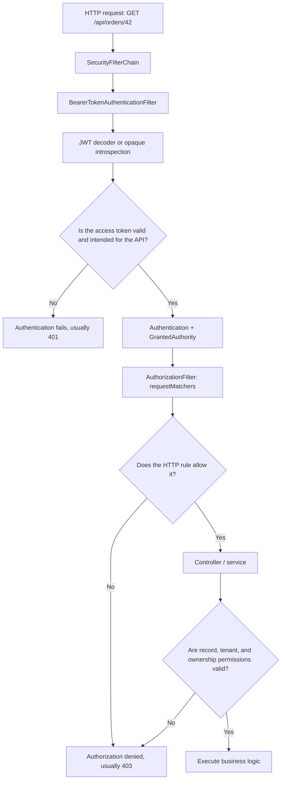

# requestMatchers by Path, Method, and Business Requirements

When a Spring Security application acts as an **OAuth 2.0 Resource Server**, a valid access token does not mean the caller is allowed to perform every action. The API needs to decide **which functionality a request can reach** based on the HTTP method, URL path, and granted permissions. In Spring Security's Servlet stack, a core tool is **`requestMatchers(...)` inside `authorizeHttpRequests(...)`**.

For example, an Orders API has these operations:

- Customers read their own orders.
- Customers create new orders.
- Support agents view orders according to policy.
- Administrators view system reports.
- A machine-to-machine integration synchronizes orders.
- Unauthenticated visitors can only access permitted health/public endpoints.

These requirements cannot be satisfied by a single line `anyRequest().authenticated()`. You need to map out paths, methods, authorities, and the corresponding data checks.

> **Core principle:** `requestMatchers` determines **which HTTP requests** a rule applies to; `hasAuthority`, `hasRole`, `authenticated`, `access`, and so on determine **the authorization condition** for that request. Access to a **specific record** usually must also be checked at the method/service layer.

This lesson uses the modern Spring Security Servlet context with a `SecurityFilterChain` bean configuration and lambda DSL. This configuration targets a **JWT/opaque bearer token Resource Server**; differences across Spring Security versions, Servlet mappings, and matcher implementations should be verified against your actual deployment environment.

## 1. Viewing the Full Authentication and Authorization Journey

A request to the API:

```http
GET /api/orders/42 HTTP/1.1
Host: api.example.test
Authorization: Bearer <ACCESS_TOKEN>
```

Goes through these logical steps:



With a JWT access token:

```json
{
  "iss": "https://login.example.test/realms/shop",
  "sub": "user-123",
  "aud": ["orders-api"],
  "scope": "orders.read orders.write",
  "exp": 1900000000
}
```

Spring Security typically maps each scope to a `GrantedAuthority` with the `SCOPE_` prefix:

```text
scope:
  orders.read
  orders.write

GrantedAuthority:
  SCOPE_orders.read
  SCOPE_orders.write
```

Then `requestMatchers(HttpMethod.GET, "/api/orders/**").hasAuthority("SCOPE_orders.read")` can check the **read scope** for the corresponding GET routes. However, permission to read order 42 belonging to someone else cannot be inferred from the scope alone.

### 1.1. Two Decision Layers

| Layer | Question | Example |
|---|---|---|
| **Authentication** | Was the token issued by a trusted issuer, is it still valid, and is it intended for this API? | Signature/issuer/audience/expiry validation or introspection |
| **HTTP authorization** | What scope/role does this type of HTTP request require? | `GET /api/orders/**` requires `SCOPE_orders.read` |
| **Object/business authorization** | Does the caller have permission for the specific order/tenant? | Does `user-123` own or have shared access to order 42? |

These three layers complement one another; they do not replace one another.

## 2. What Do `authorizeHttpRequests` and `requestMatchers` Solve?

Spring Security Servlet provides the DSL:

```java
http.authorizeHttpRequests(authorize -> authorize
    .requestMatchers(HttpMethod.GET, "/api/orders/**")
        .hasAuthority("SCOPE_orders.read")
    .requestMatchers(HttpMethod.POST, "/api/orders")
        .hasAuthority("SCOPE_orders.write")
    .anyRequest().denyAll()
);
```

How to read each line:

1. If the request matches **method GET** and **path pattern `/api/orders/**`**, require authority `SCOPE_orders.read`.
2. If the request matches **method POST** and **path `/api/orders`**, require authority `SCOPE_orders.write`.
3. Requests matching none of the rules above **are denied**.

`requestMatchers` accepts matchers to select requests; what follows, such as `permitAll()`, `authenticated()`, or `hasAuthority(...)`, is the authorization condition.

### 2.1. Authorization Is Not Authentication

A rule:

```java
.anyRequest().authenticated()
```

only requires the request to have an `Authentication` considered authenticated by Spring Security. It is **not equivalent** to "has the right scope" or "has permission on all data."

In an API with many sensitive endpoints, explicitly describe permissions and provide an appropriate fallback:

```java
.anyRequest().denyAll()
```

This makes any new endpoint not yet added to the policy **blocked by default**. When adding an API route, the developer must deliberately decide the authorization rule for that route.

### 2.2. HTTP Method and Path Are Two Axes

The same path `/api/orders/42` can serve multiple actions:

| HTTP method | Example | Business requirement | Illustrative authority |
|---|---|---|---|
| `GET` | `GET /api/orders/42` | View order | `SCOPE_orders.read` |
| `PATCH` | `PATCH /api/orders/42` | Edit order details | `SCOPE_orders.write` |
| `DELETE` | `DELETE /api/orders/42` | Delete/void per policy | `SCOPE_orders.delete` |
| `POST` | `POST /api/orders/42/cancel` | Request order cancellation | `SCOPE_orders.cancel` |

If you only use:

```java
.requestMatchers("/api/orders/**")
    .hasAuthority("SCOPE_orders.read")
```

then the rule covers **multiple HTTP methods**, potentially including write/delete operations. This is a common design mistake: *the path is the same, but the risk level of each method differs*.

**When read and write permissions differ, express both HTTP method and path.**

## 3. `requestMatchers(...)` by HTTP Method

For typical REST APIs, the basic arguments are:

```java
.requestMatchers(HttpMethod.GET, "/api/orders/**")
.requestMatchers(HttpMethod.POST, "/api/orders")
.requestMatchers(HttpMethod.PUT, "/api/orders/**")
.requestMatchers(HttpMethod.PATCH, "/api/orders/**")
.requestMatchers(HttpMethod.DELETE, "/api/orders/**")
```

Business rules can differ:

- `GET`: reads data, typically less privileged.
- `POST`: creates resources, submits actions, or starts workflows.
- `PUT`: updates/replaces a resource.
- `PATCH`: partial update, which can affect sensitive fields.
- `DELETE`: deletes/deactivates, typically requiring tighter permissions.
- `HEAD`: returns metadata; still evaluate data sensitivity and framework mapping.
- `OPTIONS`: commonly appears in CORS preflight; handle according to CORS policy rather than unconditionally permitting every request across the system.

**The HTTP method is only a signal of the API contract**, not an automatic guarantee of safety. A `GET` endpoint with side effects is questionable API design; a `POST` endpoint that exports a report only reads data yet may expose sensitive information. Authorization must be based on actual business behavior rather than method names alone.

### 3.1. Distinguishing Resource-Creation POST from Action POST

Two endpoints can both use `POST` yet require distinct permissions:

```http
POST /api/orders
POST /api/orders/42/cancel
```

You can separate them:

```java
.requestMatchers(HttpMethod.POST, "/api/orders")
    .hasAuthority("SCOPE_orders.write")
.requestMatchers(HttpMethod.POST, "/api/orders/*/cancel")
    .hasAuthority("SCOPE_orders.cancel")
```

The `*` pattern in the example matches a single path segment under the corresponding matching mechanism. Verify wildcard semantics for the chosen matcher and application routing; do not assume every matcher engine follows the same rules.

If cancellation carries the condition "only the order creator or authorized support staff may cancel," add a business check in the service after verifying the scope.

## 4. Path Patterns and Specificity

In Spring Security, you may see patterns such as:

```text
/api/orders
/api/orders/*
/api/orders/**
/api/admin/**
/public/**
```

Intuitive meaning:

| Pattern | Used to describe | Point of caution |
|---|---|---|
| `/api/orders` | Exact collection endpoint path | Does not cover child items by default |
| `/api/orders/*` | One child path segment per matcher | Do not assume it matches multiple path levels |
| `/api/orders/**` | Paths under the Orders API branch | May cover special routes like export/admin if URL structure is poorly organized |
| `/api/admin/**` | Administrative branch | Does not automatically require a role unless a rule is attached |
| `/public/**` | Branch considered public | Requires a business decision that every new route under this branch can be public |

**Exact behavior depends on the `RequestMatcher` type.** Modern Spring Security versions may select matchers based on Spring MVC, path patterns, or corresponding implementations; this affects syntax, trailing slashes, servlet paths, encoded paths, and edge cases. Do not mix the rules of `AntPathRequestMatcher`, `MvcRequestMatcher`, or `PathPatternRequestMatcher` as if they were always identical.

For example, `/api/orders/**` is a broad pattern suitable for general Orders API read access, but if `/api/orders/admin/export` sits inside that branch and needs special permissions, the more specific rule must take precedence.

### 4.1. Path Matters More Than Controller Method Names

A Java method:

```java
@GetMapping("/api/orders/{orderId}")
public OrderDto findById(@PathVariable String orderId) {
    // ...
}
```

is protected by the HTTP policy via the request path, not automatically by the method name `findById`.

If the controller changes the path from `/api/orders/{orderId}` to `/api/v2/orders/{orderId}`, the old matcher rule may no longer protect the new route as intended. Therefore, controller paths and authorization rules must be kept in sync.

## 5. **Rule Declaration Order Determines the Outcome**

A common pitfall in `authorizeHttpRequests` is that **the first rule matching the request is used to decide authorization** in the corresponding rule list.

Incorrect example:

```java
.authorizeHttpRequests(auth -> auth
    .requestMatchers("/api/orders/**").authenticated()
    .requestMatchers(HttpMethod.GET, "/api/orders/admin/export")
        .hasAuthority("SCOPE_orders.export")
    .anyRequest().denyAll()
)
```

Request:

```http
GET /api/orders/admin/export
```

already matches `/api/orders/**`. The stricter second rule never gets a chance to decide the request as intended. An authenticated token lacking `orders.export` can bypass **HTTP authorization** for this route if no other check exists.

Better approach:

```java
.authorizeHttpRequests(auth -> auth
    .requestMatchers(HttpMethod.GET, "/api/orders/admin/export")
        .hasAuthority("SCOPE_orders.export")
    .requestMatchers(HttpMethod.GET, "/api/orders/**")
        .hasAuthority("SCOPE_orders.read")
    .anyRequest().denyAll()
)
```

**Place specific/sensitive rules first, broader covering rules later**, followed by the fallback.

### 5.1. There Is No Automatic Prioritization of the "Most Specific" Pattern

Do not assume Spring Security will always analyze all rules, pick the most specific pattern automatically, and ignore the order written by the developer. In the request-matcher authorization DSL, **entry order is part of the policy**.

Therefore:

```java
.requestMatchers("/api/**").permitAll()
.requestMatchers("/api/admin/**").hasRole("ADMIN")
```

is a critical bug: the overly broad public rule can block any chance of applying the admin role below it.

### 5.2. Matcher Ordering Example Table

| Request | First matching rule | Decision |
|---|---|---|
| `GET /api/orders/admin/export` | `GET /api/orders/admin/export` | Requires `SCOPE_orders.export` |
| `GET /api/orders/42` | `GET /api/orders/**` | Requires `SCOPE_orders.read` |
| `POST /api/orders` | `POST /api/orders` | Requires `SCOPE_orders.write` |
| `DELETE /api/orders/42` | `DELETE /api/orders/**` | Requires `SCOPE_orders.delete` |
| `GET /api/unknown` | `anyRequest().denyAll()` | Denied |

Ordering affects security even when the same URL is matched by multiple patterns.

## 6. Designing Policies from Business Requirements Before Writing Java

Determine **who can perform which actions** using an API contract table.

Suppose the Shop API has these caller groups:

- **Authenticated customers:** read and create their own orders.
- **Support agents:** read orders they are authorized to support, without modifying payments.
- **Warehouse operators:** view orders for fulfillment and update delivery status.
- **Sync services:** read lists for integration purposes.
- **Administrators:** manage specifically delegated business operations, not "everything" by default.
- **Unauthenticated visitors:** access only resources explicitly designated as public.

Sample requirements table:

| Route and method | Purpose | Minimum HTTP permission | Additional business conditions |
|---|---|---|---|
| `GET /public/catalog` | View public catalog | `permitAll` | Returned data is genuinely public |
| `GET /api/orders` | List orders | `SCOPE_orders.read` | Return only orders the caller may view |
| `GET /api/orders/{id}` | View order | `SCOPE_orders.read` | Ownership/tenant/sharing |
| `POST /api/orders` | Create order | `SCOPE_orders.write` | Validate customer, items, limits |
| `PATCH /api/orders/{id}` | Edit order | `SCOPE_orders.write` | Allow editing only permitted fields and states |
| `POST /api/orders/{id}/cancel` | Cancel order | `SCOPE_orders.cancel` | Permission on the order, cancellable status |
| `GET /api/orders/admin/export` | Bulk data export | `SCOPE_orders.export` | Tenant/data restrictions and audit |
| `DELETE /api/orders/{id}` | Delete/deactivate | `SCOPE_orders.delete` | Approved role/principal only |
| `POST /api/shipments/{id}/dispatch` | Confirm shipment | `SCOPE_shipments.dispatch` | Verify warehouse permission and status |
| `GET /internal/health` | Health endpoint | `permitAll` or separate policy | Separate public liveness from internal details |

This table does not dictate that every application must use these exact scopes. Scope names are **a contract with the Authorization Server**. The AS must grant scopes based on client and user permissions; the Resource Server then checks the corresponding authorities.

### 6.1. Distinguishing "Granted a Scope" from "Owns the Data"

Access token:

```json
{
  "sub": "customer-123",
  "aud": ["orders-api"],
  "scope": "orders.read"
}
```

and request:

```http
GET /api/orders/987
```

do not prove that order 987 belongs to customer-123. `hasAuthority("SCOPE_orders.read")` checks **the type of permission**. The service must check the relationship between the principal and the record.

Forgetting this step easily leads to **IDOR/BOLA** (*insecure direct object reference/broken object level authorization*): changing the ID in the URL lets you read someone else's data.

## 7. Example `SecurityFilterChain` for the Orders API

A reference configuration for a JWT Resource Server:

```java
@Configuration
@EnableMethodSecurity
public class ApiSecurityConfig {

    @Bean
    SecurityFilterChain apiSecurity(HttpSecurity http) throws Exception {
        return http
            .sessionManagement(session ->
                session.sessionCreationPolicy(
                    SessionCreationPolicy.STATELESS
                )
            )
            .authorizeHttpRequests(auth -> auth
                // Intentionally public:
                .requestMatchers(HttpMethod.GET, "/public/catalog")
                    .permitAll()
                .requestMatchers(HttpMethod.GET, "/public/health")
                    .permitAll()

                // Sensitive operations, placed before wildcards:
                .requestMatchers(
                    HttpMethod.GET, "/api/orders/admin/export"
                ).hasAuthority("SCOPE_orders.export")

                .requestMatchers(
                    HttpMethod.POST, "/api/orders/*/cancel"
                ).hasAuthority("SCOPE_orders.cancel")

                .requestMatchers(
                    HttpMethod.DELETE, "/api/orders/**"
                ).hasAuthority("SCOPE_orders.delete")

                .requestMatchers(
                    HttpMethod.GET, "/api/shipments/**"
                ).hasAuthority("SCOPE_shipments.read")

                .requestMatchers(
                    HttpMethod.POST, "/api/shipments/*/dispatch"
                ).hasAuthority("SCOPE_shipments.dispatch")

                // Standard Orders operations:
                .requestMatchers(
                    HttpMethod.GET, "/api/orders/**"
                ).hasAuthority("SCOPE_orders.read")

                .requestMatchers(
                    HttpMethod.POST, "/api/orders"
                ).hasAuthority("SCOPE_orders.write")

                .requestMatchers(
                    HttpMethod.PUT, "/api/orders/**"
                ).hasAuthority("SCOPE_orders.write")

                .requestMatchers(
                    HttpMethod.PATCH, "/api/orders/**"
                ).hasAuthority("SCOPE_orders.write")

                // Do not automatically open new routes:
                .anyRequest().denyAll()
            )
            .oauth2ResourceServer(oauth2 ->
                oauth2.jwt(Customizer.withDefaults())
            )
            .build();
    }
}
```

Imports:

```java
import org.springframework.context.annotation.Bean;
import org.springframework.context.annotation.Configuration;
import org.springframework.http.HttpMethod;
import org.springframework.security.config.Customizer;
import org.springframework.security.config.annotation.method.configuration.EnableMethodSecurity;
import org.springframework.security.config.annotation.web.builders.HttpSecurity;
import org.springframework.security.config.http.SessionCreationPolicy;
import org.springframework.security.web.SecurityFilterChain;
```

Here `STATELESS` is a common choice when the API uses only bearer tokens via headers. The example **does not yet cover the full CORS, CSRF, actuator, error dispatch, gateway, and other deployment policies**. Those must be configured according to how the real application receives credentials.

### 7.1. Why Not End with `anyRequest().authenticated()`?

If a new endpoint is added:

```http
POST /api/admin/refund-all
```

without a dedicated matcher, an `authenticated()` fallback can let any authenticated caller through without refund permission. With a `denyAll()` fallback, this endpoint is blocked at HTTP authorization until an explicit permission decision is made.

In environments requiring strict governance, **deny-by-default reduces the risk of exposing permissions when adding new routes**.

### 7.2. Why Should the Export Route Be Placed Before the GET Wildcard?

If `GET /api/orders/admin/export` matches `GET /api/orders/**` and the wildcard rule comes first, the caller only needs §orders.read§. Placing `SCOPE_orders.export` first enforces the sensitive permission dedicated to bulk export.

Even so, if `/api/orders/admin/export` carries highly sensitive data, you may need tenant restrictions, auditing, row limits, and export policies directly in the service. A scope alone does not mitigate every risk.

### 7.3. What Happens to Unlisted Endpoints?

With `anyRequest().denyAll()`, other routes such as:

```http
POST /api/orders/42/approve
GET  /api/admin/config
PATCH /api/users/123
```

will be denied at authorization if they do not match an earlier permitted entry. This does not guarantee every route has the right policy, but it keeps the default closed rather than open.

## 8. Distinguishing `hasAuthority`, `hasRole`, `authenticated`, and `permitAll`

Commonly used methods in `authorizeHttpRequests`:

| Method | Meaning | When to use |
|---|---|---|
| `permitAll()` | Allows the request at the HTTP authorization step | Resources intentionally made public |
| `authenticated()` | Requires the caller to have a valid Authentication | Endpoints needing only an authenticated user/app |
| `hasAuthority("SCOPE_x")` | Requires one exact authority | An OAuth 2.0 scope or permission mapped to an authority |
| `hasAnyAuthority("A", "B")` | Accepts at least one authority in the set | Multiple equivalent permissions suffice to call the endpoint |
| `hasRole("ADMIN")` | Requires a role per the §ROLE_ADMIN§ convention | When the system has properly mapped roles into Spring Security |
| `hasAnyRole("A", "B")` | Allows any one of the roles | Role-based systems |
| `access(customAuthorizationManager)` | Applies custom logic | Complex HTTP rules needing request context |
| `denyAll()` | Denies the request | Default closed or forbidden routes |

### 8.1. A Scope Is Not Automatically a Role

Token containing:

```json
{
  "scope": "orders.read",
  "roles": ["ORDER_MANAGER"]
}
```

The default JWT configuration typically converts scopes into:

```text
SCOPE_orders.read
```

but **does not automatically create §ROLE_ORDER_MANAGER§ from the §roles§ claim** unless an appropriate converter is configured.

Therefore:

```java
.hasAuthority("SCOPE_orders.read")
```

is usually right for the read scope, whereas:

```java
.hasRole("ORDER_MANAGER")
```

works only when §GrantedAuthority=ROLE_ORDER_MANAGER§ has been produced from a claim source trusted by the issuer.

Do not mix them up:

```java
.hasRole("SCOPE_orders.read")
```

because §hasRole§ uses the role prefix convention rather than directly checking a scope.

### 8.2. §authenticated()§ Is Insufficient for Sensitive Data

With:

```java
.requestMatchers("/api/orders/**").authenticated()
```

the API only requires an authenticated user/app. It enforces neither read nor write permissions, and certainly not ownership. For business operations with distinct permissions, use specific authorities and object checks.

### 8.3. §permitAll()§ Does Not Mean Bypassing All Filters

`permitAll()` allows the request at the authorization step. It **does not necessarily skip every security filter**: for example, `BearerTokenAuthenticationFilter` may still see an invalid bearer token and handle the error depending on configuration, even if the path is considered public.

You should not use `web.ignoring()` to "avoid errors" on public endpoints if security headers, observability, and related filters are still needed. `permitAll` is usually the better choice when the route still passes through `SecurityFilterChain`.

## 9. `hasAnyAuthority`: Multiple Permissions Able to Perform the Same Action

Suppose the read-orders endpoint allows **customers with the read scope** or **support integrations granted the support permission**:

```java
.requestMatchers(HttpMethod.GET, "/api/orders/**")
    .hasAnyAuthority(
        "SCOPE_orders.read",
        "SCOPE_support.orders.read"
    )
```

This is **OR** logic at HTTP authorization: the caller only needs one of the two authorities.

Yet the endpoint must still verify who can view **a specific order**:

- Customers view only their own orders or orders shared with them.
- Support staff view only data within their assigned tenant/scope.
- Sync services may require organization or purpose restrictions.

A §support.orders.read§ permission does not by default grant access to every order across all tenants. If a scope is intended to be broad, corresponding data policies and auditing are needed.

### 9.1. When Multiple Authorities Must Be Required Together

If an operation requires **both** permissions, use an appropriate AND check; `hasAnyAuthority` is not sufficient.

Example in method security:

```java
@PreAuthorize(
    "hasAuthority('SCOPE_orders.read') and " +
    "hasAuthority('SCOPE_reports.export')"
)
public byte[] exportOrders() {
    // ...
}
```

Or configure an `AuthorizationManager` combining the corresponding conditions at the HTTP layer per your Spring Security version's API. Do not interpret `hasAnyAuthority(A, B)` as "must have both A and B."

## 10. `requestMatchers` Does Not Replace Record-Level Permissions

Consider two requests matching the same route pattern:

```http
GET /api/orders/42
GET /api/orders/99
```

Both match `GET /api/orders/**` and the caller has §SCOPE_orders.read§. However, order 42 belongs to the caller, while order 99 belongs to another tenant.

**HTTP matchers do not know who owns ID 42 or 99.** A business check layer is required.

### 10.1. Method Security Example with `@PreAuthorize`

Enable method security:

```java
@Configuration
@EnableMethodSecurity
public class MethodSecurityConfiguration {
}
```

In the service:

```java
@Service
public class OrderService {

    private final OrderRepository repository;
    private final OrderAccessPolicy accessPolicy;

    public OrderService(
            OrderRepository repository,
            OrderAccessPolicy accessPolicy) {
        this.repository = repository;
        this.accessPolicy = accessPolicy;
    }

    @PreAuthorize(
        "hasAuthority('SCOPE_orders.read') and " +
        "@orderAccessPolicy.canRead(authentication, #orderId)"
    )
    public OrderDto getOrder(String orderId) {
        Order order = repository.findById(orderId)
            .orElseThrow(OrderNotFoundException::new);

        return OrderDto.from(order);
    }
}
```

Example policy bean:

```java
@Component("orderAccessPolicy")
public class OrderAccessPolicy {

    private final OrderRepository repository;

    public OrderAccessPolicy(OrderRepository repository) {
        this.repository = repository;
    }

    public boolean canRead(
            Authentication authentication,
            String orderId) {

        if (authentication == null ||
                !authentication.isAuthenticated()) {
            return false;
        }

        String subject = authentication.getName();

        return repository.existsReadableBySubject(
            orderId,
            subject
        );
    }
}
```

This is an example **business pattern**, not a built-in Spring repository class. §existsReadableBySubject(...)§ must be implemented against your real schema; ensure checks cover tenant, ownership, sharing, or support permissions per your contract. The principal name is not always the user ID; if JWT mapping uses another claim, the policy must extract the appropriate **trusted subject identifier**.

With the SpEL parameter `#orderId`, ensure Spring Security can see the parameter name (for example, compiling with `-parameters` or specifying parameters via a supported mechanism). Never drop the permission check to work around a missing parameter-name error.

### 10.2. Avoid Queries Missing Tenant Filtering

Suppose Order IDs are unique only within each tenant:

```text
tenant A, order 42
tenant B, order 42
```

A query using only §id=42§ may mistakenly load another tenant's record. A safe rule usually needs a combination:

```text
orderId
+ permitted tenant
+ subject/client service principal
+ role/sharing policy
+ business state
```

For multi-tenant systems, include the tenant condition in data queries or repository/service-bound policies rather than comparing the path ID after loading all data.

### 10.3. Checking HTTP with a Custom AuthorizationManager

Besides `@PreAuthorize`, Spring Security can use `access(...)` with an `AuthorizationManager<RequestAuthorizationContext>`. This fits when the policy truly belongs at the **request layer** and needs to leverage path variables or trusted parsed HTTP attributes.

Conceptual example:

```java
.requestMatchers(HttpMethod.GET, "/api/tenants/{tenantId}/orders/**")
    .access(tenantAuthorizationManager)
```

The manager is built to evaluate the current `Authentication` together with the request context. However, not every request matcher exposes path variables the same way; implementation and Spring Security version determine extraction behavior. For DB-dependent record ownership, **service/method authorization** is usually clearer.

## 11. Matcher Precedence with Multiple URL Groups

A system might have branches such as:

```text
/api/orders/**
/api/orders/admin/**
/api/reports/**
/api/admin/**
/public/**
/internal/**
```

At scale, there are multiple ways to organize them. Principles:

1. Public rules **apply only to genuinely public endpoints**.
2. Admin/export/cancel/delete rules **are placed before** wildcard rules on the same branch.
3. Read and write permissions **are separated by method**.
4. System-wide fallback is **`denyAll`** when there is no reason to open new routes.
5. Do not assume a path containing "admin" is protected automatically without a matching rule/policy.

Example:

```java
.authorizeHttpRequests(auth -> auth
    .requestMatchers(HttpMethod.GET, "/public/catalog")
        .permitAll()
    .requestMatchers(HttpMethod.GET, "/api/orders/admin/export")
        .hasAuthority("SCOPE_orders.export")
    .requestMatchers(HttpMethod.GET, "/api/orders/**")
        .hasAuthority("SCOPE_orders.read")
    .requestMatchers(HttpMethod.POST, "/api/orders")
        .hasAuthority("SCOPE_orders.write")
    .anyRequest().denyAll()
)
```

Do not write:

```java
.authorizeHttpRequests(auth -> auth
    .requestMatchers("/api/**").permitAll()
    .requestMatchers("/api/admin/**").hasRole("ADMIN")
    .anyRequest().authenticated()
)
```

Because the public rule at the top can cover the admin branch before the role rule is evaluated.

### 11.1. Request Patterns Change with Base Path / Deployment

Some applications run behind a gateway:

```text
Public URL:
  https://gateway.example.test/shop/api/orders/42

Internal Servlet route:
  /api/orders/42
```

The HTTP request seen by Spring Security depends on context path, servlet path, forwarded headers, and gateway configuration. **Do not prepend `/shop` to matchers just because the public URL has that prefix**, if the gateway strips it before forwarding to the Servlet container.

Conversely, do not write matchers ignoring servlet paths when an application has multiple servlets with different mappings. Understand the exact path used by the relevant parser/matcher rather than guessing from browser URLs.

### 11.2. Query Parameters Do Not Replace Path/Method Authorization

Two URLs:

```http
GET /api/orders/42?format=short
GET /api/orders/42?format=full
```

are usually matched by the same path/method matcher. If `format=full` exposes sensitive extra data, a generic `GET /api/orders/**` rule does not automatically enforce the extra permission. A business policy or a dedicated `AuthorizationManager`/endpoint is needed, because query parameters can be chosen by the caller.

Similarly, `?admin=true` must never become a way to enable admin privileges in service code.

## 12. How Does `securityMatcher` Differ from `requestMatchers`?

A very common mistake is treating these two APIs as the same.

- **`http.securityMatcher(...)`**: determines **which requests belong to this entire `SecurityFilterChain`**.
- **`authorizeHttpRequests(...).requestMatchers(...)`**: determines **authorization rules inside the already-selected chain**.

Example of a system with a bearer API and a session-based web UI:

```java
@Bean
@Order(1)
SecurityFilterChain apiChain(HttpSecurity http) throws Exception {
    return http
        .securityMatcher("/api/**")
        .authorizeHttpRequests(auth -> auth
            .requestMatchers(HttpMethod.GET, "/api/orders/**")
                .hasAuthority("SCOPE_orders.read")
            .anyRequest().denyAll()
        )
        .oauth2ResourceServer(oauth2 ->
            oauth2.jwt(Customizer.withDefaults()))
        .build();
}
```

This chain applies only to requests matched by `/api/**`. The `anyRequest().denyAll()` rule here **is only a fallback within the scope of the API chain**. It does not automatically protect `/admin/**` or `/public/**` if those requests enter another chain or are left unprotected by any chain.

A second chain can handle the web UI:

```java
@Bean
@Order(2)
SecurityFilterChain webChain(HttpSecurity http) throws Exception {
    return http
        .authorizeHttpRequests(auth -> auth
            .requestMatchers("/login", "/assets/**").permitAll()
            .anyRequest().authenticated()
        )
        .formLogin(Customizer.withDefaults())
        .build();
}
```

Related imports:

```java
import org.springframework.core.annotation.Order;
import org.springframework.context.annotation.Bean;
import org.springframework.http.HttpMethod;
import org.springframework.security.config.Customizer;
import org.springframework.security.config.annotation.web.builders.HttpSecurity;
import org.springframework.security.web.SecurityFilterChain;
```

These are two configurations **illustrating separate chains**. In a real app, evaluate session, CSRF, CORS, endpoints, authentication providers, exception handling, and specific servlet paths. Do not paste fragmented snippets into a single class while omitting required dependencies/beans.

### 12.1. Chain Selection Also Follows Ordering

With multiple `SecurityFilterChain` beans, Spring Security selects the **first chain whose matcher matches** in configured order. If a general chain precedes a specialized chain, the specialized chain may never be applied to the intended requests.

A bug:

```text
Chain A: matches every request, @Order(1)
Chain B: matches /api/**,       @Order(2)
```

`/api/**` requests can be captured first by Chain A, preventing the JWT Resource Server rules in B from running.

Therefore, at both the **filter chain selection** level and the **intra-chain authorization rule** level, precedence is critical.

### 12.2. What If No Chain Matches?

If a request is not selected by any `SecurityFilterChain`, it may **receive no Spring Security protection**. Therefore, when using multiple chains, audit the full route surface and design an appropriate overall fallback.

Do not assume that `anyRequest().denyAll()` inside a chain covering only `/api/**` will deny every path across the entire application.

## 13. Combining JWT Resource Server with HTTP Authorization

A JWT Resource Server configuration can use:

```yaml
spring:
  security:
    oauth2:
      resourceserver:
        jwt:
          issuer-uri: https://login.example.test/realms/shop
          audiences:
            - orders-api
```

In Spring Boot versions supporting the audience property, this binds tokens as **issued for this API**. In the filter chain:

```java
.oauth2ResourceServer(oauth2 ->
    oauth2.jwt(Customizer.withDefaults()))
```

enables Spring Security to verify the JWT and construct `Authentication`.

**Separate two concerns:**

- `audiences: orders-api`: Access token is intended for this Resource Server.
- `hasAuthority("SCOPE_orders.read")`: Access token was granted read permission for the Orders API.

A token with a valid signature and audience that lacks the scope will still fail HTTP authorization on the read endpoint.

### 13.1. Opaque Tokens Can Use the Same HTTP Rules

If the Authorization Server issues opaque tokens, the Resource Server can use introspection:

```java
.oauth2ResourceServer(oauth2 ->
    oauth2.opaqueToken(Customizer.withDefaults()))
```

When introspection succeeds and scopes are mapped to authorities, `requestMatchers(...).hasAuthority("SCOPE_orders.read")` can still apply. However, the introspection contract must properly verify issuer/resource binding, scopes, and principal.

Do not assume all opaque tokens carry the same attributes or authority mapping as JWTs. Design around the metadata the Authorization Server actually provides.

## 14. Mapping Scopes and Roles Before Writing Matcher Rules

If Spring Security by default generates §SCOPE_...§ from the §scope§ or §scp§ claim, the following rule fits:

```java
.requestMatchers(HttpMethod.GET, "/api/orders/**")
    .hasAuthority("SCOPE_orders.read")
```

If the issuer emits a different claim:

```json
{
  "permissions": ["orders:read", "orders:export"]
}
```

a custom `JwtGrantedAuthoritiesConverter` may be needed:

```java
JwtGrantedAuthoritiesConverter grantedAuthorities =
    new JwtGrantedAuthoritiesConverter();

grantedAuthorities.setAuthoritiesClaimName("permissions");
grantedAuthorities.setAuthorityPrefix("PERM_");

JwtAuthenticationConverter converter =
    new JwtAuthenticationConverter();

converter.setJwtGrantedAuthoritiesConverter(grantedAuthorities);
```

Then configure the rule:

```java
.requestMatchers(HttpMethod.GET, "/api/orders/**")
    .hasAuthority("PERM_orders:read")
```

Imports:

```java
import org.springframework.security.oauth2.server.resource.authentication.JwtAuthenticationConverter;
import org.springframework.security.oauth2.server.resource.authentication.JwtGrantedAuthoritiesConverter;
```

**Do not call `hasRole("orders:read")` when the actual authority is `PERM_orders:read`.** The name in the matcher rule must match the authority produced by the converter.

### 14.1. Avoid Trusting Self-Declared Roles in Body/Query

Never use:

```http
POST /api/orders
Content-Type: application/json

{"role":"ADMIN","order":{...}}
```

to conclude that the caller has admin privileges. Roles/scopes used for authorization must come from a verified §Authentication§ or a trusted server-side permission source.

### 14.2. Scopes in a Token Do Not Replace Issuer/Audience Validation

If a JWT contains:

```json
"scope": "orders.read"
```

but the audience is only `payments-api`, the Orders API must reject the token during token validation, before granting access based on scope. Never write HTTP matcher logic to "compensate" for a decoder skipping issuer/audience validation.

## 15. CORS Preflight and HTTP OPTIONS

A frontend on another domain may require CORS preflight:

```http
OPTIONS /api/orders
Origin: https://app.example.test
Access-Control-Request-Method: POST
Access-Control-Request-Headers: authorization,content-type
```

Preflight requests usually **carry no access token**. If the backend requires preflight to be authenticated before applying CORS, the browser may block it and report a CORS error.

A Servlet configuration approach:

```java
http.cors(Customizer.withDefaults());
```

with a `CorsConfigurationSource` defining an explicit policy:

```java
@Bean
UrlBasedCorsConfigurationSource corsConfigurationSource() {
    CorsConfiguration config = new CorsConfiguration();

    config.setAllowedOrigins(
        List.of("https://app.example.test")
    );
    config.setAllowedMethods(
        List.of("GET", "POST", "PUT", "PATCH", "DELETE")
    );
    config.setAllowedHeaders(
        List.of("Authorization", "Content-Type")
    );

    UrlBasedCorsConfigurationSource source =
        new UrlBasedCorsConfigurationSource();

    source.registerCorsConfiguration("/api/**", config);
    return source;
}
```

Illustrative imports:

```java
import java.util.List;
import org.springframework.context.annotation.Bean;
import org.springframework.web.cors.CorsConfiguration;
import org.springframework.web.cors.UrlBasedCorsConfigurationSource;
```

Depending on the Spring Security version, how the CORS bean is declared/wired to the filter chain may vary. Verify that CORS is actually handled **before authentication requires a bearer token**.

### 15.1. It Is Not Simply "Allow All OPTIONS"

Rule:

```java
.requestMatchers(HttpMethod.OPTIONS, "/**").permitAll()
```

can alter authorization for all OPTIONS requests, not only valid CORS preflights. If there are business OPTIONS endpoints or multiple security zones, define matching policies. Prefer configuring CORS with the proper origins, methods, and headers rather than opening everything globally just to silence a frontend error.

CORS **does not replace API authorization**. An allowed browser origin sending a request must still supply a valid access token with sufficient scopes for the actual request, such as the POST following preflight.

### 15.2. Distinguishing CORS and CSRF

CORS controls cross-origin access policies from the browser; CSRF concerns requests that automatically carry credentials (such as cookies). If a Resource Server **only accepts bearer tokens explicitly placed by the client in the Authorization header** and does not use session/cookie authentication, there may be a rationale for configuring CSRF suitably for a stateless API.

However, **do not disable CSRF by default just because an application uses Spring Security**, if cookies/sessions or browser-authenticated endpoints still exist. `requestMatchers` does not replace a CSRF policy.

## 16. Dispatcher Types, Error Handling, and Special Paths

In a Servlet container, requests also have a §DispatcherType§, such as §REQUEST§, §ERROR§, §FORWARD§, or §ASYNC§. Some requests may be forwarded to an error endpoint or undergo internal dispatches.

When using a `denyAll()` fallback, an error dispatch to `/error` may be denied and make error responses harder to observe depending on filter chain configuration.

Spring Security can control dispatcher types, depending on version:

```java
.authorizeHttpRequests(auth -> auth
    .dispatcherTypeMatchers(
        DispatcherType.FORWARD,
        DispatcherType.ERROR
    ).permitAll()
    .requestMatchers(HttpMethod.GET, "/api/orders/**")
        .hasAuthority("SCOPE_orders.read")
    .anyRequest().denyAll()
)
```

Import:

```java
import jakarta.servlet.DispatcherType;
```

**This is a policy decision, not a snippet every project must copy blindly.** Permitting all ERROR/FORWARD dispatches may be inappropriate if a forward targets a sensitive route or given a particular filter/controller organization. Understand Servlet dispatcher mappings and application internals before applying it.

Similarly, actuator endpoints, static resources, health checks, API docs, and the H2 console should not be opened via broad patterns just to avoid 401 errors. Each group has its own operational requirements and risks.

## 17. Which Rules Protect Health, Docs, and Actuator Endpoints?

A system may require:

```text
GET /actuator/health/liveness
GET /actuator/health/readiness
GET /actuator/metrics
GET /v3/api-docs
GET /swagger-ui/index.html
```

Do not use a rule:

```java
.requestMatchers("/actuator/**").permitAll()
```

if actuator also exposes metrics, env, configprops, or sensitive endpoints. Open only the exact health endpoints required by operations, and place the remaining endpoints behind authentication/authorization.

Conceptual example:

```java
.requestMatchers(
    HttpMethod.GET,
    "/actuator/health/liveness",
    "/actuator/health/readiness"
).permitAll()
```

Actuator paths may differ if a management port, base-path, or endpoint exposure is configured. Do not assume all paths above exist or use the exact same pattern across every Spring Boot application.

API docs may be public in dev environments yet must be restricted in production. Public exposure is a **business/operational decision**, not automatic just because an endpoint serves documentation.

## 18. Role and Scope Rules in Multi-Tier Business Logic

Suppose:

- Customer: scope §orders.read§.
- Support agent: authority §ROLE_SUPPORT§ mapped per policy.
- Administrator: authority §ROLE_ADMIN§.

A read endpoint can allow both customers and support:

```java
.requestMatchers(HttpMethod.GET, "/api/orders/**")
    .hasAnyAuthority(
        "SCOPE_orders.read",
        "ROLE_SUPPORT"
    )
```

But if support and customers have **different record permissions**, the method/service policy needs to know which group the caller belongs to and apply the proper rule:

```text
If scope orders.read is for customer:
  read only orders owned by/shared with the customer

If ROLE_SUPPORT:
  read orders within assigned tenant and support group

If ROLE_ADMIN:
  read only per granted admin permissions, with auditing and tenant boundaries
```

Do not assume §ROLE_ADMIN§ holds every permission across all bounded contexts if the business model does not allow it.

### 18.1. Choosing Role or Scope?

OAuth 2.0 scopes usually represent permissions granted by the Authorization Server to a token; roles can represent positions within an organization or application. Both can be used together, provided there is a clear contract:

| Type | Example | When useful |
|---|---|---|
| OAuth scope | `orders.read` | Which operations the access token was granted |
| Spring authority | `SCOPE_orders.read` | How Spring Security represents scopes |
| Role | `ROLE_SUPPORT` | Support role per a trusted policy |
| Business permission | `CAN_EXPORT_TENANT_42` | Specialized permission verified by service/policy |

Never infer roles from URL names or from client-submitted fields without a verified source.

## 19. Checking Request Methods with HEAD, PUT, PATCH, DELETE

A REST application can easily forget to protect less common methods:

```java
.requestMatchers(HttpMethod.GET, "/api/orders/**")
    .hasAuthority("SCOPE_orders.read")
```

A GET rule should not be assumed to cover every other method properly. The fact that Spring MVC supports HEAD requests automatically for GET mappings in some cases **does not mean you should assume Security HTTP method matchers behave identically in every version**. If metadata also requires read permission, explicitly define/test the HEAD policy per the API contract.

Similarly, `PUT` and `PATCH` may require different permissions:

```java
.requestMatchers(HttpMethod.PUT, "/api/orders/**")
    .hasAuthority("SCOPE_orders.replace")
.requestMatchers(HttpMethod.PATCH, "/api/orders/**")
    .hasAuthority("SCOPE_orders.edit")
```

If the application allows PATCH to alter sensitive fields such as payment information, the permission level may be higher than for ordinary fields. Do not lump all mutations into one generic scope when business requirements demand hierarchy.

### 19.1. Blocking Out-of-Contract Methods

When an API defines only GET and POST on `/api/orders`, the `denyAll()` fallback ensures methods not included in any rule are not permitted by default.

A controller lacking a mapping for a method normally produces §405 Method Not Allowed§, yet if the security layer rejects first, the client may receive §401/403§. **The exact HTTP status code depends on processing order and policy**, not necessarily serving as an accurate indicator of whether an endpoint is implemented.

## 20. Making Policy Decisions Based on Business Data

An order cancellation scenario:

```http
POST /api/orders/42/cancel
Authorization: Bearer <ACCESS_TOKEN>
```

There are at least four questions:

1. **Valid token?** Are issuer, lifetime, audience, and signature/introspection valid?
2. **Matching HTTP authority?** Does the caller have §SCOPE_orders.cancel§?
3. **Permission on order 42?** Does the caller own the order, belong to an allowed tenant, or hold valid support permissions?
4. **Is the order still cancellable?** If it has already shipped or is in a non-cancellable state, business logic must reject it, even if the caller has permission.

`requestMatchers` directly addresses **question 2** by method/path, whereas questions 3 and 4 belong to data/workflow policy. Separating these prevents the bug "having the scope lets you cancel anyone's order in any state."

### 20.1. Permissions Based on Resource Attributes and State

Example contract:

```text
cancel(orderId, caller) allowed if:
  token valid for orders-api
  AND authority includes SCOPE_orders.cancel
  AND (caller owns order OR caller is authorized support)
  AND caller and order are in an allowed tenant relationship
  AND order.status is CANCELLABLE
```

This policy follows a combined **RBAC/ABAC and object-level control** model, which cannot be fully expressed by a path matcher alone.

Place these conditions where trusted data access lives, typically the service/domain layer. If each controller branch writes its own ad-hoc condition, it is easy to miss checks when adding endpoints.

## 21. AuthorizationManager with RequestAuthorizationContext

When HTTP authorization genuinely needs request context, you can use `access(...)` with an `AuthorizationManager<RequestAuthorizationContext>`.

API-level example:

```java
.requestMatchers(
    HttpMethod.GET,
    "/api/tenants/{tenantId}/reports/**"
).access(tenantReportsAuthorizationManager)
```

A custom manager can inspect the current `Authentication` and the matched context supplied by Spring Security, then evaluate tenant permissions. However:

- Availability of path variables in the context depends on the matcher implementation.
- Never use the tenant ID from the path as **self-proving evidence** that the caller belongs to that tenant.
- If DB queries and complex policies are needed, service-layer authorization is usually clearer and easier to maintain.
- A custom manager is never sufficient if the token was not properly validated by the Resource Server.

### 21.1. Conceptual Example of an Authorization Decision

```text
HTTP request:
  GET /api/tenants/shop/orders/42

requestMatchers:
  GET /api/tenants/{tenantId}/orders/**
  -> apply custom AuthorizationManager

AuthorizationManager:
  read authenticated principal
  extract tenantId from the matcher-parsed context
  verify principal is permitted to operate in tenant shop
  -> grant or deny

Business service:
  verify principal also has permission on order 42
  -> allow or deny
```

This is a business flow diagram; do not skip record-level checks just because the manager already checked the tenant path.

## 22. Comparing `requestMatchers` with `@PreAuthorize`

| Attribute | `requestMatchers` | `@PreAuthorize` and method security |
|---|---|---|
| Scope | HTTP request, method, and URL | Java method invocation |
| Context data | HTTP method/path, `Authentication`, matcher context | Method arguments, `Authentication`, beans/policies |
| Best suited for | Protecting routes by scope/role, default deny | Record permissions, tenant, ownership, business logic |
| Common risks | Overly broad wildcards; wrong matcher ordering | Self-invocation/proxy limitations; wrong SpEL parameter mapping |
| Should they be used together? | Yes | Yes |

Example:

```java
.requestMatchers(HttpMethod.GET, "/api/orders/**")
    .hasAuthority("SCOPE_orders.read")
```

and:

```java
@PreAuthorize("@orderAccessPolicy.canRead(authentication, #orderId)")
public OrderDto getOrder(String orderId) {
    // ...
}
```

With method security, pay attention to proxy mechanics: **internal calls on the same instance may bypass the proxy**, so annotations may not fire if designed poorly. Entry points/service boundaries and SQL/repository filters still need to be structured so authorization cannot be accidentally bypassed.

If an API has multiple paths accessing the same service's data, placing the policy in the service keeps checks more consistent than letting each controller infer ownership on its own.

## 23. Testing requestMatchers Policies with MockMvc

When designing security rules, you can write HTTP-level tests with Spring Security Test and MockMvc. The goal of these tests is to verify **which route/method requires which authority**, not to verify JWT signatures by default.

Example:

```java
@SpringBootTest
@AutoConfigureMockMvc
class OrderHttpAuthorizationTests {

    @Autowired
    MockMvc mockMvc;

    @Test
    void getOrdersRequiresReadScope() throws Exception {
        mockMvc.perform(get("/api/orders/42")
                .with(jwt().authorities(
                    new SimpleGrantedAuthority("SCOPE_orders.read")
                )))
            .andExpect(status().isOk());
    }

    @Test
    void getOrdersRejectsTokenWithoutReadScope() throws Exception {
        mockMvc.perform(get("/api/orders/42")
                .with(jwt().authorities(
                    new SimpleGrantedAuthority("SCOPE_profile")
                )))
            .andExpect(status().isForbidden());
    }
}
```

Illustrative imports:

```java
import static org.springframework.security.test.web.servlet.request.SecurityMockMvcRequestPostProcessors.jwt;
import static org.springframework.test.web.servlet.request.MockMvcRequestBuilders.get;
import static org.springframework.test.web.servlet.result.MockMvcResultMatchers.status;

import org.junit.jupiter.api.Test;
import org.springframework.beans.factory.annotation.Autowired;
import org.springframework.boot.test.autoconfigure.web.servlet.AutoConfigureMockMvc;
import org.springframework.boot.test.context.SpringBootTest;
import org.springframework.security.core.authority.SimpleGrantedAuthority;
import org.springframework.test.web.servlet.MockMvc;
```

**Note:** A §200§ success test only passes if the endpoint/controller, test data, and business dependencies are wired to return success; otherwise, the test may produce §404§ or another status. The example demonstrates using `jwt()` to simulate an authenticated caller with authorities.

With §SecurityMockMvcRequestPostProcessors.jwt()§, Spring Security Test constructs/simulates an Authentication for the request **without going through full public-key JWT signature verification**. Therefore:

- Use `jwt()` to test HTTP authorization logic and method security.
- Do not use it as proof that `JwtDecoder` properly validates §iss§, §aud§, §exp§, or JWKS/key rotation.
- To test the real decoder, use properly signed test tokens or purposefully stub/configure the decoder and test validators separately.

### 23.1. Testing Rule Ordering

Suppose you defined:

```java
.requestMatchers(HttpMethod.GET, "/api/orders/admin/export")
    .hasAuthority("SCOPE_orders.export")
.requestMatchers(HttpMethod.GET, "/api/orders/**")
    .hasAuthority("SCOPE_orders.read")
```

Cases to cover:

| Request | Test authorities | Expected authorization result |
|---|---|---|
| `GET /api/orders/42` | §SCOPE_orders.read§ | Permitted through HTTP authorization |
| `GET /api/orders/42` | §SCOPE_profile§ | Denied |
| `GET /api/orders/admin/export` | §SCOPE_orders.read§ | Denied due to missing export |
| `GET /api/orders/admin/export` | §SCOPE_orders.export§ | Permitted through HTTP authorization |
| `POST /api/orders` | §SCOPE_orders.read§ | Denied |
| `POST /api/orders` | §SCOPE_orders.write§ | Permitted through HTTP authorization |
| `DELETE /api/orders/42` | §SCOPE_orders.read§ | Denied |
| `GET /api/unknown` | Any scope without a rule | Denied by fallback |

Note: "Permitted through HTTP authorization" does not mean the controller returns 200 if the service still requires record-level permissions or hits a business error.

### 23.2. Do Not Forget Requests Without a Token

For protected APIs, simulate requests with no token:

```java
mockMvc.perform(get("/api/orders/42"))
    .andExpect(status().isUnauthorized());
```

Exact status depends on the chain, anonymous authentication, entry points, and exception handling. With a typical JWT Resource Server, a protected endpoint without a token usually results in §401 Unauthorized§.

## 24. Distinguishing 401, 403, and 404

When a caller reports "the token is not expired, yet the endpoint fails," check which layer rejected it.

| Case | Handling layer | Common HTTP status |
|---|---|---|
| No bearer token sent to protected endpoint | Authentication/entry point | `401` |
| Invalid JWT signature, expired, wrong issuer/audience | Token validation | `401` |
| Valid token, missing authority required by requestMatcher | HTTP authorization | `403` |
| Valid token and scope, no permission on the order ID | Business authorization | `403` or `404` per policy |
| Caller has permission, but order ID does not exist | Business/resource lookup | `404` |
| Path/method not supported by controller | Spring MVC mapping | Possibly `404` or `405`, if security does not block earlier |
| Request hits a `denyAll` route | HTTP authorization | Usually `403` for authenticated callers |

Some systems return `404` for resources the caller is not allowed to view to avoid leaking existence; this is an intentional API decision, not something to "default" blindly everywhere.

Never turn an under-privileged token into an "invalid" token inside `JwtDecoder` just to return §401§. A token can be valid for the Orders API while lacking §orders.export§ — that is **insufficient privileges**.

## 25. Risky Configurations to Avoid

### 25.1. Permitting Every Authenticated Request

```java
.anyRequest().authenticated()
```

Risk: new sensitive endpoints can still be called by any caller holding a valid token. Use explicit policies or a `denyAll()` fallback in strictly governed areas.

### 25.2. Overly Broad Matcher Placed Before Sensitive Matcher

```java
.requestMatchers("/api/**").authenticated()
.requestMatchers("/api/admin/**").hasRole("ADMIN")
```

Risk: the first rule already matches admin paths.

### 25.3. Using `permitAll()` on a Branch Containing Internal Info

```java
.requestMatchers("/internal/**").permitAll()
```

Risk: metrics, jobs, config, or diagnostic endpoints may be exposed publicly under the wildcard without the author realizing it.

### 25.4. Treating a Query Parameter as a Permission

```http
GET /api/orders/42?isAdmin=true
```

Risk: the caller controls §isAdmin§; if the service trusts it, authorization becomes meaningless.

### 25.5. Using Read Scope for HTTP Mutations

```java
.requestMatchers("/api/orders/**")
    .hasAuthority("SCOPE_orders.read")
```

Risk: POST/PATCH/DELETE methods in the same branch can pass HTTP authorization with only a read scope.

### 25.6. Permitting GET Routes Without Ownership Checks

```java
.requestMatchers(HttpMethod.GET, "/api/orders/**")
    .hasAuthority("SCOPE_orders.read")
```

Not wrong at the HTTP layer, yet **insufficient** for private data. Record-level policies must be added.

### 25.7. Confusing Authorization Rules with JWT Claim Validation

If a token has §aud=payments-api§ and §scope=orders.read§, the Orders API must reject it at the audience validator. Route scopes cannot compensate for accepting tokens meant for another API.

### 25.8. Protecting One Chain While Leaving Another Open

A `securityMatcher("/api/**")` does not automatically protect §/admin/**§. When using multiple chains, clarify which requests each chain handles, `@Order` values, and the fallback.

### 25.9. Opening CORS Too Broadly Due to Preflight Errors

```java
.requestMatchers(HttpMethod.OPTIONS, "/**").permitAll()
```

Applied without clear intent, this can permit non-preflight OPTIONS endpoints. Configure CORS with proper origins/methods/headers and ensure preflight is handled properly.

### 25.10. Trusting `client_id` Instead of Proof of Permission

OAuth `client_id` identifies the application receiving the token per contract; it does not prove the token is meant for this API or that the caller has data permissions. Validate the token, audience, scopes, and relevant policies.

## 26. Mapping Scenario from Business Requirements

To roll out a new API, follow these steps.

### Step 1 — List the Operations Table

Example "orders" feature:

```text
GET    /api/orders
GET    /api/orders/{id}
POST   /api/orders
PATCH  /api/orders/{id}
POST   /api/orders/{id}/cancel
GET    /api/orders/admin/export
```

### Step 2 — Identify Caller Types

```text
customer
support agent
warehouse operator
batch integration
administrator
anonymous visitor
```

Do not equate caller with user. With client credentials, the principal may be a service account rather than a logged-in human user.

### Step 3 — Define Authorities per Action

```text
GET list/detail       -> SCOPE_orders.read
POST create           -> SCOPE_orders.write
PATCH update          -> SCOPE_orders.write
POST cancel           -> SCOPE_orders.cancel
GET admin export      -> SCOPE_orders.export
```

### Step 4 — Design Ownership and Business Rules

```text
getOrder(orderId):
  require order visible to caller

cancelOrder(orderId):
  require order cancelable
  require order tenant allowed
  require owner or authorized support
```

### Step 5 — Order Matchers by Precedence

Place admin/export/cancel routes before wildcards, separate methods, and end with a `denyAll` fallback.

### Step 6 — Review Multiple Filter Chains and CORS/CSRF

Verify requests actually pass through the intended `SecurityFilterChain`. With a cross-origin frontend, handle CORS preflight. With cookies/sessions, review CSRF policy.

### Step 7 — Test Allow and Deny Cases

Verify at minimum: no token, wrong scope, right scope, sensitive routes with overlapping wildcards, wrong record ownership, and unlisted new endpoints.

### Step 8 — Track Policy Changes as the API Evolves

When adding routes or changing HTTP methods, update matchers and policies alongside business changes. A route added outside protected branches can be more dangerous than a typical Java bug.

## 27. Case Studies and Reasoning

**Scenario A — Public rule placed before admin rule.**

```java
.requestMatchers("/api/**").permitAll()
.requestMatchers("/api/admin/**").hasRole("ADMIN")
```

Conclusion: the first rule covers the admin path, preventing the second rule from working as intended. Remove or narrow the public matcher, and place specific rules before wildcards.

**Scenario B — GET and DELETE on the same URL.**

```text
GET    /api/orders/42
DELETE /api/orders/42
```

Conclusion: do not use a single read-only rule for both; enforce method, delete permission, and the corresponding record policy.

**Scenario C — Caller has §orders.read§ and accesses someone else's order.**

Conclusion: may pass HTTP authorization, but must be rejected by service/method policy if lacking access to that order.

**Scenario D — JWT has valid issuer but audience is Payments API.**

Conclusion: the Orders Resource Server must reject the token at validation, before `requestMatchers` inspects scopes.

**Scenario E — Calling §/public/catalog§ without a token.**

Conclusion: §permitAll` allows it at authorization if the route is genuinely public and security filters raise no other errors.

**Scenario F — GET admin export with `orders.read` scope.**

Conclusion: place the export route before the GET wildcard and require §orders.export§; do not let `orders.read` grant bulk data export.

**Scenario G — API chain placed after a catch-all chain.**

Conclusion: API requests may be picked up by the earlier chain, preventing bearer resource server rules from running. Verify `@Order` and `securityMatcher`.

**Scenario H — OPTIONS preflight without a token.**

Conclusion: CORS must handle preflight by origin/method/headers before applicable bearer checks, without blindly opening every OPTIONS route.

**Scenario I — Frontend changes URL from §/api/orders§ to §/api/v2/orders§.**

Conclusion: update matchers to the actual request path. A `denyAll` fallback causes the new version to be denied until policy is defined, which is the desired protective behavior.

**Scenario J — Batch integration has read permission but must filter data by tenant.**

Conclusion: Read scope is only one condition. The service must scope data to the integration's tenant/purpose, rather than letting batch read everything just because it authenticated with client credentials.

## 28. Tips for Observing Errors Without Leaking Bearer Tokens

An internal log may contain:

```text
request_id=req-123
http_method=GET
route=/api/orders/{id}
authentication=SUCCESS
authorization=DENIED
reason=MISSING_SCOPE
required_authority=SCOPE_orders.read
```

Or:

```text
request_id=req-124
http_method=GET
route=/api/orders/{id}
authentication=SUCCESS
http_authorization=ALLOWED
business_authorization=DENIED
reason=ORDER_NOT_VISIBLE
```

Never log raw access tokens, refresh tokens, private keys, or sensitive personal data. When emitting logs with roles/tenants, retain only metadata needed for diagnostics and protect log access.

The key is knowing **whether the failure occurred in authentication, HTTP authorization, or object authorization**. A 403 does not mean "token expired"; a 401 due to a wrong audience should not be "fixed" by opening up permissions on the path.

## 29. How Should the API Protection Contract Be Documented?

A design table can record:

| Contract element | Decision required |
|---|---|
| **Trusted issuer** | Which access tokens are issued by a trusted AS? |
| **Audience** | Which Resource Server is the token intended for? |
| **Scope/authorities** | What permissions does each API function require? |
| **HTTP methods** | How are GET/POST/PUT/PATCH/DELETE/HEAD/OPTIONS supported? |
| **Path matchers** | Which patterns represent endpoints? Are there overlapping routes? |
| **Matcher order** | Are specific rules placed before wildcards? |
| **Filter chains** | Which chain handles the request? Do other chains protect the rest? |
| **Fallback** | Are unlisted endpoints denied or allowed? |
| **Object permissions** | Which records/tenants may the caller act upon? |
| **CORS/CSRF** | How are browser credentials, preflight, and sessions handled? |
| **Error behavior** | How are token errors, missing permissions, and missing records distinguished? |
| **Observability** | How are decisions inspected without exposing credentials? |

Defining the contract at the business-action level helps the team avoid designing security rules purely by URL names. For instance, "export all orders" might be a GET request, yet because of its large data-exposure impact, it requires dedicated authorities, tenant restrictions, rate limits, and auditing.

## 30. References

- [Spring Security Reference — Authorize HTTP Requests](https://docs.spring.io/spring-security/reference/servlet/authorization/authorize-http-requests.html): `authorizeHttpRequests` configuration, request matching, rule ordering, and `AuthorizationManager`.
- [Spring Security Reference — Java Configuration / Multiple HttpSecurity Instances](https://docs.spring.io/spring-security/reference/servlet/configuration/java.html): `SecurityFilterChain`, `securityMatcher`, and multiple chains.
- [Spring Security Reference — OAuth 2.0 Resource Server JWT](https://docs.spring.io/spring-security/reference/servlet/oauth2/resource-server/jwt.html): JWT Authentication and mapping scopes to authorities.
- [Spring Security Reference — Method Security](https://docs.spring.io/spring-security/reference/servlet/authorization/method-security.html): `@EnableMethodSecurity`, `@PreAuthorize`, and method-level authorization.
- [Spring Security Reference — CORS](https://docs.spring.io/spring-security/reference/servlet/integrations/cors.html): preflight handling and CORS integration with Spring Security.
- [Spring Security Reference — CSRF](https://docs.spring.io/spring-security/reference/servlet/exploits/csrf.html): choosing CSRF handling appropriate for the authentication mechanism.
- [RFC 6750 — OAuth 2.0 Bearer Token Usage](https://www.rfc-editor.org/rfc/rfc6750): bearer token usage over HTTP and access error responses.
- [RFC 9068 — JWT Profile for OAuth 2.0 Access Tokens](https://www.rfc-editor.org/rfc/rfc9068): semantics of access tokens, audience, and scopes.

**Conclusion:** `requestMatchers` allows Spring Security to enforce HTTP policies by **path, HTTP method, and rule order**. Accurate decisions must start from business requirements: which routes are public, which actions require which scopes/roles, which sensitive routes must precede wildcards, and which records require ownership/tenant checks in the service. Combining **proper token validation + explicit request matchers + default deny + object-level authorization** creates an effective security boundary for an OAuth 2.0 Resource Server.
