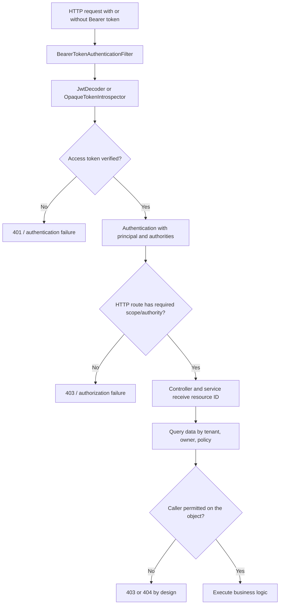
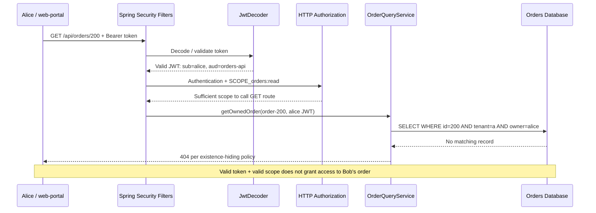

# Authenticated Does Not Mean Sufficient Scope or Resource Ownership

## 1. Three Separate Questions to Answer When Protecting an API

In a **Spring Security OAuth 2.0 / OIDC Resource Server**, a request carrying a valid Bearer access token solves only the first step of API security. An e-commerce application might successfully verify Alice's JWT, yet still must not let Alice update Bob's order simply because Alice is logged in and her token carries the `orders:write` scope.

Three questions must be kept separate:

1. **Authentication — Who or what is calling?** Is the access token valid, from the right issuer, intended for the right audience, unexpired, and verified via signature or introspection? Can the system build a trustworthy `Authentication`?
2. **Operation-level authorization — What kind of action is allowed?** Which scopes/authorities were granted to the token, such as `orders:read`, `orders:write`, or an equivalent application permission? What permission does the route or method require?
3. **Object-level authorization — On which resource is that action allowed?** Does order `42` actually belong to the user, tenant, or organization the caller is allowed to operate on? Are there state rules, limits, delegation rules, or dedicated admin permissions?

Business logic should execute only when all necessary questions are satisfactorily answered.

> **Core principle:** `authenticated()` only proves a request has an authenticated principal under Spring Security's mechanism. `hasAuthority("SCOPE_orders:read")` only checks one permission attached to that principal. **Neither automatically proves the caller owns or is allowed to access a specific record.**

This lesson belongs to the **HTTP Authorization** chapter of the **Spring Security OAuth 2.0 OIDC Resource Server** module. Examples use Java 17+, Spring Boot 3.x, Spring Security 6.x, a hypothetical Authorization Server, and an `orders-api`. Domains, JWTs, and order data are illustrative only and are not real usable tokens.

## 2. User, Token, and Order Model

Suppose we have these components:

- **Authorization Server** at `https://auth.example.test/realms/orders`.
- **Resource Server** `orders-api` exposing `GET /api/orders/{id}` and `PATCH /api/orders/{id}`.
- **Alice** with subject `alice-123`, belonging to tenant `tenant-a`.
- **Bob** with subject `bob-456`, also in `tenant-a`, owning different orders.
- **Carol** with subject `carol-789`, belonging to `tenant-b`.
- **Batch worker** `orders-importer` using Client Credentials, not representing a logged-in human user.

Orders stored in the database:

| Order | Tenant | Owner | Status |
|---|---|---|---|
| `order-100` | `tenant-a` | `alice-123` | `DRAFT` |
| `order-200` | `tenant-a` | `bob-456` | `PAID` |
| `order-300` | `tenant-b` | `carol-789` | `DRAFT` |

Alice's illustrative decoded access token:

```json
{
  "iss": "https://auth.example.test/realms/orders",
  "sub": "alice-123",
  "aud": ["orders-api"],
  "client_id": "web-portal",
  "tenant_id": "tenant-a",
  "scope": "orders:read orders:write",
  "iat": 1890000000,
  "exp": 1890003600
}
```

If this token is genuinely signed by a trusted issuer, unexpired, carries the right audience, and meets the API's access token profile, Spring Security can construct a `JwtAuthenticationToken` with the authorities:

```text
SCOPE_orders:read
SCOPE_orders:write
```

Yet this only grants permission **to read and write orders within the scope defined by the API**, not permission over every order.

| Alice's request | Valid token? | Right scope? | Object permission? | Expected outcome |
|---|---:|---:|---:|---|
| `GET /api/orders/order-100` | Yes | Has `orders:read` | Owned by Alice | Allow. |
| `GET /api/orders/order-200` | Yes | Has `orders:read` | Owned by Bob | Deny or return 404 per policy. |
| `GET /api/orders/order-300` | Yes | Has `orders:read` | Different tenant | Deny or return 404 per policy. |
| `PATCH /api/orders/order-100` | Yes | Has `orders:write` | Owned by Alice; also needs state rule | May allow if business rules hold. |
| `DELETE /api/orders/order-100` | Yes | No delete permission defined | Ownership not yet evaluated | Deny. |
| `GET /api/orders/order-100` with expired token | No | Not evaluated | Not evaluated | Reject at authentication. |

The `GET order-200` case is a classic example of **Broken Object Level Authorization (BOLA)**, often called **Insecure Direct Object Reference (IDOR)** in many texts: the caller swaps the object ID in the URL and the API returns data despite the caller lacking permission on that object.

## 3. Authentication, Scope, and Ownership Live at Different Layers

Illustrative processing flow:



Depending on implementation style, object-level authorization checks can live in `@PreAuthorize`, a service, a repository, or a shared **domain authorization service**. What matters is not the class name or location, but that **every access path goes through that check**, with no bypass in another controller, batch endpoint, export API, or GraphQL resolver.

### 3.1. What Does `authenticated()` Answer?

Example:

```java
.authorizeHttpRequests(auth -> auth
    .requestMatchers("/api/orders/**").authenticated()
    .anyRequest().denyAll())
```

This rule essentially requires the request to have an authentication satisfying Spring Security's condition. In a Resource Server, that is typically a verified access token. It **does not check `orders:read` or `orders:write`**. Alice holding a valid token containing only `profile`, or a service holding a token meant for another operation, can still pass `authenticated()` if all other token checks succeed.

Never interpret `authenticated()` as "the user is fully authorized." Its name states its exact scope: **authenticated**.

### 3.2. What Does `hasAuthority(...)` Answer?

Example:

```java
.authorizeHttpRequests(auth -> auth
    .requestMatchers(HttpMethod.GET, "/api/orders/**")
        .hasAuthority("SCOPE_orders:read")
    .requestMatchers(HttpMethod.PATCH, "/api/orders/**")
        .hasAuthority("SCOPE_orders:write")
    .anyRequest().denyAll())
```

This is a step forward: the token must hold an authority matching the operation type. However, if Alice holds `SCOPE_orders:read`, that still **does not distinguish** Alice's `order-100` from Bob's `order-200`.

Spring Security does not know which database table stores owners or which tenant column maps to the subject. The application itself must define and enforce that relationship.

### 3.3. What Does Object-Level Authorization Answer?

Example policy:

```text
Permit GET /api/orders/{orderId} if:
    access token is valid for orders-api
AND authorities include SCOPE_orders:read
AND requested order exists
AND order.tenant_id equals trusted tenant context
AND order.owner_issuer equals token.iss
AND order.owner_subject equals token.sub

Otherwise deny or conceal existence according to API policy.
```

If the API allows managers or support agents to view someone else's order, describe **the explicit exception permission**, such as `orders:read:any` within a tenant plus `ROLE_ORDERS_SUPPORT`, while enforcing tenant/state/audit checks. Never turn every user with `orders:read` into a reader of all orders.

## 4. Nature of OAuth Scopes in Access Tokens

In OAuth 2.0, a **scope** describes the access scope granted to a client/token. For JWT access tokens per RFC 9068, `scope` is typically a space-delimited string of scope tokens:

```json
{
  "scope": "orders:read orders:write"
}
```

Some issuers use `scp` (as a string or array depending on profile). In Spring Security Resource Server JWT, the default `JwtGrantedAuthoritiesConverter` typically reads the `scope`/`scp` claim and produces authorities prefixed with `SCOPE_`.

| Verified claim | Authority the app typically receives | Code condition |
|---|---|---|
| `"scope":"orders:read"` | `SCOPE_orders:read` | `hasAuthority("SCOPE_orders:read")` |
| `"scope":"orders:write"` | `SCOPE_orders:write` | `hasAuthority("SCOPE_orders:write")` |
| `"scp":["orders:read","orders:write"]` | `SCOPE_orders:read`, `SCOPE_orders:write` if supported by profile/converter | Check each authority accurately. |
| `"roles":["ADMIN"]` | Not mapped automatically by default scope converter | Needs deliberate role mapping. |

The `orders:write` scope **does not inherently imply** `orders:read`. Whether scopes have a hierarchy is defined by the Authorization Server and API contract, and cannot be inferred merely from the word "write."

### 4.1. Scopes Should Have Concrete Business Meaning

Example catalog for `orders-api`:

| Scope | Suggested meaning | Constraints beyond scope |
|---|---|---|
| `orders:read` | Read accessible orders. | Matching owner/tenant/role. |
| `orders:write` | Create/edit orders within assigned scope. | Owner, tenant, order status, limits. |
| `orders:cancel` | Cancel orders when policy permits. | Who may cancel, current order status, time window. |
| `orders:read:any` | Read orders within a defined management scope. | Managed tenant/unit, audit; does not open the whole system. |
| `orders:import` | Import orders via an authorized workload. | Client identity, partner contract, idempotency, tenant. |

Scope names are illustrative only, not a standard catalog. If the system decides `orders:read:any` permits reading all orders in **tenant A only**, the tenant condition must be enforced in the service/repository, not merely implied by the scope name.

### 4.2. "Having an Authority" Does Not Mean Token Claims Were Trusted

Every authority used for a JWT must come from a JWT verified by **`JwtDecoder`**. A JWT payload is merely Base64URL-encoded and must never be trusted by decoding the string alone.

A JWT Resource Server must:

- Verify the JWS signature against the trusted issuer's public key/JWKS.
- Accept only allowed algorithms and the appropriate token type.
- Validate `iss`, `aud`, `exp`, `nbf`, and required claims per the token profile.
- Map `scope`/`scp` or approved permission claims after validation.
- Apply HTTP, method, and object-level authorization.

When using opaque access tokens, the equivalent first step is introspection with a trusted Authorization Server and checking `active`, audience/scope per contract. Opaque tokens do not mean skipping object authorization.

## 5. A Valid JWT Not Intended for the API Is Still Rejected

This is a critical point when saying "authenticated": the token must **be authenticated in the right context**. Not every JWT signed by the same issuer is accepted by `orders-api`.

An OIDC **ID Token** typically has `aud` pointing to the login client, such as `web-portal`. It is meant for the OIDC client to authenticate the user, not as an access token for the orders API. Another access token might have `aud = payments-api` even from the same issuer. Both must be rejected when calling `orders-api` if they do not satisfy the contract.

Example token with wrong audience:

```json
{
  "iss": "https://auth.example.test/realms/orders",
  "sub": "alice-123",
  "aud": ["payments-api"],
  "scope": "orders:read",
  "exp": 1890003600
}
```

Even with a valid signature, `orders-api` **cannot accept this token simply because it contains `orders:read`**.

In a Spring Boot application:

```yaml
spring:
  security:
    oauth2:
      resourceserver:
        jwt:
          issuer-uri: https://auth.example.test/realms/orders
          audiences:
            - orders-api
```

This configuration specifies that issuer and audience must be validated. If the issuer mints JWT access tokens per **RFC 9068**, you must also enforce the corresponding token profile requirements, such as `typ=at+jwt` and mandatory claims depending on your Spring Security/decoder version; do not assume configuring issuer/audience alone completes RFC 9068 compliance.

### 5.1. Client Credentials Tokens Are Not User Tokens

A batch client might carry a token:

```json
{
  "iss": "https://auth.example.test/realms/orders",
  "sub": "service-orders-importer",
  "client_id": "orders-importer",
  "aud": ["orders-api"],
  "scope": "orders:import",
  "exp": 1890003600
}
```

This token can pass authentication. If an endpoint only uses `authenticated()`, the service can enter a user-handling code path even though no user owns an order. With Client Credentials, `sub` can be a **service subject**, not an interactive human user. The API should define clear workload policies and dedicated scopes like `orders:import`; never treat a service's `sub` as a user ID unless defined in the business contract.

In token-exchange/delegation models, an `act` claim may represent the actor; distinguish subject, actor, OAuth client, and ownership. Never infer permission to act on behalf of a user merely because a token holds broad scopes.

## 6. Configuring HTTP Authorization on Least Privilege

For stateless APIs, Spring Security provides the `authorizeHttpRequests` DSL and conditions such as `permitAll`, `authenticated`, `hasAuthority`, `hasAnyAuthority`, and `access`.

### 6.1. Basic Dependencies

With Java 17+, Spring Boot 3.x, and Maven using Boot dependency management:

```xml
<dependencies>
    <dependency>
        <groupId>org.springframework.boot</groupId>
        <artifactId>spring-boot-starter-web</artifactId>
    </dependency>
    <dependency>
        <groupId>org.springframework.boot</groupId>
        <artifactId>spring-boot-starter-security</artifactId>
    </dependency>
    <dependency>
        <groupId>org.springframework.boot</groupId>
        <artifactId>spring-boot-starter-oauth2-resource-server</artifactId>
    </dependency>
    <dependency>
        <groupId>org.springframework.boot</groupId>
        <artifactId>spring-boot-starter-test</artifactId>
        <scope>test</scope>
    </dependency>
    <dependency>
        <groupId>org.springframework.security</groupId>
        <artifactId>spring-security-test</artifactId>
        <scope>test</scope>
    </dependency>
</dependencies>
```

### 6.2. SecurityFilterChain Requiring Scopes per HTTP Method

```java
package com.example.orders.security;

import org.springframework.context.annotation.Bean;
import org.springframework.context.annotation.Configuration;
import org.springframework.http.HttpMethod;
import org.springframework.security.config.Customizer;
import org.springframework.security.config.annotation.web.builders.HttpSecurity;
import org.springframework.security.config.annotation.web.configurers.AbstractHttpConfigurer;
import org.springframework.security.config.http.SessionCreationPolicy;
import org.springframework.security.web.SecurityFilterChain;

@Configuration
public class ApiSecurityConfig {

    @Bean
    SecurityFilterChain apiSecurity(HttpSecurity http) throws Exception {
        return http
            // Appropriate for stateless APIs using only the Bearer header, not
            // session cookies for authentication. Cookie apps must evaluate CSRF separately.
            .csrf(AbstractHttpConfigurer::disable)
            .sessionManagement(session -> session
                .sessionCreationPolicy(SessionCreationPolicy.STATELESS))
            .authorizeHttpRequests(auth -> auth
                .requestMatchers(HttpMethod.GET, "/api/public/ping")
                    .permitAll()

                .requestMatchers(HttpMethod.GET, "/api/orders/**")
                    .hasAuthority("SCOPE_orders:read")

                .requestMatchers(HttpMethod.POST, "/api/orders")
                    .hasAuthority("SCOPE_orders:write")

                .requestMatchers(HttpMethod.PATCH, "/api/orders/**")
                    .hasAuthority("SCOPE_orders:write")

                .requestMatchers(HttpMethod.POST, "/api/orders/*/cancel")
                    .hasAuthority("SCOPE_orders:cancel")

                .anyRequest().denyAll())
            .oauth2ResourceServer(oauth -> oauth
                .jwt(Customizer.withDefaults()))
            .build();
    }
}
```

The rules above illustrate the idea, yet there is an easily overlooked detail: **Spring Security evaluates request matchers in declaration order and applies the first matching rule**. Above, `PATCH /api/orders/**` does not shadow `POST /api/orders/*/cancel` because their HTTP methods differ. When two matchers share **the same method and overlapping paths**, place the specific matcher before the general matcher.

Example of an ordering bug:

```java
// ILLUSTRATING BUG ONLY — general matcher shadows specific matcher.
.requestMatchers(HttpMethod.GET, "/api/orders/**")
    .authenticated()
.requestMatchers(HttpMethod.GET, "/api/orders/export")
    .hasAuthority("SCOPE_orders:export")
```

Since `GET /api/orders/export` matches the first matcher, the export condition below never runs. Fix by placing the specific rule first or designing unambiguous routes, and write tests to verify them.

### 6.3. A Better Configuration for the Export Route

```java
.authorizeHttpRequests(auth -> auth
    .requestMatchers(HttpMethod.GET, "/api/orders/export")
        .hasAuthority("SCOPE_orders:export")
    .requestMatchers(HttpMethod.GET, "/api/orders/**")
        .hasAuthority("SCOPE_orders:read")
    .anyRequest().denyAll())
```

Even when export requires `SCOPE_orders:export`, the export service must still filter by tenant, owner, or management scope. Never interpret "export scope" as "export every order across all tenants" unless the contract explicitly specifies that.

### 6.4. `anyRequest().authenticated()` Can Be Broader Than You Think

A shortcut configuration:

```java
.authorizeHttpRequests(auth -> auth
    .requestMatchers("/api/orders/**").hasAuthority("SCOPE_orders:read")
    .anyRequest().authenticated())
```

can allow any valid token to call newly added routes such as `/api/payments/**`, `/api/admin/**`, or `/api/reports/**` not yet protected by their own authority if controllers exist. Using **`denyAll()` as the default** for unlisted endpoints is usually a more conservative policy for APIs requiring explicit authorization.

On the other hand, `permitAll()` should apply only to genuinely public endpoints, such as health/public catalog routes designed to contain no sensitive data. Never set `/api/**` to `permitAll()` while debugging and forget to revert it.

## 7. Ownership Lives in Data Relationships, Not in the URL

Consider the request:

```http
GET /api/orders/200 HTTP/1.1
Host: orders.example.test
Authorization: Bearer <valid-token-for-alice>
```

Whether Alice typed `200` manually or the frontend took the ID from a link, **the ID in the URL is only the requested object**, never proof of permission. Clients can alter path variables, query parameters, JSON bodies, GraphQL node IDs, or file IDs at will.

This holds true even when IDs are long or unpredictable UUIDs:

- **Unguessable** does not mean **authorized**.
- `UUID.randomUUID()` reduces enumeration risk but does not replace object-level authorization.
- URLs signed by clients, saved in bookmarks, or sent via email do not guarantee continued permission after user/tenant state changes.
- "Hiding the edit button" on the frontend does not protect the backend; the API must independently reject unauthorized requests.

### 7.1. A Simple Data Model

Suppose the `orders` table has:

```text
orders
------
id            UUID PRIMARY KEY
tenant_id     VARCHAR NOT NULL
owner_issuer  VARCHAR NOT NULL
owner_subject VARCHAR NOT NULL
status        VARCHAR NOT NULL
amount        DECIMAL NOT NULL
```

Why store both `owner_issuer` and `owner_subject`?

In a multi-issuer system, subject `"123"` from issuer A may not be subject `"123"` from issuer B. **`sub` should only be interpreted within the issuer's namespace**. A composite identity `(iss, sub)` is generally safer than storing `sub` alone when a product supports multiple identity sources. Tenant/business memberships may also be required by the application model.

Do not use `email` or `preferred_username` as a stable owner ID because they can change, be reassigned, or lack the required verification guarantees. If the organization maps `(iss, sub)` to an internal user ID, perform that mapping through a managed trusted source.

### 7.2. Tenant ID Is Not Self-Proving Access Permission Either

If a JWT contains:

```json
{
  "sub": "alice-123",
  "tenant_id": "tenant-a",
  "scope": "orders:read"
}
```

then `tenant_id` may indicate the user's active tenant **if the issuer guarantees that semantics**. However, the API must not assume every `tenant-a` record belongs to Alice. It may need to verify:

- Is the user currently a member of that tenant?
- May the user view all orders or only their own orders?
- Are roles or delegation permissions scoped to a department/project?
- A user may belong to multiple tenants; does the selected tenant match the verified context?
- Was permission revoked after the token was issued?

In particular, never trust a client-supplied `X-Tenant-Id` header or a `tenantId` field in a JSON body **as the sole authorization source**. If the API lets the client choose a tenant, validate the requested value against verified memberships/entitlements.

## 8. Enforcing Object-Level Authorization in Spring Services and Repositories

There are two common implementation approaches:

1. **Load the record and then check** owner/tenant before returning or mutating it.
2. **Embed permission predicates into the query** so the database returns only records within the permitted scope.

The second approach is especially valuable for personal-data read APIs, because it prevents the service from accidentally passing unauthorized records to downstream processing. Even then, it must be paired with full business rule and data-scope checks.

### 8.1. Repository Query Finding Only Orders Alice May View

Suppose there is a JPA entity `OrderEntity` with fields `id`, `tenantId`, `ownerIssuer`, `ownerSubject`, and `status`. The repository can define:

```java
package com.example.orders.persistence;

import java.util.Optional;
import java.util.UUID;

import org.springframework.data.jpa.repository.JpaRepository;

public interface OrderRepository
        extends JpaRepository<OrderEntity, UUID> {

    Optional<OrderEntity> findByIdAndTenantIdAndOwnerIssuerAndOwnerSubject(
        UUID id,
        String tenantId,
        String ownerIssuer,
        String ownerSubject
    );
}
```

Spring Data JPA generates a query including owner and tenant conditions when property names match the entity:

```sql
SELECT *
FROM orders
WHERE id = :id
  AND tenant_id = :tenantId
  AND owner_issuer = :ownerIssuer
  AND owner_subject = :ownerSubject;
```

The SQL above illustrates logic only; exact bind syntax and SQL are produced by the JPA provider. The key point is **not querying solely by `id` and accidentally returning any record**.

### 8.2. Service Reading Orders Using the Verified Token

Example `OrderQueryService` reading subject, issuer, and tenant from the `Jwt` object verified by Spring Security:

```java
package com.example.orders.service;

import java.util.UUID;

import org.springframework.http.HttpStatus;
import org.springframework.security.access.AccessDeniedException;
import org.springframework.security.oauth2.jwt.Jwt;
import org.springframework.stereotype.Service;
import org.springframework.web.server.ResponseStatusException;

import com.example.orders.persistence.OrderEntity;
import com.example.orders.persistence.OrderRepository;

@Service
public class OrderQueryService {

    private final OrderRepository orders;

    public OrderQueryService(OrderRepository orders) {
        this.orders = orders;
    }

    public OrderView getOwnedOrder(UUID orderId, Jwt jwt) {
        String issuer = jwt.getIssuer() == null
            ? null
            : jwt.getIssuer().toString();
        String subject = jwt.getSubject();
        Object tenantValue = jwt.getClaim("tenant_id");

        if (issuer == null || issuer.isBlank()
                || subject == null || subject.isBlank()
                || !(tenantValue instanceof String tenantId)
                || tenantId.isBlank()) {
            // If missing claims violate the token profile,
            // it is better for a validator in JwtDecoder to reject early.
            throw new AccessDeniedException(
                "Required identity context missing");
        }

        OrderEntity order = orders
            .findByIdAndTenantIdAndOwnerIssuerAndOwnerSubject(
                orderId, tenantId, issuer, subject)
            .orElseThrow(() ->
                new ResponseStatusException(HttpStatus.NOT_FOUND));

        return new OrderView(
            order.getId(),
            order.getStatus(),
            order.getAmount()
        );
    }
}
```

`OrderView` is the API response DTO:

```java
package com.example.orders.service;

import java.math.BigDecimal;
import java.util.UUID;

public record OrderView(
    UUID id,
    String status,
    BigDecimal amount
) { }
```

These are illustrative snippets assuming `OrderEntity` has matching getters, a database is configured, and JPA mappings exist. They are not a complete copy-and-run application.

Several notable design choices:

- `Jwt` has been verified by Spring Security's decoder **before** the controller calls the service. The service never parses raw Bearer token strings itself.
- `iss` and `sub` identify the subject within the issuer's namespace.
- `tenant_id` is read with the exact data type specified by the token profile. If the claim is mandatory, add a schema validator at the authentication layer to reject non-conforming tokens.
- The repository query requires **both matching owner and tenant**, not just matching `id`.
- If no matching record exists, the service returns **404**. This helps avoid disclosing whether the ID exists under another tenant/user. Another API might choose `403`, provided it is applied consistently with the existence-hiding model.
- The DTO does not return the full entity, limiting leakage of internal attributes such as owner identifiers, cost prices, admin notes, or payment details.

### 8.3. Controller Delegates to Service Without Trusting the ID

```java
package com.example.orders.api;

import java.util.UUID;

import org.springframework.security.core.annotation.AuthenticationPrincipal;
import org.springframework.security.oauth2.jwt.Jwt;
import org.springframework.web.bind.annotation.GetMapping;
import org.springframework.web.bind.annotation.PathVariable;
import org.springframework.web.bind.annotation.RequestMapping;
import org.springframework.web.bind.annotation.RestController;

import com.example.orders.service.OrderQueryService;
import com.example.orders.service.OrderView;

@RestController
@RequestMapping("/api/orders")
public class OrderController {

    private final OrderQueryService service;

    public OrderController(OrderQueryService service) {
        this.service = service;
    }

    @GetMapping("/{orderId}")
    public OrderView getOrder(
        @PathVariable UUID orderId,
        @AuthenticationPrincipal Jwt jwt
    ) {
        return service.getOwnedOrder(orderId, jwt);
    }
}
```

Earlier HTTP authorization required `SCOPE_orders:read`. The controller delegates object-level authorization to the service. **There is no "if authenticated, fetch by ID and return" shortcut.**

If the endpoint uses **opaque token introspection**, the principal may not be a `Jwt`. In that case, use an identity abstraction derived from the verified `Authentication` rather than blindly casting to `JwtAuthenticationToken` for all token types. Owner/tenant rules remain the same.

### 8.4. Never Take User IDs from Request Bodies

An anti-pattern:

```java
// DO NOT USE — ownerId is self-declared by the client.
@GetMapping("/{orderId}")
public OrderView getOrder(
    @PathVariable UUID orderId,
    @RequestParam String ownerId
) {
    return service.getOrder(orderId, ownerId);
}
```

If the service only checks `order.ownerId == ownerId` without comparing against the verified subject, the client can pass `ownerId=bob-456` to retrieve Bob's orders. **The owner ID used for authorization must come from authentication or a trusted membership source**, never a client-chosen value.

Likewise, a JSON body containing `"ownerId":"alice-123"` when creating an order must never serve as proof that the caller is Alice. The server should assign the owner from the authenticated principal or check permission to create on someone else's behalf via an explicit policy.

## 9. Checking Permissions Before Updating or Deleting Records

Reading data already carries BOLA risk; updating or deleting can also alter money, status, shipping addresses, or another user's permissions.

### 9.1. Order Update Flows Need Multiple Checks

Suppose the endpoint is:

```http
PATCH /api/orders/100
Authorization: Bearer <alice-access-token>
Content-Type: application/json

{"shippingAddress":"..."}
```

The flow should check:

1. JWT is valid for `orders-api`.
2. Holds `SCOPE_orders:write`.
3. Order belongs to a tenant and subject permitted to update; or caller has an explicit delegation/role.
4. Order is in an editable state (e.g., `DRAFT`, not yet shipped).
5. Editable fields are allowlisted, disallowing arbitrary updates to `tenantId`, `ownerSubject`, or `status`.
6. Business invariants and transaction versions are preserved to prevent lost updates/race conditions.

Never take client JSON and automatically bind all fields onto the entity:

```java
// DO NOT USE: the client could submit ownerSubject, tenantId, status, etc.
objectMapper.updateValue(orderEntity, requestBody);
```

Instead, use a DTO containing only allowed editable attributes and controlled update logic. Example:

```java
public record UpdateShippingAddressRequest(
    String line1,
    String city,
    String postalCode
) { }
```

### 9.2. Checking Inside a Transaction

An update flow can use a service method annotated with `@Transactional`:

```java
@Transactional
public void updateOwnedOrder(
        UUID orderId,
        String tenantId,
        String issuer,
        String subject,
        UpdateShippingAddressRequest request
) {
    OrderEntity order = orders
        .findByIdAndTenantIdAndOwnerIssuerAndOwnerSubject(
            orderId, tenantId, issuer, subject)
        .orElseThrow(() ->
            new ResponseStatusException(HttpStatus.NOT_FOUND));

    if (!"DRAFT".equals(order.getStatus())) {
        throw new ResponseStatusException(
            HttpStatus.CONFLICT, "Order can no longer be edited");
    }

    order.setShippingLine1(request.line1());
    order.setShippingCity(request.city());
    order.setPostalCode(request.postalCode());
}
```

This snippet focuses on the execution path, assuming entity fields/setters exist. Under concurrency, consider `@Version` (optimistic locking), row locks, or conditional updates so state cannot change between check and write. Subject/tenant identity must come from authentication or a trusted service, **never accepting arbitrary identity parameters from clients**.

To avoid bugs where a developer calls `updateOwnedOrder` from an internal job with hand-picked `tenantId` and `subject`, create an `AuthenticatedActor` or `AccessContext` type constructed strictly at security boundaries, and define separate entry points for workloads or trusted administration.

### 9.3. Service-to-Service and Admins Are Not Default Exceptions

An API may let support agents edit orders they do not own. Yet the policy must be explicitly designed:

```text
Owner path:
    SCOPE_orders:write
    AND same tenant
    AND same owner identity
    AND editable status

Support path:
    SCOPE_orders:support
    AND ROLE_ORDERS_SUPPORT
    AND caller assigned to target tenant
    AND purpose/audit requirement satisfied
    AND action is permitted for that order
```

Never write `if (hasRole("ADMIN")) return true` bypassing tenant, access purpose, or business constraints unless admin privileges are truly defined as system-wide. Especially in multi-tenant systems, an admin of `tenant-a` is not automatically an admin of `tenant-b`.

## 10. Combining HTTP Security with Method-Level Authorization

**HTTP rules** protect by route and method; **method security** can enforce shared rules at the service layer. The two layers complement each other without replacing one another automatically.

### 10.1. Enabling Method Security

```java
package com.example.orders.security;

import org.springframework.context.annotation.Configuration;
import org.springframework.security.config.annotation.method.configuration.EnableMethodSecurity;

@Configuration
@EnableMethodSecurity
public class MethodSecurityConfig {
}
```

Once enabled, Spring Security can apply `@PreAuthorize`, `@PostAuthorize`, and related method-level annotations on managed beans.

### 10.2. Checking Scopes at the Method Level

```java
@PreAuthorize("hasAuthority('SCOPE_orders:read')")
public OrderView getOwnedOrder(UUID orderId, Jwt jwt) {
    // The service still checks owner/tenant as shown above.
}
```

The method layer protects against another caller accidentally bypassing an HTTP route rule. Yet `hasAuthority` at the method level still does not distinguish Alice from Bob, so **object-level authorization logic is still required**.

### 10.3. Using an Authorization Component with an Object ID

You can write a dedicated authorization component:

```java
package com.example.orders.security;

import java.util.UUID;

import org.springframework.security.core.Authentication;
import org.springframework.security.oauth2.server.resource.authentication.JwtAuthenticationToken;
import org.springframework.stereotype.Component;

@Component("orderAccess")
public class OrderAccess {

    private final OrderAccessRepository repository;

    public OrderAccess(OrderAccessRepository repository) {
        this.repository = repository;
    }

    public boolean canRead(Authentication authentication, UUID orderId) {
        if (!(authentication instanceof JwtAuthenticationToken jwtAuth)
                || !authentication.isAuthenticated()) {
            return false;
        }

        boolean hasScope = authentication.getAuthorities().stream()
            .anyMatch(authority ->
                "SCOPE_orders:read".equals(authority.getAuthority()));

        if (!hasScope) {
            return false;
        }

        var jwt = jwtAuth.getToken();
        String issuer = jwt.getIssuer() == null
            ? null
            : jwt.getIssuer().toString();
        String subject = jwt.getSubject();
        Object rawTenant = jwt.getClaim("tenant_id");

        if (issuer == null || subject == null
                || !(rawTenant instanceof String tenantId)
                || tenantId.isBlank()) {
            return false;
        }

        return repository.existsByIdAndTenantIdAndOwnerIssuerAndOwnerSubject(
            orderId, tenantId, issuer, subject);
    }
}
```

The repository must define the matching method:

```java
boolean existsByIdAndTenantIdAndOwnerIssuerAndOwnerSubject(
    UUID id,
    String tenantId,
    String ownerIssuer,
    String ownerSubject
);
```

Method usage:

```java
@PreAuthorize("@orderAccess.canRead(authentication, #orderId)")
public OrderView loadOrder(UUID orderId) {
    // Runs only after the check above.
}
```

This example demonstrates combining Spring Expression Language (SpEL) with authentication and an object ID. **Do not assume this is the optimal solution for every system**:

- It can trigger **two queries** (`exists` to check, then `find` to load), increasing cost and creating a window where state may change.
- If `loadOrder` queries only by ID without tenant/owner, carefully assess **TOCTOU** (time-of-check to time-of-use) and call paths that bypass proxies/method security.
- Spring method security relies on proxies; internal self-invocation within the same bean may bypass the interceptor under standard proxy configuration.
- For stronger guarantees, keep **identity-filtered queries in the repository** as in section 8, or place check and operation inside the same transaction with proper concurrency controls.

Thus, `@PreAuthorize("@orderAccess.canRead(...)")` is a viable technique, **not a reason for services to drop object-level constraints from queries/writes**.

### 10.4. Complex Admin Permissions Belong in a Domain Policy

When multiple conditions exist—such as tenant membership, delegation, owner, order status, and scopes—cramming all logic into a long SpEL expression becomes hard to test and maintain. Place policy in a clearly named service/class:

```text
OrderAuthorizationPolicy
  canRead(actor, order)
  canEdit(actor, order)
  canCancel(actor, order)
  canExport(actor, tenantId)
```

Method security can invoke that policy, while services/repositories still ensure data is filtered and checked properly. Policies should take **a verified principal** and **objects/states loaded from trusted sources**, never trusting owner fields in request bodies.

## 11. Authorization When Listing, Searching, and Exporting Data

BOLA does not happen only on `GET /api/orders/{id}`. Listing, search, export, aggregation, and batch update endpoints can also leak data.

### 11.1. Lists Must Be Filtered Server-Side

Example:

```http
GET /api/orders?tenantId=tenant-b&owner=bob-456
Authorization: Bearer <alice-token>
```

If an API checks only `orders:read` and passes query params straight to the DB, Alice can pull another tenant's or user's orders. The safe approach separates:

- **Caller-requested filters:** status, date range, order number, pagination, sorting, allowed within bounds.
- **Mandatory authorization filters:** tenant and owner/assigned accounts verified from token/membership/policy.

Example query:

```sql
SELECT id, status, amount
FROM orders
WHERE tenant_id = :trusted_tenant_id
  AND owner_issuer = :trusted_issuer
  AND owner_subject = :trusted_subject
  AND status = :requested_status
ORDER BY created_at DESC
LIMIT :page_size OFFSET :offset;
```

The `trusted_*` values come from identity context, not query params. `requested_status` is a normal filter and must be validated to prevent SQL injection if dynamic queries are used; use parameter binding.

For pagination, never run an unfiltered `SELECT COUNT(*) FROM orders` if the count can reveal another tenant's metrics. Apply authorization filters consistently across results, total counts, facets, search suggestions, and aggregations.

### 11.2. Exports and Bulk Operations Must Check Every Object

An `orders:export` scope may allow **starting an export action**, yet the exported records must stay within the user/tenant's permitted scope.

For bulk updates:

```json
{
  "orderIds": ["order-100", "order-200", "order-300"],
  "operation": "CANCEL"
}
```

Never check only the first order and apply the action to the whole array. Verify permissions on every ID or use an update/query with authorization predicates covering the entire set. Decide explicitly between **all-or-nothing** and partial success, handle non-existent/unauthorized IDs without leaking info, and ensure transactions/idempotency.

### 11.3. Attachments and Child Resources

If an order has an invoice file:

```http
GET /api/orders/200/invoice.pdf
```

The download endpoint must also verify permissions on **the parent order** and file type. Do not rely on having blocked `GET /api/orders/200`; the file download path can be called directly. With object storage/signed URLs, verify permissions before issuing the URL, and set tight TTLs and access scopes. Audit similar APIs: comments, attachments, payment details, shipping addresses, and event history.

## 12. Multi-Tenancy: Right Scope with Wrong Tenant Is Still Unauthorized

In a multi-tenant system, each tenant has isolated data and access rules. A token with `SCOPE_orders:read` states the caller may perform the "read order" action type within their assigned scope; not "read every tenant."

### 12.1. Decision Matrix

Suppose Alice belongs to `tenant-a` with scope `orders:read`:

| Order | Same tenant? | Same owner? | Read-own policy | Read-all-in-tenant policy |
|---|---|---|---|---|
| `order-100` (Alice, tenant-a) | Yes | Yes | Allow | Allow if management role applies. |
| `order-200` (Bob, tenant-a) | Yes | No | Deny | Allow only if holding `read:any` or matching role. |
| `order-300` (Carol, tenant-b) | No | No | Deny | Deny even with a tenant-a management role. |

**Same tenant does not mean same owner.** Conversely, in an enterprise app, roles may allow reading data across departments/units within a tenant; model that explicitly as a permission rather than hardcoding strict owner equality across every endpoint.

### 12.2. Where Does Tenant Context Come From?

Several design options:

- The token carries an explicit tenant claim, with the issuer guaranteeing the user/token is active in that tenant.
- The token carries organization/tenant memberships; the caller requests a tenant, and the server verifies it belongs to active memberships and roles.
- The API queries a trusted internal entitlement service for up-to-date memberships.
- A service-to-service client is bound to a scope/tenant in an internal client registry.

Do not assume a `tenant_id` JWT claim has identical semantics across all issuers. If a token lacks a tenant on a tenant-scoped route, fail closed or reject the token per profile. If callers can specify `tenantId` in an HTTP header, that value is only **the requested target**, never authorization proof.

### 12.3. Enforce Authorization at Both Data and Query Layers

Protecting one controller while skipping another service creates bypasses. A strong pattern is a tenant-aware query or security predicate applied consistently. PostgreSQL Row Level Security (RLS) or similar database mechanisms can add another data-protection layer, provided connection/session context is set accurately per request/transaction and RLS is never treated as a total replacement for application scopes, owners, and policies.

## 13. Understanding 401, 403, and 404 Properly

HTTP status codes tell clients the failure category. However, **exact status codes depend on the authentication provider, exception handler, and API policy**; do not force every error into a single status.

| Scenario | Rejecting layer | Common status |
|---|---|---|
| No Bearer token on a protected route | Authentication | **401 Unauthorized** |
| Bearer token bad signature, expired, wrong issuer/audience | Authentication | **401 Unauthorized** |
| Valid JWT lacking `orders:read` | Authorization | **403 Forbidden** |
| Valid JWT with scope, caller does not own order | Object authorization | **403** or **404** per existence-hiding policy |
| Order ID genuinely does not exist | Resource lookup | **404 Not Found** |
| Caller has permission, but order state forbids editing | Business rule | Possibly **409 Conflict** or another fitting business code |
| JWKS/introspection unavailable | Dependency failure | Never grant access; HTTP status depends on error handling, e.g., **503** if upstream outage is distinguished. |

### 13.1. Why Might Object Ownership Return 404?

If Bob owns `order-200`, returning `403` to Alice can reveal that `order-200` exists. An API can return **404** for both "does not exist" and "exists but caller is not allowed to know," limiting information disclosure. However, this is a **design decision**, not a universally mandatory rule.

If an API chooses to return 403 for same-tenant users lacking permissions, apply it consistently and evaluate enumeration risk. Never include messages like "order belongs to Bob in tenant B" unless the caller is permitted to know.

### 13.2. `WWW-Authenticate` When Scope Is Insufficient

Per OAuth 2.0 Bearer Token Usage (RFC 6750), protected resource errors can use HTTP `WWW-Authenticate: Bearer` to indicate codes like `invalid_token` or `insufficient_scope`. Illustrative example:

```http
HTTP/1.1 403 Forbidden
WWW-Authenticate: Bearer error="insufficient_scope"
```

Avoid exposing sensitive details like owner user IDs or internal permission topologies in error bodies. In Spring Security, the authorization handler, Bearer token entry point, and access denied handler determine exact headers/statuses. Test actual behavior rather than assuming every 403 emits the exact same header.

### 13.3. Never Turn Every Exception into 401

A `JwtDecoder` error differs from a database error, role permission failure, or downstream outage. Catching `Exception` and returning 401 for everything misleads clients into thinking tokens expired and obscures observability. Separate authentication, authorization, business validation, and dependency failures by responsibility.

## 14. Required Permissions Must Be Enforced Across All Entry Points

It is not just `GET /api/orders/{id}`:

| Endpoint type | Checks required |
|---|---|
| `GET /api/orders/{id}` | Read scope + owner/tenant. |
| `GET /api/orders` | Read scope + tenant/owner filters on full query, total count, and pagination. |
| `GET /api/orders/{id}/events` | History read scope + permission to view parent order. |
| `POST /api/orders` | Create scope + allowed tenant + owner assigned from trusted context. |
| `PATCH /api/orders/{id}` | Write scope + permission to edit order + state + field allowlist. |
| `POST /api/orders/{id}/cancel` | Cancel scope + cancel policy + transaction/state check. |
| `DELETE /api/orders/{id}` | Delete scope if allowed + special owner/admin policy. |
| `GET /api/orders/export` | Export scope + filter all data within tenant/owner. |
| `POST /api/orders/bulk` | Bulk scope + permission check on every ID/record. |
| GraphQL `order(id)` / gRPC `GetOrder` | Equivalent object authorization rules, independent of REST matchers. |
| Background job or message handler | Job's principal/service identity and delegated scope, never relying on HTTP `authenticated()`. |

Any entry point may invoke a shared service; if you protect only controllers with annotations while services can be called from paths without method security, place **domain policies** in the service/core layer or expose operations requiring explicit permission context.

## 15. Testing to Distinguish Authenticated, Sufficient Scope, and Ownership

A solid test suite does more than "valid token returns 200" and "no token returns 401." It must prove **per-object permission boundaries**.

### 15.1. Test Matrix

Suppose the test fixture has:

- Alice: `iss=A`, `sub=alice-123`, `tenant=tenant-a`; owns `order-100`.
- Bob: `iss=A`, `sub=bob-456`, `tenant=tenant-a`; owns `order-200`.
- Carol: `iss=A`, `sub=carol-789`, `tenant=tenant-b`; owns `order-300`.
- All requests in the table target `orders-api`, unless noted otherwise.

| Actor/token | Scope | Resource | Expectation |
|---|---|---|---|
| No token | — | `order-100` | 401. |
| Expired token | `orders:read` | `order-100` | 401. |
| Wrong-audience token | `orders:read` | `order-100` | 401. |
| Forged token with bad signature | `orders:read` | `order-100` | 401. |
| Alice, valid token | Lacks `orders:read` | `order-100` | 403 even though Alice owns it. |
| Alice, valid token | `orders:read` | `order-100` | Allow if no other constraints block it. |
| Alice, valid token | `orders:read` | `order-200` (Bob) | 403/404. |
| Alice, valid token | `orders:read` | `order-300` (tenant-b) | 403/404. |
| Bob, valid token | `orders:read` | `order-200` | Allow. |
| Carol, valid token | `orders:read` | `order-100` | 403/404. |
| Alice, valid token | `orders:write` | `GET order-100` | 403 if write does not imply read. |
| Alice, valid token | `orders:read` | `PATCH order-100` | 403 for missing write. |
| Alice, valid token | `orders:write` | `PATCH order-100` | Allow only if owner and state permit. |
| Alice, valid token | `orders:write` | `PATCH order-200` | 403/404 despite sufficient scope. |
| Client Credentials service | `orders:import` | User order read endpoint | Deny if profile/route forbids workload reads. |
| Support in tenant-a | Support scope/role | `order-200` | Allow only with valid support permission, tenant, and audit. |
| Support in tenant-a | Support scope/role | `order-300` | Deny due to cross-tenant access. |

### 15.2. HTTP Authorization Tests with MockMvc

`spring-security-test` provides `jwt()` to synthesize a mock authenticated principal for testing route/method policies.

Assuming the application has `GET /api/orders/{id}` and suitable test data/fixtures:

```java
package com.example.orders;

import static org.springframework.security.test.web.servlet.request
    .SecurityMockMvcRequestPostProcessors.jwt;
import static org.springframework.test.web.servlet.request.MockMvcRequestBuilders.get;
import static org.springframework.test.web.servlet.result.MockMvcResultMatchers.status;

import org.junit.jupiter.api.Test;
import org.springframework.beans.factory.annotation.Autowired;
import org.springframework.boot.test.autoconfigure.web.servlet.AutoConfigureMockMvc;
import org.springframework.boot.test.context.SpringBootTest;
import org.springframework.security.core.authority.SimpleGrantedAuthority;
import org.springframework.test.web.servlet.MockMvc;

@SpringBootTest
@AutoConfigureMockMvc
class OrderHttpAuthorizationTest {

    @Autowired
    MockMvc mvc;

    @Test
    void missingTokenIsUnauthorized() throws Exception {
        mvc.perform(get("/api/orders/100"))
            .andExpect(status().isUnauthorized());
    }

    @Test
    void authenticatedWithoutReadScopeIsForbidden() throws Exception {
        mvc.perform(get("/api/orders/100")
                .with(jwt()
                    .jwt(token -> token
                        .subject("alice-123")
                        .claim("tenant_id", "tenant-a"))
                    .authorities(
                        new SimpleGrantedAuthority("SCOPE_profile"))))
            .andExpect(status().isForbidden());
    }

    @Test
    void readScopeDoesNotGrantAccessToAnotherOwner() throws Exception {
        mvc.perform(get("/api/orders/200")
                .with(jwt()
                    .jwt(token -> token
                        .issuer("https://auth.example.test/realms/orders")
                        .subject("alice-123")
                        .claim("tenant_id", "tenant-a"))
                    .authorities(
                        new SimpleGrantedAuthority("SCOPE_orders:read"))))
            // Per lesson design: query hides orders not owned by caller.
            .andExpect(status().isNotFound());
    }
}
```

Notes:

- The example assumes Bob's `order-200` data exists in the test database or fixture and beans/controllers are configured.
- `jwt().authorities(...)` assigns mock authorities; it **does not invoke the real `JwtGrantedAuthoritiesConverter`**.
- `jwt()` in Spring Security Test **bypasses JWS decoding/signatures and JWKS**. Hence this test proves route and object-level behavior, **not JWT validation**.
- If the test authentication principal omits `issuer` or mandatory claims expected by service logic, tests may fail due to incomplete identity context; build consistent fixtures.
- Object-level penetration tests should cover both **same-tenant different-owner** and **cross-tenant**, not just a single case.

### 15.3. Service Unit Tests Checking Scoped Queries

HTTP-independent unit tests can verify the service passes the right token identity to the repository:

```java
import static org.junit.jupiter.api.Assertions.assertThrows;
import static org.mockito.Mockito.verify;
import static org.mockito.Mockito.when;

import java.util.Optional;
import java.util.UUID;

import org.junit.jupiter.api.Test;
import org.junit.jupiter.api.extension.ExtendWith;
import org.mockito.InjectMocks;
import org.mockito.Mock;
import org.mockito.junit.jupiter.MockitoExtension;
import org.springframework.security.oauth2.jwt.Jwt;
import org.springframework.web.server.ResponseStatusException;

@ExtendWith(MockitoExtension.class)
class OrderQueryServiceTest {

    @Mock
    OrderRepository orders;

    @InjectMocks
    OrderQueryService service;

    @Test
    void lookupContainsIssuerSubjectAndTenant() {
        UUID id = UUID.randomUUID();

        Jwt jwt = Jwt.withTokenValue("test-only")
            .header("alg", "RS256")
            .issuer("https://auth.example.test/realms/orders")
            .subject("alice-123")
            .claim("tenant_id", "tenant-a")
            .build();

        when(orders.findByIdAndTenantIdAndOwnerIssuerAndOwnerSubject(
            id,
            "tenant-a",
            "https://auth.example.test/realms/orders",
            "alice-123"
        )).thenReturn(Optional.empty());

        assertThrows(ResponseStatusException.class,
            () -> service.getOwnedOrder(id, jwt));

        verify(orders).findByIdAndTenantIdAndOwnerIssuerAndOwnerSubject(
            id,
            "tenant-a",
            "https://auth.example.test/realms/orders",
            "alice-123"
        );
    }
}
```

This test proves the repository is called with trusted constraints; it does not replace real database/JPA query tests. When using `Jwt.withTokenValue(...)` in unit tests, the constructed JWT object **is unsigned and never passed through a decoder**. This technique is strictly for service unit tests, with no parallel path in production accepting unverified tokens.

### 15.4. Integration Tests with Real Signed Tokens

To test end-to-end authentication, use a test Authorization Server or generate test RSA/EC keypairs to mint signed JWTs carrying varied issuers/audiences/scopes/expirations. Configure `JwtDecoder` to trust the test public key/JWKS. Then send real requests through the Spring Security `FilterChain`.

Cases to verify:

1. Token with valid signature/issuer/audience and unexpired lifetime passes authentication.
2. Token with a different issuer is rejected even if signed with a key configured for testing.
3. Token with wrong audience is rejected by the API.
4. Expired or not-yet-valid (`nbf`) token is rejected.
5. Token with tampered `scope` payload without re-signing is rejected.
6. ID Token with frontend audience is rejected as an API access token.
7. Token with valid scope but wrong owner is still rejected at object authorization.

Never use production private signing keys in test suites. Generate dedicated test keypairs and keep decoder tests separate from business ownership tests.

### 15.5. Cross-Access Tests Across Multiple Identity Mechanisms

Beyond single REST endpoints, test:

- UUID IDs, auto-increment IDs, composite keys.
- Query parameters `?ownerId=...`, `?tenantId=...`.
- JSON bodies containing `orderId`, `ownerId`, `tenantId`, or arrays of IDs.
- Batch/export endpoints, pagination, and counts.
- Nested resources such as files, comments, and status history.
- Users who changed tenants, lost roles, or were locked.
- Client Credentials service tokens instead of user tokens.
- Tokens from a second issuer sharing the same `sub` as the first issuer.

Do not merely swap the last character of a URL. A policy may hold for read-by-ID while failing on list/export or update-by-ID.

## 16. Common Design Mistakes

### Mistake 1 — Using Only `authenticated()` Across the Entire API

```java
.requestMatchers("/api/**").authenticated()
```

Only requires a valid token, verifying neither operation type nor target object. Assign scopes/authorities per route group and object-level authorization in services/repositories.

### Mistake 2 — Checking `hasAuthority` and Letting Every ID Through

```java
.requestMatchers(HttpMethod.GET, "/api/orders/**")
    .hasAuthority("SCOPE_orders:read")
```

Necessary yet insufficient. If the controller calls `orders.findById(id)` and returns it, Alice can read Bob's order. Add owner/tenant queries or trusted policies.

### Mistake 3 — Taking Owner from Request Body

```json
{
  "orderId": "order-200",
  "ownerId": "bob-456"
}
```

Client-entered `ownerId` is never authorization proof. The server must resolve the actor from the token or entitlement service and compare against real data relationships.

### Mistake 4 — Checking Tenant Only, Ignoring Owner

Both Alice and Bob are in `tenant-a`. A query filtering only `tenant_id='tenant-a'` lets one user read another's orders under a read-own policy. Define explicitly "who inside a tenant may see what."

### Mistake 5 — Comparing `sub` Alone Without Issuer

`sub=123` at issuer A may not correspond to `sub=123` at issuer B. When accepting multiple issuers, namespace identities by issuer or map reliably to an internal user ID.

### Mistake 6 — Blocking Only in the Frontend

Hiding the "Delete" button or omitting order IDs in the UI creates no security boundary. HTTP requests can be crafted manually or from other clients. The API must authenticate and authorize independently.

### Mistake 7 — Querying Before Authorizing

If the API loads the full entity, logs it, or runs sensitive calculations before checking ownership, data can leak via logs, timing, or exceptions. Enforce authorization close to data access and avoid handling unverified entities unnecessarily.

### Mistake 8 — Unscoped Admin Permissions

A `ROLE_ADMIN` in an IdP might belong to another app or be valid only within a specific tenant. Never assume any "admin" role grants system-wide data access. Authority mappings must bind resource and role semantics.

### Mistake 9 — Assuming Write Scope Implies Read

Never assume `SCOPE_orders:write` grants `SCOPE_orders:read`. Any such implication must be an explicit rule agreed upon by the Authorization Server and API, tested and documented.

### Mistake 10 — Leaving Secondary Endpoints Unprotected

Blocking `GET /api/orders/{id}` while forgetting `/invoice`, `/export`, `/events`, or `/bulk`. Every path accessing the same object must enforce equivalent policies.

### Mistake 11 — Using `@PreAuthorize` Alone While Ignoring Self-Invocation

When Spring method security uses proxies, a method calling another `@PreAuthorize`-annotated method on the same bean can bypass the proxy. Never rely solely on annotations without understanding call paths. Owner/tenant-scoped queries in services/repositories reduce the risk of bypassing method interceptors.

### Mistake 12 — Using `@PostAuthorize` Instead of Pre-Execution Checks

`@PostAuthorize` can suit certain **read** cases validating the returned object. However, if a method already wrote to the database, emitted messages, called a payment API, or leaked data via side effects **before `@PostAuthorize` runs**, denying afterward is too late. For operations with side effects, authorize **before executing** and use proper transactions/locking.

### Mistake 13 — Testing Only Valid Users

A test showing "Alice reads Alice's order" does not prove the API is secure. Test Alice reading Bob's order in the same tenant, Carol's order in another tenant, missing scopes, and invalid tokens.

### Mistake 14 — Treating 404 as Proof of Security

Returning 404 is only **the response symptom**. If before returning 404 the API accessed/used unauthorized data, emitted events, logged PII, or updated records, a vulnerability remains. Authorization rules must guard behavior as well as responses.

## 17. Operations: Logging, Auditing, and Permission Updates

When a request is denied, the system needs enough signal for investigation without logging raw tokens or sensitive data.

### 17.1. Controlled Logging

Safe to log:

- Request ID/correlation ID.
- Normalized endpoint, HTTP method, status code.
- Failure category: `invalid_token`, `insufficient_scope`, `object_not_authorized`, `tenant_mismatch`.
- Allowlisted issuer ID, client ID, or pseudonymized subject where legally/policy permitted.
- Normalized tenant ID if audit policy permits storing it.
- Timestamp/business operation path and policy decision.

Never log:

- `Authorization: Bearer <token>`.
- Full JWT payloads/claims.
- Private keys, introspection client secrets, or refresh tokens.
- Order contents, addresses, emails, or payment details unnecessary for audit.
- Another user's name just to explain "order belongs to Bob" to the caller.

### 17.2. Scopes in JWTs Can Become Stale

An access token issued at 10:00 may remain unexpired when a user is removed from a tenant at 10:05. If the API trusts only `tenant_id` and `roles` from issuance time, permission changes may not take effect immediately.

Depending on product requirements, you can use:

- Short-lived access tokens with appropriate refresh policies.
- Querying current memberships/entitlements from a trusted service for sensitive operations.
- Opaque token introspection or revocation mechanisms when near-real-time control is needed.
- Permission versions/session state and system-defined invalidation mechanisms.
- Direct checks on business object state in the database before writes.

Do not assume an unexpired token guarantees every business membership/role is still active. Yet do not blindly call a permissions database/microservice on every endpoint without considering latency, caching, network failures, and fail-closed behavior.

### 17.3. Do Not Equate Resource Protection with Simple Ownership

Some resources **lack a single simple owner**. Examples:

- A department's financial report.
- An order belonging to a shared project.
- A support ticket delegated to support staff.
- A file shared across a team.
- Multi-tenant logging systems.
- A transaction requiring dual approval.

Object-level authorization is still required, though the policy may be `canRead(actor, report)` based on membership, role, organization, delegation, project ACL, or ABAC rather than `resource.owner == actor.sub`. **BOLA is missing/insufficient per-object authorization; it does not mean every object must have a single owner.**

## 18. Workflow for Building a Secure Endpoint

When adding a new endpoint, an explicit implementation checklist ensures object authorization is never forgotten.

**Step 1 — Define resource and action.** For example, `GET /api/orders/{id}` reads order data, `PATCH /api/orders/{id}` edits shipping address, `POST /api/orders/{id}/cancel` cancels an order.

**Step 2 — Define token type.** JWT access token or opaque? Are issuer/audience/token type right? Are user tokens, workload tokens, or both allowed? Declare clearly.

**Step 3 — Define scopes/authorities.** Does the route need `orders:read`, `orders:write`, or another specific permission? Is the source claim `scope`, `scp`, or an issuer role? Is there a proper mapper?

**Step 4 — Define the object policy.** Who may read/edit/delete this exact ID? By owner, tenant, organization, delegated agent, customer account, project membership, or dedicated permission? What are the resource state rules?

**Step 5 — Order HTTP rules properly.** Specific matchers before general matchers, deny-by-default for undefined routes. Avoid substituting `authenticated()` for required permissions.

**Step 6 — Enforce policy near the data.** Repository queries embed data scope into retrieval predicates, services verify principal/tenant and guard side effects. Return explicit DTOs rather than raw entities.

**Step 7 — Write negative tests.** Missing token, missing scope, same-tenant other user's ID, cross-tenant ID, service token, wrong-tenant admin, wrong-issuer/audience token, expired token, and sibling endpoints.

**Step 8 — Choose error responses deliberately.** 401 for authentication failure, 403 for insufficient privileges, 404 when hiding existence; lock in the API contract and avoid information leaks.

**Step 9 — Observe and audit.** Log failure reason/category and correlation ID appropriately; never log raw Bearer tokens or unnecessary personal data.

**Step 10 — Handle permission changes.** When roles, tenants, ownership, or order status change, does the endpoint reflect the new policy on time? What transaction guards, cache invalidation, or entitlement lookups are needed?

### 18.1. Decision Table for the API Team

| Question | If unanswered |
|---|---|
| Which issuer verifies the token, and for which audience? | Do not deploy a protected route by merely decoding JWTs. |
| What scope is required, and which claim carries it? | Do not substitute `authenticated()`, as it widens access. |
| Is the caller identity a user or a workload? | Do not blindly apply user-owner logic to service tokens. |
| Which tenant/owner/ACL owns the resource? | Do not write `findById(id)` and return it. |
| At which layer are permission rules enforced? | Do not treat the frontend or unguessable URLs as security boundaries. |
| Who may act on someone else's behalf? | Do not let `ADMIN` bypass the entire system by default. |
| How are list/export/bulk endpoints filtered? | Do not protect only single-record read routes. |
| Do unauthorized accesses return 403 or 404? | Lock down policy to avoid existence leaks and inconsistency. |
| Which test proves callers cannot read others' data? | Insufficient evidence of object-level authorization. |

## 19. End-to-End Illustration from Bearer Token to Data



Comparing Alice's request for `order-100`:

```text
JwtDecoder: valid signature, iss, aud, exp        -> PASS
HTTP rule: hasAuthority(SCOPE_orders:read)       -> PASS
Service query: order.owner == Alice, tenant == a -> PASS
Business state and response DTO                   -> RETURN permitted data
```

And Alice's request for `order-200`:

```text
JwtDecoder: valid signature, iss, aud, exp        -> PASS
HTTP rule: hasAuthority(SCOPE_orders:read)       -> PASS
Service query: order.owner == Alice, tenant == a -> NO MATCH
Response                                        -> 404/403, no order data
```

This is the fundamental difference between **authentication** and **resource-level authorization**. Both requests may come from a valid user with the exact same access token, yet only one satisfies permissions on the requested object.

## 20. References and Glossary

| Term | Explanation |
|---|---|
| **Authentication** | Verifying whether the token/principal is valid per the Resource Server mechanism. |
| **Authorization** | Deciding which actions an authenticated principal may perform. |
| **Scope** | Access scope granted in OAuth 2.0; must be interpreted per the resource contract. |
| **GrantedAuthority** | Represents a permission/role in Spring Security, e.g., `SCOPE_orders:read`. |
| **Object-level authorization** | Checking permissions on a specific record or object. |
| **BOLA** | Broken Object Level Authorization: missing/insufficient permission checks on the requested object. |
| **IDOR** | Insecure Direct Object Reference: accessing objects via direct references without proper permission checks. |
| **Tenant isolation** | Ensuring one user/organization cannot access another tenant's data without permission. |
| **Fail closed** | Denying access rather than allowing by default when permission evidence is insufficient. |
| **Principal** | The entity recognized by the application after authentication; for JWTs typically bound to `sub`. |
| **Client Credentials** | An OAuth grant for clients/services, without an interactive human user by default. |

Technical specifications to cross-reference:

- [RFC 6749 — The OAuth 2.0 Authorization Framework](https://www.rfc-editor.org/rfc/rfc6749.html): access tokens, scopes, and grant flows.
- [RFC 6750 — The OAuth 2.0 Authorization Framework: Bearer Token Usage](https://www.rfc-editor.org/rfc/rfc6750.html): Bearer tokens, `invalid_token`, `insufficient_scope`, and `WWW-Authenticate`.
- [RFC 9068 — JWT Profile for OAuth 2.0 Access Tokens](https://www.rfc-editor.org/rfc/rfc9068.html): validating JWT access tokens for their intended purpose.
- [RFC 7519 — JSON Web Token (JWT)](https://www.rfc-editor.org/rfc/rfc7519.html): `iss`, `sub`, `aud`, and claims.
- [RFC 8725 — JWT Best Current Practices](https://www.rfc-editor.org/rfc/rfc8725.html): trust boundaries, token types, and signing algorithms.
- [Spring Security — Authorize HTTP Requests](https://docs.spring.io/spring-security/reference/servlet/authorization/authorize-http-requests.html): `authorizeHttpRequests`, matchers, and authorization rules.
- [Spring Security — Method Security](https://docs.spring.io/spring-security/reference/servlet/authorization/method-security.html): `@EnableMethodSecurity` and `@PreAuthorize`.
- [Spring Security — OAuth 2.0 Resource Server JWT](https://docs.spring.io/spring-security/reference/servlet/oauth2/resource-server/jwt.html): JWT validation and claim-to-authority mapping.
- [OWASP API Security Top 10 (2023) — API1 Broken Object Level Authorization](https://owasp.org/API-Security/editions/2023/en/0xa1-broken-object-level-authorization/): BOLA risks and per-object authorization checks.
- [OWASP Authorization Cheat Sheet](https://cheatsheetseries.owasp.org/cheatsheets/Authorization_Cheat_Sheet.html): least privilege, deny-by-default, and checking permissions on every request.

**Conclusion:** *Authenticated* only answers "has the token/principal been verified?" *Scope/authority* answers "what kind of operation is the token permitted to perform?" *Object-level authorization* answers "is the caller allowed to act on **this specific resource**?" A secure API enforces all applicable layers and tests cases where the token is valid yet lacks sufficient permissions—especially attempts to access another user's ID or another tenant.
