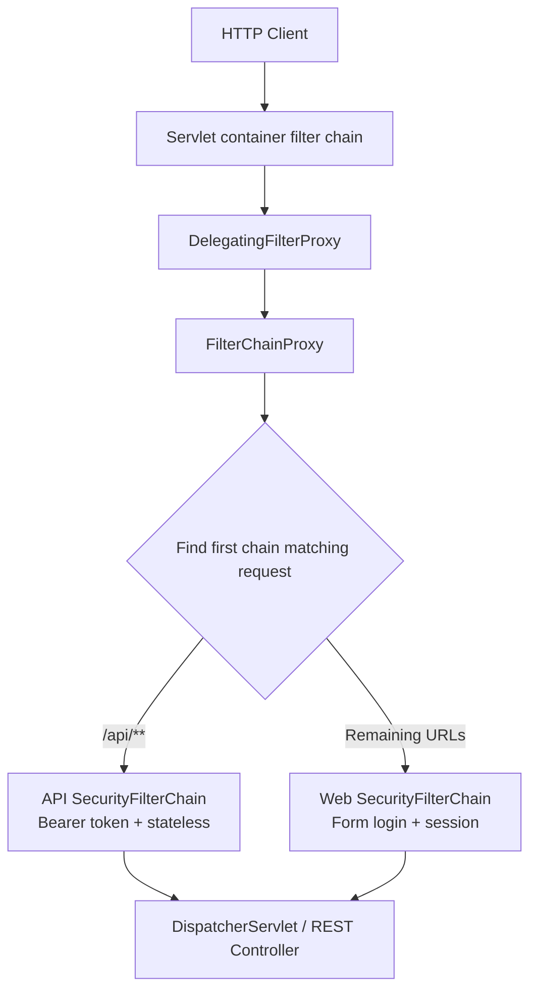

# Multiple SecurityFilterChains, securityMatcher, and @Order Ordering

## 1. The Problem: One Application Where API and Website Need Different Protection Mechanisms

Suppose a Spring Boot application serves both a REST API for a mobile app and an administration UI accessed via a browser:

- `GET /api/public/ping`: public API requiring no access token.
- `GET /api/orders/42`: API requiring an OAuth 2.0 Bearer JWT with the `orders.read` scope.
- `POST /api/orders`: API requiring the `orders.write` scope.
- `GET /web/dashboard`: web page accessible only to users signed in via form login.
- `GET /login` and `POST /login`: endpoints of the form login mechanism.

These request groups have different characteristics:

| Group | Authentication type | When unauthenticated | Session management | CSRF |
|---|---|---|---|---|
| REST API `/api/**` | Bearer access token | Usually returns `401` and `WWW-Authenticate: Bearer` | Usually stateless | Can be disabled in pure Bearer-header APIs, depending on architecture |
| Admin website | Form login | Usually redirects `302` to `/login` | Usually uses HTTP session | Should retain CSRF protection for state-changing actions |
| Public resources | No authentication required | Allowed | Depends on selected chain | Depends on authentication/request mechanism |

You can use **one** `SecurityFilterChain` with multiple `requestMatchers` to handle simple requirements. However, when different URL zones need **different authentication mechanisms, filters, error responses, session behavior, or CSRF policies**, using **multiple `SecurityFilterChain`s** separates configurations cleanly.

The core rule is not "a request runs through every chain," but rather:

> **Spring Security picks the first matching `SecurityFilterChain` in priority order. A request passes only through the filters of the selected chain.**

Without understanding this rule, a general chain can shadow a specialized chain, or a group of URLs can end up unprotected by Spring Security because it matches no chain.

### Lesson Objectives

After this lesson, you will be able to:

1. Explain the roles of `DelegatingFilterProxy`, `FilterChainProxy`, and individual `SecurityFilterChain`s.
2. Distinguish `securityMatcher(...)` used for **chain selection** from `requestMatchers(...)` inside `authorizeHttpRequests` used for **authorization rule selection**.
3. Use `@Order` to establish priority ordering among chains.
4. Separate a stateless Bearer JWT API from a stateful form-login website.
5. Understand why only **the first matching chain** takes effect, without merging rules across chains.
6. Identify risks when a request matches no chain, when `/login` falls outside chain scope, or when a broad chain precedes a narrow chain.
7. Write requests/tests to observe 200, 401, 403, 302 and verify which chain handles each URL.

## 2. Servlet Architecture: FilterChainProxy Selects a SecurityFilterChain

Spring Security Servlet integrates with the Servlet container via `DelegatingFilterProxy`. This proxy typically delegates requests to the Spring Security bean `springSecurityFilterChain`, usually constructed as a `FilterChainProxy`.

`FilterChainProxy` manages a list of `SecurityFilterChain`s. Each chain consists of:

- A **`RequestMatcher`** deciding whether the chain applies to the request.
- A list of **security filters** processing the request, such as security context, CSRF, Bearer token authentication, exception handling, and authorization.

High-level diagram:



This is an illustrative model. Real applications may have additional Servlet filters outside Spring Security, multiple DispatcherServlets, or other security mechanisms.

### 2.1. A Request Does Not Pass Through Every SecurityFilterChain

Suppose there are three chains:

```text
@Order(1)  securityMatcher("/api/admin/**")
@Order(2)  securityMatcher("/api/**")
@Order(3)  securityMatcher(any request)
```

For request `GET /api/admin/users`:

1. `FilterChainProxy` checks the priority-1 chain.
2. The URL matches `/api/admin/**`.
3. **Chain 1 is selected immediately.**
4. Chains 2 and 3 are not executed for that request.

This point is critical: if chain 1 requires only `authenticated()` while chain 2 requires strict admin scopes, **the scopes in chain 2 are never checked**. There is no intersection or union of rules across two chains.

### 2.2. Priority Order Is Part of the Security Policy

The following matchers overlap:

```text
/api/**
/api/admin/**
/api/public/**
```

A URL such as `/api/admin/users` matches both `/api/**` and `/api/admin/**`. Because only the first matching chain is chosen, ordering must reflect **specificity and protective intent**.

Typically:

```text
High priority: /api/admin/**
Next priority: /api/**
Last priority: catch-all
```

Never assume Spring Security automatically selects the chain with the longest URL or the "most specific" matcher. **Chain list order determines which is chosen first.**

### 2.3. What Happens If No Chain Matches?

Suppose an application declares only:

```text
@Order(1) /api/**
@Order(2) /web/**
```

Requests to `/actuator/info` or `/internal/diagnostics` match neither chain.

In this case, **`FilterChainProxy` does not apply the security filters of those two chains to that request**. That does not prove the endpoint is definitely reachable—it might still be restricted by the Servlet container, reverse proxy, Controller, or another mechanism—but **you must not assume Spring Security is protecting the endpoint with the rules of those two chains**.

For APIs needing default denial, include a **catch-all chain** placed last or design matchers covering all expected requests. An `anyRequest().denyAll()` rule takes effect only **inside the selected chain**, and does not protect URLs outside that chain's matcher.

## 3. How Do `securityMatcher(...)` and `requestMatchers(...)` Differ?

These are the two easiest APIs to confuse when writing multiple `SecurityFilterChain`s.

### 3.1. `securityMatcher(...)` Selects the Scope of the Entire Chain

Example:

```java
http
    .securityMatcher("/api/**")
    .oauth2ResourceServer(oauth2 ->
        oauth2.jwt(Customizer.withDefaults()));
```

Meaning: the `SecurityFilterChain` built from this `http` **is considered only for requests matching `/api/**`**.

When a request matches, that chain's filters run, including Bearer authentication, authorization, exception handling, and other filters configured on the chain.

If the request is `GET /web/dashboard`, the API chain does not match; `FilterChainProxy` tries the next chain.

### 3.2. `requestMatchers(...)` in `authorizeHttpRequests` Selects Rules After Chain Selection

Example:

```java
http
    .securityMatcher("/api/**")
    .authorizeHttpRequests(auth -> auth
        .requestMatchers("/api/public/**").permitAll()
        .requestMatchers(HttpMethod.GET, "/api/orders/**")
            .hasAuthority("SCOPE_orders.read")
        .anyRequest().denyAll()
    );
```

Here:

- `securityMatcher("/api/**")`: **chain selection**.
- `requestMatchers("/api/public/**")`: **authorization rule** for requests already inside the API chain.
- `requestMatchers(HttpMethod.GET, "/api/orders/**")`: rule for HTTP GET reading orders.
- `anyRequest().denyAll()`: default rule denying requests **that entered this chain** without being permitted.

### 3.3. Comparison Table

| Characteristic | `securityMatcher(...)` | `requestMatchers(...)` inside authorization |
|---|---|---|
| Where is it called? | On `HttpSecurity` when building the chain | Inside `authorizeHttpRequests` |
| Question | "Does this chain apply to the request?" | "Once inside the chain, what permission does the request need?" |
| When unmatched | `FilterChainProxy` tries the next chain | Tries the next rule in the selected chain |
| Affects authentication filters | Yes; determines whether requests go through this chain's filters | Does not remove the Bearer filter from the chain just because a rule uses `permitAll` |
| Risk when misunderstood | URLs can slip outside all chains | Overly broad rules can permit or deny wrongly |
| Example | `securityMatcher("/api/**")` | `requestMatchers("/api/public/**").permitAll()` |

Note that Spring Security also has other `RequestMatcher` APIs used in CSRF, CORS, or exception handling; their role depends on where they are configured. Here, the comparison focuses on **chain-selection matchers** versus **HTTP-authorization rule matchers**.

### 3.4. Common Mistake: Missing `securityMatcher`

```java
@Bean
@Order(1)
SecurityFilterChain apiChain(HttpSecurity http) throws Exception {
    return http
        .authorizeHttpRequests(auth -> auth
            .requestMatchers("/api/**").authenticated()
            .anyRequest().permitAll())
        .oauth2ResourceServer(oauth2 ->
            oauth2.jwt(Customizer.withDefaults()))
        .build();
}
```

At first glance this looks like an "API chain," yet it lacks `securityMatcher(...)`. By default, a chain can match **every request**.

If this chain is first, it will be selected for `/web/dashboard` too. A web form-login chain below it **never gets a chance to handle** the request. Worse, `anyRequest().permitAll()` in the first chain can unexpectedly open access to the web section.

**Proper fix:** add `securityMatcher("/api/**")` if you genuinely want the API chain to protect only `/api/**`; then declare the API zone's rules inside it.

### 3.5. `permitAll` Does Not Mean Skipping Authentication Filters

If `GET /api/public/ping` matches an API chain that has a Bearer authentication filter and a `permitAll()` rule:

- **No Authorization header sent:** the request is usually permitted.
- **Valid Bearer token sent:** the token may be processed and the endpoint still permitted.
- **Invalid Bearer token sent:** the authentication filter may reject with `401` **before** the `permitAll` authorization rule is evaluated.

Therefore, if you want public routes never to pass through the Bearer filter at all, you can design **a dedicated public chain** before the API chain, while accounting for differences in security headers, CSRF, CORS, and authentication context in the public chain.

## 4. `@Order` Determines Chain Priority

### 4.1. Basic Usage

Spring Security collects multiple `SecurityFilterChain` beans and sorts them by order:

```java
@Bean
@Order(1)
SecurityFilterChain apiSecurity(HttpSecurity http) throws Exception {
    // ...
}

@Bean
@Order(2)
SecurityFilterChain webSecurity(HttpSecurity http) throws Exception {
    // ...
}
```

`@Order(1)` has **higher priority** than `@Order(2)`, meaning it is evaluated first when finding a matching chain.

Other integer order values can be used; lower numbers are sorted earlier. When multiple chains overlap, assign explicit orders rather than relying on method declaration order in a Java file.

### 4.2. First Matching Chain Wins

Suppose:

```text
Chain A: @Order(1), matcher /api/**
Chain B: @Order(2), matcher /api/admin/**
Chain C: @Order(3), matcher any request
```

A request `/api/admin/users` enters **Chain A**, not Chain B.

This is misconfigured if B was built to enforce stricter admin protection. For B to win, configure:

```text
Chain B: @Order(1), matcher /api/admin/**
Chain A: @Order(2), matcher /api/**
Chain C: @Order(3), matcher any request
```

Specific rules precede broader matchers.

### 4.3. `@Order` on Chains Differs from Filter Order Inside a Chain

Do not mix up two concepts:

1. **Chain order:** `@Order` decides which `SecurityFilterChain` is evaluated first.
2. **Filter order:** Inside the selected chain, filters are ordered according to Spring Security's internal order. Additional filters can be inserted via `addFilterBefore`, `addFilterAfter`, or related APIs when needed.

Changing `@Order(1)` to `@Order(2)` **does not** make `AuthorizationFilter` run before `BearerTokenAuthenticationFilter` inside the same chain. Conversely, `addFilterBefore` does not decide which chain is selected.

### 4.4. `@Order` Alone Is Not Enough

A `@Bean @Order(1)` method still matches all URLs if it lacks `securityMatcher`.

Even a tightly configured `@Order(2)` chain cannot help a request already captured by chain 1. You need all of the following together:

- Clear matchers on each chain.
- Priority order reflecting the URL structure.
- Complete authorization rules inside each chain.
- Handling for URLs outside specialized zones.

## 5. Complete Example: Bearer JWT API and Web Form Login in One Application

Let us build a Spring Boot application to clearly see how two independent chains operate.

### 5.1. Dependencies

Example `build.gradle`:

```groovy
dependencies {
    implementation 'org.springframework.boot:spring-boot-starter-web'
    implementation 'org.springframework.boot:spring-boot-starter-security'
    implementation 'org.springframework.boot:spring-boot-starter-oauth2-resource-server'

    testImplementation 'org.springframework.boot:spring-boot-starter-test'
    testImplementation 'org.springframework.security:spring-security-test'
}
```

Assume the project configures the Spring Boot plugin and dependency management compatible with your Java/Spring Security versions. The following examples use the lambda DSL and `SecurityFilterChain` for modern Spring Security versions.

### 5.2. Configuring the Resource Server Issuer

In `src/main/resources/application.yml`:

```yaml
server:
  port: 8080

spring:
  security:
    oauth2:
      resourceserver:
        jwt:
          issuer-uri: https://id.example.com/realms/shop
```

The address is a **placeholder**. To use real Bearer JWTs, replace it with an actual trusted issuer and use access tokens issued by the Authorization Server for the API.

`issuer-uri` enables the Resource Server to verify the issuer and use appropriate key-source discovery. In real applications, also enforce **the API's audience** unless an equivalent validator is already configured. Checking signature/issuer and scope alone does not guarantee the token was issued for this Resource Server.

### 5.3. SecurityConfig with Two SecurityFilterChains

```java
package com.example.multichain;

import org.springframework.context.annotation.Bean;
import org.springframework.context.annotation.Configuration;
import org.springframework.core.annotation.Order;
import org.springframework.http.HttpMethod;
import org.springframework.security.config.Customizer;
import org.springframework.security.config.annotation.web.builders.HttpSecurity;
import org.springframework.security.config.http.SessionCreationPolicy;
import org.springframework.security.web.SecurityFilterChain;

@Configuration
public class SecurityConfig {

    // Priority 1: all /api/** requests go through the JWT Resource Server.
    @Bean
    @Order(1)
    SecurityFilterChain apiSecurity(HttpSecurity http) throws Exception {
        return http
            .securityMatcher("/api/**")
            .csrf(csrf -> csrf.disable())
            .sessionManagement(session -> session
                .sessionCreationPolicy(SessionCreationPolicy.STATELESS))
            .authorizeHttpRequests(auth -> auth
                .requestMatchers(HttpMethod.GET, "/api/public/ping")
                    .permitAll()

                .requestMatchers(HttpMethod.GET, "/api/orders/**")
                    .hasAuthority("SCOPE_orders.read")

                .requestMatchers(HttpMethod.POST, "/api/orders")
                    .hasAuthority("SCOPE_orders.write")

                .anyRequest().denyAll()
            )
            .oauth2ResourceServer(oauth2 ->
                oauth2.jwt(Customizer.withDefaults()))
            .build();
    }

    // Priority 2: catch-all for requests outside /api/**.
    @Bean
    @Order(2)
    SecurityFilterChain webSecurity(HttpSecurity http) throws Exception {
        return http
            .authorizeHttpRequests(auth -> auth
                .requestMatchers("/assets/**", "/favicon.ico")
                    .permitAll()
                .anyRequest().authenticated()
            )
            .formLogin(Customizer.withDefaults())
            .build();
    }
}
```

**These are two genuinely distinct `SecurityFilterChain` beans**, not two methods adding rules to the same chain.

Key points:

- The API chain is evaluated first because of `@Order(1)`.
- `securityMatcher("/api/**")` scopes **the entire API chain**.
- Other paths go to the web chain.
- The web chain **has no `securityMatcher`**, so it uses the default matcher covering all remaining requests; it is **the catch-all chain**.
- The API chain uses Bearer JWTs and stateless sessions.
- The web chain uses form login and defaults suitable for browser applications, including session support and CSRF protection per configuration.
- `anyRequest().denyAll()` in the API chain denies API requests without explicitly declared permissions.
- `anyRequest().authenticated()` in the web chain requires login for the web area and any other unpermitted URLs.
- `/login` falls within the catch-all web chain, allowing the default form-login mechanism to operate.

The example illustrates only the protection mechanism. To log in via form in a real application, you must configure a user authentication mechanism such as `UserDetailsService`, an identity provider, or an appropriate mechanism; enabling form login alone does not create a production user management system.

### 5.4. Why Disable CSRF on the API Chain Yet Keep It on the Web Chain?

The REST API in the example receives Bearer tokens via headers explicitly sent by the client, rather than relying on cookies for automatic authentication. Hence the example disables CSRF **only in the API chain**.

By contrast, a website using form login and session cookies is vulnerable to CSRF attacks if protection is removed. **Never apply `csrf.disable()` to the web chain merely to make POST requests easier to run.**

If a real application uses cookies to authenticate APIs or uses any credential automatically attached by browsers, evaluate CSRF separately; not every endpoint with "API" in its path is safe with CSRF disabled.

### 5.5. Does the Web Chain Need Its Own `sessionCreationPolicy`?

The web chain in the example does not set `STATELESS`, so it can use a session policy suited for form login. The API chain sets `STATELESS` so it does not use HTTP sessions for Bearer token authentication.

**Session configuration is per-chain**; do not infer that setting `STATELESS` on the API chain prevents the entire application from using sessions. Browser web logins still need a mechanism to store and retrieve Authentication by design.

### 5.6. Minimal Controller

```java
package com.example.multichain;

import java.util.Map;
import org.springframework.security.core.Authentication;
import org.springframework.security.core.annotation.AuthenticationPrincipal;
import org.springframework.security.oauth2.jwt.Jwt;
import org.springframework.web.bind.annotation.GetMapping;
import org.springframework.web.bind.annotation.PathVariable;
import org.springframework.web.bind.annotation.RestController;

@RestController
public class DemoController {

    @GetMapping("/api/public/ping")
    public Map<String, String> ping() {
        return Map.of("status", "ok", "surface", "api-public");
    }

    @GetMapping("/api/orders/{orderId}")
    public Map<String, String> getOrder(
            @PathVariable String orderId,
            @AuthenticationPrincipal Jwt jwt) {

        return Map.of(
            "orderId", orderId,
            "subject", jwt.getSubject());
    }

    @GetMapping("/web/dashboard")
    public Map<String, String> dashboard(Authentication authentication) {
        return Map.of(
            "surface", "web",
            "user", authentication.getName());
    }
}
```

The demo can use a standard `@SpringBootApplication` in the same root package. It does not declare `POST /api/orders` because its purpose is illustrating authorization rules; to test a successful POST, add the handler and business logic. In production environments, check ownership/tenant before returning orders.

### 5.7. Why Doesn't Form Login Appear on the API?

`GET /api/orders/42` matches the API chain **first**. Thus it uses the Bearer authentication entry point instead of entering the web chain and redirecting to `/login`.

`GET /web/dashboard` does not match the API chain, so it is handled by the web chain and form login. Unauthenticated users typically receive a redirect to `/login`.

This is the concrete benefit of splitting chains: **within one application, each URL zone gets the right authentication experience**.

## 6. Per-Request Chain Selection Walkthrough

With the example in section 5, consider these requests:

### 6.1. `GET /api/public/ping`

```text
1. Check API chain @Order(1):
   /api/public/ping matches /api/** → select API chain.

2. Bearer token filter sees no token → continue.

3. Authorization rule matches GET /api/public/ping → permitAll.

4. Controller returns 200 OK.
```

There is no fallback to the web chain once the API chain has been chosen.

### 6.2. `GET /api/orders/42` Without a Token

```text
1. API chain @Order(1) matches /api/**.
2. No valid Bearer token present.
3. Rule requires SCOPE_orders.read.
4. No satisfying Authentication exists.
5. Bearer entry point typically returns 401 Unauthorized.
```

There is no redirect to `/login` because the web chain never runs.

### 6.3. `GET /api/orders/42` with a Valid Token Missing the Scope

```text
1. API chain matches.
2. JwtDecoder verifies token successfully.
3. GrantedAuthority does not contain SCOPE_orders.read.
4. Authorization denies.
5. Typically returns 403 Forbidden.
```

`403` does not mean the token has the wrong issuer or expired; it typically means **the token was accepted but lacks sufficient privileges**.

### 6.4. `GET /web/dashboard` Without a Login Session

```text
1. API chain @Order(1) does not match /api/**.
2. Web chain @Order(2) matches as catch-all.
3. anyRequest().authenticated() requires login.
4. Form login entry point typically redirects to /login.
5. Client receives 302 Found (or appropriate 3xx redirect).
```

### 6.5. `GET /login`

```text
1. API chain does not match.
2. Catch-all web chain matches.
3. Form login filter/page generator handles login endpoint per configuration.
```

If the web chain is restricted to `securityMatcher("/web/**")` without also handling `/login`, the default login path may **fall outside the chain containing `formLogin`**. In that case, adjust matchers or configure login endpoints consistently.

### 6.6. `GET /unlisted-path`

```text
1. API chain does not match.
2. Catch-all web chain matches.
3. authenticated() rule applies.
4. Unauthenticated users are typically redirected to /login.
```

After authentication, the URL may still lack a Controller mapping and return 404. That is an HTTP routing concern, separate from whether Spring Security protects the request.

## 7. Matrix of securityMatcher, @Order, and Selection Outcomes

With configuration:

```text
@Order(1)   API chain: /api/**
@Order(2)   Web chain: any request
```

| Request | Selected chain | Key rule | Typical outcome if unauthenticated |
|---|---|---|---|
| `GET /api/public/ping` | API | `permitAll` | 200 |
| `GET /api/orders/42` | API | `SCOPE_orders.read` | 401 |
| `POST /api/orders` | API | `SCOPE_orders.write` | 401 |
| `PATCH /api/orders/42` | API | `denyAll` | Denied; exact status depends on authentication/handler |
| `GET /web/dashboard` | Web | `authenticated` | Redirect to login |
| `GET /login` | Web | Form login infrastructure | Serves/navigates login page per config |
| `GET /assets/app.css` | Web | `permitAll` | Permitted by security; file response depends on existence |
| `GET /unknown` | Web | `authenticated` | Redirect to login |

Distinguish:

- **Chain selection:** which chain handles the request?
- **Authorization:** does the request have permission under the chain's rules?
- **Endpoint mapping:** if it passes Security, is there a matching Controller or static resource?
- **Business authorization:** if the controller runs, does the data truly belong to the caller?

You cannot determine the complete HTTP status solely from matchers; a request can be denied before the Controller or return 404/405 after passing authorization.

## 8. When Three Chains Exist: Admin API, Regular API, and Web

A large architecture may need an administration API zone with a different protection setup from the rest of the API.

Example:

```text
@Order(1)  /api/admin/**  → requires specialized admin permission
@Order(2)  /api/**        → requires normal API scopes
@Order(3)  catch-all      → web form login
```

Be extra careful because `/api/admin/**` also matches `/api/**`.

### 8.1. Code Illustrating Proper Ordering

```java
@Configuration
public class ThreeChainSecurityConfig {

    @Bean
    @Order(1)
    SecurityFilterChain adminApi(HttpSecurity http) throws Exception {
        return http
            .securityMatcher("/api/admin/**")
            .csrf(csrf -> csrf.disable())
            .sessionManagement(s -> s
                .sessionCreationPolicy(SessionCreationPolicy.STATELESS))
            .authorizeHttpRequests(auth -> auth
                .anyRequest()
                    .hasAuthority("SCOPE_api.admin"))
            .oauth2ResourceServer(oauth2 ->
                oauth2.jwt(Customizer.withDefaults()))
            .build();
    }

    @Bean
    @Order(2)
    SecurityFilterChain generalApi(HttpSecurity http) throws Exception {
        return http
            .securityMatcher("/api/**")
            .csrf(csrf -> csrf.disable())
            .sessionManagement(s -> s
                .sessionCreationPolicy(SessionCreationPolicy.STATELESS))
            .authorizeHttpRequests(auth -> auth
                .requestMatchers("/api/public/**").permitAll()
                .requestMatchers(HttpMethod.GET, "/api/orders/**")
                    .hasAuthority("SCOPE_orders.read")
                .anyRequest().denyAll())
            .oauth2ResourceServer(oauth2 ->
                oauth2.jwt(Customizer.withDefaults()))
            .build();
    }

    @Bean
    @Order(3)
    SecurityFilterChain web(HttpSecurity http) throws Exception {
        return http
            .authorizeHttpRequests(auth -> auth
                .anyRequest().authenticated())
            .formLogin(Customizer.withDefaults())
            .build();
    }
}
```

This illustrative snippet assumes imports similar to section 5.3 and is meant **as a replacement**, not declared simultaneously alongside the earlier two-chain configuration. Real applications must also add audience validators and business permissions.

### 8.2. Only the First Chain Matches, Permissions Do Not Stack

A request `GET /api/admin/reports` enters `adminApi`, so it requires `SCOPE_api.admin`. It **does not** also check `SCOPE_orders.read` from `generalApi`.

If an admin endpoint requires **both** `SCOPE_api.admin` and `SCOPE_reports.read`, declare both conditions **inside the admin chain** or via corresponding method/business authorization. Never rely on the general API chain behind it.

### 8.3. The Same Authentication Mechanism Does Not Require Multiple Chains

If both the admin API and regular API use stateless JWTs, the same issuer, and the same filter policies, it may be simpler to use a single API chain:

```java
.securityMatcher("/api/**")
.authorizeHttpRequests(auth -> auth
    .requestMatchers("/api/admin/**")
        .hasAuthority("SCOPE_api.admin")
    .requestMatchers(HttpMethod.GET, "/api/orders/**")
        .hasAuthority("SCOPE_orders.read")
    .anyRequest().denyAll()
)
```

In this setup, the ordering of **authorization rules** still matters: `/api/admin/**` must precede overlapping general API rules.

**Use multiple chains when you need to separate filter/security behavior cleanly**, not simply because you have two different scopes requiring two `SecurityFilterChain`s.

## 9. Splitting Out a Dedicated Public Chain: When Does It Make Sense?

In the initial two-chain example, `/api/public/ping` uses `permitAll()` **inside the API Resource Server chain**. The Bearer authentication filter may still inspect a submitted token, including an invalid token.

If the product requirement is that `/api/public/**` **must not attempt Bearer token authentication**, you can create a separate chain:

```java
@Bean
@Order(1)
SecurityFilterChain publicApi(HttpSecurity http) throws Exception {
    return http
        .securityMatcher("/api/public/**")
        .authorizeHttpRequests(auth -> auth
            .anyRequest().permitAll())
        .build();
}

@Bean
@Order(2)
SecurityFilterChain protectedApi(HttpSecurity http) throws Exception {
    return http
        .securityMatcher("/api/**")
        .csrf(csrf -> csrf.disable())
        .sessionManagement(s -> s
            .sessionCreationPolicy(SessionCreationPolicy.STATELESS))
        .authorizeHttpRequests(auth -> auth
            .anyRequest().authenticated())
        .oauth2ResourceServer(oauth2 ->
            oauth2.jwt(Customizer.withDefaults()))
        .build();
}
```

This is an **alternative example to explain chain selection**; it omits the catch-all web chain and per-endpoint scope rules. In a real application, add those pieces and define CSRF/session/CORS/headers for the public chain.

### 9.1. Differences vs. `permitAll` Inside the API Chain

**Public rule inside the API chain:**

```text
/api/public/ping
    → API chain
    → BearerTokenAuthenticationFilter is present
    → AuthorizationFilter permitAll
```

**Public route in its own chain:**

```text
/api/public/ping
    → Public chain
    → oauth2ResourceServer is not configured on this chain
    → AuthorizationFilter permitAll
```

If a client sends an invalid Bearer token to the public route:

- In the API chain with a Bearer filter, the bad token may trigger a `401`.
- In the public chain without a Bearer filter, the bad token is not processed at the Bearer authentication layer and the route remains allowed, barring other filters/rules.

This is an **architectural choice**, not a bug in `permitAll`. If a public endpoint should never accept or interpret tokens, splitting chains can make sense. However, controllers handling requests in the public chain will also have no `Jwt` principal available.

### 9.2. Do Not Use `web.ignoring()` for Every Public Chain

Spring Security supports excluding certain requests from the security filter chain. That differs from `permitAll`:

- `permitAll`: requests still traverse the selected `SecurityFilterChain`, so filters like security headers still apply.
- Ignoring Spring Security completely: requests bypass those security filters altogether.

For ordinary public HTTP endpoints, `permitAll` is usually the better choice to retain filter-layer protections. Ignore Spring Security entirely only when you fully understand the reason and consequences; never use ignoring as a "quick fix" for a 401/403.

## 10. Form Login, Login Endpoints, and Chain Selection

### 10.1. A Classic Bug: Chain Restricted to `/web/**` While Login Is at `/login`

Suppose:

```java
@Bean
@Order(2)
SecurityFilterChain webSecurity(HttpSecurity http) throws Exception {
    return http
        .securityMatcher("/web/**")
        .authorizeHttpRequests(auth -> auth
            .anyRequest().authenticated())
        .formLogin(Customizer.withDefaults())
        .build();
}
```

When a user calls `/web/dashboard`, form login tries to redirect to `/login`, yet **`/login` does not match `/web/**`**. Without another matching chain, login filters/page generators may fail to handle that URL, causing errors or a broken login flow.

There are two design options:

1. Use a **catch-all web chain** placed last, as in section 5.
2. Configure the login URL and needed endpoints inside the web chain's matcher, or write a matcher accurately covering `/web/**`, `/login`, and related error pages/assets.

A chain can expose filter-generated endpoints such as login/logout, not just Controller mappings. When narrowing matchers, also audit **URLs handled internally by security filters**.

### 10.2. Login Should Not Be Accidentally Intercepted by the Bearer Chain

If the API chain lacks `securityMatcher("/api/**")`, `GET /login` may be captured by the first chain, preventing the form-login chain from running. This explains why apps sometimes "have form login configured" yet `/login` still returns 401/403/404.

Do not merely swap to `permitAll` inside the web chain when requests **never get routed to the web chain**. Fix chain selection first.

### 10.3. CORS Is Also Configured Per Chain

A REST API called from a cross-origin frontend may need CORS and `OPTIONS` preflight handling. With multiple chains, ensure preflight requests are processed by the right chain with matching CORS configuration before Bearer authentication triggers an error.

Conceptual example:

```java
http
    .securityMatcher("/api/**")
    .cors(Customizer.withDefaults())
    .authorizeHttpRequests(auth -> auth
        // Appropriate rules after CORS/preflight processing.
        .anyRequest().authenticated())
    .oauth2ResourceServer(oauth2 ->
        oauth2.jwt(Customizer.withDefaults()));
```

Provide a `CorsConfigurationSource` or compatible MVC/CORS configuration so `cors()` works as required. Never solve CORS errors by calling `permitAll` across the entire API.

## 11. Different Exception Handling per Chain

Each `SecurityFilterChain` can have its own authentication mechanism and error responses.

### 11.1. Bearer API

With an OAuth 2.0 Resource Server:

- Missing token on an endpoint requiring Authentication → usually `401 Unauthorized`.
- Invalid JWT → usually `401 Unauthorized` with a Bearer challenge.
- Valid token missing required scope → usually `403 Forbidden`.

Responses may include:

```http
HTTP/1.1 401 Unauthorized
WWW-Authenticate: Bearer
```

or:

```http
HTTP/1.1 403 Forbidden
WWW-Authenticate: Bearer error="insufficient_scope"
```

Exact header details depend on the error and `AuthenticationEntryPoint`/`AccessDeniedHandler` configuration.

### 11.2. Form-Login Website

With a web chain and form login, unauthenticated access to a protected page usually redirects:

```http
HTTP/1.1 302 Found
Location: http://localhost:8080/login
```

The actual URL depends on host, port, context path, redirect strategy, and login configuration. After logging in via session, the user can access pages per policy.

### 11.3. A URL Picked by the "Wrong" Chain Returns the "Wrong" Status

If `/api/orders/42` returns `302` to `/login` instead of `401`, check whether it entered the web chain.

If `/web/dashboard` returns `401` with `WWW-Authenticate: Bearer`, check whether the API chain is matching too broadly.

**Do not patch HTTP statuses arbitrarily with custom exception handlers when the root cause is wrong chain selection.** Fix matchers and `@Order` first.

## 12. Example HTTP Paths and Expected Results

Assuming the two-chain setup from section 5, running at `http://localhost:8080`, with an Authorization Server issuing JWT access tokens carrying the proper scopes.

### 12.1. Public API Without Token

```bash
curl -i http://localhost:8080/api/public/ping
```

Expected result:

```http
HTTP/1.1 200 OK
Content-Type: application/json

{"status":"ok","surface":"api-public"}
```

Illustrative response; JSON field ordering may vary.

### 12.2. Protected API Without Token

```bash
curl -i http://localhost:8080/api/orders/42
```

Typical result:

```http
HTTP/1.1 401 Unauthorized
WWW-Authenticate: Bearer
```

If it returns `302` to `/login`, verify whether the API chain is being selected.

### 12.3. API with Invalid Token

```bash
curl -i \
  -H 'Authorization: Bearer this-is-not-a-jwt' \
  http://localhost:8080/api/orders/42
```

Typical result is `401`. This is a token validation failure, not a missing verified authority.

### 12.4. API with Valid Token Missing Scope

Suppose `ACCESS_TOKEN_WITHOUT_READ` holds a real, unexpired access token with the right issuer/audience but without `orders.read`:

```bash
curl -i \
  -H "Authorization: Bearer $ACCESS_TOKEN_WITHOUT_READ" \
  http://localhost:8080/api/orders/42
```

Typical result is `403 Forbidden`. The token must be genuinely issued without the scope; tampering with a signed JWT payload breaks the signature and will likely return `401`.

### 12.5. API with Valid Token and Sufficient Scope

```bash
curl -i \
  -H "Authorization: Bearer $ACCESS_TOKEN_WITH_READ" \
  http://localhost:8080/api/orders/42
```

If the token is valid and holds `orders.read`, the demo Controller may return:

```http
HTTP/1.1 200 OK
Content-Type: application/json

{"orderId":"42","subject":"user-417"}
```

`subject` depends on the actual token. In production applications, still enforce record-level permissions.

### 12.6. Unauthenticated Website Access

```bash
curl -i http://localhost:8080/web/dashboard
```

Typically receives a redirect:

```http
HTTP/1.1 302 Found
Location: http://localhost:8080/login
```

Do not use `curl -L` when trying to **observe the initial redirect status**; `-L` follows redirects and may display the final login page response instead of 302.

### 12.7. Website Login Page

```bash
curl -i http://localhost:8080/login
```

With default form login supported and a catch-all web chain, you can get `200 OK` with the login page. With a custom login page, ensure a corresponding Controller/template and matcher exist.

### 12.8. Summary Table

| Request | Chain | Authentication | Typical outcome |
|---|---|---|---|
| `GET /api/public/ping` | API | No token | 200 |
| `GET /api/orders/42` | API | No token | 401 |
| `GET /api/orders/42` | API | Invalid JWT | 401 |
| `GET /api/orders/42` | API | Valid JWT missing `orders.read` | 403 |
| `GET /api/orders/42` | API | Valid JWT with `orders.read` | 200 in demo |
| `GET /web/dashboard` | Web | Not logged in | 302 to login |
| `GET /web/dashboard` | Web | Valid session Authentication | 200 in demo |
| `GET /login` | Web | Not logged in | Form login page or appropriate response |
| `GET /assets/app.css` | Web | Not logged in | Permitted by security; file status depends on existence |
| `GET /unknown` | Web | Not logged in | 302 to login, not bypassing security |

## 13. Verifying Chain Selection and Authorization Rules with MockMvc

You can write Spring Security Tests to verify web/security layer behavior. Assume the project includes `spring-security-test` and the Controller from section 5.6.

### 13.1. Example Test

```java
package com.example.multichain;

import org.junit.jupiter.api.Test;
import org.springframework.beans.factory.annotation.Autowired;
import org.springframework.boot.test.autoconfigure.web.servlet.AutoConfigureMockMvc;
import org.springframework.boot.test.context.SpringBootTest;
import org.springframework.security.core.authority.SimpleGrantedAuthority;
import org.springframework.test.web.servlet.MockMvc;

import static org.springframework.security.test.web.servlet.request
    .SecurityMockMvcRequestPostProcessors.jwt;
import static org.springframework.test.web.servlet.request
    .MockMvcRequestBuilders.get;
import static org.springframework.test.web.servlet.result
    .MockMvcResultMatchers.*;

@SpringBootTest
@AutoConfigureMockMvc
class MultiChainSecurityTest {

    @Autowired
    MockMvc mvc;

    @Test
    void publicApiIsAccessibleWithoutToken() throws Exception {
        mvc.perform(get("/api/public/ping"))
            .andExpect(status().isOk())
            .andExpect(jsonPath("$.surface").value("api-public"));
    }

    @Test
    void apiWithoutTokenReturns401NotLoginRedirect() throws Exception {
        mvc.perform(get("/api/orders/42"))
            .andExpect(status().isUnauthorized());
    }

    @Test
    void validJwtPrincipalWithoutScopeReturns403() throws Exception {
        mvc.perform(get("/api/orders/42")
                .with(jwt()
                    .jwt(token -> token.subject("user-417"))
                    .authorities(new SimpleGrantedAuthority(
                        "SCOPE_profile.read"))))
            .andExpect(status().isForbidden());
    }

    @Test
    void jwtPrincipalWithScopeCanReadDemoOrder() throws Exception {
        mvc.perform(get("/api/orders/42")
                .with(jwt()
                    .jwt(token -> token.subject("user-417"))
                    .authorities(new SimpleGrantedAuthority(
                        "SCOPE_orders.read"))))
            .andExpect(status().isOk())
            .andExpect(jsonPath("$.orderId").value("42"));
    }

    @Test
    void webWithoutLoginRedirectsToLogin() throws Exception {
        mvc.perform(get("/web/dashboard"))
            .andExpect(status().is3xxRedirection())
            .andExpect(redirectedUrlPattern("**/login"));
    }
}
```

This example uses `MockMvc` with a simulated JWT principal. `with(jwt())` **does not sign a real token and does not run the full `JwtDecoder`/JWK/issuer validation pipeline**. It is suitable for testing authorization branches and verifying how distinct API/web routes are protected.

If the test context attempts to fetch metadata from the example issuer or lacks a decoder configuration, provide a test issuer/JWKS or a suitable mock/bean `JwtDecoder`. Real JWT tests require a test keyset or Authorization Server integration—never use `with(jwt())` to claim production signature verification works.

### 13.2. Checking the Opposite Cases

Beyond the tests above, know how to recognize misconfigurations:

- Protected API returns 302 → the web chain is likely being selected.
- Protected web page returns 401 Bearer → the API chain is likely matching too broadly.
- Unfamiliar endpoint returns 200 without auth → a rule may be too broad or the URL matches no chain.
- API receives valid JWT yet returns 403 → check scopes, matchers in the API chain, and other method security.
- Form login redirect loop or login 404 → check whether `/login` belongs to the chain with form login.
- URL with a different HTTP method hits an unintended rule → check method-specific matchers.

These are checks to actively verify in your own environment. Writing sample tests does not mean they have been run or prove production configuration.

## 14. Tracing the Selected Chain While Debugging

When encountering 401, 403, 302, or an unprotected endpoint, identify **which chain was actually selected** instead of guessing from bean names.

In development environments, enable appropriate logging:

```yaml
logging:
  level:
    org.springframework.security.web.FilterChainProxy: TRACE
    org.springframework.security: DEBUG
```

Framework logs show matcher/filter evaluation and other diagnostic details depending on version. Use an appropriate log level and never leave unbounded verbose logging enabled in production.

### 14.1. Useful Diagnostic Questions

1. What are the actual request path and HTTP method?
2. Is there a context path, servlet path, or reverse proxy rewrite?
3. Which `SecurityFilterChain` beans were created?
4. What is the current `@Order` sequence?
5. Does each chain's `securityMatcher` match the request?
6. Which filters/authentication mechanisms does the first matching chain contain?
7. Which `authorizeHttpRequests` rule applied?
8. Which exception entry point/access denied handler produced the response?
9. Did the request reach `DispatcherServlet`/Controller?
10. Is there additional method security or business permission checking?

Logs can contain paths, authority names, or principal details. **Never log raw Bearer access tokens, session secrets, passwords, or secret keys.**

### 14.2. When the Application Runs Behind a Reverse Proxy

An external request:

```http
GET /shop/api/orders/42 HTTP/1.1
Host: public.example.com
```

may be forwarded by the proxy to the application as `/api/orders/42` or kept as `/shop/api/orders/42`, depending on rewrite rules and context paths.

Therefore, if `/api/**` fails to match behind a gateway while working on localhost, inspect the path **the Servlet request actually receives** and how the framework maps paths. Do not rush to widen `securityMatcher("/**")` as a fix, as that can cause one chain to capture unintended areas.

## 15. Common Configuration Mistakes

### 15.1. First Chain Has No `securityMatcher`

**Mistake:** `@Order(1)` matches every request by default, preventing lower chains from ever being selected.

**Consequence:** API/web returns the wrong 401/302 behavior or applies policies to the wrong URL zones.

**Fix:** Use explicit `securityMatcher` on specialized chains; place the catch-all last.

### 15.2. General Chain Placed Before Specialized Chain

**Mistake:**

```text
@Order(1) /api/**
@Order(2) /api/admin/**
```

**Consequence:** The admin chain is never selected for `/api/admin/**`.

**Fix:** Put the narrower matcher first or merge admin rules into the same API chain with accurate rule ordering.

### 15.3. Missing Catch-All Chain

**Mistake:** Only `/api/**` and `/web/**` exist; a new endpoint sits outside both zones.

**Consequence:** The endpoint may go unprotected by Spring Security because no chain matches it.

**Fix:** Add a catch-all chain or ensure all sensitive requests are covered; choose a strict default rule.

### 15.4. Adding `anyRequest().denyAll()` Only Inside a Narrow Chain

**Mistake:** Assuming `denyAll` protects every URL application-wide.

**Consequence:** URLs outside `securityMatcher` never pass through that rule.

**Fix:** Understand that `anyRequest` applies within **the active chain**, not as a replacement for chain scope.

### 15.5. Unintentionally Enabling Form Login on the API Chain

**Mistake:** API without a token returns 302 to `/login`.

**Consequence:** REST clients do not receive the Bearer challenge per contract.

**Fix:** Separate the JWT API chain or configure a dedicated entry point; check chain selection before touching exception handlers.

### 15.6. Disabling CSRF on the Web Chain

**Mistake:** Copying `csrf.disable()` from the stateless API onto a session-cookie chain.

**Consequence:** Can weaken protection against cross-site request forgery.

**Fix:** Disable CSRF only where architecturally justified; keep CSRF for web form login when appropriate.

### 15.7. Web Login URL Outside the Web Chain

**Mistake:** `securityMatcher("/web/**")` while form login uses `/login`.

**Consequence:** Login page/login-processing filters fail to handle the expected endpoints.

**Fix:** Use a catch-all web chain or a matcher properly covering login URLs.

### 15.8. Valid JWT Still Returns 403

**Possible causes:** Rule requires `SCOPE_orders.read` while the converter produced `SCOPE_profile.read`, or another chain with different rules was selected.

**Fix:** Inspect post-authentication authorities, matcher ordering, and method/business authorization layers.

### 15.9. Confusing `@Order` with Filter Order

**Mistake:** Changing chain order expecting a custom filter to move ahead of the JWT filter inside the same chain.

**Fix:** To change filter order inside one chain, use the corresponding filter-ordering mechanism; `@Order` only orders chains.

### 15.10. Configuring the Same URL in Multiple Chains Assuming Rules Stack

**Mistake:** Admin API is protected in two chains, yet only the first chain's rules run.

**Fix:** Put all required rules into the first matching chain or structure mutually exclusive chains clearly.

### 15.11. Using `web.ignoring` for Many Public Endpoints

**Mistake:** Bypassing Spring Security completely to avoid 401 responses.

**Consequence:** Filters for security headers/CSRF or other mechanisms may no longer apply.

**Fix:** Prefer `permitAll` inside an appropriate chain; use ignoring only with full awareness.

### 15.12. Ignoring `OPTIONS` and CORS Preflight

**Mistake:** Browser sends a preflight request with no token, and the API chain requires Authentication without proper CORS handling.

**Consequence:** Browser hits CORS errors or HTTP 401/403 before the real request.

**Fix:** Configure CORS on the relevant chain; verify allowed origins, methods, headers, and preflight handling without opening up the entire API.

## 16. Applying It: Choosing One Chain or Multiple Chains?

There is no rule that "more `SecurityFilterChain`s equals more security." Choose based on requirements:

| Scenario | Usually appropriate design |
|---|---|
| Single REST API using JWT, differing only by scopes | **One chain** with `requestMatchers` |
| JWT API and form-login website in one app | **Two chains** separating authentication/session/entry points |
| Admin API with genuinely different policies/filters from regular API | **Admin chain before general API chain** |
| Public API that must not process Bearer tokens | **Dedicated public chain** with a narrow matcher |
| Multiple issuers sharing the same API surface | Multi-issuer resolver/decoder inside **one chain**; not necessarily one chain per issuer |
| Need strict control over technical URLs and safe fallback | Precise chain matchers plus a **final catch-all** |
| Only want to allow `/api/public/ping` | `permitAll` inside the API chain is usually enough |

### 16.1. Principles for Designing Ordering

An easy-to-remember pattern:

```text
@Order(1)  very specific matcher, specialized mechanism
@Order(2)  matcher covering broader groups
@Order(3)  catch-all (unrestricted or matching all requests)
```

Then test sample URLs and verify which chain matches first. Whenever two chains overlap, ensure the earlier chain enforces **the full** required policy for the overlapping zone.

### 16.2. Protect New Endpoints by Default

When the team adds `/api/v2/orders`, a `securityMatcher("/api/**")` chain still handles the new route; with `anyRequest().denyAll()` in the API chain, the new route is blocked until an explicit rule is added.

Conversely, a new route `/internal/metrics` outside `/api/**` must be handled by the catch-all chain per policy or protected by a specialized zone. Without a catch-all, the new route can become an exposure gap.

## 17. Self-Check Questions

**Question 1.** There are two chains: `@Order(1) /api/**` and `@Order(2) /api/admin/**`. Which chain handles `/api/admin/users`?

**Answer:** The `/api/**` chain at order 1, because it already matches. The admin chain at order 2 does not run.

**Question 2.** Do `securityMatcher("/api/**")` and `requestMatchers("/api/public/**").permitAll()` perform the same function?

**Answer:** No. `securityMatcher` decides whether the chain is selected; `requestMatchers` decides authorization rules within the selected chain.

**Question 3.** An API chain has `anyRequest().denyAll()` with `securityMatcher("/api/**")`. Does it protect `/internal/metrics`?

**Answer:** Not via that rule, because `/internal/metrics` sits outside the API chain's matcher. Another suitable chain is needed, typically a catch-all or internal chain.

**Question 4.** Why does `GET /api/orders/42` without a token redirect to `/login` even though Bearer JWT is configured in a `SecurityFilterChain` bean?

**Answer:** The request is likely being picked up by an earlier web/form-login chain or another broad chain. Check `@Order` values and each chain's matcher.

**Question 5.** Is placing `@Order(1)` on the API chain enough to restrict that chain to `/api/**`?

**Answer:** No. You must declare `securityMatcher("/api/**")` or an equivalent matcher; `@Order` only sets priority order.

**Question 6.** If a `permitAll` public API receives an invalid Bearer token, is it guaranteed to return 200?

**Answer:** No. If the API chain includes a Bearer authentication filter, an invalid token can be rejected before the authorization step. A dedicated public chain without a Bearer filter behaves differently.

**Question 7.** Why might form login fail when the web chain matches only `/web/**`?

**Answer:** Because default login page/processing URLs like `/login` may sit outside the chain holding the form-login filters. Widen the matcher or adjust login endpoints accordingly.

**Question 8.** Does `@Order` change the relative order of `BearerTokenAuthenticationFilter` and `AuthorizationFilter` inside a chain?

**Answer:** No. `@Order` orders `SecurityFilterChain`s, whereas filter ordering within a chain is controlled by filter-order management.

**Question 9.** Does using multiple chains automatically combine scope rules from chains with overlapping URLs?

**Answer:** No. Only the first matching chain is selected. All mandatory conditions for a URL must reside in that chain or in authorization layers executed as the request proceeds.

**Question 10.** Why should you avoid omitting a catch-all when deploying an application with multiple URL zones?

**Answer:** Because a new route outside every `securityMatcher` might receive no Spring Security protection. A final catch-all provides a clear default policy.

## 18. Conclusion

**`SecurityFilterChain` is the set of security filters applied to a group of requests; `securityMatcher(...)` defines that group's scope; `@Order` determines which chain is considered first.** `FilterChainProxy` picks **the first matching chain** and does not accumulate rules from later chains.

Inside the chosen chain, `requestMatchers(...)` in `authorizeHttpRequests` then decides whether a request needs `permitAll`, `authenticated`, `hasAuthority`, or another policy. Therefore, a sound multi-chain setup requires **all three elements**: clear matcher scope, proper priority order, and complete authorization rules inside each chain.

For applications combining an OAuth 2.0 Resource Server and a website, separating a **stateless Bearer JWT API** from **stateful web form login** is a classic pattern. Put narrow matchers before broad matchers, keep URLs handled by login filters inside the right chain, manage CSRF/CORS/sessions per zone, and include a catch-all at the end when default protection is needed. Most importantly, always verify **which chain actually handles each request**, rather than merely reading bean names or assuming every chain applies.
