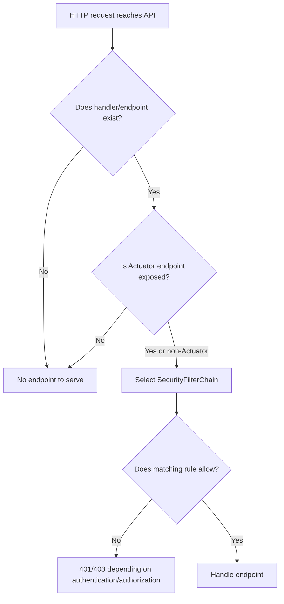
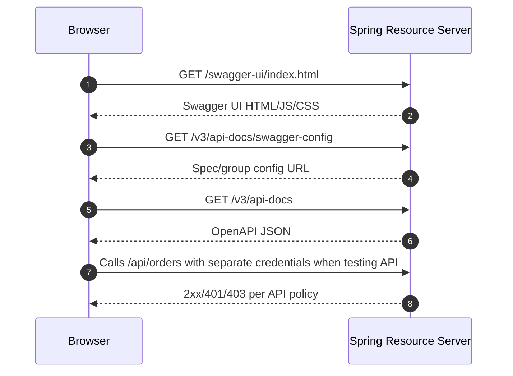
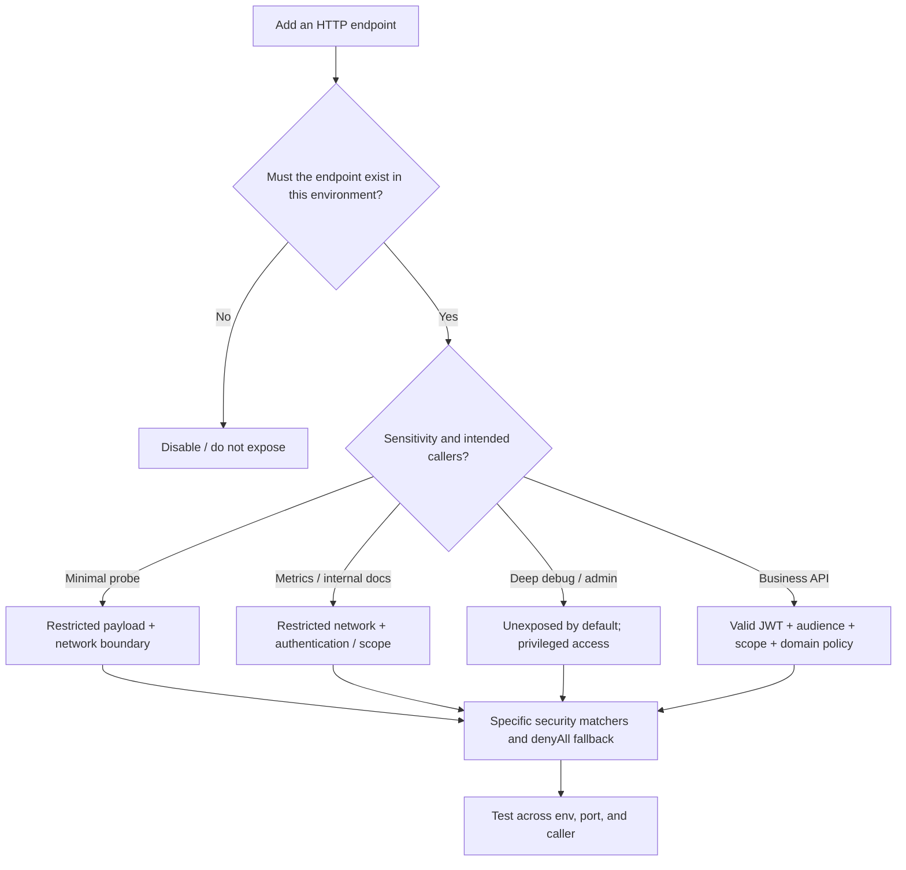

# Monitoring Endpoints, API Documentation, and Environment-Based Permission Configuration

A **Spring Security OAuth 2.0 Resource Server** exposes more than business APIs like `/api/orders` or `/api/payments`. During development and operations, applications also expose paths for **health checks, readiness/liveness probes, metrics, Prometheus, system info, OpenAPI specifications, and Swagger UI**. These endpoints carry varying levels of sensitivity and cannot share a single blanket rule such as "every URL under `/actuator` is public" or "all API docs must be turned off in production."

The tricky part is that **whether an endpoint is created, whether it is HTTP-exposed, which `SecurityFilterChain` handles it, and whether the caller is permitted access** are four separate decisions. A URL may not exist even though Security permits it; or it may exist yet be denied for lacking a scope. Across multiple environments—`dev`, `staging`, `prod`—inconsistent configuration can accidentally expose `env`, `heapdump`, or internal docs to the Internet.

This lesson teaches how to design **intentional HTTP authorization** for operational and documentation paths in **Spring Boot 3 / Spring Security 6** applications acting as Resource Servers receiving **Bearer access tokens**. Examples focus on the Servlet stack, Spring Boot Actuator, and springdoc-openapi. Specific path names and properties can vary with version and deployment architecture; always verify against your actual configuration before applying.

## 1. Why Shouldn't Health, Metrics, and Swagger Share the Same Permissions?

The three endpoint groups serve different callers:

| Group | Common example paths | Legitimate callers | Sensitivity |
| --- | --- | --- | --- |
| **Minimal probes** | `/actuator/health/liveness`, `/actuator/health/readiness` | Kubelet, load balancers, trusted operational probes | Low if returning only necessary status. |
| **Monitoring and diagnostics** | `/actuator/prometheus`, `/actuator/metrics`, `/actuator/info` | Prometheus, agents, or authorized ops teams | Medium to high, depending on metric contents/labels. |
| **Deep administration and debugging** | `/actuator/env`, `/actuator/configprops`, `/actuator/heapdump`, `/actuator/loggers`, `/actuator/beans`, `/actuator/mappings` | Specially privileged ops staff/infrastructure | High or very high. |
| **API documentation** | `/v3/api-docs`, `/swagger-ui/index.html`, `/swagger-ui.html` | Developers, testers, partners, or permitted users | Depends on content and environment. |
| **Business APIs** | `/api/orders/**`, `/api/admin/**` | Users or apps with access tokens carrying the right audience/scopes | Governed by data/business permissions. |

This distinction leads to common policies:

- **Minimal probes** may allow access **without a Bearer token**, while restricting network access and returned payload.
- **Metrics** are typically open only to metrics collectors over private networks/mTLS and/or with tokens carrying dedicated scopes.
- **Dangerous diagnostic endpoints** are usually **not exposed over HTTP** in production; when genuinely needed, open temporarily with multi-layer protection.
- **Swagger UI/OpenAPI** may be public for public APIs, restricted for internal APIs, or disabled in production per product needs.
- **Business APIs** require valid JWTs, the right audience, matching scopes, and owner/tenant checks where needed.

Never use `permitAll()` merely because "this path isn't a business API."

## 2. Four Mandatory Questions When an Endpoint Receives a Request

When checking permissions for a URL, answer in order:

1. **Is the endpoint registered?** For example, was the springdoc dependency added and is `springdoc.api-docs.enabled` turned on?
2. **Is the endpoint exposed over HTTP?** For example, is Actuator `prometheus` included in `management.endpoints.web.exposure.include`?
3. **Which security chain receives the request?** `securityMatcher` and `@Order` decide which `SecurityFilterChain` is selected.
4. **Which authorization rule allows or denies?** `requestMatchers`, `hasAuthority`, `permitAll`, `denyAll`, and related business policy layers.



This diagram is a functional breakdown, not an exact trace of Spring MVC filter execution and handler lookup. In reality **Security filters can reject a request before the framework even checks whether the endpoint exists**. Consequently, a disabled/unexposed endpoint will not always return `404` right away; a `denyAll` rule can cause callers to see `403` first.

**A `permitAll` rule does not create an endpoint**; conversely, an exposed endpoint **is not automatically accessible** if Spring Security blocks it.

## 3. Spring Boot Actuator: Exposure and Security Are Two Separate Layers

To add Actuator, include the dependency:

```gradle
dependencies {
    implementation 'org.springframework.boot:spring-boot-starter-security'
    implementation 'org.springframework.boot:spring-boot-starter-oauth2-resource-server'
    implementation 'org.springframework.boot:spring-boot-starter-actuator'
}
```

Example Actuator configuration:

```yaml
management:
  endpoints:
    web:
      exposure:
        include: health,info,prometheus
  endpoint:
    health:
      probes:
        enabled: true
      show-details: never
```

This is the **web endpoint exposure** layer:

- `management.endpoints.web.exposure.include` selects which Actuator endpoints are exposed over HTTP.
- `health` provides health status.
- `info` provides application info if configured.
- `prometheus` works only when Actuator and the required registry integration are present, such as the Micrometer Prometheus registry.
- `management.endpoint.health.probes.enabled=true` enables liveness/readiness health groups in applicable environments.
- `show-details: never` restricts public health detail output.

For Prometheus, an example additional dependency:

```gradle
dependencies {
    implementation 'io.micrometer:micrometer-registry-prometheus'
}
```

**Exposure does not mean authorization**: an exposed `prometheus` endpoint can still require an access token or be blocked by network policy. Conversely, writing `permitAll("/actuator/prometheus")` does not conjure the endpoint into existence if `prometheus` is not enabled and properly configured.

### Do Not Expose All of Actuator for Debugging Convenience

A risky configuration in production:

```yaml
management:
  endpoints:
    web:
      exposure:
        include: "*"
```

This configuration expands the set of registered HTTP endpoints, including sensitive ones if present and enabled. Spring Security **still requires authorization**, yet a safer principle is **not creating unnecessary HTTP surface area in the first place**.

Prefer allowlisting strictly the operational endpoints needed. When deep debugging is necessary, use a dedicated operational access procedure with time-boxed exposure and auditing.

## 4. Liveness and Readiness: Both Are Health Checks, Yet Their Purposes Differ

In Kubernetes and orchestration platforms, there are typically two probe types:

**Liveness** answers: is the current process still alive to keep running? Liveness should not overly depend on a temporarily slow external service, which can cause restart loops when a dependency has an outage.

**Readiness** answers: is the instance ready to receive business traffic? Readiness may evaluate critical request-handling conditions depending on architecture and resilience requirements.

Common paths when Actuator probes are enabled:

```text
GET /actuator/health/liveness
GET /actuator/health/readiness
```

Illustrative minimal responses:

```json
{ "status": "UP" }
```

When status differs from `UP`, the HTTP code may differ—for example, an unready service returning `503 Service Unavailable` per health status mapping. **A valid health probe can still return non-2xx because the app is unhealthy**; that is not an authentication error.

| Characteristic | Liveness | Readiness |
| --- | --- | --- |
| Goal | Detect instances that need restarting. | Decide whether to route business traffic to the instance. |
| Should it depend on the Authorization Server being online? | Usually **no**, to avoid restart loops during issuer outages. | Only if explicitly designed as a readiness condition. |
| Needs public Internet exposure? | No. Only needs reachability from the probe system. | No. Only needs reachability from the probe system. |
| Needs a Bearer token? | Possibly not, if network-restricted with safe responses. | Depends on architecture; if tokenless, must restrict network/content. |

**`permitAll()` handles only HTTP authorization, not who on the Internet can send requests.** If probes require no authentication, use ingress/network policies, a management network, or appropriate bind addresses to restrict access scope.

### Probes Running on a Separate Management Port

If Actuator runs on a port different from the business port, health on the management port may stay `UP` while the main application port is failing. Depending on Boot version, additional health probe paths on the main port can be enabled to close this gap:

```yaml
management:
  endpoint:
    health:
      probes:
        enabled: true
        add-additional-paths: true
```

The additional paths are typically `/livez` and `/readyz` on the main port when supported. Verify **actual paths and ports** for your version/app before configuring kubelet or proxies; permitting `/actuator/health/readiness` does not automatically permit `/readyz`.

## 5. Do Not Publicly Open All of `/actuator/health/**`

An overly broad rule:

```java
.requestMatchers("/actuator/health/**").permitAll()
```

can expose extra health groups or component details defined under `/actuator/health`. If a sensitive health group is added later, the exposed surface grows without anyone editing the rule.

When only the two basic probes are needed, consider:

```java
.requestMatchers(
    "/actuator/health/liveness",
    "/actuator/health/readiness"
).permitAll()
```

If infrastructure requires `/actuator/health` as the probe, **permit that exact path** and ensure returned content is minimized. There is no rigid rule that `/actuator/health` must always be private; policy depends on purpose, payload, and network placement.

For Spring Boot Actuator, detail visibility can be configured with `management.endpoint.health.show-details` (`never`, `when-authorized`, `always` per version features) and details-authorization settings. Never use `always` on an externally reachable endpoint if details reveal service names, databases, or sensitive dependencies.

## 6. Metrics and Prometheus Need Permissions Separate from Business APIs

A Prometheus system may scrape:

```text
GET /actuator/prometheus
```

Metrics data can reveal traffic patterns, JVM state, backend health, URI names, exception types, or service labels. Depending on the system, this is internal operational telemetry and should not be public by default.

Example policy with a Bearer access token:

```java
.requestMatchers(HttpMethod.GET, "/actuator/prometheus")
    .hasAuthority("SCOPE_metrics.read")
```

Tokens for a Prometheus scraper should be issued via **machine-to-machine / client credentials** where appropriate, with:

- A trusted issuer and audience matching the Resource Server receiving the token.
- A dedicated scope, such as `metrics.read`, never `orders.write`.
- Appropriate token lifetime/refresh and secure credential storage.
- Network policies or mTLS if supported by the architecture.

**Do not assume Prometheus automatically sends JWTs.** If an endpoint requires a Bearer token, configure the scrape job, agent, or proxy capable of obtaining and sending the credential. In some infrastructures, metrics are exposed only inside a management network over mTLS without direct OAuth tokens; that is a **different security model** that must be explicitly designed and verified.

### Distinguishing `/actuator/metrics` and `/actuator/prometheus`

`/actuator/metrics` typically serves queries for individual meters/metrics in Actuator's format; `/actuator/prometheus` serves Prometheus scrape-formatted data when the registry is enabled. They do not necessarily need the same permissions. For instance, production may expose only `prometheus` to an agent while **not exposing** the `metrics` endpoint used to browse detailed meters.

Do not add `metrics` to exposure simply because you use Prometheus. Expose only endpoints serving concrete operational needs.

## 7. Actuator Endpoints That Should Be Treated as Sensitive

Certain endpoints can reveal or modify critical information:

| Endpoint | Common risk | Suggested policy |
| --- | --- | --- |
| `env` | Environment details, configuration, and variable names; secret masking does not replace access control. | Do not expose in production except under tightly controlled procedures. |
| `configprops` | Bound properties and system integration structure. | Do not expose publicly. |
| `beans` / `conditions` | Internal architecture, auto-configuration, deployment details. | Internal investigation only. |
| `mappings` | Full list of routes and handlers. | Do not open publicly unless needed. |
| `heapdump` / `threaddump` | May contain sensitive data in memory or active threads. | Tightly control; limit exposure. |
| `loggers` | Can allow changing log levels when write operations are supported. | Restrict write permissions and audit changes. |
| `shutdown` | Can directly affect process lifecycle when enabled. | Do not enable for external HTTP. |
| `health` | Dependency status and component names if `show-details` is broad. | Minimize payload when probes are unauthenticated. |
| `info` | May include version, git commit, build metadata. | Audit contents before publishing. |
| `prometheus` | Operational telemetry and labels. | Network restriction or dedicated scraper permissions. |

An unexposed endpoint usually has no HTTP mapping to invoke. That is far stronger than exposing everything and relying solely on Security rules.

**Defense in depth** is the right approach: restrict exposure, control ports/networks, enforce authentication/authorization policies, and maintain logging/auditing. Never rely on obscure path names alone.

## 8. OpenAPI Specification Differs from Swagger UI

In applications using springdoc-openapi, you may see:

```text
/v3/api-docs
/v3/api-docs/swagger-config
/swagger-ui.html
/swagger-ui/index.html
```

Depending on version and configuration, other paths or property-customized paths may appear.

**OpenAPI specification** is the structured JSON/YAML document describing endpoints, requests/responses, schemas, and security requirements. **Swagger UI** is the web interface that reads the spec and lets developers try out the API.

| Component | Purpose | Risk if public |
| --- | --- | --- |
| OpenAPI JSON/YAML | Describes API contract, schemas, operations. | May expose unreleased endpoints or internal descriptive details. |
| Swagger UI | Browser viewer and API testing tool. | Can help outsiders discover/inspect the entire contract. |
| Swagger config endpoint | Directs UI to specs and URL groups. | May contain internal server URLs/specs unsuitable for public view. |
| Real API endpoints | Execute business logic. | Must be protected independently of docs. |

**Hiding Swagger UI does not hide the OpenAPI JSON.** Blocking only `/swagger-ui/**` while leaving `/v3/api-docs` public still lets clients read the spec. Conversely, allowing the UI while blocking the spec renders an interface that cannot load the API definition.

In particular, adding OpenAPI annotations like `@SecurityRequirement`, declaring a Bearer scheme in docs, or displaying the **Authorize** button in Swagger UI **does not replace** `SecurityFilterChain`. Those describe and assist API testing; whether HTTP requests are permitted is still governed by Spring Security and business policies.

## 9. Documentation Paths Depend on Version and Configuration

An application may set:

```yaml
springdoc:
  api-docs:
    path: /internal/openapi
  swagger-ui:
    path: /developer-docs
```

Then a matcher protecting only `/v3/api-docs` **no longer matches** the new path. Swagger UI may also use additional static files, redirects, configuration endpoints, and grouped spec endpoints.

Before writing rules, verify:

1. Was the right springdoc library added for your Spring Boot/Servlet stack?
2. What is the actual OpenAPI endpoint, and are there group-specific specs?
3. Is the UI served at `/swagger-ui/index.html`, redirected from `/swagger-ui.html`, or at a custom path?
4. Does the API gateway/ingress add a `context-path`, `servlet-path`, or reverse proxy prefix?
5. What are the per-environment `springdoc.api-docs.enabled` and `springdoc.swagger-ui.enabled` settings?
6. Can the UI load the spec from the same origin, or are CORS and additional policies required?

Avoid formulas like:

```java
.requestMatchers("/**").permitAll()
```

just to make Swagger UI work. If the UI fails to load a resource, locate **the exact blocked resource** and adjust the policy in the narrowest scope possible.

## 10. A Unified `SecurityFilterChain`: Probes, Metrics, Docs, and API

Here is a Servlet Resource Server example accepting JWTs, with these goals:

- Both `liveness`/`readiness` probes are permitted without a JWT.
- Prometheus scraping requires `SCOPE_metrics.read`.
- OpenAPI/Swagger can be public in permitted environments, while other environments require `SCOPE_docs.read` if docs are enabled.
- Order read/write APIs require their corresponding scopes.
- Other Actuator paths and all unlisted requests are denied.

Illustrative dependencies:

```gradle
dependencies {
    implementation 'org.springframework.boot:spring-boot-starter-security'
    implementation 'org.springframework.boot:spring-boot-starter-oauth2-resource-server'
    implementation 'org.springframework.boot:spring-boot-starter-actuator'
    implementation 'io.micrometer:micrometer-registry-prometheus'
    // Add compatible springdoc-openapi starter if Swagger UI is needed.
}
```

Code example:

```java
import org.springframework.beans.factory.annotation.Value;
import org.springframework.context.annotation.Bean;
import org.springframework.context.annotation.Configuration;
import org.springframework.http.HttpMethod;
import org.springframework.security.config.Customizer;
import org.springframework.security.config.annotation.web.builders.HttpSecurity;
import org.springframework.security.config.http.SessionCreationPolicy;
import org.springframework.security.web.SecurityFilterChain;

@Configuration
public class HttpAuthorizationConfig {

    private static final String[] DOC_PATHS = {
        "/v3/api-docs",
        "/v3/api-docs/**",
        "/swagger-ui.html",
        "/swagger-ui/**"
    };

    @Bean
    SecurityFilterChain securityFilterChain(
            HttpSecurity http,
            @Value("${app.security.public-api-docs:false}")
                boolean publicApiDocs) throws Exception {

        return http
            .csrf(csrf -> csrf.disable())
            .sessionManagement(session -> session
                .sessionCreationPolicy(SessionCreationPolicy.STATELESS))
            .authorizeHttpRequests(auth -> {
                auth.requestMatchers(
                    "/actuator/health/liveness",
                    "/actuator/health/readiness"
                ).permitAll();

                if (publicApiDocs) {
                    auth.requestMatchers(DOC_PATHS).permitAll();
                } else {
                    auth.requestMatchers(DOC_PATHS)
                        .hasAuthority("SCOPE_docs.read");
                }

                auth.requestMatchers(
                    HttpMethod.GET, "/actuator/prometheus"
                ).hasAuthority("SCOPE_metrics.read");

                auth.requestMatchers("/actuator/**").denyAll();

                auth.requestMatchers(
                    HttpMethod.GET, "/api/orders/**"
                ).hasAuthority("SCOPE_orders.read");

                auth.requestMatchers(
                    HttpMethod.POST, "/api/orders"
                ).hasAuthority("SCOPE_orders.write");

                auth.anyRequest().denyAll();
            })
            .oauth2ResourceServer(oauth2 -> oauth2
                .jwt(Customizer.withDefaults()))
            .build();
    }
}
```

This is **one chain covering requests in a standard web application context**, without `.securityMatcher("/api/**")` narrowing its scope, so monitoring/docs paths also receive this policy on the same port/context. If deploying management endpoints in **a different application context or separate management port**, do not assume this wiring applies automatically; inspect the management context's security and real infrastructure.

### Why Does Rule Order Matter in This Example?

The order is designed as follows:

1. **Exact** probes receive `permitAll`.
2. Documentation paths receive rules based on environment configuration.
3. `/actuator/prometheus` has its own monitoring scope.
4. Remaining `/actuator/**` paths are denied.
5. Business endpoints enforce their corresponding permissions.
6. `anyRequest().denyAll()` blocks all unspecified URLs.

If `.requestMatchers("/actuator/**").denyAll()` were placed **before** the probes and Prometheus, the specific rules afterward would never run for matching requests. This is an **authorization matcher ordering** rule, not bean creation order.

**Do not copy this code as a complete configuration for every product.** Add appropriate rules if you have web login, admin APIs, custom doc groups, `info` endpoints, webhooks, internal services, or other paths.

### `permitAll` Does Not Mean Filters Ignore Invalid Tokens

A normal probe request sends no `Authorization` header. If a caller still sends `Authorization: Bearer <invalid-token>`, the Bearer authentication filter may try to process that credential and fail **before** the `permitAll` rule decides. Therefore, do not take a `401` on a probe carrying a bad token as proof that the path was not permitted.

For unauthenticated probes, kubelet/load balancers should call **without Bearer credentials**, and network paths must be protected appropriately.

## 11. Why Shouldn't You Create Only One Chain for `/api/**`?

A quickly written configuration:

```java
@Bean
SecurityFilterChain apiChain(HttpSecurity http) throws Exception {
    return http
        .securityMatcher("/api/**")
        .authorizeHttpRequests(auth -> auth
            .anyRequest().authenticated())
        .oauth2ResourceServer(oauth2 -> oauth2
            .jwt(Customizer.withDefaults()))
        .build();
}
```

This chain **matches only `/api/**`**. If it is the sole `SecurityFilterChain` bean and Boot backs off its default web security chain because the app supplies a custom chain, URLs such as `/actuator/env` or `/v3/api-docs` may **match no security chain at all**.

That is a high-severity flaw when sensitive endpoints are HTTP-exposed.

To split into multiple chains, design explicitly:

```text
@Order(1)  /actuator/**     -> probes, metrics, deny other Actuator endpoints
@Order(2)  /swagger-ui/** and /v3/api-docs... -> documentation
@Order(3)  /api/**          -> JWT/scope APIs
@Order(99) all other URLs   -> fallback denyAll or valid policy
```

The lines above represent logical partitioning; a chain's `securityMatcher` may need `OrRequestMatcher` to cover multiple doc path groups. **The first matching chain is selected**, not all chains together.

For applications needing only a few endpoint groups, **one chain with ordered rules and a deny-all fallback** is usually easier to audit than multiple chains with overlapping matchers.

## 12. `EndpointRequest` and Matchers by Actuator Endpoint Type

Spring Boot Actuator provides helpers to create endpoint-based matchers, such as `EndpointRequest` in Servlet environments:

```java
import org.springframework.boot.actuate.autoconfigure.security.servlet.EndpointRequest;
import org.springframework.boot.actuate.health.HealthEndpoint;
```

In compatible configurations, you can use:

```java
http.securityMatcher(EndpointRequest.toAnyEndpoint());
```

or use a matcher by endpoint class:

```java
.requestMatchers(EndpointRequest.to(HealthEndpoint.class))
    .permitAll()
```

An advantage of endpoint matchers is tracking Actuator endpoint mappings automatically, especially when changing `management.endpoints.web.base-path`. **However, opening all of `HealthEndpoint` is broader than permitting just the two probes**; it can also open the root health/groups. If only liveness/readiness should be allowed, write sufficiently narrow rules or configure separate health groups/networks.

Additionally, when **the management server runs on a separate port/context**, the filter chain set, web security initialization, and request mappings can differ from the main application context. `EndpointRequest` is no guarantee that any chain bean declared in the main context protects all endpoints in the child context. Check the actual behavior of your version and deployment.

## 13. Separating the Management Port from the API Port

Spring Boot can configure:

```yaml
server:
  port: 8080

management:
  server:
    port: 9090
  endpoints:
    web:
      exposure:
        include: health,prometheus
```

Example:

```text
Port 8080: business APIs, possibly docs
Port 9090: Actuator health and Prometheus
```

Using two ports helps:

- Apply separate firewall/network policies for monitoring traffic.
- Avoid exposing port 9090 through public ingress.
- Manage separate rate limits or routing for scrapes/probes.
- Prevent Internet users from directly reaching administrative endpoints.

Yet **a separate port does not become a trusted zone by itself** if left open to all sources. Verify firewalls, service bindings, management base paths, authorization, and Spring Security config in the real context.

### Do Not Assume the Same Chain Applies to Every Port

When the management port differs from the application port, Spring Boot may create a **separate management web application context**. Boot auto-configuration conditions and Security beans are shared/registered in ways specific to the framework version.

Therefore verify:

1. Which URLs are actually exposed on 8080 and 9090?
2. Which security filter chain processes requests **on each port**?
3. Is default Actuator security auto-configuration or a custom chain active in the management context?
4. Are probe and Prometheus policies tested via HTTP integration tests on **the exact right port**?
5. Is the management port protected by cluster network policies/ingress?

A `denyAll("/actuator/**")` rule on the application port **is not sufficient proof** that the management port is locked down.

## 14. Environment-Based Configuration: Safe Defaults First

In many projects, environment requirements look like:

| Environment | Health probes | Metrics | OpenAPI/Swagger | Debug Actuator |
| --- | --- | --- | --- | --- |
| **Local development** | Minimal access allowed. | As needed. | Usually enabled for dev/testing. | Controlled local enablement allowed. |
| **CI/Integration test** | Enabled per test scenario. | Often unnecessary. | Enabled if testing contracts/docs. | Avoid unnecessary exposure. |
| **Staging** | For infrastructure probes. | Scraper/ops teams only. | Usually restricted to developers/QA. | Restricted, audited when needed. |
| **Production** | For probes on ops network. | Collector or admin connections only. | Public, restricted, or disabled per product. | Unexposed by default. |

**Never base default safety on assuming "the production profile will definitely be active."** If someone forgets to activate the profile, the application could boot with permissive development settings.

A solid pattern is **deny by default** in `application.yml`, enabling specific features only per environment:

```yaml
# application.yml — baseline
app:
  security:
    public-api-docs: false

spring:
  security:
    oauth2:
      resourceserver:
        jwt:
          issuer-uri: ${OAUTH2_ISSUER_URI}

management:
  endpoints:
    web:
      exposure:
        include: health,prometheus
  endpoint:
    health:
      probes:
        enabled: true
      show-details: never

springdoc:
  api-docs:
    enabled: false
  swagger-ui:
    enabled: false
```

In local development:

```yaml
# application-dev.yml
app:
  security:
    public-api-docs: true

springdoc:
  api-docs:
    enabled: true
  swagger-ui:
    enabled: true
```

For production needing **authenticated** docs:

```yaml
# application-prod.yml — example if production needs internal docs
app:
  security:
    public-api-docs: false

springdoc:
  api-docs:
    enabled: true
  swagger-ui:
    enabled: true
```

Then the security rule in section 10 requires `SCOPE_docs.read` for docs. If production **needs no docs**, keep them disabled per the baseline without overriding them on.

These configurations are standalone examples dependent on the springdoc library in use. `enabled: false` works only when supported as a property by your springdoc version. Verify actual endpoints with integration tests.

## 15. `@Profile` on Security Chains Can Create Gaps

Another common pattern is creating a bean:

```java
@Bean
@Profile("dev")
SecurityFilterChain developmentSecurity(HttpSecurity http)
        throws Exception {
    // Illustrative only: local development policy
    return http
        .authorizeHttpRequests(auth -> auth
            .anyRequest().permitAll())
        .build();
}
```

The snippet above is a **risky anti-pattern** if copied as real Resource Server dev config. It opens every URL when the dev profile is active and drops JWT Resource Server authentication. The bigger hazard is accidentally running the wrong profile in staging/production or causing other chain beans to back off conditionally.

`@Profile` is useful for toggling certain beans by environment, yet for HTTP security consider:

- Maintaining **one consistent baseline filter chain** with a deny-all fallback.
- Varying **small, explicitly designated rules** via safe properties and startup checks.
- Ensuring no profile accidentally drops all authentication.
- Never using `@Profile("!prod")` as the sole security boundary; `prod` can be mistyped, or a new environment may have a different name.
- Writing tests/checks for real profile combinations.

Spring Boot has a layered property and profile system; operators must control `SPRING_PROFILES_ACTIVE`, Kubernetes manifests, Helm values, or pipeline secrets per environment. Environment configuration is not an end-user credential, yet it remains **a security input to the system**.

## 16. `permitAll` for Docs Does Not Allow Calling Real APIs

A common point of confusion: inside Swagger UI, a developer clicks "Try it out" and calls `POST /api/orders`. Permitting documentation downloads grants no business scopes:

```text
GET /swagger-ui/index.html
    -> may be permitAll in dev

GET /v3/api-docs
    -> may be permitAll in dev

POST /api/orders
    -> still requires a valid token with SCOPE_orders.write
```

OpenAPI/Swagger UI is **a client tool** calling the API, not a component that bypasses Resource Server policy.

If Swagger UI supports the **Authorize** button, it can describe a Bearer or OAuth 2.0 security scheme:

- Bearer JWT: users may supply an access token **only in trusted environments and under approved workflows**.
- OAuth 2.0 Authorization Code + PKCE fits interactive browser clients better when integrating login.
- Never embed a confidential client's client secret or long-lived access tokens into JavaScript/static HTML/public docs.
- Restrict redirect URIs and origins per Authorization Server configuration.

**Protecting the Swagger UI endpoint does not protect API test calls initiated from the UI, and vice versa.** Both request paths have independent policies.

## 17. Swagger UI Must Load the Spec Before Displaying the API

A typical browser flow:



If `/v3/api-docs/swagger-config` requires `SCOPE_docs.read` while the browser has no access token yet, the UI may load HTML and then fail to display the spec. This **should never be fixed** by opening all of `/api/**` to unauthenticated access.

If production docs must be restricted, use **SSO at a reverse proxy, a VPN, or a protected developer portal** so browsers can fetch both static UI and OpenAPI specs; or design an appropriate token flow for docs. Evaluate browser/cookie/CSRF policies and the exact authentication mechanism rather than slapping a scope onto one URL and calling it done.

## 18. CORS and CSRF: Two Concerns Separate from Authorization

When Swagger UI runs on a different origin from the Resource Server:

```text
Docs UI: https://developer.example.com
API:     https://api.example.com
```

the browser may send a **CORS preflight** (`OPTIONS`) before the actual request. If Security blocks `OPTIONS` or the backend lacks proper CORS configuration, developers can mistake CORS failures for Bearer authentication/scope errors.

An API configuration allowing an approved origin:

```java
import java.util.List;

import org.springframework.context.annotation.Bean;
import org.springframework.web.cors.CorsConfiguration;
import org.springframework.web.cors.CorsConfigurationSource;
import org.springframework.web.cors.UrlBasedCorsConfigurationSource;

@Bean
CorsConfigurationSource corsConfigurationSource() {
    CorsConfiguration cors = new CorsConfiguration();
    cors.setAllowedOrigins(List.of(
        "https://developer.example.com"
    ));
    cors.setAllowedMethods(List.of(
        "GET", "POST", "PUT", "DELETE", "OPTIONS"
    ));
    cors.setAllowedHeaders(List.of(
        "Authorization", "Content-Type"
    ));

    UrlBasedCorsConfigurationSource source =
        new UrlBasedCorsConfigurationSource();
    source.registerCorsConfiguration("/api/**", cors);
    return source;
}
```

In `SecurityFilterChain`, enable:

```java
.cors(Customizer.withDefaults())
```

If Swagger UI and the API share the same origin, special CORS config may not be needed. CORS **is not a backend authentication or authorization mechanism**; non-browser tools can still send direct HTTP requests. Never use CORS instead of `JwtDecoder`, scopes, firewalls, or network policies.

**CSRF** concerns browsers automatically sending credentials such as cookies/sessions. For a stateless API accepting only client-attached Bearer tokens in headers, CSRF can be configured to match that architecture. However, if Actuator or docs pages use login/sessions/cookies, do not mechanically disable CSRF application-wide, especially on mutating endpoints.

## 19. Right Audience and Caller for Monitoring Endpoints

A design mistake is using a user token with business scopes to scrape metrics:

```text
sub = user-123
scope = orders.write
```

Separate monitoring permissions instead:

```text
sub/client_id = prometheus-agent
scope = metrics.read
aud = orders-api (if orders-api is the protected resource receiving the token)
```

The system's token contract may pick a dedicated audience for management APIs or share one for the protected resource, yet **the Resource Server must validate the appropriate actual audience**. Never accept a token meant for another service (`aud = payments-api`) to read `orders-api` metrics simply because the signature comes from the same issuer.

Furthermore:

- `SCOPE_metrics.read` grants no permission to access business APIs.
- `SCOPE_docs.read` must not grant permission to call `POST /api/orders`.
- `SCOPE_orders.read` does not imply permission to read `/actuator/metrics`.
- Client Credentials service tokens do not represent an End-User unless stated by the contract.
- Scopes are endpoint-level conditions and do not replace network, tenant, and owner policies.

These permissions must be issued by the Authorization Server via governance workflows, not minted from client-supplied headers like `X-Role: ADMIN`.

## 20. Environment Configuration Changes Must Be Reviewed Like Security Changes

Suppose an organization flips:

```yaml
app:
  security:
    public-api-docs: true
```

That **is not merely a UI tweak**. It moves documentation paths from restricted to public per the code in section 10. If the spec includes internal endpoints or unpublished schemas, the impact can be severe.

Similarly:

```yaml
management:
  endpoints:
    web:
      exposure:
        include: "*"
```

is not simply "turning on debug"; it increases attack surface. Such changes should undergo code review, environment verification, and auditing just like security policies.

Useful rules:

1. Keep a closed baseline for docs and sensitive Actuator endpoints.
2. Apply minimal overrides per real environment.
3. Avoid decisions based on easily misconfigured profile names or inferred string values.
4. Test `dev`, `staging`, `prod` profiles and **no-profile** startup if supported.
5. Verify actual configuration on the deployment, not just YAML in the repository.
6. Prevent sensitive secrets/issuer URLs from leaking via docs, `info`, or config logs.
7. Apply network policies accurately per port, namespace, and ingress route.
8. When disabling/renaming docs or management paths, update matchers, probes, scrapers, and tests together.

## 21. Distinguishing Unmapped Endpoints, 401, 403, and 503

| Result | Possible cause | How to verify |
| --- | --- | --- |
| `404 Not Found` | Docs disabled, Actuator not exposed, path changed, or handler missing. | Check dependencies, endpoint mappings, exposure, actual path. |
| `401 Unauthorized` | Protected endpoint requires authentication; Bearer token missing or invalid. | Check whether chain enables JWT/opaque, issuer/audience/expiry, and headers. |
| `403 Forbidden` | Caller authenticated yet lacks scope, or blocked by `denyAll`. | Check matcher ordering and authorities. |
| `503 Service Unavailable` | Health endpoint reports unhealthy readiness/liveness, or real infrastructure failure. | Inspect health groups/status and application cause. |
| `200 OK` | Endpoint permitted and succeeded. | Never treat a lone 200 status as proof that other permissions/endpoints are safe. |

Subtle point: a URL without a handler can still be rejected by Security filters **before routing looks for a handler**, so `denyAll` may return `403` instead of `404`. Thus you should not expect one fixed status code across all disabled/exposure cases.

Besides the HTTP status, Bearer authentication failures may emit `WWW-Authenticate: Bearer`, while insufficient-scope errors may follow OAuth Bearer error responses. Avoid returning issuer config details, JWKS, stack traces, or sensitive claims to unauthorized callers.

## 22. Testing Authorization by Path, Method, and Environment

A test matrix might include:

| Request | Dev per example | Prod per example | Purpose of check |
| --- | --- | --- | --- |
| `GET /actuator/health/liveness` without Bearer | Permitted at security layer | Permitted at security layer | Kubelet probe needs no user token. |
| `GET /actuator/health/readiness` without Bearer | Permitted | Permitted | Health status reflects traffic readiness. |
| `GET /actuator/prometheus` without Bearer | 401 if exposed and rule requires JWT | 401 if exposed and rule requires JWT | Scraper needs credentials or a different protection model. |
| `GET /actuator/prometheus` with `metrics.read` | Permitted | Permitted | Dedicated scope. |
| `GET /actuator/prometheus` with `orders.read` | 403 | 403 | Business scope cannot read metrics. |
| `GET /actuator/env` | Unreachable when unexposed | Unreachable when unexposed | Debug endpoint not accidentally public. |
| `GET /swagger-ui/index.html` | Permitted if docs enabled and public | Docs typically disabled or require `docs.read` | Do not confuse access policy with docs enabled. |
| `GET /v3/api-docs` | Permitted if enabled and public | Disabled or restricted | OpenAPI JSON also needs policy. |
| `GET /v3/api-docs/swagger-config` | Permitted if enabled and public | Disabled or restricted | UI loads spec configuration. |
| `GET /api/orders/42` without Bearer | 401 | 401 | Business API always requires authentication. |
| `GET /api/orders/42` with `orders.read` | Permitted at endpoint; still checks owner | Same | Scope and data policy are independent. |
| `POST /api/orders` with `orders.read` | 403 | 403 | Read permission is not write permission. |
| `GET /unknown` | Blocked by deny-all | Blocked by deny-all | No missed routes. |

The table states **expectations of the illustrated configuration model**, not automatic out-of-the-box behavior of every Spring Boot app. For unexposed or disabled endpoints, status may be 404 or blocked earlier by Security. For `/actuator/health/readiness`, the final status may be 503 when readiness fails.

### `MockMvc` Testing Has Its Own Scope

Spring Security Test example with a simulated JWT authority:

```java
import static org.springframework.security.test.web.servlet.request.SecurityMockMvcRequestPostProcessors.jwt;
import static org.springframework.test.web.servlet.request.MockMvcRequestBuilders.get;
import static org.springframework.test.web.servlet.result.MockMvcResultMatchers.status;

// Inside a test with MockMvc and real endpoints configured:
mockMvc.perform(get("/api/orders/42")
        .with(jwt().authorities(() -> "SCOPE_orders.read")))
    .andExpect(status().isOk());
```

This assumes test data/fixtures allow the caller to access order 42. Spring Security Test's `jwt()` creates a simulated authentication to test authorization; **it usually does not verify real JWT signatures through the production `JwtDecoder`**. Separate integration tests for issuer, audience, expiration, and validation are needed to prove the real Resource Server path.

Beyond testing the main web context, **a separate management port** needs real HTTP tests on that exact port alongside its network policy. Testing controllers via MockMvc on the app port does not prove the Actuator management context is protected.

## 23. Dedicated Tests for Wrong Profiles or Missing Configuration

In addition to normal cases, test **unexpected states**:

1. Active profile unset: do docs accidentally become public?
2. `dev` accidentally enabled in staging: does `public-api-docs` turn on unintentionally?
3. Springdoc dependency added while forgetting matchers: do OpenAPI spec and Swagger UI slip past deny-all?
4. `springdoc.api-docs.path` changed: does policy still guard the spec at the new path?
5. `management.endpoints.web.base-path` changed: are probes, metrics, firewalls, and scrapers updated together?
6. `management.server.port` enabled: are chain beans and network policies correct on the management port?
7. `include: "*"` enabled in an experimental config: are sensitive endpoints caught and blocked from publishing?
8. New Actuator endpoint added: does the default policy deny it rather than making it public?
9. Swagger UI OAuth2 integration added: are client secrets/tokens accidentally embedded in static config?
10. Health probes without a Bearer header: do they still succeed while returning only safe content?

These checks can be organized as integration tests, config linting, security reviews of deployment manifests, or staging checks. You do not need one monolithic test; what matters is **evidence of actual HTTP permissions per environment**.

## 24. Distinguishing Network Isolation from HTTP Authorization

An API can have two protection layers:

```text
Internet / internal network
          |
          v
Ingress / Firewall / Service Mesh / NetworkPolicy
          |
          v
Spring SecurityFilterChain
          |
          v
Actuator / OpenAPI / Business endpoint
```

Kubernetes example:

- Business API port is exposed via ingress per service routing.
- Management port is reachable only from the monitoring namespace or cluster internals.
- Prometheus scrapes using a service account/mTLS or dedicated credentials depending on architecture.
- Spring Security still enforces endpoint rules so other callers cannot overreach privileges.

**Network isolation does not replace authentication**, because internal networks still face lateral movement, misconfiguration, or compromised services. **HTTP authentication does not replace network isolation either**, because exposing an admin endpoint publicly expands the attack surface even if only privileged callers are permitted.

An organization may accept `permitAll` for liveness/readiness **strictly on the management network**, yet must not apply a public rule to that same path if a gateway exposes that port to the Internet.

## 25. Choosing Access Scope for API Documentation

Not every API should use the same docs model:

**Public APIs for external developers**

- Can publish the reviewed OpenAPI contract containing public endpoints.
- Can publish Swagger UI if it fits the product.
- Business endpoints still authenticate via OAuth access tokens and scopes.
- Never mix internal/unreleased endpoints into the public spec.

**Internal APIs**

- Can disable Swagger on production services and publish OpenAPI to a separate SSO-protected developer portal.
- If services still expose docs, restrict via `docs.read`, VPN, or reverse-proxy identity per architecture.
- Ensure UI, `swagger-config`, and group specs are protected consistently.

**Sensitive or machine-only APIs**

- Can publish OpenAPI artifacts in CI rather than serving them over HTTP in production.
- Avoid examples containing real tokens, accounts, identifiers, or customer data.
- Never let "Try it out" trigger production writes from an exposed UI.

This is a **product, operational, and threat-model** decision, not a rigid rule that "Swagger must always be on in dev and always off in prod." What matters is deliberately choosing the policy, enforcing it consistently, and testing it.

## 26. Runbook When Health or Swagger Suddenly Returns 401/403

When liveness/readiness or docs stop working after deployment, do not immediately add `permitAll("/**")`. Follow this sequence:

**Step 1 — Verify the real URL and port.** Are you hitting the app port or management port? Is there a reverse proxy prefix? Do Actuator and springdoc use custom paths?

**Step 2 — Verify the endpoint exists and is exposed.** Check dependencies, `management.endpoints.web.exposure.include`, probes enabled, and springdoc enabled. Never confuse a 404 from a disabled endpoint with a 401 from Security.

**Step 3 — Identify the selected chain.** Inspect `SecurityFilterChain` beans, `@Order`, `securityMatcher`, and whether Boot's default chain backed off due to a custom bean.

**Step 4 — Inspect rule ordering.** Does `"/actuator/**".denyAll()` precede Prometheus/probe rules? Does `anyRequest().denyAll()` swallow new documentation paths?

**Step 5 — Check credentials.** For restricted metrics/docs, does the client hold a token with the right issuer, audience, and scope? For `permitAll` probes, is infrastructure accidentally attaching an invalid Bearer token?

**Step 6 — Check health business status.** Is readiness returning 503 due to an unhealthy dependency rather than auth?

**Step 7 — Compare environment settings.** Are active profiles and properties on the deployment accurate? Was Swagger intentionally disabled in prod?

**Step 8 — Check browser/CORS.** If Swagger UI fails only when calling APIs from another origin, inspect preflight and CORS policies rather than making APIs unauthenticated to fix browser errors.

In development environments, you can enable Spring Security logging at an appropriate level:

```yaml
logging:
  level:
    org.springframework.security: DEBUG
```

Never log raw access tokens, `Authorization` headers, client secrets, or full claims. Record request ID, route, security chain, rule, error category, and environment appropriately.

## 27. Sustainable Workflow for Designing HTTP Authorization

When deploying a new Resource Server or modifying environments, follow this sequence:

1. **Inventory every HTTP surface:** APIs, probes, metrics, admin/debug, OpenAPI, Swagger UI, and actually needed static assets.
2. **Assess sensitivity:** distinguish minimal status, internal telemetry, admin data, and API contract descriptions.
3. **Minimize exposure first:** do not register Actuator/springdoc HTTP endpoints in environments that do not need them.
4. **Define network boundaries:** main/management ports, ingress, firewalls, VPNs, mTLS, and scrape networks.
5. **Choose authentication mechanisms:** JWT/opaque tokens, reverse-proxy SSO, or dedicated infrastructure per caller.
6. **Define minimal authorities:** `metrics.read`, `docs.read`, `orders.read`, and `orders.write` are separate permissions.
7. **Configure matchers from narrow to broad:** specific probes/docs/metrics first, then Actuator deny-all, and finally an explicit fallback.
8. **Maintain a safe cross-environment baseline:** override only needed features; avoid overly permissive default profiles.
9. **Test real HTTP traffic:** with/without tokens, right/wrong scopes, exposed/unexposed paths, management ports, and real profiles.
10. **Monitor in operations:** distinguish 401/403/404/503 at the right layer, with audited endpoint/config changes and rollback mechanisms.

Decision flowchart:



**Core takeaway:** Health probes, metrics, OpenAPI/Swagger UI, and business APIs are **HTTP surfaces with distinct purposes and trust levels**. Spring Boot decides which endpoints exist/are exposed; Spring Security decides which chain and rules govern requests; infrastructure decides who can reach those ports. A secure design combines **allowlisted exposure, narrow matchers, least-privilege scope authorization, closed-by-default environment config, network protection, and testing on real request paths**—never solving errors by applying `permitAll` across the board.
