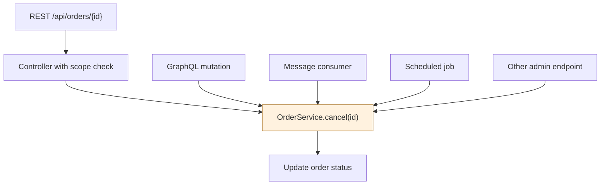
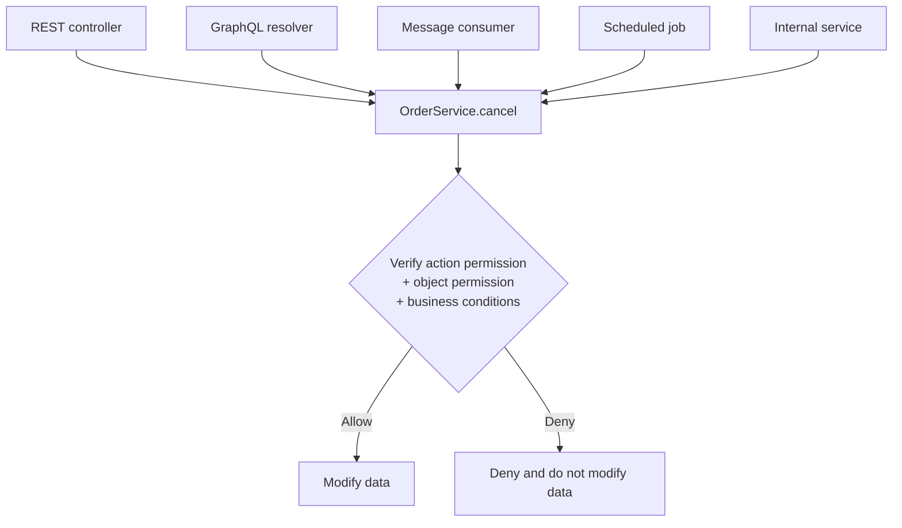

# Service-Layer Authorization to Protect Behavior Beyond the Controller

In a **Spring Security OAuth 2.0 / OIDC Resource Server** application, validating JWTs and scopes at the HTTP layer is an important protective step, but it is **not enough to guarantee that every business behavior is executed with the right permissions**. The same method to create an order, cancel an order, or export data can be invoked from a REST controller, a GraphQL resolver, a message consumer, a scheduled job, an internal command, or another service. If authorization checks are only written in the controller, the remaining call paths can enter the same business logic without passing through that check.

**Service-layer authorization** brings access constraints to the place where the business action actually happens. It works alongside token authentication and endpoint authorization, rather than replacing those two layers.

For example, a bearer access token containing `scope=orders.cancel` may be permitted to invoke the "cancel order" operation type, but it is not implicitly allowed to cancel **every** order. The service needs to check the principal, tenant, permissions on the specific order, order status, and transaction rules. These checks must continue to hold even when the method is called from a non-HTTP entry point.

> **Illustrative context:** The Authorization Server has issuer `https://login.example.com`; the Orders API is a Servlet Resource Server with audience `orders-api`; Spring Boot 3.x / Spring Security 6.x. Examples focus on JWT access tokens and `@EnableMethodSecurity`. Objects and URLs are used solely to explain the contract, not live runtime data.

## 1. Why Can Controller-Only Authorization Leave Business Logic Exposed?

Consider an application that starts with a REST endpoint:

```java
@RestController
@RequestMapping("/api/orders")
class OrdersController {

    private final OrderService orderService;

    OrdersController(OrderService orderService) {
        this.orderService = orderService;
    }

    @DeleteMapping("/{orderId}")
    @PreAuthorize("hasAuthority('SCOPE_orders.cancel')")
    void cancel(@PathVariable String orderId) {
        orderService.cancel(orderId);
    }
}
```

If `OrderService.cancel(...)` does not check permissions, the application depends on **every call** to the service going through `OrdersController.cancel(...)`.

As the system grows, additional call paths can emerge:

- A **GraphQL mutation** directly calling `orderService.cancel(id)`.
- A **message consumer** processing an event and calling that method.
- A **scheduled job** cleaning up stale orders.
- Another **admin controller** reusing the service while forgetting the annotation.
- An **internal service** calling `cancel(...)` to carry out a workflow.
- A **test/integration adapter** introducing a new code path that the development team overlooks.

If the service does not enforce permission invariants, any call path bypassing the original controller can bypass the `SCOPE_orders.cancel` condition.

### 1.1. "HTTP Is Protected" Does Not Mean "Every Business Call Is Protected"

`SecurityFilterChain` protects HTTP requests **that pass through the matching chain**. It does not automatically intercept every Java call within the same process, nor does it check events, schedulers, or commands that invoke services internally.

`@PreAuthorize` placed on a controller protects **the controller method handled by a proxy/interceptor**; it does not implicitly protect a separate service method across all call paths.

Risk diagram:



Only the edge from the REST controller passes through the scope check. The other edges do not automatically inherit that check.

### 1.2. Where Should the Boundary Move?

Desired design:



Entry points need to pass into the service **an actor context authenticated in an appropriate way**, or use a dedicated service/application port with a system-actor policy. This does not mean every job must impersonate an end-user JWT. The goal is **never to let business logic run without a valid authorization decision for that specific call path**.

## 2. Three Layers of Responsibility That Must Be Separated

In an OAuth 2.0 Resource Server, it is best to distinguish:

| Layer | Question | Typical Components |
|---|---|---|
| **Authentication** | Is the access token valid and which principal does it represent? | `BearerTokenAuthenticationFilter`, `JwtDecoder`, `JwtAuthenticationProvider` |
| **API / operation authorization** | Was the token granted the required scope/role for this kind of operation? | `AuthorizationFilter`, `hasAuthority`, `@PreAuthorize` |
| **Object / business authorization** | Is the principal allowed to perform this action on **this specific order** in its current state? | Domain policy, service, method security, repository, PDP |

A JWT with a valid signature but the wrong `aud` must still be rejected at **authentication**. A validly verified JWT missing `orders.cancel` is typically rejected at **operation authorization**. A JWT with sufficient scope trying to cancel someone else's order must be rejected at **object/business authorization**.

### 2.1. A Scope Is Not Resource Ownership

A token with:

```json
{
  "iss": "https://login.example.com",
  "sub": "customer-42",
  "aud": ["orders-api"],
  "client_id": "storefront-web",
  "scope": "orders.cancel",
  "tenant_id": "tenant-a"
}
```

may be mapped to `SCOPE_orders.cancel`. However, no claim here proves that `order-9001` belongs to `customer-42`, that the tenant is still valid, or that the order is in a state that permits cancellation.

Allowed conditions typically must all hold simultaneously:

```text
ALLOW_CANCEL =
    token_valid
AND token_audience_is_orders_api
AND token_has_orders_cancel_scope
AND actor_is_allowed_to_cancel_orders
AND actor_belongs_to_resource_tenant
AND actor_owns_or_is_delegated_the_order
AND order_status_allows_cancellation
AND transaction_rules_are_satisfied
```

This is an **illustrative policy model**, not a mandatory expression defined by OAuth. The key point: **the presence of a scope is only part of the decision**.

### 2.2. The Principal Is Not Necessarily a User

An access token from `authorization_code` can represent a user delegating authority to a client. A token from `client_credentials` typically represents an **application/service**, with no logged-in end user.

Therefore, a service cannot always assume:

```text
authentication.getName() == userId in database
```

There must be a clear identity contract specifying `(iss, sub)`, `client_id`, tenant, and actor kind. A job using a service identity must have its own corresponding permissions rather than pretending to be a customer by filling in `sub=customer-42`.

## 3. What Is Spring Security Method Security?

**Method Security** enables Spring to intercept calls to **methods on Spring-managed beans** and evaluate policies before or after the method executes.

Common mechanisms:

| Mechanism | Check Point | Purpose | Limitations to Understand |
|---|---|---|---|
| `@PreAuthorize` | Before method execution | Checks scopes, roles, arguments, and policy beans | Does not automatically know database state unless the policy queries or receives the data |
| `@PostAuthorize` | After method returns a result | Uses `returnObject` to evaluate access to the returned result | The method **has already executed**; unsuitable to rely on for write side effects |
| `@PreFilter` | Filters a collection argument before processing | Removes elements not allowed to be processed | Does not replace resource permissions in the repository; has cost/filter semantics to control |
| `@PostFilter` | Filters a collection result after retrieval | Small read results | Unsafe as the sole solution for pagination, total counts, or aggregates; may fetch excess data |
| `@Secured` | Before method execution | Traditional authority/role check | Must be enabled if used; less flexible than `@PreAuthorize` expressions |
| `@RolesAllowed` | Before method execution | JSR-250 role model | Requires enabling JSR-250 support; still does not understand ownership/tenant on its own |
| Custom `AuthorizationManager` | Before or after method invocation via interceptor | Complex reusable policies | Requires understanding proxies/AOP and data contracts |

With Spring Security 6, use `@EnableMethodSecurity` to enable method security configuration in the modern model.

### 3.1. Enabling Method Security

```java
package com.example.orders.security;

import org.springframework.context.annotation.Configuration;
import org.springframework.security.config.annotation.method.configuration.EnableMethodSecurity;

@Configuration
@EnableMethodSecurity
public class MethodSecurityConfiguration {
}
```

`@EnableMethodSecurity` enables support for `@PreAuthorize` and `@PostAuthorize` by default in modern configurations. If you want to use `@Secured` or JSR-250 `@RolesAllowed`, you must enable the corresponding options, such as `securedEnabled = true` or `jsr250Enabled = true`.

**Do not assume that merely having `spring-boot-starter-security` makes all method security annotations work.** Ensure that method security is explicitly enabled in configuration and that calls go through a Spring-managed proxy/interceptor.

### 3.2. Example of Checking Permissions Directly on a Service

```java
package com.example.orders.application;

import org.springframework.security.access.prepost.PreAuthorize;
import org.springframework.stereotype.Service;

@Service
public class OrderReadService {

    @PreAuthorize("hasAuthority('SCOPE_orders.read')")
    public OrderDto getOrder(String orderId) {
        // Still must check tenant and ownership in the policy below.
        return loadAuthorizedOrder(orderId);
    }
}
```

This is an abbreviated illustration: `OrderDto` and `loadAuthorizedOrder` represent application classes/methods. The key idea is that **even when the service is called from another entry point**, the method interceptor still has the chance to block calls lacking the scope **if** the invocation goes through the proxy and has valid authentication in the context.

However, `@PreAuthorize("hasAuthority(...)")` is **not enough** for per-order authorization. The next section places the object policy inside the service.

## 4. The "Deny by Default" Rule at the Business Layer

A safe policy should **deny** when:

- There is no authenticated `Authentication`.
- The principal does not belong to a token type or identity form supported by the action.
- Required scopes or roles are missing.
- Mandatory claims per the contract are missing or have the wrong type.
- The tenant or subject cannot be determined.
- Assigned permission information cannot be found from a trusted source.
- The resource state needed for evaluation cannot be loaded.
- The resource belongs to another user or tenant.
- The business state does not allow the action.

Never default to allowing access when an attribute is absent or `null`. For example, two `tenantId` fields both being null is **not** evidence that both sides belong to the same valid tenant.

### 4.1. From Endpoint Scope to Object Policy

Example:

```text
Service.cancel(orderId)
    │
    ├─ Valid Authentication?
    ├─ Has SCOPE_orders.cancel?
    ├─ Actor belongs to a supported model?
    ├─ Order exists within tenant scope?
    ├─ Actor is allowed to cancel this specific order?
    ├─ Order is still in a cancellable state?
    └─ Perform mutation within an appropriate transaction boundary
```

For users, the actor can be identified by `issuer + subject` after JWT verification. For machine-to-machine applications, the actor needs a separate policy based on `client_id` and assigned tasks; do not grant customer permissions just to reuse the same function.

## 5. Complete Service Example: Scope + Tenant + Owner + Order Status

Suppose the Orders API allows **customers to cancel their own unprocessed orders** when they have `orders.cancel` and the token was issued in a user-delegated context per the Authorization Server contract.

### 5.1. Resource Server Configuration

```groovy
dependencies {
    implementation 'org.springframework.boot:spring-boot-starter-web'
    implementation 'org.springframework.boot:spring-boot-starter-security'
    implementation 'org.springframework.boot:spring-boot-starter-oauth2-resource-server'
    implementation 'org.springframework.boot:spring-boot-starter-data-jpa'
}
```

```yaml
spring:
  security:
    oauth2:
      resourceserver:
        jwt:
          issuer-uri: https://login.example.com
          audiences:
            - orders-api
```

`audiences` can only be used directly if the project's Spring Boot version supports it; with a custom `JwtDecoder` or other versions, a separate `aud` validator is required. If the API accepts the RFC 9068 profile, appropriate checks for token type and required claims must also be added.

Spring Security chain:

```java
package com.example.orders.security;

import org.springframework.context.annotation.Bean;
import org.springframework.context.annotation.Configuration;
import org.springframework.http.HttpMethod;
import org.springframework.security.config.Customizer;
import org.springframework.security.config.annotation.web.builders.HttpSecurity;
import org.springframework.security.web.SecurityFilterChain;

@Configuration
public class ApiSecurityConfiguration {

    @Bean
    SecurityFilterChain apiChain(HttpSecurity http) throws Exception {
        return http
            .securityMatcher("/api/**")
            .authorizeHttpRequests(auth -> auth
                .requestMatchers(HttpMethod.GET, "/api/orders/**")
                    .hasAuthority("SCOPE_orders.read")
                .requestMatchers(HttpMethod.POST, "/api/orders/*/cancel")
                    .hasAuthority("SCOPE_orders.cancel")
                .anyRequest().authenticated()
            )
            .oauth2ResourceServer(oauth2 ->
                oauth2.jwt(Customizer.withDefaults())
            )
            .build();
    }
}
```

The example uses `POST /api/orders/{orderId}/cancel` to represent a business action. Route-level authorization is an additional layer; **the service still enforces its own policy**.

### 5.2. Order Model and Repository

To focus on authorization, we use a simplified domain model:

```java
package com.example.orders.domain;

public enum OrderStatus {
    NEW,
    PROCESSING,
    SHIPPED,
    CANCELLED
}
```

```java
package com.example.orders.domain;

public record Order(
    String id,
    String tenantId,
    String ownerIssuer,
    String ownerSubject,
    OrderStatus status
) {

    public Order cancelled() {
        if (status != OrderStatus.NEW) {
            throw new IllegalStateException("Order cannot be cancelled");
        }

        return new Order(
            id,
            tenantId,
            ownerIssuer,
            ownerSubject,
            OrderStatus.CANCELLED
        );
    }
}
```

Repository port:

```java
package com.example.orders.domain;

import java.util.Optional;

public interface OrderRepository {

    // The adapter must actually implement locking or a concurrency control mechanism.
    Optional<Order> findByIdForUpdate(String orderId);

    void save(Order order);
}
```

`findByIdForUpdate(...)` is a business port name and **does not automatically create a database lock just from the method name**. A JPA adapter may use `@Lock(PESSIMISTIC_WRITE)` or another concurrency control mechanism depending on the database. The examples omit detailed entity/DTO mapping and transaction adapter code to stay focused on authorization.

### 5.3. Determining Actor Permissions for an Order

```java
package com.example.orders.security;

import com.example.orders.domain.Order;
import com.example.orders.domain.OrderStatus;

import org.springframework.security.core.Authentication;
import org.springframework.security.oauth2.jwt.Jwt;
import org.springframework.security.oauth2.server.resource.authentication.JwtAuthenticationToken;
import org.springframework.stereotype.Component;

@Component
public final class OrderActionPolicy {

    public boolean canCancel(Authentication authentication, Order order) {
        if (!(authentication instanceof JwtAuthenticationToken jwtAuth)) {
            return false;
        }
        if (!jwtAuth.isAuthenticated() || order == null) {
            return false;
        }

        boolean hasCancelScope = jwtAuth.getAuthorities().stream()
            .anyMatch(authority ->
                "SCOPE_orders.cancel".equals(authority.getAuthority())
            );
        if (!hasCancelScope) {
            return false;
        }

        Jwt jwt = jwtAuth.getToken();
        if (jwt.getIssuer() == null || jwt.getSubject() == null) {
            return false;
        }

        String tenant = jwt.getClaimAsString("tenant_id");
        if (tenant == null || tenant.isBlank()) {
            return false;
        }

        // Only use the tenant claim if the validator/issuer contract
        // guarantees its semantics and issuing source.
        boolean sameTenant = tenant.equals(order.tenantId());
        boolean sameOwner =
            jwt.getIssuer().toString().equals(order.ownerIssuer())
            && jwt.getSubject().equals(order.ownerSubject());

        boolean allowedState = order.status() == OrderStatus.NEW;

        return sameTenant && sameOwner && allowedState;
    }
}
```

The policy denies when `JwtAuthenticationToken` is missing, the scope is missing, issuer/subject/tenant is missing, the owner does not match, or the order is not in the `NEW` status.

**Limitation of this example:** it illustrates a policy for a **user-delegated token**. If the AS can issue a `client_credentials` token whose `sub` collides with a user ID, or whose `tenant_id` claim is not bound to the right principal, you must add a step to verify the **token class/client policy** using a validator or independent check. Never assume every JWT with a `sub` is a user token.

### 5.4. Service Protecting the Mutation Behavior Itself

```java
package com.example.orders.application;

import com.example.orders.domain.Order;
import com.example.orders.domain.OrderRepository;
import com.example.orders.security.OrderActionPolicy;

import org.springframework.security.access.AccessDeniedException;
import org.springframework.security.access.prepost.PreAuthorize;
import org.springframework.security.core.Authentication;
import org.springframework.security.core.context.SecurityContextHolder;
import org.springframework.stereotype.Service;
import org.springframework.transaction.annotation.Transactional;

@Service
public class OrderCommandService {

    private final OrderRepository repository;
    private final OrderActionPolicy policy;

    public OrderCommandService(
            OrderRepository repository,
            OrderActionPolicy policy) {
        this.repository = repository;
        this.policy = policy;
    }

    @PreAuthorize("hasAuthority('SCOPE_orders.cancel')")
    @Transactional
    public void cancelOrder(String orderId) {
        Authentication actor =
            SecurityContextHolder.getContext().getAuthentication();

        // Read the record under the adapter's concurrency control.
        Order order = repository.findByIdForUpdate(orderId)
            .orElseThrow(() -> new OrderNotFoundException(orderId));

        // Check on the exact record about to be modified.
        if (!policy.canCancel(actor, order)) {
            throw new AccessDeniedException(
                "Not allowed to cancel this order"
            );
        }

        repository.save(order.cancelled());
    }
}
```

Simple domain exception:

```java
package com.example.orders.application;

public final class OrderNotFoundException extends RuntimeException {
    public OrderNotFoundException(String orderId) {
        super("Order not found");
    }
}
```

Safety mechanisms of the service:

1. `@PreAuthorize` requires the scope right **at the service invocation boundary through the proxy**, even for non-controller callers.
2. `SecurityContextHolder` reads the authentication belonging to the current execution context, rather than taking a self-declared principal from an HTTP header or a `userId` parameter.
3. The repository fetches the order to be modified within the adapter's transaction/concurrency control boundary.
4. `OrderActionPolicy` checks scope, identity, tenant, ownership, and status.
5. Mutation only occurs after all conditions pass.
6. If any check fails, `AccessDeniedException` is thrown and no changes are persisted.

**`@PreAuthorize` and manual checks inside the service are two complementary layers.** Even if an internal call bypasses the proxy due to poor design, checking `policy.canCancel(...)` inside the service body still serves as a line of defense. However, you should never intentionally rely on proxy bypasses; design proper call paths and test both layers.

### 5.5. The Controller Becomes Thin

```java
package com.example.orders.api;

import com.example.orders.application.OrderCommandService;
import org.springframework.http.ResponseEntity;
import org.springframework.web.bind.annotation.PathVariable;
import org.springframework.web.bind.annotation.PostMapping;
import org.springframework.web.bind.annotation.RequestMapping;
import org.springframework.web.bind.annotation.RestController;

@RestController
@RequestMapping("/api/orders")
public class OrderCommandsController {

    private final OrderCommandService commands;

    public OrderCommandsController(OrderCommandService commands) {
        this.commands = commands;
    }

    @PostMapping("/{orderId}/cancel")
    public ResponseEntity<Void> cancel(@PathVariable String orderId) {
        commands.cancelOrder(orderId);
        return ResponseEntity.noContent().build();
    }
}
```

The controller does not decide ownership, does not take a client-supplied `ownerId`, and does not hold a scattered copy of the policy. The service is the final point before mutation, making it the right place to enforce permission invariants.

In a real-world application, HTTP exception handling, domain states, auditing, and API contracts must also be added. The snippet focuses on **service-layer authorization**, not a complete runnable Spring Boot project.

## 6. Why Need Both @PreAuthorize and In-Service Policy?

The two approaches have different strengths:

| Aspect | Method Security Annotation | Policy Inside Service / Domain |
|---|---|---|
| Checking static scopes/roles | Very well suited to `hasAuthority`, `hasRole` | Can be repeated as a defensive layer |
| Checking resources in the DB | Can invoke a policy bean via SpEL | Well suited when the resource is already loaded in a transaction |
| Protecting calls through a Spring proxy | Yes | Checks in the method body do not depend on proxies |
| Usage from background jobs without SecurityContext | Usually denies; caller identity must be designed | Can use an explicit actor abstraction across multiple entry points |
| Consistent mutation control | Annotation checks before invocation | Service can lock, check, then update atomically |
| Locating where business invariants are enforced | Located at service entry | Located right next to the data mutation |

There is no mandatory rule that every service must duplicate the exact same checks in **both** forms. Depending on architecture, you can use:

- `@PreAuthorize` for scopes and roles; policy in the service body for owner/tenant/state.
- `@PreAuthorize` calling a policy bean for simple, relatively stable read actions.
- A central `AuthorizationManager` or PDP when many unified rules are needed.
- Application services using an explicit `ActorContext` and dedicated policies for multi-entry-point systems.

**What must never be lost:** every path capable of performing a mutation must enforce the actual policy, not just the path going through a specific controller.

## 7. Placing Policy Directly in @PreAuthorize

You can invoke a Spring bean from an expression:

```java
@PreAuthorize(
    "hasAuthority('SCOPE_orders.read') " +
    "and @orderAuthorization.canRead(authentication, #orderId)"
)
public OrderDto readOrder(String orderId) {
    return loadOrderDto(orderId);
}
```

`orderAuthorization` is a policy bean defined by the application. It must resolve the order, tenant, owner, and principal from trusted data. The name `#orderId` must be resolved by Spring from the Java parameter (for example, compiling with `-parameters` or using a parameter-name annotation when needed).

You can use a parameter annotation to guarantee the name when the build environment does not preserve parameter names:

```java
import org.springframework.security.access.method.P;
import org.springframework.security.access.prepost.PreAuthorize;

@PreAuthorize(
    "hasAuthority('SCOPE_orders.read') " +
    "and @orderAuthorization.canRead(authentication, #orderId)"
)
public OrderDto readOrder(@P("orderId") String orderId) {
    return loadOrderDto(orderId);
}
```

This is an illustration of argument binding; classes like `OrderDto` and `loadOrderDto` belong to the specific application.

### 7.1. Limitations of "Query Policy First, Mutate Later"

If an annotation uses a policy bean to read the order and allow access, and then the method body reads the order again to modify it:

```text
Time A: policy reads order, status = NEW -> allow
Time B: service reads order, status = SHIPPED -> cancel
```

This is a **TOCTOU — Time Of Check To Time Of Use** risk. State can change between the two points in time, especially when multiple requests or workers run concurrently.

Therefore, for mutations:

- Keep simple, data-independent checks in `@PreAuthorize`, such as scopes.
- Load the record under an appropriate transaction/locking mechanism.
- Check **resource policy and state right before the mutation**.
- Ensure the write is atomic or use optimistic locking/version checks.
- Never allow a write operation to proceed merely because a boolean was computed in an earlier request.

A conditional database update can be used to protect the invariant:

```sql
UPDATE orders
SET status = 'CANCELLED'
WHERE id = :order_id
  AND tenant_id = :tenant_id
  AND owner_issuer = :issuer
  AND owner_subject = :subject
  AND status = 'NEW';
```

Then check the number of updated rows, which normally must be `1` to consider the operation successful; `0` may mean the order does not exist, permission is lacking, or the status does not permit the action. Design appropriate error messages without leaking out-of-scope data.

For complex conditions, transactions, locks/versions, and domain policies must work closely together. `@Transactional` alone does not turn every read-check-write sequence into an atomic operation across all isolation levels.

## 8. @PostAuthorize and @PostFilter: Useful, but Not the Final Guard for Writes

### 8.1. @PostAuthorize on Returned Resources

An example of checking after a read:

```java
@PostAuthorize(
    "returnObject == null or " +
    "returnObject.ownerSubject == authentication.name"
)
public OrderDto findOrder(String orderId) {
    return orderRepository.readDto(orderId);
}
```

`@PostAuthorize` can inspect the result to decide whether to return it to the caller. However, understand that:

- **The method has already executed** before the post-method policy is evaluated.
- If the method sends an email, writes to the DB, transfers money, or emits an event, denying afterward does not necessarily undo all side effects.
- Expressions relying on `authentication.name` may lack issuer/tenant checks and be unsuitable when the subject is not a user.
- If the method returns null or nested data, the policy must be designed for the exact types.

**Do not use `@PostAuthorize` as the sole protection on methods with side effects.** For writes, check permissions before performing the action and enforce constraints within the transaction.

### 8.2. @PostFilter on Lists

```java
@PostFilter("filterObject.ownerSubject == authentication.name")
public List<OrderDto> listOrders() {
    return orderRepository.findAllDtos();
}
```

The example above is easy to understand, but it is **unsuitable as the sole mechanism** for protecting list data in large systems:

- The service may have unnecessarily loaded the entire dataset from the DB.
- `totalElements`, aggregates, and pagination may still reflect unauthorized records.
- Nested relations, exports/file streams, or caches may already have been created before filtering.
- An unconstrained `findAll` query without tenant filtering may violate data minimization requirements.

Prefer **authorization-constrained queries**:

```sql
SELECT *
FROM orders
WHERE tenant_id = :authorized_tenant
  AND owner_issuer = :issuer
  AND owner_subject = :subject
ORDER BY created_at DESC
LIMIT :limit OFFSET :offset;
```

Also ensure counts, filters, sorting, and exports are computed over that exact same authorized dataset.

## 9. Spring AOP Proxies: Technical Boundaries of Method Security

Method security is typically implemented using **Spring AOP/proxies/interceptors**. Therefore, an annotation on a method is **not** a guarantee that every Java statement calling that method will be checked.

### 9.1. Self-Invocation Can Bypass Interceptors

Example:

```java
@Service
public class OrderWorkflowService {

    public void process(String orderId) {
        cancelOrder(orderId); // this.cancelOrder(...): internal call
    }

    @PreAuthorize("hasAuthority('SCOPE_orders.cancel')")
    public void cancelOrder(String orderId) {
        // Mutation
    }
}
```

If `process` calls `cancelOrder` via `this` inside the same instance, the call may **not go through the Spring proxy**, causing `@PreAuthorize` not to execute for that internal call.

**Good design practices:**

- Move the protected method into a **separate Spring bean**, so callers invoke it through the bean/proxy.
- Or place the policy inside the service/domain body rather than relying on annotations as the sole control point.
- Avoid "tricks" to call back into a bean's own proxy when a simpler, clearer architecture solves the problem.

Example of splitting beans:

```java
@Service
public class OrderWorkflowService {

    private final OrderCommandService commandService;

    public OrderWorkflowService(OrderCommandService commandService) {
        this.commandService = commandService;
    }

    public void process(String orderId) {
        // Call to another bean, passing through the service proxy when configured.
        commandService.cancelOrder(orderId);
    }
}
```

However, if `process` is called from a scheduler with no Authentication, `cancelOrder` should **deny** under the current policy. Do not create a fake user authentication just to force it past the interceptor.

### 9.2. Beans, Method Visibility, and Proxying

Conditions you must understand:

| Case | Risk |
|---|---|
| Object created with `new`, not managed by Spring | No Spring proxy/method interceptor |
| `private` method called internally | Not protected like a public call through a proxy |
| Self-invocation within the same bean | Can bypass the interceptor |
| `final` class/method in certain CGLIB proxy models | Cannot be overridden/intercepted as expected |
| Using different interface/proxy types | How proxying and interception apply depends on configuration |
| Annotation placed on a method while method security is not enabled | The annotation has no effect as expected |
| Calling a service from an async worker without context | The annotation may deny or principal-reading logic may lack context |
| Exception caught and ignored | The caller may continue executing side effects even though auth was denied |

Not every annotation on a Java method creates a security boundary under all conditions. For critical behavior, the design should enforce **calls through controlled beans**, while domain policies cannot be bypassed when executing mutations.

### 9.3. Is Method Security on Both Controller and Service Redundant?

Both can be present:

```java
// Controller (guard at the HTTP boundary)
@PreAuthorize("hasAuthority('SCOPE_orders.cancel')")
public void cancelHttp(String id) {
    orderCommandService.cancelOrder(id);
}

// Service (guard at business logic)
@PreAuthorize("hasAuthority('SCOPE_orders.cancel')")
public void cancelOrder(String id) {
    // Object policy and mutation
}
```

This increases defense in depth when configured clearly. However, when the same rule appears in multiple places, avoid differing variants that cause confusing "controller allows, service denies" behavior. Typically, the controller handles protocol/routing, the service enforces business policy, and the security filter chain protects HTTP at the endpoint level.

## 10. Call Paths Beyond the Controller: GraphQL, gRPC, Events, Jobs

### 10.1. GraphQL Resolvers

GraphQL can be exposed via a single shared HTTP endpoint `/graphql`, while internally containing many queries/mutations with very different permission requirements.

If `/graphql` only requires `authenticated()`, each behavior must be protected individually:

```text
Mutation.cancelOrder
    → OrderCommandService.cancelOrder
        → Method security + object policy
```

Do not treat the fact that all GraphQL traffic passes through one authenticated endpoint as a replacement for authorization at each resolver/service.

### 10.2. gRPC or Internal RPC

If the same domain service is called from a gRPC adapter, the HTTP Servlet `SecurityFilterChain` **does not automatically** handle gRPC requests like REST endpoints. Workload/user authentication must be enforced at the gRPC boundary using an appropriate mechanism, then translated into a trusted actor context for the application service.

Do not trust `user-id` or `roles` metadata sent by an arbitrary gRPC client without authentication/authorization on the RPC channel.

### 10.3. Message Consumers

A message handler may receive:

```json
{
  "eventType": "CancelOrderRequested",
  "orderId": "order-42",
  "requestedBy": "customer-42"
}
```

A `requestedBy` claim in a message body **is not automatically a Spring Security Authentication**. If the publisher is unauthenticated or the message is tampered with, using that field to grant permissions creates a vulnerability.

You need to determine:

- Who is allowed to publish events/commands to the queue?
- Does the publisher have an appropriate service identity and scope/role?
- Did the message arrive over a protected broker, topic, ACL, and transport?
- Which attributes are trustworthy, and which are merely **request payload data**?
- Does the consumer service need to verify a **system actor** or a delegated end-user's authorization decision?
- Does order/tenant state need to be re-checked at message consumption time?

For state-changing commands, the policy should be checked at execution time, not solely based on a stale decision from when the message was sent.

### 10.4. Schedulers / Batch Jobs

Schedulers typically have no incoming HTTP request or user `SecurityContext`:

```java
@Scheduled(cron = "0 */15 * * * *")
public void expireOldOrders() {
    orderMaintenanceService.expireEligibleOrders();
}
```

**Do not fix "missing Authentication" by manually setting `ROLE_ADMIN` or `SCOPE_orders.cancel` on a fake user.** A scheduler should have its own use case/policy for a system actor:

```text
OrderMaintenanceService.expireEligibleOrders()
  → Allowed workload identity / trusted scheduler trigger
  → Only orders eligible by age/status
  → Tenant/batch constraints
  → Transaction + audit
```

An automated maintenance operation like "expire old orders" has a different meaning from "a user actively cancelling their own order." They should not be forced through the same controller authorization simply because both ultimately update order status.

## 11. Designing an Actor Context for Multiple Entry Points

If a system supports user requests, service accounts, and jobs, a well-managed abstraction can keep services independent of transport:

```java
package com.example.orders.security;

public record ActorContext(
    ActorKind kind,
    String issuer,
    String subject,
    String clientId,
    String tenantId
) {
    public enum ActorKind {
        END_USER,
        SERVICE
    }
}
```

**Key condition:** `ActorContext` must not be arbitrarily constructed from a client JSON body or header without verification. It must be **created from verified credentials at the trust boundary**, for example:

- HTTP Resource Server: verified JWT/opaque token and issuer/claims policy.
- RPC: service identity authenticated via mTLS or an appropriate RPC mechanism.
- Message consumer: workload/producer identity and trusted authorization evidence per architecture.
- Scheduler: deployed and controlled workload identity and authority.

Never treat the `ActorContext` record itself as a "certificate" or let any untrusted caller instantiate an actor with `kind=SERVICE` to bypass checks.

### 11.1. Application Service with an Explicit Actor

A general design:

```java
public void cancelOrder(
        ActorContext actor,
        String orderId) {

    // 1. Check actor permission for this action type.
    // 2. Load the order for the right tenant, inside an appropriate transaction.
    // 3. Check owner/delegation/state.
    // 4. Only then modify data.
}
```

An **adapter/application boundary** is also needed to control who can instantiate `ActorContext`. If any internal bean can pass a fake actor without restriction, passing actor as a parameter only changes the form without guaranteeing security.

### 11.2. Splitting Business Commands by Source

Many systems are safer and easier to understand when they have two use cases:

```text
CustomerCancelOrder
  → requires a user-delegated access token
  → scope orders.cancel
  → same tenant and order owner
  → status allowing user cancellation

SystemExpireOrder
  → requires a trusted workload
  → separate batch policy
  → expired and unprocessed orders
  → does not impersonate a customer principal
```

Both use cases may call the same internal domain transition, but **the conditions permitting the transition to be triggered** must differ and be enforced at the application/service layer.

## 12. SecurityContextHolder: Value and Limitations

In a Servlet Resource Server, after a JWT is verified, Spring stores the `Authentication` in the request's `SecurityContext`. You can read it via:

```java
Authentication authentication =
    SecurityContextHolder.getContext().getAuthentication();
```

With JWTs, the authentication is typically a `JwtAuthenticationToken`, whose principal is the verified `Jwt`. Scopes may be converted into `SCOPE_*` authorities.

Keep in mind:

- `SecurityContextHolder` normally uses a **thread-bound** strategy; it does not propagate everywhere automatically.
- Context is not present by default in `@Async`, `CompletableFuture`, custom executors, scheduled jobs, message listeners, or callbacks running on other threads.
- Do not rely on a previous request being authenticated for a subsequent request to have a principal.
- Do not store one user's `Authentication` in a shared singleton field or static variable.
- For code outside a request, a missing context must be treated as **unauthenticated / no actor**, never picking the "most recent user" or defaulting to admin.
- If context needs to propagate across async boundaries, use appropriate Spring Security mechanisms such as `DelegatingSecurityContextRunnable` or `DelegatingSecurityContextExecutor` and clearly define the context's lifetime and boundaries.

### 12.1. Do Not Pass a User's Bearer Token Indefinitely Through Jobs

An access token has a specific lifetime and audience. Pushing the raw token from an HTTP request into a queue for a job running hours later risks expiration, token leakage, and broken trust boundaries.

A better approach is often:

1. Authenticate the user and verify permission to **initiate the job** at request time.
2. Create a trusted job record specifying the permitted scope.
3. When the worker runs, authenticate the workload with its own service identity.
4. Re-check business conditions that may have changed, such as tenant, ownership, status, and current policy.
5. Audit both the request origin and the executing actor, without storing raw access tokens unless genuinely required.

If the business requires **long-lived delegation** on behalf of a user, use an appropriate explicit OAuth/authorization mechanism rather than treating a JWT access token as a permanent credential.

## 13. Protecting Data in Services Beyond Just an ID

### 13.1. Read by ID

Wrong:

```java
@PreAuthorize("hasAuthority('SCOPE_orders.read')")
public OrderDto get(String orderId) {
    return repository.findDtoById(orderId);
}
```

If the repository reads solely by ID, any subject with the read scope can access another user's record if they guess or know the ID. This is the **Broken Object Level Authorization (BOLA/IDOR)** risk.

The solution is to put the owner/tenant policy into the service or query. For example, a constrained query:

```sql
SELECT *
FROM orders
WHERE id = :order_id
  AND tenant_id = :authorized_tenant
  AND owner_issuer = :issuer
  AND owner_subject = :subject;
```

Actor parameters must come from the authenticated context or trusted domain mappings, **not** from client-supplied request values used as authorization proof.

### 13.2. Read List, Pagination, and Aggregates

A method like:

```java
@PreAuthorize("hasAuthority('SCOPE_orders.read')")
public Page<OrderDto> list(Pageable pageable) {
    return repository.findAll(pageable);
}
```

can still expose another tenant's orders. The record set must be restricted **before** pagination:

```text
findVisibleOrders(authorizedTenant, issuer, subject, filters, pageable)
```

`totalElements`, statistical metrics, exports, and file downloads must all follow the same resource scope. Do not merely filter data after the database has already computed totals across the entire system.

### 13.3. Nested Resources

`GET /api/orders/42/items/7` must verify that item 7 **belongs to order 42** and that the order falls within the authorized scope. If you check order 42 and then load item 7 independently, you may expose an item belonging to another order.

With service-layer policies, parent-child relationships are part of resource authorization, not just a controller routing concern.

### 13.4. File Exports and Background Reports

A CSV/PDF export method can be called by users, admins, and scheduled jobs. Export permissions need to consider:

- Does the actor have the `orders.export` scope or equivalent workload permission?
- Which set of tenants is permitted?
- Which sensitive/PII fields are allowed in the file?
- Are there volume, date, or customer group limits?
- Where is the file stored, who may download it, and for how long?
- If the job runs minutes or hours later, does authorization need to be re-evaluated?

Checking `SCOPE_orders.export` only on a UI "Download" button or controller is insufficient if the export worker/service can be invoked from elsewhere.

## 14. 401, 403, 404, and Behavior Outside HTTP

In a REST API, typical status codes are:

| Scenario | Layer | Typical HTTP Status |
|---|---|---|
| No access token sent to a protected endpoint | Authentication | **401 Unauthorized** |
| JWT has invalid signature, issuer, audience, is expired, or wrong token profile | Authentication | **401 / invalid_token** |
| Valid token but missing `orders.cancel` | Operation authorization | **403 Forbidden**, possibly `insufficient_scope` |
| Token has scope but order does not belong to actor | Object authorization | **403 or 404** depending on policy |
| Token has scope/owner but order is already SHIPPED, cannot cancel | Business state policy | Could be **409 Conflict**, **403**, or another business code |
| All conditions satisfied | Application service | Execute mutation and return appropriate response |

**`404` instead of `403`** may be chosen to reduce the ability to infer the existence of out-of-scope orders, but it must be consistent and must not leak information through messages, counts, or timing. Distinguish permissions from resource state according to the API contract.

Outside HTTP, **there is no reason every exception must be turned into 403**:

- In a message consumer, `AccessDeniedException` may result in rejecting the message, sending it to a dead-letter queue, or recording a non-retryable error.
- In a scheduled job, a missing workload identity may be a **configuration incident**, not a user response.
- In RPC, frameworks have their own "permission denied/unauthenticated" error codes.
- When a policy fails because data is temporarily unreachable, distinguish a **true deny** from an infrastructure failure rather than blindly retrying every case forever.
- Never catch `AccessDeniedException`, ignore it, and still perform the mutation.

### 14.1. Exception Handling Must Not Cause Side Effects After Denial

Wrong example:

```java
try {
    orderService.cancelOrder(orderId);
} catch (AccessDeniedException denied) {
    log.warn("Permission denied");
}
sendCancellationEmail(orderId); // Still runs despite no permission!
```

This is an orchestration bug. After a policy denies access, the workflow must halt or transition to a safe denial-handling branch. Auditing the denial may need to be recorded, but the forbidden business action must **not** proceed.

## 15. Transactions, Locking, and Avoiding TOCTOU

Even when a policy is valid at check time, a system handling concurrent requests can allow the resource state to change.

Suppose two operations occur:

```text
T1: checks order.status = NEW
T2: order transitions to SHIPPED
T1: executes cancel on already changed data
```

If the cancellation policy only permits the `NEW` status, checking in the controller or in pre-authorization outside the transaction **does not guarantee** the condition still holds at write time.

Tools that must work together:

1. **Transaction boundary:** check and update within one business unit of work.
2. **Pessimistic/optimistic locking:** constrain versions or locks to avoid writing over changed data.
3. **Conditional write:** update only if status/owner/tenant still match.
4. **Domain invariants:** entities/domain services disallow illegal state transitions.
5. **Idempotency:** handle retries and duplicate messages safely.
6. **Audit trail:** record actor, resource, decision, and changes per security policy.

`@Transactional` is helpful, but it does not replace checking isolation levels, locks/versions, or conditional updates. Business security must evaluate **at the moment the resource is acted upon**, not only when the HTTP request arrives.

## 16. Authorization for Admins and Internal Services

A `ROLE_ORDER_MANAGER` role should not become a "bypass across all tenants" if it is only meaningful within a single department.

Policy example:

```text
CAN_CANCEL_AS_MANAGER =
  token_has_scope("orders.cancel")
  AND actor_has_role("ORDER_MANAGER")
  AND manager_is_assigned_to_order
  AND actor_tenant == order_tenant
  AND order_status == NEW
```

For service accounts allowed to operate across tenants, there must be **explicitly granted workload permissions**, restricting the list of tenants, job types, resource sets, and data access capabilities.

### 16.1. User Scopes and Machine-to-Machine Permissions

| Actor Type | Input Authentication | Service Rules to Evaluate |
|---|---|---|
| User via OAuth authorization code | User-delegated JWT/opaque token | Scope, issuer/subject, tenant membership, ownership/delegation, state |
| Service via client credentials | Client/service-bound access token | Scope, client allowlist, workload identity, tenant/resource limits, job contract |
| Internal scheduler | Workload identity mechanism or trusted job boundary | Job type, maintenance policy, resource status, tenant constraints, audit |
| Message consumer | Broker/producer authentication + message integrity | Trusted publisher, authorized command scope, event data, state at execution time |
| Admin portal | User-delegated JWT or session per contract | Tenant-appropriate role/permission, step-up when required, object policy, audit |

A service can reuse business state checks, but it **must never automatically grant every actor the highest privilege** just to pass through a shared method.

### 16.2. "Internal" Does Not Mean "Trusted"

An internal network, service name, or `X-Internal-Call: true` header does not prove authorization. Service identities must be authenticated, service call privileges must be restricted, and a single shared super-admin credential must not be used across all microservices.

This is the **least privilege** principle at both the token level and the service-execution level.

## 17. Method-Level Policies and Application/Domain Architecture

Layers can be organized as:

```text
Inbound adapters
  ├── REST Controller
  ├── GraphQL Resolver
  ├── Message Handler
  └── Scheduled Job
         │
         ▼
Application Service / Use Case
  ├── Resolve actor from the corresponding trust boundary
  ├── Check action permission
  ├── Load resource within proper scope
  ├── Check tenant/owner/delegation
  ├── Check state and invariants
  └── Coordinate transaction, mutation, and audit
         │
         ▼
Domain Model / Policy
         │
         ▼
Persistence / External effects
```

Such an architecture is beneficial because:

- The same policy is used across multiple communication channels.
- Critical behavior does not depend on controller annotations.
- Policies can be unit tested without HTTP.
- Application service methods and filter chains can be integration tested separately.
- Business rules can evolve without modifying every controller.
- Permission sources are easy to explain in audits.

However, "centralized policy" does not mean putting a single thousand-line class full of `if` statements in one place. Policies should be split by **action and resource domain** (for example `OrderReadPolicy`, `OrderCancellationPolicy`), with clear interfaces and responsibilities.

## 18. Testing Service-Layer Authorization for the Right Purpose

A test suite that only checks that `GET /api/orders` returns 401 when missing a token **does not prove** the service is safe when called directly. You need to test paths that do not go through the controller as well as cases where the scope is right but the object is wrong.

### 18.1. Unit Testing Domain Policies

You can construct a test `JwtAuthenticationToken` **without using a real JWT** to verify `OrderActionPolicy`:

```java
package com.example.orders.security;

import com.example.orders.domain.Order;
import com.example.orders.domain.OrderStatus;

import java.util.List;

import org.junit.jupiter.api.Test;
import org.springframework.security.core.authority.SimpleGrantedAuthority;
import org.springframework.security.oauth2.jwt.Jwt;
import org.springframework.security.oauth2.server.resource.authentication.JwtAuthenticationToken;

import static org.assertj.core.api.Assertions.assertThat;

class OrderActionPolicyTest {

    private final OrderActionPolicy policy = new OrderActionPolicy();

    private JwtAuthenticationToken actor(String subject, String tenant) {
        Jwt jwt = Jwt.withTokenValue("test-only-not-real-jwt")
            .header("alg", "RS256")
            .claim("iss", "https://login.example.com")
            .claim("sub", subject)
            .claim("tenant_id", tenant)
            .claim("aud", List.of("orders-api"))
            .claim("scope", "orders.cancel")
            .build();

        return new JwtAuthenticationToken(
            jwt,
            List.of(new SimpleGrantedAuthority("SCOPE_orders.cancel"))
        );
    }

    @Test
    void rejectsOtherOwnerEvenWithCorrectScope() {
        Order order = new Order(
            "order-9001",
            "tenant-a",
            "https://login.example.com",
            "customer-99",
            OrderStatus.NEW
        );

        assertThat(policy.canCancel(
            actor("customer-42", "tenant-a"), order
        )).isFalse();
    }

    @Test
    void rejectsOtherTenantEvenWithCorrectOwner() {
        Order order = new Order(
            "order-9001",
            "tenant-b",
            "https://login.example.com",
            "customer-42",
            OrderStatus.NEW
        );

        assertThat(policy.canCancel(
            actor("customer-42", "tenant-a"), order
        )).isFalse();
    }

    @Test
    void rejectsShippedOrderEvenWithCorrectIdentity() {
        Order order = new Order(
            "order-9001",
            "tenant-a",
            "https://login.example.com",
            "customer-42",
            OrderStatus.SHIPPED
        );

        assertThat(policy.canCancel(
            actor("customer-42", "tenant-a"), order
        )).isFalse();
    }

    @Test
    void acceptsSameOwnerTenantAndAllowedState() {
        Order order = new Order(
            "order-9001",
            "tenant-a",
            "https://login.example.com",
            "customer-42",
            OrderStatus.NEW
        );

        assertThat(policy.canCancel(
            actor("customer-42", "tenant-a"), order
        )).isTrue();
    }
}
```

This test only verifies the **object policy** against a test-constructed `Jwt`/`Authentication`. It **does not verify real JWT signatures**, nor does it replace issuer/audience/token-type tests.

### 18.2. Verifying That Method Security Actually Intercepts Service Calls

Beyond policy unit tests, test the **Spring-managed service bean** with `@EnableMethodSecurity` enabled. Example scenarios:

| Call | Context | Expected Outcome |
|---|---|---|
| Call `orderCommandService.cancelOrder` via bean proxy | No Authentication | Denied; no data written |
| Call service via bean proxy | Authentication missing `SCOPE_orders.cancel` | Denied; no write |
| Call service via bean proxy | Has scope but wrong owner | `OrderActionPolicy` denies; no write |
| Call service via bean proxy | Has scope but wrong tenant | Denied |
| Call service via bean proxy | Has scope/owner/tenant but `SHIPPED` | Denied |
| Call service via bean proxy | All conditions met and `NEW` | Order cancelled in transaction |
| Call service via bean proxy from another bean | Bypasses controller | Still checked |
| Caller calls method on the same bean via `this` | Self-invocation | Detect proxy-bypass design; in-service policy must still protect |
| Background job missing actor | No request security context | Does not inherit customer/admin permissions |

For method security tests, `@WithMockUser` can create a mock principal, but in the example `OrderActionPolicy` requires a `JwtAuthenticationToken`. Thus, a test using `@WithMockUser` will fail the object policy even if it has an authority named after the scope; you must populate the SecurityContext with the **right Authentication type** or use appropriate test support.

Do not use `@WithMockUser` as proof that the JWT Resource Server will automatically recognize real user tokens properly.

### 18.3. Difference Between MockMvc jwt() and Real JWT Testing

Spring Security Test's `SecurityMockMvcRequestPostProcessors.jwt()` is very useful for testing authorization because it sets up a test JWT authentication. However, it typically **skips sending a Bearer header to a decoder for actual signature verification**.

Two test groups are needed:

1. **Policy/method-security tests:** create valid authentications in the test environment; verify scope, owner, tenant, state, self-invocation, and service paths.
2. **HTTP integration tests:** send `Authorization: Bearer ...` through the real filter chain with a controlled issuer/JWKS/decoder; test invalid signatures, `iss`, `aud`, expiration, and ID tokens mistaken for access tokens.

### 18.4. Testing Behaviors Outside the Controller

In particular, verify:

- GraphQL mutations calling the service are still blocked.
- Message consumers receiving forged commands or unauthorized publishers do not modify the DB.
- Scheduled jobs without a security context cannot enter user cancellation services.
- Client credentials only access authorized data, tenants, or jobs.
- Order state changing between check and update does not cause an illegal mutation.
- After `AccessDeniedException` is thrown, email/event/payment side effects do not proceed.
- Method security actually works on the real bean proxy, not just direct calls to an object created with `new`.

## 19. Common Mistakes

### 19.1. "The controller has @PreAuthorize, yet calling from a scheduler still executes"

A method annotation on the controller only protects the controller. The scheduler calls the service directly, so it can bypass that guard.

**Remediation:** place the policy in the application service/domain, and define a separate workload identity and use case for the scheduler.

### 19.2. "The service has @PreAuthorize, yet calling it within the same bean still gets through"

This may be a proxy **self-invocation bypass**. Extract the protected service into another bean or place critical checks inside the service/policy body.

### 19.3. "We already have hasAuthority(SCOPE_orders.write), so why is there still a vulnerability reading/modifying others' data?"

Scopes only protect the **type of operation**. You must check tenant, owner/delegation, and all object relationships. Use permission-constrained queries and domain policies.

### 19.4. "The job has no Authentication, so is creating a UsernamePasswordAuthenticationToken with ROLE_ADMIN a quick fix?"

Doing so fabricates a **fake identity** and breaks audit/trust boundaries. You must use a verified service/workload identity model or a dedicated application port with explicit permissions.

### 19.5. "Is using @PostAuthorize to check the owner after deleting an order safe?"

No. If the method has already deleted the order, denying after invocation does not automatically reverse all side effects, especially network/event/email actions. Use pre-checks inside transactions and domain invariants.

### 19.6. "@PostFilter filtered the list, yet aggregate totals still leak"

`@PostFilter` filters results after querying. Pagination/counts/aggregates may have been computed beforehand. Apply permission scopes directly in database queries.

### 19.7. "With tenant_id in the JWT, is there zero need for a DB policy?"

Not necessarily. JWT claims may be valid at issuance while tenant membership or ownership changes later. If the system requires near-real-time permission updates, use a current data source or an appropriate token revocation mechanism.

### 19.8. "Some pods return 403 while other pods allow the request"

This may be caused by differing security configurations, method security not being enabled in one module, differing converter versions/role mappings, clock/token claim differences, cache policies, or tenant data discrepancies. Verify a shared **permission contract**, deployment configuration, and consistency across instances.

## 20. Designing Auditing and Decision Explainability

When a service denies a request, audit logs can record:

- Action code, e.g., `ORDER_CANCEL`.
- Actor type: user or service.
- Issuer and actor identifier permitted to be logged per data policy.
- Verified client ID and tenant ID.
- Resource ID or minimized identifier.
- Outcome `ALLOW/DENY` and internal reason codes such as `MISSING_SCOPE`, `OTHER_TENANT`, `NOT_OWNER`, `INVALID_STATUS`.
- Request ID / correlation ID, timestamp, and policy version.

**Do not log raw bearer tokens, refresh tokens, private keys, session cookies, or full JWT claim sets.** If actor/resource fields may contain personal data, apply appropriate retention policies, access controls, and log expiration periods.

Especially for async workflows, distinguish two audit identities:

```text
requestedBy = user/service that initiated the request
executedBy  = workload/service that performed the processing
```

Do not treat a message-declared `requestedBy` as an authenticated credential for exercising permissions. Link the request origin and execution using immutable audit data or appropriate authorization evidence.

## 21. Architectural Rules to Prevent Future Bypasses

1. **Do not place permission checks only in controllers.** Services/application use cases must protect critical behavior.
2. **Enable Spring Method Security intentionally** with `@EnableMethodSecurity` when using `@PreAuthorize`, `@PostAuthorize`, and related interceptors.
3. **Understand proxy limitations.** Self-invocation, objects not created by Spring, private/final methods, and async contexts can prevent annotations from applying as expected.
4. **Scopes are a contract prerequisite, not permission over every record.** Check tenant/owner/delegation/state.
5. **Do not trust data received from HTTP or messages as an authenticated identity** unless it has crossed an appropriate trust boundary.
6. **Design user actions and system actions with separate policies.** Schedulers do not need to impersonate users to perform legitimate state updates.
7. **Check right before mutation and within an appropriate transaction/concurrency control.** Avoid TOCTOU and post-denial side effects.
8. **Enforce permissions directly inside queries** for lists, nested resources, pagination, and exports where appropriate.
9. **Deny by default** when actor, tenant, scope, or a trusted policy source is missing.
10. **Test services directly through Spring beans**, alongside HTTP integration tests, GraphQL/consumer/job scenarios, and "right scope, wrong resource" cases.
11. **Record meaningful audit logs** while strictly avoiding sensitive credentials.
12. **Never catch and ignore access denied** and let the workflow proceed with a mutation.

## 22. References

- [Spring Security Reference — Method Security](https://docs.spring.io/spring-security/reference/servlet/authorization/method-security.html): `@EnableMethodSecurity`, `@PreAuthorize`, `@PostAuthorize`, method authorization interceptors, and proxies.
- [Spring Security Reference — Authorize HTTP Requests](https://docs.spring.io/spring-security/reference/servlet/authorization/authorize-http-requests.html): HTTP authorization and its relationship with the filter chain.
- [Spring Security Reference — OAuth 2.0 Resource Server JWT](https://docs.spring.io/spring-security/reference/servlet/oauth2/resource-server/jwt.html): JWT validation, `JwtAuthenticationToken`, and scope mapping.
- [Spring Framework Reference — Proxying Mechanisms](https://docs.spring.io/spring-framework/reference/core/aop/proxying.html): proxy-based AOP and self-invocation.
- [RFC 6749 — OAuth 2.0 Authorization Framework](https://www.rfc-editor.org/rfc/rfc6749): scopes and authorization boundaries.
- [RFC 6750 — OAuth 2.0 Bearer Token Usage](https://www.rfc-editor.org/rfc/rfc6750): Bearer access tokens and insufficient-permission responses.
- [RFC 9068 — JWT Profile for OAuth 2.0 Access Tokens](https://www.rfc-editor.org/rfc/rfc9068): access-token claims and issuer/audience contracts.
- [OWASP API Security Top 10 — Broken Object Level Authorization](https://owasp.org/API-Security/editions/2023/en/0xa1-broken-object-level-authorization/): consequences of checking only functional permissions while omitting object policies.

**Key takeaway:** the controller is an entry point, **not the final boundary** of business logic. In a Spring Security Resource Server, verify the token, check scopes/authorities, and enforce **access decisions on the specific resource right inside the service/application use case** before modifying data. When multiple call paths converge on the same behavior, that behavior must protect itself with clear policies, an authenticated actor, and proper transaction boundaries.
