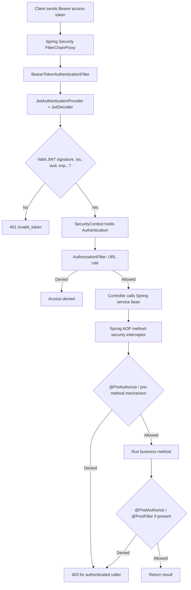
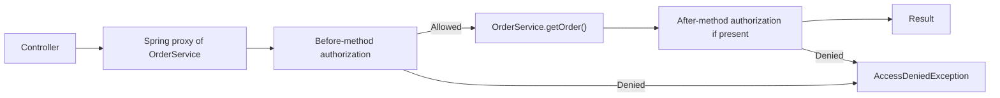

# @EnableMethodSecurity and Method Authorization Mechanisms

## 1. Why Endpoint Protection Alone Is Not Enough to Protect Business Logic

In a **Spring Security OAuth 2.0/OIDC Resource Server** application, APIs typically receive `Authorization: Bearer <access-token>`. Once the token is validated, an endpoint might allow a caller carrying `SCOPE_orders:read` to read orders. However, permission to **read orders** does not equate to permission to read **every order belonging to every customer or tenant**.

Consider a service:

```java
public OrderDto getOrder(UUID orderId) {
    return orderRepository.findById(orderId)
            .map(orderMapper::toDto)
            .orElseThrow(OrderNotFoundException::new);
}
```

Suppose the URL `GET /api/orders/{orderId}` is protected with `hasAuthority("SCOPE_orders:read")`. User A, who holds this scope, can still pass User B's `orderId`. If the service simply calls `findById`, URL-level access control **does not prove that A is permitted to view that specific record**.

**Method security** allows authorization rules to be placed at the **method boundary** of a Spring service or bean, for example:

```java
@PreAuthorize(
    "hasAuthority('SCOPE_orders:read') and "
    + "@orderAccess.canRead(authentication, #orderId)")
public OrderDto getOrder(@P("orderId") UUID orderId) {
    // ...
}
```

Where:

- `hasAuthority('SCOPE_orders:read')` checks the functional permission.
- `@orderAccess.canRead(...)` checks permission for the **specific business object** using a trusted policy.
- `@P("orderId")` lets the expression reference the parameter by name, even if parameter name metadata is not retained in the bytecode.

> **Purpose:** Protect business actions **right where they are invoked**, even when a service is reused by multiple controllers or processing flows within the same application context. However, method security **does not replace** token validation, URL security, query-level data isolation, or authorization controls in external systems.

## 2. Where Does Method Security Sit in the Resource Server Processing Chain?

A typical Servlet request follows this flow:



This is a conceptual diagram. The ordering of interceptors and the use of Spring Security's `AuthorizationManager` depend on the specific annotation types and configuration.

Three layers of responsibility to distinguish:

| Protection Layer | Typical Tools | Question |
| --- | --- | --- |
| **Authentication** | `JwtDecoder`, `JwtAuthenticationProvider`, `OpaqueTokenIntrospector` | Was the Bearer token validly issued for this API? |
| **HTTP request authorization** | `SecurityFilterChain`, `authorizeHttpRequests` | Is the request allowed to invoke this HTTP URL/method? |
| **Method/business authorization** | `@PreAuthorize`, `@PostAuthorize`, `@Secured`, custom policy | Is the authenticated principal permitted to perform this business operation on this resource? |

In a Resource Server, a valid token is converted into an `Authentication` with `GrantedAuthority` instances, usually from the `scope`/`scp` claim. Method security uses **that same security context** to evaluate permissions, unless an application intentionally alters the context management strategy.

## 3. Enabling Method Security with @EnableMethodSecurity

In modern Spring Security, the common declaration is:

```java
import org.springframework.context.annotation.Configuration;
import org.springframework.security.config.annotation.method.configuration.EnableMethodSecurity;

@Configuration
@EnableMethodSecurity
public class MethodSecurityConfig {
}
```

`@EnableMethodSecurity` enables the authorization infrastructure on methods of Spring-managed beans. In typical configurations, **`prePostEnabled` is enabled by default**, allowing the use of:

- `@PreAuthorize` — evaluates an expression **before invoking** the method.
- `@PostAuthorize` — evaluates an expression **after the method returns**.
- `@PreFilter` — filters a collection argument before invoking the method.
- `@PostFilter` — filters returned data according to an expression.

Two other annotation groups generally **must be enabled explicitly**:

```java
@Configuration
@EnableMethodSecurity(
        prePostEnabled = true,
        securedEnabled = true,
        jsr250Enabled = true)
public class MethodSecurityConfig {
}
```

- `securedEnabled = true` to use `@Secured`.
- `jsr250Enabled = true` to use standard annotations such as `@RolesAllowed`, `@PermitAll`, and `@DenyAll` from `jakarta.annotation.security` in modern Spring versions.

If the application only needs `@PreAuthorize`, there is usually **no need to enable all annotation types**. Configuring multiple protection styles can be helpful during migration, but there should be a consistent convention to avoid confusing overlapping policies.

### 3.1. Dependencies and Deployment Context

A Spring Boot project using Servlet OAuth2 Resource Server typically requires the appropriate starters/dependencies, for example:

```xml
<dependency>
    <groupId>org.springframework.boot</groupId>
    <artifactId>spring-boot-starter-security</artifactId>
</dependency>
<dependency>
    <groupId>org.springframework.boot</groupId>
    <artifactId>spring-boot-starter-oauth2-resource-server</artifactId>
</dependency>
<dependency>
    <groupId>org.springframework.security</groupId>
    <artifactId>spring-security-test</artifactId>
    <scope>test</scope>
</dependency>
```

Method security relies on **Spring AOP/proxy** components; depending on the dependency graph and application build style, ensure Spring AOP is on the classpath. With Gradle, the dependency structure is equivalent. There is no need to switch to a reactive stack just to use method security in a Servlet application.

### 3.2. Configuring JWT Resource Server and URL Authorization

Example:

```yaml
spring:
  security:
    oauth2:
      resourceserver:
        jwt:
          issuer-uri: https://login.example.test/realms/shop
```

```java
@Configuration
@EnableMethodSecurity
public class ApiSecurityConfig {

    @Bean
    SecurityFilterChain apiChain(HttpSecurity http) throws Exception {
        return http
                .securityMatcher("/api/**")
                .sessionManagement(session -> session
                        .sessionCreationPolicy(SessionCreationPolicy.STATELESS))
                .authorizeHttpRequests(auth -> auth
                        .requestMatchers("/api/public/**").permitAll()
                        .anyRequest().authenticated())
                .oauth2ResourceServer(oauth2 ->
                        oauth2.jwt(Customizer.withDefaults()))
                .build();
    }
}
```

In this example, the URL layer requires every private API endpoint to have a valid **Authentication**. Fine-grained permissions such as `orders:read` or ownership are checked via annotations on services. In other architectures, both URL authority rules and method authority rules can be applied to establish **defense in depth**.

**Full JWT validation must be configured:** `issuer-uri` does not mean every Resource Server binds the audience/resource per the desired contract by default. You must verify `aud`, algorithms, expiration, access token type, and required claims via the appropriate `JwtDecoder`/validators. Method security **cannot fix** an API that accepts a token with the wrong issuer, wrong audience, or an ID token instead of an access token.

### 3.3. CSRF in Bearer-Only APIs

`SessionCreationPolicy.STATELESS` and `oauth2ResourceServer().jwt()` describe the session and authentication mechanisms; they do not mean every application should disable CSRF with a boilerplate statement. If an API strictly uses Bearer tokens explicitly attached in `Authorization` and does not rely on login cookies/sessions, its CSRF policy can differ from a cookie-based web application. Identify which endpoints receive browser-attached credentials automatically before deciding how to configure CSRF.

## 4. @PreAuthorize: Checking Permissions Before Executing Business Logic

`@PreAuthorize` accepts a Spring Expression Language (**SpEL**) expression in the Method Security context. It is a common mechanism for protecting the **service layer**.

### 4.1. Checking a Single Authority

```java
@Service
public class OrderReportService {

    @PreAuthorize("hasAuthority('SCOPE_orders:read')")
    public ReportDto getSummary() {
        return loadSummary();
    }
}
```

If the request's `Authentication` lacks the `SCOPE_orders:read` authority, the call **should not execute the method body**. An authenticated caller missing the permission normally receives an `AccessDeniedException`, which the HTTP security layer can translate into **403 Forbidden**.

### 4.2. Any Permission or All Permissions?

```java
@PreAuthorize(
    "hasAnyAuthority('SCOPE_orders:read', 'SCOPE_orders:export')")
public List<OrderDto> previewReport() {
    // Only one of the two authorities is required.
}

@PreAuthorize(
    "hasAuthority('SCOPE_orders:read') "
    + "and hasAuthority('SCOPE_orders:export')")
public byte[] exportReport() {
    // Must have both read and export simultaneously.
}
```

| Principal's Authorities | `hasAnyAuthority(read, export)` | `read and export` |
| --- | --- | --- |
| None | Denied | Denied |
| Only `SCOPE_orders:read` | Allowed | Denied |
| Only `SCOPE_orders:export` | Allowed | Denied |
| Both | Allowed | Allowed |
| Only `SCOPE_orders:write` | Denied | Denied |

**Do not infer permission hierarchy from naming** unless the policy explicitly defines it. `orders:write` does not implicitly include `orders:read`; `orders:read-all` does not automatically equal `orders:read`.

### 4.3. `hasRole` Differs from `hasAuthority`

In a typical Spring Security configuration:

```java
@PreAuthorize("hasRole('ADMIN')")
public void resetAllOrders() { }
```

`hasRole('ADMIN')` typically looks for the authority **`ROLE_ADMIN`**. Meanwhile, the standard JWT scope converter produces **`SCOPE_orders:read`**, not `ROLE_...`.

| Expression | Default / Common Authority Checked |
| --- | --- |
| `hasAuthority('SCOPE_orders:read')` | `SCOPE_orders:read` |
| `hasRole('ADMIN')` | `ROLE_ADMIN` |
| `hasAuthority('ROLE_ADMIN')` | `ROLE_ADMIN` |
| `hasAuthority('ADMIN')` | `ADMIN`, without adding any prefix. |

The role prefix can be customized via application configuration. If an API receives scopes via JWT, explicitly choose `hasAuthority("SCOPE_...")` to avoid confusing `scope` with `role`. Do not take an arbitrary claim like `groups` and automatically treat every element as an administrative privilege.

### 4.4. Other Useful Expressions

```java
@PreAuthorize("isAuthenticated()")
public AccountSummary currentAccount() { }

@PreAuthorize("hasAuthority('SCOPE_orders:write') and #amount > 0")
public void requestRefund(@P("amount") BigDecimal amount) { }
```

Expressions accessing parameters are useful for stating **security conditions**, but checking `amount > 0` is input/business validation and does not replace actual authorization checks on the refund. Do not cram all business validation into SpEL when an explicit service policy is far easier to maintain.

## 5. Protecting Business Objects: Scope and Ownership Must Go Together

An endpoint reading an order simultaneously needs to know:

1. The token is valid and was issued for `orders-api`.
2. The principal has `SCOPE_orders:read`.
3. The principal is allowed to access the **specific order**, by user/tenant/role.

Service example:

```java
@Service
public class OrderApplicationService {

    private final OrderRepository orders;
    private final OrderMapper mapper;

    public OrderApplicationService(
            OrderRepository orders,
            OrderMapper mapper) {
        this.orders = orders;
        this.mapper = mapper;
    }

    @PreAuthorize(
        "hasAuthority('SCOPE_orders:read') and "
        + "@orderAccess.canRead(authentication, #orderId)")
    public OrderDto getOrder(@P("orderId") UUID orderId) {
        Order order = orders.findById(orderId)
                .orElseThrow(OrderNotFoundException::new);
        return mapper.toDto(order);
    }
}
```

`@P` in this example is `org.springframework.security.core.parameters.P`, which helps Method Security resolve the exact argument name when evaluating `#orderId`. Types such as `OrderRepository`, `OrderMapper`, and `OrderDto` are project-defined domain types.

### 5.1. A Policy Bean Using Trusted Data

```java
@Component("orderAccess")
public class OrderAccessPolicy {

    private final CurrentActorService currentActorService;
    private final OrderRepository orders;

    public OrderAccessPolicy(
            CurrentActorService currentActorService,
            OrderRepository orders) {
        this.currentActorService = currentActorService;
        this.orders = orders;
    }

    public boolean canRead(
            Authentication authentication,
            UUID orderId) {

        if (orderId == null || authentication == null
                || !authentication.isAuthenticated()) {
            return false;
        }

        // Obtain internal user/tenant from the authenticated principal,
        // never take arbitrary userId or tenantId from the HTTP request.
        AuthorizedActor actor =
                currentActorService.requireAuthorizedActor(authentication);

        return actor.canReadOwnOrders()
                && orders.existsByIdAndOwnerUserIdAndTenantId(
                        orderId,
                        actor.userId(),
                        actor.tenantId());
    }
}
```

This example assumes `CurrentActorService` verifies trusted identity mapping and membership, and `AuthorizedActor` is an application model providing `userId()`, `tenantId()`, and `canReadOwnOrders()`. **These are illustrative domain contracts** that must be implemented in the project; they are not built-in Spring Security APIs.

The key point: `@orderAccess.canRead(...)` must not merely check whether `orderId` exists—it must check **who may read**, **which tenant**, and **which policy**. Do not write:

```java
// WRONG: allows access just because the request has an orderId.
public boolean canRead(UUID orderId) {
    return orderId != null;
}
```

### 5.2. Query-Level Control Remains Crucial

Suppose a policy checks permission with an `exists...` query, and then the business method calls `findById(orderId)` at a later moment. If ownership or tenant changes between the two steps, **time-of-check/time-of-use (TOCTOU)** can occur. For sensitive data, consider constraining the query with authorization rules right when fetching the data:

```java
@PreAuthorize("hasAuthority('SCOPE_orders:read')")
public OrderDto getOwnOrder(@P("orderId") UUID orderId) {
    AuthorizedActor actor = actorService.currentHumanActor();

    Order order = orders
            .findByIdAndOwnerUserIdAndTenantId(
                    orderId, actor.userId(), actor.tenantId())
            .orElseThrow(OrderNotFoundException::new);

    return mapper.toDto(order);
}
```

The method `findByIdAndOwnerUserIdAndTenantId` is an application repository method, not a Spring Security API. Combining **annotation-level scope** with **record-level constraints in the query** is a clear pattern: even if code above changes, the query cannot retrieve an order outside the authorized user/tenant scope.

For write operations, transaction/locking/concurrency requirements must also be enforced in the domain layer. Method security is an **authorization** layer, not a substitute for transaction isolation or data access controls.

## 6. @PostAuthorize: Authorization After the Method Has Run

`@PostAuthorize` evaluates an expression **after the method completes** and can access the `returnObject` variable.

Example:

```java
@PostAuthorize(
    "returnObject == null "
    + "or @orderAccess.canRead(authentication, returnObject.id)")
public OrderDto findOrder(UUID id) {
    return orderRepository.findById(id)
            .map(orderMapper::toDto)
            .orElse(null);
}
```

When the method returns an `OrderDto`, the interceptor can check permission on `returnObject.id` before returning the result to the caller. When the method returns `null`, the expression above allows it through (depending on response design, the controller then decides 404 or otherwise).

**Critical risk:** `@PostAuthorize` runs **after the method body has executed**. If the method transferred funds, deleted a record, sent an email, or wrote side effects, a denial in `@PostAuthorize` **does not automatically undo** what already happened. Therefore:

- Use `@PreAuthorize` or policy checks inside the transaction **before writing data** for operations with side effects.
- `@PostAuthorize` is better suited to certain read use cases, though you must still understand its cost and result materialization.
- Never rely solely on `@PostAuthorize` to hide data if the method already sent data elsewhere, logged sensitive values, or triggered side effects outside the transaction.

### 6.1. @PostAuthorize and Out-of-Scope Data

A `findById` query may already have loaded a record not belonging to the user into memory before `@PostAuthorize` denies it. Even though the interceptor withholds the result from the controller on denial, fetching it can still consume resources, trigger lazy loading, or cause fetch side effects. For multi-tenant systems, **filtering right in the query** is usually more predictable and protective.

### 6.2. Do Not Misapply @PostAuthorize Semantically

Bad example:

```java
@PostAuthorize("hasAuthority('SCOPE_orders:write')")
public void cancelOrder(UUID orderId) {
    // The order may already have been cancelled before access is denied.
}
```

For a cancellation action, use `@PreAuthorize` together with a record-level policy and transaction checks. **Enforcement timing** is just as important as the expression content.

## 7. @PreFilter and @PostFilter: Filtering Collections

Spring Security provides data-filtering annotations when a method contract needs to process a collection of elements.

### 7.1. @PreFilter: Filtering Input Before Running the Method

Example:

```java
@PreAuthorize("hasAuthority('SCOPE_orders:write')")
@PreFilter(
    value = "@orderAccess.canModify(authentication, filterObject)",
    filterTarget = "commands")
public void processBatch(
        @P("commands") List<OrderCommand> commands) {
    for (OrderCommand command : commands) {
        applyCommand(command);
    }
}
```

`filterObject` represents the current element as the expression is evaluated. `filterTarget` specifies which collection parameter to filter, useful when a method has multiple collection parameters. `@orderAccess.canModify(...)` is assumed to be securely implemented using an object policy backed by trusted data; **never treat a client-supplied `ownerId`/`tenantId` inside the command as proof of authorization**.

**Semantic warning:** `@PreFilter` can **drop** unauthorized elements rather than rejecting the **entire batch**. For a financial request or an "all-or-nothing" write operation, silent filtering is usually **inappropriate**. When business rules require every element to be valid, validate the input set and reject the entire request/transaction if any element is unauthorized.

### 7.2. @PostFilter: Filtering Output After the Method Returns

```java
@PreAuthorize("hasAuthority('SCOPE_orders:read')")
@PostFilter("@orderAccess.canRead(authentication, filterObject.id)")
public List<OrderDto> recentOrders() {
    return orderRepository.findRecentOrders()
            .stream()
            .map(orderMapper::toDto)
            .toList();
}
```

`@PostFilter` evaluates `filterObject` on each returned element to return only those passing the check. It can be handy for small sets, but it is **not an optimal choice for tenant isolation or filtering large volumes of data**:

- The method has already loaded all records before filtering, causing **overfetching**, high memory/CPU usage, or information leakage risks via logs/side effects.
- If authorization requires querying the DB per item, it can cause **N+1 authorization queries**.
- Pagination breaks: fetching a page of 20 items and filtering down to 3 does not equal "a proper page of 20 authorized items."
- For highly sensitive data, filter by tenant/ownership **directly in the query** and apply appropriate data-layer policies.

### 7.3. When Should Filter Annotations Be Used?

| Scenario | Mechanism to Consider |
| --- | --- |
| Checking permission for an action before execution | `@PreAuthorize`. |
| Deciding based on the return value of a read operation | `@PostAuthorize`, once side effects have been assessed. |
| Accepting a small collection where processing a **subset** of elements is allowed | `@PreFilter` if silent filtering semantics are acceptable. |
| Returning a small collection where elements must be pruned by policy | `@PostFilter`, mindful of performance and leakage. |
| Large lists, pagination, multi-tenant data | Query-level filtering combined with `@PreAuthorize`, not relying on `@PostFilter` alone. |
| Batch that must be atomic: all or nothing | Validate and reject the **entire batch** if any item is unauthorized. |

Supported collection behaviors and return types must match the running Spring Security version; do not assume every stream or reactive publisher type is handled like a `List` in Servlet method security.

## 8. @Secured and @RolesAllowed: Role-Declaration Mechanisms

Beyond SpEL annotations, Spring Security also supports several familiar role-based mechanisms.

### 8.1. @Secured

When `securedEnabled = true` is set:

```java
@Secured("ROLE_ADMIN")
public void rebuildAllSearchIndexes() {
    // ...
}
```

`@Secured` focuses on checking specified authorities; it **does not provide full access to parameters, policy bean invocations, or `returnObject`** like `@PreAuthorize`/`@PostAuthorize`.

### 8.2. @RolesAllowed, @PermitAll, @DenyAll

When `jsr250Enabled = true` is set:

```java
import jakarta.annotation.security.RolesAllowed;
import jakarta.annotation.security.PermitAll;
import jakarta.annotation.security.DenyAll;

@RolesAllowed("ADMIN")
public void deactivateAccount(UUID userId) {
    // ...
}

@PermitAll
public CatalogInfo publicCatalogInfo() {
    // ...
}

@DenyAll
public void unsupportedLegacyOperation() {
    // ...
}
```

`@RolesAllowed("ADMIN")` is typically interpreted according to the system's `ROLE_ADMIN` role authority convention. However, prefixes and role handling can be customized, so tests must reflect the actual configuration.

**`@PermitAll` on a service does not disable the AuthenticationFilter, URL authorization, or checks in other layers.** If `SecurityFilterChain` requires a Bearer token before a request reaches the controller, `@PermitAll` on an inner method does not make the URL public.

### 8.3. Choosing the Right Annotation

| Mechanism | Expressions / Capabilities | When to Use |
| --- | --- | --- |
| `@PreAuthorize` | SpEL, authorities, roles, parameters, custom beans. | Protecting actions before execution; very well suited for Resource Servers. |
| `@PostAuthorize` | SpEL and `returnObject` after execution. | Selected use cases checking returned data. |
| `@PreFilter` | Expression on each input element. | Collections where pre-processing element filtering is allowed. |
| `@PostFilter` | Expression on each output element. | Small collections, when cost and semantics are acceptable. |
| `@Secured` | Checks declared authorities; less expressive than SpEL. | Projects with simple role policies or legacy inheritance. |
| `@RolesAllowed` | JSR-250/Jakarta role-based. | Integration matching project role conventions. |
| `@PermitAll`/`@DenyAll` | JSR-250 method-level allow/deny. | Simple method policies; does not replace HTTP-layer security. |

Do not mix conflicting annotations on the same method hoping one will "override" all others. Establish **a single source of truth for rules**, and test thoroughly if migrating from `@Secured` to `@PreAuthorize`.

## 9. SpEL: Parameters, Authentication, and Policy Beans

### 9.1. Accessing Authorities and Principal Details

Commonly used Method Security expressions:

```java
@PreAuthorize("isAuthenticated()")
public ProfileDto profile() { /* ... */ }

@PreAuthorize("hasAuthority('SCOPE_orders:export')")
public ExportDto export() { /* ... */ }

@PreAuthorize("@tenantPolicy.canAccess(authentication, #tenantId)")
public TenantDashboard dashboard(
        @P("tenantId") UUID tenantId) { /* ... */ }
```

`authentication` typically represents the caller's `Authentication`. Not every `Authentication.getPrincipal()` is a `Jwt`: JWT Resource Server, opaque tokens, OIDC Login, and username/password have different principal types. Custom policies should **know which principal types the application's security chain accepts**, or provide an abstraction to handle supported types explicitly.

### 9.2. Why @P or Parameter Name Metadata Matters

`#orderId` is a parameter name inside the expression. If class files lack parameter name metadata, or if methods are declared across different interfaces, the expression will not resolve the name as expected.

Example:

```java
@PreAuthorize("@orderAccess.canRead(authentication, #orderId)")
public OrderDto read(@P("orderId") UUID orderId) {
    // ...
}
```

Some projects enable the `-parameters` compiler flag to retain Java parameter names. `@P` is an explicit way to help Method Security resolve names under Spring Security's supported configuration. When using interfaces, pay attention to annotation placement and the metadata visible to the proxy.

### 9.3. Custom Policy Beans Are Easier to Read Than Overly Long SpEL Expressions

Instead of:

```java
@PreAuthorize("""
    hasAuthority('SCOPE_orders:read')
    and principal.claims['tenant_id'] == #tenantId
    and principal.claims['account_type'] == 'human'
    and ...
    """)
```

consider:

```java
@PreAuthorize("@orderPolicy.canReadOrder(authentication, #orderId)")
public OrderDto read(@P("orderId") UUID orderId) {
    // ...
}
```

A policy bean can perform data access, account mapping, role membership checks, and clear validation, and is easier to unit test than an expression combining many custom claims. Still, the policy bean must be **fail-closed**, avoiding trust in client-supplied tenant/user IDs or unverified claims.

### 9.4. hasPermission and PermissionEvaluator

Spring Security also supports expressions like `hasPermission(...)` when the system configures an appropriate `PermissionEvaluator` and Method Security expression handler.

Conceptual example:

```java
@PreAuthorize("hasPermission(#orderId, 'ORDER', 'read')")
public OrderDto read(@P("orderId") UUID orderId) {
    // ...
}
```

**Do not assume `hasPermission` is a complete, out-of-the-box database ACL.** The application must implement and configure an evaluator capable of deciding permissions for `ORDER`, mapping principals, tenants, and owners with a fail-closed policy. When only a specific domain policy is needed, a bean call like `@orderPolicy.canRead(...)` can be clearer.

## 10. Creating Reusable Annotations and Keeping Policies Consistent

When multiple services need `SCOPE_orders:read`, you can create a Method Security **meta-annotation**:

```java
import java.lang.annotation.ElementType;
import java.lang.annotation.Retention;
import java.lang.annotation.RetentionPolicy;
import java.lang.annotation.Target;
import org.springframework.security.access.prepost.PreAuthorize;

@Target({ElementType.METHOD, ElementType.TYPE})
@Retention(RetentionPolicy.RUNTIME)
@PreAuthorize("hasAuthority('SCOPE_orders:read')")
public @interface CanReadOrders {
}
```

Usage:

```java
@CanReadOrders
public List<OrderDto> listVisibleOrders() {
    // ...
}
```

Benefits:

- Fewer typos when copying authority strings.
- A readable business name.
- Easy to locate methods using a policy when the scope contract changes.

However, a meta-annotation **does not automatically check ownership** if the inner expression only checks `SCOPE_orders:read`. For a method reading a specific object, add an object-level policy or query-level isolation.

Changing a meta-annotation can have a broad impact; run regression tests for every method where it is applied. Avoid creating overlapping meta-annotations with unclear semantics.

## 11. Technical Mechanism: Spring AOP Proxies and Method Interceptors

Method security on Spring beans typically works via **proxies/interceptors**. The infrastructure activated by `@EnableMethodSecurity` uses Method Security authorization managers/interceptors to evaluate annotations when methods are invoked through a Spring bean.

Diagram:



This creates an important limitation: **the method must be invoked through the Spring-managed proxy object**. Simply writing an annotation on any Java method does not guarantee enforcement.

### 11.1. Self-Invocation: Internal Calls Can Bypass Interceptors

Example:

```java
@Service
public class OrderService {

    public void process(UUID orderId) {
        // An internal call via 'this' typically does not pass through the Spring proxy.
        approve(orderId);
    }

    @PreAuthorize("hasAuthority('SCOPE_orders:approve')")
    public void approve(UUID orderId) {
        // Sensitive operation.
    }
}
```

If the controller calls `orderService.process(...)` through the proxy, inside `process` calling `approve(...)` happens directly on `this`. Under the default proxy-based mechanism, **the annotation on `approve` may not be applied** for that internal call.

Ways to handle this:

- Organize protected actions into **separate Spring beans**, calling methods through injected beans so calls pass through the proxy.
- Place policies on the **public entry point** callable from outside, and enforce permission checks inside the domain service when needed.
- Design clear service boundaries rather than relying on self-invocation.
- If interception is required in scenarios proxies cannot handle, evaluate an appropriate weaving mechanism and understand its cost/complexity; do not default to AspectJ for every project.

**Do not "fix" this by calling back through `ApplicationContext.getBean(...)` everywhere** if it tangles the architecture and introduces coupling. Splitting services or clarifying policy boundaries is usually much easier to maintain.

### 11.2. Private, Final, and Manually Created Beans

| Scenario | Risk |
| --- | --- |
| Placing an annotation on a `private` method | External proxies do not intercept internal private method calls in the standard way. |
| `final` class/method under subclass-based proxying | The proxy may be unable to override/intercept it. |
| Manually calling `new OrderService(...)` outside the Spring context | Does not go through the Spring-managed proxy / method security. |
| Unit tests instantiating the class directly | Annotations are not enforced by Spring AOP. |
| Controller calling an injected Spring service bean | Will pass through the proxy when method security is properly configured. |
| Self-invocation within the same bean | Easily bypasses the interceptor because the call skips the proxy. |

Spring supports multiple proxy mechanisms, including interface-based and class-based proxies, with different capabilities and limitations. What must be verified is that **the bean actually invoked is the bean wrapped by the method-security infrastructure**, not merely that an annotation appears in source code.

### 11.3. Annotations on Interfaces and Classes

Spring Security can discover annotations on methods/classes/interfaces according to its supported resolution mechanisms; however, duplicate or conflicting annotations across layers can cause ambiguity. Standardize on one consistent declaration location for public method contracts, and write integration tests invoking the real bean through its proxy. Do not assume an annotation on one overloaded method or an unrelated interface automatically applies to all overloads or implementations.

## 12. Method Security and @Transactional: Which Runs First, Which Causes Side Effects?

A business service may combine:

```java
@Transactional
@PreAuthorize(
    "hasAuthority('SCOPE_orders:write') and "
    + "@orderPolicy.canChange(authentication, #orderId)")
public void changeOrder(@P("orderId") UUID orderId,
                        ChangeOrderCommand command) {
    // Write data once the policy approves.
}
```

Spring AOP can attach multiple interceptors for `@Transactional`, `@PreAuthorize`, logging, or custom aspects. **Do not assume one specific interceptor order across all configurations**; ordering can be configured and affects when transactions open or policies evaluate.

Concerns that must be designed:

1. **Authorization before side effects:** do not use `@PostAuthorize` as the sole gate for write commands.
2. **Consistency:** if a policy reads data and the business logic then writes, consider that state may change between the two moments.
3. **Transaction boundaries:** permission checks relying on consistent data may need to run inside a transaction or be guarded by database constraints/locking.
4. **Exceptions:** a denied method can throw `AccessDeniedException`; within a transaction, rollback behavior depends on exception/transaction configuration.
5. **External side effects:** external API calls, message/email dispatches, or payments do not automatically roll back with a JDBC transaction.

Method security does not replace **idempotency**, **optimistic/pessimistic locking**, data controls, or domain auditing.

## 13. Threads, Async, and Cross-Service Calls

`SecurityContextHolder` is typically bound to the processing context of the thread/request according to the configured strategy. Keep this in mind whenever code switches to another thread or executor:

```java
@Async
public void generateMonthlyReport() {
    // Never assume the SecurityContext from the HTTP thread is always present here.
}
```

If a background task still needs the caller's identity, the application needs a **security context propagation policy** or must pass a normalized, well-scoped `AuthorizedActor`. Spring Security provides tools like `DelegatingSecurityContextExecutor` for specific patterns, but ensure you do not accidentally reuse a previous request's security context or extend an expired token's authority.

For **message queues/scheduled jobs**, there is usually no HTTP request and no default user `Authentication`. Define actor/service identities, permissions, and auditing for these operations; never temporarily assign `ROLE_ADMIN` to every job just to get past method security.

**Method security in one JVM does not automatically protect HTTP calls to another JVM.** Each Resource Server must verify access tokens/credentials and enforce security policies at its own trust boundary. If service A calls service B, B requires an appropriate audience/token; it cannot simply trust a method annotation inside A.

## 14. Distinguishing 401 and 403 in Method Security

In a Servlet Resource Server, security errors typically surface at two points:

| Scenario | Authentication | Method/URL Authorization | Typical HTTP Outcome |
| --- | --- | --- | --- |
| No Bearer token to an API requiring authentication | No valid principal | Cannot enter API | **401**, Bearer challenge. |
| JWT has bad signature, issuer/audience, or is expired | Failed | No trusted principal | **401 invalid_token**. |
| Valid JWT but missing `SCOPE_orders:read` | Succeeded | `@PreAuthorize` denies | **403 Forbidden**. |
| Valid JWT, sufficient scope, but does not own order | Succeeded | Custom policy denies | **403** or an intentional domain-appropriate 404. |
| Valid JWT, sufficient permission, but `@PostAuthorize` denies | Succeeded | Blocked after method runs | Typically **403**, though side effects must be evaluated separately. |
| Method called outside HTTP request with no SecurityContext | No context | May throw security exception | No automatic HTTP status; caller must handle the exception. |

When Spring Security handles an HTTP request:

```http
HTTP/1.1 401 Unauthorized
WWW-Authenticate: Bearer
```

or:

```http
HTTP/1.1 403 Forbidden
WWW-Authenticate: Bearer error="insufficient_scope"
```

An `insufficient_scope` response is not always generated for **every** `AccessDeniedException` from method security; it also depends on the handler type, the `Authentication` object, and `AccessDeniedHandler` configuration. If the application uses custom entry points and exception handlers, HTTP statuses/challenges may differ. Avoid writing tests asserting version-dependent detail description strings when the goal is verifying **the right stage blocked the call**.

### 14.1. Using 404 to Limit Disclosure of Resource Existence

An API may intentionally return **404 Not Found** for resources that do not exist **or fall outside the actor's scope**, to avoid disclosing other users' resource IDs. When using this approach:

- The policy must be **consistent**.
- Queries must constrain owner/tenant from the start.
- Avoid leaking information via timing, logs, response details, or listing endpoints.
- Never let a 404 mask a vulnerability caused by missing authentication or audience validation.

Returning 403 versus 404 is a choice in the object-level authorization/domain contract, not an automatic feature of `@PreAuthorize`.

## 15. Testing Method Security: Calls Must Actually Go Through the Proxy

Testing an annotated method by instantiating the object directly **will not prove that Spring enforces the annotation**:

```java
OrderService service = new OrderService(repository);
service.approve(orderId); // No Spring proxy.
```

To test enforcement, invoke the **Spring-managed bean** while populating an appropriate `SecurityContext`.

### 15.1. Unit Testing the Policy Bean

Suppose you have `OrderAccessPolicy`. Standalone tests should verify:

- Missing principal or inappropriate token context → deny.
- User A has scope and owns order A → allow.
- User A has scope but queries order B → deny.
- User A does not belong to tenant B → deny.
- Service principal is not allowed to process user-owned order → deny.
- Ownership changes between steps → system preserves invariant via query/transaction.

These tests verify the policy's **business rules**, but **do not by themselves prove `@PreAuthorize` invokes the policy**.

### 15.2. Testing Annotations with @WithMockUser

Example simple service:

```java
@Service
public class SecureReportService {

    @PreAuthorize("hasAuthority('SCOPE_orders:export')")
    public String exportPreview() {
        return "report";
    }
}
```

Testing with a real Spring context:

```java
import static org.junit.jupiter.api.Assertions.assertEquals;
import static org.junit.jupiter.api.Assertions.assertThrows;

import org.junit.jupiter.api.Test;
import org.springframework.beans.factory.annotation.Autowired;
import org.springframework.boot.test.context.SpringBootTest;
import org.springframework.security.access.AccessDeniedException;
import org.springframework.security.test.context.support.WithMockUser;

@SpringBootTest
class SecureReportMethodSecurityTest {

    @Autowired
    SecureReportService service;

    @Test
    @WithMockUser(authorities = "SCOPE_orders:export")
    void rightAuthorityCanExecuteMethod() {
        assertEquals("report", service.exportPreview());
    }

    @Test
    @WithMockUser(authorities = "SCOPE_orders:read")
    void wrongAuthorityIsDeniedBeforeMethodRuns() {
        assertThrows(AccessDeniedException.class,
                () -> service.exportPreview());
    }

    @Test
    @WithMockUser(roles = "ADMIN")
    void roleAdminDoesNotAutomaticallyGrantExportScope() {
        assertThrows(AccessDeniedException.class,
                () -> service.exportPreview());
    }
}
```

This test assumes `@EnableMethodSecurity` is active in the application context and `SecureReportService` is a properly proxied Spring bean. `@WithMockUser(authorities="SCOPE_orders:export")` creates a mock Authentication in tests; it **has no real JWT** and does not verify signatures or audiences.

In the `@WithMockUser(roles="ADMIN")` case, Spring typically creates `ROLE_ADMIN`, not `SCOPE_orders:export`, so `hasAuthority('SCOPE_orders:export')` still denies access. If the application has a custom `RoleHierarchy` or special mapping, adjust expectations to match the configuration.

### 15.3. HTTP Testing with MockMvc and jwt()

Example testing URL → controller → proxied service:

```java
mockMvc.perform(get("/api/reports/export-preview")
        .with(jwt().authorities(
                new SimpleGrantedAuthority("SCOPE_orders:export"))))
        .andExpect(status().isOk());

mockMvc.perform(get("/api/reports/export-preview")
        .with(jwt().authorities(
                new SimpleGrantedAuthority("SCOPE_orders:read"))))
        .andExpect(status().isForbidden());
```

This example assumes a controller calls `SecureReportService.exportPreview()`, the URL allows reaching the service, and on success the controller returns HTTP 200. `jwt()` is a Spring Security Test request post-processor; it injects a simulated `JwtAuthenticationToken`, so it **does not prove `JwtDecoder` verified JWS/issuer/audience**.

A mock test can return 200 even if a service's method-security annotation is bypassed when tests only check URL rules or lack missing-authority cases. Therefore, **negative tests** calling the method through the proxy are essential.

### 15.4. Integration Testing Signed Bearer Tokens

To prove the full **OAuth2 Resource Server + Method Security** flow:

1. Prepare a test issuer, public key/JWKS, and a dedicated key pair for the test environment.
2. Sign test JWTs with appropriate `iss`, `aud`, `exp`, `sub`, and `scope`; also create tokens with invalid signatures/audiences.
3. Configure a real `JwtDecoder` with issuer, audience, expiration, and access-token profile validators.
4. Send `Authorization: Bearer <signed-test-JWS>` through MockMvc with Spring Security filters active.
5. Assert 401 when the JWT fails authentication; 403 when the JWT is valid but lacks scope/ownership; 2xx when all policies allow.
6. Verify that **the method body did not execute** when `@PreAuthorize` denies, e.g., via mocks of domain components or verifying no data was written.

Never use production access tokens, private keys, or secrets in test fixtures. When tests require HTTP and record-level permissions, use an isolated database or stub system that preserves data isolation.

## 16. Business Protection Test Matrix

Suppose:

`GET /api/orders/{id}` calls a service annotated with `@PreAuthorize("hasAuthority('SCOPE_orders:read') and @orderAccess.canRead(authentication, #orderId)")`.

| Scenario | Primary Expectation |
| --- | --- |
| No Bearer token | No trusted principal created, typically **401**. |
| JWT with invalid signature | **401 invalid_token**, method does not run. |
| JWT with `aud` for another API | **401 invalid_token**, method does not run. |
| Valid JWT with no scopes | **403**, method does not run. |
| Valid JWT with only `orders:write` | **403** if lacking `orders:read`; do not infer write includes read. |
| Valid JWT with `orders:read`, order owned by current user | Passes method rule; outcome depends on business logic. |
| Valid JWT with `orders:read`, order owned by another user | **403 or domain 404** per policy; never return the other user's data. |
| Valid JWT, order has same user but different permitted tenant | Do not use subject alone: check membership/tenant, deny if policy is violated. |
| Principal is an M2M service not permitted to read user-owned orders | Policy fails closed. |
| Same name/email but different subject | Never use email/name as the ownership identity key. |
| Calling annotated method through proxy | Rule is enforced. |
| Calling `this.method()` inside the same class | Tests must catch the proxy-bypass risk. |
| Write operation with `@PostAuthorize` and no pre-check | Tests must detect side effects occurring despite response denial. |
| `@PostFilter` on a list of 10,000 records | Evaluate performance/data leakage; prefer query-level isolation. |

### 16.1. Assertions More Valuable Than HTTP Status Alone

In method-security tests:

- Verify **the service method did not execute** when pre-method permission is missing.
- Verify **no records were modified** when a request is denied.
- Verify **no other tenant/user data is returned** even with a valid scope.
- Verify the exact authority name, e.g., `SCOPE_orders:read`, not just "has at least one authority."
- Verify `#orderId` argument resolution works properly and whether the policy bean was invoked.
- Verify behavior when external identity links or tenant memberships are absent.

Status 403 can originate from **CSRF**, URL rules, method rules, or domain rules. Looking solely at the HTTP status is not enough to conclude which annotation was enforced.

## 17. HTTP Security and Method Security Complement Each Other

A sound architectural setup is:

**At the URL layer:**

```java
.authorizeHttpRequests(auth -> auth
    .requestMatchers("/api/public/**").permitAll()
    .requestMatchers("/api/**").authenticated()
    .anyRequest().denyAll())
```

**At the service layer:**

```java
@PreAuthorize("hasAuthority('SCOPE_orders:read')")
public List<OrderDto> listMyOrders() {
    // Query is always scoped to the authenticated actor and tenant.
}

@PreAuthorize(
    "hasAuthority('SCOPE_orders:approve') "
    + "and @orderAccess.canApprove(authentication, #orderId)")
public void approve(@P("orderId") UUID orderId) {
    // ...
}
```

The URL layer blocks unauthenticated requests or out-of-scope paths; the method layer enforces action- and object-level permissions. However:

- URL `permitAll()` does not automatically make a service `@PreAuthorize` accept anonymous users.
- Method `@PermitAll` does not turn an `authenticated()` URL into a public endpoint.
- If a controller calls an annotated service **without going through the Spring proxy**, method security can be bypassed.
- If a service method lacks annotations and is reused by a new path, policies must exist at the data layer or the actual entry point.

**Defense in depth is not the sum of contradictory rules.** Clearly delineate each layer's security boundary and test the full flow from token to data.

## 18. Common Mistakes and How to Fix Them

### 18.1. @EnableMethodSecurity Is Enabled, Yet Annotations Have No Effect

Common causes:

- Calling the method on an object instantiated via `new` instead of a Spring bean.
- Self-invocation `this.securedMethod()` bypassing the proxy.
- Annotation placed on a private/final method not intercepted under the active proxy mode.
- The test application context does not include the `@EnableMethodSecurity` configuration.
- The method is not at the actual boundary invoked by the request.

Remediation: inspect Spring beans/proxies, call paths, and configurations, and write **negative tests** missing the required authority.

### 18.2. Token Has the Scope, Yet hasRole() Denies Access

The JWT converter typically produces `SCOPE_orders:read`, whereas `hasRole("ORDERS_READ")` looks for `ROLE_ORDERS_READ`. Fix by **checking the exact authority in the expression** or using explicit role/scope mapping—never grant extra roles automatically.

### 18.3. Expression Cannot Read #orderId

Parameter names were not preserved or the annotation was placed in a different location. Use `@P("orderId")` or appropriate compiler metadata, then test invocations through the proxy.

### 18.4. Putting @PostAuthorize on Money-Transfer or Data-Deletion Commands

The method has already executed before the policy is evaluated. Use pre-authorization and transaction/data policies before side effects; test rollbacks and external side effects independently.

### 18.5. Relying Only on Scope to Read Any Record

A scope is a functional permission; it does not verify tenant or ownership. Use trusted data-reading policies or queries constrained by `tenantId`/`ownerId`.

### 18.6. Writing SpEL Policies Based on Email or Username

Emails and display names can change or be reused. Use verified subject/issuer values linked to internal user IDs and memberships per the IdP contract.

### 18.7. Returning Large Datasets and Filtering Afterward with @PostFilter

This overfetches data, risks N+1 policy queries, and breaks pagination. Prefer query-level filtering; only use `@PostFilter` when its semantics and cost are acceptable.

### 18.8. Using @PreFilter on Batches Requiring All-or-Nothing Behavior

The annotation may drop invalid elements and process the rest, violating the operation's atomic requirement. Reject the entire batch if any item is unauthorized.

### 18.9. Testing with @WithMockUser and Thinking JwtDecoder Is Tested

`@WithMockUser` only sets a mock Authentication. To verify signatures, issuer, audience, and token profiles, write JWT integration tests with a real `JwtDecoder`.

### 18.10. Passing SecurityContext Arbitrarily Across @Async

Background jobs may lack the right Authentication or hold privileges for too long. Use an actor context/policy with an explicit lifecycle; never reuse credentials/tokens indefinitely.

### 18.11. Using a Request-Supplied tenantId as the Source of Truth

`@PreAuthorize("#tenantId == principal.claims['tenant_id']")` can be one check when the claim is verified, but it does not prove actual membership or record-level permission. If the client controls both the resource ID and tenant field, enforce checks at the data layer using trusted identity and authorization sources.

## 19. Symptom-Based Diagnosis

| Symptom | Possibility | Investigation Direction |
| --- | --- | --- |
| 401 before service runs | Missing JWT, invalid issuer/audience/expiry/signature. | Check `BearerTokenAuthenticationFilter`/decoder/validators before Method Security. |
| 403 with a valid JWT | Missing authority, policy bean denial, CSRF, URL rule, or method rule. | Identify which stage denied, check scope mapping and controlled logs. |
| `@PreAuthorize` does not run | Not enabled, call skips proxy, self-invocation, final/private method. | Check bean wiring, method call paths, and integration tests. |
| `hasRole('ADMIN')` does not match `scope=admin` | `ROLE_` and `SCOPE_` prefixes differ. | Inspect actual authorities in `Authentication`. |
| SpEL `#orderId` is null | Parameter name metadata was not preserved. | Use `@P`/`-parameters`; inspect method signatures. |
| Policy bean not found | Bean name in SpEL does not match registered bean name. | Check `@Component("orderAccess")` and the application context. |
| All objects in the same tenant are readable | Policy checks only tenant, not owner/role. | Add resource-specific rules or query isolation. |
| 403 after the database was already modified | Using post-authorize or an interceptor running after side effects. | Move authorization before the method; inspect transaction/rollback behavior. |
| Fewer items returned and broken pagination | `@PostFilter` filters after the query. | Push permission conditions down into the paginated query. |
| Service test passes when instantiated with `new` | Test bypasses the proxy. | Use `@SpringBootTest` or a context with Method Security bean proxies. |
| Scheduler/async job gets denied | Missing SecurityContext or unsuitable actor. | Design service identities and context propagation per policy. |

In development environments, controlled Spring Security logging can help:

```yaml
logging:
  level:
    org.springframework.security: DEBUG
```

Never log raw access tokens, refresh tokens, client secrets, or full claim sets containing sensitive data. Log request IDs, policy/operation names, allow/deny decisions, verified subjects, and resource IDs according to data protection policies. Avoid putting unverified values into metric labels with unbounded cardinality.

## 20. Practical Scenarios

### Scenario A — Order Reading API

A valid token has `SCOPE_orders:read`; a user wants to read their own order. `@PreAuthorize` checks the scope; `findByIdAndOwnerUserIdAndTenantId` protects ownership. A token with the same scope for someone else's order is denied or returns not found according to policy.

### Scenario B — Order Cancellation API

The service has side effects. Use `@PreAuthorize` to check `orders:cancel` and order permission state **before** cancelling, then rely on transaction/data constraints to prevent race conditions from violating policy. Do not rely solely on `@PostAuthorize`.

### Scenario C — Exporting Thousands of Orders

`@PostFilter` could filter the list only after loading everything, causing overfetching and broken pagination. A better design constrains tenant/owner directly inside the repository query while protecting `export` with `@PreAuthorize`.

### Scenario D — One Service Called from Two Controllers

Both a REST controller and an admin controller invoke `OrderApplicationService.approve(...)`. Method security on the service preserves shared authorization rules, while the policy must also account for business roles/tenants and appropriate exceptions. If the admin workflow has special privileges, express them in the policy/authority contract rather than dropping annotations from the controller.

### Scenario E — Self-Invocation Causing Annotations to Be Skipped

A controller calls `processAll()`, and inside the service it calls `approve()` on the same class via `this`. An annotation placed only on `approve()` may not be intercepted. Extract `approve()` into a separate Spring bean or place the rule on the actual entry-point method; add an integration test covering that call path.

### Scenario F — M2M Token Accessing a Business Service

A Client Credentials token has `client_id=batch-worker` and scope `orders:reconcile`, but does not represent an End-User. Policies must distinguish human and service actors, rather than reading `email` or `sub` assuming a user. Grant the appropriate scopes/resources to the workload, and check actor kind and related data.

### Scenario G — Web OIDC Login and Bearer API in the Same Application

A web chain uses OIDC session login, while an API chain uses JWT Bearer access tokens. Method Security applies to internal application beans and inspects the `Authentication` produced by whichever chain handled the request. Policies must identify the supported principal types; never blindly cast every principal to `Jwt`. If one service serves both flows, create a trusted `AuthorizedActor` adapter before evaluating permissions.

## 21. Self-Check Questions

**1. What is `@EnableMethodSecurity` used for?** Enabling method-level access control mechanisms on Spring-managed beans as configured.

**2. How does `@PreAuthorize` differ from `@PostAuthorize`?** `@PreAuthorize` evaluates before running the method; `@PostAuthorize` evaluates after the method returns and can inspect `returnObject`.

**3. Should `@PostAuthorize` be used as the sole gate for write operations?** No, because side effects may already have occurred before access is denied.

**4. Does scope `orders:read` automatically become `ROLE_ADMIN`?** No. Standard JWT converters produce `SCOPE_orders:read`; roles and scopes follow different conventions.

**5. Does `@PreFilter` always reject the entire batch when one element is unauthorized?** No. It can strip out unauthorized elements; implement explicit all-or-nothing validation if the business requires it.

**6. When is `@PostFilter` unsuitable?** When datasets are large, paginated, sensitive, or when policy forbids loading out-of-tenant rows from the DB.

**7. Is an annotated method called via `this.method()` guaranteed to be protected?** Not under the standard proxy-based model; self-invocation can bypass interception.

**8. Why must issuer/audience be checked before method security?** Method policies are only meaningful when principals and authorities come from an access token verified for the right trust domain.

**9. Are `@Secured` and `@RolesAllowed` enabled by default with `@EnableMethodSecurity` alone?** Typically, `securedEnabled` and `jsr250Enabled` must be enabled explicitly when used.

**10. Does `hasPermission(...)` automatically query a business permissions database?** No. A `PermissionEvaluator`/policy infrastructure must be implemented and configured by the application.

**11. Can a JWT with the right scope access an order it does not own?** Not if the policy requires ownership. Scopes do not replace object-level authorization.

**12. Why don't `@WithMockUser` tests verify JWT signatures?** Because they inject a simulated Authentication without passing through `JwtDecoder`.

**13. Does method security automatically protect a service in another JVM?** No. The remote Resource Server must perform its own authentication and authorization.

**14. When `@PreAuthorize` denies an authenticated HTTP request, what status code is typical?** Typically 403; handlers/configuration can alter this, whereas token authentication failure typically produces 401.

**15. Can business logic be protected solely with a `/api/**` URL matcher?** URL rules do not guarantee object-level permissions, tenant isolation, or other service call paths; action- and data-level policies are required.

## 22. Recommended References

- **Spring Security — Method Security:** `@EnableMethodSecurity`, `@PreAuthorize`, `@PostAuthorize`, `@PreFilter`, `@PostFilter`, `@Secured`, `@RolesAllowed`, `AuthorizationManager`, and method interceptors.
- **Spring Security — Authorization Architecture:** `GrantedAuthority`, `Authentication`, `SecurityContextHolder`, `AuthorizationManager`, and access-denied handling.
- **Spring Security — Servlet Security Architecture:** `FilterChainProxy`, `SecurityFilterChain`, `BearerTokenAuthenticationFilter`, and `AuthorizationFilter`.
- **Spring Security — OAuth 2.0 Resource Server JWT:** `JwtDecoder`, `JwtAuthenticationConverter`, issuer/audience validators, and scope mapping.
- **Spring Security Test:** `@WithMockUser`, `MockMvc`, `SecurityMockMvcRequestPostProcessors.jwt()`, and testing Spring AOP method-security proxies.
- **Spring Framework — Spring AOP / Proxying Mechanisms:** self-invocation, JDK dynamic proxies, class-based proxies, and interception limits.
- **Spring Framework — Declarative Transaction Management:** interplay between transaction interceptors, authorization, and data consistency.
- **RFC 6749 — OAuth 2.0 Authorization Framework:** roles, grants, and scopes.
- **RFC 6750 — OAuth 2.0 Bearer Token Usage:** Bearer authentication, `invalid_token`, and `insufficient_scope`.
- **RFC 7519 — JSON Web Token (JWT)**, **RFC 8725 — JWT Best Current Practices**, **RFC 9068 — JWT Profile for OAuth 2.0 Access Tokens:** identity sources, claim validation, and access token profiles where applicable.

**Conclusion:** `@EnableMethodSecurity` brings access control down to the **business methods** of Spring beans. `@PreAuthorize` is the primary tool for blocking operations before execution; `@PostAuthorize` checks results but does not automatically undo side effects; `@PreFilter`/`@PostFilter` help filter collections in suitable contexts; `@Secured` and `@RolesAllowed` support role-based policies. With an OAuth2 Resource Server, combine **JWT validation for the right issuer/audience**, **contract-compliant authorities**, **method-level policies**, **data-level tenant/ownership checks**, and **testing through real proxies**. Annotations only protect business logic when applied at the right call boundary and backed by a properly authenticated principal.
