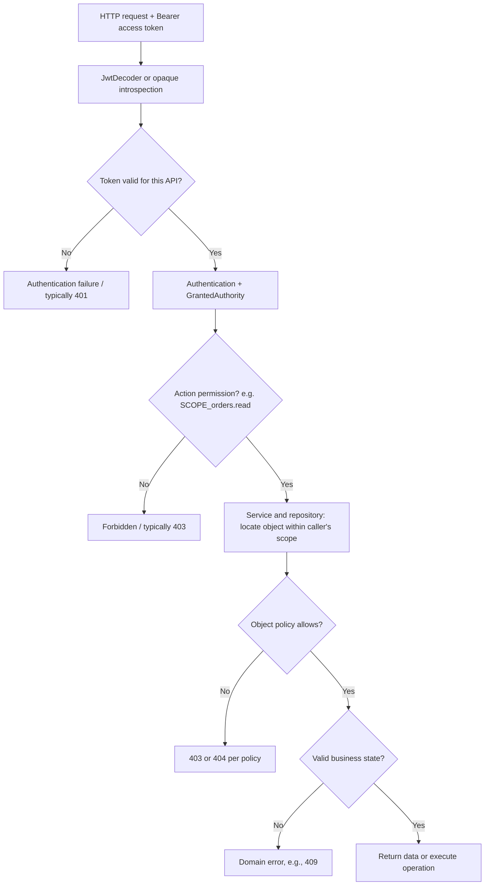

# Distinguishing Operation Permissions from Access to a Specific Object

In a **Spring Security OAuth 2.0 OIDC Resource Server**, having an access token with a valid signature, right issuer, right audience, and valid expiration only tells the API that the token can be accepted. If the token carries scope `orders.read`, Spring Security typically maps that scope to authority `SCOPE_orders.read`. However, this **does not prove the caller is allowed to read every order in the database**.

For example, user `user-123` holds a token:

```json
{
  "iss": "https://login.example.test/realms/shop",
  "sub": "user-123",
  "aud": ["orders-api"],
  "tenant_id": "shop-a",
  "scope": "orders.read orders.cancel",
  "exp": 1900000000
}
```

When calling `GET /api/orders/order-42`, there are at least three questions:

1. Is the token valid for use at the Orders API?
2. Does the caller have **permission to perform the read-order action**?
3. Does the caller have **permission to read order `order-42` specifically**?

The first two questions can be handled by token validation and HTTP authorization. The third question requires **object-level authorization**, usually based on owner, tenant, ACL, sharing relationships, support teams, or business policies in the service/repository layer.

This lesson focuses on the boundary between **action-level permission** and **object-level authorization**, how to enforce it in Spring Security Servlet applications, and how to prevent **Broken Object Level Authorization (BOLA)** or **IDOR** vulnerabilities.

## 1. Distinguishing Three Protection Layers

| Layer | Question Addressed | Example |
|---|---|---|
| **Authentication / token validation** | Is the token trustworthy and intended for this API? | Verifying JWT signature, `iss`, `aud`, `exp`, or opaque token introspection |
| **Action-level authorization** | What kind of action is the caller allowed to request? | Holding `SCOPE_orders.read` to read Orders |
| **Object-level authorization** | Which **specific resource** may the caller act upon? | `user-123` may read `order-42` but not someone else's `order-99` |
| **Business-state restrictions** | Is the action still valid at execution time? | An already shipped order cannot be cancelled |

The latter three permission groups generally combine with AND logic: a caller must be permitted to perform the **action**, permitted to act on the **object**, and satisfy **business conditions**.



**Never believe `authenticated()` or `hasAuthority(...)` solves object ownership on its own.** Spring Security does not automatically know who owns the ID in a URL unless the application implements appropriate policies and queries.

## 2. Operation Permissions: Scope, Role, and Authority

In an OAuth 2.0 Resource Server, the Authorization Server may issue scopes:

```text
orders.read
orders.write
orders.cancel
orders.export
payments.refund
shipments.dispatch
```

With a common JWT Resource Server setup, Spring Security converts scopes into authorities:

```text
SCOPE_orders.read
SCOPE_orders.write
SCOPE_orders.cancel
...
```

Some APIs may also use roles mapped from trusted claims:

```text
ROLE_CUSTOMER
ROLE_SUPPORT
ROLE_FINANCE
ROLE_ADMIN
```

These names are only an **illustrative contract**; Spring Security does not inherently understand the business meaning of `orders.cancel` or `ROLE_SUPPORT`.

### 2.1. Operation Permissions Only Describe a Category of Capability

| Authority | Action-Level Meaning | What Does It Not Prove? |
|---|---|---|
| `SCOPE_orders.read` | Allowed to request reading Orders | Does not prove access to view every order |
| `SCOPE_orders.write` | Allowed to request creating/updating Orders | Does not prove permission to edit others' orders |
| `SCOPE_orders.cancel` | Allowed to request cancelling Orders | Does not prove permission to cancel any order in any state |
| `SCOPE_orders.export` | Allowed to request exports | Does not prove permission to export system-wide data |
| `ROLE_SUPPORT` | Holds support role per policy | Does not prove support is assigned to every customer |
| `ROLE_ADMIN` | Holds admin role per policy | Does not implicitly grant access across all tenants |

Someone who holds the read scope and owns order A does not necessarily own order B. The operation permission is identical, while the object-level decision differs.

### 2.2. Which Part Does `requestMatchers` Solve?

Spring Security Servlet example:

```java
@Bean
SecurityFilterChain apiSecurity(HttpSecurity http) throws Exception {
    return http
        .authorizeHttpRequests(auth -> auth
            .requestMatchers(HttpMethod.GET, "/api/orders/**")
                .hasAuthority("SCOPE_orders.read")
            .requestMatchers(HttpMethod.POST, "/api/orders")
                .hasAuthority("SCOPE_orders.write")
            .requestMatchers(HttpMethod.POST, "/api/orders/*/cancel")
                .hasAuthority("SCOPE_orders.cancel")
            .anyRequest().denyAll()
        )
        .oauth2ResourceServer(oauth2 ->
            oauth2.jwt(Customizer.withDefaults()))
        .build();
}
```

Key imports:

```java
import org.springframework.context.annotation.Bean;
import org.springframework.http.HttpMethod;
import org.springframework.security.config.Customizer;
import org.springframework.security.config.annotation.web.builders.HttpSecurity;
import org.springframework.security.web.SecurityFilterChain;
```

Here, the route/method dictates **which permission category** is needed. Not a single line checks the owner/tenant of the order ID. That part must be enforced in the service or the corresponding object-access authorization mechanism.

**Note on rule ordering:** In `authorizeHttpRequests`, the first matching rule decides authorization. A specialized route requiring a stronger scope such as `GET /api/orders/admin/export` must appear before the wildcard `GET /api/orders/**` if the two patterns can overlap.

## 3. Object Permissions: Actor, Action, Resource, Context

Object-level authorization can be modeled as a policy function:

```text
canAccess(actor, action, resource, context) -> ALLOW / DENY
```

Example:

```text
actor:
  issuer   = https://login.example.test/realms/shop
  subject  = user-123
  tenant   = shop-a

action:
  READ_ORDER

resource:
  id       = order-99
  owner    = user-456
  tenant   = shop-a
  shared   = false

decision:
  DENY: has read scope but neither owner nor shared
```

Factors that may participate:

- **Ownership:** is the user the owner of the object?
- **Tenant isolation:** does the object belong to an authorized tenant?
- **ACL/share:** has the object been shared with the principal or group?
- **Assignment:** is the support agent assigned to the case, account, or order?
- **Delegation:** is the principal allowed to act on someone else's behalf?
- **Relationship:** is the user a team/project member with rights to the object?
- **Business state:** is the order still cancellable, the payment still refundable, or the record already approved?

### 3.1. RBAC, ABAC, and ReBAC

| Model | How Decisions Are Made | Example |
|---|---|---|
| RBAC | Role-based permissions | `ROLE_SUPPORT` can view support cases |
| ABAC | Permissions based on principal/resource/context attributes | `actor.tenant == order.tenant` |
| ReBAC | Relationship-based permissions | Actor is owner, assignee, or share recipient |
| ACL | Permission list attached directly to the object | Order 42 grants read permission to user-123 |
| Business policy | Domain rules and state | Can cancel only before order is shipped |

Real applications often combine multiple models. For example, support staff must hold the right role **and** be assigned to the right team **and** belong to the same tenant to read an order.

## 4. BOLA/IDOR Vulnerability Example

Suppose an API exposes the endpoint:

```http
GET /api/orders/order-1
Authorization: Bearer <user-123-token>
```

and `user-123` holds `SCOPE_orders.read`. The endpoint returns `order-1`, which belongs to `user-123`.

An attacker swaps the ID:

```http
GET /api/orders/order-2
Authorization: Bearer <user-123-token>
```

If `order-2` belongs to `user-456` yet the API still returns the data, the bug is **Broken Object Level Authorization**.

Risky snippet:

```java
@GetMapping("/api/orders/{orderId}")
public OrderDto getOrder(@PathVariable String orderId) {
    return repository.findById(orderId)
        .map(OrderDto::from)
        .orElseThrow(OrderNotFoundException::new);
}
```

If only `hasAuthority("SCOPE_orders.read")` sits on the URL, the controller above still lets `user-123` read `user-456`'s order.

**Using random UUIDs does not fix this bug.** Object IDs can leak through links, logs, reports, emails, or other payloads. Hard-to-guess IDs merely reduce guessability; they are not proof of authorization.

## 5. Which Identity Should Be Used in Policies?

A JWT access token might contain:

```json
{
  "iss": "https://login.example.test/realms/shop",
  "sub": "user-123",
  "client_id": "web-portal",
  "tenant_id": "shop-a",
  "aud": ["orders-api"],
  "scope": "orders.read"
}
```

Distinguish carefully:

| Claim | Meaning | Note for Object Authorization |
|---|---|---|
| `sub` | Subject confirmed by the issuer | May be a user or service principal depending on token/grant |
| `iss` | Issuer | Multi-issuer setups may need `(issuer, subject)` as the identity pair |
| `tenant_id` | Tenant attribute if defined by AS contract | Must verify active tenant and membership policies |
| `client_id` | OAuth client that requested the token | Does not prove ownership or API audience |
| `aud` | Resource Servers allowed to accept the token | Must be verified prior to authorization |
| `scope` | Operation permissions | Not the set of objects the caller owns |

**Never read claims from a JWT payload whose signature has not been verified**, because an attacker could self-declare `sub=user-admin`, `tenant_id=shop-b`, and arbitrary scopes. Attributes used by policies must come from an `Authentication`/principal **already validated by the decoder or introspector**.

### 5.1. Extracting the Principal from a Spring Security–Verified JWT

Policy code example:

```java
if (!(authentication instanceof JwtAuthenticationToken jwtAuth)) {
    return false;
}

Jwt jwt = jwtAuth.getToken();

String subject = jwt.getSubject();
String tenantId = jwt.getClaimAsString("tenant_id");
String issuer = jwt.getIssuer() == null
    ? null
    : jwt.getIssuer().toString();
```

Imports:

```java
import org.springframework.security.core.Authentication;
import org.springframework.security.oauth2.jwt.Jwt;
import org.springframework.security.oauth2.server.resource.authentication.JwtAuthenticationToken;
```

This example is for a JWT Resource Server. When using opaque tokens, the principal may be `OAuth2AuthenticatedPrincipal` with a different Authentication type; object policies need an adapter extracting identity according to the actual authentication mechanism rather than casting every request to JWT.

### 5.2. Do Not Assume `authentication.getName()` Is an Immutable User ID

`JwtAuthenticationConverter` can be configured to map the principal name to `preferred_username` or another claim. Usernames and emails can change or collide across issuers.

In multi-issuer systems, account identification typically requires considering both **`iss` and `sub`**, rather than relying solely on a display name when uniqueness matters. If the application maintains an internal mapping table from issuer identities to account IDs, that mapping must be controlled and trusted.

## 6. Designing Policies in Services and Repositories

It can be structured as:

```text
HTTP SecurityFilterChain
    └── check SCOPE_orders.read
            │
            ▼
OrderController
            │
            ▼
OrderService
    ├── identify the authenticated actor
    ├── check tenant/owner/share/assignment
    ├── query OrderRepository within valid scope
    └── return field-filtered DTO
```

If multiple controllers or jobs share a service, the policy should live at the **application/service boundary**, not merely duplicated sporadically across individual HTTP controllers.

### 6.1. `@PreAuthorize` with a Policy Bean

Service example:

```java
@Service
public class OrderService {

    private final OrderRepository repository;

    public OrderService(OrderRepository repository) {
        this.repository = repository;
    }

    @PreAuthorize(
        "hasAuthority('SCOPE_orders.read') and " +
        "@orderAccessPolicy.canRead(authentication, #orderId)"
    )
    @Transactional(readOnly = true)
    public OrderDto getOrder(String orderId) {
        Order order = repository.findById(orderId)
            .orElseThrow(OrderNotFoundException::new);

        return OrderDto.from(order);
    }
}
```

Policy bean:

```java
@Component("orderAccessPolicy")
public class OrderAccessPolicy {

    private final OrderRepository repository;

    public OrderAccessPolicy(OrderRepository repository) {
        this.repository = repository;
    }

    public boolean canRead(
            Authentication authentication,
            String orderId) {

        if (!(authentication instanceof JwtAuthenticationToken jwtAuth)) {
            return false;
        }

        Jwt jwt = jwtAuth.getToken();
        String subject = jwt.getSubject();
        String tenant = jwt.getClaimAsString("tenant_id");

        if (subject == null || tenant == null) {
            return false;
        }

        return repository.existsByIdAndTenantIdAndOwnerSubject(
            orderId, tenant, subject
        );
    }
}
```

Core imports:

```java
import org.springframework.security.access.prepost.PreAuthorize;
import org.springframework.security.core.Authentication;
import org.springframework.security.oauth2.jwt.Jwt;
import org.springframework.security.oauth2.server.resource.authentication.JwtAuthenticationToken;
import org.springframework.stereotype.Component;
import org.springframework.stereotype.Service;
import org.springframework.transaction.annotation.Transactional;
```

`OrderRepository` and `OrderDto` are illustrative domain components. This example only permits owners to read orders within their tenant; applications with support/share policies must add explicitly defined branches.

**Note:** The `#orderId` expression requires parameter name metadata to be available (e.g., compiling with `-parameters` or using an appropriate parameter annotation). Additionally, method security typically relies on proxies: self-invocation within the same bean can skip executing the annotation as expected.

### 6.2. Prefer Authorization-Scoped Queries in the DB

The example above checks existence and then calls `findById`, causing two queries and risking data changing between check and use. An often cleaner pattern is **querying only visible data**:

```java
public interface OrderRepository extends JpaRepository<Order, String> {

    @Query("""
        select o from Order o
        where o.id = :orderId
          and o.tenantId = :tenantId
          and o.ownerSubject = :subject
        """)
    Optional<Order> findOwnedOrder(
        @Param("orderId") String orderId,
        @Param("tenantId") String tenantId,
        @Param("subject") String subject
    );
}
```

From the service:

```java
@PreAuthorize("hasAuthority('SCOPE_orders.read')")
@Transactional(readOnly = true)
public OrderDto getOrder(String orderId, AuthenticatedActor actor) {
    Order order = repository.findOwnedOrder(
            orderId,
            actor.tenantId(),
            actor.subject()
        )
        .orElseThrow(OrderNotFoundException::new);

    return OrderDto.from(order);
}
```

`AuthenticatedActor` in this example is an **internal value object constructed from the verified `Authentication`**, never a client-supplied DTO. It must carry the exact issuer/subject/tenant required by multi-tenant contracts.

Advantage of a filtered query: out-of-scope data is never loaded only to be checked afterward. When support/sharing is needed, extend the policy and query with authorized relationships **without dropping the tenant predicate**.

### 6.3. SQL by Owner/Tenant

Illustration:

```sql
SELECT *
FROM orders
WHERE id = :orderId
  AND tenant_id = :trustedTenant
  AND owner_subject = :trustedSubject;
```

Both `trustedTenant` and `trustedSubject` must come from server-side identity/policy. If taken from caller-supplied query parameters, even a well-written SQL statement cannot protect the data.

## 7. Authorizing by Owner, Share ACL, and Support Assignment

Not every object has just a single owner. A policy might allow:

```text
canReadOrder(actor, order):
  require SCOPE_orders.read
  require allowed tenant relationship

  if order.owner == actor.subject:
      ALLOW
  else if shareACL grants actor read:
      ALLOW
  else if supportAssignment grants actor read:
      ALLOW
  else:
      DENY
```

An illustrative SQL query:

```sql
SELECT o.*
FROM orders o
WHERE o.id = :orderId
  AND o.tenant_id = :tenantId
  AND (
        o.owner_subject = :subject
        OR EXISTS (
            SELECT 1 FROM order_shares s
            WHERE s.order_id = o.id
              AND s.tenant_id = o.tenant_id
              AND s.recipient_subject = :subject
              AND s.can_read = true
        )
      );
```

In a real system, support policies need a corresponding branch matching verified assignments.

### 7.1. Watch Out for AND and OR Precedence

Wrong:

```sql
WHERE tenant_id = :tenant
  AND owner_subject = :subject
   OR assigned_support = :subject
```

The `assigned_support` branch may escape the tenant constraint. Better when the intent is same-tenant:

```sql
WHERE tenant_id = :tenant
  AND (
       owner_subject = :subject
       OR assigned_support = :subject
  )
```

When combining multiple roles and permission sources, **every OR branch must preserve mandatory boundaries**.

## 8. Object-Level Authorization Is Not Just for GET Detail

An easily overlooked area is APIs without a direct object ID:

```http
GET /api/orders
GET /api/orders/search?q=chair
GET /api/orders/count
GET /api/orders/stats
GET /api/orders/export
```

If you only check scope and then run:

```sql
SELECT * FROM orders ORDER BY created_at DESC;
```

the caller can see every order.

### 8.1. Lists Must Filter by Permitted Scope

Customer list example:

```sql
SELECT *
FROM orders
WHERE tenant_id = :trustedTenant
  AND owner_subject = :trustedSubject
ORDER BY created_at DESC
LIMIT :limit OFFSET :offset;
```

### 8.2. Counts, Aggregations, and Pagination Also Need Constraints

Beyond item lists, the following values can also leak data:

- `totalElements` or `totalPages`.
- Total monetary amount across all orders.
- Cancellation/refund rates.
- Status or geographic statistics.
- Filter facets.
- CSV/Excel reports.
- Cached search results.

If items are filtered while total count is computed across the entire database, the API can still leak another tenant's information.

### 8.3. Exports Usually Need Stronger Action Permissions

```java
.requestMatchers(HttpMethod.GET, "/api/orders/export")
    .hasAuthority("SCOPE_orders.export")
.requestMatchers(HttpMethod.GET, "/api/orders/**")
    .hasAuthority("SCOPE_orders.read")
```

The export rule should come before the wildcard if they could overlap. Still, `orders.export` **only grants permission to request an export**; exported content must still be bounded by object policies.

## 9. Creation: The Object Does Not Exist Yet, Yet Object Policy Still Applies

With:

```http
POST /api/orders
Authorization: Bearer <ACCESS_TOKEN>
Content-Type: application/json

{
  "customerId": "user-456",
  "tenantId": "shop-b",
  "items": [{"sku": "SKU-001", "quantity": 1}]
}
```

A caller holding `orders.write` is not permitted to create orders for arbitrary customers or tenants.

Two groups of conditions apply:

1. **Action permission:** is the token allowed to request order creation?
2. **Creation policy:** **what kind of order, for whom, in which tenant, and with which attributes** may the caller create?

### 9.1. Do Not Bind Arbitrary Owner and Tenant from the Request

Risk:

```java
Order order = new Order();
order.setOwnerSubject(request.customerId());
order.setTenantId(request.tenantId());
repository.save(order);
```

If the endpoint is for "customers creating their own orders," the service should assign owner/tenant from the trusted `AuthenticatedActor`:

```java
@Transactional
public OrderDto createOwnOrder(
        CreateOrderRequest request,
        AuthenticatedActor actor) {

    requireAuthority(actor, "SCOPE_orders.write");

    Order order = new Order();
    order.setOwnerSubject(actor.subject());
    order.setTenantId(actor.tenantId());
    order.setItems(validateItems(request.items()));

    return OrderDto.from(repository.save(order));
}
```

This snippet illustrates a domain API; helpers and value objects must be implemented per the application. It is not standalone runnable code.

### 9.2. When Creating on Behalf of Someone Else Is Allowed

A support endpoint creating orders on behalf of customers may require:

- A dedicated scope such as `orders.create_for_customer`.
- The target customer belonging to an assigned tenant/scope.
- The actor holding delegated permission or a genuine support role.
- Guards against self-escalation or unauthorized owner changes.
- Auditing "who created on behalf of whom," without spoofing `sub` in the access token.

## 10. Updates: Check Both the Object and the Modified Fields

Example:

```http
PATCH /api/orders/order-42
Content-Type: application/json
Authorization: Bearer <ACCESS_TOKEN>

{
  "shippingAddress": "New address",
  "ownerSubject": "user-456",
  "tenantId": "shop-b",
  "paymentStatus": "PAID"
}
```

Even if the user holds `SCOPE_orders.write` and owns `order-42`, they are **not automatically allowed to modify every field**.

| Field | Who Can Modify? | Illustrative Rule |
|---|---|---|
| `shippingAddress` | Owner or authorized support | Before shipment dispatch |
| `internalNote` | Assigned support | Within matching tenant |
| `paymentStatus` | Trusted payment workflow | Never accepted directly from customer |
| `ownerSubject` | Authorized ownership-transfer workflow | Never mass-assigned |
| `tenantId` | Usually immutable after creation | Changed only via dedicated workflow |
| `totalAmount` | Computed server-side | Never taken arbitrarily from client |

Never bind a JSON body directly onto an entity and copy all fields. Use request DTOs declaring only editable fields and enforce corresponding policies.

### 10.1. Field-Level Authorization

A customer allowed to view `OrderDto` may still not be allowed to view `internalFraudScore` or `supportNotes`. Object-level permission grants access to the **object**, whereas field-level policies govern **which pieces of information** may be exposed.

Avoid returning JPA entities directly from controllers when entities contain sensitive fields or relationships. Use role- or use-case-specific DTOs.

## 11. Cancel, Approve, Refund: Action + Object + State

Order cancellation example:

```text
cancelOrder(orderId, actor) allowed if:
  access token is valid for orders-api
  AND actor has SCOPE_orders.cancel
  AND order.tenant is allowed
  AND (actor owns order OR authorized support)
  AND order.status in [CREATED, CONFIRMED]
  AND shipment has not reached irreversible state
```

Here:

- Scope determines the **action type**.
- Owner/share/support/tenant determines the **object**.
- Status and shipment determine the **business state**.

An order owner still cannot cancel an already delivered order. When rejected due to state, the response may be `409 Conflict` or a corresponding domain error rather than a permission error.

### 11.1. Avoiding TOCTOU Between Check and Write

A race condition:

```text
T1: canCancel(order) = true
T2: another service transitions order to DISPATCHED
T3: cancel(order) still updates
```

Separating check and mutation can fail because state changed in between. Remediations depend on the DB/ORM:

- Appropriate transactions.
- Optimistic locking with a version column.
- Pessimistic locking when necessary.
- Conditional updates with owner/tenant/status predicates.
- Idempotency and domain rules for side effects.

SQL example:

```sql
UPDATE orders
SET status = 'CANCELLED'
WHERE id = :orderId
  AND tenant_id = :trustedTenant
  AND owner_subject = :trustedSubject
  AND status IN ('CREATED', 'CONFIRMED');
```

Check affected rows to confirm whether the mutation occurred. For support policies, add the authorized branch while keeping tenant isolation intact.

**Adding `@Transactional` alone does not solve all race conditions.** Isolation levels, locking, and side-effect ordering must still be properly designed.

## 12. Bulk Operations: Check Every Object in the List

Example:

```http
POST /api/orders/bulk-cancel
Content-Type: application/json
Authorization: Bearer <ACCESS_TOKEN>

{"orderIds": ["order-1", "order-2", "order-3"]}
```

Scope `orders.cancel` only permits the **bulk cancel operation type** if the system defines it that way. Each ID can still belong to a different owner/tenant or be in a non-cancellable state.

Wrong:

```java
if (canCancel(orderIds.get(0), actor)) {
    cancelAll(orderIds);
}
```

Never check only the first element and apply the decision to the whole list.

Possible policies:

| Policy | Handling | Notes |
|---|---|---|
| All-or-nothing | All items must be allowed to commit | Easier to keep transactions consistent when domain supports it |
| Partial success | Process only valid items | Response must not leak invisible items |
| Deny if any unauthorized | Reject entire request | Avoids out-of-scope partial side effects |

Choose according to the business contract. Bulk `UPDATE` statements must include tenant/owner/state predicates, or execute verified mutations inside an appropriate transaction boundary.

## 13. Nested Resources: Verify the Parent–Child Relationship

Endpoint:

```http
GET /api/projects/project-1/files/file-9
```

At minimum, evaluate:

1. Is the caller allowed to read `project-1`?
2. Does `file-9` actually belong to `project-1`?
3. Does `file-9` have its own policy?
4. Are both project and file within an authorized tenant?

If the service simply runs:

```java
File file = fileRepository.findById(fileId).orElseThrow();
```

omitting `projectId`, a caller can combine a valid parent ID with a file ID from elsewhere.

Illustrative query:

```sql
SELECT f.*
FROM files f
JOIN projects p ON p.id = f.project_id
WHERE f.id = :fileId
  AND p.id = :projectId
  AND p.tenant_id = :trustedTenant
  AND p.owner_subject = :trustedSubject;
```

This is a simple owner-only policy; if files have per-file ACLs, add file-permission predicates. Permission to read a project **does not automatically imply** permission to read every document under that project.

## 14. Cross-Object Operations: Check Both Source and Target

A request assigning a support agent:

```http
POST /api/orders/order-42/assignees
Content-Type: application/json

{"assigneeId": "support-9"}
```

You must check:

- Is the caller permitted to change assignments?
- Does the caller have permission on `order-42`?
- Does `support-9` exist and belong to the right tenant/team?
- Is the caller allowed to assign that role/group?
- Is there any risk of self-escalation or cross-tenant assignment?

The same applies to transferring ownership, sharing files, moving projects, attaching payments to orders, or routing shipments to another warehouse. **Having permission on the source object does not mean having permission to act on the target object.**

## 15. Multi-Tenant: A Tenant in the Path Does Not Prove Permission

Example:

```http
GET /api/tenants/shop-b/orders/order-3
Authorization: Bearer <shop-a-token>
```

The string `shop-b` in the URL is chosen by the caller. It does not prove membership.

Trusted permission sources may include:

- Tenant claims authenticated and clearly defined by the AS.
- Server-side membership/assignment tables.
- An active tenant resolved through a controlled flow.
- Valid ACLs or delegated access records.

**Never let queries accept an arbitrary tenant and directly use it as an authorization decision.** Compare it against the set of tenants the caller is truly permitted to access.

### 15.1. Policy When a User Belongs to Multiple Tenants

If a user holds memberships in `shop-a` and `shop-b`, the token may represent an active tenant or only a general subject. The design must specify:

- Who is allowed to switch active tenants?
- Is a new access token required when switching tenants?
- Do scopes apply organization-wide or per tenant?
- Must revoked memberships take immediate effect?
- Does the Resource Server need to query current membership?

A signed claim in a JWT reflects data confirmed by the issuer **at issuance time**; when memberships change, object policies may need current state from the DB or a policy service.

## 16. Service Principals and Client Credentials

The OAuth 2.0 Client Credentials grant is typically used for machine-to-machine calls. A token may carry:

```json
{
  "iss": "https://login.example.test/realms/shop",
  "sub": "service-order-sync",
  "client_id": "order-sync-worker",
  "aud": ["orders-api"],
  "scope": "orders.read",
  "tenant_id": "shop-a"
}
```

For a service principal:

- There may be no end user.
- `sub` may be a service ID.
- `client_id` identifies the OAuth client per issuer contract.
- Scope `orders.read` does not equate to reading data from all tenants.

A service policy might be:

```text
canSyncOrder(client, order):
  client has SCOPE_orders.read
  AND client_id in trusted integration allowlist
  AND order.tenant in client allowed tenants
  AND order.integration_enabled = true
```

Never adopt a rule like "if client credentials, grant system-wide admin" unless backed by an explicitly approved security contract with matching data boundaries and auditing.

## 17. Async Jobs and Downstream APIs

An export endpoint may enqueue a background job:

```http
POST /api/reports/export
Authorization: Bearer <ACCESS_TOKEN>
```

The job executes minutes later, when the original HTTP `SecurityContext` is gone. If the worker uses a database account that reads the entire table while ignoring the originating request's actor, an initially valid export can turn into a system-wide data export.

The design must establish:

- Actor, tenant, and scope recorded in a trusted manner.
- Which object filters are persisted and applied when the job executes.
- Whether permissions are re-checked at execution time.
- Avoid storing raw bearer tokens in queues unless truly needed.
- Never allow a technical service account to widen a user's business privileges.

### 17.1. Permissions in Service A Do Not Transfer Automatically to Service B

The Orders API may need to call the Inventory API. Even when the Orders service has a technical token to call Inventory, it must preserve appropriate tenant/object boundaries per the business contract. When acting on a user's behalf, an AS-supported delegation/token-exchange model may be needed.

A token with audience `orders-api` must never simply be forwarded to `inventory-api` and treated as valid; each Resource Server must verify its own audience.

## 18. Method Security: `@PreAuthorize` and `@PostAuthorize`

`@PreAuthorize` is generally suited to denying **before** the service executes:

```java
@PreAuthorize(
    "hasAuthority('SCOPE_orders.cancel') and " +
    "@orderAccessPolicy.canCancel(authentication, #orderId)"
)
public void cancelOrder(String orderId) {
    // ...
}
```

If the policy relies on DB state, consider TOCTOU/transactions as analyzed earlier.

`@PostAuthorize` can inspect the method result:

```java
@PostAuthorize(
    "returnObject == null or " +
    "@orderAccessPolicy.canReadReturned(authentication, returnObject)"
)
public OrderDto readOrder(String orderId) {
    // ...
}
```

However, **do not use post-authorization to protect methods with side effects**. If the method already transferred funds, wrote to the DB, or sent emails before being denied, the action has already occurred. Even for reads, keep in mind that data may have been materialized, logged, or cached before the check; filtered queries are usually easier to control.

### 18.1. Proxy / Self-Invocation

Spring method security generally relies on AOP proxies. Calling another annotated method within the same bean directly can **bypass the proxy**, causing the annotation not to apply as expected.

Therefore, protect use cases at a consistent entry-point/service boundary; do not rely solely on annotations on methods that might be invoked internally without passing through a proxy.

## 19. 401, 403, 404, and Business Errors

| Scenario | Which Layer? | Typical HTTP Status |
|---|---|---|
| No access token on protected endpoint | Authentication | `401 Unauthorized` |
| JWT has invalid signature, wrong issuer/audience, or is expired | Authentication | `401 invalid_token` |
| Valid token but missing `SCOPE_orders.read` | Action authorization | `403 Forbidden` |
| Has scope but not allowed to view `order-42` | Object authorization | `403` or `404` |
| Object genuinely does not exist | Resource lookup | `404 Not Found` |
| Permitted to cancel but order is no longer cancellable | Business state | `409 Conflict` or appropriate domain code |

### 19.1. Why Return 404 for Non-Visible Objects?

If an API returns 403 when an ID exists without permission and 404 when the ID does not exist, callers can infer which object IDs exist. Some APIs intentionally return 404 in both cases to prevent **object enumeration**.

This is a **policy decision**: it must be applied consistently without leaking out-of-scope owner/tenant/state details in responses. Missing an endpoint-wide scope still typically returns 403 for authenticated callers.

## 20. Caching and Field-Level Permissions

If a cache is keyed solely by `orderId` and holds an admin DTO containing all fields, another caller might receive the cached entry before permissions are evaluated.

Principles:

- Authorization must be enforced **before returning cached data**.
- Caches for tenant/principal-dependent data must use appropriate cache boundaries.
- Never treat a cache hit as proof of permission.
- Handle invalidation when share ACLs, memberships, or ownership change.
- Never return entities with sensitive fields just because the user is allowed to view the object.

For instance, a customer may view order status without viewing `internalFraudScore`. Use a DTO containing only permitted fields. Object permissions and field permissions are two levels that often must work together.

## 21. Testing Boundaries with Data Fixtures

A minimal fixture set:

```text
tenant shop-a:
  user-123 owns order-1
  user-456 owns order-2

tenant shop-b:
  user-789 owns order-3
```

Testing `user-123` with `SCOPE_orders.read`:

| Request | Action-Level | Object-Level | Outcome |
|---|---|---|---|
| GET `order-1` | Pass | Owner in right tenant | Allow |
| GET `order-2` | Pass | Not owner / not shared | Deny |
| GET `order-3` | Pass | Different tenant | Deny |
| GET `order-1` with scope `profile` | Fail | Not evaluated further | Deny |
| GET list | Pass | Returns only visible items | Sees only `order-1` |
| Export orders | Requires dedicated export permission | Exports only visible set | Does not leak `order-2`/`3` |
| PATCH `order-1` changing `tenantId` | May have write scope | Field update not permitted | Deny |
| Bulk cancel `order-1` and `order-3` | Has cancel scope | One object outside tenant | Must not affect `order-3` |

### 21.1. Spring Security Test Has Its Own Scope

In MockMvc, you can use:

```java
mockMvc.perform(get("/api/orders/order-1")
        .with(jwt().authorities(
            new SimpleGrantedAuthority("SCOPE_orders.read")
        )))
    .andExpect(status().isOk());
```

This is an HTTP authorization test example using `SecurityMockMvcRequestPostProcessors.jwt()` and a prepared endpoint/fixture that succeeds. `jwt()` typically simulates an authenticated principal **without verifying real JWT signatures** via `NimbusJwtDecoder`.

Therefore, distinguish:

- HTTP scope/route tests.
- Service policy tests with differing owners/tenants.
- Repository query tests ensuring data constraints.
- Decoder integration tests for issuer, signature, audience, and expiry.
- Concurrency tests when mutations depend on state.

If all test data belongs to a single user/tenant, a query missing a tenant predicate can still pass. Multi-tenant data fixtures are essential for object authorization.

## 22. Common Mistakes to Avoid

**1. Believing a valid token is enough.** A valid token only proves identity/claims per contract; it does not authorize every object.

**2. Checking only `hasAuthority("SCOPE_orders.read")`.** That authorizes the action, without checking owner or tenant.

**3. Using a client-sent `userId` as the principal.** Query/body/path values are caller-chosen; compare against verified identity and server-side policies.

**4. Using hard-to-guess UUIDs instead of ACLs.** IDs can leak; permissions must still be verified.

**5. Omitting tenant in an OR branch.** A support/share branch lacking a tenant predicate can leak data across tenants.

**6. Checking detail views while skipping list/search/export/count.** BOLA can occur even when responses are not tied to one explicit ID.

**7. Granting service accounts full DB access based on a general read scope.** Client credentials tokens require integration/tenant/object limits.

**8. Trusting owner/tenant in create requests.** Never create objects for another user/tenant without explicit delegation.

**9. Binding PATCH payloads directly to entities.** Can overwrite owner, tenant, payment status, or sensitive fields.

**10. Skipping business state when owner + scope pass.** Owning an order does not mean it can be cancelled in every state.

**11. Checking then mutating outside a transaction or without concurrency control.** Race conditions can invalidate the policy.

**12. Protecting controllers while ignoring services, async jobs, and GraphQL.** Other entry points can bypass HTTP rules.

**13. Returning cached data before authorization.** A cache hit does not prove permission.

**14. Using `Authentication.getName()` as an immutable ID when changing the principal claim.** With multiple issuers, consider identity pairs and trusted mappings.

**15. Using `@PostAuthorize` to protect side effects.** Post-method authorization may arrive too late.

## 23. Use-Case Contracts Should Explicitly Describe Each Permission Layer

A use case can be documented as:

```text
Use case:
  cancelOrder(orderId)

Authentication:
  - Access token valid for orders-api
  - Trusted issuer and unexpired token

Action-level:
  - Requires SCOPE_orders.cancel

Object-level:
  - Order belongs to an allowed tenant
  - Actor is owner OR authorized assigned support
  - No cross-tenant access without explicit delegation

Business state:
  - Order status in [CREATED, CONFIRMED]
  - Shipment has not reached irreversible state

Data access:
  - Query/update includes tenant and authorization predicates
  - Concurrency handled by transaction/lock/conditional update

Error behavior:
  - Invalid token: usually 401
  - Missing action permission: usually 403
  - Invisible object: 403 or 404 consistently
  - Invalid state: domain error such as 409

Audit:
  - Trusted actor identity, action, target ID, decision
  - Never raw bearer token
```

This contract prevents the development team from reducing everything to "the scope is present" and overlooking **which object may be acted upon**.

## 24. References

- [Spring Security — Authorize HTTP Requests](https://docs.spring.io/spring-security/reference/servlet/authorization/authorize-http-requests.html): HTTP authorization, request matching, scope/authority checks.
- [Spring Security — Method Security](https://docs.spring.io/spring-security/reference/servlet/authorization/method-security.html): `@EnableMethodSecurity`, `@PreAuthorize`, and `@PostAuthorize`.
- [Spring Security — OAuth 2.0 Resource Server JWT](https://docs.spring.io/spring-security/reference/servlet/oauth2/resource-server/jwt.html): creating Authentication from JWTs, scope mapping.
- [Spring Security — Opaque Token Resource Server](https://docs.spring.io/spring-security/reference/servlet/oauth2/resource-server/opaque-token.html): introspection for opaque access tokens.
- [OWASP API Security Top 10: API1:2023 Broken Object Level Authorization](https://owasp.org/API-Security/editions/2023/en/0xa1-broken-object-level-authorization/): BOLA and framing object risk in APIs.
- [OWASP Authorization Cheat Sheet](https://cheatsheetseries.owasp.org/cheatsheets/Authorization_Cheat_Sheet.html): access control, default deny, least privilege.
- [RFC 6750 — OAuth 2.0 Bearer Token Usage](https://www.rfc-editor.org/rfc/rfc6750): bearer tokens over HTTP.
- [RFC 9068 — JWT Profile for OAuth 2.0 Access Tokens](https://www.rfc-editor.org/rfc/rfc9068): JWT access tokens, audience, and scopes.

**Conclusion:** **Operation permissions** indicate what category of action a caller may request; **object access permissions** decide **which specific object** the caller may perform that action on. In a Spring Security Resource Server, checking scopes/roles at HTTP is only the first layer; it must be combined with owner/tenant/share/assignment policies, properly scoped queries, and business conditions in the service layer. **A valid access token with `orders.read` is not permission to read every order.**
