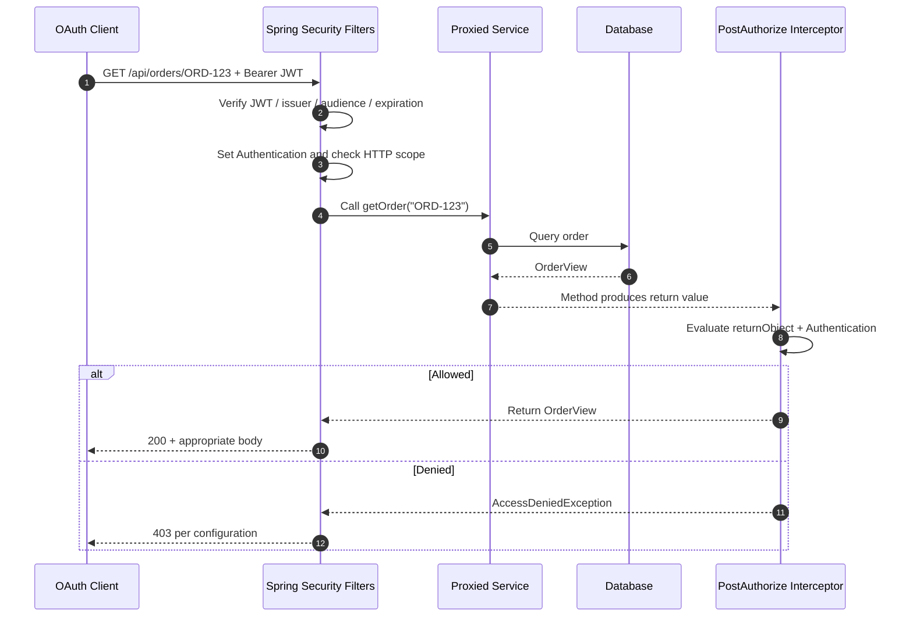
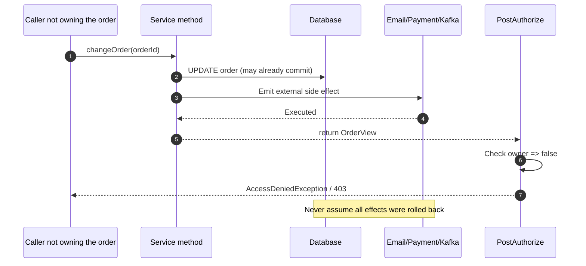
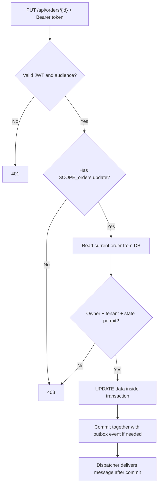
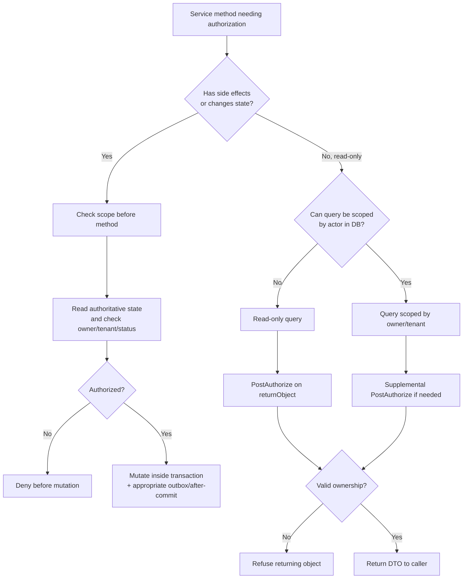

# @PostAuthorize and Its Limitations with Side Effects That Have Already Occurred

In a **Spring Security OAuth 2.0/OIDC Resource Server**, when a request carries a valid access token, Spring Security constructs an `Authentication` from the token and can use that information to decide which business method may be called. At the service layer, two commonly mentioned annotations are **`@PreAuthorize`** and **`@PostAuthorize`**.

The most important difference lies in **timing**:

- **`@PreAuthorize`** evaluates conditions **before allowing the method call to proceed**. It is suited to blocking writes, deletes, payment commands, message publishing, or state-changing tasks.
- **`@PostAuthorize`** evaluates conditions **after the method has executed and produced a return value**. It is useful when access rights can only be accurately evaluated after reading the object, such as checking the owner of a freshly queried record. However, it **cannot turn back time**: if the method already sent an email, created a transaction, wrote data, or emitted an event before the condition failed, refusing to return the result does not undo those side effects.

This distinction is easy to miss if you only look at the HTTP response: an endpoint can return **403 Forbidden** because `@PostAuthorize` denied access, while the business operation has already executed partially or completely. That is especially dangerous for payments, refunds, data deletions, inventory updates, or external service calls.

This lesson progresses from the exact semantics of `@PostAuthorize`, how to read `returnObject`, Spring Security Servlet configuration, and transaction and side-effect risks, to better design patterns for protecting state-changing actions.

## 1. What Is `@PostAuthorize`?

`@PostAuthorize` is a **Spring Security Method Security** annotation. It lets you write an authorization expression (typically SpEL) based on **the value the method just returned** and the current security context.

Small example:

```java
import org.springframework.security.access.prepost.PostAuthorize;
import org.springframework.stereotype.Service;

@Service
public class AccountQueryService {

    @PostAuthorize("returnObject.owner == authentication.name")
    public AccountView getAccount(String accountId) {
        return repository.findAccountView(accountId);
    }
}
```

Suppose `AccountView` exposes `getOwner()`, `repository` is configured, and the request is authenticated. When `getAccount` is called through the Spring proxy:

1. The method queries the account and constructs an `AccountView`.
2. After the method returns a result, Spring Security evaluates `returnObject.owner == authentication.name`.
3. If the expression is true, the caller receives the `AccountView`.
4. If false, Spring Security denies by default with `AccessDeniedException` instead of handing the result to the caller.

In a properly configured HTTP request, an authenticated principal typically receives **403** when method security denies access. If the method is invoked from a job or non-HTTP code, there is no `ExceptionTranslationFilter` to produce an HTTP status code; the caller must handle the exception in that context.

**Read the sequence carefully:** the account **was already queried** before the check. The annotation guards **returning the result across the method call**, rather than preventing the method from executing in the first place.

### 1.1. What Is `returnObject`?

Inside a `@PostAuthorize` expression, the special variable name `returnObject` refers to **the return value of the protected method invocation**. For example:

```java
@PostAuthorize("returnObject.owner == authentication.name")
public AccountView readAccount(String accountId) {
    return accountRepository.getViewById(accountId);
}
```

Here:

- `returnObject` is the `AccountView` that the method just produced.
- `returnObject.owner` reads the `owner` property (e.g., via its getter).
- `authentication` is Spring Security's current `Authentication`.
- `authentication.name` retrieves the principal name; in a JWT Resource Server this is usually `sub` under default configuration, though it can be customized.

Because the expression can inspect the returned result to decide access, `@PostAuthorize` fits naturally with methods **reading a single object**. For methods returning `void`, `returnObject` carries no new record to inspect; using it as a security gate for write operations generally makes no sense.

### 1.2. `@PostAuthorize` Must Be Enabled

In Spring Security 6+:

```java
import org.springframework.context.annotation.Configuration;
import org.springframework.security.config.annotation.method.configuration.EnableMethodSecurity;

@Configuration
@EnableMethodSecurity
public class MethodSecurityConfiguration {
}
```

`@EnableMethodSecurity` enables the method security infrastructure, including `@PreAuthorize` and `@PostAuthorize` under the appropriate default configuration. If an application has disabled `prePostEnabled` or customized advisors, confirm that the corresponding interceptor is registered.

**Merely adding the annotation to a class without method-security infrastructure does not ensure the annotation executes.** Furthermore, by default method security works via Spring AOP proxies; calls that do not go through the proxy may not be intercepted.

## 2. Where `@PostAuthorize` Sits in the Servlet Resource Server Flow

A request to an Orders API may travel through:



There are three distinct decision layers here:

| Layer | Check | Example |
|---|---|---|
| **Authentication** | Is the access token valid and intended for the Orders API? | Signature, `iss`, `aud`, `exp`/`nbf` |
| **Pre-method authorization** | Is the caller allowed to use the read-order capability? | `SCOPE_orders.read` |
| **Post-method authorization** | Does the returned record belong to the caller or an allowed tenant? | `@PostAuthorize` comparing permissions against `returnObject` |

Do not use `@PostAuthorize` to compensate for missing bearer token validation or audience checks. An access token with the wrong issuer must never travel deep into services only to be rejected later due to an owner mismatch.

### 2.1. `@PreAuthorize` and `@PostAuthorize` Can Coexist

Example:

```java
@PreAuthorize("hasAuthority('SCOPE_orders.read')")
@PostAuthorize("returnObject.ownerSubject == authentication.name")
public OrderView readOrder(String id) {
    return orderRepository.getViewById(id);
}
```

When method security is enabled and the call passes through the proxy:

1. `@PreAuthorize` checks the scope before the method call.
2. If `SCOPE_orders.read` is missing, the method **is not invoked**.
3. If the scope is present, the method queries the data.
4. `@PostAuthorize` checks ownership on `returnObject` before returning the result.

The two conditions complement each other in the sense that **both must be satisfied**. On the same method, do not repeat two separate `@PreAuthorize` annotations expecting them to combine automatically; express combined conditions in SpEL or an appropriate policy/bean.

### 2.2. Annotations Do Not Perform Rollbacks by Themselves

`@PostAuthorize` is an **access decision** after a method call. The annotation itself is not a transaction manager, does not unsend an email, does not delete a published message, and does not reverse a payment transaction already confirmed by an external service.

If code relies on a transaction rollback when `@PostAuthorize` fails, you must examine the **actual transaction boundary and Spring advisor ordering**. Never generalize that 403 always means a successful rollback.

## 3. Why Is `@PostAuthorize` Useful for Read Operations?

An endpoint querying by a client-supplied ID:

```http
GET /api/orders/ORD-123 HTTP/1.1
Host: orders.example.com
Authorization: Bearer ACCESS_TOKEN
```

Before reading the data, the service may not know who owns `ORD-123`. If a decision must be based on the object just read, `@PostAuthorize` can express:

```text
Read order by ID
     |
     v
Obtain owner/tenant from trusted data
     |
     v
Compare against authenticated principal
     |
     +-- match ----> return result to caller
     |
     +-- mismatch -> deny
```

This helps mitigate **IDOR/BOLA** (*Insecure Direct Object Reference* / *Broken Object Level Authorization*): an attacker who knows or guesses someone else's ID cannot receive the object simply because the endpoint checks the read scope.

However, the post-read approach has limitations: data has already been fetched from the repository, may have been materialized into memory, and method logic may have triggered side effects. Therefore, it best fits **pure read queries without sensitive side effects**; if you can filter by actor right inside the query, that is even better.

### 3.1. Simple Example with an Owner Property

Suppose `OrderView` has `getOwnerSubject()`:

```java
import org.springframework.security.access.prepost.PostAuthorize;
import org.springframework.security.access.prepost.PreAuthorize;
import org.springframework.stereotype.Service;

@Service
public class OrderQueryService {

    private final OrderRepository orders;

    public OrderQueryService(OrderRepository orders) {
        this.orders = orders;
    }

    @PreAuthorize("hasAuthority('SCOPE_orders.read')")
    @PostAuthorize(
        "returnObject != null && returnObject.ownerSubject == authentication.name")
    public OrderView findOne(String id) {
        return orders.findViewById(id)
            .orElseThrow(OrderNotFoundException::new);
    }
}
```

`OrderRepository`, `OrderView`, and `OrderNotFoundException` are application-defined business components. The method returns a projection containing `ownerSubject`. In this example, the expression evaluates against `Authentication`'s username/name.

**Limitation of comparing only names:** in a JWT Resource Server, `authentication.getName()` typically comes from `sub`, though `JwtAuthenticationConverter` can change it. When multiple issuers exist, `sub` is not guaranteed to be globally unique. In multi-tenant systems, comparing only `ownerSubject` may also miss `iss` and `tenant_id` checks.

### 3.2. Checking Multiple Conditions with a Bean Instead of Long SpEL

In products with multiple issuers or tenants, using a Java bean as the check policy is easier to maintain:

```java
import org.springframework.security.access.prepost.PostAuthorize;
import org.springframework.security.access.prepost.PreAuthorize;
import org.springframework.stereotype.Service;

@Service
public class OrderQueryService {

    private final OrderRepository repository;

    public OrderQueryService(OrderRepository repository) {
        this.repository = repository;
    }

    @PreAuthorize("hasAuthority('SCOPE_orders.read')")
    @PostAuthorize("@orderAccess.canRead(authentication, returnObject)")
    public OrderView getOrder(String orderId) {
        return repository.findViewById(orderId)
            .orElseThrow(OrderNotFoundException::new);
    }
}
```

Policy bean:

```java
import java.net.URI;
import java.util.Objects;
import org.springframework.security.core.Authentication;
import org.springframework.security.oauth2.jwt.Jwt;
import org.springframework.security.oauth2.server.resource.authentication.JwtAuthenticationToken;
import org.springframework.stereotype.Component;

@Component("orderAccess")
public class OrderAccessPolicy {

    public boolean canRead(Authentication auth, OrderView order) {
        if (!(auth instanceof JwtAuthenticationToken jwtAuth)
                || order == null) {
            return false;
        }

        Jwt jwt = jwtAuth.getToken();
        URI issuer = jwt.getIssuer();
        String subject = jwt.getSubject();
        String tenant = jwt.getClaimAsString("tenant_id");

        return issuer != null
            && subject != null
            && tenant != null
            && Objects.equals(issuer.toString(), order.getOwnerIssuer())
            && Objects.equals(subject, order.getOwnerSubject())
            && Objects.equals(tenant, order.getTenantId());
    }
}
```

`OrderView` is assumed to provide `getOwnerIssuer()`, `getOwnerSubject()`, and `getTenantId()`. The logic only illustrates an "order owner within matching tenant" policy; admin or delegated access requires separate approved policies.

Advantages:

- Separates complex security conditions out of one-line SpEL.
- Allows unit testing `OrderAccessPolicy` as plain Java code.
- Evaluates identity by **issuer + subject + tenant**, rather than a customizable name alone.
- Returns `false` if the principal is not the expected JWT type or lacks claims.

This example assumes the route uses JWTs; if the application uses opaque tokens, `Authentication` may be a `BearerTokenAuthentication` with `OAuth2AuthenticatedPrincipal`. In that case, the policy must support the contract's actual principal types rather than forcing `JwtAuthenticationToken`.

### 3.3. The Return Value Is Not Sent to the Client When the Check Fails

In normal synchronous execution, the method returns `OrderView` to Spring AOP, and **post-authorization runs before the result crosses the method boundary back to the caller**. If denied, the controller does not receive a successful result to serialize into JSON.

However, "not sending the result to the client" **does not mean** "all traces of the read have vanished":

- The repository may already have queried sensitive data.
- The method may have called other services before returning.
- Caches may have been warmed, populated, or had state updated.
- Audits/logs/metrics may already have recorded details.
- If code streams output, writes directly to the response, or runs asynchronously, effects may already occur outside the post-check's scope.

That is why methods guarded by `@PostAuthorize` should be kept as close as possible to **side-effect-free queries**.

## 4. Core Problem: Post-Method Denial Does Not Cancel Side Effects

Consider a method like:

```java
import org.springframework.security.access.prepost.PostAuthorize;
import org.springframework.stereotype.Service;

@Service
public class UnsafeOrderCommandService {

    @PostAuthorize("returnObject.ownerSubject == authentication.name")
    public OrderView changeShippingAddress(
            String orderId, String newAddress) {

        Order order = repository.findById(orderId)
            .orElseThrow(OrderNotFoundException::new);

        order.setShippingAddress(newAddress);
        repository.save(order);

        emailGateway.sendAddressChangedEmail(order);

        return mapper.toView(order);
    }
}
```

This is an **intentional anti-pattern**. When an attacker has a valid token but does not own `orderId`:

1. The caller requests modifying the shipping address of someone else's order.
2. The method executes **before** `@PostAuthorize` checks the owner of the result.
3. The code modifies the order and may persist changes to the database.
4. The code sends an email.
5. The method returns `OrderView`.
6. The post-authorization expression detects an owner mismatch.
7. The caller receives 403 (in an appropriate HTTP flow).

Never assume the database or email reverted to its prior state simply because step 7 returned 403. If the transaction had not committed yet and the exception occurred inside a suitable transaction scope, part of the database work might roll back; an email already sent cannot be recalled automatically. If the transaction committed before the post-check, DB changes are already permanent.

### 4.1. Timeline Showing the Problem



**Denying a response is not undo/compensation.** This is the single most critical design boundary when choosing `@PostAuthorize` for business methods.

### 4.2. Side Effects Requiring Particular Caution

| Side Effect Occurring Inside Method | Why Post-Authorization Is Too Late | Protection Strategy |
|---|---|---|
| `INSERT/UPDATE/DELETE` in DB | Data may already be committed or flushed, depending on transaction | Check actor and data before mutation; clear transaction boundaries |
| Sending email/SMS/push | Message has already left the system | Send only after permission checks; use outbox for after-commit delivery when needed |
| Calling payment/refund APIs | Payment provider may have already processed funds | Authorize before external call; use idempotency and compensation flows |
| Publishing Kafka/RabbitMQ messages | Consumers may process immediately | Never publish before authorization; use transactional outbox when appropriate |
| Writing files / deleting object storage | Files/objects may already be altered or deleted | Check permissions prior to operation and manage versioning/rollback separately |
| Modifying cache | Cache may now hold new data or state | Cache only after authorization; avoid caching unauthorized data |
| Writing an audit event meaning "operation succeeded" | Audit may misreport final outcome | Distinguish attempt/deny/success; record success after policy and commit |
| Granting permissions or creating API keys | New credential/permission may already be usable | Authorize before provisioning; maintain revocation mechanisms |
| Writing details to logs/traces | Sensitive data already persisted elsewhere | Never log sensitive payloads/claims; restrict before processing |

Even "read" actions sometimes carry side effects: marking items as seen, incrementing counters, writing business audit entries, or calling metered services. Therefore, **a method named `get...` does not guarantee it is safe for `@PostAuthorize`**; inspect what the method actually does.

## 5. Distinguishing Database Transactions from External Side Effects

In Spring, `@Transactional` manages a transaction for participating resources (typically a database). `@PostAuthorize` is a method-security advice evaluated after the method runs. Both can be applied via Spring AOP; **advisor ordering determines whether the post-authorization exception occurs inside the transaction or after the transaction has already finished**.

Misleading snippet:

```java
@Transactional
@PostAuthorize("returnObject.ownerSubject == authentication.name")
public OrderView updateOrder(String orderId, UpdateOrderCommand command) {
    Order order = repository.findById(orderId)
        .orElseThrow(OrderNotFoundException::new);

    order.setShippingAddress(command.shippingAddress());
    repository.save(order);

    return mapper.toView(order);
}
```

The author might expect "if `@PostAuthorize` throws `AccessDeniedException`, the transaction always rolls back." **That expectation is unsafe without verifying the actual advisor order and transaction boundaries.**

### 5.1. Two Orderings That Yield Different Outcomes

Case A: post-authorization runs **after the transaction interceptor has completed**:

```text
PostAuthorize advisor (outer)
    |
    v
Transaction advisor
    |
    v
Method updates DB
    |
    v
Transaction commits
    |
    v
PostAuthorize evaluates -> deny

Outcome: 403 can occur AFTER the DB has committed.
```

Case B: post-authorization runs **inside the transaction advisor**:

```text
Transaction advisor (outer)
    |
    v
PostAuthorize advisor
    |
    v
Method updates DB
    |
    v
PostAuthorize evaluates -> deny
    |
    v
Exception propagates to transaction advisor -> rollback per policy
```

In Case B, if the exception propagates as a runtime exception and the transaction genuinely wraps the method/security advice, database work in that same transaction **may** roll back. Still, this does not undo non-DB operations, separate transactions, or calls committed elsewhere.

The Spring Security Reference notes that `@PostAuthorize` should not be used to protect classes/methods performing database writes because changes have usually already happened before invariant checks. The documentation also mentions explicitly configuring the ordering between transaction management and method security if forced to combine them; that is a scoped configuration measure, **not an automatic guarantee**.

### 5.2. Cases Where Rollback Cannot Protect You

Even when an outer DB transaction wraps the post-check:

- `REQUIRES_NEW` may have committed an independent transaction.
- Writes to a non-transactional datasource will not roll back with the primary transaction.
- HTTP calls to a payment provider are generally not part of a database transaction.
- Kafka/email/SMS/file systems do not automatically participate in DB transactions.
- An exception caught and swallowed inside an interceptor or caller alters rollback semantics.
- Different transaction managers, disparate resources, or complex propagation settings alter outcomes.

Thus, never build business authorization rules on the hope that "if the post-check fails, everything reverses." **Checking before side effects** is the primary safeguard.

### 5.3. `readOnly = true` Is Not a Security Barrier Against Writes

```java
@Transactional(readOnly = true)
@PostAuthorize("@orderAccess.canRead(authentication, returnObject)")
public OrderView getOrder(String id) {
    return repository.findById(id)
        .orElseThrow(OrderNotFoundException::new);
}
```

For pure read queries, `readOnly = true` can help optimize behavior depending on the transaction manager/provider. However, it is **not a system-level DB access control**, does not guarantee every repository cannot write, and does not block email/network calls. Never treat `readOnly = true` as justifying a method that triggers side effects before `@PostAuthorize`.

## 6. Safe Pattern for Commands: Authorize Before Changing State

For update/delete methods, prioritize:

1. Block missing scopes at the HTTP or method layer **before entering business logic**.
2. Load the authoritative state from the DB, including owner/tenant/status and business lock flags.
3. Check **permissions on that specific object** before modifying it.
4. Perform the mutation inside an appropriate transaction.
5. Trigger external side effects only after required conditions are checked; use post-commit dispatch mechanisms when needed.

Structural example:



This sequence places the **security decision point** before the side-effecting step.

### 6.1. Resolving the Principal from a Verified Access Token

In a JWT Resource Server, the principal may use `JwtAuthenticationToken`. To avoid confusing users across multiple issuers, use issuer + subject + tenant per contract:

```java
public record CurrentActor(
    String issuer,
    String subject,
    String tenantId
) {}
```

An adapter translating `Authentication` into a trusted actor:

```java
import org.springframework.security.access.AccessDeniedException;
import org.springframework.security.core.Authentication;
import org.springframework.security.oauth2.jwt.Jwt;
import org.springframework.security.oauth2.server.resource.authentication.JwtAuthenticationToken;
import org.springframework.stereotype.Component;

@Component
public class CurrentActorResolver {

    public CurrentActor from(Authentication authentication) {
        if (!(authentication instanceof JwtAuthenticationToken token)) {
            throw new AccessDeniedException("JWT principal required");
        }

        Jwt jwt = token.getToken();
        if (jwt.getIssuer() == null
                || jwt.getSubject() == null
                || jwt.getClaimAsString("tenant_id") == null) {
            throw new AccessDeniedException("Required actor claims missing");
        }

        return new CurrentActor(
            jwt.getIssuer().toString(),
            jwt.getSubject(),
            jwt.getClaimAsString("tenant_id")
        );
    }
}
```

This example assumes `JwtDecoder` has already verified signature, issuer, audience, expiration, and contract requirements before `Authentication` was constructed. `CurrentActorResolver` **does not** replace validators inside `JwtDecoder`. If the API uses opaque tokens, provide an equivalent adapter for `OAuth2AuthenticatedPrincipal`/`BearerTokenAuthentication`.

### 6.2. Example Service Checking Before Modification

```java
import org.springframework.security.access.AccessDeniedException;
import org.springframework.security.access.prepost.PreAuthorize;
import org.springframework.security.core.Authentication;
import org.springframework.stereotype.Service;
import org.springframework.transaction.annotation.Transactional;

@Service
public class OrderCommandService {

    private final OrderRepository repository;
    private final CurrentActorResolver actors;
    private final OrderOutboxRepository outbox;

    public OrderCommandService(
            OrderRepository repository,
            CurrentActorResolver actors,
            OrderOutboxRepository outbox) {
        this.repository = repository;
        this.actors = actors;
        this.outbox = outbox;
    }

    @Transactional
    @PreAuthorize("hasAuthority('SCOPE_orders.update')")
    public OrderView changeShippingAddress(
            String orderId,
            String newAddress,
            Authentication authentication) {

        CurrentActor actor = actors.from(authentication);

        Order order = repository.findById(orderId)
            .orElseThrow(OrderNotFoundException::new);

        boolean sameOwner =
            order.getOwnerIssuer().equals(actor.issuer())
            && order.getOwnerSubject().equals(actor.subject());

        boolean sameTenant =
            order.getTenantId().equals(actor.tenantId());

        if (!sameOwner || !sameTenant) {
            throw new AccessDeniedException("Order access denied");
        }
        if (!order.canChangeShippingAddress()) {
            throw new OrderStateConflictException(orderId);
        }

        // Mutate only after passing security and business conditions.
        order.setShippingAddress(newAddress);
        repository.save(order);

        // In the same DB transaction, write event to internal outbox
        // so a worker sends it externally after commit.
        outbox.addAddressChanged(orderId);

        return OrderView.from(order);
    }
}
```

Classes `Order`, `OrderView`, `OrderRepository`, `OrderOutboxRepository`, `OrderNotFoundException`, and `OrderStateConflictException` are project-defined domain examples. `outbox.addAddressChanged` is assumed to write to an **outbox in the same database transaction**; if it actually invokes Kafka or email directly, it does not carry the outbox guarantee described.

This example demonstrates:

- `@PreAuthorize` blocks tokens lacking `SCOPE_orders.update` **before the method executes**.
- The service loads the order from the authoritative source, then checks owner/tenant from DB data.
- If unauthorized, the method throws `AccessDeniedException` **before calling setter/save/outbox**.
- The transaction ensures mutation and outbox execute atomically when both participate in a real transaction.
- `@PostAuthorize` is not used as the first line of defense for a write operation.

### 6.3. Do Not Trust Owner/Tenant Self-Declared in the Request Body

Anti-pattern:

```java
// Client can send any ownerSubject in the payload.
if (command.ownerSubject().equals(authentication.getName())) {
    repository.update(orderId, command);
}
```

The client controls `command.ownerSubject()`, so comparing it to the principal does not prove **the order in the DB** belongs to the caller. The real record may belong to someone else. Permissions must be checked against **authoritative state**, such as the order row loaded from the repository, never solely against caller-supplied fields.

Another approach is querying directly by actor:

```java
Order order = repository
    .findByIdAndOwnerIssuerAndOwnerSubjectAndTenantId(
        orderId,
        actor.issuer(),
        actor.subject(),
        actor.tenantId())
    .orElseThrow(OrderNotFoundException::new);
```

Because the query filters by owner and tenant, the method cannot retrieve an unauthorized row to mutate. This is a useful defense layer, though state policies and functional write permissions must still be checked.

## 7. TOCTOU Risk: Checking Beforehand When Data Changes Later

**Time-of-check to time-of-use (TOCTOU)** occurs when the data used to decide permission changes before the operation actually executes.

Example:

```text
T1: API verifies order belongs to user-A, status DRAFT.
T2: Another transaction transitions order to SHIPPED.
T3: First API still updates the address on the order.
```

Switching from `@PostAuthorize` to pre-checks is necessary, yet sensitive writes must also preserve **data consistency and business conditions**. Options depending on the application:

- Perform read/check/update within an appropriate transaction.
- Use optimistic locking with `@Version` to detect concurrent modifications.
- Use row locking / pessimistic locking when truly necessary and contention costs are understood.
- Use conditional DB updates enforcing owner, tenant, status, and version predicates; check updated row counts.
- Perform updates through a domain service with an explicit state machine.

Conceptual conditional update example:

```sql
UPDATE orders
SET shipping_address = :new_address,
    version = version + 1
WHERE id = :order_id
  AND owner_issuer = :issuer
  AND owner_subject = :subject
  AND tenant_id = :tenant_id
  AND status = 'DRAFT'
  AND version = :expected_version;
```

If `rowsUpdated == 0`, the service must return an appropriate error (not found, unauthorized, or state conflict), never treating it as success. Queries like this ensure the same conditions checked are also enforced on the write statement. Columns, types, and SQL are illustrative and depend on the actual schema.

**`@PostAuthorize` does not solve TOCTOU.** It observes the result after the method runs; preventing TOCTOU requires ensuring atomicity and consistency at mutation time.

## 8. A Better Read Solution: Scoping Queries by Permissions at the Database

With `@PostAuthorize`, the repository may load an object not belonging to the caller before the policy denies returning it. If an API handles large datasets or strict tenant boundaries, use a **query scoped by actor**:

```java
import org.springframework.security.access.prepost.PreAuthorize;
import org.springframework.stereotype.Service;

@Service
public class OrderQueryService {

    private final OrderRepository repository;
    private final CurrentActorResolver actors;

    public OrderQueryService(
            OrderRepository repository,
            CurrentActorResolver actors) {
        this.repository = repository;
        this.actors = actors;
    }

    @PreAuthorize("hasAuthority('SCOPE_orders.read')")
    public OrderView readVisibleTo(
            String orderId, Authentication authentication) {

        CurrentActor actor = actors.from(authentication);

        return repository
            .findViewByIdAndOwnerIssuerAndOwnerSubjectAndTenantId(
                orderId,
                actor.issuer(),
                actor.subject(),
                actor.tenantId())
            .orElseThrow(OrderNotFoundException::new);
    }
}
```

Benefits:

- The query never returns rows outside the principal's scope.
- Sensitive data is less likely to be materialized into unnecessary application layers.
- Can be indexed efficiently on `id`, `tenant_id`, and owner columns.
- Enforces multi-tenant boundaries close to the data source.
- Avoids fetching rows only to discard them afterward.

One option is **keeping `@PostAuthorize` as an extra defense layer** on top of the scoped query:

```java
@PreAuthorize("hasAuthority('SCOPE_orders.read')")
@PostAuthorize("@orderAccess.canRead(authentication, returnObject)")
public OrderView readVisibleTo(
        String orderId, Authentication authentication) {

    CurrentActor actor = actors.from(authentication);

    return repository
        .findViewByIdAndOwnerIssuerAndOwnerSubjectAndTenantId(
            orderId, actor.issuer(), actor.subject(), actor.tenantId())
        .orElseThrow(OrderNotFoundException::new);
}
```

This post-check layer can catch mapping/query bugs or invariant violations, without being the sole defense against BOLA. This pattern works well when the method is **purely read-only and has no sensitive side effects**.

### 8.1. "Not Found" and "Not Permitted" Are Two Distinct API Decisions

When queries fetch only resources visible to the caller, an order that exists but belongs to someone else can be represented as **404 Not Found** instead of 403 if the policy aims to avoid disclosing IDs/resources. Be consistent across the entire API, ensure no side-channel leaks reveal existence, and log internally as appropriate.

When `@PostAuthorize` discovers a fetched object does not belong to the user, Spring Security denies access by default, usually yielding 403. The two approaches can lead to different HTTP statuses, so choose response handling according to the API's security contract rather than whichever annotation is convenient.

### 8.2. Reading Many Records: `@PostFilter` Does Not Replace Query Scoping

`@PostAuthorize` checks the **entire method result** with one expression. For a list, Spring Security also supports `@PostFilter` to filter element by element:

```java
@PreAuthorize("hasAuthority('SCOPE_orders.read')")
@PostFilter("filterObject.ownerSubject == authentication.name")
public List<OrderView> listOrders() {
    return repository.findAllViews();
}
```

Here, `@PostFilter` runs on the collection after `findAllViews()` has executed. Downsides: the database may have loaded **every user's orders**, wasting memory and I/O, breaking pagination, and risking side effects or unauthorized data passing through unnecessary layers.

Whenever possible, filter in the query first:

```java
List<OrderView> findByOwnerIssuerAndOwnerSubjectAndTenantId(
    String issuer,
    String subject,
    String tenantId);
```

For large lists, filtering at the database also keeps pagination and counts accurate over the **permitted resource set**. `@PostFilter` can fit small datasets or supplemental defense, but should not replace query-level authorization by default.

## 9. In an HTTP Resource Server, at Which Layer Should Authorization Live?

For an Orders API exposing these endpoints:

| Endpoint | Required Scope | Data Permission | Is `@PostAuthorize` Suitable as Main Gate? |
|---|---|---|---|
| `GET /api/orders/{id}` | `orders.read` | Order owner / tenant allowed to view | **Can be used** if query is pure read; filtering at repository is better |
| `GET /api/orders` | `orders.read` | Return only viewable orders | Not a primary choice for large lists; filter at DB |
| `POST /api/orders` | `orders.create` | Client/tenant permitted to create, valid payload | **No**, check before INSERT |
| `PUT /api/orders/{id}` | `orders.update` | Owner/tenant/status allow modification | **No**, check before UPDATE |
| `PATCH /api/orders/{id}` | `orders.update` or specialized scope | Field-level permissions | **No**, check before PATCH |
| `DELETE /api/orders/{id}` | `orders.delete` | Owner/tenant/retention policy | **No**, check before DELETE |
| `POST /api/payments/{id}/refund` | `payments.refund` | Refund permission, transaction status | **Never use as primary post-check** |
| `POST /api/reports/export` | `reports.export` | Dataset caller is allowed to export | Block before generating file/job; do not wait for post-check |

Spring Security can enforce HTTP scopes:

```java
import org.springframework.context.annotation.Bean;
import org.springframework.context.annotation.Configuration;
import org.springframework.http.HttpMethod;
import org.springframework.security.config.Customizer;
import org.springframework.security.config.annotation.method.configuration.EnableMethodSecurity;
import org.springframework.security.config.annotation.web.builders.HttpSecurity;
import org.springframework.security.config.annotation.web.configurers.AbstractHttpConfigurer;
import org.springframework.security.config.http.SessionCreationPolicy;
import org.springframework.security.web.SecurityFilterChain;

@Configuration
@EnableMethodSecurity
public class ApiSecurityConfiguration {

    @Bean
    SecurityFilterChain apiSecurity(HttpSecurity http) throws Exception {
        return http
            // Only for APIs receiving Bearer headers and not using
            // cookies/sessions as credentials for write operations.
            .csrf(AbstractHttpConfigurer::disable)
            .sessionManagement(session ->
                session.sessionCreationPolicy(SessionCreationPolicy.STATELESS))
            .authorizeHttpRequests(auth -> auth
                .requestMatchers(HttpMethod.GET, "/api/orders/**")
                    .hasAuthority("SCOPE_orders.read")
                .requestMatchers(HttpMethod.POST, "/api/orders")
                    .hasAuthority("SCOPE_orders.create")
                .requestMatchers(HttpMethod.PUT, "/api/orders/**")
                    .hasAuthority("SCOPE_orders.update")
                .requestMatchers(HttpMethod.DELETE, "/api/orders/**")
                    .hasAuthority("SCOPE_orders.delete")
                .requestMatchers(HttpMethod.POST, "/api/payments/*/refund")
                    .hasAuthority("SCOPE_payments.refund")
                .anyRequest().denyAll())
            .oauth2ResourceServer(oauth2 ->
                oauth2.jwt(Customizer.withDefaults()))
            .build();
    }
}
```

HTTP rules act as a **guard before the controller**. If specific paths require distinct permissions, place specific matchers before broad ones to avoid "first-match-wins" accidentally applying a weaker rule. Per-order and per-payment permissions must still be enforced in the business service.

`csrf().disable()` in this example assumes a REST API authenticating strictly via bearer tokens sent explicitly in the `Authorization` header. If the application uses cookies/sessions or any browser credential sent automatically on writes, design CSRF protection accordingly. Never disable CSRF simply because "the app uses JWT."

### 9.1. Before Using Scopes, Verify the Access Token

Example:

```yaml
spring:
  security:
    oauth2:
      resourceserver:
        jwt:
          issuer-uri: https://idp.example.com/realms/shop
          audiences:
            - orders-api
```

The Resource Server must verify signature, issuer, audience, expiration, and token profile per contract. `@PostAuthorize` depends on the established `Authentication`, so it does not replace those JWT checks. If a token fails authentication, controllers and services must never rely on an unverified `sub` claim to make access decisions.

### 9.2. Scopes Do Not Replace Ownership

A token carrying `SCOPE_orders.update` only indicates the access token was granted permission **to invoke the update operation type**. It does not grant permission to modify every order. There are three layers:

```text
1) JwtDecoder/introspection:
   Is the token trusted, matching issuer/audience, and unexpired?

2) HTTP/@PreAuthorize:
   Does it carry SCOPE_orders.update?

3) Business policy:
   Does the order belong to the actor/tenant?
   Does current state permit updating?
   Which fields is the actor permitted to edit?
```

Omitting any layer can expose data or permit unintended mutations.

## 10. `@PostAuthorize` with `Optional`, Collections, `void`, and Async

Post-check timing is already one constraint. Return value types also affect how the annotation behaves.

### 10.1. Single Objects (DTO/Entity)

This is the clearest case:

```java
@PostAuthorize("returnObject != null && returnObject.owner == authentication.name")
public AccountView findAccount(String id) {
    return repository.getAccount(id);
}
```

The expression inspects the owner property of the returned object directly. Use projections/DTOs carrying the fields needed to evaluate access while avoiding side effects inside the method.

### 10.2. Null Values

If a method can return `null`, an expression like:

```java
@PostAuthorize("returnObject.owner == authentication.name")
```

can throw an error accessing `owner` on null rather than producing a clean denial. You can write:

```java
@PostAuthorize(
    "returnObject != null && returnObject.owner == authentication.name")
```

However, a **missing record** should generally be handled as a domain error (e.g., 404) **inside the method** rather than returning null and letting a security policy turn it into access-denied. Separate "not found" from "not permitted" per the API contract.

### 10.3. `Optional<OrderView>`

If a method returns:

```java
Optional<OrderView> read(String id)
```

you must understand **the actual return value** seen by SpEL and how your Spring Security version handles that wrapper. Never blindly write `returnObject.owner` when the return type is `Optional` assuming the expression will always unwrap it as expected.

In typical APIs, let query methods return a DTO or throw not-found, then apply `@PostAuthorize` to the DTO, or move to an **authorization bean** with an explicit contract for the inspected object.

### 10.4. `ResponseEntity<OrderView>`

If you place post-checks on a controller returning `ResponseEntity<OrderView>`, `returnObject` may be the **`ResponseEntity` wrapper**, not the `OrderView` you intended to inspect. Also check whether the response body could already have been serialized or streamed.

A simpler practice: place method security at the **service boundary** returning regular domain DTOs; let the controller convert the result into an HTTP response only after the service call succeeds.

### 10.5. `void` Methods

Example:

```java
@PostAuthorize("returnObject.owner == authentication.name")
public void deleteOrder(String id) {
    repository.deleteById(id);
}
```

This is a misaligned design: the method has already deleted the data before the post-check, and there is no returned object carrying ownership to check. Even if the expression fails closed or errors, it **cannot restore the deleted record**. Use `@PreAuthorize` for scopes and check owner/tenant before issuing DELETE.

### 10.6. `CompletableFuture`, `@Async`, and Streaming

A method:

```java
public CompletableFuture<OrderView> exportReport(...)
```

may return a handle to a running task rather than a completed business result. Do not assume `@PostAuthorize` on the wrapper will **wait for the task to finish and automatically verify ownership of the final data** the way a synchronous DTO is checked. The task can run on another thread and produce side effects after the initial method returns.

Likewise, `StreamingResponseBody`, `ResponseBodyEmitter`, file streams, or code writing directly to `HttpServletResponse` may already have transmitted bytes or caused side effects before or outside when method-security advice evaluates.

For async exports/reports:

1. Verify scope, actor, and data permissions **before enqueuing or starting streaming**.
2. Execute the job strictly within the authorized data scope.
3. When a job runs later, re-evaluate permissions/state if required by policy.
4. Use controlled credential/actor propagation rather than assuming `SecurityContextHolder` automatically follows executors.

## 11. Proxies, Self-Invocation, and Actual Protection Scope

Spring Security Method Security relies on AOP interception in typical configurations. This means **annotations protect calls passing through the Spring proxy**, not every Java call to a method with that name.

Example:

```java
@Service
public class OrderFacade {

    public OrderView readOrderFromFacade(String id) {
        // Call via 'this': can bypass the method-security proxy.
        return this.readOrderProtected(id);
    }

    @PostAuthorize("@orderAccess.canRead(authentication, returnObject)")
    public OrderView readOrderProtected(String id) {
        return repository.findById(id)
            .orElseThrow(OrderNotFoundException::new);
    }
}
```

In proxy mode, `this.readOrderProtected(id)` is **self-invocation** and can skip the `@PostAuthorize` interceptor. If access is guarded solely by that annotation, results risk being returned along internal call paths without post-checks.

Design solutions:

- Move protected methods into a separate Spring bean and invoke them through the bean proxy.
- Enforce permission checks directly inside the domain service at a trusted boundary when multiple call paths could bypass proxies.
- If using AspectJ weaving or a different configuration, understand the real interception mechanism rather than assuming all proxy limitations apply identically.
- Never place security annotations solely on private/final methods that proxies cannot intercept under the active configuration.

### 11.1. `@PostAuthorize` Does Not Protect Code Outside the Interceptor

Code may be called:

- From constructors or `@PostConstruct` before the proxy is ready.
- From self-invocation within the same bean.
- From an instance created manually with `new` instead of being Spring-managed.
- From background jobs lacking an appropriate `SecurityContext`.

Never conclude "the method has an annotation" covers every execution path. For sensitive operations, enforce **consistent authorization checkpoints** at the application/domain boundary regardless of whether methods are invoked via HTTP or internal batches.

### 11.2. Method Security Is Not HTTP Security

`@PostAuthorize` can be invoked outside HTTP requests (batches, message listeners, tests), in which case:

- There may be no user Bearer `Authentication`.
- `SecurityContextHolder` may be empty or hold a different service identity.
- `AccessDeniedException` does not automatically become 403 without a Servlet response.

Design explicit actor/authorization contexts for background jobs and never reuse "the most recent request's user" sitting in a thread pool.

## 12. Logging, Auditing, and the Difference Between "Not Returning Data" and "Not Executing"

One benefit of `@PostAuthorize` for queries is preventing callers from receiving unauthorized objects in normal synchronous flows. Yet this control is not an **access-trace eraser**:

```text
Repository queries data -> object constructed
    |
    +--> debug log may already have recorded attributes
    +--> cache may already hold the object
    +--> APM/tracing may already have captured metadata
    +--> an external service may already have been called
    |
    v
PostAuthorize refuses to return object
```

If code logs the full `OrderView` before returning, the post-check cannot scrub sensitive fields from logs. If a cache stores DTOs under a key lacking tenant/authorization boundaries, another user's object can be wrongly reused. Therefore:

- Never log full bearer tokens, sensitive JWT claims, or entire objects just for debugging.
- Scope cache keys and access checks by tenant/principal whenever caching private data.
- Never emit "successfully updated" audit events before authorization checks and transaction commit.
- Separate **attempt** and **denied** audits from **success** audits per security and compliance rules.

### 12.1. Seeing a 403 Does Not Prove the Operation Was Blocked Up Front

During a production incident, simply seeing in access logs:

```text
POST /api/refunds/123 -> HTTP 403
```

is not enough to conclude "no refund happened." If `@PostAuthorize` was the sole guard, the refund may have been called before returning 403. Inspect transactions, payment-provider records, outboxes/messages, and business audits by correlation ID to determine what actually occurred.

The distinction between **response outcome** and **business effect** belongs in incident playbooks.

## 13. Comparing `@PostAuthorize`, `@PreAuthorize`, `@PostFilter`, and Domain Checks

| Mechanism | When Does It Run? | Inspectable Data | Strengths | Limitations |
|---|---|---|---|---|
| `@PreAuthorize` | Before method | Authentication, method parameters, bean policies | Prevents running method when conditions fail | May not know current DB state if not yet loaded |
| `@PostAuthorize` | After method returns result | Authentication, `returnObject`, expression context | Evaluates access based on freshly read object | Cannot undo side effects that already occurred |
| `@PostFilter` | After method, filters collection/map/array/stream as supported | Each `filterObject` | Prunes returned elements by policy | May overfetch data, break pagination/performance |
| Query scoped by actor | At DB query time | Owner, tenant, status, ACL inside query | Avoids loading unauthorized rows; scales well for large datasets | Must construct exact DB predicates |
| Domain authorization in transaction | Before or at mutation time | Principal + current record state | Protects the real action; suited to writes | Requires concurrency/transaction design |
| HTTP `authorizeHttpRequests` | Before controller | Method, URL, Authentication authorities | Fails fast by endpoint/scope | Does not automatically check per-record ownership |

Depending on functionality, a service can combine:

```text
Read:
  HTTP scope check
    -> query scoped by actor
    -> optional PostAuthorize defense-in-depth

Write:
  HTTP scope check / PreAuthorize
    -> load persisted object + validate business authorization
    -> transactionally mutate
    -> commit + outbox / external work after authorization
```

### 13.1. When Is `@PostAuthorize` Reasonable?

Appropriate conditions:

- The method is a synchronous query **with no sensitive side effects**.
- The return value contains enough information to evaluate ownership/tenant/ACL.
- On denial, the caller receives no result and no business action needs undoing.
- Querying an unauthorized object inside the service layer is acceptable under the threat model, or pre-filtering already minimizes exposure.
- The annotation actually runs via the AOP proxy and the policy expression is tested against real principal types.

Example: `readAccount(accountId)` returning a read-only DTO and checking account ownership.

### 13.2. When Should It Be Avoided as the Main Guard?

Avoid on methods that:

- Modify money, inventory, permissions, accounts, or order status.
- Send emails/SMS/webhooks, enqueue jobs, or publish messages.
- Write/delete files, create/revoke API keys, or call external APIs.
- Return streams or `CompletableFuture` where real work runs afterward.
- Involve complex transaction/proxy ordering where rollback semantics cannot be proven.
- Have multiple internal call paths that might bypass method security proxies.

In those places, **authorization must happen before side effects are created**.

## 14. Testing: Observe Both HTTP Outcomes and Side Effects

A test suite asserting only `403` can miss a dangerous bug: the method already wrote to the database or called a payment API before `@PostAuthorize` denied it.

Two test groups are essential:

1. **Authorization behavior:** authorized/unauthorized callers receive expected results or exceptions.
2. **Side-effect safety:** unauthorized callers **do not trigger writes, messages, or external calls**.

### 14.1. Testing `@PostAuthorize` Queries

Conceptual test with Spring Security Test:

```java
import static org.assertj.core.api.Assertions.assertThatExceptionOfType;
import static org.mockito.Mockito.when;

import org.junit.jupiter.api.Test;
import org.springframework.beans.factory.annotation.Autowired;
import org.springframework.boot.test.context.SpringBootTest;
import org.springframework.security.access.AccessDeniedException;
import org.springframework.security.test.context.support.WithMockUser;

@SpringBootTest
class OrderQueryAuthorizationTest {

    @Autowired
    OrderQueryService service;

    @Test
    @WithMockUser(
        username = "user-842",
        authorities = "SCOPE_orders.read")
    void cannotReturnOrderOwnedBySomeoneElse() {
        // Test fixture must make repository return OrderView
        // with ownerSubject = "user-901" when looking up ORD-999.

        assertThatExceptionOfType(AccessDeniedException.class)
            .isThrownBy(() -> service.findOne("ORD-999"));
    }
}
```

This assumes the test context has seeded an appropriate fixture/repository and the method proxy is intercepted. `@WithMockUser` creates a mock Authentication with `getName() == "user-842"`, convenient for expressions comparing `authentication.name`.

**Caution:** the policy bean example in Section 3.2 requires `JwtAuthenticationToken`, so `@WithMockUser` is not a valid fixture for that branch. When testing policies expecting a Jwt principal, construct an appropriate Authentication/JWT or use Spring Security Test `jwt()` at the HTTP layer. Security tests must reflect **real principal types**.

### 14.2. Testing Commands: Denying Before Any Side Effects

For `OrderCommandService`, tests for a caller not owning the order should assert:

- `AccessDeniedException` is thrown.
- Repository **never calls save/mutation** after policy denial.
- Outbox **does not add an event**.
- No email is sent and no payment gateway is called.
- Database state remains unmodified.

Conceptual Mockito example:

```java
import static org.assertj.core.api.Assertions.assertThatExceptionOfType;
import static org.mockito.Mockito.never;
import static org.mockito.Mockito.verify;
import static org.mockito.Mockito.when;

@Test
void unauthorizedUpdateCannotWriteOrPublish() {
    // Arrange: actor is user-A, but order belongs to user-B.
    when(repository.findById("ORD-999"))
        .thenReturn(Optional.of(orderOwnedByUserB));

    assertThatExceptionOfType(AccessDeniedException.class)
        .isThrownBy(() -> service.changeShippingAddress(
            "ORD-999", "New address", userAAuthentication));

    verify(repository, never()).save(any());
    verify(outbox, never()).addAddressChanged(anyString());
}
```

This is an illustrative snippet requiring `Optional`, `any`, `anyString`, test doubles, fixtures, and test wiring. If a method uses JPA dirty checking, "never calling `repository.save()`" does not prove no SQL `UPDATE` occurred: inspect managed entity state and actual post-transaction data. Use database integration tests to confirm **zero committed changes**.

### 14.3. Testing Rollback Is Not Enough: Check External Side Effects

An integration test can verify DB rollback when an exception is thrown inside a transaction. However, an email already sent or a Kafka message already consumed **does not automatically roll back** with the DB.

Therefore, for methods with side effects:

```text
Unauthorized caller
  |
  +--> DB unchanged?
  +--> Payment provider not called?
  +--> No outgoing message/job?
  +--> No email/SMS?
  +--> No file written/deleted?
```

Tests must observe the whole system or mock external ports to verify they were never invoked. For outboxes, confirm no outbox row was committed when authorization failed.

### 14.4. Always Test Through the Spring Proxy

If a unit test simply creates:

```java
OrderQueryService service = new OrderQueryService(repository);
```

AOP annotations will not run just because `@PostAuthorize` is on the method. To test the interceptor, invoke the bean inside a Spring context with `@EnableMethodSecurity` or equivalent proxy configuration. Plain Java unit tests are great for **policy beans**, but do not prove advice is active.

Similarly, `MockMvc` with `jwt().authorities(...)` can simulate a JWT principal to test authorization, yet **does not prove the JWT decoder verifies signatures/issuer/audience**. Distinguish method-security tests from JWT authentication integration tests.

## 15. Troubleshooting When `@PostAuthorize` Does Not Behave as Expected

### 15.1. Data Returned Even Though the Annotation Should Deny

Causes to investigate:

- `@EnableMethodSecurity` is missing or pre/post interceptors are disabled.
- The method was invoked via `this.method()` (self-invocation), bypassing the proxy.
- The bean was instantiated with `new` instead of being Spring-managed.
- The annotation sits on a method not intercepted by the configured proxy.
- The expression reads the wrong field, e.g., `owner` is not the actual database owner.
- Principal name is not `sub`, or the application has multiple issuers while comparing names alone.
- Customized method security configuration changed policy behavior.

### 15.2. 403 Even Though the Scope Is Present

Distinguish between:

- HTTP matcher or `@PreAuthorize` denying due to missing `SCOPE_...`.
- `@PostAuthorize` denying because the object belongs to another user/tenant.
- Policy bean not supporting the actual principal type (e.g., receiving an opaque token while only handling `JwtAuthenticationToken`).
- Missing `tenant_id` claim or broken issuer/subject mapping.
- Return object having an unexpected shape (`Optional`/`ResponseEntity` wrapper) or being null.

Inspect causes via controlled logs/exceptions without printing raw JWTs, bearer tokens, or private data.

### 15.3. HTTP 403 Yet the Database Still Changed

Signals to check:

- Does the method place `@PostAuthorize` after write statements?
- Are the write statements inside a transaction wrapped by the interceptor?
- What is the actual ordering between transaction advice and post-authorization advice?
- Is there `REQUIRES_NEW`, multiple datasources, or event publishing outside the transaction?
- Did a scheduler/listener/consumer process a message before the request ended?
- Did a downstream gateway/service create independent side effects?

A 403 outcome only tells you **authorization denied at some point**, never proving prior actions did not happen.

## 16. Common Misconceptions

| Incorrect Assumption | Accurate Understanding |
|---|---|
| "`@PostAuthorize` checks permissions before the method runs." | It checks after the method executes and returns a result |
| "Returning 403 means no records were modified." | Side effects may have occurred before the post-check |
| "Having `@Transactional` means `@PostAuthorize` failures always roll back." | Depends on advisor ordering, transaction boundaries, and actual rollback semantics |
| "Database rollback recalls sent emails." | Emails/API calls/messages outside the transaction are not automatically undone |
| "`@PostAuthorize` is fine for protecting DELETE since the return value is denied." | DELETE may already have executed; check permissions before deleting |
| "`get...` methods definitely have no side effects." | Getters/services can log sensitive data, write state, send messages, or call APIs |
| "`returnObject` is always the domain entity even if the return type is Optional/ResponseEntity." | Understand the exact return value type seen by the expression |
| "Annotations on private/internal methods always run." | Spring AOP proxies have interception limits, especially self-invocation |
| "Using `@PostFilter` removes the need for SQL query filtering." | DB may already load unauthorized data; pagination and performance suffer |
| "Having the read scope means any order ID can be viewed." | Ownership, tenant, and ACL must be checked for each record |
| "Having `@PreAuthorize` makes it safe even when checking owner from the payload." | Data permissions must rely on authoritative state to avoid TOCTOU |
| "A token with `sub=user-A` is enough across multiple issuers." | Consider issuer and identity-linking contracts |
| "Method security automatically preserves SecurityContext across all `@Async` tasks." | Other threads require deliberate context/actor propagation |
| "A 403 test with `@WithMockUser` proves JWT validation works." | Mock principals do not check JWT signatures, issuers, or audiences |

## 17. Workflow for Choosing Protection on a Service Method

Ask in order:

1. **Does the method cause side effects?** If yes, default to authorization **before side effects**; never use `@PostAuthorize` as the primary gate.
2. **Can permissions be checked from Authentication and parameters before the method?** If yes, `@PreAuthorize` is suited to failing fast.
3. **Do permissions depend on current DB state?** Load the authoritative row and verify before mutation, or use actor-scoped queries/conditional updates.
4. **Does the method only read one object where access depends on that result?** `@PostAuthorize` can be a reasonable option.
5. **Does the method read a large list?** Filter at the repository by principal/tenant; consider `@PostFilter` only when suitable.
6. **Does the method return a wrapper/async handle/stream?** Do not assume post-checks can inspect the target object or prevent side effects. Check before starting tasks/streams.
7. **Is `@Transactional` present?** Prove transaction boundaries/advisor ordering and real rollback behavior; never assume post-denials undo DB work.
8. **Is there external I/O?** Separate authorize → transaction → outbox/delivery or appropriate orchestration/compensation mechanisms.
9. **Are there multiple call paths?** Ensure authorization holds across proxies, internal calls, batches, and HTTP without bypass paths.
10. **What should be tested?** Test not only exceptions/statuses, but also DB state, events, files, payments, and network side effects.

### 17.1. Selection Flowchart



The sharpest distinction: the **side-effecting** branch must pass permission and state checks before executing. The **pure read** branch can use post-checks on the result to prevent disclosing data to the caller.

## 18. Practical Scenarios

### Scenario A — Reading an Account and Checking Ownership

```java
@PreAuthorize("hasAuthority('SCOPE_accounts.read')")
@PostAuthorize("returnObject.owner == authentication.name")
public AccountView readAccount(String id) {
    return accountRepository.getView(id);
}
```

This is where `@PostAuthorize` shines: inspecting the owner of the result after reading. When the method strictly queries and returns a DTO with no sensitive mutations, the post-check can block unauthorized data.

### Scenario B — Updating Contact Email

```java
@PostAuthorize("returnObject.owner == authentication.name")
public ProfileView updateEmail(String id, String email) {
    profileRepository.updateEmail(id, email);
    emailGateway.sendVerificationEmail(email);
    return profileRepository.getView(id);
}
```

This is **what not to do**: the DB update and email are dispatched before permissions are checked. Verify the caller has permission to edit profile `id` **before** both statements.

### Scenario C — Refunding a Payment

```java
@PostAuthorize("returnObject.requestedBy == authentication.name")
public RefundResult refund(String paymentId) {
    return paymentProvider.refund(paymentId);
}
```

Checking after the provider returns a refund result is **too late** to stop money from being refunded. Replace with pre-authorization for the refund scope, check user/service permissions on the payment plus state/refund limits before calling the provider, and add idempotency/compensation where appropriate.

### Scenario D — Exporting a Large Report

```java
@PostAuthorize("returnObject.tenantId == authentication.details.tenant")
public ReportFile exportReport(String tenantId) {
    return reportGenerator.generateAndUpload(tenantId);
}
```

Besides SpEL here depending on whether `authentication.details` even exists, the report may already have been generated and uploaded before denial. If the file contains sensitive data, storage mechanisms may already have granted access or logged URLs elsewhere. Check actor/tenant/data scope before creating the file, and manage object storage permissions, TTLs, and post-auth upload/delivery carefully.

### Scenario E — Reading a Large Dataset

```java
@PostFilter("filterObject.tenantId == authentication.name")
public List<OrderView> listEveryOrder() {
    return repository.findAllViews();
}
```

If the database holds millions of orders, this is inefficient and risks loading other tenants' data into memory. Push tenant/owner filters into the repository, couple pagination with the authorized query, and reserve post-filtering as a supplement only when the contract truly requires it.

## 19. Conclusion

```text
@PreAuthorize:
  [Authorize] -> [Method executes] -> [Return]

@PostAuthorize:
  [Method executes] -> [Authorize returned object] -> [Return or deny]

What @PostAuthorize DOES NOT do:
  [Database write] -------X---> automatically undo all changes
  [Email sent] -----------X---> automatically recall email
  [Payment completed] ----X---> automatically cancel transaction
  [Message published] ----X---> automatically retract from consumer
```

**`@PostAuthorize` guards returning a result from an intercepted method; it does not guarantee the method did nothing.** It is useful for **purely synchronous read queries** when ownership/tenant must be evaluated from `returnObject`. For **commands** that write to databases, emit events, send emails, or call payment services, verify scopes, principals, and object permissions **before triggering any side effects**.

`@Transactional`, rollbacks, outboxes, idempotency, and compensation are distinct tools for transactional consistency; they do not replace pre-mutation authorization. Solid designs typically combine: **JWT/introspection validation → HTTP/method scope checks → business authorization on authoritative state → mutation with transaction/concurrency control → policy-governed external delivery**.

## References

- [Spring Security Reference — Method Security (Servlet)](https://docs.spring.io/spring-security/reference/servlet/authorization/method-security.html): `@PreAuthorize`, `@PostAuthorize`, `returnObject`, post-method authorization, and warnings about database writes/transactions.
- [Spring Security Reference — Authorize HTTP Requests](https://docs.spring.io/spring-security/reference/servlet/authorization/authorize-http-requests.html): HTTP authorization via matchers, authorities, and rule ordering.
- [Spring Security Reference — OAuth 2.0 Resource Server JWT](https://docs.spring.io/spring-security/reference/servlet/oauth2/resource-server/jwt.html): JWT validation, validators, and converting scopes to `GrantedAuthority`.
- [Spring Security Reference — OAuth 2.0 Resource Server Opaque Token](https://docs.spring.io/spring-security/reference/servlet/oauth2/resource-server/opaque-token.html): introspection and principals/authorities.
- [Spring Framework Reference — Transaction Management](https://docs.spring.io/spring-framework/reference/data-access/transaction.html): proxy transaction boundaries, propagation, and rollback rules.
- [Spring Framework Reference — Declarative Transaction Management](https://docs.spring.io/spring-framework/reference/data-access/transaction/declarative.html): `@Transactional` and advice/transaction semantics.
- [Spring Framework Reference — Understanding AOP Proxies](https://docs.spring.io/spring-framework/reference/core/aop/proxying.html): Spring AOP proxies and self-invocation.
- [OWASP API Security Top 10 — API1 Broken Object Level Authorization](https://owasp.org/API-Security/editions/2023/en/0xa1-broken-object-level-authorization/): per-object/API-resource permissions.
- [RFC 6750 — OAuth 2.0 Bearer Token Usage](https://www.rfc-editor.org/rfc/rfc6750): bearer authentication, 401/403, and `insufficient_scope`.
- [RFC 9068 — JWT Profile for OAuth 2.0 Access Tokens](https://www.rfc-editor.org/rfc/rfc9068): issuer, audience, and access-token profiles.
