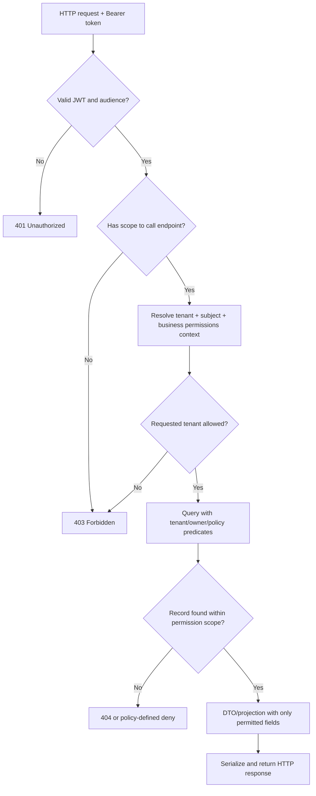
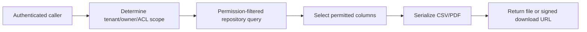

# Filtering Data by Permissions and Avoiding Over-Returning Resources Before Checks

## 1. Why Can an API Still Leak Data After Validating JWTs?

A **Spring Security OAuth 2.0 Resource Server** receives an access token, verifies its signature, issuer, audience, and expiration, and checks scopes to decide whether the caller can access the endpoint. Those steps are crucial, yet they **do not automatically decide which records the caller is allowed to see**.

Consider a multi-tenant invoicing application:

- Tenant `tenant-alpha` owns invoices A1, A2.
- Tenant `tenant-beta` owns invoices B1, B2.
- User `user-417` holds scope `invoices.read` and belongs only to Alpha.
- The API exposes `GET /api/tenants/{tenantId}/invoices/{invoiceId}` and `GET /api/tenants/{tenantId}/invoices`.

The client sends:

```http
GET /api/tenants/tenant-beta/invoices/11111111-1111-4111-8111-111111111111 HTTP/1.1
Host: invoices.example.com
Authorization: Bearer <access-token-of-tenant-alpha>
```

The access token may be completely valid:

```json
{
  "iss": "https://id.example.com/realms/shop",
  "sub": "user-417",
  "aud": ["invoices-api"],
  "scope": "invoices.read",
  "tenant_id": "tenant-alpha"
}
```

If the Controller only uses `hasAuthority("SCOPE_invoices.read")`, and the Repository then calls `findById(invoiceId)` **without checking tenant/ownership**, the API risks returning Beta's invoice to Alpha's user.

This is a form of **Broken Object Level Authorization (BOLA)**, often called IDOR when an application trusts client-supplied resource IDs. Similarly, returning excessive sensitive attributes of a record is a **Broken Object Property Level Authorization** issue.

The goal of this lesson is to design the flow:

> **Authenticate caller → determine permitted data scope → query strictly within that scope → build DTOs with only permitted attributes → return response.**

Do not load all data, generate system-wide reports, or populate shared caches hoping to filter properly inside the Controller afterward.

### After This Lesson, You Should Be Able To

1. Distinguish JWT authentication, HTTP authorization, and object-level data authorization.
2. Push tenant, ownership, and business-permission predicates into **queries**, not only post-query code.
3. Safely handle detail, list, search, pagination, statistics, file export, and data-update endpoints.
4. Prevent responses, logs, caches, events, or file-download URLs from exposing data **before** authorization decisions.
5. Apply Spring Security, Spring Data JPA, Services, and DTOs under the **least privilege** principle.
6. Understand when `401`, `403`, or `404` is appropriate.
7. Design test cases directly targeting cross-tenant and cross-owner access risks.

## 2. Four Control Layers When Returning Resources

To see why `hasAuthority(...)` alone is insufficient, break the decision into four layers.

| Layer | Question | Typically Handled By |
|---|---|---|
| **1. Token authentication** | Is the token valid, matching issuer, audience, and unexpired? | `JwtDecoder`, authentication provider |
| **2. Endpoint authorization** | Does the token carry the scope/authority to invoke this operation? | `SecurityFilterChain`, `@PreAuthorize` |
| **3. Object-level authorization** | Is the caller allowed to view/modify this **specific record**? | Service, authorization service, Repository, DB policy |
| **4. Property-level authorization** | Within an authorized record, which fields may be returned? | DTO/projection, response mapping, field-level policy |

Example:

```text
GET /api/tenants/tenant-alpha/invoices/A1

JWT:
  issuer         = trusted
  audience       = invoices-api
  scope          = invoices.read
  tenant_id      = tenant-alpha
  subject        = user-417

Invoice A1:
  tenant_id      = tenant-alpha
  owner_subject  = user-902
  internal_notes = "Sensitive internal workflow"
```

The token satisfies layers 1 and 2. However:

- If policy only permits reading one's **own** invoices, `user-417` must not view A1.
- If `user-417` is an Alpha manager authorized to read tenant invoices, that role must be verified independently.
- Even when viewing the invoice is permitted, the client must not automatically receive `internal_notes` if that field is internal staff-only.

**Data scope and property scope are two separate decisions.**

### 2.1. Signs of Missing Authorization

Some implementations easily fall into traps:

```java
@GetMapping("/{id}")
@PreAuthorize("hasAuthority('SCOPE_invoices.read')")
public InvoiceEntity detail(@PathVariable UUID id) {
    return repository.findById(id).orElseThrow();
}
```

The code checks **functional read permission**, fails to check **permission on `id`**, and returns the entire Entity. If a user guesses a UUID from another tenant, the API leaks data.

Another example:

```java
@GetMapping
public List<InvoiceEntity> list() {
    return repository.findAll();
}
```

Even when an endpoint requires authentication, `findAll()` can fetch records across every tenant. Passing authentication does not turn `findAll()` into "find all authorized invoices."

## 3. Crucial Rule: Filter at the Source Before Building Responses

There are two different ways of thinking.

### 3.1. Unsafe Pattern: Fetch First, Check Later

```java
// DO NOT USE for multi-tenant or sensitive data.
List<InvoiceEntity> allInvoices = repository.findAll();

return allInvoices.stream()
    .filter(invoice -> invoice.getTenantId().equals(requestTenant))
    .toList();
```

Problems with this approach:

- Unauthorized data has already been loaded into application memory.
- It is easy to forget a condition such as owner, role, organization, or record state.
- Pagination, sorting, and counting may already have run over the **entire dataset**.
- Mappers, logs, metrics, traces, or caches may touch unauthorized records before filtering.
- When adding a new processing path, a developer may accidentally consume `allInvoices`.
- Poor performance and overload risk when record counts grow.
- Related associations may be lazy-loaded outside the intended scope.

Post-fetch filtering is only suitable in narrow, controlled scenarios, such as processing data already proven to belong to the caller's scope. It is not a primary access control layer for large lists or multi-tenant data.

### 3.2. Preferred Pattern: Push Permission Scope into the Query

```sql
SELECT id, tenant_id, invoice_no, total_amount
FROM invoices
WHERE tenant_id = :verified_tenant_id
  AND owner_issuer = :verified_issuer
  AND owner_subject = :verified_subject
ORDER BY created_at DESC, id DESC
LIMIT :page_size;
```

In this query:

- `verified_tenant_id` comes from the authenticated and authorized context.
- `verified_issuer` and `verified_subject` identify the principal per the token contract.
- The database returns only records within the **constrained scope**.
- `SELECT` retrieves only the columns needed for the response.
- `ORDER BY` and `LIMIT` apply **after authorization predicates are inside the query**.

Thus, if a client swaps the ID or tenant path segment for someone else's value, the query returns no rows.

### 3.3. One Broadly Applicable Principle



**Never** return partial data, stream several records, issue a signed download URL, or commit an HTTP response **and only afterward** decide whether the caller owns the resource.

## 4. Building an Authorization Context from Verified Tokens

A Resource Server using JWTs can inject `Jwt` via Spring Security:

```java
@GetMapping("/api/me")
public Map<String, String> me(@AuthenticationPrincipal Jwt jwt) {
    return Map.of("subject", jwt.getSubject());
}
```

Prerequisite: the application properly configures `oauth2ResourceServer(...jwt(...))`, issuer, signing keys, expiration, and audience.

Suppose the access token contract contains:

```json
{
  "iss": "https://id.example.com/realms/shop",
  "sub": "user-417",
  "aud": ["invoices-api"],
  "scope": "invoices.read",
  "tenant_id": "tenant-alpha"
}
```

Never take tenant or identity from client-declared `X-User-Id`, `X-Tenant-Id`, or JSON body fields in place of verified authentication data.

### 4.1. Why Care About Both `iss` and `sub`?

If an API accepts multiple Authorization Servers, the same `sub` can appear across two different issuers:

```text
Issuer A + sub user-417
Issuer B + sub user-417
```

These two principals are not automatically the same person. A safer external identifier is the **`(issuer, subject)`** pair, or an internal user ID mapped from that pair.

For simplicity, the examples store both `ownerIssuer` and `ownerSubject` in the DB. If a system uses a single issuer with an independent internal user mapping, `internalUserId` may be used instead, provided the mapping source is verified and not client-controlled.

### 4.2. Building a Trusted CallerContext

In the Service, verified data can be packaged into a record:

```java
package com.example.invoices;

import org.springframework.security.oauth2.jwt.Jwt;

public record CallerContext(
        String issuer,
        String subject,
        String tenantId) {

    public static CallerContext from(Jwt jwt) {
        String issuer = jwt.getIssuer().toString();
        String subject = jwt.getSubject();
        String tenantId = jwt.getClaimAsString("tenant_id");

        if (subject == null || subject.isBlank()
                || tenantId == null || tenantId.isBlank()) {
            throw new IllegalStateException(
                "Authenticated token does not match the API contract");
        }

        return new CallerContext(issuer, subject, tenantId);
    }
}
```

This assumes `issuer` is a required claim verified by the decoder. **In production applications, reject JWTs missing required claims or having wrong claim types right in the validator**, rather than letting the request reach the Service and throwing a `500` because token data violates the contract.

`CallerContext` does not create trust on its own; it merely wraps a **`Jwt` already verified by Spring Security**. Calling `from(...)` on a manually decoded JWT from an unverified string would break the entire authorization model.

### 4.3. Comparing the URL Tenant Against the Verified Tenant

Example route:

```text
/api/tenants/{tenantId}/invoices
```

You can use a helper:

```java
public static void requireSameTenant(
        String requestedTenant,
        CallerContext caller) {

    if (!caller.tenantId().equals(requestedTenant)) {
        throw new AccessDeniedException("Tenant access denied");
    }
}
```

However, this condition only holds if the access token contract dictates **each token represents a single active tenant**. If a user can operate across multiple tenants, you need an explicit membership/entitlement model or tokens issued for the selected tenant. Never weaken this check to "trust the tenant in the URL" and ignore the claim.

More importantly, **comparing the URL tenant does not replace the tenant predicate in SQL**. If `invoiceId` belongs to another tenant even when the URL says Alpha, the Repository must still reject it.

## 5. List Protection: Authorize Before Paginating

Lists are the easiest place to leak data because they expose many surfaces:

- Items in the response.
- `totalElements`, `totalPages`, and returned counts.
- Record titles/labels.
- Search, autocomplete, and suggestion data.
- Sorting, filtering, cursors, and aggregate numbers.
- Nested relations loaded alongside each item.

### 5.1. Mistake: Paginating Everything, Then Filtering

Suppose the DB holds 100,000 invoices, and the user is only allowed to view 40 of them. Code:

```java
Page<InvoiceEntity> page =
    invoiceRepository.findAll(PageRequest.of(0, 20));

List<InvoiceDto> visible = page.getContent().stream()
    .filter(invoice -> canRead(caller, invoice))
    .map(InvoiceDto::from)
    .toList();

return new PagedResponse<>(
    visible,
    page.getTotalElements());
```

There are at least two problems:

1. `totalElements` can reveal the **system-wide** invoice count.
2. The first 20 paginated rows may belong to another tenant; after filtering, 0–2 items remain even though the user actually has 40 invoices on later pages.

Similar problems arise with `LIMIT/OFFSET`, cursors, search scores, and aggregations computed on an unfiltered dataset.

### 5.2. Better: Filter First, Then Sort / Paginate / Count

```sql
SELECT id, invoice_no, total_amount
FROM invoices
WHERE tenant_id = :tenant_id
  AND owner_issuer = :issuer
  AND owner_subject = :subject
ORDER BY created_at DESC, id DESC
LIMIT :limit OFFSET :offset;
```

Simultaneously, the count query must use the **exact same permission scope**:

```sql
SELECT COUNT(*)
FROM invoices
WHERE tenant_id = :tenant_id
  AND owner_issuer = :issuer
  AND owner_subject = :subject;
```

If the user has 40 authorized invoices, metadata reflects those 40 invoices—not the 100,000 invoices across the entire system.

### 5.3. Spring Data JPA: Repository Filtering Permissions Inside the Query

Example simplified Entity:

```java
package com.example.invoices;

import java.math.BigDecimal;
import java.time.Instant;
import java.util.UUID;
import jakarta.persistence.Column;
import jakarta.persistence.Entity;
import jakarta.persistence.Id;
import jakarta.persistence.Table;

@Entity
@Table(name = "invoices")
public class InvoiceEntity {
    @Id
    private UUID id;

    @Column(name = "tenant_id", nullable = false)
    private String tenantId;

    @Column(name = "owner_issuer", nullable = false)
    private String ownerIssuer;

    @Column(name = "owner_subject", nullable = false)
    private String ownerSubject;

    @Column(name = "invoice_no", nullable = false)
    private String invoiceNo;

    @Column(name = "total_amount", nullable = false)
    private BigDecimal totalAmount;

    @Column(name = "created_at", nullable = false)
    private Instant createdAt;

    protected InvoiceEntity() {
        // JPA
    }

    public UUID getId() { return id; }
    public String getTenantId() { return tenantId; }
    public String getOwnerIssuer() { return ownerIssuer; }
    public String getOwnerSubject() { return ownerSubject; }
    public String getInvoiceNo() { return invoiceNo; }
    public BigDecimal getTotalAmount() { return totalAmount; }
    public Instant getCreatedAt() { return createdAt; }
}
```

DTO/projection containing only publishable fields:

```java
package com.example.invoices;

import java.math.BigDecimal;
import java.util.UUID;

public record InvoiceListItem(
    UUID id,
    String invoiceNo,
    BigDecimal totalAmount
) {
}
```

Repository:

```java
package com.example.invoices;

import java.util.Optional;
import java.util.UUID;
import org.springframework.data.domain.Page;
import org.springframework.data.domain.Pageable;
import org.springframework.data.jpa.repository.JpaRepository;
import org.springframework.data.jpa.repository.Query;
import org.springframework.data.repository.query.Param;

public interface InvoiceRepository
        extends JpaRepository<InvoiceEntity, UUID> {

    Optional<InvoiceEntity>
        findByIdAndTenantIdAndOwnerIssuerAndOwnerSubject(
            UUID id,
            String tenantId,
            String ownerIssuer,
            String ownerSubject);

    @Query(
        value = """
            select new com.example.invoices.InvoiceListItem(
                i.id, i.invoiceNo, i.totalAmount)
            from InvoiceEntity i
            where i.tenantId = :tenant
              and i.ownerIssuer = :issuer
              and i.ownerSubject = :subject
            """,
        countQuery = """
            select count(i)
            from InvoiceEntity i
            where i.tenantId = :tenant
              and i.ownerIssuer = :issuer
              and i.ownerSubject = :subject
            """
    )
    Page<InvoiceListItem> findVisibleList(
        @Param("tenant") String tenant,
        @Param("issuer") String issuer,
        @Param("subject") String subject,
        Pageable pageable);
}
```

Key points:

- Both the content query and `countQuery` enforce the same tenant/issuer/subject constraints.
- The database selects only the three columns needed by the list API, avoiding loading and accidentally serializing the full Entity.
- `Pageable` applies to the already-filtered set.
- Users changing `page`, `size`, or `sort` cannot remove the server-constructed `WHERE` predicates.

When supporting dynamic sorting, restrict allowed sort fields to prevent unexpected queries or leaking fields that should not be exposed. Large page sizes must also be bounded; this protects both system resources and bulk-extraction exposure.

## 6. Detail Views: Do Not Fetch by Global ID Before Deciding Access

With the endpoint:

```http
GET /api/tenants/tenant-alpha/invoices/11111111-1111-4111-8111-111111111111 HTTP/1.1
Authorization: Bearer <jwt-of-tenant-alpha>
```

An error-prone approach:

```java
InvoiceEntity invoice = repository.findById(invoiceId)
    .orElseThrow(() -> new ResponseStatusException(
        HttpStatus.NOT_FOUND));

if (!invoice.getTenantId().equals(caller.tenantId())) {
    throw new AccessDeniedException("Forbidden");
}

return InvoiceDto.from(invoice);
```

In a simple DTO-returning flow, checking after `findById` may still block the response if done properly without side effects. However, it is a **design weakness**:

- An unauthorized Entity has already been loaded into the Service.
- Associations, mappers, logging, metrics, or lazy loading might touch out-of-scope data.
- A future refactor could place mapping or side effects above the `if` check.
- It is easy to omit owner/issuer/tenant checks in another code path.

Prefer querying for a record **already within the permission scope**:

```java
Optional<InvoiceEntity> result =
    repository.findByIdAndTenantIdAndOwnerIssuerAndOwnerSubject(
        invoiceId,
        caller.tenantId(),
        caller.issuer(),
        caller.subject());
```

If absent, the Service can return `404` under a "do not disclose whether out-of-scope records exist" policy.

### 6.1. Sample Service

```java
package com.example.invoices;

import java.util.UUID;
import org.springframework.data.domain.Page;
import org.springframework.data.domain.Pageable;
import org.springframework.http.HttpStatus;
import org.springframework.security.access.AccessDeniedException;
import org.springframework.security.oauth2.jwt.Jwt;
import org.springframework.stereotype.Service;
import org.springframework.transaction.annotation.Transactional;
import org.springframework.web.server.ResponseStatusException;

@Service
public class InvoiceService {

    private final InvoiceRepository repository;

    public InvoiceService(InvoiceRepository repository) {
        this.repository = repository;
    }

    @Transactional(readOnly = true)
    public InvoiceListItem readOne(
            String requestedTenant,
            UUID invoiceId,
            Jwt jwt) {

        CallerContext caller = CallerContext.from(jwt);
        requireSameTenant(requestedTenant, caller);

        InvoiceEntity invoice = repository
            .findByIdAndTenantIdAndOwnerIssuerAndOwnerSubject(
                invoiceId,
                caller.tenantId(),
                caller.issuer(),
                caller.subject())
            .orElseThrow(() ->
                new ResponseStatusException(HttpStatus.NOT_FOUND));

        return new InvoiceListItem(
            invoice.getId(),
            invoice.getInvoiceNo(),
            invoice.getTotalAmount());
    }

    @Transactional(readOnly = true)
    public Page<InvoiceListItem> list(
            String requestedTenant,
            Jwt jwt,
            Pageable pageable) {

        CallerContext caller = CallerContext.from(jwt);
        requireSameTenant(requestedTenant, caller);

        return repository.findVisibleList(
            caller.tenantId(),
            caller.issuer(),
            caller.subject(),
            pageable);
    }

    private void requireSameTenant(
            String requestedTenant,
            CallerContext caller) {

        if (!caller.tenantId().equals(requestedTenant)) {
            throw new AccessDeniedException("Tenant access denied");
        }
    }
}
```

The Service enforces a consistent rule: verify the request's tenant **before** querying, use Repository methods with tenant and owner predicates, and construct DTOs only from records within scope.

`@Transactional(readOnly = true)` describes a read transaction. It is **not an authorization mechanism** and does not ensure tenant isolation if queries lack constraints.

### 6.2. Sample Controller

```java
package com.example.invoices;

import java.util.UUID;
import org.springframework.data.domain.Page;
import org.springframework.data.domain.Pageable;
import org.springframework.security.core.annotation.AuthenticationPrincipal;
import org.springframework.security.oauth2.jwt.Jwt;
import org.springframework.web.bind.annotation.GetMapping;
import org.springframework.web.bind.annotation.PathVariable;
import org.springframework.web.bind.annotation.RequestMapping;
import org.springframework.web.bind.annotation.RestController;

@RestController
@RequestMapping("/api/tenants/{tenantId}/invoices")
public class InvoiceController {

    private final InvoiceService service;

    public InvoiceController(InvoiceService service) {
        this.service = service;
    }

    @GetMapping
    public Page<InvoiceListItem> list(
            @PathVariable String tenantId,
            @AuthenticationPrincipal Jwt jwt,
            Pageable pageable) {

        return service.list(tenantId, jwt, pageable);
    }

    @GetMapping("/{invoiceId}")
    public InvoiceListItem detail(
            @PathVariable String tenantId,
            @PathVariable UUID invoiceId,
            @AuthenticationPrincipal Jwt jwt) {

        return service.readOne(tenantId, invoiceId, jwt);
    }
}
```

The Controller never calls `findAll()` or `findById()` itself. It delegates tenant checks and scoped lookups to the Service.

This example enforces an **"each user reads only their own invoices"** policy. If the system wants a manager role to view all invoices within a tenant, build a separate policy and query branch checking the role **within that tenant**, rather than dropping the owner predicate for everyone.

## 7. HTTP Authorization: Scope First, Data Permissions Second

Example Resource Server using Spring Security:

```groovy
dependencies {
    implementation 'org.springframework.boot:spring-boot-starter-web'
    implementation 'org.springframework.boot:spring-boot-starter-security'
    implementation 'org.springframework.boot:spring-boot-starter-oauth2-resource-server'
    implementation 'org.springframework.boot:spring-boot-starter-data-jpa'
}
```

In `application.yml`:

```yaml
spring:
  security:
    oauth2:
      resourceserver:
        jwt:
          issuer-uri: https://id.example.com/realms/shop
```

The issuer is illustrative and must be replaced with the real Authorization Server. Validate `aud` as `invoices-api` per contract using an audience validator or equivalent mechanism; never rely solely on issuer and scope.

Endpoint configuration:

```java
package com.example.invoices;

import org.springframework.context.annotation.Bean;
import org.springframework.context.annotation.Configuration;
import org.springframework.http.HttpMethod;
import org.springframework.security.config.Customizer;
import org.springframework.security.config.annotation.web.builders.HttpSecurity;
import org.springframework.security.config.http.SessionCreationPolicy;
import org.springframework.security.web.SecurityFilterChain;

@Configuration
public class SecurityConfig {

    @Bean
    SecurityFilterChain api(HttpSecurity http) throws Exception {
        return http
            .securityMatcher("/api/**")
            .csrf(csrf -> csrf.disable())
            .sessionManagement(s -> s.sessionCreationPolicy(
                SessionCreationPolicy.STATELESS))
            .authorizeHttpRequests(auth -> auth
                .requestMatchers(HttpMethod.GET, "/api/public/ping")
                    .permitAll()

                .requestMatchers(
                    HttpMethod.GET,
                    "/api/tenants/*/invoices",
                    "/api/tenants/*/invoices/*")
                    .hasAuthority("SCOPE_invoices.read")

                .anyRequest().denyAll()
            )
            .oauth2ResourceServer(oauth2 ->
                oauth2.jwt(Customizer.withDefaults()))
            .build();
    }
}
```

Explanation:

- `SCOPE_invoices.read` is the authority typically mapped from an access token with `scope=invoices.read`.
- Endpoint rules check **functional read access**, not `tenant_id` or `owner_subject` in SQL.
- The Service still enforces tenant, owner, and property-level authorization.
- `anyRequest().denyAll()` rejects undeclared API operations.
- `csrf.disable()` illustrates only a REST API using Bearer headers without relying on cookies/sessions for authentication.

This configuration only defines an API chain with `securityMatcher("/api/**")`. If the application exposes other endpoints, ensure those routes have their own chain/protection or an appropriate catch-all. `anyRequest().denyAll()` inside the API chain does not automatically protect URLs outside `/api/**`.

### 7.1. Why Doesn't `@PreAuthorize` Replace Scoped Queries?

Example:

```java
@PreAuthorize("hasAuthority('SCOPE_invoices.read')")
public InvoiceListItem readInvoice(UUID invoiceId) {
    return findInvoiceById(invoiceId);
}
```

The annotation guarantees the caller holds the invoice-reading authority, without checking **which invoice**. Even an expression like:

```java
@PreAuthorize("@invoicePolicy.canRead(authentication, #invoiceId)")
```

requires `invoicePolicy` to verify the right tenant, ownership, and live permissions. If the policy loads data to check and the Service loads it again, redundant queries occur or permission state can change between reads. When conditions can be expressed in the DB, using queries with predicates to constrain data retrieval directly is usually clearer.

You can **combine** method security to protect operations/scopes with permission-scoped queries in the Repository; the two layers are not mutually exclusive.

## 8. Authorizing Managers and Other Roles

An "owner-only" policy is just one example. Real systems may have:

- **Owner:** views only their own invoices.
- **Tenant accountant:** views all invoices in the active tenant.
- **Tenant admin:** has additional write/delete rights per business rules.
- **Platform auditor:** views a controlled multi-tenant scope under audited privileges.
- **Service account:** processes only invoices belonging to assigned clients/tenants.

Never write a blanket condition like:

```java
if (authentication.isAuthenticated()) {
    return repository.findAll();
}
```

### 8.1. Document the Policy Before Writing Queries

Example table:

| Principal | Required Scope | List Permission | Detail Permission |
|---|---|---|---|
| Regular user | `invoices.read` | Only invoices matching `tenant_id` and owner | Only own invoices |
| Tenant accountant | `invoices.read` and verified membership role | All invoices **within authorized tenant** | Invoices in same tenant |
| Tenant admin | Contract scope/role | Within tenant, never crossing tenants | Per role/rules |
| Multi-tenant auditor | Specialized audited privilege | Only tenants in granted scope | Per audit scope |
| Machine-to-machine service | Contract scope/client/entitlement | Assigned tenant/jobs only | Per service policy |

Never treat `ROLE_ADMIN` from an arbitrary token as access to all tenants. System-wide roles, tenant-scoped roles, and resource-group roles are distinct concepts.

### 8.2. Querying by One of the Allowed Permissions

One implementation for a tenant accountant:

```java
@Query("""
    select new com.example.invoices.InvoiceListItem(
        i.id, i.invoiceNo, i.totalAmount)
    from InvoiceEntity i
    where i.tenantId = :tenant
    """)
Page<InvoiceListItem> findForTenantAccountant(
    @Param("tenant") String verifiedTenant,
    Pageable pageable);
```

A prerequisite **before calling this method** is proving the caller is genuinely an accountant of that tenant, via a role claim with trusted semantics or a managed membership/permission table lookup. Never let clients self-declare `role=accountant` in the request to invoke this method.

In more complex permission models, membership/ACL checks can be expressed directly in SQL:

```sql
SELECT i.id, i.invoice_no, i.total_amount
FROM invoices i
WHERE i.tenant_id = :requested_tenant
  AND (
    (i.owner_issuer = :issuer AND i.owner_subject = :subject)
    OR EXISTS (
      SELECT 1
      FROM tenant_memberships tm
      WHERE tm.tenant_id = i.tenant_id
        AND tm.principal_issuer = :issuer
        AND tm.principal_subject = :subject
        AND tm.role = 'ACCOUNTANT'
        AND tm.active = TRUE
    )
  );
```

This query illustrates the policy idea; actual schemas and roles vary by system. `EXISTS` checks membership for the tenant **matching the invoice**. Combine this with endpoint scopes, record states, membership validity dates, and relevant business rules.

### 8.3. Avoiding AND/OR Precedence Bugs in SQL

Predicates can fail silently due to missing parentheses:

```sql
-- DANGEROUS: accountant privilege can cross tenants due to OR.
WHERE tenant_id = :tenant
  AND owner_subject = :subject
  OR :is_accountant = TRUE;
```

`AND` has higher precedence than `OR`, so `:is_accountant = TRUE` can make the query return records across **all tenants**.

Group the conditions properly:

```sql
WHERE tenant_id = :tenant
  AND (
    owner_subject = :subject
    OR :verified_accountant_of_this_tenant = TRUE
  );
```

Even with this fix, `:verified_accountant_of_this_tenant` must be verified server-side for the **exact tenant**; never take a boolean from an HTTP body or header.

## 9. Property-Level Authorization: Return Only Necessary Fields

Permission to view an invoice does not mean permission to view every field on the Entity.

Suppose the table has:

```text
id
tenant_id
owner_issuer
owner_subject
invoice_no
total_amount
customer_email
billing_address
internal_fraud_flag
internal_notes
created_at
updated_at
```

A customer-facing API should only return:

```json
{
  "id": "11111111-1111-4111-8111-111111111111",
  "invoiceNo": "INV-42",
  "totalAmount": 250.00
}
```

Never serialize the entire JPA Entity:

```java
@GetMapping("/{id}")
public InvoiceEntity detail(@PathVariable UUID id) {
    return repository.findById(id).orElseThrow();
}
```

Risks:

- New fields added to the Entity automatically appear in JSON.
- `@OneToMany` and `@ManyToOne` relations can expose linked objects.
- Internal notes, business keys, or fraud flags can be returned unintentionally.
- Circular references or lazy loading cause performance problems or serialization failures.

### 9.1. Dedicated DTOs or Projections

```java
public record InvoiceListItem(
    UUID id,
    String invoiceNo,
    BigDecimal totalAmount
) {
}
```

The Service constructs `InvoiceListItem` only from authorized records. For accountant endpoints, create a separate DTO containing the fields authorized for accountants.

### 9.2. Do Not Rely Solely on `@JsonIgnore`

`@JsonIgnore` can help hide fields, yet when one Entity serves multiple endpoints and permission tiers, single annotations struggle to express all cases. Separate DTOs define explicit **response contracts** and limit data exposure right at the query.

Using projections to select only needed columns reduces over-exposure at both **data retrieval** and **response serialization**.

### 9.3. Role-Based Field-Level Permissions

You can define:

| Field | Invoice Owner Customer | Tenant Accountant | Dedicated Internal Staff |
|---|---|---|---|
| Invoice number, total amount | Yes | Yes | Yes when authorized |
| Customer email | Per specific policy | Yes if business requires | Yes if granted |
| Internal notes | No | No | Dedicated roles only |
| Internal fraud flag | No | No | Strictly restricted |
| Tenant/owner IDs | Not necessarily exposed | Per API contract | Per policy |

If the client lacks permission for a sensitive field, **do not read it unnecessarily from the DB** and never return a structure containing the field hoping the frontend hides it.

## 10. Filtering Permissions for Search, Autocomplete, and Advanced Pagination

### 10.1. Search Filters Must Apply Before Returning Results

A search endpoint:

```http
GET /api/tenants/tenant-alpha/invoices/search?q=INV HTTP/1.1
Authorization: Bearer <access-token>
```

Never fetch system-wide results from Elasticsearch/OpenSearch or a DB and filter afterward in the API, because:

- Snippets, highlights, or scores can contain or reveal unauthorized data.
- Total hit counts can leak the count of confidential documents.
- Autocomplete can suggest customer codes or invoice numbers from other tenants.
- Result pagination becomes unstable after filtering.
- Search aggregations may compute across the entire dataset.

Queries sent to search engines must carry **security filters** for tenant, principal, and groups/ACLs per the search engine's model. Search indexes must store the necessary security metadata for filtering, and permission/index synchronization must also be managed.

### 10.2. Totals and Metadata Are Also Data

Example of an unsafe response:

```json
{
  "items": [
    {"invoiceNo": "INV-42"}
  ],
  "totalSystemInvoices": 103284,
  "visibleInvoices": 1
}
```

Even though `items` is filtered, `totalSystemInvoices` leaks internal volume. In many applications, **counts, update timestamps, categories, filenames, and search suggestions** are all sensitive.

If an API intends to expose aggregate metrics to a group of users, enforce a separate authorization policy for those statistics.

### 10.3. Sorting and Cursors

Sorting over an authorized set must be controlled:

```sql
SELECT id, invoice_no, total_amount, created_at
FROM invoices
WHERE tenant_id = :tenant
  AND owner_subject = :subject
ORDER BY created_at DESC, id DESC
LIMIT :limit;
```

Cursor pagination must also preserve tenant/owner constraints on **every page**. Never let a cursor from tenant Alpha access tenant Beta's data. If a cursor encodes sensitive details or scope state, sign/encrypt it or store state server-side and bind it to the caller/tenant per contract.

Stable sort ordering needs a tie-breaker (such as `id`) to avoid duplicates or skipped rows; that aids pagination correctness, though it never replaces permission policies.

### 10.4. Pagination Count Queries Must Share the Exact Same Permission Predicates

In Spring Data JPA with custom `@Query`, pay attention to `countQuery`. If the page query filters by tenant while the count query omits tenant filtering, the API can return:

```json
{
  "content": [],
  "totalElements": 100000
}
```

even when the caller only owns a handful of invoices. That is both a metadata leak and broken pagination logic.

## 11. Report Exports, File Downloads, and Response Streaming

Data export endpoints are often overlooked because developers view them as "just another way to format a list."

### 11.1. CSV/Excel/PDF Exports Must Use an Already-Authorized Dataset

Do not do:

```text
findAllInvoices()
    → generateCsv(allInvoices)
    → filterRowsForCaller()
    → returnFile
```

The file was generated from data broader than permitted. Extra columns or metadata may remain inside the file, or temporary files may be stored where callers can reach them.

The flow should be:



If exports run via background jobs, never assume permissions present when the job was created remain valid when the job executes or when the file is downloaded. Define an explicit policy: when permissions are snapshotted, how download-time checks work, how long files live, and whether they can be revoked.

### 11.2. Streaming Must Avoid Sending Data Before Permission Checks

When using `StreamingResponseBody` or reactive streams, response chunks are written incrementally. If the server flushes the first 100 rows and only discovers on row 101 that it belongs to another tenant, data has already leaked and the response may already be **committed**, making rollback impossible.

Therefore:

- Establish scope, tenant, and owner before starting the stream.
- Use **permission-filtered** DB queries or cursors.
- Serialize only permitted fields.
- If policy requires per-row checks, ensure rows **are not written** before passing that check.
- Decide how to handle permission changes during long-running streams.

An exception thrown after the output stream has already flushed bytes cannot "unsend transmitted data."

### 11.3. Signed URLs and Object Storage

For invoice files stored in object storage:

1. API authenticates the caller.
2. API locates file metadata within tenant/owner scope.
3. API verifies download permission.
4. **Only after authorization passes**, generate a short-lived signed URL for that specific object.
5. Client downloads the file per expiry and storage policies.

Never generate signed URLs for all files and filter links on the frontend by tenant. If signed URLs are cached or logged, they risk unintended reuse.

Object names/keys can also reveal details like tenant or customer codes; avoid turning path/object names into the sole access barrier.

## 12. Caching: Right DB Authorization with Wrong Redis Caching Still Leaks

An overly generic cache key:

```text
invoice:11111111-1111-4111-8111-111111111111
```

can hold a DTO built for a higher-privileged user and return it to a lower-privileged user if the application skips authorization on the cache-hit path.

### 12.1. Two Caching Strategies

**Strategy A — Cache raw domain data and always check permissions before returning**

Example:

```text
Request
  → authenticate
  → authorize invoice for current tenant/owner
  → load cached domain data (if present)
  → construct allowed DTO
  → respond
```

Authorization must execute **even on a cache hit**; never assume having the ID in the cache key is enough.

**Strategy B — Cache authorization-scoped results**

When caching a personalized list or DTO, the key may need tenant, issuer/subject or internal user ID, current role/permission version, search criteria, and page:

```text
invoices:list:
  tenant=tenant-alpha:
  principal=issuerA:user-417:
  filter=status-open:
  page=0
```

Keys here illustrate the concept; real keys should be safely hashed/normalized, length-bounded, and avoid exposing sensitive identifiers in logs or unsuitable cache systems.

If entitlements change, cached responses keyed by old principals/permissions may no longer be authorized. Implement versioning, invalidation, or TTLs matching revocation requirements.

### 12.2. Never Share Caches Arbitrarily Across Tenants

List/search/count caches keyed only by `page=0` or `query=INV` are especially dangerous because they lack tenant isolation. With CDNs or HTTP caches, control `Cache-Control`, `Vary`, and caching of `Authorization`-authenticated responses; private/tenant data generally does not belong in shared public caches.

## 13. Updates and Deletes: Permissions Must Be Part of the Write Condition

Protection is not just for `GET`. Suppose a user in Alpha sends:

```http
PATCH /api/tenants/tenant-alpha/invoices/11111111-1111-4111-8111-111111111111 HTTP/1.1
Authorization: Bearer <access-token>
Content-Type: application/json

{"status":"PAID"}
```

An unsafe implementation:

```java
InvoiceEntity invoice = repository.findById(invoiceId)
    .orElseThrow();

invoice.setStatus("PAID");
repository.save(invoice);
```

If `invoiceId` points to Beta's record, this code can modify Beta's data.

### 13.1. Updating with Tenant/Owner Predicates

SQL example:

```sql
UPDATE invoices
SET status = :new_status
WHERE id = :invoice_id
  AND tenant_id = :verified_tenant_id
  AND owner_issuer = :verified_issuer
  AND owner_subject = :verified_subject
  AND status = :expected_old_status;
```

Affected row counts should typically be checked:

- `1`: updated one record within permitted scope and expected status.
- `0`: not found within scope, status already changed, or conditions unmet; handle per contract without disclosing unnecessary data.
- `>1`: abnormal if `id` is a unique key; inspect the schema.

For complex multi-condition business checks, use transactions and locking/optimistic locking. Even then, ensure **the target record is selected within permission scope before modification**.

### 13.2. Repository Update Example in Spring Data JPA

```java
@Modifying
@Query("""
    update InvoiceEntity i
       set i.status = :newStatus
     where i.id = :id
       and i.tenantId = :tenant
       and i.ownerIssuer = :issuer
       and i.ownerSubject = :subject
       and i.status = :expectedStatus
    """)
int updateStatusIfOwned(
    @Param("id") UUID id,
    @Param("tenant") String tenant,
    @Param("issuer") String issuer,
    @Param("subject") String subject,
    @Param("expectedStatus") String expectedStatus,
    @Param("newStatus") String newStatus);
```

This is an **additional** method for `InvoiceRepository` once the Entity has a `status` field and mapping. If copying the snippet onto the Entity from Section 5.3, add that field first.

Code calling `@Modifying` must run inside an appropriate transaction, such as a `@Transactional` Service. JPQL bulk updates have specific behavior regarding the persistence context and entity callbacks; choose techniques fitting the domain. The security point is that the `WHERE` clause must enforce tenant, owner, and permitted states.

### 13.3. Creation: Never Trust Tenant and Owner from the Body

A client may send:

```json
{
  "tenantId": "tenant-beta",
  "ownerSubject": "admin",
  "totalAmount": 250
}
```

The API must never persist these owner/tenant fields as authorized values. When creating an invoice:

- Take tenant from the verified/authorized context.
- Take owner from the principal or verify through a "create on behalf of" policy.
- Linked IDs (customer, project, order) must also belong to an authorized tenant/scope.
- Request DTOs accept only fields the client is allowed to set.

This also mitigates **mass assignment**: never bind JSON bodies directly onto Entities containing security-sensitive fields like `tenantId`, `ownerSubject`, `approvedBy`, or `isAdminOnly`.

## 14. Joins and Data Relationships Must Preserve the Same Boundary

Even when the primary query checks `tenant_id`, table joins can still leak data if linked IDs are unconstrained.

Example:

```sql
SELECT i.id, i.tenant_id, c.name
FROM invoices i
JOIN customers c ON c.id = i.customer_id
WHERE i.tenant_id = :verified_tenant;
```

If data integrity fails, foreign keys do not prevent pointing to another tenant's customer, or identifiers are reused across tenants, this query can return `c.name` from an unintended scope.

A stricter rule:

```sql
SELECT i.id, i.tenant_id, c.name
FROM invoices i
JOIN customers c
  ON c.id = i.customer_id
 AND c.tenant_id = i.tenant_id
WHERE i.tenant_id = :verified_tenant;
```

Beyond SQL, design matching data-integrity constraints, such as composite keys/foreign keys including tenant, depending on schema. Whenever an API attaches links to files, customers, projects, or payments, verify **all linked objects** belong to the scope the caller may act upon.

### 14.1. Do Not Let N+1 Queries Break Permission Control

A Mapper may trigger a lazy association for every invoice in a list. This causes extra queries and can leak information if the association is not constrained.

Prefer projections selecting only genuinely needed fields; when using entity graphs or join fetches, ensure relationships and result sets respect tenant/ACL boundaries. Be cautious combining collection fetch joins with pagination, as frameworks may be unable to push pagination down to the database as expected.

## 15. Database Row-Level Security as an Additional Defense Layer

Some systems use database **Row-Level Security (RLS)**, such as in PostgreSQL, to constrain access at the DB layer.

Conceptual example:

```sql
ALTER TABLE invoices ENABLE ROW LEVEL SECURITY;

CREATE POLICY invoices_tenant_policy
ON invoices
USING (
  tenant_id = current_setting('app.current_tenant_id', true)
)
WITH CHECK (
  tenant_id = current_setting('app.current_tenant_id', true)
);
```

Meaning:

- `USING` restricts which rows can be read or targeted by operations under the policy.
- `WITH CHECK` verifies inserted/updated rows match the tenant.
- `current_setting('app.current_tenant_id', true)` reads a session/transaction variable the application must set properly.

A transaction can set the context using PostgreSQL's **transaction-local** `set_config(..., true)` on the exact connection running the query:

```sql
SELECT set_config('app.current_tenant_id', :verified_tenant_id, true);
```

### 15.1. Conditions for RLS to Be Genuinely Useful

RLS does not guarantee safety if implemented incorrectly:

- Tenant context must originate from the verified principal, **not from client headers**.
- Context must be set on the **exact connection and transaction** before running queries.
- With connection pools, ensure one request's tenant context never leaks into a subsequent request.
- Enforce a **fail-closed** policy when context is unset.
- DB connection roles must not accidentally bypass RLS; table owners, superusers, and `BYPASSRLS` roles have special behavior. Consider `FORCE ROW LEVEL SECURITY` where appropriate.
- Privileged reporting/maintenance queries must be protected by dedicated policies.
- Tenant-based RLS does not enforce ownership, scopes, or property-level authorization if policies contain only tenant predicates.

RLS is **defense in depth**, never an excuse to omit Service-layer authorization or grant the API an overly broad DB account.

### 15.2. When Is RLS Appropriate?

RLS is helpful when many DB access paths make it hard to guarantee every query carries a tenant predicate, or when organizational policy mandates centralized DB-layer enforcement. However, managing session/transaction contexts, performance, and privileged operations adds complexity; there is no need to force RLS into every application at any cost.

## 16. 401, 403, and 404: Avoiding Disclosure of Resource Existence

For protected APIs, statuses carry distinct meanings:

| Scenario | Typical Outcome |
|---|---|
| No token sent | `401 Unauthorized` |
| JWT invalid signature/issuer/audience, or expired | `401 Unauthorized` |
| Valid token missing `invoices.read` | `403 Forbidden` |
| Valid Alpha token requesting Beta tenant | `403` or detail-hiding response per policy |
| Valid token, right tenant, but unauthorized for invoice ID | Often `404` to avoid revealing record existence |
| Invoice ID does not exist | `404 Not Found` |
| Valid token and all conditions satisfied | `2xx` or business result |

Not every API must return 404 on unauthorized access. However, for ID-addressed resources, a policy of **returning the same 404 for "does not exist" and "outside permission scope"** reduces the ability to probe whether records exist.

### 16.1. Do Not Leak Information Through Messages and Headers

Inappropriate example:

```json
{
  "error": "Forbidden",
  "invoiceOwner": "user-902",
  "tenant": "tenant-beta",
  "reason": "You belong to tenant-alpha"
}
```

This message leaks the tenant and owner of a record the caller is not permitted to view.

A more appropriate response for an existence-hiding policy:

```http
HTTP/1.1 404 Not Found
Content-Type: application/json

{"error":"RESOURCE_NOT_FOUND"}
```

When returning 403, messages should still avoid disclosing details about out-of-scope records.

### 16.2. Timing and Side-Channel Behavior

Even with identical response bodies, large latency differences between "ID does not exist" and "ID exists in another tenant" can provide an inference signal. Constant-time execution across all business queries is impractical, yet avoid easily exploitable differences while applying rate limiting and auditing as needed.

Never log raw JWTs or confidential data just to diagnose 404/403 errors.

## 17. Permissions Can Change Between Two Check Steps

Suppose a Service checks that `user-417` is an Alpha accountant, then runs a separate query to load the invoice. Between those two steps:

- The user's membership may be revoked.
- The invoice's status or owner may change.
- Another transaction may modify the record.

In a broad sense, this is known as **time-of-check to time-of-use (TOCTOU)**.

### 17.1. Mitigating the Risk

Depending on security requirements, you can:

1. Fold permission checks into the **same query** used to fetch or update the record.
2. Use appropriate transactions and isolation levels for multi-step operations.
3. Use optimistic versioning or locking when decisions depend on record state.
4. Apply appropriate entitlement checks / token revocation when permissions change rapidly.
5. Avoid relying indefinitely on role/membership claims inside an unexpired JWT if business rules demand live permissions.

A query like `UPDATE ... WHERE tenant_id ... AND owner ... AND status = expected` combines permission and state predicates into **one operation**, narrowing the gap between check and use.

### 17.2. An Unexpired JWT Does Not Guarantee Permissions Still Hold

If a token carries `tenant_id=tenant-alpha` and `role=ACCOUNTANT`, yet membership was revoked in the DB after issuance, the Resource Server will continue seeing the old claims until the token expires.

When immediate revocation is required, consider short-lived tokens, live entitlement lookups, introspection, or an appropriately designed revocation mechanism. Never assume a JWT signature guarantees the freshness of authorization data.

## 18. Secondary Paths That Are Often Forgotten

Resources do not leave a system solely via JSON REST responses. Apply the same policies across other paths.

### 18.1. GraphQL and Nested Resolvers

A GraphQL query may reach `invoice.customer.email` even when the root invoice resolver was authorized. Resolvers for sensitive relationships and fields must enforce appropriate permissions; never assume checking only the root query suffices.

### 18.2. Batch Endpoints

Example:

```http
POST /api/invoices/batch-get HTTP/1.1

{"ids":["A1","B1","B2"]}
```

Do not call `findAllById(ids)` and return everything. Fetch only IDs within tenant/owner/ACL scope, and design responses so they do not reveal whether out-of-scope records exist. If returning per-ID item statuses, apply an appropriate disclosure policy to those statuses too.

### 18.3. Background Jobs and Message Consumers

An export job might be queued while a user has permission, then run after membership is revoked. Establish clear rules: re-check permissions at execution time, or use a business-approved snapshot/time-bounded delegation.

Message consumers must also not trust `tenant_id` in a message merely because another service published to the queue. When messages arrive from multiple sources, authenticate the producer and enforce tenant/ACL rules per the trust contract.

### 18.4. Auditing, Analytics, and Observability

Analytics events may carry invoice numbers, emails, or tenants. Never emit full Entities into logs or event streams before data minimization. Internal audit logs may retain details needed for investigations under a dedicated access policy, without letting end users view out-of-scope logs or events.

### 18.5. Static File Downloads and CDNs

If invoice files are served directly via a public bucket or permanent CDN URL, Controller security rules cannot protect that download path. Enforce storage ACLs, signed URLs, or authorized download proxies to maintain the exact same security boundary.

## 19. Verification Matrix: Which Data Gets Returned?

Suppose the database contains:

| Invoice ID | Tenant | Owner | Amount |
|---|---|---|---|
| A1 | Alpha | user-417 | 100 |
| A2 | Alpha | user-902 | 200 |
| B1 | Beta | user-417 | 300 |
| B2 | Beta | user-902 | 400 |

`user-417`'s token:

```text
issuer  = trusted-issuer
subject = user-417
tenant  = Alpha
scope   = invoices.read
```

Policy: **read only one's own invoices within the granted tenant**.

| Test Case | Expected Outcome |
|---|---|
| GET Alpha list | Returns only **A1** |
| GET Beta list | Denied because token belongs to tenant Alpha |
| GET A1 detail | Allowed |
| GET A2 detail | Does not return A2; typically 404 |
| GET B1 detail | Does not return B1 despite `owner` string `user-417`, due to wrong tenant |
| GET B2 detail | Does not return B2 |
| Search invoice numbers in Alpha | Only permitted results such as A1 |
| Count Alpha list | 1, not 2 or 4 |
| Export Alpha | File contains only A1 and permitted columns |
| Access cache with B1's key | Must not return B1 data |
| UPDATE B1 status | Zero Beta records modified |
| Call endpoint without token | 401 |
| Valid token missing `invoices.read` | 403 |

These cases can guide integration tests, API tests, and data-permission checks. Never use production tokens or real customer data.

## 20. Testing Spring Security and Repositories

### 20.1. MockMvc Proves Only Part of the Flow

With Spring Security Test, `with(jwt())` simulates a principal:

```java
mvc.perform(get("/api/tenants/tenant-alpha/invoices")
        .with(jwt()
            .jwt(j -> j
                .subject("user-417")
                .claim("tenant_id", "tenant-alpha"))
            .authorities(
                new SimpleGrantedAuthority("SCOPE_invoices.read"))))
    .andExpect(status().isOk());
```

This illustrates an **authorization test** once `SecurityFilterChain` and Controller are configured. `with(jwt())` does not verify a genuinely signed token through `JwtDecoder`/JWKS. Separately test signature, issuer, audience, and claim validators using signed test fixtures or an appropriate Authorization Server setup.

### 20.2. Cross-Tenant Repository Tests

With Spring Data JPA, seed the four records A1, A2, B1, B2 from the table above and verify:

```java
Page<InvoiceListItem> page = repository.findVisibleList(
    "tenant-alpha",
    "https://id.example.com/realms/shop",
    "user-417",
    PageRequest.of(0, 20));

assertThat(page.getContent())
    .extracting(InvoiceListItem::invoiceNo)
    .containsExactly("A1");

assertThat(page.getTotalElements()).isEqualTo(1);
```

This illustrates an AssertJ test; database fixtures must define entities matching the stated `invoiceNo` and issuer. If a query lacks an explicit `ORDER BY` or `Pageable` sort, assert set contents rather than requiring an arbitrary order.

### 20.3. Testing Detail Endpoints with Another Tenant's ID

Key cases:

```text
Alpha user-417 token:
  GET A1 -> 200 (when DTO mapping and policy pass)
  GET A2 -> 404/deny
  GET B1 -> 404/deny
  GET B2 -> 404/deny
```

**B1 is especially important**: it shares `owner_subject=user-417` yet belongs to Beta. If the Repository filters only by owner and forgets tenant, the B1 test catches the bug.

### 20.4. Testing Negative Side Effects

For writes and exports, check more than HTTP status:

- After an unauthorized PATCH, the DB row remains unmodified.
- After an unauthorized export, no file containing out-of-scope records is created.
- After an unauthorized download request, no signed URL is issued.
- After list/search, counts/hits reflect only the authorized scope.
- Cache hits never bypass authorization.
- Logs and errors never contain out-of-scope record data.

Checking only that the API returns `403` is insufficient if the system already generated a file or emitted an event containing sensitive data beforehand.

## 21. Request-Flow Implementation Checklist

When building an API holding multi-user or multi-tenant data, ask sequentially:

1. Is the token validated for issuer, audience, expiration, and profile?
2. Does the scope/authority permit this **operation type**?
3. From which trusted source are tenant, client, and user context obtained?
4. Are business permissions expressed via tenant, owner, membership, ACL, or a combination?
5. Does the Repository embed permissions into queries before sorting, paginating, or counting?
6. When queries join tables, do relationships preserve the same tenant/ACL boundaries?
7. When no record is found in scope, does the response avoid disclosing record existence?
8. Do DTOs/projections exclude unauthorized fields?
9. Do caches, search, exports, file downloads, and streaming enforce the exact same policy?
10. Do write operations include tenant/owner predicates and verify affected row counts?
11. When permissions change, do caches and long-running tasks expire or re-validate per policy?
12. Do tests cover cross-tenant, cross-owner, missing-scope, and invalid-token cases?

This list guides business access-control design; it does not replace real testing or project application-security standards.

## 22. Common Mistakes and How to Avoid Them

| Mistake | Why Dangerous | Proper Approach |
|---|---|---|
| Using only `hasAuthority("SCOPE_invoices.read")` then `findById` | BOLA/IDOR | Add tenant/owner/ACL predicates in queries |
| Calling `findAll` then stream-filtering | Loads unauthorized data; wrong paging/counts | Filter in DB/search engine |
| Checking only `tenantId` in the URL | Clients alter path freely | Cross-check token/entitlements and data |
| Checking only owner without tenant | Subjects can collide or own records in another tenant | Constrain both tenant and issuer/owner |
| Returning Entities directly | Exposes new fields/associations | Controlled DTOs/projections |
| Global count even when list is filtered | Metadata leak | Count with identical permission predicates |
| Searching first, then filtering response | Leaks hit counts, snippets, pagination | Filter inside search before results return |
| Caching by ID and returning directly | Cache bypasses authorization | Re-authorize on cache hit or scope cache keys |
| Generating signed URL before auth | Exposes signed file access | Authorize before signing |
| Streaming data before checking | Response commits; cannot recall bytes | Query authorized rows before streaming and check items before writing |
| Updating solely by ID | Modifies out-of-scope records | `UPDATE ... WHERE id AND tenant AND owner ...` |
| Trusting tenant/owner in request body | Mass assignment, privilege escalation | Server assigns trusted tenant/owner |
| Joining tables without tenant check | Exposes cross-tenant links | Tenant-scoped joins and constraints |
| Treating unexpired JWT as live membership | Privileges may have been revoked | Entitlement checks / TTL / revocation strategy |
| Checking only HTTP status | Side effects occurred before denial | Verify DB, files, events, caches, and responses |
| Returning 403 disclosing record owner | Identity/resource disclosure | Minimal error messages; consider 404 |

## 23. Self-Check Questions

**Question 1.** Is a token with `SCOPE_invoices.read` enough to read every invoice in the database?

**Answer:** No. The scope permits the read operation type, whereas specific data access must still be constrained by tenant, owner, membership, and business policy.

**Question 2.** Why should you avoid calling `findAll()` and filtering with a Java stream?

**Answer:** Unauthorized data is already loaded into the application, pagination and counts break, and mappers, caches, logs, or exports can touch sensitive data before filtering. Use queries with security predicates instead.

**Question 3.** If Alpha's token has `sub=user-417` and Beta's invoice B1 also has `owner_subject=user-417`, is reading B1 allowed?

**Answer:** No, when the token is only authorized for Alpha. Queries must constrain tenant, not owner subject alone.

**Question 4.** A list contains only 1 authorized item, yet `totalElements=100000`. What is wrong?

**Answer:** It can leak system-wide record counts and break pagination. The count query must apply the exact same authorization predicates.

**Question 5.** Why do DTOs reduce data exposure risk?

**Answer:** DTOs explicitly define which fields the API may return, preventing accidental serialization of sensitive Entity fields and associations.

**Question 6.** Can you issue a signed download URL first and check file-read permissions afterward?

**Answer:** No. A signed URL grants direct access to the object. Authenticate and authorize before generating the URL, with appropriate expiry and scoping.

**Question 7.** Does `@PreAuthorize("hasAuthority('SCOPE_invoices.read')")` replace the owner predicate in SQL?

**Answer:** No. The annotation only checks the stated authority. Permissions for the specific invoice must still be enforced in the Service/Repository.

**Question 8.** Why is an update query with only `WHERE id=:id` dangerous?

**Answer:** It can modify another user's or tenant's record. Include tenant, owner/ACL, and business state in the write condition, and check affected row counts.

**Question 9.** Can tenant-based RLS let you skip scope and ownership checks?

**Answer:** No. RLS enforces only the policies declared in the DB. If policies only isolate tenants, the API must still check scopes, ownership, and field-level permissions.

**Question 10.** An API returns 403, yet it already generated an export file containing unauthorized data beforehand. Is that safe?

**Answer:** No. The side effect has already happened. Permissions must be verified before retrieving or exporting data, and tests must check side effects too.

## 24. Conclusion

In a Spring Security OAuth 2.0/OIDC Resource Server, **a valid token and right scope are only the first gate**. To protect business logic, the API must decide **which records, in which tenant, and with which attributes** the caller may receive.

Designs should prioritize:

- Verifying JWTs and authority scopes before accessing data.
- Building tenant/issuer/subject context from verified sources.
- Embedding tenant, owner, and ACL conditions into **data queries before pagination, counting, sorting, or serialization**.
- Using DTOs/projections so excess fields or associations are never returned.
- Enforcing the exact same policies across list, detail, search, export, streaming, download, caching, and write operations.
- Testing cross-tenant/cross-owner requests and side effects before returning responses.

**Never "return data first and check permissions later."** Structure processing flows so unauthorized data never enters responses or any export channel, even when clients know the exact resource IDs to probe.
