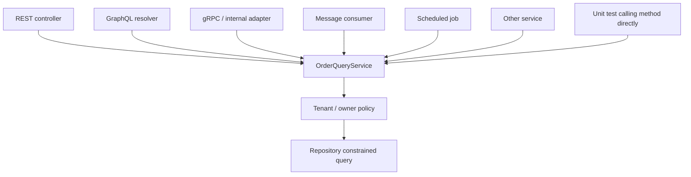
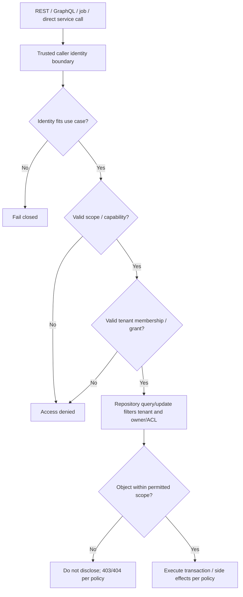

# Testing Tenant Boundaries, Ownership, and Direct Service Call Paths

In a **Spring Security OAuth 2.0 Resource Server**, having a JWT access token with a valid signature containing `SCOPE_orders.read` **does not prove the caller can read every order**. The caller must also hold permissions in the requested **tenant** and permissions on **that specific record**. This is the boundary where an API with proper authentication can still suffer from **Broken Object Level Authorization (BOLA)** or **Insecure Direct Object Reference (IDOR)**.

A dangerous situation: the original controller checked the tenant, yet the same service gets invoked directly from a new controller, GraphQL resolver, message handler, or another service. If authorization lives only in the web layer, the new call path can fetch records belonging to another user or tenant. Therefore, you must test **two distinct questions**: whether HTTP requests are properly blocked, and whether **direct use-case/service calls still enforce authorization invariants**.

This lesson uses Java examples for **Spring Boot 3 / Spring Security 6** (Servlet Resource Server), JUnit, Mockito, Spring MVC Test, and JPA. Illustrative entities, DTOs, and repositories must be implemented per your real schema. Tests using mocked JWT principals validate authorization, rather than replacing tests that decode genuinely signed JWTs.

## 1. Defining the Threat with Concrete Data

Suppose `orders-api` contains:

| Tenant | User | Order | Owner |
| --- | --- | --- | --- |
| `tenant-a` | Alice | 101 | Alice |
| `tenant-a` | Bob | 103 | Bob |
| `tenant-b` | Charlie | 201 | Charlie |
| `tenant-b` | Alice | 202 | Alice, only if Alice holds `tenant-b` membership |

Alice holds a Bearer JWT issued by a trusted issuer:

```json
{
  "iss": "https://identity.example.com/realms/shop",
  "sub": "alice",
  "aud": ["orders-api"],
  "scope": "orders.read orders.write",
  "exp": 1900000000
}
```

This JSON illustrates the payload only; it is not a signed JWT. Even after the JWT is verified, Alice **must not view Bob's order 103**, nor Charlie's order 201 in `tenant-b`, even though her JWT contains `orders.read`.

IDOR attack example:

```http
GET /api/tenants/tenant-a/orders/103
Authorization: Bearer <alice-token>
```

Or swapping the tenant:

```http
GET /api/tenants/tenant-b/orders/201
Authorization: Bearer <alice-token>
```

An implementation that merely executes:

```java
return repository.findById(orderId)
    .map(OrderDto::from)
    .orElseThrow(OrderNotFoundException::new);
```

can return an order not belonging to Alice. This is a **data authorization bug**, not a JWT signature verification bug.

## 2. Three Distinct Security Boundaries

| Boundary | Question | Common Mechanisms |
| --- | --- | --- |
| **Token and identity** | Is the token trustworthy and meant for `orders-api`? | `JwtDecoder`, signature, `iss`, `aud`, `exp`, `nbf`, token profile. |
| **Tenant** | Is the caller allowed to operate in the selected tenant? | Membership, tenant role, active grant, dedicated policy. |
| **Object/owner** | Is the caller allowed to act on this exact record? | Owner, ACL, sharing, relational data, conditional queries. |

Spring Security provides `JwtAuthenticationToken` and authorities like `SCOPE_orders.read`. It **does not automatically inject `tenantId` or `ownerId` predicates into every query**.

An owner-only condition:

```text
allowRead(caller, tenant, order)
  = valid JWT for API
    AND caller has SCOPE_orders.read
    AND caller currently has rights in tenant
    AND order.tenantId == tenant
    AND order.ownerIssuer == caller.issuer
    AND order.ownerSubject == caller.subject
```

If the business supports sharing, support staff, or administration, the owner clause can be replaced by a **specific domain authorization policy**. Never skip object-level checks simply because a user holds a broad role or scope.

## 3. What Is a Direct Service Call?

A standard HTTP path:

```text
HTTP Bearer JWT
  -> Spring SecurityFilterChain
  -> Controller
  -> OrderQueryService
  -> Repository
```

Yet a service can also be called via:



Not every entry point passes through the **same HTTP matcher**, or even carries a `SecurityContext` with a JWT. If tenant checks exist only in the REST controller, other adapters can bypass them.

Calling a Java method directly is not by itself an Internet vulnerability; the risk is an **externally reachable entry point** passing unverified inputs into that method. Direct service call tests prove that **authorization invariants live at the use-case layer**, not merely as a side effect of a web filter.

## 4. Token Claims, Tenant Selectors, and Owner Data Must Have Clear Trusted Sources

Clients can select a tenant via URL:

```http
GET /api/tenants/tenant-b/orders/201
```

or header:

```http
X-Tenant-Id: tenant-b
```

These are **request inputs**, not proof that Alice holds membership in `tenant-b`. Likewise, never trust a body like:

```json
{
  "tenantId": "tenant-b",
  "ownerSubject": "charlie",
  "note": "new note"
}
```

to determine the caller's identity or the record's owner.

| Attribute | Appropriate Source | What Must Be Checked |
| --- | --- | --- |
| `iss`, `sub` | Verified JWT or trusted identity adapter. | Issuer namespace, token profile, caller kind. |
| `SCOPE_orders.read` | Mapped Authentication authorities. | Functional operation right, not all objects. |
| `tenantId` from path/header | Caller-selected input. | Membership/grant in that specific tenant. |
| `ownerSubject` from body | Client input. | Never use directly as owner; server must enforce owner-assignment policy. |
| `order.tenantId`, owner | Integrity-managed database. | Match against permitted tenant/caller. |
| Membership | Authoritative database/policy service. | Active status and role within the tenant. |

If an issuer emits `tenant_id` in the JWT, determine whether the issuer is genuinely the application's **authoritative membership source**. A validly signed claim can still be **stale** after permissions are revoked.

## 5. Defining a Small Identity Type for Domain Services

Do not pass raw `Authorization` headers into the business layer, or let controllers Base64-decode JWTs themselves. In a JWT Resource Server, `JwtDecoder` must verify signature, issuer, timestamps, and audience before the application uses any claims.

Post-authentication, you can map to an application-defined type:

```java
import java.util.Set;

public record CallerIdentity(
        String issuer,
        String subject,
        Set<String> authorities) {

    public CallerIdentity {
        if (issuer == null || issuer.isBlank()) {
            throw new IllegalArgumentException("issuer required");
        }
        if (subject == null || subject.isBlank()) {
            throw new IllegalArgumentException("subject required");
        }
        authorities = Set.copyOf(authorities);
    }

    public boolean hasAuthority(String authority) {
        return authorities.contains(authority);
    }
}
```

Distinguish the `issuer + subject` pair because two issuers can both emit `sub = "alice"` representing **two different principals**. If the domain stores internal user IDs, map `(issuer, subject)` to that ID via trusted data.

Interface for the current caller source:

```java
public interface CurrentCaller {
    CallerIdentity requireAuthenticated();
}
```

This is an application-defined abstraction, not a built-in Spring Security API.

## 6. Adapter Reading a Verified `JwtAuthenticationToken`

In a JWT-only Servlet Resource Server path, an adapter can read `SecurityContext`:

```java
import java.util.Set;
import java.util.stream.Collectors;

import org.springframework.security.authentication.AuthenticationCredentialsNotFoundException;
import org.springframework.security.core.Authentication;
import org.springframework.security.core.GrantedAuthority;
import org.springframework.security.core.context.SecurityContextHolder;
import org.springframework.security.oauth2.jwt.Jwt;
import org.springframework.security.oauth2.server.resource.authentication.JwtAuthenticationToken;
import org.springframework.stereotype.Component;

@Component
public class SecurityContextCurrentCaller implements CurrentCaller {

    @Override
    public CallerIdentity requireAuthenticated() {
        Authentication authentication =
            SecurityContextHolder.getContext().getAuthentication();

        if (!(authentication instanceof JwtAuthenticationToken jwtAuth)
                || !jwtAuth.isAuthenticated()) {
            throw new AuthenticationCredentialsNotFoundException(
                "Verified JWT authentication required");
        }

        Jwt jwt = jwtAuth.getToken();
        if (jwt.getIssuer() == null || jwt.getSubject() == null) {
            throw new AuthenticationCredentialsNotFoundException(
                "Issuer and subject required");
        }

        Set<String> authorities = jwtAuth.getAuthorities().stream()
            .map(GrantedAuthority::getAuthority)
            .collect(Collectors.toUnmodifiableSet());

        return new CallerIdentity(
            jwt.getIssuer().toString(),
            jwt.getSubject(),
            authorities
        );
    }
}
```

The adapter **does not re-verify signatures**. It relies on the real application placing a trusted `Authentication` into `SecurityContext` via Spring Security Resource Server. Never fabricate a `JwtAuthenticationToken` from an unverified HTTP header and treat it as a trusted user.

In unit tests, `CurrentCaller` can be mocked to test domain conditions. In schedulers, message consumers, or `@Async` tasks, when no security context exists, this adapter must reject rather than defaulting to `sub = system` or `tenant = default`. Service identities need their own explicitly defined mechanism.

## 7. Tenant Membership Must Be an Independent Policy

A minimal interface:

```java
public interface TenantMemberships {
    boolean isActiveMember(
        String issuer,
        String subject,
        String tenantId
    );
}
```

This abstraction targets authoritative membership, not string comparison against headers. A policy checking scope and tenant:

```java
import org.springframework.security.access.AccessDeniedException;
import org.springframework.stereotype.Component;

@Component
public class OrderReadPolicy {

    private final TenantMemberships memberships;

    public OrderReadPolicy(TenantMemberships memberships) {
        this.memberships = memberships;
    }

    public void requireCanRead(
            CallerIdentity caller,
            String tenantId) {

        if (!caller.hasAuthority("SCOPE_orders.read")) {
            throw new AccessDeniedException(
                "Missing orders.read permission");
        }

        if (tenantId == null || tenantId.isBlank()) {
            throw new AccessDeniedException(
                "Tenant must be selected");
        }

        if (!memberships.isActiveMember(
                caller.issuer(), caller.subject(), tenantId)) {
            throw new AccessDeniedException(
                "Tenant access denied");
        }
    }
}
```

**This condition is real Java code executed inside the service**, not merely an annotation on a controller. Even when a test instantiates the service directly without an AOP proxy, the check still executes.

Applications with multiple tenant roles should use capability-specific methods like `canReadOrders(...)` instead of a plain `isActiveMember(...)`; a member is not automatically permitted to read every dataset inside a tenant.

## 8. Owner/Tenant Must Be Constrained in Repository Queries

For owner-only orders, do not query `findById(orderId)` and assume anyone with the scope may view it. An illustrative JPA repository:

```java
import java.util.Optional;

import org.springframework.data.jpa.repository.JpaRepository;
import org.springframework.data.jpa.repository.Query;
import org.springframework.data.repository.query.Param;

public interface OrderRepository extends JpaRepository<Order, Long> {

    @Query("""
        select o
          from Order o
         where o.id = :orderId
           and o.tenantId = :tenantId
           and o.ownerIssuer = :issuer
           and o.ownerSubject = :subject
        """)
    Optional<Order> findVisibleToOwner(
        @Param("orderId") Long orderId,
        @Param("tenantId") String tenantId,
        @Param("issuer") String issuer,
        @Param("subject") String subject
    );
}
```

Assume entity `Order` has `id`, `tenantId`, `ownerIssuer`, and `ownerSubject`. DTOs and schemas must be implemented accordingly.

The `id + tenant + owner` predicate prevents loading someone else's record and accidentally returning it; an empty result also helps **avoid disclosing object existence** to unauthorized callers.

In systems using internal owner IDs, the repository can match `ownerUserId` after a trusted identity resolver maps `iss + sub` to that ID. Never use mutable email addresses or usernames as owner keys when policies require stable identities.

## 9. Service Protecting the Use Case Even Without Going Through a Controller

A service with explicit dependencies:

```java
import org.springframework.stereotype.Service;

@Service
public class OrderQueryService {

    private final CurrentCaller currentCaller;
    private final OrderReadPolicy readPolicy;
    private final OrderRepository orders;

    public OrderQueryService(
            CurrentCaller currentCaller,
            OrderReadPolicy readPolicy,
            OrderRepository orders) {
        this.currentCaller = currentCaller;
        this.readPolicy = readPolicy;
        this.orders = orders;
    }

    public OrderDto getOrder(String tenantId, Long orderId) {
        CallerIdentity caller = currentCaller.requireAuthenticated();
        readPolicy.requireCanRead(caller, tenantId);

        return orders.findVisibleToOwner(
                orderId,
                tenantId,
                caller.issuer(),
                caller.subject())
            .map(OrderDto::from)
            .orElseThrow(OrderNotFoundException::new);
    }
}
```

`OrderDto` and `OrderNotFoundException` are illustrative business types to be defined; a REST adapter can map the exception to `404`.

When called from another controller or tested directly, the service still invokes `CurrentCaller` and `OrderReadPolicy`, then uses the scoped repository. This avoids relying solely on checks at one specific URL. Nor does the policy "relax permissions" if the repository returns empty: the object either does not exist or is not visible.

## 10. Thin Controller: Tenant and ID Are Strictly Selectors

```java
import org.springframework.web.bind.annotation.GetMapping;
import org.springframework.web.bind.annotation.PathVariable;
import org.springframework.web.bind.annotation.RequestMapping;
import org.springframework.web.bind.annotation.RestController;

@RestController
@RequestMapping("/api/tenants/{tenantId}/orders")
public class OrdersController {

    private final OrderQueryService service;

    public OrdersController(OrderQueryService service) {
        this.service = service;
    }

    @GetMapping("/{orderId}")
    public OrderDto getOrder(
            @PathVariable String tenantId,
            @PathVariable Long orderId) {
        return service.getOrder(tenantId, orderId);
    }
}
```

The controller neither reads `X-Owner-Id` to identify the caller nor compares tenants using a client-declared string. Policies reside in the service, policy component, and repository.

An HTTP security chain protecting functional capabilities:

```java
import org.springframework.context.annotation.Bean;
import org.springframework.context.annotation.Configuration;
import org.springframework.http.HttpMethod;
import org.springframework.security.config.Customizer;
import org.springframework.security.config.annotation.web.builders.HttpSecurity;
import org.springframework.security.web.SecurityFilterChain;

@Configuration
public class ApiSecurityConfig {

    @Bean
    SecurityFilterChain apiChain(HttpSecurity http) throws Exception {
        return http
            .securityMatcher("/api/**")
            .authorizeHttpRequests(auth -> auth
                .requestMatchers(
                    HttpMethod.GET,
                    "/api/tenants/{tenantId}/orders/{orderId}"
                ).hasAuthority("SCOPE_orders.read")
                .anyRequest().denyAll())
            .oauth2ResourceServer(oauth2 -> oauth2
                .jwt(Customizer.withDefaults()))
            .build();
    }
}
```

This example specifies one read endpoint; real applications must add rules for other methods and routes, CSRF/sessions per architecture, and a **fallback chain** if URLs exist outside `/api/**`. Spring Security verifies Bearer JWTs, without automatically enforcing tenant scoping in repositories.

## 11. `@PreAuthorize` Adds Protection, but Has Proxy Limits

With method security:

```java
import org.springframework.context.annotation.Configuration;
import org.springframework.security.config.annotation.method.configuration.EnableMethodSecurity;

@Configuration
@EnableMethodSecurity
public class MethodSecurityConfig {}
```

```java
import org.springframework.security.access.prepost.PreAuthorize;

@PreAuthorize("hasAuthority('SCOPE_orders.read')")
public OrderDto getOrder(String tenantId, Long orderId) {
    // Tenant membership and owner still must be checked.
    // ...
}
```

`@PreAuthorize` applies via Spring's method-security mechanism to calls intercepted on a **Spring-managed bean/proxy**. Keep in mind:

1. Calling the service through its bean proxy can be checked.
2. Tests using `new OrderQueryService(...)` or `@InjectMocks` **do not trigger AOP interceptors**.
3. Calls like `this.protectedRead()` inside the same instance typically skip the proxy (**self-invocation**).
4. Private methods or call paths not traversing a Spring-managed proxy must not be the sole home for authorization.
5. Schedulers/message consumers may lack a `SecurityContext`; method security does not manufacture a trusted user.

Therefore, `@PreAuthorize` can add **defense in depth**, while critical tenant/owner invariants must live in Java policies and conditional data queries/writes. Testing method-security proxies and testing direct service calls address **two different goals**.

## 12. Counter-Example: Self-Invocation Losing Method Security

```java
@Service
public class OrderFacade {

    @PreAuthorize("hasAuthority('SCOPE_orders.read')")
    public OrderDto protectedRead(Long orderId) {
        return readInternal(orderId);
    }

    public OrderDto anotherEntry(Long orderId) {
        return this.protectedRead(orderId);
    }

    private OrderDto readInternal(Long orderId) {
        // Suppose this code loads order via findById without owner checks.
        return null;
    }
}
```

In standard proxy-based method security, `anotherEntry` calling `this.protectedRead(...)` can **skip the interceptor** on `protectedRead`. Thus, if `readInternal` lacks policies, the second call path risks leaking data.

A better design ensures every path into the use case still executes the policy (or routes through controlled facades) and scoped repository queries. Tests should not stop at observing an endpoint return `403`; invoke business methods directly to verify guards actually live there.

## 13. Direct Unit Test: Missing Tenant Membership Prevents Querying

Using JUnit 5 and Mockito without booting a Spring context:

```java
import static org.junit.jupiter.api.Assertions.assertThrows;
import static org.mockito.Mockito.verifyNoInteractions;
import static org.mockito.Mockito.when;

import java.util.Set;

import org.junit.jupiter.api.BeforeEach;
import org.junit.jupiter.api.Test;
import org.junit.jupiter.api.extension.ExtendWith;
import org.mockito.Mock;
import org.mockito.junit.jupiter.MockitoExtension;
import org.springframework.security.access.AccessDeniedException;

@ExtendWith(MockitoExtension.class)
class OrderQueryServiceTest {

    @Mock CurrentCaller callers;
    @Mock TenantMemberships memberships;
    @Mock OrderRepository orders;

    OrderQueryService service;

    @BeforeEach
    void setup() {
        OrderReadPolicy policy = new OrderReadPolicy(memberships);
        service = new OrderQueryService(callers, policy, orders);
    }

    @Test
    void directCallCannotReadAnotherTenant() {
        CallerIdentity alice = new CallerIdentity(
            "https://identity.example.com/realms/shop",
            "alice",
            Set.of("SCOPE_orders.read")
        );

        when(callers.requireAuthenticated()).thenReturn(alice);
        when(memberships.isActiveMember(
            alice.issuer(), alice.subject(), "tenant-b"))
            .thenReturn(false);

        assertThrows(AccessDeniedException.class,
            () -> service.getOrder("tenant-b", 201L));

        verifyNoInteractions(orders);
    }
}
```

Here **the scope is valid**, because the test targets the tenant boundary. The test proves that even when invoking the service via plain Java **with no controller and no AOP proxy**, the policy denies `tenant-b` and **never queries the repository**.

Include an equivalent missing-scope test where Alice belongs to `tenant-a` with empty authorities; the service must deny before querying. Never write tests solely with invalid tokens to claim tenant authorization works.

## 14. Unit Test: Same Tenant, Different Owner

Place this method **inside the test class from Section 13**, reusing the same fields/mocks and `@BeforeEach`:

```java
import static org.junit.jupiter.api.Assertions.assertThrows;
import static org.mockito.Mockito.verify;
import static org.mockito.Mockito.when;

import java.util.Optional;
import java.util.Set;

@Test
void directCallCannotReadBobsOrder() {
    CallerIdentity alice = new CallerIdentity(
        "https://identity.example.com/realms/shop",
        "alice",
        Set.of("SCOPE_orders.read")
    );

    when(callers.requireAuthenticated()).thenReturn(alice);
    when(memberships.isActiveMember(
        alice.issuer(), "alice", "tenant-a")).thenReturn(true);

    when(orders.findVisibleToOwner(
        103L, "tenant-a", alice.issuer(), "alice"))
        .thenReturn(Optional.empty());

    assertThrows(OrderNotFoundException.class,
        () -> service.getOrder("tenant-a", 103L));

    verify(orders).findVisibleToOwner(
        103L, "tenant-a", alice.issuer(), "alice");
}
```

This is a **service test**, not a real JPQL query test. It proves the use case passes **tenant + issuer + subject** to the repository and does not return Bob's order when the query finds no record belonging to Alice.

To prove the real query does not leak, you need an integration test with database fixtures; if a mock of `findVisibleToOwner` violates the contract and returns Bob's data, the service test alone cannot verify entity ownership fields. Thus, you can add defensive domain-model checks or ensure the repository/data layer enforces the invariant accurately.

## 15. Repository Integration Test with Multi-Tenant Fixtures

Create fixtures:

```text
Order 101 -> tenant-a, issuer-shop, alice
Order 103 -> tenant-a, issuer-shop, bob
Order 201 -> tenant-b, issuer-shop, charlie
Order 301 -> tenant-a, issuer-other, alice
```

A `@DataJpaTest` can assert:

```java
import static org.assertj.core.api.Assertions.assertThat;

import org.junit.jupiter.api.Test;
import org.springframework.beans.factory.annotation.Autowired;
import org.springframework.boot.test.autoconfigure.orm.jpa.DataJpaTest;

@DataJpaTest
class OrderRepositoryBoundaryTest {

    @Autowired OrderRepository orders;

    @Test
    void queryFiltersTenantOwnerAndIssuer() {
        String issuer =
            "https://identity.example.com/realms/shop";

        assertThat(orders.findVisibleToOwner(
            101L, "tenant-a", issuer, "alice")).isPresent();

        assertThat(orders.findVisibleToOwner(
            103L, "tenant-a", issuer, "alice")).isEmpty();

        assertThat(orders.findVisibleToOwner(
            201L, "tenant-a", issuer, "alice")).isEmpty();

        assertThat(orders.findVisibleToOwner(
            301L, "tenant-a", issuer, "alice")).isEmpty();
    }
}
```

This snippet requires matching test data (`@Sql`, `TestEntityManager`, or migrations) and the real entity/schema. Fixture aliases `issuer-shop` and `issuer-other` must be replaced with the corresponding URIs.

If production uses PostgreSQL RLS, native queries, materialized views, separate tenant schemas/databases, or DB-specific policies, test against a matching engine. H2 or mocked repositories may not reproduce that behavior accurately.

Query bugs to look for: omitting tenant in joins; broken `AND`/`OR` precedence; applying owner filters to lists while omitting them on details; calling `findById` in exports; omitting tenant predicates on child entities.

## 16. HTTP Test with Mocked JWT: Tenant Authorization Through the Web Layer

Spring Security Test can build a JWT principal using `jwt()`:

```java
import static org.springframework.security.test.web.servlet.request.SecurityMockMvcRequestPostProcessors.jwt;
import static org.springframework.test.web.servlet.request.MockMvcRequestBuilders.get;
import static org.springframework.test.web.servlet.result.MockMvcResultMatchers.status;

import org.junit.jupiter.api.Test;
import org.springframework.beans.factory.annotation.Autowired;
import org.springframework.boot.test.autoconfigure.web.servlet.AutoConfigureMockMvc;
import org.springframework.boot.test.context.SpringBootTest;
import org.springframework.security.core.authority.SimpleGrantedAuthority;
import org.springframework.test.web.servlet.MockMvc;

@SpringBootTest
@AutoConfigureMockMvc
class OrderHttpBoundaryTest {

    @Autowired MockMvc mvc;

    @Test
    void aliceCannotReadTenantB() throws Exception {
        mvc.perform(get(
                "/api/tenants/{tenantId}/orders/{orderId}",
                "tenant-b", 201L)
            .with(jwt()
                .jwt(token -> token
                    .issuer("https://identity.example.com/realms/shop")
                    .subject("alice")
                    .claim("aud", java.util.List.of("orders-api")))
                .authorities(new SimpleGrantedAuthority(
                    "SCOPE_orders.read"))))
            .andExpect(status().isForbidden());
    }
}
```

This assumes Spring MVC, the security chain, and the real service are wired; membership fixtures confirm Alice **does not belong to `tenant-b`**, and `AccessDeniedException` is mapped to `403` per policy.

**Important:** `.with(jwt())` creates a simulated JWT authentication and **does not prove JWT signatures were verified by the production `JwtDecoder`**. When `.authorities(...)` is assigned directly, it also **does not verify the production `JwtGrantedAuthoritiesConverter`**. This HTTP test verifies routing and policies, not cryptography.

To verify issuer, JWKS, `aud`, `exp`, `nbf`, and converters, write a separate integration test using real JWTs signed with test keys and a trusted test issuer/JWK Set.

## 17. Why Can HTTP Tests Pass Green While the Service Remains Unsafe?

Suppose the controller does:

```java
if (!requestedTenant.equals(currentTenant)) {
    throw new AccessDeniedException("wrong tenant");
}
return orderService.findById(orderId);
```

An HTTP test calling `tenant-b` gets `403`, yet `orderService.findById(...)` may **not check tenant or owner**. A GraphQL resolver or another service calling `findById` directly can still return the wrong data.

Therefore, combine:

| Test Type | What It Confirms |
| --- | --- |
| HTTP with mocked JWT | Matchers/authorities and controllers reach the right policy. |
| **Direct service method calls** | Missing scope / wrong tenant is blocked without controllers or proxies. |
| Real repository | Queries return only records belonging to a valid tenant and owner. |
| Secondary entry points | GraphQL / message / admin endpoints cannot bypass. |
| JWT integration | Real tokens must be decoded/validated before establishing identity. |

Never treat a `403` status as blanket proof for every layer. Know **which layer denied** and which layers could still be invoked independently.

## 18. Testing Missing `SecurityContext`, Anonymous Callers, and Service Callers

A service may be invoked from:

```text
@Scheduled / @Async / message listener / batch worker
```

There, `SecurityContextHolder` may hold no JWT principal. `CurrentCaller.requireAuthenticated()` in a user-facing use case **must deny**, rather than defaulting to `subject = system` or `tenant = default`.

Necessary negative cases:

- Missing `Authentication`.
- Anonymous authentication.
- Non-`JwtAuthenticationToken` Authentication in a JWT-only adapter.
- JWT missing required `iss`/`sub` per the identity contract.
- Client Credentials token whose `sub` represents a service account, not an End-User.
- Event body containing a forged `ownerSubject`; never use as trusted caller.

A legitimate batch service may need a **trusted service identity** and dedicated capabilities (`reports.export`, allowed tenant list). Never spoof a `JwtAuthenticationToken` for Alice to push a scheduler past user policies.

## 19. Testing Matching `sub` Across Two Issuers

Suppose the Resource Server trusts two issuers:

```text
Issuer A: https://identity-a.example.com
Issuer B: https://identity-b.example.com
```

Two tokens both carrying `sub = "42"` **do not automatically represent the same principal**. Test:

```text
GIVEN:
  order 101.ownerIssuer = issuer A
  order 101.ownerSubject = "42"
  caller comes from issuer B, sub = "42"
  caller holds orders.read and membership in tenant-a

WHEN:
  caller B requests order 101

THEN:
  deny / return no record
```

If a repository filters only by `ownerSubject`, this test catches the identity-collision bug. With internal user IDs, test the `(issuer, sub) -> internalUserId` mapping logic; never merge matching emails, display names, or `sub` values automatically.

## 20. Data Writes: Updates and Deletes Must Constrain Tenant and Owner

A request:

```http
PATCH /api/tenants/tenant-a/orders/103
Authorization: Bearer <alice-token>
Content-Type: application/json

{ "note": "changed" }
```

must never modify Bob's order simply because Alice has `orders.write` and `tenant-a` membership.

One pattern uses an atomic conditional update:

```java
import org.springframework.data.jpa.repository.Modifying;
import org.springframework.data.jpa.repository.Query;
import org.springframework.data.repository.query.Param;

@Modifying
@Query("""
    update Order o
       set o.note = :note
     where o.id = :orderId
       and o.tenantId = :tenantId
       and o.ownerIssuer = :issuer
       and o.ownerSubject = :subject
    """)
int updateOwnedNote(
    @Param("orderId") Long orderId,
    @Param("tenantId") String tenantId,
    @Param("issuer") String issuer,
    @Param("subject") String subject,
    @Param("note") String note
);
```

This method lives in `OrderRepository` and requires an appropriate transaction from a service that already verified `SCOPE_orders.write` and membership. The return value is the updated row count; `0` must be handled under the not-found/not-permitted policy, **never falling back to an unconstrained update**.

Putting predicates directly inside the update statement also mitigates part of **time-of-check/time-of-use** risk when owner or tenant changes between read and write. Complex workflows require transactions, locking/versioning, and concurrency tests against the real database.

## 21. Write Tests Must Confirm Zero Side Effects

A handler might return `403` while having already caused side effects before checking:

```text
1. Update order
2. Emit OrderUpdated event
3. Check owner
4. Return 403
```

Without rollback, someone else's data has already changed. For writes/deletes, tests must assert:

1. Order data remains unchanged after a wrong-owner or wrong-tenant request.
2. No unauthorized shipment, payment, or attachment is created.
3. No success message or outbox event is published.
4. Transactions roll back properly; verify real commits when needed.
5. Audits record a denial rather than falsely logging success.
6. Retries/idempotency cannot reuse stale state to bypass policy.

Example scenario:

```text
GIVEN order 103 belongs to Bob, tenant-a
      Alice has orders.write and is a member of tenant-a
WHEN Alice calls updateOrder(tenant-a, 103, "new note")
THEN operation is denied
     order 103 retains original note/version
     no OrderUpdated event is emitted
```

**Checking HTTP status alone is insufficient** when database updates, queues, or external API calls are involved. Verify post-operation business state.

## 22. Lists, Searches, Counts, and Exports Must Also Be Tenant-Scoped

A system may protect `GET /orders/{id}` yet leak via:

```text
GET /api/tenants/tenant-a/orders
GET /api/tenants/tenant-a/orders/search
GET /api/tenants/tenant-a/orders/count
GET /api/tenants/tenant-a/orders/export
GET /api/tenants/tenant-a/orders/103/items
```

For owner-only access:

```java
Page<Order> findByTenantIdAndOwnerIssuerAndOwnerSubject(
    String tenantId,
    String issuer,
    String subject,
    Pageable pageable
);
```

**Filter tenant and owner in the query before pagination**, rather than loading all data and filtering lists in Java. Filtering after pagination can make `totalElements`, page ordering, or aggregate counts reveal out-of-scope records or return broken results.

Required tests: list contents, `totalElements`, filters/search, sorting, CSV exports, nested resources, bulk ID lists, parent-child joins, and cross-tenant permissions. If using DB Row-Level Security (RLS), verify tenant context comes from a trusted source, is properly reset across pooled connections, and is tested against the real DB engine.

## 23. Caching Can Bypass Owner Checks

Suppose a service result is cached:

```java
@Cacheable(cacheNames = "visibleOrders", key = "#orderId")
public OrderDto getOrder(String tenantId, Long orderId) {
    // Tenant/owner guard inside the method.
}
```

This is a **counter-example** when results depend on the caller: a cache interceptor can return Alice's data to Bob on a **cache hit before the method body runs**, depending on AOP/cache ordering.

A plain `orderId` key, or even `tenantId + orderId`, omits **owner, issuer, ACL, and permission variants**.

Two design approaches:

- Cache **raw data** by record, while always enforcing trusted authorization before returning.
- Cache authorized results keyed by a sufficiently specific **caller/tenant/policy scope**, with TTL/invalidation on membership/ACL changes.

Tests should warm the cache as Alice, then request the same order ID as Bob. Next, alter membership/ACLs and call again as Alice to test revocation behavior. Testing only with cold caches misses these bugs.

## 24. Membership Revocation While a JWT Is Still Valid

Example:

```text
T0: Alice is a member of tenant-a
T1: Issuer mints a JWT valid for 15 minutes
T2: Admin revokes Alice's membership
T3: Alice reuses the old JWT to request order 101
```

When membership revocation must take effect rapidly, checking only a `tenant_id` claim inside the JWT may not suffice. You may need a membership database, permission cache with TTL/invalidation, or an online authorization policy.

| Mechanism | Possible Behavior After T2 | Required Tests |
| --- | --- | --- |
| Live DB membership on each request | Denies once revocation transaction commits. | Reuse same JWT before/after membership change. |
| Cached membership | Stale window per policy. | Verify TTL/invalidation and acceptable bounds. |
| Trusting only JWT claims | Access may persist until token expires. | Confirm this trade-off is explicitly accepted. |
| Token introspection or online policy | Reflects updated state per contract. | Test timeouts/outages and fail-closed behavior. |

`JwtDecoder` checks that the JWT has not expired, but **does not ask the database whether membership changed**. Authorization tests must simulate data changes occurring after token issuance.

## 25. Admins, Support Staff, and Service Accounts Need Separate Policy Branches

A valid exception might allow a tenant admin to view all orders in their tenant, or support staff to view an order under an approved ticket. Never write:

```java
if (caller.hasAuthority("ROLE_ADMIN")) {
    return orders.findById(orderId);
}
```

if the role is not scoped to a tenant. `ROLE_ADMIN` does not prove admin rights across **every tenant**. A clearer domain policy:

```text
allowRead =
  (tenantMember AND ownerMatch AND orders.read)
  OR (tenantAdminOfRequestedTenant AND orders.read.all)
  OR (supportGrantForThisOrder AND support.read)
```

Branches require both positive and negative tests:

- An admin of `tenant-a` cannot view `tenant-b`.
- A support grant for order 101 does not open order 103.
- A Client Credentials service holds only its granted capabilities and tenants.
- An admin who loses their role cannot keep using stale cached rights beyond policy limits.
- Every exception is properly audited without accidentally opening global queries.

When the product supports sharing/ACLs, `owner != caller` is not automatically an error; **explicit sharing policies must be defined and tested**, rather than omitting owner checks.

## 26. Returning 401, 403, or 404?

| Scenario | Layer | Typical Outcome |
| --- | --- | --- |
| Missing Bearer token on endpoint requiring auth. | Authentication | `401`. |
| JWT has invalid signature, issuer, audience, or expiration. | Authentication | `401`. |
| Valid JWT missing required scope. | Authorization | `403`. |
| Has scope but not a member of tenant. | Tenant policy | `403` or concealing `404` per contract. |
| Same tenant but not the owner. | Object policy | `403` or `404`. |
| Scoped query finds no object. | Data access/business | Usually `404`. |
| Authorized and processed successfully. | Business | `2xx`. |

A `403` may happen **before the service is ever called** due to an HTTP matcher. Therefore, HTTP status alone does not prove domain code checked tenant/owner. When using `404` to conceal existence, avoid messages like `"order 103 exists but belongs to Bob"` and ensure count/export APIs do not leak the object either.

For write paths, also verify **database state and events/outboxes**, since returning 403 after side effects still constitutes a security flaw.

## 27. Tenant, Owner, and Direct Call Test Matrix

Assuming an owner-only policy, `tenant-a` has Alice/Bob, and `tenant-b` has Charlie:

| # | Caller | Resource | Entry Point | Expectation |
| --- | --- | --- | --- | --- |
| 1 | Alice, `orders.read` | Alice's order 101, `tenant-a` | HTTP | Allowed. |
| 2 | Alice, missing scope | Order 101 | HTTP | Denied for scope. |
| 3 | Alice, `orders.read` | Bob's order 103, `tenant-a` | HTTP | Does not return Bob's data. |
| 4 | Alice, `orders.read` | Charlie's order 201, `tenant-b` | HTTP | Denied for tenant. |
| 5 | Alice, valid scope | Order 201, `tenant-b` | **Direct service** | Denied before query when lacking membership. |
| 6 | Alice, valid scope | Order 103, `tenant-a` | **Direct service** | Owner-scoped query does not return Bob's order. |
| 7 | Alice, missing scope | Order 101 | **Direct service** | Denied even without passing HTTP matchers. |
| 8 | No principal | Order 101 | **Direct service** | Fails closed; uses no default identity. |
| 9 | Bob, `orders.read` | Bob's order 103 | HTTP + service | Allowed. |
| 10 | Issuer B, same `sub` Alice | Object belonging to Issuer A | Repository | No identity confusion. |
| 11 | Alice with revoked membership | Order 101, unexpired JWT | HTTP + service | Follows revocation policy; not auto-allowed. |
| 12 | Alice, `orders.write` | Update Bob's order 103 | HTTP + service | No data modified, no events emitted. |
| 13 | Alice, `orders.read` | List/search/count `tenant-a` | HTTP + repository | Neither counts nor displays out-of-scope data. |
| 14 | Alice warms cache, then Bob | Same order ID | Cache + service | No cross-user cache leak. |
| 15 | Admin of `tenant-a` | Order in `tenant-b` | Service | Denied without `tenant-b` grant. |
| 16 | Narrowly granted service account | Resource outside capability | Event/HTTP | Denied. |

Include **both negative and positive tests**. A suite producing only 403s might merely prove a misconfigured policy blocked all legitimate functionality.

## 28. Four Test Layers with Distinct Responsibilities

| Layer | Tools | What It Proves | What It Does Not Prove Alone |
| --- | --- | --- | --- |
| **Service/domain unit tests** | JUnit + Mockito, real policy. | Direct service calls block missing scope/tenant and call scoped repos. | JPQL/SQL or production JWT signatures. |
| **Repository/database integration** | `@DataJpaTest`, multi-tenant DB fixtures. | Queries, joins, and updates filter by tenant/owner/issuer accurately. | `SecurityFilterChain`. |
| **HTTP/method security integration** | `@SpringBootTest`, MockMvc, security chain. | Matchers, policies, exception mapping, and controllers invoke the right use case. | When using `jwt()`, does not test JWT cryptography. |
| **JWT end-to-end integration** | Real JWT signed with test keys/JWKS and real decoder. | Issuer, audience, signature, validators, and converters are wired properly. | Does not replace cross-tenant fixtures and service tests. |

With `@PreAuthorize`, test through the **Spring proxy bean** to prove interceptors fire, and also test the directly instantiated service to prove domain guards do not depend on AOP. For caches and transactions, add integration tests whenever interceptors, commits, or rollbacks are security-relevant.

**`@WithMockUser` and `jwt()` are great for authorization tests**, yet do not prove real tokens are verified or carry contract-compliant subjects/issuers. Never assign authorities directly in tests and conclude the production `JwtGrantedAuthoritiesConverter` definitely works.

## 29. Anti-Patterns Where Tests Pass Green Yet Data Still Leaks

### Testing Only "No Token Returns 401"

BOLA happens with **valid tokens**. You need two callers sharing the same scope and data owned by multiple owners.

### Using Only `@WebMvcTest` with a Mocked Service

A mock returning `403` does not prove real domain policies. You need service unit tests and DB integration tests.

### Relying Solely on `@PreAuthorize`

Self-invocation or calls skipping the Spring proxy bypass interceptors. Domain guards and repository scoping must stand on their own.

### Comparing Owners Solely by `sub`

Matching `sub` across issuers does not guarantee the same account. Test across distinct issuers too.

### Lists Filter by Tenant, While Detail/Export Uses `findById`

Another endpoint can still leak. Test all read paths, bulk endpoints, counts, and nested resources.

### Caching by `orderId`

Cached results may return before the method checks ownership. Test consecutive callers and membership revocation.

### Checking Permissions After Updating or Publishing Events

HTTP 403 does not automatically roll back side effects. Assert database and event state after denied commands.

### Treating the `X-Tenant-Id` Header as Membership

Clients pick tenants freely; verify against an authoritative source.

### Scheduler Impersonating a User to Pass Policies

Service jobs need trusted service capabilities, never an End-User's identity.

### Concluding Safety from Status 404

A 404 can still leak information through messages, counts, timing, or side effects. Verify both response payloads and underlying state.

## 30. Review Process When Adding a New Business Call Path

1. **Identify the identity source:** verified JWT/opaque token, or trusted service principal for jobs? Never read principals from caller-sent headers/bodies.
2. **Identify scopes/capabilities:** `orders.read` differs from `orders.write`; what tenant-scoped rights do admins/support hold?
3. **Identify tenant selectors:** what do paths, headers, and claims mean? Where is membership verified?
4. **Identify object policies:** owner, ACL, delegation, or tenant-wide access? Is issuer checked?
5. **Constrain queries:** do detail, list, count, export, nested resources, and updates/deletes filter accurately by tenant and owner?
6. **Inspect all entry points:** do other controllers, GraphQL, internal service calls, event handlers, and schedulers go through the same use case/policy?
7. **Inspect proxies and caches:** can `@PreAuthorize` or `@Cacheable` be bypassed or serve results before guards run?
8. **Inspect side effects:** do transactions, queues, audits, outboxes, and idempotency guarantee zero writes on denial?
9. **Prepare strong fixtures:** same tenant different owner; different tenant same subject; same subject different issuer; missing scope; revoked membership.
10. **Run tests at the right layers:** direct service, database, HTTP/security, and JWT integration so you know exactly which layer protects what.

Summary diagram:



**Core takeaway:** a Resource Server can verify JWTs accurately and still suffer from BOLA/IDOR if services or repositories fail to check tenant and owner. To genuinely protect business logic, place **authorization invariants inside use-case/domain policies and conditional queries/writes**, then test **both HTTP requests and direct service calls**—covering different tenants, same tenant with different owners, same `sub` across different issuers, revoked memberships, caches, and side effects. `SecurityFilterChain`, method security, database controls, and multi-layer tests reinforce each other; no single layer replaces the responsibility to protect data.
