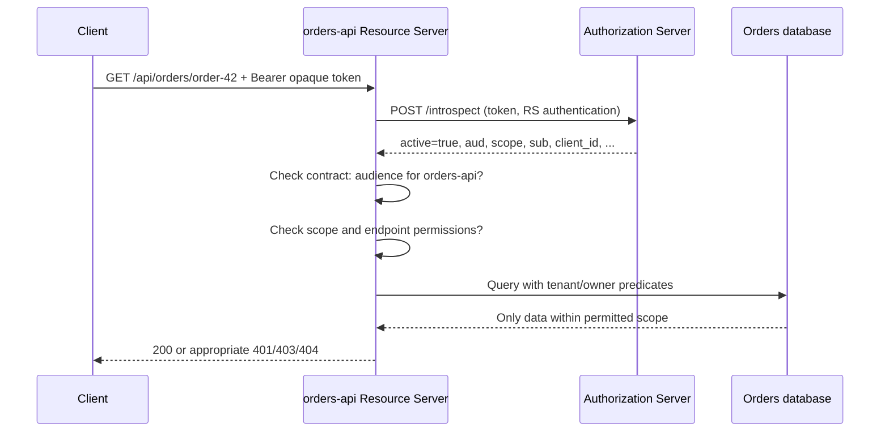

# `active=true` does not replace API audience binding and authorization

## 1. Scenario: introspection returns `active: true` yet the API must still reject

A Spring Boot application acting as an **OAuth 2.0 Resource Server** exposes the endpoint:

```http
GET /api/orders/order-42 HTTP/1.1
Host: orders.example.com
Authorization: Bearer <opaque-access-token>
Accept: application/json
```

Unlike a JWT access token, an **opaque access token** does not have a format the Resource Server can decode and verify signatures against a JWT profile on its own. It is usually a reference string or an unstructured value opaque to the Client. The Resource Server can verify the token by calling the Authorization Server's **token introspection endpoint** under RFC 7662.

An illustrative introspection result:

```json
{
  "active": true,
  "scope": "orders.read profile.read",
  "client_id": "shop-web",
  "sub": "user-417",
  "aud": ["billing-api"],
  "iss": "https://id.example.com/realms/shop",
  "exp": 1893456000
}
```

Suppose the current application is **`orders-api`**, not `billing-api`. Even though `active` is `true` and the token carries a scope named `orders.read`, may `orders-api` accept this request?

**You cannot conclude that from `active: true` alone.** If the contract requires audience `orders-api`, the response above **does not qualify**. The API must still verify scope, endpoint permissions, user/Client context, and individual order data. `active=true` does not mean "access to every API and every record."

An Authorization Server can enforce audience policies itself during introspection—for instance, returning `active=false` to a Resource Server not permitted to see a token. However, that is **a guarantee that must be explicitly defined and verified in the integration contract**, never inferred simply from having a boolean `active` field.

### Learning objectives

After this lesson, you will be able to:

1. Interpret `active` accurately in OAuth 2.0 Token Introspection.
2. Distinguish **whether a token is active**, **which API it is meant for**, **scope/authorities**, and **resource-level permissions**.
3. Understand why `aud` can be an optional attribute in introspection responses and how to handle its absence.
4. Configure a Spring Security Resource Server to use opaque tokens.
5. Add audience validation via an `OpaqueTokenIntrospector` wrapper when required by contract.
6. Write `SCOPE_...` rules and enforce tenant/owner checks in Service/Repository layers.
7. Distinguish `401`, `403`, and `404` in realistic scenarios.
8. Design tests that do not stop at `active=true`, confirming tokens meant for other APIs cannot be reused.

## 2. How does OAuth 2.0 Token Introspection work?

### 2.1. Participating components

In the standard model, there are:

- **Client:** the application holding the access token and sending it to the API.
- **Authorization Server (AS):** issues tokens, manages state, and provides the introspection endpoint.
- **Resource Server (RS):** the API protecting resources; in this example, `orders-api`.
- **Introspection endpoint:** the endpoint exposed by the AS for the RS to query token status/metadata under granted authorization.

Diagram:



The Resource Server **must never trust** caller-supplied headers such as `X-Scope`, `X-Audience`, or `X-Tenant-ID` to override verification data from the AS or a trusted authorization store.

### 2.2. Opaque tokens are not the same as JWT access tokens

With JWTs, the Resource Server can fetch public keys from a trusted issuer and verify signatures locally. With opaque tokens, the Resource Server generally cannot verify signatures that way; the AS or a trusted introspection service provides token state and required attributes.

```text
JWT access token:
  Client → Resource Server
  Resource Server → JwtDecoder → signature + claims validators

Opaque access token:
  Client → Resource Server
  Resource Server → trusted introspection endpoint
  Authorization Server → token status + attributes
```

An opaque token **does not necessarily** contain `iss`, `aud`, or `scope` decodable from the token string. When those attributes are required, the Resource Server must obtain them via the introspection response or another trusted contracted source.

### 2.3. The introspection endpoint must be trusted

Example request to the AS:

```http
POST /oauth2/introspect HTTP/1.1
Host: id.example.com
Authorization: Basic <resource-server-credentials>
Content-Type: application/x-www-form-urlencoded

token=<opaque-token>
```

This is an illustrative request. In practice, use **HTTPS**, authenticate the Resource Server to the AS using the configured mechanism, and send properly form-encoded data. Introspection authentication does not have to be HTTP Basic, though it must follow the AS's contract.

Because the token is a Bearer credential, **never send it to a Client-proposed introspection URL**. Sending the token to an untrusted server can leak the token even if the API ultimately returns 401.

## 3. What does `active` mean under RFC 7662?

### 3.1. `active` is the mandatory attribute of an introspection response

A response for a token accepted at the status level might look like:

```json
{
  "active": true,
  "scope": "orders.read",
  "client_id": "shop-web",
  "sub": "user-417"
}
```

When the token is inactive or the AS withholds details, the response normally needs only:

```json
{
  "active": false
}
```

Under RFC 7662, `active` represents the token's active state as evaluated by the AS. The AS typically considers whether the token was issued, remains unrevoked, and is within its validity window. **Exact policy defining an "active" token belongs to the AS**, and may include constraints on which Resource Server is calling introspection.

Therefore, never interpret `active=true` as:

- "The token is meant for every Resource Server."
- "The token has every scope the API needs."
- "The current Client may access every endpoint."
- "The user is still a member of the requested tenant."
- "The token represents a human user rather than a service."
- "Every field in the response is safe to return to the Client."
- "Order `order-42` belongs to the caller."

`active=true` is merely **one necessary signal during authentication**, not the final authorization decision.

### 3.2. The AS may enforce permissions of the introspecting Resource Server

Some AS implementations configure each Resource Server with its own identity and return `active=true` only when the token is allowed for that specific Resource Server. Other AS implementations return `active=true` for any valid token the introspection Client may inspect, alongside `aud` for the RS to check itself.

These two designs yield different contracts:

| AS–RS contract | What can `active=true` guarantee? | What must the RS still do? |
|---|---|---|
| AS checks only whether token is valid | Token is active | Check audience and all required policies |
| AS scopes `active` by the introspecting Resource Server's identity | Token is active **and valid for this RS per AS contract** | Verify right client/resource identity integration; still check scope, tenant, owner |
| AS publishes `aud` in the response | Token is active and carries audience metadata | Compare `aud` against the API |
| AS omits `aud` with no RS-binding guarantee | Cannot tell which API the token belongs to | Reject ambiguous tokens; fix contract or verification mechanism |

**Important:** Just because an AS *can* factor in Resource Server identity when computing `active` does not mean every implementation does so.

### 3.3. `active=false` does not always mean "forged token"

An AS may return `active=false` when:

- The token does not exist, expired, or was revoked.
- The token is not yet valid.
- The querying Resource Server is not permitted to introspect that token.
- The AS withholds further token details.

The Resource Server should generally treat this result as **token not accepted**, rather than trying to guess the exact reason or spraying the token across multiple other AS instances.

For a Client calling a protected endpoint, the outcome is typically **401 Unauthorized**. Error details may be kept minimal to avoid leaking token state.

## 4. Audience: which Resource Server is this token meant for?

### 4.1. Distinguishing audience and scope

`aud` (*audience*) specifies the recipient/resource the token was issued for, per the AS contract. Scope specifies part of the granted permissions.

Example:

```json
{
  "active": true,
  "aud": ["billing-api"],
  "scope": "orders.read"
}
```

The token carries `orders.read` scope yet its audience is `billing-api`. If `orders-api` requires `aud=orders-api`, the token is invalid **for this API**, even though the scope name looks matching.

Another token:

```json
{
  "active": true,
  "aud": ["orders-api"],
  "scope": "profile.read"
}
```

This token targets the right API yet lacks `orders.read`. Once token authentication passes and reaches authorization, the order-read request is typically rejected with **403**.

| `active` | Audience | Scope | Meaning for `GET /api/orders/**` |
|---|---|---|---|
| `false` | Any | Any | Token rejected |
| `true` | `billing-api` | `orders.read` | Wrong Resource Server if API requires `orders-api` |
| `true` | `orders-api` | `profile.read` | Right RS yet lacks permission to read orders |
| `true` | `orders-api` | `orders.read` | Passes initial gate; still needs object/tenant permission |
| `true` | Missing `aud` | `orders.read` | Depends on AS–RS contract; never default to wildcard |

**Audience and scope answer two distinct questions.** Never substitute one field for the other.

### 4.2. Why is audience binding needed in multi-API systems?

Suppose an organization runs:

```text
Authorization Server:
  https://id.example.com

Resource Servers:
  orders-api
  billing-api
  customer-api
```

Clients may hold `read` permissions across multiple APIs. If APIs accept **any token with `active=true`** without Resource Server binding, a token minted for `customer-api` can be replayed against `orders-api`. This is **cross-resource token replay / token confusion**.

Proper binding prevents a credential issued for resource A from being accepted unexpectedly at resource B.

### 4.3. `aud` in the introspection response is optional

RFC 7662 defines `active` as the core field; fields like `scope`, `client_id`, `sub`, `aud`, `iss`, and `exp` appear depending on implementation and contract.

If the response is:

```json
{
  "active": true,
  "scope": "orders.read",
  "sub": "user-417"
}
```

the Resource Server **cannot read an audience that was not returned**. Never infer `aud=orders-api` just because the token is active or the introspection endpoint returned HTTP 200.

There are two design solutions:

1. **Require the AS to return `aud` and validate it at the RS.** If the contract makes audience mandatory, missing `aud` must be rejected (*fail closed*).
2. **Have the AS enforce audience via resource-specific introspection.** The AS authenticates the introspecting Resource Server's identity and returns `active=true` only for tokens valid at that RS. Document the contract and verify with integration tests that tokens meant for other APIs receive `active=false` or are rejected.

Without either guarantee, never "fix" errors by removing audience checks. Fix the contract between AS and RS before treating tokens as eligible.

### 4.4. Audience can be a string or an array

Across implementations, audience may appear as:

```json
{"aud":"orders-api"}
```

or:

```json
{"aud":["orders-api","reports-api"]}
```

When checking, match only the **exact authorized API identifier** per contract; never use partial matches or accept arbitrary strings.

For example, a response:

```json
{
  "active": true,
  "aud": ["orders-api-admin", "billing-api"]
}
```

does not satisfy an exact `orders-api` audience requirement. Checking `startsWith("orders-api")` can open vulnerabilities when audience identifiers share prefixes.

### 4.5. Resource indicators and audience

Some Authorization Servers support OAuth 2.0 **Resource Indicators** (RFC 8707) so a Client specifies the target resource when requesting an access token. Depending on the profile, that `resource` value can govern the resulting audience or scope.

Even so, the Resource Server must never look at a `resource` parameter sent by the Client and treat it as proof the token is meant for this API. It must verify **what the AS actually issued and asserted** via introspection or an equivalent trusted mechanism.

## 5. Scope/authority: a token meant for the API still needs the right action permission

### 5.1. Scope in the introspection response

A common response:

```json
{
  "active": true,
  "aud": ["orders-api"],
  "scope": "orders.read orders.write",
  "client_id": "shop-web"
}
```

The `scope` string usually contains space-separated scopes. A standard Spring Security Resource Server with opaque-token authentication can map:

```text
scope:
  orders.read
  orders.write

GrantedAuthority:
  SCOPE_orders.read
  SCOPE_orders.write
```

That enables writing:

```java
.hasAuthority("SCOPE_orders.read")
```

or:

```java
@PreAuthorize("hasAuthority('SCOPE_orders.write')")
```

**Not every AS uses the same scope/claim format.** If the introspection response deviates from the profile Spring Security supports, write an explicit adapter/converter rather than treating every string claim as an authority.

### 5.2. `active=true` does not grant every scope

Example:

```json
{
  "active": true,
  "aud": ["orders-api"],
  "scope": "profile.read"
}
```

When calling `GET /api/orders/42`, the token lacks `orders.read`. Even though authentication succeeded, the endpoint must deny access.

In REST Bearer API policies, lacking an authority after authentication typically yields **403 Forbidden**, potentially with a Bearer challenge containing `error="insufficient_scope"`.

### 5.3. `hasAuthority` differs from `hasRole`

Spring Security uses `GrantedAuthority`, and helpers follow clear conventions:

| Rule | Required authority |
|---|---|
| `hasAuthority("SCOPE_orders.read")` | `SCOPE_orders.read` |
| `hasAuthority("ROLE_ADMIN")` | `ROLE_ADMIN` |
| `hasRole("ADMIN")` | Typically `ROLE_ADMIN` |
| `hasAuthority("orders.read")` | `orders.read`, with no prefix added |

Because scopes map to `SCOPE_orders.read`, `hasAuthority("orders.read")` or `hasRole("orders.read")` is not equivalent.

### 5.4. Scope is not permission to access every record

An access token with `scope=orders.read` does not allow accessing another user's or another tenant's orders. It represents API-level operational permission per contract, without solving **object-level authorization**.

If a Service simply calls `findById(orderId)` without checking tenant/owner, the app remains vulnerable to BOLA/IDOR even when introspection and scopes pass.

## 6. Client ID, subject, and token type do not replace audience

### 6.1. `client_id` is the OAuth Client identifier

An introspection response might contain:

```json
{
  "active": true,
  "client_id": "shop-web",
  "sub": "user-417",
  "aud": ["orders-api"],
  "scope": "orders.read"
}
```

`client_id` identifies the Client application bound to the token by the AS per contract, **not the audience**. A token issued to `shop-web` might be usable across multiple APIs if the AS granted the corresponding scopes.

Never use:

```text
client_id == orders-api
```

in place of checking audience `orders-api`, unless a specialized contract explicitly defines both identifiers and that exact rule. Normally, Client ID and Resource Server ID are two distinct concepts.

### 6.2. `sub` does not prove permission to read every order

`sub` may identify a user, Client, or service principal per AS profile. Never infer:

```text
active=true + non-empty sub
    ⇒ subject may read any order
```

Bind the subject to ownership, membership, tenant, and business policy.

### 6.3. Token type and opaque tokens

In an introspection response, `token_type` can describe how the token is presented, e.g., `Bearer`. It is not proof that the token belongs to a specific API. Nor can you require an opaque token to carry a JOSE `typ=at+jwt` header like a signed JWT access token: **an opaque token may have no JOSE header at all**.

If the API requires a specific access token type or principal type, the introspection contract must supply trustworthy fields for it. Never guess from the opaque string's format.

### 6.4. Sender-constrained tokens

Checking `client_id` or `active` does not prove the HTTP sender is the original Client. With **Bearer tokens**, any party holding an unexpired token can attempt to use it.

If the system must cryptographically bind the presenter to a key or certificate, implement an appropriate sender-constraining mechanism such as mTLS-bound tokens or DPoP when supported by AS and RS. The Resource Server must then verify the **binding proof**, not just `active`.

## 7. Spring Security Resource Server with opaque tokens

### 7.1. Dependencies

Example Spring Boot application using Gradle:

```groovy
dependencies {
    implementation 'org.springframework.boot:spring-boot-starter-web'
    implementation 'org.springframework.boot:spring-boot-starter-security'
    implementation 'org.springframework.boot:spring-boot-starter-oauth2-resource-server'
}
```

The rest assumes a modern Spring Security Servlet version supporting `SecurityFilterChain` and OAuth 2.0 Resource Server opaque-token configuration.

### 7.2. Configuring the introspection endpoint

Example `application.yml`:

```yaml
server:
  port: 8080

spring:
  security:
    oauth2:
      resourceserver:
        opaquetoken:
          introspection-uri: https://id.example.com/oauth2/introspect
          client-id: INTROSPECTION_CLIENT_ID
          client-secret: INTROSPECTION_CLIENT_SECRET
```

These are **placeholders**, not real credentials. In production deployments, supply `client-id` and `client-secret` via a secret configuration system or environment variables; never commit Client secrets to a repository.

This configuration tells Spring Boot:

- The Resource Server uses **opaque-token introspection**.
- The trusted introspection endpoint resides at the declared address.
- The Resource Server uses the corresponding Client credentials to authenticate to the AS.

The Resource Server **must not** dynamically discover an introspection endpoint from a URL provided in an incoming request.

### 7.3. `SecurityFilterChain` with scopes

```java
package com.example.orders;

import org.springframework.context.annotation.Bean;
import org.springframework.context.annotation.Configuration;
import org.springframework.http.HttpMethod;
import org.springframework.security.config.Customizer;
import org.springframework.security.config.annotation.web.builders.HttpSecurity;
import org.springframework.security.config.http.SessionCreationPolicy;
import org.springframework.security.web.SecurityFilterChain;

@Configuration
public class SecurityConfig {

    @Bean
    SecurityFilterChain apiSecurity(HttpSecurity http) throws Exception {
        return http
            .csrf(csrf -> csrf.disable())
            .sessionManagement(s ->
                s.sessionCreationPolicy(SessionCreationPolicy.STATELESS))
            .authorizeHttpRequests(auth -> auth
                .requestMatchers("/api/public/**").permitAll()
                .requestMatchers(HttpMethod.GET, "/api/orders/**")
                    .hasAuthority("SCOPE_orders.read")
                .requestMatchers(HttpMethod.POST, "/api/orders")
                    .hasAuthority("SCOPE_orders.write")
                .anyRequest().denyAll()
            )
            .oauth2ResourceServer(oauth2 -> oauth2
                .opaqueToken(Customizer.withDefaults()))
            .build();
    }
}
```

Notes:

- `opaqueToken(...)` enables Bearer opaque-token authentication.
- `hasAuthority("SCOPE_orders.read")` requires the authority mapped from the introspection scope.
- `STATELESS` avoids using HTTP sessions to retain Bearer Authentication.
- `anyRequest().denyAll()` blocks any unpermitted routes.
- Disabling CSRF here applies **only** to pure Bearer-header APIs that do not authenticate automatically via cookies. If the app uses sessions/cookies, evaluate CSRF per architecture.
- **This configuration does not by itself enforce `orders-api`-specific audience validation.** Add the step in section 8 or ensure audience is already scoped by the AS during introspection for this specific RS.

### 7.4. Who performs introspection and builds `Authentication`?

In the Spring Security Servlet flow, components typically include:

- `BearerTokenAuthenticationFilter`: extracts the Bearer token from the request.
- `OpaqueTokenAuthenticationProvider`: authenticates opaque tokens via `OpaqueTokenIntrospector`.
- `OpaqueTokenIntrospector`: calls the introspection endpoint (or equivalent) and builds an authenticated principal.
- `BearerTokenAuthentication`: represents the resulting Authentication with principal and authorities.
- `AuthorizationFilter`: enforces `authorizeHttpRequests` rules.

`OpaqueTokenIntrospector` is the right place to enforce **mandatory token-level conditions**, such as requiring audience `orders-api` per contract. `AuthorizationFilter` is suited to endpoint permission rules.

### 7.5. Scope of `active=true` in default configuration

A standard introspector implementation normally accepts the token when the AS returns a valid active response and builds principal/authorities from metadata. However, **never assume adding `opaquetoken` to YAML automatically applies all audience, tenant, Client, and business-specific validators for your API**.

Constraints beyond standard behavior must either be enforced by the AS per contract or added explicitly to the Resource Server.

## 8. Adding audience validation with `OpaqueTokenIntrospector`

### 8.1. When should you use a decorator?

If the AS contract specifies that introspection returns `aud` and the API must accept only tokens for `orders-api`, you can **wrap a standard introspector**:

1. Delegate calls the AS and handles `active`.
2. Receive `OAuth2AuthenticatedPrincipal` from an accepted token.
3. Validate audience on the principal.
4. Reject the token if audience is missing or wrong.
5. Return the principal to the authentication provider only when all checks pass.

This protects the token-level contract **before** the request reaches a Controller or Service.

### 8.2. Java example for mandatory audience

The snippet below illustrates Spring Security versions supporting `SpringOpaqueTokenIntrospector` with a constructor taking introspection URI, Client ID, and Client secret.

```java
package com.example.orders;

import java.util.Collection;
import org.springframework.beans.factory.annotation.Value;
import org.springframework.context.annotation.Bean;
import org.springframework.context.annotation.Configuration;
import org.springframework.security.oauth2.core.OAuth2AuthenticatedPrincipal;
import org.springframework.security.oauth2.server.resource.introspection.BadOpaqueTokenException;
import org.springframework.security.oauth2.server.resource.introspection.OpaqueTokenIntrospector;
import org.springframework.security.oauth2.server.resource.introspection.SpringOpaqueTokenIntrospector;

@Configuration
public class IntrospectionPolicyConfig {

    @Bean
    OpaqueTokenIntrospector opaqueTokenIntrospector(
            @Value("${spring.security.oauth2.resourceserver.opaquetoken.introspection-uri}")
            String uri,

            @Value("${spring.security.oauth2.resourceserver.opaquetoken.client-id}")
            String clientId,

            @Value("${spring.security.oauth2.resourceserver.opaquetoken.client-secret}")
            String clientSecret) {

        OpaqueTokenIntrospector delegate =
            new SpringOpaqueTokenIntrospector(
                uri, clientId, clientSecret);

        String expectedAudience = "orders-api";

        return token -> {
            OAuth2AuthenticatedPrincipal principal =
                delegate.introspect(token);

            Object aud = principal.getAttribute("aud");

            boolean accepted =
                expectedAudience.equals(aud)
                || (aud instanceof Collection<?> audiences
                    && audiences.contains(expectedAudience));

            if (!accepted) {
                throw new BadOpaqueTokenException(
                    "Token is not intended for orders-api");
            }

            return principal;
        };
    }
}
```

**Version note:** Constructors/builders for `SpringOpaqueTokenIntrospector` can vary across Spring Security versions. If your version provides a builder/factory or another introspector, construct the delegate with the matching API while preserving the rule: validate audience **after successful introspection, before returning the principal**.

In this example, every token without `aud` or with `aud` not containing `orders-api` is rejected. That is the right behavior **when the contract makes audience mandatory**.

If the AS omits `aud` because it already enforces audience via resource-specific introspection, do not blindly copy this validator and break all tokens; confirm the contract and design the right binding mechanism first.

### 8.3. Why check both string and collection?

Introspection metadata comes from varied implementations; `aud` may be serialized as:

```json
{"aud": "orders-api"}
```

or:

```json
{"aud": ["orders-api", "reports-api"]}
```

The example logic accepts either representation **strictly per contract**, while rejecting lookalikes such as `orders-api-admin`.

If the AS uses another data type, write the matching parser/validator. Never call `toString()` on an arbitrary object and check `contains("orders-api")`; that easily accepts invalid values.

### 8.4. Why use `BadOpaqueTokenException`?

Its purpose is to signal to the Resource Server mechanism that introspection succeeded at transport level yet the token **failed an authentication condition required by the API**. Spring Security can translate this error into a Bearer authentication failure response, typically **401**.

Avoid throwing `AccessDeniedException` arbitrarily inside a token-level introspector when audience is a token-acceptance condition: it can alter HTTP status semantics or exception-handling paths.

### 8.5. An introspector bean and DSL configuration

When an application declares an `@Bean OpaqueTokenIntrospector` and uses `oauth2ResourceServer(...opaqueToken...)`, Spring Security/Boot will generally pick up that bean automatically. When multiple beans exist or wiring is custom, specify the introspector explicitly:

```java
.oauth2ResourceServer(oauth2 -> oauth2
    .opaqueToken(opaque -> opaque
        .introspector(opaqueTokenIntrospector)))
```

The snippet above is **part of the `HttpSecurity` DSL**, with `opaqueTokenIntrospector` injected into the configuration class. Never define multiple competing `SecurityFilterChain` beans sharing the same matcher just to plug in an introspector.

When using a decorator, **never skip the `active` check**: the delegate must be a trusted introspector that evaluates token status, not a function constructing `OAuth2AuthenticatedPrincipal` from arbitrary JSON.

### 8.6. Apply audience checks only where needed

If one application serves multiple Resource Server surfaces or audience groups, design clearly:

- Mandatory audience for **every token in the chain/API** → enforce in the introspector.
- Specific endpoints requiring specialized audiences → use appropriate chains/managers/authorization policies.
- APIs across separate deployments → each deployment configures its own expected audience.

Never hardcode one audience and reuse the same bean for APIs expecting different audiences; nor use a Client-supplied path to escalate allowed audiences.

## 9. If the AS does not provide `aud`: renegotiate the contract

### 9.1. Dangerous scenario

The AS returns:

```json
{
  "active": true,
  "client_id": "shop-web",
  "sub": "user-417",
  "scope": "orders.read"
}
```

while both `orders-api` and `billing-api` share the same introspection endpoint.

If the AS returns `active=true` for tokens from both APIs without publishing an audience, `orders-api` has no trustworthy information showing **which API the token was issued for**.

Do not work around this with:

```java
// INAPPROPRIATE: skip check when audience is missing.
if (aud == null) {
    return principal;
}
```

or:

```text
active=true + matching scope name
    ⇒ treat token as valid for every Resource Server
```

### 9.2. Sound contract options

**Option A — Publish audience in introspection.** The AS returns accurate `aud`, and the Resource Server checks against expected audience.

**Option B — Introspection bound to RS identity.** The AS authenticates a dedicated credential for `orders-api`, knows which Resource Server is asking, and rejects/withholds tokens meant for `billing-api`. Verify directly with cross-resource token tests.

**Option C — Custom token policy agreed by AS/RS.** The AS provides an equivalent resource identifier or entitlement claim, provided the contract ensures Clients cannot spoof it and the Resource Server verifies it.

**Option D — Adjust token issuance.** Use explicit resource indicators/audiences or isolate tokens per API where architecture permits.

Never quietly drop audience checks simply because the default introspector does not enforce that field automatically.

## 10. `SecurityFilterChain`: checking authorities after audience

Suppose the audience decorator from section 8 accepted the token. `Authentication` now holds introspection-derived authorities.

An endpoint configuration:

```java
@Bean
SecurityFilterChain apiSecurity(HttpSecurity http) throws Exception {
    return http
        .authorizeHttpRequests(auth -> auth
            .requestMatchers("/api/public/**").permitAll()
            .requestMatchers(HttpMethod.GET, "/api/orders/**")
                .hasAuthority("SCOPE_orders.read")
            .requestMatchers(HttpMethod.POST, "/api/orders")
                .hasAuthority("SCOPE_orders.write")
            .anyRequest().denyAll()
        )
        .oauth2ResourceServer(oauth2 ->
            oauth2.opaqueToken(Customizer.withDefaults()))
        .build();
}
```

The rule itself does not perform introspection: it merely requires the created `Authentication` to carry the matching authority. When the delegate introspector maps scopes to `SCOPE_...` authorities, the rule works as expected.

### 10.1. What if `scope` is missing?

If the AS returns:

```json
{
  "active": true,
  "aud": ["orders-api"],
  "sub": "user-417"
}
```

while the endpoint requires `SCOPE_orders.read`, the token may pass token-level authentication yet **lack that authority**. Requests normally receive **403**.

If the contract mandates that **every token** carry a well-typed `scope` field, add a token-level validator to reject missing scopes earlier. Confirm first whether that truly applies across the whole API—a token meant only for public or authenticated-without-scope endpoints may follow a different design.

### 10.2. Never map Client ID to scope automatically

If introspection returns `client_id=shop-web` without `scope=orders.read`, never grant `SCOPE_orders.read` just because the Client name is on an allowlist. **Client identity** and **authorization grant/scope** have independent meanings.

If a special endpoint is reserved for `billing-worker`, check **both Client and scope** per contract rather than substituting Client for scope.

## 11. Tenant and owner authorization: `active`, audience, and scope are still not enough

Consider an introspection response:

```json
{
  "active": true,
  "aud": ["orders-api"],
  "scope": "orders.read",
  "sub": "user-417",
  "client_id": "shop-web",
  "tenant_id": "tenant-alpha"
}
```

User `user-417` calls:

```http
GET /api/tenants/tenant-beta/orders/order-42 HTTP/1.1
Authorization: Bearer <token-of-tenant-alpha>
```

Audience matches and scope matches, yet the requested tenant is outside the token's scope. The Resource Server must deny the request before returning data.

### 11.1. Reading the post-introspection principal

With opaque tokens, a Controller can receive `OAuth2AuthenticatedPrincipal`, not `Jwt`:

```java
package com.example.orders;

import java.util.Map;
import org.springframework.security.core.annotation.AuthenticationPrincipal;
import org.springframework.security.oauth2.core.OAuth2AuthenticatedPrincipal;
import org.springframework.web.bind.annotation.GetMapping;
import org.springframework.web.bind.annotation.RestController;

@RestController
public class IdentityController {

    @GetMapping("/api/me")
    public Map<String, Object> me(
            @AuthenticationPrincipal OAuth2AuthenticatedPrincipal principal) {

        String subject = principal.getAttribute("sub");
        String clientId = principal.getAttribute("client_id");

        return Map.of(
            "subject", subject == null ? "" : subject,
            "clientId", clientId == null ? "" : clientId
        );
    }
}
```

This illustrates reading an introspected principal. With `SecurityFilterChain` from section 7.3, add a matcher protecting `/api/me` or adjust rules accordingly, since `anyRequest().denyAll()` denies undeclared endpoints.

In production, you do not necessarily want to return `clientId` to the Client or log every claim. Expose only fields permitted by the response contract.

### 11.2. Building an authorization context

You can build a record from the principal:

```java
package com.example.orders;

import org.springframework.security.oauth2.core.OAuth2AuthenticatedPrincipal;

public record CallerContext(
        String subject,
        String tenantId,
        String clientId) {

    public static CallerContext from(
            OAuth2AuthenticatedPrincipal principal) {

        Object sub = principal.getAttribute("sub");
        Object tenant = principal.getAttribute("tenant_id");
        Object client = principal.getAttribute("client_id");

        if (!(sub instanceof String subject) || subject.isBlank()) {
            throw new IllegalStateException(
                "Authenticated token missing expected subject");
        }

        if (!(tenant instanceof String tenantId)
                || tenantId.isBlank()) {
            throw new IllegalStateException(
                "Authenticated token missing expected tenant");
        }

        if (!(client instanceof String clientId) || clientId.isBlank()) {
            throw new IllegalStateException(
                "Authenticated token missing expected client");
        }

        return new CallerContext(subject, tenantId, clientId);
    }
}
```

This expresses the contract, yet in real applications if `sub`, `tenant_id`, or `client_id` are **mandatory on every token**, validate their types and presence at the introspector/token-policy layer so authentication fails cleanly instead of causing a 500 inside the Service.

Some opaque tokens use different claims. Extract only attributes guaranteed by the AS with agreed data types.

### 11.3. Enforcing tenant and owner in database queries

Given a table:

```text
orders:
  id
  tenant_id
  owner_subject
  amount
  status
```

Do not write:

```sql
SELECT *
FROM orders
WHERE id = :order_id;
```

Instead use:

```sql
SELECT id, amount, status
FROM orders
WHERE id = :order_id
  AND tenant_id = :verified_tenant_id
  AND owner_subject = :verified_subject;
```

When the query returns no row, the API can return `404 Not Found` to avoid disclosing whether out-of-scope records exist. Depending on tenant/role policy, owner conditions may vary, yet an explicit authorization rule is always mandatory.

### 11.4. Spring Data JPA example

Repository:

```java
package com.example.orders;

import java.util.Optional;
import org.springframework.data.jpa.repository.JpaRepository;

public interface OrderRepository
        extends JpaRepository<OrderEntity, String> {

    Optional<OrderEntity> findByIdAndTenantIdAndOwnerSubject(
        String id,
        String tenantId,
        String ownerSubject);
}
```

Service:

```java
package com.example.orders;

import org.springframework.http.HttpStatus;
import org.springframework.security.access.AccessDeniedException;
import org.springframework.security.oauth2.core.OAuth2AuthenticatedPrincipal;
import org.springframework.stereotype.Service;
import org.springframework.transaction.annotation.Transactional;
import org.springframework.web.server.ResponseStatusException;

@Service
public class OrderService {

    private final OrderRepository repository;

    public OrderService(OrderRepository repository) {
        this.repository = repository;
    }

    @Transactional(readOnly = true)
    public OrderDto findVisible(
            String requestedTenant,
            String orderId,
            OAuth2AuthenticatedPrincipal principal) {

        CallerContext caller = CallerContext.from(principal);

        if (!caller.tenantId().equals(requestedTenant)) {
            throw new AccessDeniedException("Tenant access denied");
        }

        OrderEntity order = repository
            .findByIdAndTenantIdAndOwnerSubject(
                orderId, caller.tenantId(), caller.subject())
            .orElseThrow(() ->
                new ResponseStatusException(HttpStatus.NOT_FOUND));

        return new OrderDto(
            order.getId(), order.getAmount(), order.getStatus());
    }
}
```

`OrderEntity` and `OrderDto` are illustrative domain classes to define in the project. The core point is **querying only objects within the verified tenant/owner scope** and returning a DTO with only permitted fields.

If a Client Credentials token represents a service rather than a user, `sub` may be the Client ID; apply service-principal policies and queries accordingly instead of treating it as an individual customer owner.

### 11.5. Never trust tenant from URL or headers

A request might supply:

```http
GET /api/tenants/tenant-beta/orders/order-42 HTTP/1.1
Authorization: Bearer <token-of-tenant-alpha>
X-Tenant-ID: tenant-beta
```

The URL and `X-Tenant-ID` are Client-controlled inputs. They can indicate the **requested** tenant, which must be checked against the verified tenant/entitlement. Never allow a header to override `tenant_id` from the trusted source just to make a request succeed.

## 12. Example Controller wiring the Resource Server to the Service

Suppose `SecurityFilterChain` protects `GET /api/tenants/*/orders/**` with `SCOPE_orders.read`. Controller:

```java
package com.example.orders;

import org.springframework.security.core.annotation.AuthenticationPrincipal;
import org.springframework.security.oauth2.core.OAuth2AuthenticatedPrincipal;
import org.springframework.web.bind.annotation.GetMapping;
import org.springframework.web.bind.annotation.PathVariable;
import org.springframework.web.bind.annotation.RequestMapping;
import org.springframework.web.bind.annotation.RestController;

@RestController
@RequestMapping("/api/tenants/{tenantId}/orders")
public class OrderController {

    private final OrderService service;

    public OrderController(OrderService service) {
        this.service = service;
    }

    @GetMapping("/{orderId}")
    public OrderDto detail(
            @PathVariable String tenantId,
            @PathVariable String orderId,
            @AuthenticationPrincipal OAuth2AuthenticatedPrincipal principal) {

        return service.findVisible(
            tenantId, orderId, principal);
    }
}
```

Add the matching rule to `SecurityFilterChain`:

```java
.requestMatchers(
    HttpMethod.GET,
    "/api/tenants/*/orders/**")
.hasAuthority("SCOPE_orders.read")
```

When adding a specific rule, place it before `anyRequest().denyAll()`. The Controller and Repository examples demonstrate three independent layers:

1. Opaque token is introspected and accepted.
2. Endpoint requires read scope.
3. Service queries the matching tenant and owner.

A request failing any layer must never return out-of-scope data.

## 13. Observing HTTP 401, 403, and 404 outcomes

Not every security failure returns `401`. Distinguishing the decision layer is essential.

### 13.1. When is it usually 401?

- No Bearer token sent to an endpoint requiring authentication.
- Opaque token unrecognized by the AS or introspection returns `active=false`.
- Resource Server rejects the token for failing mandatory audience at token-level policy.
- Token violates another mandatory contract condition in the introspector.

Example:

```http
HTTP/1.1 401 Unauthorized
WWW-Authenticate: Bearer
```

Actual responses may include `error="invalid_token"` or another description depending on the exception handler. Never leak tokens, secrets, or detailed internal policies in responses.

### 13.2. When is it usually 403?

- Token passed authentication yet lacks `SCOPE_orders.read`.
- Authenticated principal lacks rights for an administrative endpoint.
- Client ID or role fails the **endpoint authorization policy**.
- Authenticated caller lacks permission on that tenant, if the app returns 403.

Example:

```http
HTTP/1.1 403 Forbidden
WWW-Authenticate: Bearer error="insufficient_scope"
```

`insufficient_scope` is a standard Bearer error code when scopes are missing, though actual headers depend on the handler and Authentication state. Not every `403` carries this exact header string.

### 13.3. When might it be 404?

If the order ID does not exist **within the caller's authorized scope**, the API can return:

```http
HTTP/1.1 404 Not Found
Content-Type: application/json

{"error":"ORDER_NOT_FOUND"}
```

This limits enumeration of whether records exist in other tenants. Never return a body containing `ownerSubject` or the actual tenant of an unauthorized record.

### 13.4. Summary matrix

| `active` | Audience | Scope/authority | Tenant/owner | Typical outcome |
|---|---|---|---|---|
| `false` | Any | Any | Not evaluated | 401 |
| `true` | Wrong (not `orders-api`) | Has `orders.read` | Not evaluated | 401 if audience is enforced in token-level validator |
| `true` | Missing `aud` when contract requires it | Has `orders.read` | Not evaluated | 401 |
| `true` | Right (`orders-api`) | Missing `orders.read` | Not evaluated | 403 |
| `true` | Right (`orders-api`) | Has `orders.read` | Wrong tenant | 403 or 404 per policy |
| `true` | Right (`orders-api`) | Has `orders.read` | Right tenant, wrong owner | 404 or 403 per policy |
| `true` | Right (`orders-api`) | Has `orders.read` | Authorized | 200 or business status |
| `true` | Audience enforced by AS for RS without returning `aud` | Has `orders.read` | Policy-dependent | Accept only when contracted and verified |

Exact status codes vary by implementation. What cannot be compromised is that **tokens not meant for the API or lacking permissions must never retrieve data**.

## 14. Why should you not rely on `client_id` instead of audience?

Suppose introspection returns:

```json
{
  "active": true,
  "client_id": "reporting-tool",
  "scope": "orders.read"
}
```

A Resource Server might assume `reporting-tool` is a familiar Client and allow it. Yet if that token was minted for `reporting-api`, it may not be intended for `orders-api`.

Independent properties:

| Attribute | Question it answers |
|---|---|
| `active` | Does the AS consider the token active per the introspection contract? |
| `client_id` | Which Client was issued the token? |
| `aud` | Which Resource Server/resource is the token intended for? |
| `scope` | Which operational scope was granted to the token? |
| `sub` | Which principal does the token represent per profile? |
| `tenant_id` | Which tenant is the token bound to, if defined by the AS? |
| DB owner/ACL | Does this specific record belong to the caller? |

**Client ID is not scope; scope is not audience; audience is not tenant.** Conflating these concepts creates vulnerabilities that happy-path tests miss.

## 15. Common introspection configuration mistakes

### 15.1. Introspection returns `active=true`, API accepts every token

**Cause:** Using only the default introspector without audience binding, while the AS does not enforce resource-specific introspection.

**Impact:** Tokens minted for other APIs can be presented at this API.

**Fix:** Require the AS to return `aud` and validate it, or use a Resource Server-bound introspection contract and test it thoroughly.

### 15.2. Sharing one introspection credential across all Resource Servers

If multiple APIs share one introspection credential and the AS cannot tell which API is asking, the AS may be unable to scope `active` per API.

**Fix:** Provision dedicated introspection clients/credentials per Resource Server when the AS architecture requires it, or require audience metadata and validate it in each API.

### 15.3. `aud` is omitted and code allows by default

**Cause:** Validator written as:

```text
if aud absent:
    allow
```

**Fix:** If audience is mandatory, missing `aud` is a validation failure. If the AS enforces binding another way, document and test that contract instead of guessing.

### 15.4. Audience checked with unsafe substring `contains`

Example:

```java
// DO NOT DO THIS: "orders-api-admin" also contains "orders-api".
String.valueOf(aud).contains("orders-api")
```

**Fix:** Match the audience identifier **exactly** according to the contracted data type, never using substring matching.

### 15.5. Skipping scope checks

**Cause:** `anyRequest().authenticated()` used across all protected routes.

**Impact:** A token with `active=true` and the right audience can invoke operations it was never granted scope for.

**Fix:** Attach scope/authority rules per HTTP method and endpoint, e.g., `SCOPE_orders.read` and `SCOPE_orders.write`.

### 15.6. Reading scopes from Client-supplied headers

Example:

```http
X-Scopes: orders.read orders.write
```

**Impact:** Clients can self-declare permissions.

**Fix:** Use only authorities built from a trusted introspection response mapped per contract.

### 15.7. Checking only scope, skipping tenant/owner checks

**Impact:** An Alpha user guesses a Beta order ID and reads it via `findById`.

**Fix:** Compare requested tenant against verified entitlement and include tenant/owner predicates in Repository queries.

### 15.8. Treating opaque tokens as JWTs

**Cause:** Trying to Base64URL-decode an opaque string or passing it to `JwtDecoder`.

**Fix:** Use opaque-token introspection per contract. If the AS issues JWT access tokens elsewhere, configure the matching validation mechanism there.

### 15.9. Logging access tokens

**Impact:** Bearer tokens can be stolen via logs, monitoring, or support tickets.

**Fix:** Log request IDs, introspection results, error codes, and permitted Client/issuer metadata; never log raw tokens or Client secrets.

### 15.10. Increasing introspection cache duration uncontrollably

If `active=true` results are cached too long, revoked tokens continue to be accepted from cache. That alters the "current status" semantics compared to querying the AS on each request.

**Fix:** Define cache TTLs/risk tolerances based on revocation requirements, token lifetimes, and capacity; consider refresh/invalidation policies. Never treat a stale `active=true` as guaranteed valid indefinitely.

## 16. Caching and revocation: `active` is a point-in-time status

Suppose:

```text
10:00:00  AS returns active=true
10:01:00  User's access is revoked
10:05:00  RS still uses old cached principal
```

If cached entries live too long, the RS keeps permitting access based on stale data. Even when the original response had the right audience and scope, real-world permissions may have changed.

Design must weigh:

- **TTL:** Maximum age for considering an introspection result fresh.
- **Expiration:** Never cache past the token's `exp` when known.
- **Revocation:** The AS/RS contract must specify required revocation freshness.
- **Entitlement changes:** Tenant membership/roles can change while a token stays active.
- **Availability:** If the introspection endpoint disconnects, how does the system behave per risk policy?
- **Load:** Querying the AS per request increases network cost; caching helps only within strict bounds.

**Never "fail open"** by letting tokens pass when the AS is unreachable or introspection fails with an unknown error. Any degraded mode in a specialized system requires explicit risk analysis and an operational contract; allowing unverified requests by default is dangerous.

## 17. Introspection and endpoint HTTP statuses

Distinguish the two HTTP requests across the full flow.

### 17.1. HTTP request from RS to the introspection endpoint

The AS may return:

```http
HTTP/1.1 200 OK
Content-Type: application/json

{"active":false}
```

**HTTP 200 from the introspection endpoint does not mean the token is active.** It only means the AS processed the introspection request and returned JSON. The `active` boolean is the status to evaluate.

Conversely, a `401` from the **introspection endpoint** may mean the Resource Server used invalid Client credentials when calling the AS. That is different from the `401` the Resource Server returns to the API Client.

### 17.2. HTTP request from Client to the API

If the API receives a Bearer token for which the AS returns `active=false`, the API typically returns:

```http
HTTP/1.1 401 Unauthorized
WWW-Authenticate: Bearer
```

If the token is active with the right audience yet lacks scope, the API typically returns `403`.

Hence you can observe:

```text
AS introspection:
    200 OK
    {"active": true, "aud": ["orders-api"], "scope": "profile.read"}

API client request:
    403 Forbidden
    (missing SCOPE_orders.read)
```

**Never use introspection's 200 status in place of the API's authorization decision.**

## 18. Practicing with `curl`: verifying all layers

Assume the API runs at `http://localhost:8080`, the introspection endpoint/credentials are configured properly, and you have real test tokens issued by the AS.

### 18.1. Public endpoint requiring no token

```bash
curl -i http://localhost:8080/api/public/ping
```

If a public Controller exists:

```http
HTTP/1.1 200 OK
Content-Type: application/json

{"status":"ok"}
```

If no Controller is mapped, you may see 404 even though `permitAll` works; `SecurityFilterChain` does not create endpoints on its own.

### 18.2. Protected endpoint without a token

```bash
curl -i http://localhost:8080/api/orders/order-42
```

Typical result:

```http
HTTP/1.1 401 Unauthorized
WWW-Authenticate: Bearer
```

### 18.3. Revoked/inactive token

```bash
curl -i \
  -H "Authorization: Bearer $INACTIVE_TOKEN" \
  http://localhost:8080/api/orders/order-42
```

If introspection returns `active=false`, the API must reject the token, typically `401`.

### 18.4. Active token with audience for another API

```bash
curl -i \
  -H "Authorization: Bearer $TOKEN_FOR_BILLING_API" \
  http://localhost:8080/api/orders/order-42
```

If the AS returns `active=true` and `aud=["billing-api"]`, a decorator requiring `orders-api` must reject it, typically `401`.

This case is **critical**: use a genuine token issued by the AS for the billing API rather than editing an existing token. With opaque tokens, mutating part of the string cannot produce another audience anyway.

### 18.5. Token with right audience yet missing scope

```bash
curl -i \
  -H "Authorization: Bearer $TOKEN_WITHOUT_ORDERS_READ" \
  http://localhost:8080/api/orders/order-42
```

When the token is accepted yet lacks `SCOPE_orders.read`, it typically receives `403 Forbidden`.

### 18.6. Token with right audience and sufficient scope

```bash
curl -i \
  -H "Authorization: Bearer $TOKEN_WITH_ORDERS_READ" \
  http://localhost:8080/api/orders/order-42
```

If tenant/owner checks also pass, the Controller/Service can return `200 OK`.

### 18.7. Token with right audience/scope yet wrong tenant

```bash
curl -i \
  -H "Authorization: Bearer $TOKEN_TENANT_ALPHA" \
  http://localhost:8080/api/tenants/tenant-beta/orders/order-42
```

The Resource Server must deny access to Beta data. The response can be `403` or `404` per policy. Never leak partial fields of Beta's order before checking.

### 18.8. Verification comparison table

| Test | Introspection | Next layer | Typical API outcome |
|---|---|---|---|
| No token | Not introspected | Authentication | 401 |
| Inactive token | `active=false` | Stop authentication | 401 |
| Active token, wrong audience | `active=true`, `aud=billing-api` | Audience validator rejects | 401 |
| Active token missing required audience | `active=true`, no `aud` | Audience validator rejects | 401 |
| Active token, right audience, missing scope | `active=true`, `aud=orders-api` | `AuthorizationFilter` rejects | 403 |
| Active token, right audience & scope, wrong tenant | `active=true`, valid metadata | Business authorization rejects | 403/404 |
| Active token, right audience & scope, right owner | Metadata matches | Controller/Service processes | 2xx |

Exact status codes depend on the application's exception handler and domain code, yet tokens with the wrong audience or insufficient permissions must never retrieve unauthorized data.

## 19. Integration testing with a mock introspection server

### 19.1. Why mock the AS?

In dev/test environments, you can run an HTTP stub for the introspection endpoint returning different JSON per incoming token.

Verify not only the API's HTTP status, but also that:

- The API sends introspection requests to **the trusted endpoint**.
- The Resource Server authenticates to the AS using the configured mechanism.
- `active=false` is rejected.
- `active=true` does not bypass audience validation.
- `scope` maps to the right authorities.
- Wrong tenant/owner returns no data.
- Tokens are never sent to other hosts or written to logs.

Never use production access tokens or Client credentials for these tests.

### 19.2. Four sample introspection responses

**Response A — inactive:**

```json
{
  "active": false
}
```

**Response B — active yet wrong audience:**

```json
{
  "active": true,
  "aud": ["billing-api"],
  "scope": "orders.read",
  "sub": "user-417"
}
```

**Response C — active with right audience, missing scope:**

```json
{
  "active": true,
  "aud": ["orders-api"],
  "scope": "profile.read",
  "sub": "user-417"
}
```

**Response D — active with right audience and scope:**

```json
{
  "active": true,
  "aud": ["orders-api"],
  "scope": "orders.read",
  "sub": "user-417",
  "tenant_id": "tenant-alpha"
}
```

Then test `GET /api/orders/order-42` and the tenant-bound endpoint. Provide matching Controller/DB fixtures; Response D alone does not prove object-level authorization unless tenant/owner rules execute.

### 19.3. Unit testing principal-level audience policy

You can extract audience matching into a small helper to test independently:

```java
package com.example.orders;

import java.util.Collection;

public final class AudiencePolicy {

    private AudiencePolicy() {
    }

    public static boolean containsExpectedAudience(
            Object audienceClaim,
            String expectedAudience) {

        return expectedAudience.equals(audienceClaim)
            || (audienceClaim instanceof Collection<?> values
                && values.contains(expectedAudience));
    }
}
```

JUnit example:

```java
import java.util.List;
import org.junit.jupiter.api.Test;
import static org.junit.jupiter.api.Assertions.*;

class AudiencePolicyTest {

    @Test
    void acceptsExactAudienceString() {
        assertTrue(AudiencePolicy.containsExpectedAudience(
            "orders-api", "orders-api"));
    }

    @Test
    void acceptsAudienceInCollection() {
        assertTrue(AudiencePolicy.containsExpectedAudience(
            List.of("orders-api", "reports-api"), "orders-api"));
    }

    @Test
    void rejectsOtherResourceServer() {
        assertFalse(AudiencePolicy.containsExpectedAudience(
            List.of("billing-api"), "orders-api"));
    }

    @Test
    void rejectsMissingAudience() {
        assertFalse(AudiencePolicy.containsExpectedAudience(
            null, "orders-api"));
    }

    @Test
    void doesNotAcceptPrefixMatches() {
        assertFalse(AudiencePolicy.containsExpectedAudience(
            "orders-api-admin", "orders-api"));
    }
}
```

This test verifies only the audience-matching helper. It **does not prove** that the delegate called the AS, validated HTTP responses, handled `active=false`, or built the principal properly.

### 19.4. Limitations of `MockMvc` with `opaqueToken()`

Spring Security Test provides the `opaqueToken()` request post-processor to simulate Authentication/authorities:

```java
import static org.springframework.security.test.web.servlet.request
    .SecurityMockMvcRequestPostProcessors.opaqueToken;

mvc.perform(get("/api/orders/order-42")
        .with(opaqueToken()
            .authorities(
                new SimpleGrantedAuthority("SCOPE_orders.read"))))
    .andExpect(status().isOk());
```

This illustrates **testing authorization after Authentication already exists**. `opaqueToken()` in Spring Security Test bypasses real HTTP introspection, much as `with(jwt())` skips real JWT signature verification. To prove the audience decorator and `active` handling work, test the introspector directly or run integration tests with an AS stub.

### 19.5. Mandatory test cases in a multi-API environment

An effective test matrix includes:

1. Token issued for `orders-api` calling `orders-api` → passes audience gate.
2. Token issued for `billing-api` calling `orders-api` → rejected.
3. Token issued for `orders-api` missing read scope → 403.
4. Token with read scope belonging to another tenant → denied without data leak.
5. Introspection returns `active=false` → 401.
6. AS returns `active=true` without `aud` when contract requires it → 401.
7. AS returns `aud` as string and as collection per contract → both handled properly.
8. AS returns HTTP 401 due to wrong introspection credentials → Resource Server fails safely, never failing open.
9. AS unavailable → requests never pass automatically.
10. Token revoked while cache entry is active → behavior matches TTL/revocation contract.

## 20. Protecting the introspection endpoint and Client secrets

### 20.1. Never expose tokens in logs

Introspection requests carry the **raw access token**. Any log, APM trace, proxy dump, or exception message recording raw tokens becomes a credential leak channel.

Never log:

```text
Authorization: Bearer <real-token>
token=<real-token>
client_secret=<real-secret>
```

Instead, record only request IDs, error codes, trusted introspection endpoint names, latencies, policy outcomes, and non-sensitive permitted attributes.

### 20.2. HTTPS and Client authentication

The introspection endpoint requires TLS with certificate/hostname verification. The Resource Server must authenticate to the AS via a permitted method (Basic Client auth, private-key JWT, mTLS, or equivalent per AS).

Never put Client secrets into demo files committed to source control. In Spring Boot, bind properties to environment variables via your deployment's configuration mechanism.

### 20.3. Timeouts and circuit breaking

Because introspection can trigger a network call on every protected request, configure:

- Connect/read timeouts.
- Bounded retry policies to prevent load amplification.
- Concurrency bounds.
- Controlled caching if permitted.
- Observability separating AS errors from API authorization errors.
- Safe failure behavior when tokens cannot be verified.

Never turn an AS timeout into "temporarily treat all tokens as active." That turns a network outage into an authentication bypass.

### 20.4. Never use introspection as an arbitrary discovery service

Opaque tokens may lack a readable issuer. A multi-AS system must never spray the same Bearer token across every introspection endpoint to hunt for its issuer: doing so **exposes the token to servers that did not issue it**.

Establish a trusted registry/routing mechanism upfront. Even if routing metadata selects an AS, it must never add unknown AS instances or call unapproved URLs.

## 21. Resource Servers with multiple audiences or API filter chains

An application might serve both:

```text
/api/orders/**
/api/reports/**
```

with different audience requirements:

```text
orders-api
reports-api
```

There are at least two deployment options:

- Separate deployments/Resource Servers cleanly, each API holding its own introspection credentials and expected audience.
- Use multiple `SecurityFilterChain` beans or an appropriate authorization policy, binding each token to the audience matching its resource area.

### 21.1. Do not confuse token-level and endpoint-level audience

If an application-wide decoder/introspector demands a single `orders-api` audience, valid requests for `reports-api` will be rejected even when calling report endpoints in the same deployment.

Decide whether audience is:

1. A mandatory condition for the **entire Resource Server**?
2. A per-**API surface** condition?
3. Already bound by the AS via the introspection credential?

The design can pick the right introspector/authorization manager per `SecurityFilterChain`, ensuring **the first matching chain handles the request** with a complete policy. Never rely on later chains to tack on extra rules.

### 21.2. Never let requests pick the allowed audience

Unsafe example:

```java
String expectedAudience = request.getHeader("X-Expected-Audience");
```

If the Client can supply the expected value, it can set it to match the token's audience and defeat the check. Expected audience must come from **server configuration, trusted route policy, or Resource Server identity**, never from an arbitrary Client header.

## 22. Self-check questions

**Question 1.** Introspection returns `active=true`. Does that mean the token can be used on any API?

**Answer:** No. `active` reflects token state per the AS; the API still needs audience binding and authorization, unless explicitly guaranteed by the AS in the introspection contract.

**Question 2.** A token has `active=true`, `aud=billing-api`, and `scope=orders.read`. Should `orders-api` accept it?

**Answer:** No, if `orders-api` requires its own audience. Matching scope names do not turn a billing API token into an orders API token.

**Question 3.** If introspection omits `aud`, can we assume the audience is every API?

**Answer:** No. If `aud` is mandatory, missing claims must be rejected. If the AS binds tokens by the introspecting Resource Server's identity, the contract and integration tests must prove it.

**Question 4.** How should a token with the right audience yet missing `orders.read` be handled?

**Answer:** After token authentication succeeds, `hasAuthority("SCOPE_orders.read")` rejects the request, typically with `403`.

**Question 5.** Why doesn't HTTP 200 from the introspection endpoint prove a token is valid?

**Answer:** HTTP 200 can carry `{"active":false}`. The Resource Server must parse and obey token status rather than looking only at the AS's HTTP status.

**Question 6.** Can `client_id=shop-web` substitute for `aud=orders-api`?

**Answer:** No. Client ID identifies the application receiving the token; audience identifies the Resource Server/resource the token is intended for.

**Question 7.** A token is active, with the right audience and scope. Why might the API still return 404?

**Answer:** The order may not exist within the caller's tenant/owner scope. Queries retrieve only authorized records and may return 404 to avoid disclosing other users' records.

**Question 8.** Can you require an opaque token to carry a JOSE header `typ=at+jwt`?

**Answer:** Not by default. Opaque tokens do not have to be JWT-structured; distinguishing token types requires a matching introspection/AS contract.

**Question 9.** Does Spring Security Test `opaqueToken()` prove AS audience validation works?

**Answer:** No. It typically mocks an Authentication for authorization tests without testing outbound introspection or an audience decorator. Use direct or integration tests.

**Question 10.** The AS hits a network error. Should the Resource Server skip introspection and return 200?

**Answer:** No. Failing to verify a token is never a reason to grant default access. Fail safely with timeouts and clear operational policies.

## 23. Key takeaways

With OAuth 2.0 opaque tokens, **`active=true` is a token status result from the Authorization Server, not an "access-everywhere pass."** It does not replace three independent decisions: is the token intended for the right Resource Server (**audience**), is it permitted to perform this action (**scope/authority**), and is it permitted to access the specific record/tenant (**object-level authorization**)?

In a Spring Security Resource Server, `OpaqueTokenIntrospector` is the right place to enforce mandatory token-level conditions such as contracted audience; `SecurityFilterChain` or method security checks `SCOPE_...`; and Service/Repository layers enforce tenant, owner, and resource permissions.

Start with a trusted introspection endpoint, protect Bearer tokens and Client secrets, check `active`, bind to the right API and granted scope, and only then access data. **An active token meant for another API, missing scope, or lacking permission on the resource must still be rejected.**
