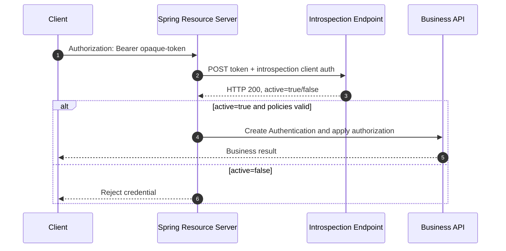
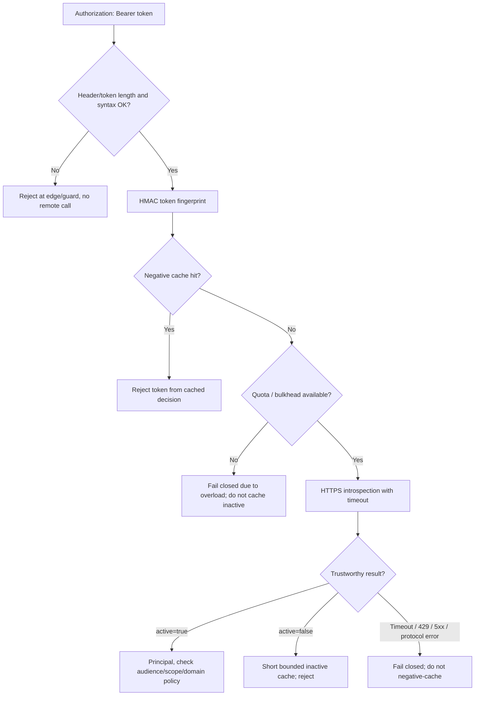

# Caching Invalid Results and Limiting Resources Against Arbitrary Input

When a **Spring Security OAuth 2.0 Resource Server** uses **opaque access tokens**, the application typically must call the Authorization Server's **OAuth 2.0 Token Introspection Endpoint** to check whether a token is still `active` and read attributes accepted by the issuer. Unlike local JWT signature verification, each introspection call can trigger an HTTP request, consuming connections, threads, CPU, memory, and Authorization Server quota.

Because a Bearer token is **client-supplied input**, a caller can send an invalid string, an enormous token, or thousands of different random strings. If the Resource Server forwards all of them to the introspection endpoint without limits, an attacker can turn the API into a traffic amplifier and exhaust resources on both the API and the Identity Provider (IdP). One commonly proposed optimization is **negative caching**: temporarily remembering tokens already determined by the IdP to be inactive to avoid repeated introspection.

However, negative caching is not a safe default for every failure. Distinguish clearly:

- **`active: false` returned by an authenticated, protocol-valid introspection response**: you may consider caching the inactive state briefly and within bounds.
- **Timeouts, 429s, 5xxs, TLS errors, introspection client authentication errors, malformed responses**: **not proof that the token is invalid**; never cache those errors as an `active: false` conclusion.
- **Overly long or syntactically invalid strings at ingress**: should be blocked early before making a network request; there is usually no need to store every such string in a negative cache.

This lesson belongs to the **Introspection Customization** chapter in Spring Security Resource Server. Examples use the Servlet stack, Spring Boot 3, and Spring Security 6, with Caffeine for bounded caching. When using a specific version, check the `OpaqueTokenIntrospector` API and delegate implementation; TTLs, cache sizes, and concurrency numbers in this lesson are **illustrative assumptions**, not optimal configurations for every system.

## 1. What Is Introspection and Why Does It Affect Availability?

OAuth 2.0 Token Introspection (RFC 7662) defines a way for a Resource Server to ask an Authorization Server about a token's status. Common Spring Boot configuration:

```yaml
spring:
  security:
    oauth2:
      resourceserver:
        opaquetoken:
          introspection-uri: https://identity.example.com/oauth2/introspect
          client-id: ${INTROSPECTION_CLIENT_ID}
          client-secret: ${INTROSPECTION_CLIENT_SECRET}
```

Request path:



Example successful response for an active token:

```json
{
  "active": true,
  "sub": "user-123",
  "scope": "orders.read",
  "client_id": "web-app",
  "aud": ["orders-api"],
  "iss": "https://identity.example.com",
  "exp": 1900000000
}
```

Response for an **inactive** token:

```json
{
  "active": false
}
```

In RFC 7662, an inactive response should avoid returning unnecessary details so it does not leak internal token state. `active: false` can cover nonexistent tokens, expired tokens, revoked tokens, or tokens the Resource Server is not allowed to inspect. **Never return detailed reasons to callers classifying tokens belonging to others.**

A proper Resource Server handles both introspection validity **and** business policy: an `active: true` token does not automatically permit reading every order. It must still check audience/token profile, scopes, and tenant/owner per the deployed contract.

## 2. `OpaqueTokenIntrospector` in Spring Security

Spring Security provides the interface:

```java
package org.springframework.security.oauth2.server.resource.introspection;

public interface OpaqueTokenIntrospector {
    OAuth2AuthenticatedPrincipal introspect(String token);
}
```

This is a simplified signature for explanation. When the method returns an `OAuth2AuthenticatedPrincipal`, the token is accepted by the delegate. When the token is invalid or introspection fails, the method may throw an exception from Spring Security's introspection hierarchy.

In a typical opaque-token Resource Server:

```text
BearerTokenAuthenticationFilter
    -> OpaqueTokenAuthenticationProvider
    -> OpaqueTokenIntrospector.introspect(rawToken)
    -> OAuth2AuthenticatedPrincipal
    -> BearerTokenAuthentication in SecurityContext
```

After authentication, Spring Security normally maps scopes to `SCOPE_*` authorities for the authorization layer to check. A Resource Server using **opaque introspection** does not produce a `JwtAuthenticationToken` by default: that belongs to a JWT Resource Server.

A custom `OpaqueTokenIntrospector` can:

- Reject overly long or malformed tokens.
- Cap concurrent introspection requests.
- Control timeouts, caching, and upstream response limits.
- Perform conditional negative caching.
- Check additional token profile rules or transform the principal if needed.

When the application declares its own introspector bean, Spring Boot normally defers to that bean. Therefore, a custom wrapper must **call a trusted delegate that genuinely verifies token state**, never constructing a principal for arbitrary input strings.

## 3. Three Result Categories That Must Not Be Merged

| Result Group | Upstream Signal | Security Meaning | Should Negative-Cache? |
| --- | --- | --- | --- |
| **Active** | HTTP 200, `active: true`, valid response | Token is currently accepted by introspection. | **No** negative caching; consider separate positive caching. |
| **Confirmed inactive** | HTTP 200, `active: false`, valid response | Token is currently not accepted from the introspection client's perspective. | **Possible**, short and bounded TTL. |
| **Upstream unavailable** | Timeout, connection refused, TLS error, 5xx | Token state could not be determined. | **No.** |
| **Throttled** | HTTP 429 or service limit | IdP refuses additional requests right now. | **Do not** treat token as inactive. |
| **Client authentication failed** | HTTP 401/403 from introspection endpoint | Resource Server credentials wrong/expired or not permitted to introspect. | **Do not** treat token as inactive. |
| **Malformed introspection response** | Broken JSON, missing required fields, unexpected Content-Type | No trustworthy conclusion about the token. | **No.** |
| **Input rejected locally** | Empty token, too long, forbidden characters | Introspection skipped; no conclusion from issuer. | Usually **no need** to negative-cache. |

For `active: false`, rejecting the token is appropriate. For timeouts/5xx, **never let the request pass** just because the IdP is failing: that is *fail closed*. Yet *fail closed* does not mean "write into the cache that this token is inactive." Keeping these separate prevents a brief IdP blip from turning into thousands of prolonged rejections caused by the cache.

A handy rule of thumb:

> **Being unable to check a token** is different from **having checked and knowing the token is inactive**.

## 4. Why Is Negative Caching Attractive?

Suppose a buggy client resends **the exact same expired Bearer token** 200 times in a short interval. Without caching:

```text
200 requests to API
  -> 200 introspection requests
  -> 200 active=false responses
```

With a short-TTL negative cache:

```text
First request       -> introspection -> active=false -> store in cache
Next 199 requests   -> cache hit -> reject at Resource Server
```

This can cut load significantly when **the same invalid token repeats**.

The benefit looks completely different when an attacker sends **200 different random tokens**:

```text
invalid-A
invalid-B
invalid-C
...
invalid-200
```

Every value is a **cache miss**. If the cache is unbounded, the attacker can fill memory; if the cache is bounded, they can churn it and evict useful entries. **Negative caching is not rate limiting and does not stop a random-token spray attack on its own.**

## 5. Negative Caching Is Still Caching Security Data

RFC 7662 allows Resource Servers to consider caching introspection responses while weighing the trade-off between freshness and network cost. With positive caching, the typical risk is **a recently revoked token still being accepted during the TTL**. With negative caching, the typical risk is **a token that just became valid still being rejected due to a stale result**.

Inactive → active transitions may be rare when token identifiers are never reused, yet you must still consider:

- **Eventual consistency**: a token was just issued in one IdP region while another introspection region has not synchronized yet and temporarily returns inactive.
- **Per-client/audience introspection permissions**: the same token may appear inactive to a client lacking inspection authority, without necessarily being worthless everywhere.
- **Misconfiguration or rollout**: an upstream temporarily returns wrong data that the negative cache retains.
- **Token identifier reuse**: issuers should not reuse identifiers unsafely, yet a Resource Server must not assume every system guarantees never reusing them.

If the TTL is too long, an inactive conclusion can cause an **availability incident** even after upstream recovery. If a positive cache TTL is too long, revocation security risk increases. Both caches must be designed and measured separately.

## 6. Distinguishing Negative Caches from Rate Limiters

| Component | Typical Key | Goal | What It Cannot Solve |
| --- | --- | --- | --- |
| **Negative cache** | Token fingerprint + introspection security context | Skip repeated introspection for confirmed-inactive tokens. | New random tokens, distributed DDoS. |
| **Rate limiter** | IP/source, client identity, tenant, route, global bucket | Limit request rate per source/context. | Cannot determine whether a token is active/inactive. |
| **Concurrency bulkhead** | Per instance or per introspection upstream | Cap simultaneous in-flight introspections. | Does not filter invalid requests over time. |
| **Timeout** | Single HTTP introspection call | Prevent threads/connections from waiting forever. | Does not reduce total request count by itself. |
| **Max token length** | Per request before introspection | Avoid processing huge strings over network/cache/HMAC. | Many small, distinct tokens. |
| **Max cache entries** | Entire cache or per namespace | Prevent unbounded memory growth. | Cache churn or network load. |
| **Circuit breaker** | IdP dependency health | Fail fast when upstream fails per policy. | Cannot validate tokens while circuit is open. |

These layers **complement one another**. When a token hits the negative cache, the system should still enforce ingress traffic limits per policy; never use a cache hit as a shortcut to bypass other controls.

## 7. Enforce Token Size Before Computing Fingerprints or Calling the Network

The `String token` entering an introspector might come from an adapter other than the default `BearerTokenResolver`, so the wrapper must still protect itself.

A sensible order:

```text
1. Receive token
2. Check null/empty/length bounds
3. Check character policy if contracted
4. Compute fixed-size fingerprint
5. Check negative cache
6. Check quota/concurrency
7. Only then call introspection endpoint
```

Illustrative guard:

```java
import org.springframework.security.oauth2.server.resource.introspection.BadOpaqueTokenException;

public final class TokenInputGuard {

    private static final int MAX_TOKEN_CHARS = 4096;

    public static void requireReasonableToken(String token) {
        if (token == null || token.isEmpty()
                || token.length() > MAX_TOKEN_CHARS) {
            throw new BadOpaqueTokenException(
                "Bearer token is malformed or too large");
        }

        for (int i = 0; i < token.length(); i++) {
            char ch = token.charAt(i);
            if (ch <= 0x20 || ch >= 0x7F) {
                throw new BadOpaqueTokenException(
                    "Bearer token contains unsupported characters");
            }
        }
    }

    private TokenInputGuard() {}
}
```

**The 4096-character limit is illustrative**; measure actual tokens issued by your issuer, including long opaque tokens, custom formats, or JWT-shaped tokens sharing the same boundary. Setting it too low rejects valid credentials; setting it too high reduces abuse protection.

This is an **application guard**, not a replacement for HTTP server/ingress limits. `token.length()` counts UTF-16 code units; if exact HTTP byte limits are needed, configure them at ingress/server and consider protocol encoding. For standard ASCII Bearer tokens, character count is typically close to byte count.

Never log the raw token value when the guard rejects; nor include the token in the exception message.

## 8. Defense in Depth from Outside In: Ingress First, Introspector Second

An oversized string can consume resources **before `OpaqueTokenIntrospector` is ever invoked**: reverse proxies parse headers, servlet containers allocate buffers, Spring Security reads `Authorization`, loggers format messages. Therefore:

1. Configure **HTTP request header size limits** at ingress/reverse proxies and the server.
2. Bound concurrent connections, rates, and request bodies at the edge.
3. Use the default `BearerTokenResolver` or customize carefully; avoid accepting tokens in query strings without strong justification and URL/log protections.
4. Place token length checks **before HMAC, cache lookup, and remote calls** inside the introspector.
5. Also bound **response size** and JSON processing time from the introspection endpoint so a malfunctioning upstream cannot trigger uncontrolled RAM/CPU usage.

Spring Boot has header-limit properties and server/connector settings depending on version, yet never copy one property and assume it protects every upstream proxy. Verify real limits at each hop.

## 9. Cache Keys Must Never Contain Raw Bearer Tokens

An anti-pattern:

```java
cache.put(rawToken, Boolean.FALSE);
```

Even when the cache lives solely inside the JVM, raw tokens can leak via heap dumps, debuggers, snapshots, logs, or metrics. A Bearer token is a **reusable credential** until it expires or is revoked.

A better approach is a **fixed-size one-way fingerprint**:

```text
cacheKey = HMAC-SHA256(secret, rawToken)
```

HMAC with an application-specific key limits guessing token values from a cache dump compared to plaintext storage; it does not replace memory-access controls and protecting the HMAC key. This key is **different from** the `client-secret` used to authenticate to the introspection endpoint and must never be hardcoded in source.

In many cases, tokens already have high entropy and a SHA-256 digest suffices to avoid keeping raw tokens as keys; HMAC adds protection for tokens with uncertain entropy. Either way, you must:

- **Never** log raw tokens, the HMAC key, or full token fingerprints in metric labels.
- Bound input length **before** hashing/HMACing.
- Never use predictable hashes like `String.hashCode()` as security identifiers due to collisions and inadequate width.
- Namespace by **introspection endpoint/issuer/client identity/token profile** if sharing one cache across multiple delegates.
- Handle HMAC key rotation (usually causing old cache entries to miss naturally) and distribute secrets via a secret manager.

## 10. Why Must Cache Keys Include Context?

Suppose API A and API B see the same token string, yet:

```text
API A introspection client -> permitted to inspect token A
API B introspection client -> not permitted to know about token A
```

RFC 7662 allows returning `active: false` when a Resource Server is not authorized to know about a token. If two APIs share a negative cache keyed only by `tokenFingerprint`, API B's result could **cause API A to reject a valid token**.

Design:

```text
namespace = configured introspection endpoint + client identity + token policy
key       = namespace + ":" + HMAC(rawToken)
```

Within an application having a single `OpaqueTokenIntrospector` and a private cache for that bean, the namespace is already somewhat **isolated per instance**. Once you move to Redis or share across issuers/tenants, context partitioning is mandatory. Never extract an issuer from an unverified token and use it as proof or an arbitrary query URL.

If the Authorization Server changes audience policies, introspection client scopes, or credentials across deployments, you may need to **invalidate affected caches** or bump a namespace version. An inactive entry is not a global truth for every introspection client.

## 11. Choosing Negative Cache TTL: Short and Intentional

An illustrative configuration:

```text
negative TTL:        2 seconds
max entries:         5,000
max in-flight calls: 32 / API instance
```

This is a **starting point for discussion**, not a Spring or RFC mandate. Base your choice on:

| Factor | Effect on TTL |
| --- | --- |
| Token issuance sync lag across regions | Longer TTLs keep newly issued tokens rejected longer. |
| Repeated invalid-token traffic | Short TTLs can still cut requests significantly. |
| Near-real-time requirement | Shorter TTLs reflect new state sooner. |
| Introspection endpoint limits | Caching TTL/bounds shed load, but must pair with rate limits. |
| Possibility of token reuse or state recovery | Do not negative-cache long if upstream semantics can flip. |
| Multiple Resource Server instances | Each instance has its own cache and staggered expiration times. |

If the IdP uses a distributed datastore that may briefly return inactive right after issuance, negative caching can **prolong** those errors. When high accuracy is critical, **skip negative caching** or use a tiny TTL, addressing load via rate limits and capacity elsewhere.

In particular: **never use `exp` from a client-parsed JWT to set TTL for an opaque token**. Token semantics and metadata must come from a trusted introspection response, not unverified input.

## 12. Bounding Entry Counts and Preventing Cache Pollution

An unbounded cache can become an attack target:

```text
for each fake random token:
    response active=false
    cache inserts a new entry
```

Simply generating enough distinct strings makes an unbounded cache grow endlessly. Use a bounded cache such as Caffeine:

```gradle
dependencies {
    implementation 'org.springframework.boot:spring-boot-starter-security'
    implementation 'org.springframework.boot:spring-boot-starter-oauth2-resource-server'
    implementation 'com.github.benmanes.caffeine:caffeine'
}
```

```java
import java.time.Duration;

import com.github.benmanes.caffeine.cache.Cache;
import com.github.benmanes.caffeine.cache.Caffeine;

Cache<String, Boolean> inactiveTokens = Caffeine.newBuilder()
    .maximumSize(5_000)
    .expireAfterWrite(Duration.ofSeconds(2))
    .build();
```

`maximumSize` caps cached entries per library policy; that does not mean the JVM spends zero extra bytes on metadata/overhead. Because token fingerprints are fixed-size, entry size does not scale with raw token length.

When an attacker sends endless random tokens, a bounded cache **evicts/churns** rather than growing forever. Yet upstream introspection requests can still be high because most fresh tokens are cache misses. Always pair it with **rate limiting and concurrency caps**.

## 13. Why Must You Not Cache Every Exception?

A classic implementation bug:

```java
try {
    return delegate.introspect(token);
} catch (Exception ex) {
    negative.put(fingerprint(token), true);
    throw new BadOpaqueTokenException("Inactive token");
}
```

This is an **unsafe anti-pattern for both correctness and availability**. A 30-second IdP outage could mark countless valid tokens as inactive, continuing to reject them even after the IdP recovers.

Distinguish exceptions carefully:

| Exception / Situation | Meaning | Cache Action |
| --- | --- | --- |
| `BadOpaqueTokenException` thrown by a trusted delegate on a **valid `active:false` response** | Token confirmed inactive under the delegate's contract. | May cache briefly. |
| `OAuth2IntrospectionException` from network, parsing, HTTP errors | No trustworthy token conclusion received. | Do not negative-cache. |
| Timeout or HTTP 429 | Dependency overloaded/unavailable. | Do not negative-cache. |
| Introspection client credential error | Security config/infrastructure error. | Do not negative-cache. |
| Local `BadOpaqueTokenException` for oversized/malformed token | Rejected early; issuer not queried. | Usually do not cache. |

In Spring Security, `BadOpaqueTokenException` **extends** `OAuth2IntrospectionException`. Thus, when catching in code, specific catches must precede broader ones. Still, **class name alone does not prove `active:false` origin**: a custom introspector might throw `BadOpaqueTokenException` for various "invalid in some way" conditions.

**Enable exception-driven negative caching only when you control and understand the delegate's contract guaranteeing that branch reflects a verified inactive response.** If unsure, use an adapter/gateway returning explicit `Active`, `ConfirmedInactive`, `Unavailable` types, or **disable negative caching**.

## 14. A Wrapper Layer: Guard, Bounded Cache, and Concurrency Cap

The example below shows how to wrap an `OpaqueTokenIntrospector` delegate in a controlled way. **Critical precondition:** the delegate must guarantee that its `BadOpaqueTokenException` (from the remote-call branch) represents a confirmed inactive token from a valid response. If using another delegate with broader semantics, **do not catch it to negative-cache**; use the typed-result design in the next section instead.

```java
import java.nio.charset.StandardCharsets;
import java.security.InvalidKeyException;
import java.security.NoSuchAlgorithmException;
import java.time.Duration;
import java.util.Arrays;
import java.util.Base64;
import java.util.concurrent.Semaphore;

import javax.crypto.Mac;
import javax.crypto.spec.SecretKeySpec;

import com.github.benmanes.caffeine.cache.Cache;
import com.github.benmanes.caffeine.cache.Caffeine;
import org.springframework.security.oauth2.core.OAuth2AuthenticatedPrincipal;
import org.springframework.security.oauth2.server.resource.introspection.BadOpaqueTokenException;
import org.springframework.security.oauth2.server.resource.introspection.OAuth2IntrospectionException;
import org.springframework.security.oauth2.server.resource.introspection.OpaqueTokenIntrospector;

public final class GuardedCachingIntrospector
        implements OpaqueTokenIntrospector {

    private static final int MAX_TOKEN_CHARS = 4096;

    private final OpaqueTokenIntrospector delegate;
    private final Cache<String, Boolean> negative;
    private final Semaphore concurrentCalls;
    private final byte[] hmacSecret;

    public GuardedCachingIntrospector(
            OpaqueTokenIntrospector delegate,
            byte[] hmacSecret,
            int maxInFlight) {

        if (hmacSecret == null || hmacSecret.length < 32) {
            throw new IllegalArgumentException(
                "HMAC secret must be at least 32 bytes");
        }
        if (maxInFlight <= 0) {
            throw new IllegalArgumentException(
                "maxInFlight must be positive");
        }

        this.delegate = java.util.Objects.requireNonNull(delegate);
        this.hmacSecret = hmacSecret.clone();
        this.concurrentCalls = new Semaphore(maxInFlight);
        this.negative = Caffeine.newBuilder()
            .maximumSize(5_000)
            .expireAfterWrite(Duration.ofSeconds(2))
            .build();
    }

    @Override
    public OAuth2AuthenticatedPrincipal introspect(String token) {
        // Guard must run BEFORE HMAC, cache, or remote call.
        TokenInputGuard.requireReasonableToken(token);

        String fingerprint = fingerprint(token);
        if (negative.getIfPresent(fingerprint) != null) {
            throw new BadOpaqueTokenException(
                "Bearer token is inactive");
        }

        // Do not form unbounded queues when the IdP is slow.
        if (!concurrentCalls.tryAcquire()) {
            throw new OAuth2IntrospectionException(
                "Introspection capacity temporarily exhausted");
        }

        try {
            // Recheck to avoid redundant calls when the cache was
            // updated while waiting for a permit.
            if (negative.getIfPresent(fingerprint) != null) {
                throw new BadOpaqueTokenException(
                    "Bearer token is inactive");
            }

            return delegate.introspect(token);
        } catch (BadOpaqueTokenException confirmedInactive) {
            // Valid only if the delegate commits that this exception
            // from the remote branch reflects a valid active=false response.
            negative.put(fingerprint, Boolean.TRUE);
            throw confirmedInactive;
        } finally {
            concurrentCalls.release();
        }
    }

    private String fingerprint(String token) {
        try {
            Mac mac = Mac.getInstance("HmacSHA256");
            mac.init(new SecretKeySpec(hmacSecret, "HmacSHA256"));
            byte[] digest = mac.doFinal(
                token.getBytes(StandardCharsets.US_ASCII));
            return Base64.getUrlEncoder()
                .withoutPadding()
                .encodeToString(digest);
        } catch (NoSuchAlgorithmException | InvalidKeyException ex) {
            throw new IllegalStateException(
                "HMAC fingerprint configuration error", ex);
        }
    }
}
```

Protective properties:

1. **Input length/syntax guard** runs before HMAC and before caching.
2. Cache holds only the **HMAC fingerprint**, never the raw token in the key.
3. `maximumSize` and TTL bound negative-cache entry count and lifetime.
4. `Semaphore.tryAcquire()` bounds concurrent introspection calls; overload fails fast instead of queuing indefinitely.
5. **Only** catches `BadOpaqueTokenException` for negative caching under the defined contract; timeouts, 5xx, and connection errors from the delegate are not cached.
6. `finally` releases the permit even when the delegate throws an exception.

**Note on the snippet:** The recheck sits inside `try`, so a `BadOpaqueTokenException` from the recheck passes through the catch block and re-writes an already-present entry. That repeat write does not change the inactive conclusion, though in production implementations you should cleanly separate "confirmed by upstream" so local rejections do not skew confirmed-inactive metrics. A cleaner approach separates the recheck from the delegate's catch block or uses a typed result as shown next.

`Semaphore` protects **each instance**. With 100 pods allowing 32 remote calls each, theoretical peak upstream concurrency can reach thousands of requests; a global rate limiter/IdP quota is still necessary. There is no timeout in this wrapper: **timeouts, connection pooling, and response body caps must be configured on the delegate's HTTP client**.

## 15. Typed Result Design to Avoid Caching the Wrong Error Kind

For critical systems, separate the HTTP introspection caller into a gateway returning explicit states:

```java
sealed interface VerifiedDecision
        permits ActiveDecision, InactiveDecision {}

record ActiveDecision(OAuth2AuthenticatedPrincipal principal)
        implements VerifiedDecision {}

record InactiveDecision()
        implements VerifiedDecision {}

interface VerifiedIntrospectionGateway {
    VerifiedDecision inspect(String token);
}
```

These are **illustrative application types**, not Spring Security interfaces. In a real implementation:

- Return `ActiveDecision` only when the HTTP response from the **trusted configured endpoint** is valid and `active: true`.
- Return `InactiveDecision` only when the HTTP response is valid and `active: false`.
- On timeout/5xx/429/malformed JSON/TLS failure, throw **a distinct unavailable/protocol exception**, never returning `InactiveDecision`.
- Manage credentials for the introspection endpoint securely; client authentication failure is also an infrastructure/configuration error.

The `OpaqueTokenIntrospector` wrapper then uses:

```java
VerifiedDecision decision = gateway.inspect(token);

if (decision instanceof InactiveDecision) {
    negative.put(fingerprint, Boolean.TRUE);
    throw new BadOpaqueTokenException("Bearer token is inactive");
}

if (decision instanceof ActiveDecision active) {
    return active.principal();
}

throw new OAuth2IntrospectionException(
    "No valid introspection decision");
```

This expresses **the provenance of the inactive conclusion** in the type system rather than relying on exception class names or text messages. With an RFC 7662-compliant trusted gateway, it is a clearer guarantee that timeouts will never silently turn into invalid-token cache hits in the future.

This snippet shows the core logic inside a wrapper/gateway that already has `negative` and `fingerprint`; for project use, complete the HTTP client, TLS, parsing/validation, timeouts, and tests.

## 16. A Practical Detail: `BadOpaqueTokenException` Does Not Tell the Whole Story

In Spring Security 6.5, `OpaqueTokenIntrospector` returns `OAuth2AuthenticatedPrincipal` when a token is accepted. `BadOpaqueTokenException` signals a token **invalid in some sense**, not a Java type carrying proof that an `active:false` field was present.

The library's introspection implementation may throw `BadOpaqueTokenException` on an inactive response. Yet if the application uses a custom delegate, it might throw the same exception for malformed tokens, wrong audience, or another policy rule.

Therefore, separate **three concerns**:

1. **Invalid per HTTP input guard**: block early, no need to cache.
2. **Confirmed inactive via introspection**: may cache briefly.
3. **Unable to complete introspection**: fail closed, yet never negative-cache.

Do not write `catch (OAuth2AuthenticationException ex) { negativeCache.put(...); }` or `catch (RuntimeException ex) { ... }` and call it an optimization. With `BadOpaqueTokenException`, cache only when **aligned with the delegate's contract**; if implementations/versions change, update classification.

## 17. Configuring the Custom Introspector Bean in Spring Boot

With Spring Security 6.5+, documentation uses `SpringOpaqueTokenIntrospector` via its builder. Example creating the delegate:

```java
import java.util.Base64;

import org.springframework.beans.factory.annotation.Value;
import org.springframework.context.annotation.Bean;
import org.springframework.context.annotation.Configuration;
import org.springframework.security.oauth2.server.resource.introspection.OpaqueTokenIntrospector;
import org.springframework.security.oauth2.server.resource.introspection.SpringOpaqueTokenIntrospector;

@Configuration
public class IntrospectionConfig {

    @Bean
    OpaqueTokenIntrospector opaqueTokenIntrospector(
            @Value("${app.security.introspection-uri}") String uri,
            @Value("${app.security.introspection-client-id}") String clientId,
            @Value("${app.security.introspection-client-secret}") String secret,
            @Value("${app.security.cache-hmac-key-base64}") String hmacKey) {

        OpaqueTokenIntrospector delegate =
            SpringOpaqueTokenIntrospector
                .withIntrospectionUri(uri)
                .clientId(clientId)
                .clientSecret(secret)
                .build();

        return new GuardedCachingIntrospector(
            delegate,
            Base64.getDecoder().decode(hmacKey),
            32
        );
    }
}
```

Custom properties:

```yaml
app:
  security:
    introspection-uri: https://identity.example.com/oauth2/introspect
    introspection-client-id: ${INTROSPECTION_CLIENT_ID}
    introspection-client-secret: ${INTROSPECTION_CLIENT_SECRET}
    cache-hmac-key-base64: ${INTROSPECTION_CACHE_HMAC_KEY_B64}
```

**Never commit client secrets or HMAC secrets to the repository.** Configure a secret manager, TLS, and strict credential read permissions. The bean example uses a wrapper catching `BadOpaqueTokenException`; as noted, this is **appropriate only when the delegate's semantics are verified**. When you want to cache strictly `active:false` responses, replace it with `VerifiedIntrospectionGateway` and typed results.

When providing a custom `OpaqueTokenIntrospector` bean, Boot may **stop creating a default introspector**. The security chain still needs opaque tokens enabled:

```java
@Bean
SecurityFilterChain apiSecurity(HttpSecurity http) throws Exception {
    return http
        .securityMatcher("/api/**")
        .authorizeHttpRequests(auth -> auth
            .requestMatchers(HttpMethod.GET, "/api/orders/**")
                .hasAuthority("SCOPE_orders.read")
            .anyRequest().denyAll())
        .oauth2ResourceServer(oauth2 -> oauth2
            .opaqueToken(Customizer.withDefaults()))
        .build();
}
```

This example assumes appropriate Spring Security and `HttpMethod` imports. `securityMatcher("/api/**")` scopes the chain to that path; the application must have separate policies/fallbacks for other URLs. This is an API demo; evaluate CSRF/sessions if cookies/browser credentials exist.

## 18. Limiting Concurrency to Prevent Saturating the IdP and Thread Pool

A Servlet Resource Server normally blocks the request thread waiting for the synchronous introspection response. If upstream slows down, waiting requests pile up:

```text
1000 concurrent inbound requests
  -> 1000 request threads
  -> each thread waiting on introspection
  -> exhausts thread pool, connection pool, or IdP quota
```

A **`Semaphore`-based bulkhead** can cap in-flight introspections:

```java
Semaphore permits = new Semaphore(32);

if (!permits.tryAcquire()) {
    throw new OAuth2IntrospectionException(
        "Introspection temporarily overloaded");
}
try {
    return delegate.introspect(token);
} finally {
    permits.release();
}
```

Do not use `acquire()` waiting indefinitely for every request and forming huge in-JVM queues. `tryAcquire()` rejects fast, while **the final HTTP status** depends on Spring Security/application error handling; do not promise every overload automatically returns `503`.

Rate limiting is also needed at ingress:

- Limit requests/s per IP/source and per trusted identity or quota when available.
- Enforce a **global ceiling** for unauthenticated/anonymous Bearer requests, since `client_id` read from an unintrospected token cannot be trusted.
- Maintain separate policies for trusted internal service calls so one consumer cannot starve others.
- Combine bounded retries with timeouts; avoid retry storms slowing the IdP further.

When multiple pods run, per-pod bulkheads **do not replace** aggregate limits at the load balancer, service mesh, or IdP.

## 19. Timeouts, Connection Pools, and Response Size Belong to the HTTP Client

Negative caching helps nothing if an introspection request **has already been sent** and hangs for tens of seconds. Configure:

| Resource | Control |
| --- | --- |
| TCP connect | Reasonable connect timeout. |
| Waiting for response | Read/response timeout matching API and IdP SLOs. |
| Connection count | Per-host and total pool limits. |
| Pool acquisition queue | Bounded wait/timeout, never infinite. |
| Response body | JSON/HTTP size limit to prevent huge responses. |
| Retries | Retry only transient failures when safe, with bounded count/backoff/jitter. |
| TLS | Call only trusted HTTPS introspection endpoints; verify hostname and certificate. |
| DNS/proxy | Pin configured endpoints; avoid URLs from unverified input. |

`OpaqueTokenIntrospector` is an interface, while **how the HTTP client is configured** depends on the implementation: `SpringOpaqueTokenIntrospector`, an older Nimbus version, or a custom delegate each have different APIs. When choosing a custom introspector, ensure timeouts/pools are applied **on the exact client used by the delegate**.

Never treat timeout exceptions as a reason to disable JWT/opaque authentication or return a temporary principal. Without a conclusion from the IdP, **credentials must never be accepted**.

## 20. Circuit Breakers Must Not Turn Into an `active:false` Cache

A circuit breaker helps keep the API from hammering a failing IdP:

```text
IdP healthy -> breaker closed -> introspect normally
IdP failing -> error threshold reached -> breaker open
Breaker open -> fail fast, do not call IdP
After cooldown -> half-open, probe with controlled traffic
```

While the breaker is open, the Resource Server **does not know the state of fresh tokens**. Treat it as a dependency/overload error—never store `token=inactive` in the cache.

For tokens already in a positive cache, stale-usage policies must follow revocation requirements and your threat model; never blindly allow all tokens just because the IdP is down. For recent confirmed negative-cache hits, you may keep rejecting within the designed TTL.

Separate telemetry:

```text
introspection_confirmed_inactive_total
introspection_upstream_timeout_total
introspection_upstream_5xx_total
introspection_bulkhead_rejected_total
introspection_negative_cache_hit_total
```

If everything is lumped into `invalid_token_total`, operators cannot distinguish fake-token abuse from an IdP outage.

## 21. Optimizing Processing Order to Reduce the Impact of Malicious Input

A sound ordering:



The key is **negative-cache lookup after the input guard**, avoiding computing fingerprints and creating cache entries from unbounded strings. Ingress rate limiting can apply **even before this diagram**, stopping sprays of new random tokens before they consume application quota.

On a cache hit, skip the upstream call while still rejecting and applying general abuse limits. On a cache miss, concurrent requests for the same token may introspect simultaneously; if that load is significant, consider **per-fingerprint single-flight/coalescing** with a bounded in-flight map and cancellation/timeouts, avoiding creating unbounded futures for every random token.

## 22. Request Coalescing: The Same Token Can Arrive Concurrently Many Times

Suppose 100 requests with the same invalid token arrive before the first finishes introspecting. The negative cache is still empty; 100 threads could call upstream simultaneously:

```text
cache miss + cache miss + cache miss ...
    -> 100 remote introspections
```

**Single-flight** ensures only **one remote call** executes for an in-progress fingerprint, sharing the result with waiting requests. If implemented without bounds, however, an attacker sending endless random tokens causes the `inFlight` map/queue to grow without limit.

Conditions needed when coalescing:

- Cap the maximum number of in-flight keys, rather than spawning a future for every arbitrary string.
- Set timeouts and clean up even when requests fail or cancel.
- Never retain raw tokens or sensitive credentials in cache keys/maps longer than necessary.
- Never let one stalled token hang and block all waiting requests sharing that fingerprint indefinitely.
- Classify errors: **confirmed inactive** may be negative-cached; timeouts/unavailability may be shared only as transient failures, not as inactive.
- Avoid keeping completed futures around too long, which would freeze an outage.

For moderate-load systems, **bounded cache + bulkhead + rate limiting** may suffice; add single-flight when real telemetry shows repeated concurrent misses for the same token.

## 23. Positive Cache vs. Negative Cache

A Resource Server may also want to cache `active: true` to reduce introspection:

| Cache | Information | Benefit | Main Risk |
| --- | --- | --- | --- |
| **Positive** | Token is active + principal/claims. | Reduces repeated introspection of valid tokens. | Recently revoked tokens stay accepted until TTL/invalidation. |
| **Negative** | Token confirmed inactive. | Avoids re-calling IdP for the same invalid token. | False negatives/stale denials, cache pollution when attackers rotate tokens. |

If positive caching is enabled, TTL must not exceed bounds set by **token expiry** and **revocation freshness requirements**. Ensure scope/permission/tenant claims do not go staler than policy permits; never cache long by default merely because `exp` is far away.

In this lesson, the wrapper example **does not cache positive results**. That is intentional to keep focus on negative caching. If you add positive caching, separately design its security, expiry, eviction, and principal/authority invalidation conditions.

Never use a positive cache to "return a recently valid token" when the introspection endpoint currently returns inactive, unless the system has an explicit stale-accept policy accepting the revocation consequences. In sensitive environments, **stale-accept should normally not be used**.

## 24. Testing Repeated Invalid Tokens: Only One Remote Call Within TTL

A unit test can use Mockito to simulate a delegate known to return inactive:

```java
import static org.junit.jupiter.api.Assertions.assertThrows;
import static org.mockito.Mockito.times;
import static org.mockito.Mockito.verify;
import static org.mockito.Mockito.when;

import java.nio.charset.StandardCharsets;

import org.junit.jupiter.api.Test;
import org.springframework.security.oauth2.server.resource.introspection.BadOpaqueTokenException;
import org.springframework.security.oauth2.server.resource.introspection.OpaqueTokenIntrospector;

class GuardedCachingIntrospectorTest {

    @Test
    void repeatedInactiveTokenUsesShortNegativeCache() {
        OpaqueTokenIntrospector delegate =
            org.mockito.Mockito.mock(OpaqueTokenIntrospector.class);

        when(delegate.introspect("bad-token"))
            .thenThrow(new BadOpaqueTokenException("inactive"));

        byte[] hmacKey =
            "01234567890123456789012345678901"
                .getBytes(StandardCharsets.US_ASCII);

        GuardedCachingIntrospector tested =
            new GuardedCachingIntrospector(delegate, hmacKey, 4);

        assertThrows(BadOpaqueTokenException.class,
            () -> tested.introspect("bad-token"));
        assertThrows(BadOpaqueTokenException.class,
            () -> tested.introspect("bad-token"));

        verify(delegate, times(1)).introspect("bad-token");
    }
}
```

The test assumes this case's **delegate contract**: `BadOpaqueTokenException` represents a confirmed-inactive response. It proves the wrapper's **caching mechanism**, not that a real HTTP client correctly distinguishes `active:false` from timeouts. Protocol-layer tests must use a mock server returning those exact responses.

To test TTLs, inject a controllable clock/ticker or use Caffeine's test ticker instead of `Thread.sleep` in CI tests; otherwise, tests become flaky across machines.

## 25. Testing Timeouts and 5xx: Never Negative-Cache

A far more important case than plain cache hits:

```text
Call 1:
  delegate introspect(token-X) -> timeout / OAuth2IntrospectionException
  wrapper -> rejects request, DOES NOT cache inactive

Call 2:
  delegate introspect(token-X) -> active=true
  wrapper -> accepts valid result
```

If Call 2 skips the delegate due to a negative-cache hit, the code **mistakenly cached an infrastructure failure as an invalid token**.

Mockito illustration:

```java
when(delegate.introspect("token-X"))
    .thenThrow(new OAuth2IntrospectionException("upstream timeout"))
    .thenReturn(validPrincipal);

assertThrows(OAuth2IntrospectionException.class,
    () -> tested.introspect("token-X"));

OAuth2AuthenticatedPrincipal actual =
    tested.introspect("token-X");

assertThat(actual).isSameAs(validPrincipal);
verify(delegate, times(2)).introspect("token-X");
```

This snippet sits in the same test fixture containing `tested`, `delegate`, `validPrincipal`, and matching AssertJ/Mockito imports. Never map `OAuth2IntrospectionException` to `BadOpaqueTokenException` inside the wrapper.

Mandatory variants: HTTP 429, 500, 503, TLS errors, JSON parse failures, introspection client HTTP 401, and malformed responses. In every case, **create no negative-cache entry** from an untrustworthy outcome.

## 26. Testing Token Length Limits and Concurrency

**Oversized token:**

```text
GIVEN token longer than MAX_TOKEN_CHARS
WHEN introspect(token)
THEN rejected at local guard
     delegate is never called
     no cache entry created
```

Verify with `verifyNoInteractions(delegate)` after throwing `BadOpaqueTokenException`.

**Concurrency cap:**

```text
GIVEN delegate blocked on remote I/O
      32 permits are in use
WHEN new request arrives with cache-miss token
THEN fail fast per overload policy
     do not increase in-flight remote calls
     do not negative-cache that token
```

To test concurrency without races, use latches/barriers or a controllable fake executor rather than arbitrary sleeps. Verify that permits are released after exceptions so valid requests after upstream recovery are not starved.

**Cache capacity/churn:**

```text
GIVEN thousands of random invalid tokens
WHEN wrapper receives distinct tokens
THEN cache never exceeds capacity policy
     application still protects upstream via rate/bulkhead limits
```

This test evaluates cache bounds, not full distributed DDoS resilience; add load/ingress tests if required by your threat model.

## 27. Integration Testing the Introspection Protocol

Unit tests with Mockito cannot prove the HTTP client returns the right error types. With an HTTP stub server, simulate:

| Introspection Endpoint Response | Expected Outcome |
| --- | --- |
| HTTP 200, `{"active": false}` | Token rejected; may negative-cache per policy. |
| HTTP 200, `{"active": true, ...}` | Build principal and continue scope/audience checks. |
| HTTP 200, JSON missing `active` | Untrusted token; classify protocol error per implementation. |
| HTTP 200, wrong-typed `active` | Reject; do not treat as confirmed inactive unless contract allows. |
| HTTP 500 | Fail closed, do not negative-cache. |
| HTTP 429 | Enforce retry/rate protection; do not negative-cache. |
| HTTP 401 due to wrong introspection client credentials | Config/client auth error, do not cache inactive. |
| Connection timeout | Fail closed, do not negative-cache, permit released. |
| Huge JSON response | Client response-size cap aborts before exhausting RAM. |
| Two tokens with same fingerprint in different contexts | Never share cache entries across issuers/clients with different authority. |

In this test, ensure the stub checks **POST method**, form content, TLS or equivalent transport config, introspection client authentication, and response parsing. Never use the **API's status returned to the caller** as the sole proof of which state upstream returned.

## 28. Observing Abuse Without Leaking Tokens

Useful operational signals:

| Metric/Log | Meaning |
| --- | --- |
| `introspection_attempt_total{result="active|inactive|error"}` | Classifies actual outcome after upstream calls. |
| `introspection_negative_cache_hit_total` | Savings from repeated inactive tokens. |
| `introspection_local_reject_total{reason="too_long|malformed"}` | Inputs blocked before remote calls. |
| `introspection_bulkhead_reject_total` | API hit in-flight introspection quota. |
| `introspection_http_client_error_total{type="timeout|http429|http5xx|tls"}` | Distinguishes outages from invalid tokens. |
| `introspection_inflight` | Requests currently awaiting upstream. |
| `introspection_latency_seconds` | Upstream latency and overload trends. |
| `introspection_negative_cache_size` | Tracks bounded cache occupancy and churn. |
| `http_authentication_failure_total` | Caller rejection rate; categorized cleanly. |

Never use raw tokens, token fingerprints, `sub`, or untrusted `kid` values as unbounded-cardinality metric labels. Log **request ID**, configured introspection endpoint alias, error category, latency, and cache hit/miss; never log `Authorization`, client secrets, or sensitive response claims.

If `negative_cache_hit` suddenly drops while upstream QPS spikes, an attacker may be spraying **distinct random tokens**. If upstream timeouts rise alongside negative-cache misses, check rate limiters, bulkheads, and IdP capacity instead of reflexively lengthening negative TTLs.

## 29. Multiple Pods: Local Caches and Aggregate Limits

In Kubernetes:

```text
Load balancer
  -> API pod A: negative cache A, bulkhead 32
  -> API pod B: negative cache B, bulkhead 32
  -> API pod C: negative cache C, bulkhead 32
```

A token confirmed inactive on pod A **does not automatically appear in caches B/C**. When the same token is routed across pods, the first introspection may repeat on each pod. In many systems, that is an acceptable cost for simplicity and cache isolation.

If using shared Redis/caching:

- Keys must be namespaced by introspection authority/client context, not just fingerprint.
- TTLs must be short and entries capped by count/bytes per policy.
- Losing Redis connectivity must never make unintrospected tokens appear valid.
- Never store raw Bearer tokens or sensitive principal responses without strong necessity and protection.
- Enforce controls against cache poisoning, read/write permissions, eviction, and key rotation.

**A shared negative cache does not stop random tokens**, because every new token still misses the cache and can create write load on Redis. Independent global rate limits and network policies are required.

## 30. 401 and 503 Errors Should Not Be Treated as Identical

In a Resource Server:

- A token confirmed `active:false` normally leads to **authentication failure**, typically `401` with `WWW-Authenticate: Bearer`.
- An active token lacking scope normally leads to **authorization failure**, typically `403`.
- IdP timeout/429/5xx means **unable to complete authentication**, not proof the token is invalid.

The final HTTP status for upstream errors depends on Spring Security version, exception conversion, and `AuthenticationEntryPoint`/error handling. Some introspection error paths may map to an authentication error; **internal** separation is still essential for metrics, retries, rate limits, and avoiding wrong caching.

If you want to express **dependency temporarily unavailable** as `503` per API contract, build appropriate exception handling and verify it leaks no tokens/secrets/stack traces. Do not assume `throw new OAuth2IntrospectionException(...)` automatically returns `503` in every Spring Security setup.

In all cases, **never "temporarily let through" unverified tokens** to keep the API online. Achieve availability through capacity, rate limits, circuit breakers, timeouts, and IdP design—not by bypassing authentication.

## 31. Random-Token Attacks and Rate-Limit Keys

Before introspection, the Resource Server **does not yet know for sure** which user/client a token represents. Thus, `client_id`, `tenant_id`, or `sub` decoded locally from a token must never be used as an authoritative key for rate limiters.

An edge layer can rate-limit by:

```text
IP/source network
authenticated mTLS client (if present)
separately authenticated API key (if present)
route /api/**
global anonymous/Bearer bucket
```

With NATs or corporate networks sharing an IP, pure per-IP limits can cause false positives. Use a **layered** structure: global limits, per-IP, per-trusted-client, and distinct policies for callers already successfully introspected.

Never create a cache entry for every random token expecting that to stop abuse. An attacker can mint fresh strings cheaply; a bounded cache will simply thrash continuously.

## 32. When Should You Disable Negative Caching?

Not every deployment benefits from negative caching. Consider **leaving it off** when:

- The IdP reflects newly issued token state slowly due to eventual consistency.
- Tokens can be restored/reactivated in legitimate workflows.
- Introspection clients have differing audience policies and the cache is not yet cleanly namespaced.
- You cannot reliably distinguish `active:false` from response/protocol errors.
- Repeated invalid-token volume is low, so caching barely reduces upstream QPS.
- The organization prioritizes the freshest token state and accepts upstream call cost.

In those cases, keep the **input size guard, rate limits, bulkheads, timeouts, and response-size caps** without negative caching. That remains a secure Resource Server design far more resilient to abuse than "forwarding every arbitrary string to the IdP."

## 33. Decision Guide by Operational Goal

| Goal | Primary Solution | Trade-Off |
| --- | --- | --- |
| Cut repeated calls for the same invalid token | Short, bounded negative cache TTL. | Stale denials within TTL; requires accurate inactive classification. |
| Block oversized tokens | Ingress header limits + input guard. | Limits must fit actual token formats. |
| Cap concurrent requests to the IdP | Bulkhead + HTTP pool/timeouts. | Overload requests fail fast; requires clear error policy. |
| Stop random-token sprays | Global/source rate limiting and appropriate WAF/edge controls. | Must avoid harming legitimate users behind NAT. |
| Shed load when IdP is down | Circuit breaker + timeouts + no retry storm. | Cannot verify new tokens while circuit is open. |
| Cut introspection for active tokens | Positive cache with TTL bounded by expiry/revocation policy. | Window where recently revoked tokens stay accepted. |
| Share cache across APIs/issuers | Namespace cache by trusted introspection context. | Increases cache management and invalidation complexity. |
| Debug without leaking credentials | Metrics by error/cache category, trace IDs; never log tokens. | Requires disciplined instrumentation. |

## 34. Runbook When Introspection Is Overloaded

When API CPU, thread pools, or IdP QPS spike abnormally:

1. **Measure repeated vs. distinct tokens.** Negative caching helps significantly only for repeated tokens.
2. **Check HTTP 429/5xx/timeouts** from the introspection endpoint. Never blame every failure on invalid credentials.
3. **Check header and token length limits.** If huge strings still reach the delegate, block them earlier.
4. **Inspect in-flight introspection counts** and thread/connection hold times; verify permits are released after errors.
5. **Review cache capacity/churn** and hit/miss ratios; never grow cache size unboundedly just because misses are high.
6. **Check rate limiters** before authentication; distinguish abuse traffic from outages or a buggy client retrying the same credential.
7. **Observe introspection region/tenant/client** via trusted aliases, never using unverified claims as metric labels.
8. **Review retry/circuit-breaker policies** and avoid stacked retry layers multiplying upstream load.
9. **Analyze TTL impact** on newly issued un-synced tokens and recently revoked tokens.
10. **Recover while staying fail closed**; never introduce a temporary authentication bypass.

In post-incident reviews, separate **confirmed inactive**, **input rejected locally**, **upstream unavailable**, and **capacity rejected** rates. When those numbers are merged, operators cannot tell whether to scale the IdP or tune rate limits.

## 35. Concluding Principles

1. **Opaque tokens are untrusted input.** Spring Security produces a trusted principal only after proper introspection and validation.
2. **Caching `active:false` is not caching errors.** Only an inactive conclusion confirmed by a trusted response is eligible for negative caching.
3. **Negative caches must be bounded with short TTLs.** Random-token sprays still miss the cache and require dedicated rate limiting.
4. **Filter inputs before hashing/caching/remote calls.** Header sizes, token length, control characters, and response bounds must be enforced at the right layers.
5. **Cache keys must never contain raw Bearer tokens.** Use one-way fingerprints; namespace by issuer/introspection client/policy when shared.
6. **Bound network resources.** Timeouts, connection pools, concurrent calls, circuit breakers, and retry policies must have upper bounds.
7. **Fail closed when the IdP is unavailable, without misreporting.** Unavailable differs from inactive; HTTP status/error telemetry must distinguish them.
8. **Never confuse authentication with authorization.** `active:true` still requires checking audience, scopes, tenant, and ownership per API contract.
9. **Test negative cases thoroughly.** Repeated invalid tokens, random tokens, oversized tokens, 429/5xx/timeouts, HMAC namespacing, concurrency, cache eviction, and revocation.
10. **If inactive cannot be classified reliably, disable negative caching.** Keeping other resource limits is far safer than caching an outage as an invalid token.

### References

- [RFC 7662 — OAuth 2.0 Token Introspection](https://www.rfc-editor.org/rfc/rfc7662.html): `active` status, inactive responses, and security/performance considerations when caching introspection.
- [Spring Security 6.5 — OAuth 2.0 Resource Server Opaque Token](https://docs.spring.io/spring-security/reference/6.5/servlet/oauth2/resource-server/opaque-token.html): opaque token config, `OpaqueTokenIntrospector`, and post-authentication principal.
- [Spring Security 6.5 API — `OpaqueTokenIntrospector`](https://docs.spring.io/spring-security/reference/6.5/api/java/org/springframework/security/oauth2/server/resource/introspection/OpaqueTokenIntrospector.html): successful introspection contract and principal.
- [Spring Security 6.5 API — `BadOpaqueTokenException`](https://docs.spring.io/spring-security/site/docs/6.5.x/api/org/springframework/security/oauth2/server/resource/introspection/BadOpaqueTokenException.html): exception representing an invalid opaque token, to be distinguished from upstream errors.

**Key takeaway:** Negative caching cuts repeated introspection for **the same confirmed-inactive token**, yet does not shield an API from **high-cardinality arbitrary input** and must never record timeouts, 429s, or 5xxs as "invalid tokens." A resilient Resource Server designs **clear result classification, short bounded caches, safe fingerprints, edge and application token guards, rate limits, bulkheads, timeouts, and error-path tests**—always rejecting unverified credentials without distorting the Authorization Server's conclusions.
