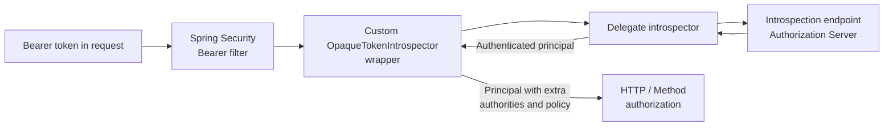
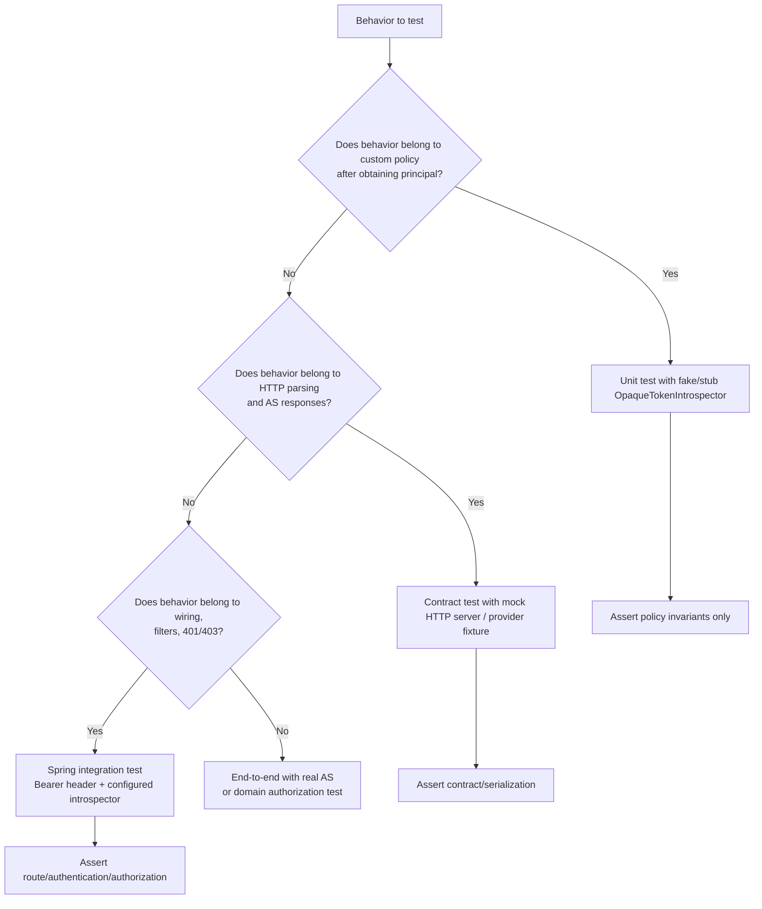

# Testing Customizations Independently of Provider Responses

In a **Spring Security OAuth 2.0/OIDC Resource Server**, when an API accepts **opaque access tokens**, the application typically uses `OpaqueTokenIntrospector` to ask the Authorization Server (AS) whether the token is still active and retrieve attributes for authentication and authorization. From the introspection attributes, Spring Security creates an `OAuth2AuthenticatedPrincipal` with `GrantedAuthority` instances, such as `SCOPE_orders.read`.

Applications sometimes need post-introspection customization: checking audience against a custom contract, normalizing a tenant claim, mapping an issuer-confirmed extended permission, or restricting the authority set. A common testing mistake is having **every unit test call a live IdP environment**, or embedding an entire vendor-specific JSON response in every test. Such tests easily break due to networking, tenant/client configuration, shifting test data, or JSON details unrelated to the logic under test.

A more reliable approach is **separating the remote introspection boundary from the application's custom processing**:

1. Let a trusted `OpaqueTokenIntrospector` handle sending the token to the AS and returning a verified `OAuth2AuthenticatedPrincipal`.
2. Put application logic in a **decorator/wrapper** that receives the verified principal and returns a principal with additional policy applied.
3. **Unit test the wrapper** with a fake/stub/mock `OpaqueTokenIntrospector` that constructs minimal principals matching the contract. These tests involve no HTTP, no client secrets, and no IdP dependency.
4. Write separate **contract tests** to verify assumptions about provider metadata structure/scope, and separate **integration tests** to verify wiring, HTTP introspection, Bearer filtering, and authorization.

The goal is not "never test against a real IdP." The goal is **giving each test layer a clear scope**, so bugs in custom policy are not conflated with network failures or provider-side changes.

## 1. Responsibility Boundary: Do Not Test the Whole World in One Unit Test

Consider an Orders API accepting an opaque token with these requirements:

- The token must be confirmed active by the AS.
- Issuer must be `https://idp.example.com/realms/shop`.
- Audience must contain `orders-api`.
- The AS's `orders.read` scope remains mapped to `SCOPE_orders.read`.
- If the AS returns a custom permission `order:approve`, the API may add `PERMISSION_order:approve`; unapproved permissions must be ignored.



Here the **unit under test** is the wrapper. The wrapper **should not reimplement** token verification against the AS. It only:

- Calls the delegate once with the token.
- Receives the `OAuth2AuthenticatedPrincipal` or lets the delegate's error propagate.
- Validates attributes required by the contract.
- Maps additional or restricted permissions intentionally.
- Preserves trusted attributes and authorities returned by the delegate.
- Never creates a "default-privileged" principal when the delegate fails.

### 1.1. Three Test Types Answering Three Different Questions

| Test Type | Primary Question | Needs a Live IdP? |
|---|---|---|
| **Customization unit tests** | Does the wrapper validate issuer/audience, preserve scopes, map permissions, and handle errors properly? | **No** |
| **Contract/adapter tests** | Does the delegate/parser interpret `active`, `scope`, `aud`, and `iss` responses as promised by the provider? | Can use controlled mock HTTP responses/fixtures; verify periodically against a provider environment |
| **Integration/end-to-end tests** | Does the Spring Security filter chain actually use the wrapper, call the AS, authenticate tokens, and enforce authorization rules? | Can use a mock server for stability; supplement with tests on a real IdP integration environment |

**Unit tests do not prove tokens are genuinely verified by the AS.** Conversely, an end-to-end test against a real IdP does not easily cover every failure branch in a custom mapper, because crafting tokens with missing audiences or malformed metadata can be difficult and flaky.

## 2. Understanding the Input of `OpaqueTokenIntrospector`

Spring Security defines the core interface:

```java
import org.springframework.security.oauth2.core.OAuth2AuthenticatedPrincipal;
import org.springframework.security.oauth2.server.resource.introspection.OpaqueTokenIntrospector;

public interface OpaqueTokenIntrospector {
    OAuth2AuthenticatedPrincipal introspect(String token);
}
```

This is the **programming boundary** that the application can implement, wrap, or mock. `String token` is the bearer credential; **never log it or include it in exceptions**. When the token is validly verified, the delegate returns a principal containing:

```java
principal.getName();
principal.getAttributes();
principal.getAttribute("sub");
principal.getAuthorities();
```

With a typical introspection response:

```json
{
  "active": true,
  "scope": "orders.read orders.update",
  "iss": "https://idp.example.com/realms/shop",
  "sub": "user-842",
  "aud": ["orders-api"],
  "client_id": "shop-web",
  "tenant_id": "tenant-a"
}
```

the delegate typically converts `orders.read` and `orders.update` into `SCOPE_orders.read` and `SCOPE_orders.update` authorities. However, **attribute normalization, the Java type of each claim, and metadata coverage depend on implementation, version, and contract**. For example, `aud` may be represented by the library as a `String` or a collection; a `permissions` extension may not be mapped automatically.

### 2.1. Why Mock the Principal Instead of the JSON Response?

If custom logic **only sees `OAuth2AuthenticatedPrincipal`**, tests should provide the exact data type at that **direct boundary**:

```text
Test data:
  name = user-842
  attributes:
    iss = https://idp.example.com/realms/shop
    aud = ["orders-api"]
    permissions = ["order:approve"]
  authorities:
    SCOPE_orders.read
```

Benefits:

- No need to know whether the provider endpoint path is `/oauth/introspect` or `/oauth2/introspect`.
- No need to send test client IDs/secrets.
- Not dependent on whether a test token expired or was revoked.
- No need to know the delegate's JSON serializer or HTTP library.
- Tests verify the wrapper's actual logic rather than network assumptions.

Conversely, when you want to test **converting introspection JSON into a principal**, that is a contract/adapter test, and the JSON response becomes the appropriate fixture.

### 2.2. Do Not Confuse a Fake Principal with Real Verification

In unit tests, `DefaultOAuth2AuthenticatedPrincipal` is constructed directly without proving `active:true` or token validity. That is a **deliberate assumption**: "the delegate already finished verification and returned a principal." If production code lets untrusted callers construct principals bypassing the delegate, the design is insecure even if all unit tests pass.

You must have at least one layer of integration tests or configuration verification confirming the application **genuinely invokes the delegate** on Bearer tokens.

## 3. Choosing a Testable Customization Architecture

### 3.1. Do Not Mix HTTP Calls and Policy in One Long Method

An implementation that is hard to test typically packs everything together:

```text
introspect(token):
  manually build URL and HTTP request
  manually attach client secret
  manually parse provider JSON
  manually guess scopes
  manually attach roles
  manually check audience
  manually cache
  manually build Authentication
```

A unit test for such a method has to mock HTTP, JSON, timeouts, caching, and business policy simultaneously. It is also prone to *fail-open* bugs: when the AS request fails, code falls back to returning a privileged principal.

Recommended architecture:

```text
HTTP/TLS + client auth + active/token state
              |
              v
   Delegate OpaqueTokenIntrospector
              |
              v
      OAuth2AuthenticatedPrincipal
              |
              v
     Custom Policy / Decorator
       - issuer/audience validation
       - optional tenant requirement
       - permission allowlist mapping
       - preserve SCOPE_ authorities
              |
              v
       Policy-bound Principal
              |
              v
     Spring Security Authorization
```

Such a wrapper depends on the **interface**, not on a concrete implementation class or an IdP's specific JSON:

```java
public final class ShopPolicyIntrospector
        implements OpaqueTokenIntrospector {

    private final OpaqueTokenIntrospector delegate;

    public ShopPolicyIntrospector(OpaqueTokenIntrospector delegate) {
        this.delegate = delegate;
    }

    @Override
    public OAuth2AuthenticatedPrincipal introspect(String token) {
        OAuth2AuthenticatedPrincipal principal =
            delegate.introspect(token);

        // Contract checks and authority mapping go here.
        return principal;
    }
}
```

This is just a **skeleton**; the next section implements a full policy and tests. The key point up front: the delegate is an **injected dependency**, so unit tests can replace it with a stub/mock without calling the IdP.

### 3.2. Defining the Decorator's Data Boundary

Assume the Orders API contract:

1. `iss` must equal the trusted issuer.
2. `aud` must contain `orders-api` (supports a single string or a collection).
3. The delegate is responsible for verifying the token and supplying baseline `SCOPE_...` authorities.
4. `permissions` is an extension claim **issued by the trusted AS**; only `order:approve` maps to `PERMISSION_order:approve`.
5. If `permissions` is absent, keep scopes only; if present with the wrong format, reject the token per contract policy.
6. Never turn an unfamiliar permission into a new authority; never add `SCOPE_orders.read` if the delegate lacked it.
7. Beyond mapping, per-order owner/tenant permissions are still checked in the business service.

This is an **illustrative choice**, not a universal standard for every AS. If the provider omits `iss` or `aud`, negotiate the contract or design an equivalent token-resource binding mechanism; never lower verification standards by simply dropping the check.

## 4. Example Implementation: HTTP-Independent Policy Wrapper

The example below uses Spring Security Servlet and Java 17+ (suitable for Spring Boot 3.x). The wrapper makes no network calls itself and only inspects the principal returned by the delegate:

```java
import java.util.Collection;
import java.util.LinkedHashSet;
import java.util.Map;
import java.util.Objects;
import java.util.Set;

import org.springframework.security.core.GrantedAuthority;
import org.springframework.security.core.authority.SimpleGrantedAuthority;
import org.springframework.security.oauth2.core.DefaultOAuth2AuthenticatedPrincipal;
import org.springframework.security.oauth2.core.OAuth2AuthenticatedPrincipal;
import org.springframework.security.oauth2.server.resource.introspection.BadOpaqueTokenException;
import org.springframework.security.oauth2.server.resource.introspection.OpaqueTokenIntrospector;

public final class ShopPolicyIntrospector
        implements OpaqueTokenIntrospector {

    private final OpaqueTokenIntrospector delegate;
    private final String expectedIssuer;
    private final String expectedAudience;

    public ShopPolicyIntrospector(
            OpaqueTokenIntrospector delegate,
            String expectedIssuer,
            String expectedAudience) {
        this.delegate = Objects.requireNonNull(delegate);
        this.expectedIssuer = Objects.requireNonNull(expectedIssuer);
        this.expectedAudience = Objects.requireNonNull(expectedAudience);
    }

    @Override
    public OAuth2AuthenticatedPrincipal introspect(String token) {
        // This call must verify the token with a trusted source.
        // If the delegate throws, never grant fallback permissions.
        OAuth2AuthenticatedPrincipal source = delegate.introspect(token);

        if (!expectedIssuer.equals(source.getAttribute("iss"))) {
            throw new BadOpaqueTokenException(
                "Token issuer is not accepted");
        }

        Object rawAudience = source.getAttribute("aud");
        boolean audienceMatches =
            (rawAudience instanceof String aud
                && expectedAudience.equals(aud))
            || (rawAudience instanceof Collection<?> audiences
                && audiences.contains(expectedAudience));

        if (!audienceMatches) {
            throw new BadOpaqueTokenException(
                "Token audience is not accepted");
        }

        // Preserve existing SCOPE_... authorities returned by the delegate.
        Set<GrantedAuthority> authorities =
            new LinkedHashSet<>(source.getAuthorities());

        Object rawPermissions = source.getAttribute("permissions");
        if (rawPermissions != null) {
            if (!(rawPermissions instanceof Collection<?> permissions)) {
                throw new BadOpaqueTokenException(
                    "Malformed permissions claim");
            }

            for (Object permission : permissions) {
                if (!(permission instanceof String value)) {
                    throw new BadOpaqueTokenException(
                        "Malformed permission entry");
                }

                // Never add unapproved values to authorities.
                if ("order:approve".equals(value)) {
                    authorities.add(new SimpleGrantedAuthority(
                        "PERMISSION_order:approve"));
                }
            }
        }

        Map<String, Object> attributes = source.getAttributes();

        return new DefaultOAuth2AuthenticatedPrincipal(
            source.getName(),
            attributes,
            authorities
        );
    }
}
```

**Why is this pattern easy to test?** The constructor accepts an `OpaqueTokenIntrospector`, so tests can substitute any tiny implementation of the interface, even a lambda. No `RestClient`, `WebClient`, hostnames, client secrets, or vendor tenants appear inside the permission-checking logic.

### 4.1. What This Wrapper Guarantees

| Condition | Handling |
|---|---|
| Delegate authenticates successfully | Receive principal and apply policy |
| Delegate reports invalid token | Exception propagates; no fallback principal created |
| Wrong or missing `iss` | Throws `BadOpaqueTokenException` |
| Wrong or missing `aud` | Throws `BadOpaqueTokenException` |
| `scope` already mapped by delegate to `SCOPE_orders.read` | Authority preserved |
| `order:approve` permission present in valid format | Adds `PERMISSION_order:approve` |
| `super-admin` permission or any unfamiliar value | Never grants corresponding role/permission |
| `permissions` absent | Keeps default authorities; adds no permission |
| `permissions` has non-contract type | Rejects token per illustrative policy |

`LinkedHashSet` removes duplicate authorities without altering permissions semantically. If the application needs to **restrict or strip** certain authorities created by the delegate, establish an explicit policy; never silently drop or rewrite scopes without understanding their meaning.

### 4.2. Important Limitations of the Example

**The wrapper trusts the delegate** to have actually verified the token. It **does not re-verify** JWT signatures or `active` state; that is the delegate/AS's responsibility. Checking `iss` and `aud` here is meaningful only when they come from trusted metadata.

The example also **does not**:

- Extract the `orders.read` scope from the raw bearer string.
- Inspect JSON/HTTP directly.
- Guarantee every IdP returns `permissions` as a collection.
- Replace business ownership/tenant checks.
- Cache introspection results on its own.
- Authorize across arbitrary multi-issuer or multi-API systems.

If you switch to an AS returning a different response, update the **boundary adapter/contract**, not every policy unit test tied to vendor details.

## 5. First Unit Test: Using a Minimal Fake Delegate

With an interface having only `introspect(String)`, a fake delegate can be written inline in a test:

```java
OpaqueTokenIntrospector fakeDelegate = token ->
    new DefaultOAuth2AuthenticatedPrincipal(
        "user-842",
        Map.of(
            "iss", "https://idp.example.com/realms/shop",
            "aud", List.of("orders-api"),
            "sub", "user-842"
        ),
        List.of(
            new SimpleGrantedAuthority("SCOPE_orders.read")
        )
    );
```

This fake does not know or care whether the token string is a JWT, opaque, or UUID. It represents **the authenticated result at the boundary**. You can invoke:

```java
ShopPolicyIntrospector custom = new ShopPolicyIntrospector(
    fakeDelegate,
    "https://idp.example.com/realms/shop",
    "orders-api"
);

OAuth2AuthenticatedPrincipal result =
    custom.introspect("not-a-real-access-token");
```

This is pure Java—needing no Spring context, database, HTTP endpoint, or Authorization Server. When you want to verify **whether the delegate was invoked with the right token**, Mockito or a fake recording the input is better than a fixed lambda.

### 5.1. Creating Test Fixtures Following the Application Contract

Instead of copying full IdP JSON responses into dozens of tests, build a **principal fixture helper**. Each test specifies only the attributes relevant to the case under test:

```java
import java.util.ArrayList;
import java.util.Collection;
import java.util.HashMap;
import java.util.List;
import java.util.Map;

import org.springframework.security.core.GrantedAuthority;
import org.springframework.security.core.authority.SimpleGrantedAuthority;
import org.springframework.security.oauth2.core.DefaultOAuth2AuthenticatedPrincipal;
import org.springframework.security.oauth2.core.OAuth2AuthenticatedPrincipal;

final class PrincipalFixtures {

    static final String ISSUER =
        "https://idp.example.com/realms/shop";

    static final String AUDIENCE = "orders-api";

    static OAuth2AuthenticatedPrincipal principal(
            Map<String, Object> overrides,
            String... authorities) {

        Map<String, Object> attributes = new HashMap<>();
        attributes.put("iss", ISSUER);
        attributes.put("aud", List.of(AUDIENCE));
        attributes.put("sub", "user-842");
        attributes.putAll(overrides);

        Collection<GrantedAuthority> grants = new ArrayList<>();
        for (String authority : authorities) {
            grants.add(new SimpleGrantedAuthority(authority));
        }

        return new DefaultOAuth2AuthenticatedPrincipal(
            "user-842", attributes, grants);
    }
}
```

A test can call:

```java
PrincipalFixtures.principal(
    Map.of("permissions", List.of("order:approve")),
    "SCOPE_orders.read"
);
```

Benefits:

- Tests express **business intent** instead of 30 unrelated JSON fields.
- When the HTTP response adapter changes, policy tests stay intact.
- Negative cases are easy to construct by overriding one attribute.
- No real bearer tokens or client secrets needed.

For **missing** required claims, `Map.of(...)` cannot express "remove field." Build a dedicated map fixture or extend the builder with a remove operation. Avoid `Map.of("iss", null)` because `Map.of` rejects null values.

## 6. Complete Unit Tests with JUnit 5, Mockito, and AssertJ

Direct test example for `ShopPolicyIntrospector`:

```java
import java.util.List;
import java.util.Map;

import org.junit.jupiter.api.BeforeEach;
import org.junit.jupiter.api.Test;
import org.springframework.security.core.GrantedAuthority;
import org.springframework.security.oauth2.core.OAuth2AuthenticatedPrincipal;
import org.springframework.security.oauth2.server.resource.introspection.BadOpaqueTokenException;
import org.springframework.security.oauth2.server.resource.introspection.OpaqueTokenIntrospector;

import static org.assertj.core.api.Assertions.assertThat;
import static org.assertj.core.api.Assertions.assertThatThrownBy;
import static org.mockito.Mockito.mock;
import static org.mockito.Mockito.times;
import static org.mockito.Mockito.verify;
import static org.mockito.Mockito.when;

class ShopPolicyIntrospectorTest {

    private static final String TOKEN = "opaque-unit-test-credential";

    private OpaqueTokenIntrospector delegate;
    private ShopPolicyIntrospector subject;

    @BeforeEach
    void setUp() {
        delegate = mock(OpaqueTokenIntrospector.class);
        subject = new ShopPolicyIntrospector(
            delegate,
            PrincipalFixtures.ISSUER,
            PrincipalFixtures.AUDIENCE);
    }

    @Test
    void keepsExistingScopesAndAddsOnlyApprovedPermission() {
        OAuth2AuthenticatedPrincipal source =
            PrincipalFixtures.principal(
                Map.of("permissions",
                    List.of("order:approve", "unrecognized-permission")),
                "SCOPE_orders.read",
                "SCOPE_orders.update");

        when(delegate.introspect(TOKEN)).thenReturn(source);

        OAuth2AuthenticatedPrincipal result =
            subject.introspect(TOKEN);

        assertThat(result.getAuthorities())
            .extracting(GrantedAuthority::getAuthority)
            .containsExactlyInAnyOrder(
                "SCOPE_orders.read",
                "SCOPE_orders.update",
                "PERMISSION_order:approve");

        assertThat(result.getName()).isEqualTo("user-842");
        assertThat(result.getAttribute("sub"))
            .isEqualTo("user-842");
        verify(delegate, times(1)).introspect(TOKEN);
    }

    @Test
    void missingPermissionsDoesNotInventExtraAuthorities() {
        OAuth2AuthenticatedPrincipal source =
            PrincipalFixtures.principal(
                Map.of(),
                "SCOPE_orders.read");

        when(delegate.introspect(TOKEN)).thenReturn(source);

        OAuth2AuthenticatedPrincipal result =
            subject.introspect(TOKEN);

        assertThat(result.getAuthorities())
            .extracting(GrantedAuthority::getAuthority)
            .containsExactly("SCOPE_orders.read");
    }

    @Test
    void rejectsWrongIssuer() {
        OAuth2AuthenticatedPrincipal source =
            PrincipalFixtures.principal(
                Map.of("iss", "https://untrusted.example.com"),
                "SCOPE_orders.read");

        when(delegate.introspect(TOKEN)).thenReturn(source);

        assertThatThrownBy(() -> subject.introspect(TOKEN))
            .isInstanceOf(BadOpaqueTokenException.class);
    }

    @Test
    void rejectsWrongAudience() {
        OAuth2AuthenticatedPrincipal source =
            PrincipalFixtures.principal(
                Map.of("aud", List.of("payments-api")),
                "SCOPE_orders.read");

        when(delegate.introspect(TOKEN)).thenReturn(source);

        assertThatThrownBy(() -> subject.introspect(TOKEN))
            .isInstanceOf(BadOpaqueTokenException.class);
    }

    @Test
    void acceptsAudienceAsSingleStringWhenContractAllowsIt() {
        OAuth2AuthenticatedPrincipal source =
            PrincipalFixtures.principal(
                Map.of("aud", "orders-api"),
                "SCOPE_orders.read");

        when(delegate.introspect(TOKEN)).thenReturn(source);

        assertThat(subject.introspect(TOKEN).getAuthorities())
            .extracting(GrantedAuthority::getAuthority)
            .contains("SCOPE_orders.read");
    }

    @Test
    void rejectsMalformedPermissionsClaim() {
        OAuth2AuthenticatedPrincipal source =
            PrincipalFixtures.principal(
                Map.of("permissions", "order:approve"),
                "SCOPE_orders.read");

        when(delegate.introspect(TOKEN)).thenReturn(source);

        assertThatThrownBy(() -> subject.introspect(TOKEN))
            .isInstanceOf(BadOpaqueTokenException.class);
    }
}
```

These tests require no network. They intentionally verify **the output of the customization layer**:

- Whether default scopes from the delegate are preserved.
- Whether approved permissions are added under the right authority name.
- Whether unapproved permissions are ignored.
- Whether principal name/attributes are preserved.
- Whether issuer and audience policies are enforced properly.
- Whether wrong-typed extension claims are rejected.
- Whether the delegate is called with the right token.

This uses common Spring Security 6.x/JUnit 5/Mockito/AssertJ APIs; fixture and test imports are kept per class. Never treat a passing unit test as proof that the live IdP response still matches the contract.

### 6.1. Why Not Compare Entire Principals with `equals`?

`DefaultOAuth2AuthenticatedPrincipal` holds many attributes, and implementation equality should not be the sole criterion when the wrapper's contract only requires:

- `getName()` stays unchanged.
- Required attributes are preserved.
- Authorities match the exact expected set.
- No privilege escalation from unfamiliar input.

Asserting on **security-relevant properties** makes tests focused and less brittle to class internals. If preserving all attributes is an application invariant, assert:

```java
assertThat(result.getAttributes())
    .containsAllEntriesOf(source.getAttributes());
```

Asserting authority collections with `containsExactlyInAnyOrder` also avoids turning list ordering into an unnecessary contract. If the application truly requires ordering for auditing/serialization, document it explicitly before asserting order.

## 7. Testing Delegate Error Scenarios: Never Fail Open

In practice, introspection can fail because:

- The token is inactive or revoked.
- The token does not exist.
- The introspection endpoint rejects client credentials.
- The endpoint times out, hits DNS/TLS errors, or returns 5xx.
- The response is invalid or omits `active`.

For the wrapper, one invariant is critical:

> **If the delegate fails to authenticate the token, custom code must never create a privileged `Authentication` to continue the request.**

Dangerous pattern:

```java
// DO NOT DO THIS: fail-open illustration.
try {
    return delegate.introspect(token);
} catch (RuntimeException ex) {
    return new DefaultOAuth2AuthenticatedPrincipal(
        "backup-user",
        Map.of("iss", "https://idp.example.com/realms/shop"),
        List.of(new SimpleGrantedAuthority("SCOPE_orders.read")));
}
```

When the Authorization Server is unreachable, the API has no proof the token is still active. Granting fallback permissions turns a network failure into an authorization vulnerability.

### 7.1. Testing Propagation of Invalid-Token Errors

```java
@Test
void invalidTokenFailureMustNotBeConvertedToPrincipal() {
    when(delegate.introspect(TOKEN))
        .thenThrow(new BadOpaqueTokenException("Inactive token"));

    assertThatThrownBy(() -> subject.introspect(TOKEN))
        .isInstanceOf(BadOpaqueTokenException.class);

    verify(delegate, times(1)).introspect(TOKEN);
}
```

The test only needs to know the delegate rejected the token. It does not need a JSON response `{"active":false}`, because turning that response into an exception is **the adapter/delegate's responsibility**, not the wrapper's.

### 7.2. Testing Network/Unavailability Errors by Behavior, Independent of the HTTP Library

Example unit test ensuring the wrapper does not swallow errors:

```java
@Test
void delegateInfrastructureFailureDoesNotGrantAuthority() {
    RuntimeException upstreamFailure =
        new IllegalStateException("Introspection unavailable");

    when(delegate.introspect(TOKEN))
        .thenThrow(upstreamFailure);

    assertThatThrownBy(() -> subject.introspect(TOKEN))
        .isSameAs(upstreamFailure);
}
```

In production, the delegate may throw a specialized exception instead of `IllegalStateException`. Wrapper unit tests should focus on **granting no permissions when the delegate fails**, without hardcoding HTTP client exception names if the wrapper does not perform HTTP itself.

At the HTTP layer, network errors may yield a status other than 401/403 depending on handlers/operational strategy. What must never change is that **the request must never be treated as authenticated and authorized** when the AS hasn't verified the token.

### 7.3. Distinguishing Business Error Tests from Upstream Error Tests

| Failure Path | Example | Responsible Layer |
|---|---|---|
| Inactive token | `active=false` | Delegate / introspection adapter |
| Wrong audience | `aud=["payments-api"]` | Custom policy wrapper or AS contract |
| Malformed permission | `permissions="order:approve"` instead of agreed collection | Custom policy wrapper |
| Connection timeout | AS unresponsive | HTTP client/delegate + operations |
| 401 calling AS | Wrong client secret / resource-server identity | HTTP client/delegate/config |
| Valid token, missing scope | Lacks `SCOPE_orders.read` | HTTP / method authorization |
| Valid token, reading another owner's order | DB record does not belong to principal | Domain / business authorization |

**Never force a wrapper unit test to simulate an HTTP 503 just to test audience rules.** Keeping each case at the right layer reduces coupling and speeds up diagnosis.

## 8. Testing Missing or Wrong-Typed Claims Without Provider JSON

Providers can change metadata structure or restrict returned claims by client/realm. However, **the contract consumed by the wrapper** must define clear behavior for missing or wrong-typed claims. Represent those directly in fixtures.

### 8.1. Missing Issuer

Fixture omitting `iss`:

```java
Map<String, Object> attributes = new HashMap<>();
attributes.put("aud", List.of("orders-api"));
attributes.put("sub", "user-842");

OAuth2AuthenticatedPrincipal principal =
    new DefaultOAuth2AuthenticatedPrincipal(
        "user-842",
        attributes,
        List.of(new SimpleGrantedAuthority("SCOPE_orders.read")));
```

The example wrapper rejects because `expectedIssuer.equals(null)` returns false. Never insert a fake issuer just to test.

### 8.2. Missing Audience

Fixture with the right issuer yet **without `aud`**. Under the illustrative policy, the wrapper must reject. This differs from "audience is null, let it slide to accommodate the provider": if audience is a mandatory security condition, missing metadata must **fail closed**.

If an AS only returns audience metadata for one Resource Server and already binds introspection permissions at the AS, that is a **different contract**. Document explicitly what proves the token was issued for this API rather than silently dropping the check.

### 8.3. String/Array/Wrong-Typed Audience

| Principal `aud` Value | Example | Illustrative Policy |
|---|---|---|
| Matching string | `"orders-api"` | Accept |
| Collection containing API | `["orders-api","reporting-api"]` | Accept if multi-audience is allowed |
| Collection missing API | `["payments-api"]` | Reject |
| Wrong string | `"another-api"` | Reject |
| Number | `123` | Reject |
| Null / absent | Field missing | Reject |

Use **exact** audience value comparisons only. Never use `String.contains("orders")` on raw strings, because `orders-api-other` or a JSON string mentioning the API elsewhere is not valid audience proof.

### 8.4. Wrong-Typed or Unknown Permission Extensions

Unit tests should cover cases like:

```text
permissions absent
permissions = []
permissions = ["order:approve"]
permissions = ["order:approve", "unknown"]
permissions = ["order:approve", "order:approve"]
permissions = "order:approve"             (wrong type)
permissions = [100]                       (wrong member type)
permissions = ["ROLE_ADMIN"]              (unapproved value)
```

Example wrapper behavior:

- Adds no permissions when the claim is missing or empty.
- Adds only one authority when `order:approve` is allowed.
- Creates no authority from `ROLE_ADMIN` unless it is an approved contract value.
- Rejects wrong-typed claims instead of guessing or parsing ambiguously.

### 8.5. Preserving Default Scopes Is a Key Security Invariant

If the delegate returns:

```text
SCOPE_orders.read
SCOPE_reports.read
```

a wrapper adding new permissions must not accidentally wipe out `SCOPE_orders.read` by rebuilding `DefaultOAuth2AuthenticatedPrincipal` with an empty authority list.

Tests should **compare authorities before and after**. Note, however, that "preserving all authorities" is appropriate only when **the delegate is trusted** and those scopes are permitted for the target API. If the application needs to restrict scopes per resource, enforce an explicit policy **before or alongside** mapping rather than blindly keeping every authority.

## 9. Extracting a Pure Java Mapper When Permission Logic Grows Complex

A small wrapper can be tested directly. When rules accumulate around tenants, client credentials, permission aliases, or type normalization, extract a pure Java component:

```text
OpaqueTokenIntrospector delegate
          |
          v
OAuth2AuthenticatedPrincipal
          |
          v
PrincipalPolicy / AuthorityMapper
          |
          v
Validated principal/authorities
```

Example mapper class knowing nothing about tokens or HTTP:

```java
import java.util.Collection;
import java.util.LinkedHashSet;
import java.util.Set;

import org.springframework.security.core.GrantedAuthority;
import org.springframework.security.core.authority.SimpleGrantedAuthority;
import org.springframework.security.oauth2.core.OAuth2AuthenticatedPrincipal;

public final class ShopAuthorityMapper {

    public Collection<GrantedAuthority> map(
            OAuth2AuthenticatedPrincipal principal) {

        Set<GrantedAuthority> result =
            new LinkedHashSet<>(principal.getAuthorities());

        Object raw = principal.getAttribute("permissions");
        if (raw instanceof Collection<?> values) {
            if (values.contains("order:approve")) {
                result.add(new SimpleGrantedAuthority(
                    "PERMISSION_order:approve"));
            }
        }
        return result;
    }
}
```

This snippet focuses only on **authority mapping** and is lenient on wrong-typed claims; it does not fully replace `ShopPolicyIntrospector` in Section 4, where malformed permissions are rejected. When refactoring production code, **pick and consistently enforce one policy** (strict rejection vs. ignoring optional extensions) with explicit tests—never let two mappers behave differently just from refactoring.

With a separated mapper:

- `ShopAuthorityMapper` unit tests focus purely on authorities.
- `ShopPolicyIntrospector` unit tests verify delegate calls, issuer/audience, errors, and applying the mapper.
- Contract tests verify how AS metadata becomes an `OAuth2AuthenticatedPrincipal`.

This separation is especially helpful when an application integrates multiple IdPs while reusing a shared permission policy.

### 9.1. Avoid Vendor-Specific DTO Field Names in the Domain

An implementation easily becomes locked in:

```java
record VendorXIntrospectionResponse(
    String realm_access,
    String resource_access,
    String scp,
    String custom_permissions_v3
) {}
```

If every policy unit test builds this DTO, switching providers forces rewriting dozens of tests even though the rule "`orders.read → SCOPE_orders.read`" did not change.

Place an adapter at the system edge:

```text
Provider-specific response/claims
           |
           v
    Provider adapter
           |
           v
Trusted principal or normalized metadata
           |
           v
Vendor-independent domain/security policy
```

Never **turn an arbitrary attribute into "trusted" merely by renaming a field**. The adapter must rely on authenticated response sources and the AS contract. Adapter tests remain separate from domain policy tests.

## 10. Contract Tests: Verifying Provider Assumptions in One Dedicated Place

Wrapper unit tests say: "If the delegate returns a principal with valid `iss` and `aud`, the wrapper accepts it; if invalid, it rejects." They **do not prove** what the real delegate/AS does:

- Whether `iss` and `aud` are actually returned.
- Whether `aud` arrives as a String, array, or converted Java type.
- How string `scope` is split.
- Whether an `scp` array is mapped by the framework.
- Whether `active=false` is rejected.
- Whether `permissions` metadata is genuinely governed by the AS.

That is the scope of **contract tests**.

### 10.1. Level 1: Minimal HTTP Fixtures Following RFC 7662

A contract test for the HTTP adapter can use a mock server returning JSON:

```http
HTTP/1.1 200 OK
Content-Type: application/json
Cache-Control: no-store

{
  "active": true,
  "scope": "orders.read orders.update",
  "sub": "user-842",
  "aud": ["orders-api"],
  "iss": "https://idp.example.com/realms/shop"
}
```

When calling the real delegate pointed at the mock HTTP endpoint, inspect:

```text
principal.getName()
principal.getAttribute("iss")
principal.getAttribute("aud")
principal.getAuthorities()
```

Expectations match **the Spring Security version in use**. Different implementations convert timestamps/strings/collections differently; tests catch those differences at the **adapter boundary** instead of letting them leak into policy unit tests.

### 10.2. Level 2: Testing Provider Extensions

If the IdP documents:

```json
{
  "active": true,
  "scope": "orders.read",
  "aud": ["orders-api"],
  "permissions": ["order:approve"]
}
```

test that exact variant in the adapter. Never copy entire responses containing real emails, names, addresses, session identifiers, tenant IDs, or bearer tokens captured from production. Build **synthetic fixtures** containing only the fields required by the contract.

If a provider returns `permissions` as a comma-separated string instead of an array, the adapter must decide whether to **normalize or reject** per contract. Never allow converters to guess multiple formats in undocumented unit tests.

### 10.3. Level 3: Periodic Tests Against a Real IdP Environment

Some assumptions cannot be proven with a mock server alone:

- Whether the Resource Server's client authentication is actually accepted by the AS.
- Whether the AS returns audience/scope metadata for this client or only for another role.
- How tokens issued via `client_credentials` / `authorization_code` are interpreted by the AS.
- Whether revoked/expired tokens return `active=false` per operational policy.
- Whether granted scopes/permissions align with consent, realm, and resource policies.

Run those tests in a managed integration environment with an AS, **not necessarily** on every unit-test run. Use low-privilege test client credentials, short-lived tokens, and data cleanup. Never put real environment secrets into fixtures.

### 10.4. Signs That Tests Are Over-Coupled to a Provider

A policy test with these traits may be testing the wrong boundary:

- Hardcoded tenant URLs, realm IDs, client secrets.
- Calling `https://idp.example.com/introspect` inside a pure mapper `@Test`.
- Hand-parsing JSON even though the real component only takes `OAuth2AuthenticatedPrincipal`.
- Asserting field ordering across the entire response.
- Relying on a real token that expires after a few minutes.
- Failing because a provider changed a field unrelated to API permissions.

Move those parts to the contract/integration suite; keep unit tests focused on principal/authority semantics.

## 11. Integration Testing the Spring Security Filter Chain

After wrapper unit tests run independently, verify that **Spring Security actually uses the wrapper you wrote**.

### 11.1. Wiring in Spring Boot

Illustrative configuration:

```java
import org.springframework.beans.factory.annotation.Value;
import org.springframework.context.annotation.Bean;
import org.springframework.context.annotation.Configuration;
import org.springframework.security.oauth2.server.resource.introspection.NimbusOpaqueTokenIntrospector;
import org.springframework.security.oauth2.server.resource.introspection.OpaqueTokenIntrospector;

@Configuration
public class IntrospectionConfiguration {

    @Bean
    OpaqueTokenIntrospector opaqueTokenIntrospector(
            @Value("${app.security.introspection-uri}") String uri,
            @Value("${app.security.client-id}") String clientId,
            @Value("${app.security.client-secret}") String clientSecret,
            @Value("${app.security.issuer}") String issuer,
            @Value("${app.security.audience}") String audience) {

        OpaqueTokenIntrospector remote =
            new NimbusOpaqueTokenIntrospector(uri, clientId, clientSecret);

        return new ShopPolicyIntrospector(remote, issuer, audience);
    }
}
```

```yaml
app:
  security:
    introspection-uri: https://idp.example.com/oauth2/introspect
    client-id: orders-resource-server
    client-secret: "${INTROSPECTION_CLIENT_SECRET}"
    issuer: https://idp.example.com/realms/shop
    audience: orders-api
```

`NimbusOpaqueTokenIntrospector` has that constructor in many Spring Security 6.x releases; some newer versions provide a different builder/`SpringOpaqueTokenIntrospector`. Use the API supported by **your project's version**. The architecture to preserve is: **remote introspector configured from trusted sources → policy-checking wrapper**.

When the application supplies its own `OpaqueTokenIntrospector` bean, auto-configuration may back off in favor of that bean. Never assume every Boot opaque property still automatically attaches to an application-created implementation.

Example security chain:

```java
import org.springframework.context.annotation.Bean;
import org.springframework.http.HttpMethod;
import org.springframework.security.config.annotation.web.builders.HttpSecurity;
import org.springframework.security.oauth2.server.resource.introspection.OpaqueTokenIntrospector;
import org.springframework.security.web.SecurityFilterChain;

@Bean
SecurityFilterChain securityFilterChain(
        HttpSecurity http,
        OpaqueTokenIntrospector introspector) throws Exception {
    return http
        .authorizeHttpRequests(auth -> auth
            .requestMatchers(HttpMethod.GET, "/api/orders/**")
                .hasAuthority("SCOPE_orders.read")
            .requestMatchers(HttpMethod.POST, "/api/orders/**")
                .hasAuthority("SCOPE_orders.create")
            .anyRequest().denyAll())
        .oauth2ResourceServer(oauth2 -> oauth2
            .opaqueToken(opaque ->
                opaque.introspector(introspector)))
        .build();
}
```

The snippet explicitly wires the custom bean into `opaqueToken()` so it is clear which component the chain uses. Real applications must handle CORS preflights, other HTTP methods, and CSRF according to the credential model in use; this example focuses only on **the introspector path and scope authorization**.

### 11.2. MockMvc with Request Post-Processors Differs from the Real Pipeline

Spring Security Test provides:

```java
mockMvc.perform(get("/api/orders/123")
    .with(opaqueToken().authorities(
        new SimpleGrantedAuthority("SCOPE_orders.read"))))
    .andExpect(status().isOk());
```

This is a good way to test **HTTP authorization** with a mocked principal. However, the `opaqueToken()` request post-processor can place an `Authentication` directly into the test context, **bypassing `OpaqueTokenIntrospector` and HTTP introspection**.

Therefore, that test **does not prove**:

- The wrapper is wired into the chain.
- Real tokens are sent to the AS.
- `active=false` is rejected.
- Response `scope` is mapped to `SCOPE_...`.
- The wrapper's audience/issuer checks run.

To prove wiring, send a **real Bearer token in the MockMvc request header** and use a fake `OpaqueTokenIntrospector` injected into the filter chain, or a mock HTTP server behind the real delegate.

### 11.3. Integration Testing with a Fake Introspector at the Chain Boundary

Suppose the test context provides a controlled mock introspector bean:

```java
import java.util.List;
import java.util.Map;
import org.springframework.boot.test.context.TestConfiguration;
import org.springframework.context.annotation.Bean;
import org.springframework.context.annotation.Primary;
import org.springframework.security.core.authority.SimpleGrantedAuthority;
import org.springframework.security.oauth2.core.DefaultOAuth2AuthenticatedPrincipal;
import org.springframework.security.oauth2.server.resource.introspection.OpaqueTokenIntrospector;

@TestConfiguration
class FakeIntrospectionTestConfig {

    @Bean
    @Primary
    OpaqueTokenIntrospector testIntrospector() {
        OpaqueTokenIntrospector fakeRemote = token -> {
            if (!"active-read-token".equals(token)) {
                throw new BadOpaqueTokenException("Inactive token");
            }
            return new DefaultOAuth2AuthenticatedPrincipal(
                "user-842",
                Map.of(
                    "iss", PrincipalFixtures.ISSUER,
                    "aud", List.of("orders-api"),
                    "sub", "user-842"
                ),
                List.of(new SimpleGrantedAuthority(
                    "SCOPE_orders.read"))
            );
        };

        return new ShopPolicyIntrospector(
            fakeRemote,
            PrincipalFixtures.ISSUER,
            "orders-api");
    }
}
```

Once sure the test chain **actually uses this bean**, you can send requests:

```java
mockMvc.perform(get("/api/orders/ORD-123")
        .header("Authorization", "Bearer active-read-token"))
    .andExpect(status().isOk());

mockMvc.perform(get("/api/orders/ORD-123")
        .header("Authorization", "Bearer inactive-token"))
    .andExpect(status().isUnauthorized());
```

This is a **configuration pattern and test concept**, not a standalone runnable test project: it requires an app context, controller, fixtures, imports, test dependencies, and configuration avoiding multiple ambiguous `OpaqueTokenIntrospector` beans. If the production chain passes a specific introspector instance directly via `opaque.introspector(instance)`, adding a `@Primary` test bean **does not automatically replace the instance pinned in the DSL**. In that case, configure a test chain or override the exact bean received by the production chain.

Key distinctions:

- Wrapper unit test: no Spring context needed.
- HTTP integration with fake introspector: tests Spring filters/wiring without a real IdP.
- HTTP contract with mock server: tests HTTP delegate + response mapping.
- End-to-end with real IdP: tests external environment integration.

## 12. Testing Scope Mapping at the Right Boundary

In an opaque Resource Server, mapping `scope` to `SCOPE_...` is normally handled by the **standard delegate**. If the wrapper simply preserves `source.getAuthorities()`, wrapper unit tests should mock already-mapped authorities; they **should not test how the delegate parses the `scope` string**.

### 12.1. When Scopes Map Properly

Provider introspection response:

```json
{
  "active": true,
  "scope": "orders.read orders.update"
}
```

Standard adapter/delegate normalizes to:

```text
SCOPE_orders.read
SCOPE_orders.update
```

Wrapper unit test:

```java
PrincipalFixtures.principal(
    Map.of(),
    "SCOPE_orders.read",
    "SCOPE_orders.update");
```

Verify the wrapper's output retains both authorities.

### 12.2. When the Provider Uses `scp` Instead of `scope`

Some IdPs may return:

```json
{
  "active": true,
  "scp": ["orders.read", "orders.update"]
}
```

This is a **custom extension** compared to RFC 7662's string `scope`. If the standard adapter does not map `scp`, use a provider adapter or wrapper with an explicit policy to handle it, and **test that adapter separately**.

Never blindly union both `scope` and `scp` into total permissions:

```json
{
  "active": true,
  "scope": "orders.read",
  "scp": ["orders.delete"]
}
```

If `scp` is metadata for another consumer, blindly adding `SCOPE_orders.delete` can escalate privileges. Tests must prove **which source is authoritative** and how conflicting responses are rejected.

### 12.3. Never Turn Unverified Raw Scopes into Authorities

Anti-pattern:

```java
String userSuppliedScope = request.getHeader("X-Scope");
GrantedAuthority authority =
    new SimpleGrantedAuthority("SCOPE_" + userSuppliedScope);
```

A caller-supplied header is not a scope granted by the Authorization Server. A test wrapper that skips the delegate and reads headers to add authorities may look green for mapping yet completely violate the trust boundary. Authorities must come solely from **authenticated principal/token metadata or another trusted authorization source**.

## 13. Negative Matrix Tests and the Fail-Closed Principle

Do not test only tokens with full scopes/permissions. Negative cases matter even more for custom introspectors:

| Input at Wrapper Boundary | Expected Outcome |
|---|---|
| Delegate throws invalid-token exception | Propagate error / reject; create no fallback principal |
| Delegate throws infrastructure exception | Grant no permission; error handled at appropriate layer |
| Valid issuer, valid audience | May proceed with mapping |
| Wrong issuer | Reject |
| Missing issuer | Reject |
| Wrong audience | Reject |
| Missing audience | Reject |
| Audience as String allowed by contract | Accept if matching expected value |
| Audience as collection containing valid API | Accept if multi-audience is allowed |
| Audience as number or unfamiliar object | Reject |
| Missing `permissions` | Preserve scopes; add no permission |
| `permissions=[]` | Preserve scopes; add no permission |
| `permissions=["order:approve"]` | Add approved authority |
| `permissions=["super-admin"]` | Never add elevated permission |
| `permissions="order:approve"` wrong type | Reject per illustrative policy |
| `permissions=[123]` wrong element type | Reject per illustrative policy |
| Delegate has no scopes | Never invent scopes to "fix" missing permissions |
| Delegate has multiple scopes | Preserve per policy; never drop valid scopes silently |
| Duplicate permission | Avoid unnecessary duplicate authorities |
| Unrelated metadata changes | Tests must not fail needlessly |

### 13.1. Tests Must Also Cover "No Permission Granted"

For a permission mapper, **asserting the absence of dangerous authorities** is a crucial assertion:

```java
assertThat(result.getAuthorities())
    .extracting(GrantedAuthority::getAuthority)
    .doesNotContain("ROLE_ADMIN", "SCOPE_orders.delete");
```

If custom code turns any value from `permissions` into `ROLE_...`, a provider-side change or misinterpreted field can cause privilege escalation.

### 13.2. Use Property-Based Tests When Input Variations Are Numerous

When permission mapping handles many variants, you can write property-based tests (e.g., with a suitable testing library) to verify invariants:

```text
For every permission string not in the allowlist:
  no extra privileged authority is produced.

For every principal missing aud or with aud outside the allowlist:
  the wrapper must reject.

For every valid set of delegate scope authorities:
  the wrapper preserves them per policy.
```

Property-based testing is unnecessary for every small project, yet invariants around **never escalating privileges from unfamiliar input** fit especially well when adapters ingest varied values from multiple IdPs.

## 14. Common Mistakes When Trying to Be "Provider-Independent"

"Independent of provider responses" can be misinterpreted as skipping contract checks altogether. Distinguish **tests not needing to call the provider** from **production not needing to enforce a concrete contract**.

### 14.1. Putting `active:true` in a Mock and Treating the Token as Verified

Nothing prevents a test-created `DefaultOAuth2AuthenticatedPrincipal` from containing:

```java
Map.of("active", true, "scope", "orders.read")
```

However, merely holding an `active:true` map does not ensure token validity. Production **must** invoke a trusted delegate to verify against the AS. Fake principals only simulate outcomes after that boundary.

### 14.2. Skipping Issuer/Audience Because "Provider A Doesn't Return Them"

If the API contract requires audience yet responses lack `aud`, that is a design/protocol issue to resolve. Dropping validation just to make tests pass can let access tokens be replayed across APIs. Solutions:

- Configure the AS to supply the metadata.
- Bind the introspection client to the exact resource if supported by the AS.
- Apply an alternative policy **with equivalent evidence** documented clearly.

Never turn a missing field into an excuse to accept every active token.

### 14.3. Mockito Returning a Principal Pre-Loaded with Every Authority

If an HTTP test uses:

```java
.with(opaqueToken().authorities(
    new SimpleGrantedAuthority("SCOPE_orders.read"),
    new SimpleGrantedAuthority("ROLE_ADMIN")))
```

then the test **granted those permissions itself**. It does not prove the mapper derived them from responses. An authority-mapping test must invoke **the real mapper or introspector at the target layer**, not just pre-populate the expected outcome on `Authentication`.

### 14.4. Tests Calling a Real AS on Every Run

Consequences:

- Slow/flaky CI during network glitches or AS maintenance.
- Token fixtures expire or get revoked.
- Requires storing secrets in the unit-test pipeline.
- IdP config changes break policy tests even when code didn't change.
- Personal data from responses risks leaking into logs.

Keep unit tests in-memory; move real AS verification to a controlled integration environment with managed test credentials and data.

### 14.5. Comparing Raw JSON Verbatim in Every Test

Unrelated fields like `username`, `preferred_username`, or timestamps can change without **changing API permissions**. If policy unit tests assert entire JSON payloads, they break on out-of-scope details.

Assert **security invariants**: issuer, audience, scope authorities, permission allowlists, principal identity, and fail-closed behavior.

### 14.6. Falling Back to Default Permissions on Timeout

Never do this:

```text
IdP timeout
   -> assume active=true
   -> add SCOPE_orders.read
   -> continue
```

Availability and security can trade off, yet **allowing API calls without authenticating tokens** is fail-open. If introspection caching is used, maintain clear TTL/revocation/expiry policies and test the cache separately. Never turn "unit tests don't need an IdP" into "production doesn't need IdP verification."

## 15. When Using Introspection Caching, Add One More Test Boundary

Many Resource Servers cut latency and AS load by briefly caching introspection results. The structure may look like:

```text
Custom Policy Introspector
         |
         v
Caching Introspector
         |
         v
Remote Introspector / AS
```

Or caching sits at another layer; **wrapping order matters**:

- If caching **in front of policy**, cached principals already include policy additions; invalidation is needed when policy changes.
- If caching **delegate results**, policy runs again per request applying current rules to cached metadata.
- If caching HTTP responses, govern raw tokens/responses and TTLs, especially `exp`, revocation, and sensitive data.

`ShopPolicyIntrospector` unit tests **do not need to know caching exists**. Test caching separately:

1. Do repeated calls with the same token actually reduce remote introspection calls?
2. Do different tokens never receive the wrong principal or scopes?
3. Are TTLs bounded by `exp` and revocation policy?
4. Are `active:false` outcomes cached (or excluded) per policy?
5. When policy changes, can stale caches accidentally keep discontinued authorities?
6. During AS incidents, does caching stay fail-closed or follow an approved safe stale SLA?

### 15.1. A Fake `Clock` Lets You Test TTLs Without Real Wall-Clock Time

If cache code uses an injected `Clock`, tests can use `Clock.fixed(...)` or a mutable test clock to control time. Avoid `Thread.sleep(...)` in unit tests, as it is slow and flaky under CI load.

### 15.2. Never Cache by Subject Instead of by Token

Two access tokens for the same `sub` can carry different scopes:

```text
Token A: sub=user-842, scope=orders.read
Token B: sub=user-842, scope=orders.read orders.delete
```

If principals are cached **by subject alone**, a request using token A could receive token B's authorities. Authentication caches must key on the proper credential, issuer/resource/policy namespace, and lifetime; never mix two tokens just because the user matches.

Never log raw tokens as cache keys in metrics. When using hashes/token fingerprints, evaluate token entropy, correlation risks, sensitive data, and retention policies.

## 16. Degree of Independence When Supporting Multiple Providers

A Resource Server may need to support multiple issuers/tenants, each returning different responses:

```text
Provider A:
  scope = "orders.read orders.write"
  aud = ["orders-api"]

Provider B:
  scp = ["orders.read", "orders.write"]
  audience = "orders-api"
  permissions = ["order:approve"]
```

To avoid scattering logic:

1. Identify **trusted issuers** and their matching introspection endpoints from configuration/allowlists.
2. Write per-provider adapters converting verified metadata into a **shared internal contract** or an `OAuth2AuthenticatedPrincipal` with an agreed shape.
3. Apply a shared `ShopPolicyIntrospector`/policy onto the normalized principal.
4. Test provider adapters using **dedicated contract fixtures**.
5. Test shared policy using **one vendor-independent set of principal fixtures**.
6. Test issuer and endpoint routing with integration tests.

Never pick the introspection URL directly from an unverified token string or a caller-supplied HTTP header. In multi-issuer setups, delegate selection must rely on **trusted configuration and safe routing**, never treating an `iss` read from an unverified bearer credential as authoritative.

### 16.1. What If Two Providers Have Different Semantics?

Never force the same permission name into one meaning if providers interpret it differently:

```text
Provider A: role ADMIN = realm administrator
Provider B: role ADMIN = store manager
```

A shared mapper unconditionally converting both to `ROLE_ADMIN` can grant wrong permissions. Use **per-issuer/resource/tenant policies** or produce unambiguous internal authorities. Tests should cover "same claim name, different permissions."

### 16.2. Testing Strategy When Switching Providers

When migrating from provider A to provider B:

- **Policy unit tests** remain unchanged if the internal contract stays constant.
- **Adapter contract tests** are updated for provider B's responses.
- **Integration tests** confirm client auth, active/scope/audience, and wiring with B.
- **Security regression tests** ensure no unintended extra roles/permissions are granted.

That is the practical benefit of independence from provider responses: permission logic is decoupled from vendor-specific JSON fields, while **safe provider contracts remain verified at the right boundary**.

## 17. Operations and Diagnostics Without Leaking Credentials

When tests are green yet the API returns 401/403 in integration environments, identify which layer failed:

| Symptom | Suspected Layer | Safe Observation |
|---|---|---|
| All tokens return 401 | Wrong client auth or AS URL | Check endpoint config, TLS, upstream status; never log secrets |
| Token active, API returns 401 | Wrapper issuer/audience policy rejected | Log error code / issuer mapping without sensitive PII |
| Token active, API returns 403 | Scope-to-authority mapping or HTTP policy | Inspect filtered authority names and route matchers |
| Only one tenant fails | Tenant/audience metadata mismatch | Compare contract fixtures against AS config |
| 403 appears after library upgrade | Attribute shapes or converter behavior changed | Run adapter contract tests on the new version |
| Latency spikes sharply | Remote introspection latency/cache | Monitor p95/p99, timeouts, cache hit rate |
| Revoked token still works | Stale cache or AS propagation lag | Review TTL and revocation semantics |
| Admin scope appears unexpectedly | Wrong mapper / role claim source | Audit allowlist, issuer scoping, negative tests |

### 17.1. Never Log Raw Tokens or Introspection Responses

The following data **must not** appear verbatim in logs or test artifacts:

```text
Authorization: Bearer opaque-...
token=opaque-...
client_secret=...
full introspection responses containing PII/sensitive claims
```

Replace them with correlation IDs, non-sensitive rule names, error categories, upstream call durations, HTTP statuses, and principal types. In unit tests, use a dummy string like `opaque-unit-test-credential`, never real user-issued tokens.

### 17.2. Do Not Deduce 401 vs. 403 Solely from Wrapper Exceptions

`BadOpaqueTokenException` on the authentication path typically results in authentication failure / 401. An active token lacking `SCOPE_orders.read` is typically denied at authorization / 403. However, exception handlers, API gateways, and `SecurityFilterChain`s can customize HTTP responses, so tests must match **the layer under test**.

In wrapper unit tests, asserting "throws `BadOpaqueTokenException`" suffices for policy failures. Asserting HTTP 401 belongs in integration tests through the Spring Security filter chain—there is no need to embed MockMvc in every policy test.

## 18. Practical Workflow for a Customization Change

Suppose a new requirement arrives: "When the Authorization Server returns `permissions` containing `order:approve`, the Orders API may allow the order-approval endpoint, while still requiring the `orders.read` scope."

Workflow:

1. **Verify the source of truth:** is `permissions` truly issued by the AS for the Orders API and scoped to the right client/issuer?
2. **Write the internal rule:** `order:approve` → `PERMISSION_order:approve`; no other values may elevate privileges.
3. **Choose the boundary:** delegate handles introspection; wrapper receives `OAuth2AuthenticatedPrincipal`.
4. **Write unit tests first:** valid permission, unknown permission, missing claim, malformed type, preserved scopes, wrong audience/issuer, delegate failure.
5. **Implement the wrapper** matching test behavior; keep HTTP out of policy code.
6. **Write contract tests** for the real `permissions` extension response or synthetic responses matching provider docs.
7. **Wire the wrapper into `SecurityFilterChain`**; verify HTTP requests actually traverse it.
8. **Write HTTP integration tests** for routes requiring `PERMISSION_order:approve` and `SCOPE_orders.read` per policy.
9. **Verify domain authorization:** only the right actor/tenant/state may approve an order.
10. **Verify operations:** secrets, TLS, timeouts, caching, token revocation, logging, and 401/403 handling.

### 18.1. Decision Flow: "Where Should I Test?"



### 18.2. Responsibility Matrix Across Test Types

| What Must Be Proven | Wrapper Unit Test | Adapter Contract Test | HTTP Integration | IdP E2E |
|---|---|---|---|---|
| Preserves `SCOPE_orders.read` from delegate | **Yes** | Not required | Possible | Possible |
| Maps `order:approve` strictly via allowlist | **Yes** | Yes if format-dependent | Possible | Possible |
| Issuer/audience policy rejects invalid claims | **Yes** | Yes if conversion-dependent | **Yes** | Yes |
| `active:false` becomes authentication failure | Delegate stubbed to throw | **Yes** | **Yes** | Yes |
| AS client authentication over TLS works | No | Mock verifies adapter HTTP config | Can mock | **Yes** |
| Filter chain uses configured wrapper | No | No | **Yes** | Yes |
| Real token issued by IdP grants scopes to right client | No | Not fully | Not fully | **Yes** |
| Business owner/tenant policy works | Outside wrapper | No | Possible | Possible |
| Grants no permissions when delegate times out | **Yes** | Possible | Possible | Possible |

## 19. Summary

```text
                  OPAQUE TOKEN RESOURCE SERVER

Bearer token from client
           |
           v
Remote introspection (real, via trusted AS)
           |
           v
Authenticated OAuth2AuthenticatedPrincipal
           |
           v
Custom policy/authority mapping
  - issuer/audience contract
  - preserve SCOPE_...
  - allowlist permissions
  - fail closed on errors
           |
           v
GrantedAuthority + Authentication
           |
           v
HTTP/method/domain authorization

TEST AT EACH BOUNDARY:
  wrapper logic         -> fake delegate, no IdP calls
  provider response     -> mock HTTP/contract fixtures
  Spring Security chain -> Bearer request integration
  real environment      -> dedicated controlled IdP E2E
```

**Testing customizations independently of provider responses** means placing **test inputs at the exact boundary consumed by custom code**—typically the `OAuth2AuthenticatedPrincipal` returned by `OpaqueTokenIntrospector`. Unit tests therefore focus on issuer/audience, permissions, error handling, and fail-closed invariants instead of hardcoding large IdP JSON payloads.

Independence, however, **does not eliminate the need to verify the provider contract**. Spring Security must still accept real tokens, verify them via a trusted AS, and enforce authorization properly. A strong design keeps **unit tests fast, deterministic, and independent**, paired with **separate contract/integration/E2E tests** that validate outer-boundary assumptions and ensure no path ever grants permissions without an authenticated token.

## References

- [RFC 7662 — OAuth 2.0 Token Introspection](https://www.rfc-editor.org/rfc/rfc7662): `active`, `scope`, metadata, and Resource Server authentication to the introspection endpoint.
- [RFC 6749 — OAuth 2.0 Authorization Framework](https://www.rfc-editor.org/rfc/rfc6749): OAuth access tokens and scopes.
- [RFC 6750 — OAuth 2.0 Bearer Token Usage](https://www.rfc-editor.org/rfc/rfc6750): Bearer tokens, `invalid_token`, and `insufficient_scope`.
- [RFC 8707 — Resource Indicators for OAuth 2.0](https://www.rfc-editor.org/rfc/rfc8707): access token resource/audience binding.
- [Spring Security Reference — OAuth 2.0 Resource Server Opaque Token](https://docs.spring.io/spring-security/reference/servlet/oauth2/resource-server/opaque-token.html): opaque introspection, `SCOPE_` mapping, and customizing `OpaqueTokenIntrospector`.
- [Spring Security Reference — OAuth 2.0 Resource Server](https://docs.spring.io/spring-security/reference/servlet/oauth2/resource-server/index.html): Bearer authentication.
- [Spring Security Reference — Testing OAuth 2.0](https://docs.spring.io/spring-security/reference/servlet/test/mockmvc/oauth2.html): `opaqueToken()` and mocking HTTP security.
- [Spring Security Reference — Authorize HTTP Requests](https://docs.spring.io/spring-security/reference/servlet/authorization/authorize-http-requests.html): authority-based authorization.
- [Spring Security Reference — Method Security](https://docs.spring.io/spring-security/reference/servlet/authorization/method-security.html): `@PreAuthorize` and protecting services.
- [Spring Security API — OpaqueTokenIntrospector](https://docs.spring.io/spring-security/site/docs/current/api/org/springframework/security/oauth2/server/resource/introspection/OpaqueTokenIntrospector.html): custom introspection interface.
- [Spring Security API — OAuth2AuthenticatedPrincipal](https://docs.spring.io/spring-security/site/docs/current/api/org/springframework/security/oauth2/core/OAuth2AuthenticatedPrincipal.html): principal, attributes, and authorities.
- [Spring Security API — DefaultOAuth2AuthenticatedPrincipal](https://docs.spring.io/spring-security/site/docs/current/api/org/springframework/security/oauth2/core/DefaultOAuth2AuthenticatedPrincipal.html): convenient implementation for unit test fixtures.
- [OWASP API Security Top 10 (2023) — Broken Object Level Authorization](https://owasp.org/API-Security/editions/2023/en/0xa1-broken-object-level-authorization/): per-object ownership/tenant checks beyond token scopes.
