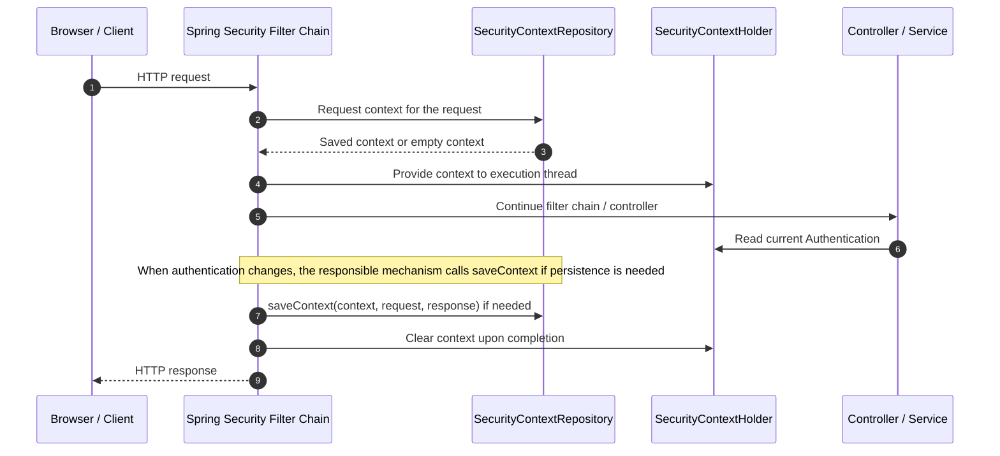
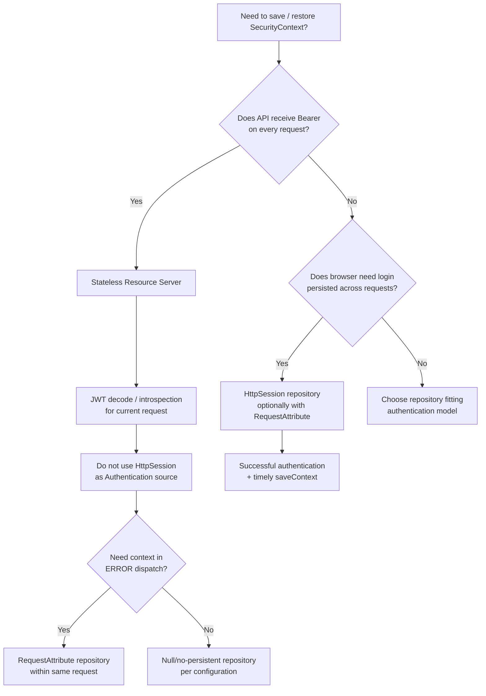

# SecurityContextRepository and Responsibilities for Saving and Restoring Identity

In **Spring Security OAuth 2.0/OIDC Resource Server**, after a request is authenticated, the application can access `Authentication` to know who is calling the API and which `GrantedAuthority` instances the caller holds. That information usually lives in a **`SecurityContext`**. Yet a more important question is: **Does the SecurityContext exist on the next request? Who saves it, who restores it, and when is it cleared?**

That is the subject of `SecurityContextRepository`. This interface handles loading and saving `SecurityContext` across web processing boundaries, though its usage varies sharply by application:

- **Web app with form login/OIDC login and HTTP sessions:** after logging in, the application usually wants to restore the authenticated state on subsequent requests without prompting for credentials each time.
- **Stateless OAuth 2.0 JWT Resource Server:** each request sends a Bearer token and is authenticated anew from that token; the API usually **does not need to store the previous request's Authentication in an HTTP session**.
- **Opaque token Resource Server:** each request may be introspected (or use a cache with an explicit policy); a Bearer credential should likewise not be turned into a login session if the contract requires statelessness.
- **Servlet error/forward dispatch:** sometimes `SecurityContext` must be shared **within the same request** when the dispatch changes, without persisting it to other requests.

Therefore, `SecurityContextRepository` does not equate to `HttpSession`, and `SecurityContextHolder` does not equate to an identity persistence mechanism. This lesson explains the components, context lifecycle, repository choices, Spring Security 6's explicit save mechanism, integration with Resource Servers, and security scenarios prone to misconfiguration.

## 1. Distinguishing four core concepts

| Concept | Role | Typical lifetime/scope |
|---|---|---|
| **`Authentication`** | Represents principal, credentials per type, and authorities; authentication state | Placed inside `SecurityContext` |
| **`SecurityContext`** | Container for the current `Authentication` | Typically tied to processing a single request |
| **`SecurityContextHolder`** | Access point to `SecurityContext` for current code via `SecurityContextHolderStrategy` | Defaults to `ThreadLocal`-based in synchronous Servlet processing |
| **`SecurityContextRepository`** | Contract to **load and save** `SecurityContext` at the Servlet request/response boundary | Can be request attributes, HTTP session, no-op, or multiple repositories |

Example:

```java
import org.springframework.security.core.Authentication;
import org.springframework.security.core.context.SecurityContext;
import org.springframework.security.core.context.SecurityContextHolder;

SecurityContext context = SecurityContextHolder.getContext();
Authentication current = context.getAuthentication();
```

At the moment this code runs during an authenticated request, `current` may be:

- `UsernamePasswordAuthenticationToken` if using form login or an appropriate username/password mechanism.
- `JwtAuthenticationToken` if the request went through a JWT Resource Server.
- `BearerTokenAuthentication` if the request went through opaque-token introspection.
- Another `Authentication` type integrated by the application.

**`SecurityContextHolderStrategy`** determines how the context is accessed on the current thread. **`SecurityContextRepository`** determines whether the context can be reloaded/saved across web boundaries. The two components are distinct pieces.

### 1.1. Authentication is not "the entire user entity in the database"

`Authentication` is not by default your application's user entity. It may hold a `Jwt`, an `OAuth2AuthenticatedPrincipal`, a provider-created principal, or a specialized object. The `sub` claim, principal name, authority set, and login session details only have meaning according to the authentication source and its contract.

Do not treat `authentication.getName()` as proof of ownership for every record. Across multiple issuers, the same `sub` can denote two different identities; in multi-tenant systems, tenant scope is also required. Specific access rights must still be verified by business authorization.

### 1.2. Holder does not automatically save into a session

The snippet:

```java
SecurityContext context =
    SecurityContextHolder.createEmptyContext();
context.setAuthentication(authentication);
SecurityContextHolder.setContext(context);
```

only places `Authentication` into the context visible to current code. It **does not automatically ensure** the context is saved for subsequent requests. In Spring Security 6 with **require explicit save** mode, if a custom authentication mechanism wants to persist login across requests, it must call `SecurityContextRepository.saveContext(...)` at the right point, unless a framework-provided filter/handler already does so.

Setting the context in the holder and saving the context into a repository are **two independent operations**.

## 2. Flow of restoring and saving SecurityContext

Conceptual model of a Servlet request:



This diagram summarizes roles and **does not claim every request calls `saveContext`**. In Spring Security 6, a filter may only load the context and clear the holder; if there is no change to persist, no save happens. With stateless JWT Bearer tokens, authentication is typically rebuilt from the bearer token on the next request.

### 2.1. Two requests in a session-based application

```text
Request A: POST /login
  User submits credentials
  -> AuthenticationManager authenticates successfully
  -> SecurityContext is created with Authentication
  -> SecurityContextRepository saves into HTTP session
  -> Response returns appropriate session cookie

Request B: GET /account
  Browser sends session cookie
  -> Repository looks up saved context
  -> SecurityContextHolder receives Authentication
  -> HTTP/method authorization checks authorities
  -> Controller handles request
```

The browser is not "resending the entire Authentication." The browser only sends a session identifier in a cookie; the server uses that identifier to look up server-side state per the session store configuration. If the session expires, is invalidated, or the server cannot find the data, the context is not restored as before.

### 2.2. Two requests in a stateless JWT Resource Server

```text
Request A: GET /api/orders/123
  Authorization: Bearer JWT-A
  -> JwtDecoder verifies JWT-A
  -> Creates JwtAuthenticationToken in SecurityContext
  -> Checks scopes and permissions
  -> Request ends, clears holder

Request B: GET /api/orders/456
  Authorization: Bearer JWT-B
  -> JwtDecoder verifies JWT-B
  -> Creates Authentication from JWT-B
  -> Does not inherit permissions of JWT-A from a prior session
```

This does not mean `SecurityContextHolder` "does not exist" in a stateless API. It still serves the **Authentication of the current request**. The difference is not relying on a long-lived context in an HTTP session to authenticate the next request.

## 3. The `SecurityContextRepository` contract

Spring Security defines the `SecurityContextRepository` interface for Servlet contexts, with main operations:

```java
// Illustrates main API signatures, simplified to focus on semantics:

DeferredSecurityContext loadDeferredContext(
    HttpServletRequest request);

void saveContext(
    SecurityContext context,
    HttpServletRequest request,
    HttpServletResponse response);

boolean containsContext(HttpServletRequest request);
```

Some versions also include legacy APIs such as `loadContext(HttpRequestResponseHolder)` for older filters. Check the API of your Spring Security version; do not apply snippets based on deprecated methods without checking the current `loadDeferredContext` mechanism.

Meaning:

- **Load:** retrieves the context associated with the request, optionally via a deferred holder to delay touching the session until needed.
- **Save:** writes the updated context to the storage mechanism per the repository's policy.
- **Check existence:** asks the repository whether a context exists for the request—not whether "the user is authorized to access the endpoint."

### 3.1. Deferred context is not asynchronous authentication

`loadDeferredContext` can postpone reading the context until a component actually needs it. This avoids unnecessary HTTP session access on requests or paths that do not require reading authentication.

**Deferred here does not mean automatically launching a network request or token introspection on a background thread.** It is a mechanism to defer reading the value during request processing.

### 3.2. The repository is not responsible for verifying passwords or JWT signatures

`SecurityContextRepository` is not:

- `AuthenticationManager`.
- `AuthenticationProvider`.
- `JwtDecoder`.
- `OpaqueTokenIntrospector`.
- `AuthorizationManager`.

It does not know whether a password is correct, whether a JWT has a valid signature, whether an opaque token is still active, or whether a user may delete a specific order. It only loads/saves **`SecurityContext`** within the chosen storage scope.

A context restored from a session may contain a previously verified `Authentication`. To handle permissions changing over time, you need session invalidation policies, session timeouts, domain checks, and possibly source-of-truth revalidation; the repository itself does not do all of this.

## 4. Important implementations

| Implementation | Where stored? | Across new requests? | Use cases |
|---|---|---|---|
| **`HttpSessionSecurityContextRepository`** | Attribute in `HttpSession` | **Yes**, if the session is retained and context was saved | Form login, stateful web apps |
| **`RequestAttributeSecurityContextRepository`** | Servlet request attributes | **No**, same request/dispatch only | Preserving context across error/forward dispatch without sessions |
| **`NullSecurityContextRepository`** | Does not save context | **No** | Stateless or when app wants no persistence |
| **`DelegatingSecurityContextRepository`** | Delegates operations to multiple repositories | Per each delegate | Combining request attributes and session |

These names implement a similar interface, yet **differ in lifecycle**. Choosing the wrong repository can cause two opposite bugs:

1. **Lost login:** custom form authentication succeeds on request A, yet request B is anonymous because the session was not saved.
2. **Unintended state retention:** a stateless bearer API accidentally reuses an old `Authentication` from a session, so identity/permissions no longer reflect the current request's token.

### 4.1. `HttpSessionSecurityContextRepository`

This implementation uses `HttpSession` to store `SecurityContext`, typically under the key:

```text
SPRING_SECURITY_CONTEXT
```

It has optimization rules to avoid saving empty/anonymous contexts and only create sessions when needed, depending on configuration and request state. Do not assume "creating `HttpSessionSecurityContextRepository` generates a session on every GET."

`HttpSession` may be managed by the servlet container or stored in Redis/database by Spring Session, but **`SecurityContextRepository` remains the interface layer in Spring Security**. Across multiple instances, session sharing must be solved by the session storage infrastructure; merely choosing the HttpSession repo does not synchronize sessions across nodes.

### 4.2. `RequestAttributeSecurityContextRepository`

This implementation stores `SecurityContext` in an attribute of the **same Servlet request**. It is useful when:

- The container switches dispatch, e.g., `ERROR` dispatch.
- `SecurityContextHolder` was cleared across a filter/dispatch boundary.
- The application still wants the authenticated context for an error page, safe logging, or continued processing **of that same request**.

It **does not persist across a new HTTP request**. Request B from the same user does not inherit context from request A merely because the browser shares an IP, user-agent, or trace ID.

### 4.3. `NullSecurityContextRepository`

The null repository does not load a previously saved context and does not write any context when `saveContext` is called. It is suitable when:

- Authentication is strictly based on **each request's** credentials.
- There is no need to restore logins from an HTTP session.
- You want to be explicit about not persisting `SecurityContext` in that repository.

It does not forbid controllers/services from creating sessions for other purposes. "SecurityContext is not saved" does not mean "the application definitely has no server-side state whatsoever."

### 4.4. `DelegatingSecurityContextRepository`

This implementation combines multiple repositories. A common Spring Security 6 configuration is:

```java
import org.springframework.security.web.context.DelegatingSecurityContextRepository;
import org.springframework.security.web.context.HttpSessionSecurityContextRepository;
import org.springframework.security.web.context.RequestAttributeSecurityContextRepository;
import org.springframework.security.web.context.SecurityContextRepository;

SecurityContextRepository repository =
    new DelegatingSecurityContextRepository(
        new RequestAttributeSecurityContextRepository(),
        new HttpSessionSecurityContextRepository()
    );
```

Meaning:

- On save, it can forward the operation to multiple delegates per its contract.
- On read, it searches for context according to the order/behavior of its delegates.
- Request attributes keep the context available across dispatches of the request.
- HttpSession allows login state to be restored on the next request.

**Not every chain is required to use a Delegating repository.** Spring Security configuration, session policies, and authentication types may lead to other choices. If specific behavior is needed, configure the repository explicitly.

## 5. `SecurityContextHolderFilter` and `SecurityContextPersistenceFilter`

These are two important filters, especially when upgrading from Spring Security 5 to 6.

### 5.1. `SecurityContextPersistenceFilter`: the traditional auto-save approach

In older configurations/versions, `SecurityContextPersistenceFilter` generally had the responsibility to:

1. Load `SecurityContext` from the repository into the holder before the rest of the filter chain.
2. Let the request execute.
3. Save the context back to the repository when the request completes or when the response commits via a response wrapper mechanism.
4. Clear `SecurityContextHolder`.

```text
SecurityContextPersistenceFilter
    |
    +-- loadContext
    |
    +-- filterChain.doFilter(...)
    |
    +-- saveContext (via auto-save mechanism)
    |
    +-- clearContext
```

This mechanism was convenient when custom code merely mutated `SecurityContextHolder` and relied on the filter to write it back at the end of the request. However, auto-saving has drawbacks:

- It can write to the session unnecessarily.
- Tracking whether the context changed is complex.
- Response redirects/commits can occur before saving if not handled carefully.
- It obscures which component is responsible for saving `SecurityContext`.

### 5.2. `SecurityContextHolderFilter`: only loads and clears the holder

In Spring Security 6's **require explicit save** model, `SecurityContextHolderFilter` typically replaces the old persistence filter. It **loads/provides the context to the holder and then clears the holder**, without **automatically calling `saveContext` at the end of the request**.

```text
SecurityContextHolderFilter
    |
    +-- loadDeferredContext
    |
    +-- provide context for the request
    |
    +-- filterChain.doFilter(...)
    |
    +-- clearContext

Saving:
    is the responsibility of the authentication component,
    when the application wants the context persisted in the repository.
```

Consequence:

> **Calling `SecurityContextHolder.setContext(newContext)` does not by itself make `newContext` exist on the next request.** In explicit-save mode, when custom authentication wants to persist state, it must call `SecurityContextRepository.saveContext(newContext, request, response)` at the proper time.

This **does not mean** every form-login app has to write custom filters to call save. Built-in authentication filters/handlers provided by Spring Security already perform the save per framework rules upon successful authentication. Calling save yourself is specifically critical when **writing a custom authentication flow** or setting context directly inside a controller/filter.

### 5.3. Do not run both filters simultaneously "to be extra sure"

`SecurityContextHolderFilter` and `SecurityContextPersistenceFilter` are alternative mechanisms for the same load/set/clear role in their respective configurations. Do not manually add both to a single chain thinking it increases security: they can cause confusing ordering effects, hidden auto-saves, or behavior inconsistent with explicit-save policy.

When upgrading, identify **the actual filter in the chain**, check `requireExplicitSave`, the repository, and the authentication filter in use; do not guess merely from class names on the classpath.

### 5.4. Comparison table

| Criterion | PersistenceFilter (legacy model) | HolderFilter (explicit-save model) |
|---|---|---|
| Loads context for request | Yes | Yes, typically via deferred contract |
| Clears holder after processing | Yes | Yes |
| Automatically saves context to repository | Typically yes | **No** |
| Custom auth mutating `SecurityContextHolder` survives next request without manual save? | Possibly, depending on mechanism and config | **No**, unless another component saves it |
| Operational goal | Automatic persistence | Clear separation between setting context and saving it |

## 6. Explicit save: who must call `saveContext`?

Suppose an application creates a custom authentication endpoint:

```http
POST /custom-login HTTP/1.1
Content-Type: application/json

{"username":"alice","password":"***"}
```

If the controller calls `AuthenticationManager.authenticate(...)` and receives a successful `Authentication`, it has proven the credentials valid per the provider, **but that does not automatically turn it into a persisted login session**.

For a mechanism intending to use an HTTP session, you must place `Authentication` into `SecurityContext` and save it:

```java
import jakarta.servlet.http.HttpServletRequest;
import jakarta.servlet.http.HttpServletResponse;

import org.springframework.security.core.Authentication;
import org.springframework.security.core.context.SecurityContext;
import org.springframework.security.core.context.SecurityContextHolder;
import org.springframework.security.web.context.SecurityContextRepository;

// After AuthenticationManager has authenticated successfully:
SecurityContext context =
    SecurityContextHolder.createEmptyContext();
context.setAuthentication(authenticated);
SecurityContextHolder.setContext(context);

securityContextRepository.saveContext(
    context,
    request,
    response
);
```

The variables `authenticated`, `securityContextRepository`, `request`, and `response` are real dependencies of the flow, not client-supplied data. Creating a fresh context via `createEmptyContext()` avoids accidentally sharing/mutating a context instance reused elsewhere.

### 6.1. The snippet above is not a complete secure login flow

When writing custom login, you must also handle:

- **Session fixation protection:** rotating session IDs/applying session strategy per policy when a user transitions from unauthenticated to authenticated.
- **CSRF protection:** form/cookie session logins carry CSRF risk; do not disable CSRF just to make a login POST work.
- **Session concurrency:** limiting or controlling concurrent sessions if the application requires it.
- **Remember-me:** if supported, requires its own mechanism.
- **Authentication failure handling:** never create/save a successful context when credentials are wrong.
- **Redirect/response commit:** call `saveContext` **before** sending a redirect or committing the response per implementation path.
- **Logout:** properly invalidate/remove the session and repository context.

Therefore, for standard form login, **prefer Spring Security's standard authentication filters/handlers** instead of rolling a custom login controller. The code above only clarifies save responsibility when a custom flow is truly required.

### 6.2. Never use an Authentication object sent by the client

Anti-pattern:

```java
// Wrong trust boundary:
Authentication claimedByClient =
    buildAuthenticationFromRequestBody(body);

SecurityContext context = SecurityContextHolder.createEmptyContext();
context.setAuthentication(claimedByClient);
securityContextRepository.saveContext(context, request, response);
```

If code simply reads `username`/`roles` from the request body and marks the user authenticated, an attacker can forge an admin session. Only place into the context an `Authentication` verified by a trusted `AuthenticationManager`/provider or a credential-verification mechanism with a clear contract.

### 6.3. Do not mutate an old context directly and expect autosave

An old habit:

```java
SecurityContextHolder.getContext()
    .setAuthentication(authenticated);
```

In explicit-save mode, that operation **is not a repository save call**. It can also mutate a context instance retrieved from storage during the same request, making reasoning harder if the instance is shared.

Create a new context, set the new `Authentication`, set it on the holder, and **explicitly save if persistence is needed**. For a stateless Resource Server, only the current request context exists and you should not try to save it into an HTTP session.

## 7. Form login and HTTP session: saving so the next request needs no re-login

A traditional web app using sessions:

```java
import org.springframework.context.annotation.Bean;
import org.springframework.context.annotation.Configuration;
import org.springframework.security.config.Customizer;
import org.springframework.security.config.annotation.web.builders.HttpSecurity;
import org.springframework.security.web.SecurityFilterChain;

@Configuration
public class BrowserSecurityConfiguration {

    @Bean
    SecurityFilterChain browserSecurity(HttpSecurity http) throws Exception {
        return http
            .authorizeHttpRequests(auth -> auth
                .requestMatchers("/", "/login", "/assets/**").permitAll()
                .anyRequest().authenticated())
            .formLogin(Customizer.withDefaults())
            .build();
    }
}
```

When form login succeeds, the framework's authentication flow coordinates with `SecurityContextRepository` to save the session per configuration. On the next request, the context can be restored from the session.

### 7.1. Explicit repository configuration for web sessions

In Spring Security 6, a sensible combination for session-based web apps:

```java
import org.springframework.context.annotation.Bean;
import org.springframework.security.web.context.DelegatingSecurityContextRepository;
import org.springframework.security.web.context.HttpSessionSecurityContextRepository;
import org.springframework.security.web.context.RequestAttributeSecurityContextRepository;
import org.springframework.security.web.context.SecurityContextRepository;

@Bean
SecurityContextRepository browserSecurityContextRepository() {
    return new DelegatingSecurityContextRepository(
        new RequestAttributeSecurityContextRepository(),
        new HttpSessionSecurityContextRepository()
    );
}
```

Wiring it into the chain:

```java
.securityContext(securityContext -> securityContext
    .requireExplicitSave(true)
    .securityContextRepository(browserSecurityContextRepository()))
```

The second snippet must be placed inside the `HttpSecurity` builder of a `SecurityFilterChain`; the bean/method must live in an appropriate Spring configuration scope. With modern versions of the framework, you may **not need to declare this manually** because the defaults already configure equivalent persistence. Only customize when you need to clarify, control, or change policy.

### 7.2. The JSESSIONID cookie does not contain authorities

Typically the browser only sends a session identifier, for example:

```http
GET /account HTTP/1.1
Cookie: JSESSIONID=opaque-session-id
```

The server uses the session ID to look up session state, which may include `SPRING_SECURITY_CONTEXT`. Therefore:

- The session ID is a sensitive credential; protect it with TLS, cookie flags, expiration, and session fixation defenses.
- If the session store is lost or the session expires, the context can no longer be restored.
- Session invalidation after logout/revocation affects subsequent requests.
- `SecurityContextRepository` does not by itself solve CSRF for session authentication.

### 7.3. The session attribute name should not be a business API

Do not write business code like:

```java
Object context = request.getSession()
    .getAttribute("SPRING_SECURITY_CONTEXT");
```

that depends directly on the implementation/session key. Use `SecurityContextHolder`/`Authentication` when you need the current identity, and Spring Security APIs when customizing persistence. The attribute name is an internal detail of `HttpSessionSecurityContextRepository`, not a domain contract.

## 8. `RequestAttributeSecurityContextRepository` and ERROR dispatch

Servlets have dispatcher types such as `REQUEST`, `ERROR`, `FORWARD`, and `ASYNC`. In some containers, when a request transitions to an `ERROR` dispatch, `SecurityContextHolder` may have been cleared by a filter or the thread/dispatch boundary may have changed.

For example:

```text
REQUEST /api/orders/123
    |
    +-- JWT authentication succeeds
    |
    +-- Controller throws exception
    |
    v
ERROR dispatch /error
    |
    +-- Another SecurityContextHolder may already be empty
    |
    +-- RequestAttributeSecurityContextRepository
        can provide the context of the SAME request again
```

The goal is not long-lived login persistence, but keeping security information within **a single request that may span multiple dispatches**. That is why default Delegating repository combinations often place `RequestAttributeSecurityContextRepository` before `HttpSessionSecurityContextRepository`.

### 8.1. Error dispatch is not a license to skip authorization

Having context on `/error` is helpful for error handling, yet security rules for dispatcher types, URLs, and `Authentication` still need proper design. Do not use `ERROR` dispatch as a channel to leak user data or sensitive stack traces.

Conditions to consider:

- Does the security filter chain run on `ERROR` dispatches?
- Do the `SecurityContextRepository` configured on the filter and the authentication mechanism share the right strategy/repository?
- Should the error endpoint allow anonymous access or require authentication?
- If an error response is generated after a token was rejected, should an older `Authentication` ever be reloaded?

Do not infer from the presence of a request attribute that every error page is safe, or that a principal always exists across every dispatch.

### 8.2. Do not confuse request attributes and session attributes

| Property | Request attribute | HTTP session attribute |
|---|---|---|
| Survives across multiple HTTP requests | No | Yes, within the same session |
| Can survive across ERROR/FORWARD within a request | Yes, per container/dispatcher | Yes, though not strictly required |
| Requires a session cookie | No | Usually yes if browser uses sessions |
| Fits stateless JWT APIs | Can be useful within the same request | Usually no need to save Authentication |
| Fits browser login sessions | Only covers a single request | Useful for maintaining login |

## 9. `NullSecurityContextRepository` and stateless Resource Servers

A pure REST OAuth 2.0 Resource Server typically wants:

```text
Each request:
  Authorization: Bearer <access-token>
       |
       v
  JwtDecoder or OpaqueTokenIntrospector
       |
       v
  Current Authentication
       |
       v
  Request authorization
       |
       v
  Clear SecurityContextHolder

Do not use a prior session as the basis for permissions on a new request.
```

With Spring Security Servlet:

```java
import org.springframework.context.annotation.Bean;
import org.springframework.context.annotation.Configuration;
import org.springframework.http.HttpMethod;
import org.springframework.security.config.Customizer;
import org.springframework.security.config.annotation.web.builders.HttpSecurity;
import org.springframework.security.config.annotation.web.configurers.AbstractHttpConfigurer;
import org.springframework.security.config.http.SessionCreationPolicy;
import org.springframework.security.web.SecurityFilterChain;

@Configuration
public class ApiResourceServerSecurity {

    @Bean
    SecurityFilterChain apiChain(HttpSecurity http) throws Exception {
        return http
            .securityMatcher("/api/**")
            .csrf(AbstractHttpConfigurer::disable)
            .sessionManagement(session -> session
                .sessionCreationPolicy(SessionCreationPolicy.STATELESS))
            .authorizeHttpRequests(auth -> auth
                .requestMatchers(HttpMethod.GET, "/api/orders/**")
                    .hasAuthority("SCOPE_orders.read")
                .requestMatchers(HttpMethod.POST, "/api/orders/**")
                    .hasAuthority("SCOPE_orders.write")
                .anyRequest().denyAll())
            .oauth2ResourceServer(oauth2 ->
                oauth2.jwt(Customizer.withDefaults()))
            .build();
    }
}
```

With `SessionCreationPolicy.STATELESS`, Spring Security **does not use an HTTP session to obtain `SecurityContext` for the request** and does not create an HTTP session for persisting `SecurityContext`. Filters can still create/set `Authentication` in the holder **for the current request**.

Note: "stateless Resource Server" does not mean:

- `SecurityContextHolder` cannot be used.
- Request attributes cannot be used within the same request.
- JWKS, token introspection, or business data cannot be cached under an explicit policy.
- No session can exist in the servlet container, because other code might create one.
- JWT/opaque tokens do not need verification on the next request.

### 9.1. Explicit `NullSecurityContextRepository` option

If you want to state explicitly **do not save SecurityContext via repository in this chain**:

```java
import org.springframework.security.web.context.NullSecurityContextRepository;

.securityContext(security -> security
    .securityContextRepository(new NullSecurityContextRepository()))
```

Note that this DSL snippet must be placed properly inside `HttpSecurity` configuration. The repository on `SecurityContextHolderFilter` and the repository used by each authentication filter **can depend on version and wiring**; do not assume setting one repository everywhere alters all custom filters. Most importantly, keep the goal clear: do not restore `Authentication` from a previous request's session.

In some Bearer authentication paths, the framework uses `RequestAttributeSecurityContextRepository` to keep context within the same request or `ERROR` dispatch **without writing to `HttpSession`**. Therefore, do not remove request-attribute persistence if error handling relies on it, just to claim the app is "stateless."

### 9.2. Saving JWT Authentication into a session usually violates the API contract

Anti-pattern in a Resource Server:

```java
// Not recommended for an API where every request must carry a Bearer token.
securityContextRepository.saveContext(
    SecurityContextHolder.getContext(),
    request,
    response);
```

if the actual repository is an `HttpSession` repo. A subsequent request **without a Bearer token** could restore the prior `Authentication` from the session if the chain/filters permit. That turns a stateless bearer API into a session mechanism that clients, gateways, and security teams might not expect.

Even when the next request carries a different token, prevent a session-stored context from overriding or mixing with the current token's authorities. Identity and permissions on an API request must reflect the credential authenticated for that specific request.

### 9.3. Opaque introspection is also typically stateless

In an opaque Resource Server, `OpaqueTokenIntrospector` verifies tokens against the AS/introspection endpoint. The request's `Authentication` is used by `authorizeHttpRequests` and method security. It likewise does not need to be saved into `HttpSession` just because the API queries the AS.

To reduce load, you can cache introspection results **keyed by token, issuer/resource, and controlled TTL**; that is a different decision from saving a user's `SecurityContext` in a session. Introspection caching must account for `active`, `exp`, revocation, sensitive data, and multi-tenant state.

## 10. SessionCreationPolicy: ALWAYS, IF_REQUIRED, NEVER, and STATELESS

`SessionCreationPolicy` guides how Spring Security uses HTTP sessions:

| Policy | General meaning | Can use an existing session to obtain SecurityContext? |
|---|---|---|
| **ALWAYS** | Spring Security proactively creates a session | Yes |
| **IF_REQUIRED** | Creates a session only when needed | Yes |
| **NEVER** | Spring Security does not proactively create a session, but may use an existing one | **Yes** |
| **STATELESS** | Spring Security does not create and does not use a session to obtain `SecurityContext` | **No**, per session policy contract |

The difference between `NEVER` and `STATELESS` is especially important:

```text
NEVER:
  Do not create a new session for Spring Security,
  but a session created elsewhere may still be used.

STATELESS:
  Do not use an HTTP session as a source of SecurityContext
  for Resource Server requests.
```

If you want a Bearer API **not to use an old session's context**, `STATELESS` expresses that intent better than `NEVER`.

### 10.1. Session policy is not CSRF policy

`csrf().disable()` only adjusts CSRF protection; `sessionCreationPolicy(STATELESS)` adjusts Spring Security's session behavior. They do not replace each other.

An API using only Bearer tokens sent explicitly in the `Authorization` header has a different CSRF risk model than browser form login using session cookies. However, if the application also has endpoints using cookies or browser-cached HTTP Basic auth, disabling CSRF globally can be dangerous.

Do not conclude "because it's stateless, there is definitely no CSRF" if credentials are still auto-sent by the browser via another mechanism.

### 10.2. Session policy does not automatically block application-created sessions

If a controller calls:

```java
request.getSession(true);
```

application code can create an `HttpSession` for reasons outside Spring Security. `SessionCreationPolicy.STATELESS` does not mean the servlet container blocks every API call to `getSession(true)`.

To ensure an API truly does not depend on sessions, review controllers, MVC, libraries, redirects, request cache, CSRF/cookie config, and other components.

## 11. An application with both browser sessions and a Bearer API

Many systems simultaneously have:

- `/web/**`: internal pages using form login and HTTP sessions.
- `/api/**`: REST API using OAuth 2.0 Bearer access tokens.

Do not force **the entire application** to share a single repository/session policy if the two route groups have different requirements.

### 11.1. Two SecurityFilterChains with different policies

Conceptual configuration example:

```java
import org.springframework.context.annotation.Bean;
import org.springframework.context.annotation.Configuration;
import org.springframework.core.annotation.Order;
import org.springframework.security.config.Customizer;
import org.springframework.security.config.annotation.web.builders.HttpSecurity;
import org.springframework.security.config.annotation.web.configurers.AbstractHttpConfigurer;
import org.springframework.security.config.http.SessionCreationPolicy;
import org.springframework.security.web.SecurityFilterChain;

@Configuration
public class MultiSurfaceSecurityConfiguration {

    @Bean
    @Order(1)
    SecurityFilterChain apiChain(HttpSecurity http) throws Exception {
        return http
            .securityMatcher("/api/**")
            .csrf(AbstractHttpConfigurer::disable)
            .sessionManagement(session -> session
                .sessionCreationPolicy(SessionCreationPolicy.STATELESS))
            .authorizeHttpRequests(auth -> auth
                .anyRequest().authenticated())
            .oauth2ResourceServer(oauth2 ->
                oauth2.jwt(Customizer.withDefaults()))
            .build();
    }

    @Bean
    @Order(2)
    SecurityFilterChain webChain(HttpSecurity http) throws Exception {
        return http
            .securityMatcher("/web/**", "/login", "/logout")
            .authorizeHttpRequests(auth -> auth
                .requestMatchers("/login").permitAll()
                .anyRequest().authenticated())
            .formLogin(Customizer.withDefaults())
            .build();
    }
}
```

In a real configuration, also design an appropriate fallback chain so other URLs are not missed; URLs provided by form login must also belong to the right chain. The sample above only highlights **choosing session policies by security surface**, not a complete production configuration for every app.

### 11.2. Distinguishing securityMatcher and requestMatchers

`securityMatcher("/api/**")` decides **whether a request enters that chain**. Inside the chain, `requestMatchers(...)` decides **endpoint permissions**. Spring Security typically picks **the first matching `SecurityFilterChain`** in order, rather than merging all chains.

If a route belongs to no chain, it may not be protected by Spring Security web filters. Therefore:

- The API chain must cover the real API paths.
- The web chain must cover login/logout endpoints and web pages.
- Provide a deny-by-default fallback chain for the remainder if the architecture requires it.
- Do not accidentally let `/api/**` fall into the form-login session chain.

### 11.3. Browser sessions should not automatically authenticate a REST Bearer API

A browser logged into `/web/**` may carry a session cookie. Yet if `/api/**` requires a Bearer token by contract, do not read the browser session's `Authentication` to grant API access merely because both share a host.

This keeps boundaries from mixing:

```text
/web/**:
  JSESSIONID -> SecurityContext from HttpSession -> form login

/api/**:
  Authorization: Bearer ... -> JwtDecoder -> Authentication of current token
```

Both policy sets may use `Authentication`/`GrantedAuthority`, yet their **sources of trust and persistence lifecycles differ**.

## 12. When must you save before the response commits?

In Servlets, an HTTP response can commit when:

- Sending a redirect.
- Writing enough response body/flushing the stream.
- Calling an API that prevents further modification of headers/cookies.
- The container commits the response at a processing milestone.

If custom login needs to create a session/cookie yet only calls `saveContext` **after the response has already committed**, updating the session identifier or setting the new cookie may fail to take effect properly.

A sensible ordering pattern:

```text
AuthenticationManager authenticates successfully
        |
        v
SessionAuthenticationStrategy if the flow uses session login
        |
        v
Create new SecurityContext and set Authentication
        |
        v
SecurityContextHolder.setContext(context)
        |
        v
SecurityContextRepository.saveContext(context, request, response)
        |
        v
Send redirect/success response
```

Do not write:

```java
response.sendRedirect("/account");
securityContextRepository.saveContext(context, request, response);
```

assuming session creation/saving will always succeed safely. After a redirect, the response may already be committed; that is why explicit save must be called at the **right moment**.

### 12.1. Why did the old filter need response wrappers?

In the auto-save model, `SecurityContextPersistenceFilter` had to handle saving when the request finished or when the response was about to commit; response wrappers helped prevent missing session cookies when responses committed early.

The explicit-save model makes responsibilities clearer: **the authentication component knows when authentication succeeded**, so it can save at the right time before responding. Do not recreate uncontrolled "auto-save" in custom filters without understanding the Servlet lifecycle.

## 13. Logout and clearing saved context

Login saves state; logout **terminates that state per contract**. With form login/sessions:

```text
POST /logout
  -> Invalidate HttpSession (if configured)
  -> Clear SecurityContextHolder
  -> Remove saved SecurityContext per corresponding mechanism
  -> Clear cookies/remember-me if applicable
```

Spring Security provides built-in logout support. Do not merely write:

```java
SecurityContextHolder.clearContext();
```

and conclude the session is invalidated: that statement primarily clears the context of the **current thread**, and does not by default remove saved `SPRING_SECURITY_CONTEXT` or invalidate the session.

If using custom logout, handle the repository/session as well as cookies/remember-me/session tracking per policy. With stateless JWT access tokens, clearing `SecurityContextHolder` **does not revoke issued JWTs**; tokens can still be used on other requests until expiration or until blocked by revocation/introspection/denylist/key-rotation mechanisms.

### 13.1. Browser logout and Bearer token revocation are different

| Scenario | What must be handled |
|---|---|
| Form login session | Invalidating session, clearing persisted context and related cookies |
| OAuth 2.0 JWT Resource Server | Client can delete local tokens, but the API needs AS/denylist/TTL if early invalidation is desired |
| Opaque access token | AS can return `active:false` after revocation; introspection caches may delay effect |
| OIDC client logout | Additional RP/OP session rules and front/back-channel per protocol if used |

`SecurityContextRepository` is the web-side authentication persistence mechanism, **not the AS's access-token revocation API**.

## 14. Concurrency, ThreadLocal, and the non-sharing context invariant

`SecurityContextHolder` normally uses a `ThreadLocal`-based strategy in synchronous Servlet processing. The Spring Security filter chain sets the context and **clears it after the request** so a previous request's principal does not appear when the servlet container reuses the thread.

### 14.1. Why is clearing required?

```text
Worker thread-7
  Request A: alice -> SecurityContext alice
  End of Request A -> clear context

Worker thread-7 is reused
  Request B: bob -> bob's own context
```

If a custom filter omits `finally { SecurityContextHolder.clearContext(); }` while managing the holder itself, `Authentication` can leak across requests via thread reuse. Generally, let framework filters manage the lifecycle instead of rolling your own `ThreadLocal` mechanism.

### 14.2. Do not arbitrarily mutate a shared SecurityContext

When a context is restored from a session, the same instance or referenced data may be used across concurrent requests depending on the implementation. Doing:

```java
SecurityContextHolder.getContext()
    .setAuthentication(otherAuthentication);
```

on a shared context instance can cause unexpected state changes. When replacing `Authentication`, prefer:

```java
SecurityContext newContext =
    SecurityContextHolder.createEmptyContext();
newContext.setAuthentication(otherAuthentication);
SecurityContextHolder.setContext(newContext);
```

and save to the repository properly if persistence is truly desired.

### 14.3. Async tasks do not automatically inherit the right context

Code like:

```java
executor.submit(() -> {
    Authentication auth =
        SecurityContextHolder.getContext().getAuthentication();
    // Do not assume auth exists or matches the original request.
});
```

may execute on a different thread. With thread pools, copying context carelessly or holding context too long can leak identity across tasks. Spring Security provides utilities such as `DelegatingSecurityContextRunnable`, `DelegatingSecurityContextExecutor`, or appropriate async integration to propagate context when genuinely needed.

Even when context is propagated, **tokens may expire and permissions may change while the job runs**. For background jobs, it is often better to pass a minimal actor snapshot/authorization intent and re-check permissions at sensitive steps per policy, rather than holding `Authentication` indefinitely.

### 14.4. ContextHolderStrategy can be customized

Spring Security allows customizing `SecurityContextHolderStrategy`. Strategies may use `ThreadLocal`, inheritable `ThreadLocal`, or other mechanisms. Never use `MODE_GLOBAL` or a singleton holder on a multi-user server to "stay logged in"; doing so can expose one caller's identity to another caller.

## 15. Repositories and sharing state in a cluster

When using `HttpSession` with multiple replicas:

```text
Browser
  |
  +-- Request A -> Node A -> Login -> SecurityContext saved to session
  |
  +-- Request B -> Node B -> needs to restore the same session
```

If each node stores sessions only in local memory and the load balancer does not guarantee sticky sessions, request B may not see request A's context. Common solutions:

- Sticky sessions at the load balancer, with limitations when nodes fail.
- Spring Session using a shared store (e.g., Redis) for `HttpSession`, per operational architecture.
- Designing stateless bearer authentication for APIs where appropriate to avoid session dependency.

**`HttpSessionSecurityContextRepository` is not by itself a session replication system.** It only knows how to interact with Servlet `HttpSession`. Distribution, expiration, and synchronization belong to the session infrastructure.

### 15.1. Serialization and class changes

When sessions are stored out-of-process, data in `Authentication`/principal/context may require serialization. If an application puts JPA entities, non-serializable objects, large secrets, or cyclic object graphs into the principal, saving/restoring can fail or create data exposure risks.

Do not store entire domain entities or access token secrets directly in the session merely for convenient business code access. Use a minimal principal aligned with session policy and fetch fresh business data when needed.

### 15.2. Session timeout and revoked permissions

A session storing `Authentication` does not automatically refresh all permissions when an admin changes roles in the database. If permission changes must take effect quickly:

- Re-check critical business permissions at the time of operation.
- Invalidate affected sessions.
- Design a reauthentication/revalidation policy.
- Set appropriate session max idle/absolute lifetimes.
- Control concurrent sessions if the feature requires it.

The repository only restores the saved object; it does not fetch the latest database permissions on every request.

## 16. Session fixation and authentication boundaries

**Session fixation** occurs when an attacker tricks a victim into using a pre-known session ID, the victim logs in, and that same session ID is retained, allowing the attacker to reuse the session. Spring Security supports session fixation protection in appropriate authentication flows, typically rotating the session ID or creating a new session per configuration.

If you write a custom login and only call:

```java
context.setAuthentication(authenticated);
repository.saveContext(context, request, response);
```

while skipping `SessionAuthenticationStrategy`/session fixation protection, you can weaken defenses that standard form login already provides.

A session-based login design needs to:

1. Verify credentials with a trusted `AuthenticationManager`/provider.
2. Apply an appropriate session authentication strategy (session fixation, concurrency if enabled).
3. Place `Authentication` into a new context.
4. Save the context before the response commits.
5. Configure cookies and CSRF/logout policies.

This is why standard Spring Security `formLogin`/OIDC login should be preferred unless custom requirements genuinely exist.

### 16.1. JWT Resource Server and session fixation are different models

Stateless Bearer JWTs do not use `JSESSIONID` as a credential to restore `Authentication`, so session fixation in that same sense usually does not apply directly. However, an exposed Bearer token can still be replayed, and CSRF can still exist if the API combines credentials auto-sent via cookies. Do not equate "no session fixation" with "completely secure."

## 17. RequestCache is not SecurityContextRepository

When an unauthenticated user visits a protected web URL, Spring Security can **save the original request** to redirect back to it after login.

For example:

```text
GET /web/reports
    -> not logged in
    -> save SavedRequest
    -> redirect /login
    -> login succeeds
    -> redirect /web/reports
```

`RequestCache` stores **the request information to return to**, whereas `SecurityContextRepository` stores **`SecurityContext`/`Authentication`**. Both may use HTTP sessions in a browser application, yet **they serve different functions**.

For a stateless API returning `401` when a Bearer token is missing, saving a `SavedRequest` and redirecting to HTML login is usually inappropriate. You can use `NullRequestCache` to avoid request caching in an API. However, replacing `RequestCache` does not by itself disable `SecurityContext` session persistence; configure each component properly.

### 17.1. CSRF token repository is also something else

`CsrfTokenRepository` stores/manages CSRF tokens per policy and does not replace `SecurityContextRepository`. You can have a session cookie and CSRF token without an authenticated session, or conversely a pure bearer API using no sessions that still has an `Authentication` during the request.

Do not assume every repository in Spring Security is persisting identity.

## 18. Testing identity persistence and restoration

A good test suite must distinguish:

1. **Context is present during request A.**
2. **Whether context was saved to the right repository.**
3. **Whether request B restores the right `Authentication`.**
4. **Whether a stateless API rejects request B without a token.**
5. **Whether logout/error dispatch behaves within expected boundaries.**

### 18.1. Are repository unit tests enough?

With a custom `SecurityContextRepository`, you can unit-test `saveContext` and `loadDeferredContext` with mock requests/responses. However, unit-testing the repository alone **does not prove** the Spring Security `FilterChain` actually uses that repository.

Conversely, `MockMvc` with `@WithMockUser` or the `jwt()` request post-processor can inject a test `Authentication` directly and **bypass real context loading/saving**. Therefore, test at the right boundaries.

### 18.2. Integration test for session login across two requests

Example using Spring Boot Test, Spring Security Test, and MockMvc:

```java
import jakarta.servlet.http.HttpSession;
import org.junit.jupiter.api.Test;
import org.springframework.beans.factory.annotation.Autowired;
import org.springframework.boot.test.autoconfigure.web.servlet.AutoConfigureMockMvc;
import org.springframework.boot.test.context.SpringBootTest;
import org.springframework.mock.web.MockHttpSession;
import org.springframework.test.web.servlet.MockMvc;
import org.springframework.test.web.servlet.MvcResult;

import static org.springframework.security.test.web.servlet.request.SecurityMockMvcRequestPostProcessors.csrf;
import static org.springframework.test.web.servlet.request.MockMvcRequestBuilders.get;
import static org.springframework.test.web.servlet.request.MockMvcRequestBuilders.post;
import static org.springframework.test.web.servlet.result.MockMvcResultMatchers.status;

@SpringBootTest
@AutoConfigureMockMvc
class SessionPersistenceTest {

    @Autowired
    MockMvc mockMvc;

    @Test
    void authenticatedSessionIsRestoredOnNextRequest() throws Exception {
        // Test context needs user "alice" with password "test-password"
        // and endpoint /web/account must already be protected.
        MvcResult login = mockMvc.perform(post("/login")
                .with(csrf())
                .param("username", "alice")
                .param("password", "test-password"))
            .andExpect(status().is3xxRedirection())
            .andReturn();

        MockHttpSession session =
            (MockHttpSession) login.getRequest().getSession(false);

        if (session == null) {
            throw new AssertionError("No HTTP session after login");
        }

        mockMvc.perform(get("/web/account").session(session))
            .andExpect(status().isOk());
    }
}
```

This is a skeleton example assuming appropriate form-login configuration and test account setup. The session is extracted from the login result and attached to request B; if the session holds no `SecurityContext` or the filter chain does not restore it, request B is not treated as authenticated. Do not use real credentials in unit/integration fixtures.

### 18.3. Integration test for stateless APIs

For `/api/**` using JWT bearer:

```text
Request A:
  GET /api/orders/123
  Authorization: Bearer JWT-A
  -> authenticated if JWT-A is valid

Request B:
  GET /api/orders/123
  no Authorization header
  but sends old JSESSIONID if browser has one
  -> must still be rejected per Bearer stateless policy
```

You cannot rely solely on `MockMvc.with(jwt())` to prove the decoder validates real tokens; it is a convenience tool for testing authorization with a test `Authentication`. To verify the bearer filter/decoder and stateless behavior, **send a real Bearer header** and configure a test JWT decoder/JWKS appropriately.

### 18.4. Testing custom login that forgets saveContext

A common upgrade regression:

```text
POST /custom-login:
  AuthenticationManager.authenticate -> success
  SecurityContextHolder.setContext -> authenticated
  NO saveContext

GET /web/account with session cookie:
  Repository has no new context
  -> anonymous / redirect login
```

A two-request test catches this bug far better than a unit test that only calls the login controller and asserts status `200`.

### 18.5. Testing request attributes and error dispatch

With `RequestAttributeSecurityContextRepository`, tests can:

1. Create request A and an authenticated context.
2. Call `saveContext(context, requestA, responseA)`.
3. Reload the context from the **same requestA** (simulating an appropriate dispatch).
4. Confirm a new request B **has no saved context**.

No HTTP session is needed to test this property. End-to-end `ERROR` dispatch testing also depends on the servlet container and how `SecurityFilterChain` applies to dispatcher types; verify in an appropriate environment if error handling has special security requirements.

### 18.6. Negative scenarios to test

| Scenario | Expected result |
|---|---|
| Custom login only sets holder, no save in explicit-save mode | Next request does not restore login |
| Login succeeds and saves to session properly | Next request with same session receives saved Authentication |
| Login fails | No authenticated context saved |
| Logout invalidates session | Next request does not remain authenticated from old session |
| Stateless API receives request without Bearer but with browser JSESSIONID | Does not restore API permissions from session |
| Stateless API receives Bearer token B after token A | Authorities reflect token B, not token A |
| RequestAttribute repo saved during request A | Available in dispatches of A, not in request B |
| Null repo has save called | No persistent context for next request |
| HTTP response commits before custom login save | Test catches failed persistence/cookie or abnormal behavior |
| Async worker runs on another thread | Does not implicitly have right SecurityContext without propagation |
| Session expires or removed from shared store | Context is no longer available to load |
| Multi-node session persistence | Restoration depends on shared session architecture |

## 19. Diagnosing real-world issues

### 19.1. "Login succeeds, yet the next request redirects to login"

Check:

- Is `SecurityContextHolderFilter` using require-explicit-save?
- Does the authentication component call `saveContext` after successful authentication?
- Is the repository `HttpSessionSecurityContextRepository`/an appropriate Delegating repo?
- Was `SessionCreationPolicy.STATELESS` mistakenly applied to the browser chain?
- Did the response redirect commit before save?
- Was the session cookie sent, and did the browser send it back?
- Are there multiple nodes without a shared session store?
- Do login/logout paths belong to the right chain?

**Do not "fix" this by making all requests `permitAll()`.** That only hides the context persistence failure and opens unauthorized access.

### 19.2. "Bearer API receives no token yet is still authenticated"

Investigate:

- Is the API chain accidentally using `HttpSessionSecurityContextRepository`?
- Was the browser's `JSESSIONID` cookie sent with the request?
- Which `SecurityFilterChain` actually handled the URL?
- Is a fallback or another authentication mechanism active?
- Is a custom filter setting `Authentication` on its own?
- Was `SessionCreationPolicy.NEVER` configured instead of `STATELESS`?

An API designed to be purely Bearer-based must not implicitly use `/web/**` login sessions to authenticate `/api/**`.

### 19.3. "Authentication disappears during ERROR dispatch"

This can happen because the context was cleared when the request switched dispatch. If the error endpoint needs the context of **the same request**, check `RequestAttributeSecurityContextRepository`, filter registration/dispatcher types, and security filter ordering.

Do not resolve this by saving every JWT `Authentication` into an HTTP session just so the error page has a principal.

### 19.4. "User A receives User B's permissions"

This is a critical incident. Check:

- Does `ContextHolderStrategy` use shared global state?
- Does any custom filter omit clearing the context in `finally`?
- Is `Authentication` stored in a singleton/static field?
- Is a thread pool/async task improperly reusing contexts?
- Is there session fixation, session ID leakage, or broken session store isolation?
- Is a principal cache keyed only by `sub` without token/issuer/tenant?

Do not look only at 200/403 logs; trace the source of `Authentication` in each request and storage boundaries.

## 20. Misconceptions to avoid

| Misconception | Accurate understanding |
|---|---|
| "`SecurityContextHolder` automatically saves identity across requests." | Holder exposes context on the current thread; persistence belongs to repository/save logic |
| "`SecurityContextRepository` means HTTP session." | There are RequestAttribute, Null, HttpSession, and Delegating implementations |
| "Calling `setAuthentication` is enough for custom login in Spring Security 6." | In explicit-save mode, persistence requires saving via the repository |
| "Spring Security 6 no longer supports session login." | Built-in authentication flows save explicitly; session login remains supported |
| "`SecurityContextHolderFilter` auto-saves at the end of a request." | This filter loads/clears context; it does not auto-save in the explicit-save model |
| "`SecurityContextPersistenceFilter` and HolderFilter should always run together." | They represent two different lifecycle models and should not be arbitrarily combined |
| "`STATELESS` means there is no Authentication." | Authentication still exists for the request carrying a Bearer token |
| "`NEVER` is the same as `STATELESS`." | NEVER can still use an already-existing session |
| "A JWT Resource Server must store JWT Authentication in HttpSession." | Normally each request authenticates its Bearer credential anew |
| "RequestAttribute repo keeps login for the next request." | It only retains context within the same Servlet request/dispatch |
| "Clearing the holder on logout invalidates the session." | You must handle persisted context/session/cookies/remember-me appropriately |
| "SecurityContextRepository manages token revocation." | It does not revoke access tokens issued by the Authorization Server |
| "CSRF token repository and SecurityContextRepository are the same." | They have distinct responsibilities |
| "RequestCache stores authentication." | RequestCache stores `SavedRequest`, not `SecurityContext` |
| "@WithMockUser proves session persistence works." | It mocks `Authentication`; test two requests and a real repository |
| "Async threads automatically get the right SecurityContext from the request." | Requires controlled propagation and expiration/permission policies |
| "A session attribute holding Authentication always has the latest permissions." | Saved context can be stale, requiring revalidation/session invalidation/domain checks |

## 21. Workflow for choosing a repository by requirement

A practical selection checklist:

1. **Does the client send a Bearer token on every request?** If yes and the API must be stateless, do not use `HttpSession` as the `Authentication` source for subsequent requests.
2. **Does the app have form login/OIDC browser login?** If login must persist, use an HTTP session repository with appropriate web configuration.
3. **Is context needed in ERROR/FORWARD dispatches of the same request?** Consider `RequestAttributeSecurityContextRepository`.
4. **Is there a custom authentication mechanism?** In require-explicit-save mode, decide explicitly when `saveContext` must be called.
5. **Are there multiple SecurityFilterChains?** Define repo/session policy per URL group to avoid mixing stateful and stateless.
6. **Is there a multi-node session store?** Verify `HttpSession` consistency.
7. **Can concurrent requests share the same session?** Avoid mutating shared contexts and control session state.
8. **Are there logout/revocation/session fixation requirements?** Separate web persistence from AS token lifecycles.
9. **Are there async/error dispatches?** Verify propagation and request-attribute semantics.
10. **Have you tested across two consecutive requests?** A single test asserting "Authentication is present in request A" is not enough.

### 21.1. Decision diagram



Choosing a repository alone does not complete security: pair it with token/session lifecycles, authorities, business authorization, CSRF, and infrastructure controls.

## 22. Conclusion

```text
SecurityContextHolder
  -> lets in-request code read current Authentication
  -> must be cleared when processing ends

SecurityContextRepository
  -> supplies SecurityContext at start of request
  -> saves context if authentication mechanism needs persistence

HttpSessionSecurityContextRepository
  -> helps browsers maintain login sessions across requests

RequestAttributeSecurityContextRepository
  -> keeps context within the same request/dispatch

NullSecurityContextRepository
  -> does not persist SecurityContext via repository

DelegatingSecurityContextRepository
  -> coordinates multiple repositories per configuration

Spring Security 6 (explicit save):
  -> HolderFilter does not auto-save at end of request
  -> authentication mechanism must save at the right time if needed

Stateless OAuth2 Resource Server:
  -> each request carries its own Bearer credential
  -> JwtDecoder/introspection re-verifies per contract
  -> Authentication exists for the request, without needing a prior session
```

**`SecurityContextRepository` governs context persistence and restoration; `SecurityContextHolder` exposes context to executing code.** Keeping these two responsibilities distinct prevents both "logged in on request A yet lost session on request B" and the graver bug "Bearer API mistakenly reuses Authentication stored in another session."

In Spring Security 6, remember that **explicit save is an intentional responsibility**, not an automatic side effect whenever `Authentication` is placed in the holder. For browser logins, save to the session and protect the session lifecycle properly. For stateless JWT/opaque Resource Servers, authenticate each request's credential and never violate the contract with session persistence. For error dispatches, a request-attribute repository can keep context **within the same request** without turning the API stateful.

## References

- [Spring Security Reference — Authentication Persistence and Session Management (Servlet)](https://docs.spring.io/spring-security/reference/servlet/authentication/persistence.html): `SecurityContextRepository`, `SecurityContextHolderFilter`, `SecurityContextPersistenceFilter`, explicit save, and repositories.
- [Spring Security Reference — Session Management (Servlet)](https://docs.spring.io/spring-security/reference/servlet/authentication/session-management.html): session policies, session fixation, session lifecycle, and session control.
- [Spring Security Reference — SecurityContextHolder](https://docs.spring.io/spring-security/reference/servlet/authentication/architecture.html): `Authentication`/`SecurityContext`/`SecurityContextHolder` model.
- [Spring Security Reference — OAuth 2.0 Resource Server JWT](https://docs.spring.io/spring-security/reference/servlet/oauth2/resource-server/jwt.html): Bearer JWT authentication and SecurityContext.
- [Spring Security Reference — OAuth 2.0 Resource Server Opaque Token](https://docs.spring.io/spring-security/reference/servlet/oauth2/resource-server/opaque-token.html): introspection and `BearerTokenAuthentication`.
- [Spring Security Reference — Multiple SecurityFilterChain](https://docs.spring.io/spring-security/reference/servlet/configuration/java.html): `securityMatcher` and chain ordering.
- [Spring Security Reference — CSRF](https://docs.spring.io/spring-security/reference/servlet/exploits/csrf.html): protecting state-changing requests when using browser credentials.
- [Spring Security Reference — Integrating with Concurrency](https://docs.spring.io/spring-security/reference/features/integrations/concurrency.html): propagating SecurityContext in background/concurrent execution.
- [Spring Security API — SecurityContextRepository](https://docs.spring.io/spring-security/site/docs/current/api/org/springframework/security/web/context/SecurityContextRepository.html): `loadDeferredContext`, `saveContext`, and `containsContext`.
- [Spring Security API — HttpSessionSecurityContextRepository](https://docs.spring.io/spring-security/site/docs/current/api/org/springframework/security/web/context/HttpSessionSecurityContextRepository.html): session storage mechanism.
- [Spring Security API — RequestAttributeSecurityContextRepository](https://docs.spring.io/spring-security/site/docs/current/api/org/springframework/security/web/context/RequestAttributeSecurityContextRepository.html): storing context in request attributes.
- [Spring Security API — DelegatingSecurityContextRepository](https://docs.spring.io/spring-security/site/docs/current/api/org/springframework/security/web/context/DelegatingSecurityContextRepository.html): combining repositories.
- [Spring Session Reference](https://docs.spring.io/spring-session/reference/): managing HTTP sessions in distributed environments.
