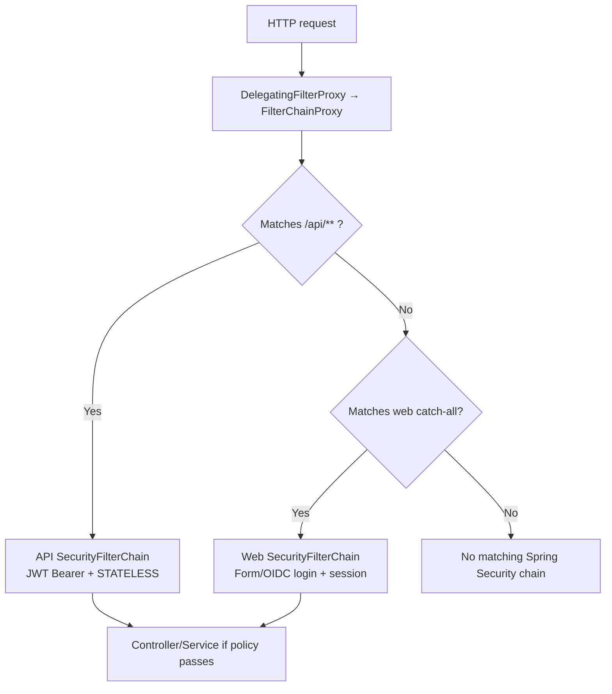
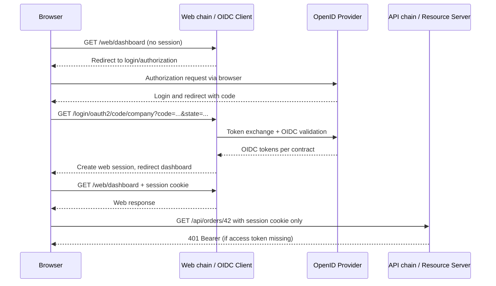

# Combining a Resource Server with Browser Login Across Multiple Filter Chains

## 1. One application, two login styles: what must be separated?

A Spring Boot application can simultaneously serve a **REST API** and a **browser-facing website**. These two surfaces typically have different authentication requirements:

- A mobile app, SPA, or another service calls `/api/**` using an **OAuth 2.0 access token** in `Authorization: Bearer ...`.
- Users open `/web/**` in a browser, log in via **form login** or **OpenID Connect (OIDC) login**, and maintain a session via an **HTTP session cookie**.
- The API should return `401 Unauthorized` with a Bearer challenge when a token is missing; an unauthenticated website typically redirects `302` to a login page.
- A pure Bearer-header API usually does not need a session for authentication; web login usually needs a session to store login state and protect against CSRF.

If everything is configured without separation, an API request may be redirected to `/login` instead of receiving `401`; or a web page may demand a Bearer token even though the user logged in with a session. Worse, disabling CSRF for the API and copying it onto the web chain can weaken the protection of a session-based website.

**Key solution:** Use `SecurityFilterChain` beans with **explicit `securityMatcher` and `@Order`**, applying the Resource Server mechanism to the API chain and the browser login mechanism to the web chain.

Target example:

| Request | Expected authentication | When unauthenticated | Policy |
|---|---|---|---|
| `GET /api/public/ping` | Token not required | `200` if controller exists | Public |
| `GET /api/orders/42` | Bearer JWT access token | `401` + Bearer challenge | `SCOPE_orders.read` |
| `POST /api/orders` | Bearer JWT access token | `401` + Bearer challenge | `SCOPE_orders.write` |
| `GET /web/dashboard` | Session after browser login | `302` to login | `authenticated()` |
| `POST /web/profile` | Session + CSRF token | Redirect/login if not logged in | Authenticated with valid CSRF |
| `GET /login` | Form login page | Displays login page | Handled by web chain |
| `POST /login` | Username/password + CSRF | Form authentication | Handled by web login filter |

This lesson uses the modern Servlet Spring Security model with `SecurityFilterChain`, lambda DSL, and Java config beans. APIs, endpoints, and hostnames are illustrative only; replace them with your real authentication contract before deploying to production.

### Expected outcomes after this lesson

You will be able to:

1. Explain why **a Resource Server is not the same as browser login** and a browser session does not automatically become a Bearer access token.
2. Understand that `FilterChainProxy` selects **the first matching chain** by `@Order`, rather than running every chain sequentially.
3. Distinguish `securityMatcher(...)` from `requestMatchers(...)` inside `authorizeHttpRequests`.
4. Configure a **stateless** JWT API separate from a **stateful** web app with form login.
5. Replace form login with **`oauth2Login`/OIDC** when the website needs login via an Identity Provider.
6. Preserve proper CSRF, session, CORS, login/logout endpoints, security context, and HTTP error behavior.
7. Test requests from browsers, API clients, and cases where routes hit the wrong chain.
8. Know when a Backend-for-Frontend (BFF), token relay, or calling downstream APIs after web login is needed.

## 2. Three OAuth 2.0/OIDC roles that must not be conflated

A Spring Security application can assume several different **protocol roles**.

### 2.1. Resource Server

A **Resource Server** protects resources when a Client sends an access token:

```http
GET /api/orders/42 HTTP/1.1
Host: shop.example.com
Authorization: Bearer <access-token>
```

The Resource Server must verify the token via `JwtDecoder` or `OpaqueTokenIntrospector`, then check scopes, audience, tenant, and business permissions.

Corresponding configuration:

```java
.oauth2ResourceServer(oauth2 ->
    oauth2.jwt(Customizer.withDefaults()))
```

It **does not automatically generate a login page** and does not convert an HTTP session into an access token for the API.

### 2.2. Browser login with form login

**Form login** authenticates users against the application's user authentication mechanism:

```text
Browser → GET /login → login page
Browser → POST /login → username/password authentication
Web application → sets Authentication in SecurityContext
Browser ↔ web app → carries session cookie for subsequent requests
```

Configuration:

```java
.formLogin(Customizer.withDefaults())
```

After login, the application typically preserves `SecurityContext` across requests via a session. This differs from a Resource Server verifying each Bearer access token.

### 2.3. Browser login with OIDC

**OIDC login** logs in via an OpenID Provider/Identity Provider:

```text
Browser → web app
Web app → redirects to Authorization Server
Browser → logs in at IdP
IdP → redirects back to web app with authorization code
Web app → exchanges code for tokens per configured flow
Web app → validates OIDC and creates Authentication/session
Browser ↔ web app → continues using session cookie
```

Configuration:

```java
.oauth2Login(Customizer.withDefaults())
```

The application acts as an **OAuth 2.0/OIDC Client** in that login flow, not as a Resource Server in that exchange.

An application can use **`oauth2ResourceServer` on the API chain** and **`oauth2Login` on the web chain**. These are two separate mechanisms, even if the same IdP issues tokens for both.

### 2.4. ID tokens must not be used in place of access tokens

After OIDC login, the Client may receive an **ID token** to confirm the login session identity. **An ID token is not an access token meant for a Resource Server.**

Example:

```text
OIDC ID token:
  aud = web-client-id
  purpose = authenticate user to the OIDC Client

OAuth access token for API:
  aud = orders-api
  scope = orders.read
  purpose = allow Client to call the Resource Server
```

Never put an ID token into:

```http
Authorization: Bearer <id-token>
```

to call `/api/orders/**`. The Resource Server must require an **access token with the right audience and scopes**, even when both tokens are JWTs from the same issuer.

## 3. How does FilterChainProxy actually process multiple SecurityFilterChains?

In the Servlet model, Spring Security uses `DelegatingFilterProxy` to integrate into the Servlet filter chain. The `FilterChainProxy` object manages the `SecurityFilterChain`s built from configuration.

Each chain has:

- A `RequestMatcher` deciding whether the chain applies to the request.
- A list of security filters matching that chain's authentication, security context, CSRF, session handling, exception handling, and authorization.

Suppose we configure:

```text
@Order(1)  /api/**       → Bearer JWT Resource Server, stateless
@Order(2)  any request   → Form login/session web
```

Flow:



**Only the first matching `SecurityFilterChain` is executed.** A request entering the API chain will not "fall through" to the web chain if authentication fails; errors are handled within the API chain's pipeline.

### 3.1. Chain selection examples

| Request | Matches `/api/**`? | Selected chain |
|---|---|---|
| `GET /api/public/ping` | Yes | API |
| `GET /api/orders/42` | Yes | API |
| `POST /api/orders` | Yes | API |
| `GET /web/dashboard` | No | Web catch-all |
| `GET /login` | No | Web catch-all |
| `POST /login` | No | Web catch-all |
| `GET /assets/app.css` | No | Web catch-all |
| `GET /oauth2/authorization/company` | No | Web catch-all |
| `GET /login/oauth2/code/company` | No | Web catch-all |

The last two URLs are important when using OIDC login; they are explained in a dedicated section.

### 3.2. `@Order` determines priority

Example:

```java
@Bean
@Order(1)
SecurityFilterChain api(HttpSecurity http) throws Exception { ... }

@Bean
@Order(2)
SecurityFilterChain web(HttpSecurity http) throws Exception { ... }
```

`@Order(1)` is evaluated before `@Order(2)`. If two chains both match a URL, the higher-priority chain (typically the lower `@Order` value) wins.

Do not rely on method declaration order inside the same Java file to decide security. Declare order intentionally whenever matcher regions overlap.

### 3.3. `securityMatcher` differs from `requestMatchers`

This is the core distinction in multi-chain configuration.

**`securityMatcher("/api/**")`:** decides whether **the entire API chain** handles the request.

**`requestMatchers("/api/public/**").permitAll()`:** decides **permissions for a request inside the already-selected chain**.

Example:

```java
http
    .securityMatcher("/api/**")
    .authorizeHttpRequests(auth -> auth
        .requestMatchers("/api/public/**").permitAll()
        .requestMatchers("/api/orders/**")
            .hasAuthority("SCOPE_orders.read")
        .anyRequest().denyAll()
    );
```

`anyRequest().denyAll()` only applies to requests **already inside the API chain**; it does not automatically protect `/web/**` or an endpoint matching no chain.

### 3.4. Default without `securityMatcher` is broad

A `SecurityFilterChain` bean without an explicit matcher typically has a matcher applying to **all requests**. Thus, if that chain comes first, it can capture every URL and prevent subsequent chains from ever being selected.

Example of an improper configuration:

```java
@Bean
@Order(1)
SecurityFilterChain api(HttpSecurity http) throws Exception {
    return http
        // Missing securityMatcher("/api/**")
        .oauth2ResourceServer(oauth2 ->
            oauth2.jwt(Customizer.withDefaults()))
        .authorizeHttpRequests(auth -> auth
            .requestMatchers("/api/**").authenticated()
            .anyRequest().permitAll())
        .build();
}
```

`/web/dashboard` may enter this chain instead of the form-login chain. The `anyRequest().permitAll()` rule can even open web routes unintentionally.

**Rule:** Specialized chains have specific matchers; the general/catch-all chain comes last.

## 4. Designing the boundary: stateless API, stateful web

A sound model:

```text
                     shop.example.com
                            |
                +-----------+------------+
                |                        |
             /api/**                all other URLs
                |                        |
          Chain @Order(1)           Chain @Order(2)
                |                        |
         BearerTokenAuth            Form/OIDC login
         JwtDecoder                 SecurityContext
         SCOPE_ authorities         Session cookie
         No session for auth        CSRF enabled
         401/403 Bearer             302/login or 403
                |                        |
             API data              Web page/BFF
```

### 4.1. What does stateless mean on the API?

`SessionCreationPolicy.STATELESS` tells Spring Security not to create or use an `HttpSession` to obtain `SecurityContext` for authentication under that chain's mechanism.

It **does not mean**:

- Clients cannot send `Cookie: JSESSIONID=...`.
- The entire application never uses HTTP sessions.
- Browsers will automatically stop sending cookies when calling same-origin `/api/**`.
- A custom filter or Controller will never touch a session.
- JWT tokens become "stateless in every respect" when the system still uses DB/caches/introspection.

It only defines **the Spring Security chain's session policy**. With a properly configured stateless API chain, **web login cookies are not used for authentication in place of Bearer tokens**.

### 4.2. What does stateful mean on the web?

A web chain using form/OIDC login typically stores `Authentication` in `SecurityContext` via an HTTP session. The browser sends the session cookie on subsequent requests, and the web chain restores login state.

A session cookie is a **browser credential for the web app**, not an OAuth access token for the API.

A user logged into `/web/dashboard` may still get `401` when calling `/api/orders/42` with only the session cookie. That is **correct by contract** if the API requires a Bearer access token.

### 4.3. Which configuration applies to which chain?

| Aspect | API Resource Server | Web login |
|---|---|---|
| Authentication | Bearer access token | Username/password or OIDC authorization code |
| Security context | Usually per-request from token | Usually persisted across requests via session |
| Session policy | `STATELESS` | Session-supporting policy |
| Entry point | Bearer challenge `401` | Redirect to login page |
| CSRF | Can be disabled when using pure Bearer headers | Keep CSRF for session-based requests |
| Scope/authority | `SCOPE_orders.read` | Web user roles/permissions |
| Logout | Token revocation per OAuth contract, not just deleting a session | Invalidate web session; optionally add OIDC logout |
| Auth endpoints | Typically no login form | `/login` or OAuth2 login endpoints |

Each chain can have different filters and security context logic, yet they still run inside **the same JVM application**. When writing custom filters, be careful never to use static variables or uncleaned custom `ThreadLocal`s to pass `Authentication` across requests.

## 5. Complete example: Spring Boot JWT API + form-login website

### 5.1. Dependencies

Example `build.gradle` for Spring Boot Servlet:

```groovy
dependencies {
    implementation 'org.springframework.boot:spring-boot-starter-web'
    implementation 'org.springframework.boot:spring-boot-starter-security'
    implementation 'org.springframework.boot:spring-boot-starter-oauth2-resource-server'

    testImplementation 'org.springframework.boot:spring-boot-starter-test'
    testImplementation 'org.springframework.security:spring-security-test'
}
```

Assumes the project already has a compatible Spring Boot plugin, Java toolchain, and dependency management. Illustrative code uses modern Java and Spring Security 6.x/compatible lambda DSL.

### 5.2. Configuring the Resource Server issuer

In `src/main/resources/application.yml`:

```yaml
server:
  port: 8080

spring:
  security:
    oauth2:
      resourceserver:
        jwt:
          issuer-uri: https://id.example.com/realms/shop
```

`issuer-uri` must be replaced with a real trusted issuer. The Resource Server uses the corresponding issuer/metadata/JWKS to verify JWTs. If the API requires `aud=orders-api`, add an audience validator per contract; issuer and signature alone do not guarantee the token is intended for the right API.

### 5.3. Two-bean SecurityFilterChain

```java
package com.example.shop;

import org.springframework.context.annotation.Bean;
import org.springframework.context.annotation.Configuration;
import org.springframework.core.annotation.Order;
import org.springframework.http.HttpMethod;
import org.springframework.security.config.Customizer;
import org.springframework.security.config.annotation.web.builders.HttpSecurity;
import org.springframework.security.config.http.SessionCreationPolicy;
import org.springframework.security.web.SecurityFilterChain;

@Configuration
public class SecurityConfig {

    // API: specific chain with higher priority.
    @Bean
    @Order(1)
    SecurityFilterChain apiSecurity(HttpSecurity http) throws Exception {
        return http
            .securityMatcher("/api/**")
            .csrf(csrf -> csrf.disable())
            .sessionManagement(session -> session
                .sessionCreationPolicy(
                    SessionCreationPolicy.STATELESS))
            .authorizeHttpRequests(auth -> auth
                .requestMatchers(
                    HttpMethod.GET, "/api/public/ping")
                    .permitAll()
                .requestMatchers(
                    HttpMethod.GET, "/api/orders/**")
                    .hasAuthority("SCOPE_orders.read")
                .requestMatchers(
                    HttpMethod.POST, "/api/orders")
                    .hasAuthority("SCOPE_orders.write")
                .anyRequest().denyAll()
            )
            .oauth2ResourceServer(oauth2 ->
                oauth2.jwt(Customizer.withDefaults()))
            .build();
    }

    // Web: catch-all, evaluated only when API chain does not match.
    @Bean
    @Order(2)
    SecurityFilterChain webSecurity(HttpSecurity http) throws Exception {
        return http
            .authorizeHttpRequests(auth -> auth
                .requestMatchers(
                    "/assets/**",
                    "/favicon.ico",
                    "/error")
                    .permitAll()
                .requestMatchers("/web/admin/**")
                    .hasRole("ADMIN")
                .anyRequest().authenticated()
            )
            .formLogin(form -> form.permitAll())
            .logout(logout -> logout
                .logoutSuccessUrl("/login?logout")
                .permitAll())
            .build();
    }
}
```

**This is a genuine dual-chain configuration**:

- `apiSecurity` matches `/api/**` first; enables JWT Resource Server and `STATELESS`.
- `webSecurity` omits `securityMatcher`, becoming the catch-all for all other URLs.
- `formLogin(...permitAll())` permits access to filter-managed login endpoints.
- `logout(...)` uses web logout; with CSRF enabled, default logout typically requires a POST request with a CSRF token.
- `/assets/**` is permitted in the web chain while still traversing the chain's security filters.
- Web admin requires a role mapped as `ROLE_ADMIN` per Spring Security conventions.

**Do not lift `csrf.disable()` into a shared setting for both chains**; here it is disabled only for the pure Bearer-header API. The web chain leaves CSRF enabled, retaining default protections for browser sessions.

If the application has additional URL areas, the catch-all web chain will handle them and require authentication by default. Teams must explicitly determine which endpoints should truly be public rather than using `anyRequest().permitAll()` and risking misconfiguration.

### 5.4. Why doesn't the web chain need `securityMatcher("/web/**")` in this example?

If you restrict the web chain to `/web/**`, URLs handled by default form login such as `/login` or `/logout` can **fall outside the chain containing the login/logout filters**.

Using a catch-all chain at the end is a simple way to cover `/login`, `/logout`, static assets, and other web URLs. If you must scope the web chain more narrowly, build a `RequestMatcher` covering **every endpoint used by security filters**, not just Controller mappings.

### 5.5. A UserDetailsService for the form-login lab

`formLogin` needs a user authentication mechanism. An internal lab example can use an in-memory account:

```java
package com.example.shop;

import org.springframework.context.annotation.Bean;
import org.springframework.context.annotation.Configuration;
import org.springframework.security.core.userdetails.User;
import org.springframework.security.core.userdetails.UserDetails;
import org.springframework.security.core.userdetails.UserDetailsService;
import org.springframework.security.crypto.factory.PasswordEncoderFactories;
import org.springframework.security.crypto.password.PasswordEncoder;
import org.springframework.security.provisioning.InMemoryUserDetailsManager;

@Configuration
public class DemoUsersConfig {

    @Bean
    PasswordEncoder passwordEncoder() {
        return PasswordEncoderFactories.createDelegatingPasswordEncoder();
    }

    @Bean
    UserDetailsService userDetailsService(
            PasswordEncoder encoder) {

        UserDetails user = User.withUsername("demo-user")
            .password(encoder.encode("demo-only-password"))
            .roles("USER")
            .build();

        return new InMemoryUserDetailsManager(user);
    }
}
```

This is a **mock lab account**; never use hardcoded passwords in production. Real applications should use a trusted identity store/IdP, password management, MFA, account lockout, and security operations.

Declaring a `UserDetailsService` for the web chain does not make the Bearer API accept username/password as a token. The API remains configured to authenticate with access tokens.

### 5.6. Demo controller for both API and web

```java
package com.example.shop;

import java.util.Map;
import org.springframework.security.core.Authentication;
import org.springframework.security.core.annotation.AuthenticationPrincipal;
import org.springframework.security.oauth2.jwt.Jwt;
import org.springframework.web.bind.annotation.GetMapping;
import org.springframework.web.bind.annotation.PathVariable;
import org.springframework.web.bind.annotation.RestController;

@RestController
public class DemoController {

    @GetMapping("/api/public/ping")
    public Map<String, String> ping() {
        return Map.of("surface", "api", "status", "ok");
    }

    @GetMapping("/api/orders/{orderId}")
    public Map<String, String> order(
            @PathVariable String orderId,
            @AuthenticationPrincipal Jwt jwt) {

        return Map.of(
            "orderId", orderId,
            "subject", jwt.getSubject());
    }

    @GetMapping("/web/dashboard")
    public Map<String, String> dashboard(
            Authentication authentication) {

        return Map.of(
            "surface", "web",
            "user", authentication.getName());
    }
}
```

This controller intentionally illustrates **Authentication** and chain selection only. A real order system must verify the owner/tenant of `orderId` and return only fields the caller is authorized to see. `POST /api/orders` in `SecurityConfig` has a protection rule without a demo Controller handler; add a dedicated handler and Service if testing successful POST requests.

## 6. Request paths: how do API and web authentication differ?

### 6.1. API without token

```http
GET /api/orders/42 HTTP/1.1
Host: shop.example.com
```

Flow:

```text
1. FilterChainProxy sees /api/** matches @Order(1).
2. Selects API chain; does not try web chain.
3. BearerTokenAuthenticationFilter finds no token.
4. Authorization rule requires SCOPE_orders.read.
5. No accepted Authentication exists.
6. Bearer entry point typically returns 401.
```

Typical response:

```http
HTTP/1.1 401 Unauthorized
WWW-Authenticate: Bearer
```

No redirect to `/login`, because the web chain was not selected.

### 6.2. API with valid token lacking scope

A JWT has `aud=orders-api`, valid issuer and signature, yet only `profile.read`. The API chain authenticates the token successfully; authorization lacks `SCOPE_orders.read`.

Typical response:

```http
HTTP/1.1 403 Forbidden
WWW-Authenticate: Bearer error="insufficient_scope"
```

Exact headers also depend on the `AccessDeniedHandler`. `403` indicates the token may have been authenticated but lacks permission to perform the operation.

### 6.3. Web without login

```http
GET /web/dashboard HTTP/1.1
Host: shop.example.com
```

Flow:

```text
1. /web/dashboard does not match API chain.
2. Web catch-all chain is selected.
3. No Authentication from web session.
4. authenticated() rule requires login.
5. Form login entry point redirects to /login.
```

Example response:

```http
HTTP/1.1 302 Found
Location: http://localhost:8080/login
```

The actual `Location` depends on host, forwarded headers, context path, and application configuration.

### 6.4. Web already logged in

The browser sends the session cookie:

```http
GET /web/dashboard HTTP/1.1
Host: shop.example.com
Cookie: JSESSIONID=<browser-session-id>
```

The web chain can use the session to restore the saved `Authentication`, then permit `/web/dashboard`. No Bearer header is needed if the web contract is session login.

### 6.5. Browser logged in calling the API with only a cookie

```http
GET /api/orders/42 HTTP/1.1
Host: shop.example.com
Cookie: JSESSIONID=<browser-session-id>
```

The request still **matches the API chain first**. With a `STATELESS` Bearer-only API chain, a session cookie does not substitute for an access token. Without a Bearer token, the protected API typically returns **401**.

This is the most critical point when combining both mechanisms: **a user logged into the website does not mean every REST API automatically accepts that session**.

### 6.6. Browser sending both session cookie and Bearer JWT to the API

```http
GET /api/orders/42 HTTP/1.1
Cookie: JSESSIONID=<browser-session-id>
Authorization: Bearer <access-token>
```

The API chain processes the Bearer token according to its JWT policy. The session cookie may also be present because the browser sends it automatically, but **it is not used as an API credential** under this stateless design.

If the Bearer JWT is invalid, do not silently "fall back" to the web session to let the request succeed. Such a fallback blurs authentication boundaries and can allow bypassing audience/scope checks.

## 7. HTTP status codes: 401/403 for API, redirects for web

The same application can return different responses for similar requests:

| Request | Chain | Situation | Typical result |
|---|---|---|---|
| `GET /api/public/ping` | API | No token | `200` if controller exists |
| `GET /api/orders/42` | API | No Bearer token | `401` + `WWW-Authenticate: Bearer` |
| `GET /api/orders/42` | API | Invalid signature/expired JWT | `401 invalid_token` |
| `GET /api/orders/42` | API | Valid JWT missing `orders.read` | `403 insufficient_scope` |
| `GET /api/orders/42` | API | JWT has scope, wrong tenant/owner | `403` or `404` per policy |
| `GET /web/dashboard` | Web | No login session | `302` to `/login` |
| `GET /web/dashboard` | Web | Valid session | `200` in demo |
| `POST /login` | Web | Wrong username/password | Redirects to error page per config |
| `POST /web/profile` | Web | Logged in but missing CSRF token | Typically `403` |
| `GET /api/orders/42` | API | Only `JSESSIONID` | `401` per JWT-only design |

Do not "fix" an API returning `401` by enabling `formLogin` on the API chain, or "fix" a website returning `302` by adding `oauth2ResourceServer` to all URLs without reviewing the browser contract.

### 7.1. When the API returns 302 instead of 401

The form-login `SecurityFilterChain` may have higher priority or too broad a matcher. Check:

```text
@Order(1) api securityMatcher("/api/**") ?
@Order(2) web catch-all ?
```

If the web chain matches first, the API chain's Bearer entry point will not be used.

### 7.2. When the web app returns `WWW-Authenticate: Bearer`

If `/web/dashboard` gets `401 Bearer` instead of redirecting to `/login`, the API chain may be matching all requests due to a missing `securityMatcher("/api/**")`.

Do not merely customize HTTP statuses; fix **chain selection**.

## 8. Sessions and SecurityContext: web state must not leak into the API

### 8.1. What is in SecurityContext?

Spring Security uses `SecurityContext` to hold the current request's `Authentication`. With web form/OIDC login, `Authentication` can be persisted in a session across requests via `SecurityContextRepository` and corresponding filters.

With a stateless Bearer JWT API, `Authentication` is created from the token on each request and does not rely on the website's HTTP session.

Example:

```text
Request A:
  GET /web/dashboard
  Cookie: JSESSIONID=web-session
  → Web chain
  → Session Authentication = user Alice

Request B:
  GET /api/orders/42
  Cookie: JSESSIONID=web-session
  → API chain
  → Does not use web session Authentication

Request C:
  GET /api/orders/42
  Authorization: Bearer jwt-for-orders-api
  → API chain
  → Authentication from JWT
```

### 8.2. Session policy is configured per chain

`SessionCreationPolicy.STATELESS` is only set on the API chain. It does not prevent the web chain from using sessions.

Conversely, the web chain creating `JSESSIONID` does not mean the API chain must read the session. Both chains may see the same browser cookie yet use entirely different authentication mechanisms.

If a custom filter/Controller tries to read `HttpSession` manually to resolve a web user across all URLs, it can break this separation. Never access web sessions to replace OAuth Bearer authentication on the API.

### 8.3. Session fixation

In web form login, Spring Security includes **session fixation** protections by rotating the session ID or applying an equivalent strategy upon successful authentication, depending on Servlet container and configuration.

Never preserve a fixed session ID across login without evaluating session fixation. In practice, check:

- Cookie has `Secure` over HTTPS.
- Cookie has `HttpOnly`.
- `SameSite` fits browser/OIDC redirect flows and cross-site needs.
- Reasonable session timeout.
- Logout invalidates the session per policy.
- Never log session cookie values.

These attributes cannot replace OAuth token audience/scope validation for APIs.

### 8.4. SecurityContext is not a shared token store

Do not write logic like:

```java
Authentication webAuth =
    SecurityContextHolder.getContext().getAuthentication();

// Conceptually wrong to treat webAuth as a Bearer access token
// for orders-api and forward it to the API chain.
```

A web `Authentication` proves the user logged in via the web mechanism. It **does not automatically contain an OAuth access token with the right audience/orders scope**, and must not be used to bypass the Resource Server.

## 9. CSRF: crucial differences between web sessions and pure Bearer APIs

### 9.1. Why do web sessions need CSRF?

Browsers typically attach cookies automatically to requests sent to a website based on domain/path/SameSite rules. An external site can try to make the browser send state-changing requests to a website where the user is already logged in.

CSRF protection checks that the request carries an anti-forgery token/proof beyond the session cookie. With form login and web sessions, keep CSRF protection enabled for state-changing operations.

Example:

```http
POST /web/profile HTTP/1.1
Cookie: JSESSIONID=<valid-session>
Content-Type: application/x-www-form-urlencoded

displayName=NewName
```

If CSRF is enabled and the request lacks a valid CSRF token, Spring Security normally rejects it. Already having a session cookie **is not enough** to omit CSRF.

### 9.2. Why did the API example disable CSRF?

In an API model **using only Bearer access tokens in the Authorization header** where browsers do not auto-attach that credential, forcing an external site to forge a request with a valid Authorization header does not work like cookie sessions. Hence many REST APIs of this style disable CSRF in the API chain.

However, if the API:

- Authenticates using session cookies.
- Accepts Bearer tokens from cookies automatically sent by the browser.
- Uses any authentication mechanism where browsers auto-attach credentials.
- Permits sensitive operations via cookies/sessions.

then do not disable CSRF merely because the URL starts with `/api/**`. Evaluate based on **auto-sent browser credentials**, not just the label "API."

### 9.3. Two chains allow scoped CSRF disabling

```java
// API chain:
.securityMatcher("/api/**")
.csrf(csrf -> csrf.disable())

// Web chain:
.formLogin(Customizer.withDefaults())
// Do not disable CSRF here.
```

This is a key reason not to write a global config disabling CSRF across the entire application when a session-based website is present.

### 9.4. POST login and logout also require understanding CSRF

With Spring Security web form login:

- `GET /login` can render the default login form.
- `POST /login` processes submitted credentials via the filter.
- When CSRF is enabled, the login form normally requires a valid CSRF token.
- `POST /logout` is typically the default logout method when CSRF is enabled; `GET /logout` may render a confirmation page or behave differently per config.

Do not disable CSRF just to make `curl -X POST /login` work when you forgot to send the CSRF token. In tests, generate a valid CSRF token or use the appropriate test utility.

### 9.5. CORS is not CSRF

**CORS** controls which cross-origin requests browsers may send and which responses they may read under certain conditions; **CSRF** protects authenticated actions from unintended invocation.

Proper CORS configuration does not replace CSRF. Conversely, enabling CSRF does not handle CORS preflight for APIs.

## 10. Form login: filter-created endpoints must sit inside the web chain

### 10.1. Default login form

When enabled:

```java
.formLogin(form -> form.permitAll())
```

Spring Security can provide a default login page and login processing endpoint if no custom page is configured. Relevant endpoints typically include:

```text
GET  /login
POST /login
GET  /login?error
GET  /login?logout
```

These URLs are not necessarily `@GetMapping` or `@PostMapping` written by developers; Spring Security's filters/page generators handle them.

Therefore, if you only configure:

```java
.securityMatcher("/web/**")
.formLogin(Customizer.withDefaults())
```

then `/login` does not match the chain containing form login; the login page/processing may fail. Use a catch-all web chain or a matcher wide enough to cover `/login`, `/logout`, and related endpoints.

### 10.2. Custom login page

If there is a custom login page:

```java
.formLogin(form -> form
    .loginPage("/signin")
    .loginProcessingUrl("/signin")
    .permitAll())
```

then `GET /signin` usually needs a Controller or view to render the page, while `POST /signin` can be handled by the authentication filter. That URL must also belong to the **web chain** and be permitted per configuration.

With a custom login page, remember to render the CSRF token in the form if CSRF is enabled, handle post-login/failed-login redirects, and avoid open redirects from client-supplied URLs.

### 10.3. SavedRequest and post-login redirects

When an unauthenticated user visits `/web/dashboard`, Spring Security can save the original request in the session so that after login succeeds, the browser is sent back to that page.

This request-cache mechanism fits web login. A stateless Bearer API usually should not create a session to save requests for post-login redirection.

Never let an API request missing a Bearer token automatically enter the form-login flow just because the web chain has a request cache.

## 11. Using OIDC login instead of form login for browsers

If the website needs login via an IdP, you can replace the **web form-login chain** with **OIDC login**. The API chain remains a JWT/opaque-token Resource Server.

### 11.1. Adding the OAuth2 Client dependency

Example `build.gradle` when using OIDC login:

```groovy
dependencies {
    implementation 'org.springframework.boot:spring-boot-starter-web'
    implementation 'org.springframework.boot:spring-boot-starter-security'
    implementation 'org.springframework.boot:spring-boot-starter-oauth2-resource-server'
    implementation 'org.springframework.boot:spring-boot-starter-oauth2-client'
}
```

`spring-boot-starter-oauth2-client` serves the website's OAuth2/OIDC Client role. The Resource Server starter and OAuth2 Client starter do not replace each other.

### 11.2. OIDC Client registration

Example `application.yml`:

```spring.yml
spring:
  security:
    oauth2:
      client:
        registration:
          company:
            provider: company
            client-id: ${OIDC_CLIENT_ID}
            client-secret: ${OIDC_CLIENT_SECRET}
            scope:
              - openid
              - profile
              - email
        provider:
          company:
            issuer-uri: https://id.example.com/realms/shop

      resourceserver:
        jwt:
          issuer-uri: https://id.example.com/realms/shop
```

`client.registration.company` and `resourceserver.jwt` serve different roles:

- **Client registration:** lets the web app perform OIDC authorization code login.
- **Resource Server JWT issuer:** lets the API verify Bearer access tokens.

Even with the same issuer, **Client ID/redirect URI and API audience/scope remain two separate contracts**. Do not treat the website's Client ID as the API's default audience.

`${OIDC_CLIENT_ID}` and `${OIDC_CLIENT_SECRET}` represent environment-provided configuration values; never commit real client secrets.

### 11.3. Web chain using `oauth2Login`

Replace the `webSecurity` method in `SecurityConfig` with:

```java
@Bean
@Order(2)
SecurityFilterChain webSecurity(HttpSecurity http) throws Exception {
    return http
        .authorizeHttpRequests(auth -> auth
            .requestMatchers(
                "/assets/**",
                "/favicon.ico",
                "/error")
                .permitAll()
            .anyRequest().authenticated()
        )
        .oauth2Login(Customizer.withDefaults())
        .logout(logout -> logout
            .logoutSuccessUrl("/"))
        .build();
}
```

This is an **alternative option**; do not declare both competing `webSecurity` beans in the same project. The `@Order(1)` API chain keeps `securityMatcher("/api/**")` and `oauth2ResourceServer`.

`oauth2Login` typically uses an HTTP session to store web authentication state and intermediate steps of the authorization code flow. It also relies on CSRF/correlation state of the OAuth2 flow; do not try to "make the entire web chain stateless" without a dedicated session/state design.

### 11.4. Common OIDC login endpoints

With registration ID `company`:

```text
/oauth2/authorization/company
/login/oauth2/code/company
```

Typically:

- `/oauth2/authorization/company` initiates the authorization request and redirects the browser to the IdP.
- `/login/oauth2/code/company` receives the authorization response/authorization code from the IdP.
- The web login filter exchanges the code for authentication per config, validates OIDC information, and creates a web session.

These URLs **do not start with `/api/**`**, so they are handled by the web catch-all chain in the two-chain architecture.

If a developer tries to narrow the web chain to `/web/**`, they must explicitly cover these OIDC login endpoints; otherwise the login flow may fail or callbacks go unhandled.

### 11.5. OIDC flow separated from Bearer API



OIDC login **does not automatically turn a web session into a Bearer token in the API chain**.

### 11.6. Can OIDC login be combined with form login?

Both `formLogin` and `oauth2Login` can be enabled on the web chain if the product intentionally supports multiple login methods. That requires designing the login page, authentication entry point, and UX carefully. However, only do this when clearly needed; this lesson uses **one web login method at a time** to avoid confusion.

Do not enable both mechanisms in the API chain hoping that "if Bearer is missing, fall back to browser login." That makes the API inconsistent and can open unintended authentication paths.

## 12. BFF and downstream APIs: can a browser session call the API?

A practical question: the browser logged into the website via OIDC, so how does the web page display orders from `orders-api`?

There are two models, requiring an explicit decision.

### 12.1. Browser calling the Resource Server directly

```text
Browser
  └── Authorization: Bearer <access-token-for-orders-api>
       └── /api/orders/42 (Resource Server)
```

In this model, the Client needs an **access token matching the audience/orders scope** and sends it in the Authorization header. You must evaluate how tokens are issued, stored, renewed, and protected in the browser, as well as XSS/token-theft risks.

Logging into the website with a session cookie does not automatically give the browser an access token for the API, nor can an OIDC ID token be used as a substitute.

### 12.2. Backend-for-Frontend (BFF)

Another model:

```text
Browser
  └── Cookie: JSESSIONID=web-session
       └── /web/orders (Web/BFF)
             └── Backend obtains properly scoped OAuth access token
                  └── Calls orders-api with Authorization: Bearer ...
```

Here the browser does not need to hold the downstream Resource Server's access token. The backend manages the web session and client-issued tokens through an appropriate OAuth flow.

The BFF must still:

- Protect the browser session and CSRF.
- Verify user permissions for the web page and data.
- Obtain an access token with the **downstream API's audience** and appropriate scopes.
- Protect access tokens in server-side storage.
- Never send an ID token in place of an access token.
- Implement token refresh/expiry/logout policies and least privilege.

Do not assume `oauth2Login` automatically supplies an access token able to call every API. An access token from OIDC login, if present, might not have the right audience for `orders-api`; an explicit AS contract or proper token acquisition flow is needed.

### 12.3. When using OAuth2AuthorizedClient

Spring Security OAuth2 Client has the `OAuth2AuthorizedClient` abstraction to manage tokens issued for a Client/registration and principal. When the web app calls a downstream API, it can use an authorized client or client manager mechanism.

However, **do not grab just any access token from an authorized client and send it to every Resource Server**. Confirm the AS issued the token for the right resource, scope, and policies.

If the application distinguishes multiple tenants, a user-bound authorized client may also need tenant/permission constraints before calling downstream.

### 12.4. Do not "copy" browser Authentication to the API

Example of a bad idea:

```java
// Unsafe idea:
// If browser session is logged in, let the API allow it
// without a Bearer access token with the right audience.
if (webSessionHasUser()) {
    allowApiRequest();
}
```

That breaks the Resource Server contract and can expose the API through session cookies, while disrupting the CSRF model and OAuth token scoping.

If a product intentionally wants an API to accept both sessions and Bearer tokens, that is **a different architecture**, requiring analysis of boundaries, Authentication precedence, CSRF, and error handling—never an accidental side effect of enabling two chains.

## 13. CORS and preflight in the browser + API model

### 13.1. Cross-origin frontend calling the API

Suppose:

```text
Web frontend: https://app.example.com
API:          https://api.example.com
```

The browser may send a CORS preflight before a request carrying an Authorization header:

```http
OPTIONS /api/orders/42 HTTP/1.1
Origin: https://app.example.com
Access-Control-Request-Method: GET
Access-Control-Request-Headers: authorization
```

Preflights typically **do not carry a Bearer token**. If the API chain forces preflights to authenticate before handling CORS, the browser may report a CORS error.

### 13.2. Enabling CORS on the API chain with explicit configuration

Example:

```java
.securityMatcher("/api/**")
.cors(Customizer.withDefaults())
.oauth2ResourceServer(oauth2 ->
    oauth2.jwt(Customizer.withDefaults()))
```

You need a `CorsConfigurationSource` or matching MVC CORS setup defining allowed origins, methods, and headers.

An explicit example:

```java
@Bean
CorsConfigurationSource apiCorsConfigurationSource() {
    CorsConfiguration cors = new CorsConfiguration();
    cors.setAllowedOrigins(
        List.of("https://app.example.com"));
    cors.setAllowedMethods(
        List.of("GET", "POST", "PUT", "DELETE"));
    cors.setAllowedHeaders(
        List.of("Authorization", "Content-Type"));

    UrlBasedCorsConfigurationSource source =
        new UrlBasedCorsConfigurationSource();
    source.registerCorsConfiguration("/api/**", cors);
    return source;
}
```

This snippet requires importing `java.util.List` and Spring Web CORS classes. The example does not enable cross-origin credentials because the illustrated model uses Bearer headers and needs no browser cookies. If sending cookies over CORS is required, perform a CSRF/cookie policy analysis and configure compatible origins/credentials; avoid arbitrary wildcards.

CORS is solely a browser policy; non-browser clients can still send HTTP requests. **CORS does not replace JWT validation, authorization, or CSRF.**

### 13.3. OPTIONS should not be treated as a business API operation

An `OPTIONS` preflight does not prove the Client is allowed to invoke `GET` or `POST` afterward. It is just the browser checking CORS policy. The actual request still needs a valid Bearer token and appropriate scopes.

Never set `permitAll("/api/**")` to "fix CORS." Configure CORS and HTTP rules accurately.

## 14. Session cookies, proxies, and OIDC redirects in production

### 14.1. Cookie attributes

Browser session cookies should be configured and verified for the deployment:

| Attribute | Role |
|---|---|
| `Secure` | Send cookie only over HTTPS |
| `HttpOnly` | Restrict scripts from reading the cookie |
| `SameSite` | Control certain cross-site cookie-sending contexts |
| `Path` and `Domain` | Restrict cookie-sending scope |
| Session lifetime | Limit credential exposure window when no longer needed |
| Session invalidation | Terminate session on logout/timeout |

`SameSite` must account for OIDC redirect flows, iframes if any, cross-site navigation, and reverse proxies. No single SameSite setting fits every application.

### 14.2. Reverse proxies and callback URLs

With OIDC login, `redirect_uri` must match the IdP registration and reflect the application's public address. If a proxy terminates TLS and forwards internally over HTTP, the app must process forwarded headers **from a trusted proxy** to generate redirects with the right scheme/host.

Never trust `X-Forwarded-Host` from arbitrary internet clients if the proxy does not scrub it, due to host header/redirect manipulation risks. Configure a forwarded-header strategy only with a clear trust boundary.

### 14.3. Browsers can send JSESSIONID to `/api/**`

A `Path=/` cookie can be auto-sent by the browser to both web and API paths on the same hostname. Therefore, in a pure Bearer-header API model:

- A cookie present in the request is **not** proof the API uses sessions for authentication.
- The stateless API chain must not restore web `Authentication` from the cookie.
- Never use a session cookie as a "fallback" when the Bearer header is missing.
- You may consider narrowing cookie `Path` when architecture permits, but **do not rely solely on cookie `Path` to enforce security boundaries**.

## 15. Web logout and access token state are two separate concerns

Suppose a user logs into `/web/**` via OIDC; the web app holds a session and may hold an access token for calling downstream APIs.

When the browser logs out:

1. The web app can delete/invalidate the HTTP session.
2. Web `Authentication` is no longer valid for subsequent web requests.
3. The browser may be redirected to a login/logout success page.
4. If using OIDC logout, the system may need RP-Initiated Logout or the IdP's logout mechanism per contract.
5. Already-issued access tokens **are not automatically revoked** merely because the web session was deleted.

An unexpired Bearer access token may still be accepted by the Resource Server until expiration or until revoked via an AS/RS mechanism.

### 15.1. Separating three states

```text
Web session active?
OIDC session at IdP active?
OAuth access token active?
```

These three states can relate, yet **are not identical**. Web logout directly affects only state managed by the web app; revoking access tokens or ending the IdP session requires separate contract-driven mechanisms.

### 15.2. CSRF and logout

With web sessions, do not expose `GET /logout` as a state-changing operation without CSRF protection merely for UI convenience. Follow Spring Security's logout filter and CSRF mechanisms when building logout buttons.

### 15.3. What does API logout mean?

A JWT Resource Server validating signatures locally does not inherently have an API "session logout." If tokens must be blocked prior to expiration, you need revocation/denylists/introspection or an appropriate token lifetime strategy. Do not expect the web chain's `/logout` to invalidate all issued JWTs.

## 16. Public endpoints: `permitAll` does not disable the Bearer filter

In the API chain:

```java
.requestMatchers("/api/public/**").permitAll()
.oauth2ResourceServer(oauth2 ->
    oauth2.jwt(Customizer.withDefaults()))
```

Several cases:

| Request to `/api/public/ping` | Possible outcome |
|---|---|
| No Authorization header | Proceeds to Controller |
| Valid Bearer token | Token authenticated, then permitted |
| Rejected Bearer token | May return `401 invalid_token` before authorization |
| Malformed Bearer header | May return `400 invalid_request` |

`permitAll` is an **authorization decision**, not an instruction to "skip all authentication filters."

If a public endpoint must work even when a Client sends a broken Bearer header, you can place a public chain ahead of it:

```text
@Order(1)  /api/public/** → public chain without oauth2ResourceServer
@Order(2)  /api/**        → JWT Resource Server chain
@Order(3)  catch-all      → web login
```

However, this design choice has trade-offs: the public chain does not populate a JWT principal for Controllers, and still needs appropriate filters like headers/CORS/CSRF. Do not split chains just to mask client token bugs without understanding the consequences.

## 17. Three chains for public API, Bearer API, and website

A three-chain pattern can be used when there is an explicit requirement that the public API does not validate Bearer credentials:

```java
@Configuration
public class ThreeChainsConfig {

    @Bean
    @Order(1)
    SecurityFilterChain publicApi(HttpSecurity http) throws Exception {
        return http
            .securityMatcher("/api/public/**")
            .authorizeHttpRequests(auth -> auth
                .anyRequest().permitAll())
            .build();
    }

    @Bean
    @Order(2)
    SecurityFilterChain protectedApi(HttpSecurity http) throws Exception {
        return http
            .securityMatcher("/api/**")
            .csrf(csrf -> csrf.disable())
            .sessionManagement(s -> s
                .sessionCreationPolicy(
                    SessionCreationPolicy.STATELESS))
            .authorizeHttpRequests(auth -> auth
                .requestMatchers(
                    HttpMethod.GET, "/api/orders/**")
                    .hasAuthority("SCOPE_orders.read")
                .anyRequest().denyAll())
            .oauth2ResourceServer(oauth2 ->
                oauth2.jwt(Customizer.withDefaults()))
            .build();
    }

    @Bean
    @Order(3)
    SecurityFilterChain web(HttpSecurity http) throws Exception {
        return http
            .authorizeHttpRequests(auth -> auth
                .requestMatchers("/assets/**").permitAll()
                .anyRequest().authenticated())
            .formLogin(form -> form.permitAll())
            .build();
    }
}
```

This is an **alternative** to the two-chain configuration; do not copy it into the same project alongside `SecurityConfig` from section 5.3. Add the corresponding imports (`@Bean`, `@Order`, `HttpSecurity`, `HttpMethod`, `Customizer`, and `SessionCreationPolicy`) as in the earlier example.

### 17.1. Why does the public chain precede the protected API?

`/api/public/ping` matches both `/api/public/**` and `/api/**`. Therefore the more specific public chain must be evaluated first to achieve the goal "do not process Bearer tokens on public routes."

If the protected API chain came first, the public chain would never execute for `/api/public/**` URLs.

### 17.2. Do not assume rules from later chains accumulate

If the public chain matches `/api/public/admin` and sets `permitAll`, the subsequent protected API chain **does not** apply additional scope rules to that same URL.

Hence verify every path under `/api/public/**` is genuinely public. Never place sensitive data there assuming the JWT chain behind it still protects it.

### 17.3. Should three chains be used just to authorize admins?

Not necessarily. If admin APIs and regular APIs both use the same Bearer JWT, a single API chain with specific `requestMatchers` is often simpler. Use multiple chains when **different filter mechanics/entry points/sessions** are needed or to separate policies intentionally.

## 18. Audience, scope, and data-permission checks are still required as usual

Multiple filter chains separate *authentication mechanisms*, but do not replace token validation and business authorization.

### 18.1. Resource Server validates audience

Suppose:

```text
API:             orders-api
Trusted issuer:  https://id.example.com/realms/shop
Required scope:  orders.read
```

A JWT:

```json
{
  "iss": "https://id.example.com/realms/shop",
  "aud": ["billing-api"],
  "scope": "orders.read"
}
```

must not be accepted by `orders-api` if the audience does not match, even if the signature and issuer are valid. An audience validator per contract is required.

Example decoder bean:

```java
package com.example.shop;

import org.springframework.context.annotation.Bean;
import org.springframework.context.annotation.Configuration;
import org.springframework.security.oauth2.core.DelegatingOAuth2TokenValidator;
import org.springframework.security.oauth2.core.OAuth2Error;
import org.springframework.security.oauth2.core.OAuth2TokenValidator;
import org.springframework.security.oauth2.core.OAuth2TokenValidatorResult;
import org.springframework.security.oauth2.jwt.Jwt;
import org.springframework.security.oauth2.jwt.JwtDecoder;
import org.springframework.security.oauth2.jwt.JwtDecoders;
import org.springframework.security.oauth2.jwt.JwtValidators;
import org.springframework.security.oauth2.jwt.NimbusJwtDecoder;

@Configuration
public class JwtValidationConfig {

    @Bean
    JwtDecoder jwtDecoder() {
        String issuer =
            "https://id.example.com/realms/shop";

        NimbusJwtDecoder decoder =
            (NimbusJwtDecoder)
                JwtDecoders.fromIssuerLocation(issuer);

        OAuth2TokenValidator<Jwt> audience = jwt ->
            jwt.getAudience().contains("orders-api")
                ? OAuth2TokenValidatorResult.success()
                : OAuth2TokenValidatorResult.failure(
                    new OAuth2Error(
                        "invalid_token", "Invalid audience", null));

        decoder.setJwtValidator(
            new DelegatingOAuth2TokenValidator<>(
                JwtValidators.createDefaultWithIssuer(issuer),
                audience));

        return decoder;
    }
}
```

This example highlights **keeping issuer/time validators when adding audience checks**. Exact decoder instantiation may vary by Spring Security version; never trust an unverified token's self-claimed issuer.

### 18.2. Scope is not object-level authorization

Having `SCOPE_orders.read` only grants **functional API read access**; it does not prove the caller may view order `42`.

A more suitable query pattern for multi-tenant data:

```sql
SELECT id, tenant_id, owner_subject, amount
FROM orders
WHERE id = :order_id
  AND tenant_id = :verified_tenant_id
  AND owner_subject = :verified_subject;
```

`verified_tenant_id` and `verified_subject` must come from the verified principal/entitlements, never trusting arbitrary URLs/headers/bodies.

### 18.3. Web roles do not automatically grant OAuth scopes

A web `Authentication` holding `ROLE_ADMIN` does not automatically possess `SCOPE_orders.write`. If the website/BFF needs to call the API on the user's behalf, it must use an access token and scopes issued by the AS. Never mint arbitrary Bearer JWTs from web roles unless the system is an architecturally authorized Authorization Server.

### 18.4. The same principal can have two representations

User Alice logged into the website might have:

```text
Web authentication:
  type: UsernamePasswordAuthenticationToken
  roles: ROLE_USER

API authentication:
  type: JwtAuthenticationToken
  authorities: SCOPE_orders.read
  subject: user-alice
```

Representing the same user at the business layer does not mean the two `Authentication` objects share **the same credential type, authorities, or lifetime**. Permissions must be verified in the proper context.

## 19. Practical HTTP checks: observing the right chain and status

Assume the app runs on `http://localhost:8080` in a lab environment.

### 19.1. Public API

```bash
curl -i 'http://localhost:8080/api/public/ping'
```

If the demo Controller is active, expect `200 OK`.

### 19.2. Protected API missing token

```bash
curl -i 'http://localhost:8080/api/orders/42'
```

Expected:

```http
HTTP/1.1 401 Unauthorized
WWW-Authenticate: Bearer
```

If you get `302` to `/login`, check the API matcher/order.

### 19.3. API with invalid Bearer JWT

```bash
curl -i \
  -H 'Authorization: Bearer invalid.jwt.value' \
  'http://localhost:8080/api/orders/42'
```

Expected `401`, typically with `error="invalid_token"`. This token is rejected by the JWT decoder.

### 19.4. Valid API token lacking scope

Suppose a token was issued by the AS with the right issuer/audience but only `profile.read`:

```bash
curl -i \
  -H "Authorization: Bearer $TOKEN_WITHOUT_ORDERS_READ" \
  'http://localhost:8080/api/orders/42'
```

Typically returns `403`. Do not edit a JWT payload manually to "remove a scope" because that breaks the signature, causing the test to fall into the 401 branch.

### 19.5. Protected web missing session

```bash
curl -i 'http://localhost:8080/web/dashboard'
```

Typically returns `302` to `/login` when using form login.

### 19.6. Web login page

```bash
curl -i 'http://localhost:8080/login'
```

With default form login and web catch-all, you should receive the login page. If the project uses OIDC login, `/login` may show provider links or a matching redirect flow; do not assume the rendered page looks like form login.

### 19.7. API with web cookie but no Bearer

```bash
curl -i \
  -H 'Cookie: JSESSIONID=some-web-session' \
  'http://localhost:8080/api/orders/42'
```

Under the stateless JWT-only API chain model, the request still requires a Bearer token and typically returns `401`. The cookie line here is illustrative; never put real session IDs into docs, logs, or tickets.

### 19.8. Why not use `curl -L` while debugging?

`curl -L` follows redirects. If the web chain returns `302` to `/login`, you might only see the final login page response and miss the chain-selection clue. Use `curl -i` first to inspect status codes and `Location`/`WWW-Authenticate`.

In real environments, always use HTTPS to transmit tokens and session cookies.

## 20. Testing multiple filter chains with MockMvc

### 20.1. Test dependencies

```groovy
dependencies {
    testImplementation 'org.springframework.boot:spring-boot-starter-test'
    testImplementation 'org.springframework.security:spring-security-test'
}
```

### 20.2. Tests for API, web, and session boundaries

Example using Spring Boot Test and MockMvc:

```java
package com.example.shop;

import org.junit.jupiter.api.Test;
import org.springframework.beans.factory.annotation.Autowired;
import org.springframework.boot.test.autoconfigure.web.servlet.AutoConfigureMockMvc;
import org.springframework.boot.test.context.SpringBootTest;
import org.springframework.security.core.authority.SimpleGrantedAuthority;
import org.springframework.test.web.servlet.MockMvc;

import static org.springframework.security.test.web.servlet.request
    .SecurityMockMvcRequestPostProcessors.jwt;
import static org.springframework.security.test.web.servlet.request
    .SecurityMockMvcRequestPostProcessors.user;
import static org.springframework.test.web.servlet.request
    .MockMvcRequestBuilders.get;
import static org.springframework.test.web.servlet.result
    .MockMvcResultMatchers.*;

@SpringBootTest
@AutoConfigureMockMvc
class MultipleChainsTest {

    @Autowired
    MockMvc mvc;

    @Test
    void publicApiIsAccessibleWithoutToken() throws Exception {
        mvc.perform(get("/api/public/ping"))
            .andExpect(status().isOk());
    }

    @Test
    void apiWithoutTokenUsesBearerChallenge() throws Exception {
        mvc.perform(get("/api/orders/42"))
            .andExpect(status().isUnauthorized())
            .andExpect(header().string(
                "WWW-Authenticate",
                org.hamcrest.Matchers.containsString("Bearer")));
    }

    @Test
    void apiTokenWithoutScopeIsForbidden() throws Exception {
        mvc.perform(get("/api/orders/42")
                .with(jwt()
                    .jwt(token -> token.subject("user-417"))
                    .authorities(new SimpleGrantedAuthority(
                        "SCOPE_profile.read"))))
            .andExpect(status().isForbidden());
    }

    @Test
    void apiTokenWithScopePassesRule() throws Exception {
        mvc.perform(get("/api/orders/42")
                .with(jwt()
                    .jwt(token -> token.subject("user-417"))
                    .authorities(new SimpleGrantedAuthority(
                        "SCOPE_orders.read"))))
            .andExpect(status().isOk());
    }

    @Test
    void browserWithoutLoginRedirects() throws Exception {
        mvc.perform(get("/web/dashboard"))
            .andExpect(status().is3xxRedirection())
            .andExpect(redirectedUrlPattern("**/login"));
    }

    @Test
    void browserUserCanAccessWebDashboard() throws Exception {
        mvc.perform(get("/web/dashboard")
                .with(user("demo-user").roles("USER")))
            .andExpect(status().isOk())
            .andExpect(jsonPath("$.surface").value("web"));
    }

    @Test
    void webUserDoesNotBecomeJwtApiAuthentication()
            throws Exception {

        mvc.perform(get("/api/orders/42")
                .with(user("demo-user").roles("USER")))
            .andExpect(status().isForbidden());
    }
}
```

**Important note on the final test:** `with(user(...))` explicitly installs a mock `SecurityContext` on the request in Spring Security Test. It **is not equivalent to a browser sending only a real `JSESSIONID` to the API**, and this test's exact status may not reflect the stateless model depending on how the request post-processor attaches context to the request. To test the real cookie/session boundary, write an integration test that logs in via the form-login session, extracts the session cookie, and sends it to the API **without a Bearer token**, confirming the API returns 401 per contract. Do not use `with(user(...))` as proof that the API genuinely accepts or rejects web sessions.

The `with(jwt())` tests also **mock JWT Authentication**, without signing real JWTs or running `JwtDecoder`/JWKS validation; they suit testing authorization rules and chain selection, not issuer/audience/expiry validation.

### 20.3. Web POST tests require a CSRF token

When testing state-changing endpoints in the web chain, use the CSRF request post-processor:

```java
import static org.springframework.security.test.web.servlet.request
    .SecurityMockMvcRequestPostProcessors.csrf;

mvc.perform(post("/web/profile")
        .with(user("demo-user").roles("USER"))
        .with(csrf())
        .param("displayName", "Alice"))
    .andExpect(status().isOk());
```

The snippet above is illustrative and requires an actual `POST /web/profile` handler to return `200`. Without `with(csrf())` while CSRF is enabled, the request can be rejected with `403` before reaching the Controller.

This does not mean CSRF should be disabled; rather, it demonstrates the web chain enforces CSRF as intended.

### 20.4. OIDC login tests

If the web chain uses `oauth2Login`, Spring Security Test supports `oidcLogin()` to simulate an OIDC principal when testing web authorization.

Conceptual example:

```java
import static org.springframework.security.test.web.servlet.request
    .SecurityMockMvcRequestPostProcessors.oidcLogin;

mvc.perform(get("/web/dashboard")
        .with(oidcLogin()))
    .andExpect(status().isOk());
```

`oidcLogin()` tests post-authentication steps and **does not perform full redirects, state, code exchange, or ID token signature verification** with a real IdP. To test the full OIDC login flow, write integration tests with an appropriate provider/stub.

### 20.5. Testing cookie-only API calls via integration test

A stronger test should:

1. Perform form login on the web chain with proper CSRF and test credentials.
2. Obtain the session cookie/`MockHttpSession` created after login.
3. Send `GET /web/dashboard` using that session → allowed.
4. Send `GET /api/orders/42` **with only that session**, no Bearer → `401`.
5. Send the same API request with a valid Bearer access token having the right scope/audience → allowed.
6. Confirm web logout strips `Authentication` from the web session without automatically assuming access tokens were revoked.

This test distinguishes **real authentication paths** from pre-installing an `Authentication` via a test post-processor.

## 21. Common configuration mistakes

### 21.1. API chain missing `securityMatcher`

**Symptom:** `/web/dashboard` returns Bearer `401` instead of redirecting to login.

**Cause:** The `@Order(1)` API chain matches every URL and intercepts the request before the web chain.

**Fix:** Add `securityMatcher("/api/**")` to the API chain.

### 21.2. Catch-all web chain placed before the API chain

```text
@Order(1) Web chain: any request
@Order(2) API chain: /api/**
```

**Consequence:** The API chain may never be selected; unauthenticated API requests get redirected to login or evaluated under web policy.

**Fix:** Put specialized API chains first; put catch-all last.

### 21.3. Web chain matching only `/web/**`

**Symptom:** `/web/dashboard` redirects to `/login`, yet `/login` fails.

**Cause:** The login page/processing URL does not fall inside the chain containing `formLogin`.

**Fix:** Use a web catch-all or explicitly cover `/login`, `/logout`, and related endpoints.

### 21.4. OIDC callback captured by the API chain

**Symptom:** OIDC callback returns `401 Bearer` or `404` instead of completing login.

**Possible cause:** API security matcher is too broad or callback path sits under `/api/**` without matching rules.

**Fix:** Keep the OAuth2 authorization endpoint and callback in the web chain/path handling `oauth2Login`; verify registered redirect URIs and reverse proxy settings.

### 21.5. Disabling CSRF for web because the API got 403

**Consequence:** A session-cookie website loses CSRF protection.

**Fix:** Disable CSRF only on the API chain when it is genuinely Bearer-header-only; fix web form/request CSRF properly instead of removing protection.

### 21.6. Browser logged in yet API still returns 401

**Explanation:** The website has a session, but the stateless JWT-only API requires a Bearer access token.

**Fix:** Explicitly design either direct browser-to-API calls with an access token, or a BFF using the browser session and calling downstream APIs with backend-managed access tokens.

### 21.7. Sending an OIDC ID token to a Resource Server

**Consequence:** ID tokens typically have the OAuth2 Client ID as audience, not the API; a proper API must reject it.

**Fix:** Use an access token with the right audience, scope, and token profile.

### 21.8. Web roles automatically treated as OAuth scopes

**Consequence:** Someone with `ROLE_ADMIN` on the website can invoke `SCOPE_orders.write` without a valid access token/grant.

**Fix:** Maintain separation between web roles and OAuth scopes, using the right token when calling APIs.

### 21.9. CORS preflight required to carry a Bearer token

**Consequence:** The browser reports a CORS error before the real request is even sent.

**Fix:** Configure CORS on the API chain, allow origins/methods/headers per contract, and ensure preflights are handled properly.

### 21.10. Only two narrow chains, missing new endpoints

**Consequence:** New URLs outside both `/api/**` and `/web/**` may go unprotected by Spring Security.

**Fix:** Use a final catch-all chain with a strict default policy, or ensure all URLs are intentionally covered.

### 21.11. Web logout leaves Bearer JWTs working

**Explanation:** Web sessions and OAuth access tokens have distinct lifecycles.

**Fix:** If tokens must be revoked after logout, implement dedicated revocation/introspection/denylist or token lifetime strategies rather than merely invalidating the web session.

### 21.12. Confusing filter order with chain order

`@Order` determines priority between **`SecurityFilterChain`s**. `addFilterBefore` or `addFilterAfter` adjusts filter positions **within a single chain**.

Changing `@Order(1)` to `@Order(2)` does not make `BearerTokenAuthenticationFilter` run before or after the CSRF filter in the same chain. Those are two separate decisions.

## 22. Observing actual chain selection and diagnostics

When an unexpected HTTP status occurs, first determine **which chain handled the request**.

In development environments, you can enable logging:

```yaml
logging:
  level:
    org.springframework.security.web.FilterChainProxy: TRACE
    org.springframework.security: DEBUG
```

Logged details vary by Spring Security version. Use these log levels carefully; never enable blanket `TRACE` in production or log access tokens/session secrets.

Diagnostic questions:

1. Is the actual request path `/api/**` or altered by proxy rewrites/context paths?
2. How many `SecurityFilterChain` beans were registered?
3. Which chain has the highest `@Order` priority?
4. Is the first chain's matcher too broad?
5. Does the web chain cover `/login`, `/logout`, and OIDC callbacks?
6. Does the API chain have `oauth2ResourceServer` and `STATELESS`?
7. Does the web chain have `formLogin` or `oauth2Login`, sessions, and proper CSRF?
8. Does the API request carry a valid Bearer token or only a session cookie?
9. Does the web request carry a valid browser session?
10. Is a custom filter/handler accidentally transferring `Authentication` from web to API?
11. What do `WWW-Authenticate`, `Location`, `Set-Cookie`, and the status say?
12. Is there further Service/tenant/owner authorization after `SecurityFilterChain`?

### 22.1. Headers to inspect

| Header | When helpful | Notes |
|---|---|---|
| `Authorization` | Did the API Client send Bearer? | Never log token values |
| `WWW-Authenticate` | Distinguish Bearer 401/403 | Do not assume all 401s share the same error |
| `Location` | Web login/OIDC redirects | Verify redirect targets the right origin |
| `Set-Cookie` | Web login creates/updates session cookie | Mask session IDs |
| `Cookie` | Is the browser sending a session? | Presence of a cookie does not mean the API uses sessions |
| `Origin` | CORS and CSRF context | Origin does not by itself prove authorization |
| `Access-Control-*` | CORS preflight/response | Does not replace authorization |

### 22.2. Gateways and reverse proxies

If a gateway rewrites `/api/orders` to `/orders` before reaching the Servlet app, `securityMatcher("/api/**")` may not match. Inspect **the path Spring Security actually receives**, not just the external URL.

Do not fix this by letting the API chain match all URLs and accidentally swallow `/login`. Align routing between the gateway and the application.

## 23. Integration matrix to verify

An integration test suite for two chains should cover:

| Scenario | Expected outcome |
|---|---|
| Public API without token | Passes security; Controller returns 2xx when present |
| Protected API without Bearer | 401 + Bearer challenge |
| Protected API JWT invalid signature | 401 |
| Protected API JWT wrong audience | 401 when validator configured |
| Protected API valid JWT missing scope | 403 |
| Protected API valid JWT with scope | Processed further; data checks still apply |
| Web dashboard without session | Redirects to login |
| Web dashboard with post-login session | Permitted |
| Web admin with user lacking role | 403 |
| API with only web session cookie | 401 per JWT-only architecture |
| Web with Bearer token but no web session | Not automatically treated as web login |
| Web POST without CSRF token | 403 under standard CSRF config |
| Web POST with login and CSRF token | Passes CSRF; depends on handler/permissions |
| Form login URL `/login` | Handled by web chain |
| Web logout | Destroys/rotates web session state |
| Access token after web logout | Follows token lifetime/revocation policy, not assumed revoked |
| OIDC authorization/callback paths | Handled by web chain with `oauth2Login` |
| CORS preflight to API | Handled per CORS without requiring Bearer on preflight |
| Non-API endpoints | Handled by web catch-all or specialized chain |
| Public API sent an invalid Bearer token | May 401 if inside API chain with Bearer filter |
| Browser/OIDC redirect behind reverse proxy | Uses registered host/scheme/redirect URI |

These outcomes must be proven with real application tests and configuration. This lesson provides structure and test scenarios; it does not imply Gradle/MockMvc or a live IdP was executed.

## 24. Self-check questions

**Q1.** A `GET /api/orders/42` request matches the `@Order(1)` API chain without a Bearer token. Does Spring Security continue to the `@Order(2)` web chain to redirect to `/login`?

**Answer:** No. `FilterChainProxy` selects the first matching chain; authentication failure is handled inside the API chain, typically returning a 401 Bearer challenge.

**Q2.** Are `securityMatcher("/api/**")` and `requestMatchers("/api/orders/**").hasAuthority(...)` the same?

**Answer:** No. `securityMatcher` selects the entire chain; `requestMatchers` defines authorization rules within the selected chain.

**Q3.** Why is the web chain in the example configured as a catch-all?

**Answer:** So URLs like `/login`, `/logout`, static assets, and OIDC login callbacks are not left outside the chain holding browser login filters, while also providing a default policy for other URLs.

**Q4.** Does a browser logged into the website with `JSESSIONID` automatically gain access to the JWT Resource Server API?

**Answer:** No. The stateless API chain only accepts Bearer tokens per contract; a web session cookie does not substitute for an access token.

**Q5.** Should an OIDC ID token be sent in `Authorization: Bearer` to call `orders-api`?

**Answer:** No. ID tokens are intended for the OIDC Client; the API requires an access token with the proper audience, scope, and token profile.

**Q6.** Why shouldn't CSRF be disabled on the web form-login chain?

**Answer:** Browsers automatically attach session cookies, so defenses are needed against unintended state-changing requests. Disabling CSRF simply because a separate API uses Bearer tokens violates boundary separation.

**Q7.** Does `STATELESS` on the API chain prevent the web chain from using sessions?

**Answer:** No. Session policies are configured per chain; the web chain can still use HTTP sessions to persist browser logins.

**Q8.** OIDC login uses `/login/oauth2/code/company` while the web chain only matches `/web/**`. What is the issue?

**Answer:** Callbacks may miss the chain containing `oauth2Login`; use matchers covering all OIDC flow endpoints or a web catch-all.

**Q9.** Does `permitAll` on `/api/public/ping` guarantee a request with a malformed Bearer token still returns 200?

**Answer:** No. The Bearer authentication filter can reject the token before the `permitAll` authorization rule runs.

**Q10.** Does a web user with `ROLE_ADMIN` automatically receive `SCOPE_orders.write` on the API?

**Answer:** No. Web roles and OAuth access token scopes are distinct permission mechanisms; the API requires a compliant access token.

**Q11.** When using a BFF, must the browser hold the downstream API's access token?

**Answer:** No. The BFF can manage tokens on the backend and use a session to authenticate the browser, provided CSRF/sessions are protected and downstream calls use access tokens with the right audience/scope.

**Q12.** Does web logout automatically revoke all issued JWT access tokens?

**Answer:** No. Web session invalidation and OAuth token revocation are separate states; implement dedicated revocation/lifetime designs if required.

## 25. Key points to remember

**Combining a Spring Security Resource Server with browser login does not mean mixing both authentication styles across all requests.** Define each URL's contract clearly:

- **API `/api/**`:** dedicated `securityMatcher`, high `@Order`, Bearer access token, JWT/opaque validation, stateless where appropriate, `401/403` errors, and scope/tenant authorization.
- **Website:** trailing/catch-all web chain, form login or OIDC login, session authentication, CSRF for browsers, and full login/logout/callback URLs.
- **Connecting web and API:** when needed, use a real access token with the right audience/scope or an intentional BFF/token-acquisition model; never arbitrarily convert ID tokens or session cookies into Bearer credentials.

Remember that **`FilterChainProxy` picks the first matching chain**, `securityMatcher` selects the chain, and `requestMatchers` selects rules inside the chain. Check `@Order`, session behavior, CSRF, CORS, and login endpoints before customizing HTTP errors or widening security matchers.

A well-designed system presents a **Bearer challenge to REST Clients**, a **proper login flow to browsers**, and preserves clean boundaries among access tokens, OIDC identity, web sessions, and business data access permissions.
