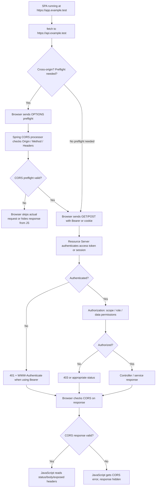

# Allowed Origins, Headers, Methods, and Credentials Based on Real Clients

In a **Spring Security OAuth 2.0/OIDC Resource Server** running on the Servlet stack, verifying a JWT or introspecting an opaque token only answers **whether the access token is valid and permitted at this API**. When a **browser** calls the API from a different origin, a separate policy layer applies: **Cross-Origin Resource Sharing (CORS)**.

CORS configuration should not start with the question "how do we make CORS errors go away quickly?" It must start from **the actual clients calling the API**: which origin the SPA runs on, whether it sends Bearer tokens in the `Authorization` header, whether cookies/sessions are used, which HTTP methods it needs, and which response headers it needs to read. From there, determine:

- **Allowed origins:** which origins the browser allows to read cross-origin responses from the API.
- **Allowed methods:** which HTTP methods the frontend may use in CORS requests.
- **Allowed headers:** which non-safelisted **request headers** the frontend is allowed to send.
- **Exposed headers:** which **response headers** frontend JavaScript is allowed to read.
- **Allow credentials:** whether the browser may share responses of credentialed requests with the cross-origin frontend, subject to CORS constraints and fetch/cookie settings.
- **Max age:** how long the browser may cache CORS preflight results within browser caps.

Because this lesson covers **web security and state**, clearly distinguish CORS from OAuth 2.0 authentication, HTTP authorization, CSRF, cookie sessions, and requests from mobile/native or backend-to-backend clients.

> **Guiding principle:** CORS is a browser policy deciding whether a JavaScript origin may **read responses** from another origin. CORS **is not** proof of identity, does not grant permissions to access tokens, does not stop all cross-origin requests from causing side effects, and does not replace CSRF or authorization.

## 1. Where does CORS appear in an OAuth 2.0 Resource Server?

Consider the architecture:

```text
SPA:
  https://app.example.test

Orders Resource Server:
  https://api.example.test

Authorization Server:
  https://login.example.test
```

The SPA logs in using an OAuth/OIDC flow suited for browser clients, such as Authorization Code + PKCE. Once it has an access token for the Orders API, the SPA calls:

```javascript
const response = await fetch(
  "https://api.example.test/api/orders/42",
  {
    headers: {
      Authorization: "Bearer " + accessToken,
      Accept: "application/json"
    }
  }
);
```

The browser sees a script running at `https://app.example.test` attempting to access `https://api.example.test`. Because **the two origins differ**, the browser enforces the Same-Origin Policy and CORS.

Even if the JWT is completely valid, the browser can still block JavaScript from reading the response if the API does not return the right CORS headers. Conversely, an API returning CORS headers for an origin does not mean the caller's token is accepted.

### 1.1. Request flow across layers



Note that CORS is **enforced by the browser**. A request that does not require a preflight or is submitted via a standard HTML form **can still reach the server** even if JavaScript cannot read the response. Therefore, CORS cannot serve as the sole barrier against CSRF, unauthorized writes, or unauthenticated API access.

### 1.2. CORS differs from Resource Server authentication

| Mechanism | Question | Enforcement layer |
|---|---|---|
| CORS | May this JavaScript origin send/read cross-origin requests under browser policy? | Browser + server-returned CORS headers |
| JWT/opaque authentication | Is the Bearer token valid and intended for this API? | Spring Security Resource Server |
| HTTP authorization | Does the principal hold `SCOPE_orders.read` / matching role? | Spring Security authorization |
| Object authorization | May this user view order 42 in the corresponding tenant? | Service / domain policy |
| CSRF protection | Are unauthorized actions via auto-sent browser credentials prevented? | Web security, CSRF token / SameSite / architecture |
| Cookie policy | Does the browser send/accept cookies cross-site? | Browser cookie rules + Set-Cookie policy |

Never "fix CORS errors" by turning off JWT verification, dropping audience validation, setting all endpoints to `permitAll()`, or granting `SCOPE_admin`.

## 2. Origin consists of scheme, host, and port

An **origin** is the tuple:

```text
scheme + host + port
```

Examples:

```text
https://app.example.test       -> scheme=https, host=app.example.test, port=443
http://app.example.test        -> scheme=http,  host=app.example.test, port=80
https://app.example.test:8443  -> scheme=https, host=app.example.test, port=8443
https://api.example.test       -> scheme=https, host=api.example.test, port=443
```

The following URLs are **not the same origin** as `https://app.example.test`:

| URL | Why is it a different origin? |
|---|---|
| `http://app.example.test` | Different scheme |
| `https://api.example.test` | Different host |
| `https://app.example.test:8443` | Different port |
| `https://admin.example.test` | Different subdomain |
| `http://localhost:5173` | Different host, scheme, and port |

Meanwhile:

```text
https://app.example.test/dashboard
https://app.example.test/orders/42
```

are **same-origin** despite having different paths. Origin excludes path, query, fragment, and username.

### 2.1. Same-origin differs from same-site

In browser security, **same-origin** and **same-site** are not the same concept.

For example:

```text
https://app.example.test
https://api.example.test
```

have different origins, yet generally belong to the same schemeful site based on how browsers determine registrable domains. This affects **SameSite cookies**, yet **does not eliminate CORS requirements** when the app's JavaScript calls an API on another subdomain.

Conversely, same-site cookies can still be constrained by Fetch's `credentials` options and cookie attributes. Never assume "same company / same root domain" means the browser automatically allows all requests.

### 2.2. Origin in request headers

On cross-origin requests, the browser may send:

```http
Origin: https://app.example.test
```

This is the origin of the script/request per browser policy—not the Resource Server name, OAuth client ID, or token issuer.

**Never use `Origin` to authenticate users.** Non-browser clients such as curl can send any arbitrary `Origin` header. CORS lets browsers read responses per origin, while the API must still verify bearer tokens/sessions.

## 3. Classify real clients before setting CORS

Not every application "calling an API" needs the same policy.

| Client | Browser enforces CORS? | Typical credentials | Usually appropriate CORS design |
|---|---|---|---|
| SPA on different origin from API | Yes | Bearer token in `Authorization` | Allow exact origin; allowed headers include `Authorization`; cookie credentials not necessarily enabled |
| Web frontend calling API with cookie/session | Yes if cross-origin | Browser-sent cookies | Allow exact origin, `allowCredentials(true)` only when genuinely needed; separate CSRF and cookie policy |
| Same-origin BFF for frontend | Usually no for same-origin browser → BFF calls | HttpOnly session cookie | Browser → BFF typically needs no CORS; BFF → backend is server-to-server |
| Web admin on separate origin | Yes | Bearer/cookie per design | Allow separate admin origin; admin authorization still mandatory |
| Native iOS/Android | No standard browser CORS for native HTTP clients | Bearer token | CORS is not a defense boundary for native clients |
| Backend microservice → API | No | Service access token/mTLS | CORS does not protect server-to-server traffic |
| Browser embedded in WebView | Depends on WebView/browser context | Bearer/cookie | Identify real origin and API; do not assume native |
| Third-party dashboard on partner site | Yes | Third-party token per contract | Allow exact partner origin and check audience/scope/tenant |
| CLI/curl/Postman | No | Bearer token | Can spoof Origin; server authorization must still enforce access |

If the client is **backend-to-backend**, setting `Access-Control-Allow-Origin: *` neither improves security nor helps services authenticate. Conversely, requiring CORS for backend-to-backend calls confuses roles: HTTP clients generally do not enforce CORS like browsers.

### 3.1. SPA sending a Bearer token via header

Flow:

```text
SPA (browser) -- Authorization: Bearer access_token --> API
```

Configuration points:

- `allowedOrigins` contains the SPA's real origin.
- `allowedMethods` contains the API HTTP methods called by the SPA.
- `allowedHeaders` includes `Authorization`; add `Content-Type` if the frontend sends JSON plus any custom headers actually used.
- `exposedHeaders` includes only response headers JavaScript needs to read, such as `WWW-Authenticate` if reading challenges is required.
- `allowCredentials` **does not automatically need to be true merely because the request carries a JavaScript-attached Bearer header**. Decide based on actual credentials/cookies and Fetch usage.

Important: the `Authorization` header typically causes requests to **require a preflight** because it is not in the CORS-safelisted request headers list, even for GET.

### 3.2. Web app using cookies/sessions

Flow:

```text
Browser -- Cookie: SESSION=... --> API / BFF
```

If frontend and API have different origins and the browser must send cookies, configuration must align with:

- `fetch(..., { credentials: "include" })` for cross-origin requests where the app intentionally includes cookies.
- Server `Access-Control-Allow-Credentials: true`.
- `Access-Control-Allow-Origin` set to a specific origin, **not `*`**.
- Appropriate cookie `Domain`, `Path`, `Secure`, `HttpOnly`, and `SameSite`.
- CSRF protection for state-changing actions.
- Session, expiry, logout, and origin trust policies.

**Enabling CORS credentials does not enable CSRF protection.** An auto-attached browser cookie can cause a request to trigger side effects even in cases where external JavaScript still cannot read the response.

### 3.3. Same-origin BFF to reduce complexity

A BFF (*Backend For Frontend*) can be structured as:

```text
Browser:
  https://app.example.test
       |
       | Same-origin HTTPS, session cookie
       v
BFF:
  https://app.example.test
       |
       | Backend HTTP request + access token
       v
Orders Resource Server:
  https://api.internal.example.test
```

Calls **browser → BFF** are not cross-origin, so CORS is typically unneeded on that leg. Calls **BFF → API** are server-side HTTP, outside browser CORS. The backend API still needs token verification or mTLS, plus audience/scope checks.

If the BFF uses cookie sessions, proper CSRF and session security are still required. Never "turn off all security" just because the BFF is same-origin.

## 4. CORS preflight: the browser asks before sending the real request

When a cross-origin request requires preflight (for instance, carrying an `Authorization` header or `Content-Type: application/json`), the browser typically sends an HTTP `OPTIONS` request:

```http
OPTIONS /api/orders HTTP/1.1
Host: api.example.test
Origin: https://app.example.test
Access-Control-Request-Method: POST
Access-Control-Request-Headers: authorization,content-type
```

Key details:

- The **preflight request** method is `OPTIONS`.
- `Access-Control-Request-Method: POST` announces the method of the **actual request** the browser wants to send.
- `Access-Control-Request-Headers` lists the **request header names** the browser wants to use.
- Preflights normally **do not carry the Bearer access token** or session credentials of the actual request. CORS must run before security checks requiring credentials for the actual request.

The server may respond:

```http
HTTP/1.1 200 OK
Access-Control-Allow-Origin: https://app.example.test
Access-Control-Allow-Methods: GET,POST,PATCH,DELETE
Access-Control-Allow-Headers: Authorization,Content-Type
Access-Control-Max-Age: 1800
Vary: Origin
Vary: Access-Control-Request-Method
Vary: Access-Control-Request-Headers
```

The status code of a successful preflight can be `200` or another suitable success code per implementation. The browser decides whether to proceed with the actual request based on the CORS response.

### 4.1. Preflight does not validate OAuth access tokens

The browser has not sent the Bearer token on the preflight, so there is no token to validate for issuer/audience/scope. If the server tries to force `OPTIONS` preflights to have `SCOPE_orders.write`, the browser may never be able to send the real POST request.

Correct flow:

```text
OPTIONS preflight:
  check Origin + requested Method + requested Headers
  -> return CORS response if policy allows

Actual POST:
  check CORS + Bearer token + OAuth scope + business permissions
  -> process/deny and return response with appropriate CORS headers
```

**Passing a preflight does not mean POST is allowed to do anything.** The actual POST must still be authenticated and authorized.

### 4.2. When is there no preflight?

Certain requests qualifying as CORS "simple requests" may be sent directly by the browser without an `OPTIONS` preflight—for example, GET with safelisted headers and qualifying Content-Types.

This means:

- Seeing no `OPTIONS` request **does not prove** CORS is absent.
- The actual request still needs `Access-Control-Allow-Origin` for JavaScript to read the response.
- The server may have already received the request and even caused side effects before the browser blocks the frontend from reading the response.

### 4.3. Why isn't `allowedMethods` just `OPTIONS`?

In a preflight:

```http
OPTIONS /api/orders
Access-Control-Request-Method: POST
```

the browser asks whether **POST** is permitted. Spring's CORS processor checks the **requested** method, not merely `OPTIONS`. Thus if the frontend needs POST, the allowed methods list must include `POST`; allowing `OPTIONS` alone does not satisfy the check.

## 5. Allowed origins: choosing the right API callers

An illustrative origin list:

```text
https://app.example.test
https://admin.example.test
http://localhost:5173
```

Configuration must separate **production** and **development**. `http://localhost:5173` may make sense for local development, yet should not appear automatically in production unless production genuinely intends browsers on localhost to read API responses.

### 5.1. Do not use a URL with a path as an origin

Conceptually wrong:

```text
https://app.example.test/dashboard
```

because origins have no path. Correct:

```text
https://app.example.test
```

If an app needs different permissions for frontend routes `/dashboard` and `/admin` **on the same origin**, CORS cannot distinguish two JavaScript routes as two separate origins. Enforce authorization on the API and separate frontend hosts/tenants if independent origin boundaries are needed.

### 5.2. Do not use ad-hoc regex/substring checks on Origin

Risky example:

```java
if (origin.endsWith("example.test")) {
    allow(origin);
}
```

A string like `evil-example.test` can bypass a suffix check missing a dot/boundary. Likewise, `contains("example.test")` is easily tricked by other URLs.

Use Spring's origin matching with **exact values** or managed patterns rather than manually reflecting input headers.

### 5.3. `Origin: null`

Browsers can send `Origin: null` from contexts like sandboxed documents or file/data origins. **Do not enable `null` merely to support local HTML files**, because many untrusted contexts also use opaque origins.

For frontend development, the common approach is running a dev server on an explicit HTTP origin such as `http://localhost:5173`. Only allow `Origin: null` if your threat model and contract truly require it.

## 6. `allowedOrigins` vs. `allowedOriginPatterns`

Spring Web CORS offers two key ways to configure origins:

- `CorsConfiguration#setAllowedOrigins(...)`: list of exact allowed origins, or wildcard where appropriate.
- `CorsConfiguration#setAllowedOriginPatterns(...)`: list of Spring-supported origin patterns covering groups of subdomains/ports via Spring's syntax.

Exact origins example:

```java
config.setAllowedOrigins(List.of(
    "https://app.example.test",
    "https://admin.example.test"
));
```

Example when a set of subdomains is genuinely managed and trusted:

```java
config.setAllowedOriginPatterns(List.of(
    "https://*.trusted.example.test"
));
```

**Use patterns only if you genuinely trust every origin matching the pattern.** Wildcards across all subdomains introduce risk if subdomain takeovers, tenant-hosted pages, arbitrary user-hosted content, or untrusted preview environments exist.

### 6.1. Why can't `allowedOrigins("*")` be combined with credentials?

Browsers reject responses with:

```http
Access-Control-Allow-Origin: *
Access-Control-Allow-Credentials: true
```

for credentialed CORS requests. This combination is forbidden by the CORS standard, and Spring validates against combining `allowCredentials(true)` with wildcard `allowedOrigins("*")`.

For credentialed browser clients, return the **specific approved origin**:

```http
Access-Control-Allow-Origin: https://app.example.test
Access-Control-Allow-Credentials: true
```

`allowedOriginPatterns` lets Spring echo a pattern-matched specific origin even when credentials are allowed. However, **do not abuse this capability with a broad `*` pattern**. If the origin allowlist is too permissive, untrusted websites may be allowed by the browser to read responses containing user data.

### 6.2. Wildcard `*` is not always wrong

For **strictly public, uncredentialed resources containing no per-user data**, `Access-Control-Allow-Origin: *` can be a sensible policy so any website can read public data.

Examples include public fonts, public catalogs, or public API docs. However, if endpoints return personal data based on cookies/access tokens, do not use that public policy as the default for all of `/api/**`.

### 6.3. CORS cannot restrict native/curl clients

A cURL command can send:

```bash
curl -H "Origin: https://app.example.test" https://api.example.test/api/orders
```

without being constrained by browser Same-Origin Policy. Thus **Origin is not an access-control identity**. To block unauthorized callers, validate OAuth bearer tokens, check audience, scopes, tenant/object permissions, and optionally mTLS/DPoP/rate limits as required.

## 7. Allowed methods: HTTP method permissions at the CORS layer

CORS allowed methods describe which HTTP methods **the browser may use cross-origin**, without granting business permissions.

Example:

```java
config.setAllowedMethods(List.of(
    "GET",
    "POST",
    "PATCH",
    "DELETE"
));
```

Whereas authorization policy may be:

```java
.requestMatchers(HttpMethod.GET, "/api/orders/**")
    .hasAuthority("SCOPE_orders.read")
.requestMatchers(HttpMethod.POST, "/api/orders")
    .hasAuthority("SCOPE_orders.write")
.requestMatchers(HttpMethod.DELETE, "/api/orders/**")
    .hasAuthority("SCOPE_orders.delete")
```

The two lists serve two purposes:

| Layer | What does POST in the allowed list mean? |
|---|---|
| CORS | Browsers from allowed origins may send cross-origin POST per CORS policy |
| Spring Security authorization | Does the caller have the authority needed for the POST endpoint? |
| Business policy | May the caller create/update this specific object and is the state valid? |

**Allowing CORS POST does not mean `permitAll()` POST.**

### 7.1. Allow only methods the frontend actually uses

If the frontend only reads data, CORS may only need:

```java
config.setAllowedMethods(List.of("GET"));
```

There is no need to allow `DELETE` merely because the backend API has a DELETE endpoint for server-side clients. Still, do not think omitting DELETE from CORS protects DELETE from Postman/curl. HTTP authorization must still enforce scopes.

### 7.2. HTTP GET can still leak information

Even GET can return personal data. A CORS policy permitting GET from an untrusted origin can expose responses when cookies/credentials are sent by the browser. Never treat GET as "safe to make public" merely because it shouldn't mutate state.

### 7.3. The `OPTIONS` method

Preflight uses OPTIONS at the browser layer. `allowedMethods` must include **the actual request's method** named in `Access-Control-Request-Method`. If the API has a business OPTIONS endpoint or needs to serve regular OPTIONS responses, design a separate policy for it.

Do not blindly add `requestMatchers(HttpMethod.OPTIONS, "/**").permitAll()` just to get past a CORS error; the right approach is usually configuring the CORS filter before authentication and scoping origins/methods/headers properly.

## 8. Allowed headers: these are request headers, not response headers

A browser request:

```http
POST /api/orders HTTP/1.1
Origin: https://app.example.test
Authorization: Bearer <ACCESS_TOKEN>
Content-Type: application/json
X-Request-Id: req-123
```

may trigger a preflight reporting:

```http
Access-Control-Request-Headers: authorization,content-type,x-request-id
```

The server must allow the header names used by the frontend contract:

```java
config.setAllowedHeaders(List.of(
    "Authorization",
    "Content-Type",
    "X-Request-Id"
));
```

HTTP header names are case-insensitive. The `Authorization` header itself **must still carry a valid token**; listing it in `allowedHeaders` only lets the browser send the header under CORS policy.

### 8.1. Common request headers

| Request header | Purpose | Needs to be in allowed headers? |
|---|---|---|
| `Authorization` | Sends Bearer access token | Yes for browser SPAs sending header cross-origin |
| `Content-Type` | JSON POST/PATCH | Yes when browser preflight requests it |
| `X-Request-Id` | Frontend-attached correlation ID | Yes if frontend sends and needs it |
| `X-CSRF-TOKEN` | CSRF token header for cookie/session apps | Yes if frontend sends it |
| `X-Tenant-Id` | Client-supplied tenant context | Allow only if contract truly uses it; never treat as proof of permission |
| `Accept` | Content negotiation | Usually CORS-safelisted with standard values |
| `Origin` | Browser-sent origin | Frontend does not need to specify it in allowed request headers |
| `Cookie` | Browser cookie management | Frontends should not manually set Cookie headers; cookies follow browser/credentials policy |

**Never put secrets or access tokens in `Access-Control-Allow-Headers`.** That is a list of **header names**, not a place to transmit tokens or Authorization Server credentials.

### 8.2. Do not default thoughtlessly to `allowedHeaders("*")`

Spring can support wildcards in allowed headers per configuration and CORS rules. Using `*` may suit public/non-sensitive APIs, but for a Resource Server with a defined contract, list the headers the frontend actually requires.

Even if all request headers are allowed, the API does not automatically grant permissions. Still, overly broad settings weaken policy governance, hide uncontrolled proliferation of custom headers, and invite confusion between client-supplied metadata and trusted identity.

### 8.3. Custom headers are not security proof

If the frontend sends:

```http
X-Tenant-Id: shop-b
```

that only expresses which tenant the caller intends to operate on. The Resource Server must verify that tenant against **verified identity/membership/ACLs**. A header permitted by CORS does not mean the caller belongs to `shop-b`.

## 9. Exposed headers: which response headers may JavaScript read?

`Access-Control-Allow-Headers` governs **request headers the browser wants to send**, whereas `Access-Control-Expose-Headers` governs **response headers JavaScript wants to read**.

For example, the Resource Server returns an error:

```http
HTTP/1.1 401 Unauthorized
WWW-Authenticate: Bearer error="invalid_token"
X-Request-Id: req-123
```

A frontend might need to read:

```javascript
const authChallenge =
  response.headers.get("WWW-Authenticate");

const requestId =
  response.headers.get("X-Request-Id");
```

Under CORS, those headers must be exposed:

```java
config.setExposedHeaders(List.of(
    "WWW-Authenticate",
    "X-Request-Id"
));
```

Without exposing them, the browser still receives the headers over the network, but cross-origin JavaScript cannot read them. A few CORS-safelisted response headers (such as `Content-Type` and `Cache-Control` per browser rules) are readable by default.

### 9.1. Do not expose headers containing credentials

Never create response headers like:

```http
X-Access-Token: <TOKEN>
X-Refresh-Token: <REFRESH_TOKEN>
```

and expose them to origins. Tokens and session credentials must follow secure OAuth/cookie architectures rather than being broadcast through arbitrary headers for frontend convenience.

### 9.2. `WWW-Authenticate` is protocol information, not a refresh token

A response:

```http
WWW-Authenticate: Bearer error="invalid_token"
```

only indicates the access token was rejected. The client might need to log in, renew tokens, or fix audience/issuer; it does not guarantee "it merely expired and refreshing will fix it." Never write infinite frontend refresh loops keyed off a single error string.

## 10. Credentials: what does `true` actually allow?

In Spring CORS:

```java
config.setAllowCredentials(true);
```

configures responses for credentialed CORS requests, typically returning:

```http
Access-Control-Allow-Credentials: true
```

but remember:

- This is **not** a switch enabling Spring Security authentication.
- It **does not** create sessions, cookies, JWTs, refresh tokens, or scopes.
- It **does not** grant access to read any API.
- It does not force browsers to send cookies if `fetch credentials` or cookie attributes disallow them.
- It does not allow `Access-Control-Allow-Origin: *` on credentialed browser requests.
- It only tells the browser it may accept/expose responses when CORS credential rules are satisfied.

Credentialed CORS requests normally involve cookies, HTTP authentication, or browser-managed credentials. In Fetch, common modes are:

| Fetch `credentials` | General meaning |
|---|---|
| `"omit"` | Do not send browser-managed credentials in Fetch |
| `"same-origin"` | Default allowing credentials on same-origin requests; cross-origin does not auto-send cookies under this mode |
| `"include"` | Allows sending credentials cross-origin per cookie/browser policy and reading credentialed responses |

Fetch nuances around a manually supplied `Authorization` header depend on browser/spec details; **never naively reason "if there is a Bearer header, we must set `allowCredentials(true)`."** For an SPA explicitly adding `Authorization` without relying on cross-origin cookies/sessions, configuration usually does not need `Access-Control-Allow-Credentials: true`; always test with the real client and credential transport.

### 10.1. Example: SPA sending only a Bearer header

```javascript
const response = await fetch(
  "https://api.example.test/api/orders/42",
  {
    method: "GET",
    headers: {
      Authorization: "Bearer " + accessToken
    },
    credentials: "omit"
  }
);
```

This frontend model does not rely on session cookies when calling the API. CORS must allow origin, GET, and Authorization; the credentials response header may not need to be true.

**However**, the access token is still a sensitive security credential. Setting `allowCredentials(false)` in CORS does not make a Bearer token "non-credential"; the decoder and authorization must still protect the API.

### 10.2. Example: cross-origin cookie/session

```javascript
const response = await fetch(
  "https://api.example.test/api/me",
  {
    method: "GET",
    credentials: "include"
  }
);
```

The server needs:

```http
Access-Control-Allow-Origin: https://app.example.test
Access-Control-Allow-Credentials: true
```

and matching cookie attributes/browser policies. If the browser blocks the cookie due to `SameSite`, `Secure`, domain/path, or third-party cookie restrictions, enabling CORS credentials alone will not fix it.

### 10.3. With cookies, remember CSRF

Cookies are typically browser-managed credentials automatically sent on matching requests. If an API mutates state based on a cookie session, evaluate CSRF risks, enforce CSRF tokens/defenses, and never think "CORS only allows the right origin" is sufficient against CSRF.

Browsers can send **certain cross-site requests** where the attacker never needs to read the response. Thus anti-CSRF protects **action execution**, whereas CORS primarily controls JavaScript's **response reading**.

## 11. Spring Security Servlet: CORS must be handled before authentication

Spring Security integrates CORS via:

```java
http.cors(Customizer.withDefaults());
```

CORS must run **before** Bearer or session authentication for preflights, because preflight requests typically lack cookies/tokens. Spring Security can use a `CorsConfigurationSource` bean or integrate with Spring MVC CORS configuration per project version and structure.

Without proper ordering, you may encounter:

```text
Browser sends OPTIONS preflight
→ Resource Server requires bearer token
→ 401 Unauthorized
→ Browser blocks actual request
```

Fixing this with `permitAll()` on all API endpoints is wrong. Configure the CORS processor with the right scope and ensure valid preflights are handled before authentication.

### 11.1. Basic bean configuration for a bearer SPA

Illustrative assumptions:

```text
SPA origin:
  https://app.example.test

Local frontend dev:
  http://localhost:5173

Orders API routes:
  /api/**

Client sends:
  Authorization, Content-Type, X-Request-Id

Browser does not rely on cross-origin cookie sessions:
  allowCredentials(false)
```

Java configuration:

```java
@Configuration
public class ApiCorsConfiguration {

    @Bean
    UrlBasedCorsConfigurationSource corsConfigurationSource() {
        CorsConfiguration config = new CorsConfiguration();

        config.setAllowedOrigins(List.of(
            "https://app.example.test",
            "http://localhost:5173"
        ));

        config.setAllowedMethods(List.of(
            "GET", "POST", "PUT", "PATCH", "DELETE"
        ));

        config.setAllowedHeaders(List.of(
            "Authorization",
            "Content-Type",
            "X-Request-Id"
        ));

        config.setExposedHeaders(List.of(
            "WWW-Authenticate",
            "X-Request-Id"
        ));

        config.setAllowCredentials(false);
        config.setMaxAge(1800L);

        UrlBasedCorsConfigurationSource source =
            new UrlBasedCorsConfigurationSource();

        source.registerCorsConfiguration("/api/**", config);

        return source;
    }
}
```

Imports:

```java
import java.util.List;
import org.springframework.context.annotation.Bean;
import org.springframework.context.annotation.Configuration;
import org.springframework.web.cors.CorsConfiguration;
import org.springframework.web.cors.UrlBasedCorsConfigurationSource;
```

**Note:** `http://localhost:5173` is included in the example for development. Production should load its allowlist from dedicated configuration containing only genuinely permitted origins. Never hardcode development origins into production unless the threat model allows it.

### 11.2. Wiring CORS into the JWT Resource Server

```java
@Configuration
public class ApiSecurityConfiguration {

    @Bean
    SecurityFilterChain apiSecurity(HttpSecurity http)
            throws Exception {

        return http
            .cors(Customizer.withDefaults())
            .sessionManagement(session -> session
                .sessionCreationPolicy(
                    SessionCreationPolicy.STATELESS
                ))
            .authorizeHttpRequests(auth -> auth
                .requestMatchers(HttpMethod.GET, "/public/catalog")
                    .permitAll()

                .requestMatchers(HttpMethod.GET, "/api/orders/**")
                    .hasAuthority("SCOPE_orders.read")

                .requestMatchers(HttpMethod.POST, "/api/orders")
                    .hasAuthority("SCOPE_orders.write")

                .requestMatchers(HttpMethod.PATCH, "/api/orders/**")
                    .hasAuthority("SCOPE_orders.write")

                .anyRequest().denyAll()
            )
            .oauth2ResourceServer(oauth2 ->
                oauth2.jwt(Customizer.withDefaults()))
            .build();
    }
}
```

Imports:

```java
import org.springframework.context.annotation.Bean;
import org.springframework.context.annotation.Configuration;
import org.springframework.http.HttpMethod;
import org.springframework.security.config.Customizer;
import org.springframework.security.config.annotation.web.builders.HttpSecurity;
import org.springframework.security.config.http.SessionCreationPolicy;
import org.springframework.security.web.SecurityFilterChain;
```

In this example:

1. CORS checks origins/methods/headers per configuration.
2. Valid preflights can be handled without an access token.
3. Actual requests must carry a valid JWT access token for the API.
4. `SCOPE_orders.read/write` remain required for GET/POST/PATCH.
5. `anyRequest().denyAll()` preserves default denial for undefined routes.
6. Object-level permissions remain enforced by service/domain logic.

The `STATELESS` configuration here is for an API using Bearer headers and not relying on session cookies. Do not apply it blindly to an application using BFF/cookie authentication.

### 11.3. CORS with opaque tokens

If the Resource Server uses opaque token introspection instead of JWT:

```java
.oauth2ResourceServer(oauth2 ->
    oauth2.opaqueToken(Customizer.withDefaults()))
```

the browser CORS policy **follows the exact same principles**. CORS does not depend on whether tokens are JWT or opaque; it depends on origins and HTTP request/response attributes.

JWT and opaque tokens differ in how the Resource Server verifies credentials, not in whether browsers require preflights for the `Authorization` header.

## 12. Configuring cookie credentials when a browser/BFF truly needs them

Suppose the frontend is at:

```text
https://app.example.test
```

and the cookie-using API/BFF is at:

```text
https://api.example.test
```

If the browser is designed to carry cookies cross-origin, configure:

```java
@Configuration
public class SessionCorsConfiguration {

    @Bean
    UrlBasedCorsConfigurationSource corsConfigurationSource() {
        CorsConfiguration config = new CorsConfiguration();

        config.setAllowedOrigins(List.of(
            "https://app.example.test"
        ));

        config.setAllowedMethods(List.of(
            "GET", "POST", "PATCH"
        ));

        config.setAllowedHeaders(List.of(
            "Content-Type",
            "X-CSRF-TOKEN",
            "X-Request-Id"
        ));

        config.setExposedHeaders(List.of(
            "X-Request-Id"
        ));

        config.setAllowCredentials(true);
        config.setMaxAge(600L);

        UrlBasedCorsConfigurationSource source =
            new UrlBasedCorsConfigurationSource();

        source.registerCorsConfiguration("/api/**", config);
        return source;
    }
}
```

**Use this configuration only when real clients truly require cookies.** If an API serves both bearer-only endpoints and session endpoints, split paths/chains/CORS policies explicitly. Never turn on credentialed CORS for the entire API just because one special endpoint needs cookies.

### 12.1. Cookie attributes matter even more than CORS headers

A cookie:

```http
Set-Cookie: SESSION=...; Path=/; Secure; HttpOnly; SameSite=Lax
```

has several independent constraints:

- `Secure` restricts transmission to secure connections per browser policy.
- `HttpOnly` prevents JavaScript from reading cookie values directly, yet **does not stop the browser from auto-sending the cookie** when applicable.
- `SameSite` governs cookie sending in same-site/cross-site contexts.
- `Domain`/`Path` restrict cookie scope.
- Cookie partitioning and third-party cookie restrictions can further affect delivery.

Cookies that genuinely must travel **cross-site** typically require `SameSite=None; Secure` under current browser policies; however, this **increases the need to evaluate CSRF** and does not bypass browser third-party cookie restrictions.

For two subdomains on the same schemeful site, `SameSite=Lax` may not block same-site delivery, yet **Fetch credentials mode** and CORS must still be configured properly because the two origins differ.

### 12.2. CORS does not allow JavaScript to read `Set-Cookie`

`Set-Cookie` is a **forbidden response-header name** for JavaScript Fetch under browser platform rules; adding:

```java
config.setExposedHeaders(List.of("Set-Cookie"));
```

does not let JavaScript read cookie values. Browsers manage cookies according to their own policies. Never design refresh/session flows expecting JS to read `Set-Cookie` from responses.

### 12.3. CSRF when using cookies

Example state-changing request:

```http
POST /api/orders/42/cancel
Cookie: SESSION=...
```

If cookies are auto-attached by the browser, a malicious page can attempt cross-site requests without needing to read responses. Protection requires:

- Spring Security CSRF protection.
- Appropriate SPA/BFF CSRF token transport.
- `SameSite` cookies.
- Additional Origin/Referer validation where suitable.
- Never using GET for mutations.
- Authorization and object-level policies.

Merely setting `allowCredentials(true)` for a trusted origin **does not solve CSRF**.

## 13. Should CSRF be disabled or kept in a Bearer Resource Server?

There is no single answer valid for every application.

### 13.1. API accepting Bearer tokens only via Authorization header

If the API genuinely **uses no cookies/sessions for authentication** and tokens must be explicitly attached to the `Authorization` header by JavaScript/native clients, classical CSRF risks based on browser-auto-sent credentials differ from cookie sessions. Such a stateless API may have valid grounds to configure CSRF accordingly.

However, you must still defend against:

- XSS and access token theft.
- Token leakage via logs/URLs.
- Token substitution with wrong audience.
- Replay and over-privileged scopes.
- Broken object authorization.

### 13.2. APIs using cookies or hybrid authentication

If the same host/chain also accepts cookie logins/sessions, or a refresh token cookie reaches state-changing routes, **do not disable CSRF globally** just because the API also supports JWTs.

A cookie-authenticated endpoint exposed to CSRF and a bearer-only endpoint have different threat models. Separate paths/chains clearly or apply CSRF policies per group.

### 13.3. CORS and CSRF are two different doors

| Question | CORS | CSRF |
|---|---|---|
| Can JS from another origin read the response? | Primary responsibility | No |
| Can a browser send a simple request to the API? | CORS does not fully prevent it | CSRF controls govern accepting mutations |
| Does it verify access tokens? | No | No |
| Does it check whether the caller owns the order? | No | No |
| Can cookie-authenticated requests be abused by another site? | Insufficient to prevent | Squarely within CSRF defense scope |
| Does it stop XSS from reading data if the origin is trusted? | No | No |

CORS should be viewed as only one **part** of web security architecture.

## 14. `Access-Control-Max-Age` and preflight caching

The server can send:

```http
Access-Control-Max-Age: 1800
```

so the browser caches preflight results for a period, subject to possibly lower browser caps.

In Spring:

```java
config.setMaxAge(1800L);
```

This reduces OPTIONS requests and latency. However:

- This is a **CORS policy cache**, not a JWT lifetime.
- It does not extend sessions or access tokens.
- It does not cache HTTP authorization decisions.
- Changing origin/method/header policies may take time until browsers evict old preflight caches.
- Do not pick very long TTLs if fast origin revocation is needed.

A preflight cache hit **does not mean the actual request skips JWT validation**. Actual requests still pass through the Resource Server and authorization checks.

### 14.1. CORS cache differs from API response cache

If a CDN caches a response for `Origin: https://app.example.test` and mistakenly serves it to `https://untrusted.example.test` along with cached CORS headers, policy violations occur. Headers like `Vary: Origin`, `Vary: Access-Control-Request-Method`, and `Vary: Access-Control-Request-Headers` help caches distinguish variants appropriately.

Moreover, responses holding personal data scoped by bearer tokens or cookies need `Cache-Control` and cache keying **scoped by identity/tenant**, not just CORS headers.

## 15. CORS response headers and `Vary`

A successful preflight may contain:

```http
Access-Control-Allow-Origin: https://app.example.test
Access-Control-Allow-Methods: GET,POST,PATCH
Access-Control-Allow-Headers: Authorization,Content-Type
Access-Control-Max-Age: 1800
Vary: Origin, Access-Control-Request-Method, Access-Control-Request-Headers
```

An actual response may contain:

```http
HTTP/1.1 200 OK
Access-Control-Allow-Origin: https://app.example.test
Vary: Origin
Content-Type: application/json

{"id":"order-42","status":"CONFIRMED"}
```

For credentialed responses, the server may add:

```http
Access-Control-Allow-Credentials: true
```

**Do not copy preflight headers haphazardly onto every response.** The CORS processor emits headers appropriate to each request; rely on Spring's built-in handling and test behavior.

### 15.1. Rejected preflight

If Origin is disallowed:

```http
Origin: https://untrusted.example.test
```

Spring's CORS processor can return a rejected response (e.g., 403) without granting `Access-Control-Allow-Origin` to that origin. The browser blocks scripts from reading the response per policy. Developer Consoles typically display a generic CORS error rather than directly exposing backend status/bodies.

### 15.2. Error responses also need CORS when the frontend must read them

With an expired token, the API may return:

```http
HTTP/1.1 401 Unauthorized
WWW-Authenticate: Bearer error="invalid_token"
```

If CORS headers are only attached to successful controller responses, the frontend may see a "CORS error" instead of HTTP 401, breaking refresh/login flows.

When CORS is properly integrated at the filter layer and the origin is allowed, error responses also carry the CORS headers needed for JS to inspect status, body, and exposed headers. Avoid controller-only CORS logic that behaves inconsistently between 2xx and 4xx responses.

## 16. One CORS configuration for multiple frontend origins

Suppose:

```text
Customer SPA:
  https://shop.example.test

Admin SPA:
  https://admin.example.test

Orders API:
  https://api.example.test
```

If both SPAs genuinely need to read Orders API data, allowed origins can include both:

```java
config.setAllowedOrigins(List.of(
    "https://shop.example.test",
    "https://admin.example.test"
));
```

However, **that does not grant admin permissions to the admin frontend**. The origin `admin.example.test` is not an authentication principal. Users calling admin endpoints must still hold a valid access token with admin authorities and object-level rights.

### 16.1. Base permissions on API URLs rather than frontend origins

You can separate:

```java
source.registerCorsConfiguration("/api/public/**", publicCors);
source.registerCorsConfiguration("/api/**", authenticatedApiCors);
```

with matching resolution rules; verify actual CORS mappings and path pattern precedence in Spring. Never assume that merely because an admin frontend has a distinct origin, the API automatically knows the caller has an admin role.

For sensitive admin APIs, consider separating hostnames/Resource Server audiences and explicit HTTP authorization policies. CORS remains strictly browser access control.

### 16.2. Preview deployments and wildcard subdomains

An organization may have preview origins:

```text
https://pr-123.preview.example.test
https://pr-124.preview.example.test
```

Do not automatically trust an entire wildcard subdomain zone if any developer/tenant can deploy scripts there. If preview CORS is needed:

- Isolate a staging API with no production data.
- Maintain a deployment-managed allowlist.
- Limit lifetimes and access scopes.
- Never combine credentialed CORS with uncontrolled wildcards.
- Never unconditionally reflect `Origin`.

## 17. Configuration by environment: development, staging, production

A policy governance matrix:

| Environment | Allowed browser origins | Credentials | Purpose |
|---|---|---|---|
| Local dev | `http://localhost:5173`, intentional dev ports | Per dev client | Supports frontend dev without opening production |
| Staging | `https://staging-app.example.test` | Per session/Bearer contract | Integration and staging frontend testing |
| Production | `https://app.example.test`, `https://admin.example.test` if needed | Enabled only for cookie-credentialed CORS | Minimize trusted origin surface |
| Internal API | May need no CORS if only backend callers | Usually browser-irrelevant | Protected by OAuth, mTLS/network/policy |

Never copy `allowedOrigins("*")` from dev into production just because "it works."

### 17.1. Binding origins from trusted configuration

Example `application.yml`:

```yaml
app:
  cors:
    allowed-origins:
      - https://app.example.test
      - https://admin.example.test
    allowed-methods:
      - GET
      - POST
      - PATCH
    allowed-headers:
      - Authorization
      - Content-Type
      - X-Request-Id
    exposed-headers:
      - WWW-Authenticate
      - X-Request-Id
    allow-credentials: false
```

A `@ConfigurationProperties(prefix = "app.cors")` class can bind these lists into Spring configuration. Validate properties on load so `allow-credentials=true` is never accidentally paired with wildcard origins or malformed values.

### 17.2. Origins change with port and scheme

Local frontends:

```text
http://localhost:5173
http://localhost:3000
http://127.0.0.1:5173
```

are **different origins**. Do not assume allowing `localhost:5173` covers `127.0.0.1:5173` or arbitrary ports. Add only the origins your team actually uses.

## 18. Public endpoints and bearer-token endpoints should have separate policies

Suppose the API has:

```text
GET /public/catalog
GET /api/orders/42
POST /api/orders
```

The public catalog may allow any origin to read non-sensitive data, while the Orders API only allows the designated SPA.

Example separate CORS policies:

```java
CorsConfiguration publicCors = new CorsConfiguration();
publicCors.setAllowedOrigins(List.of("*"));
publicCors.setAllowedMethods(List.of("GET"));
publicCors.setAllowedHeaders(List.of("Accept"));
publicCors.setAllowCredentials(false);

CorsConfiguration ordersCors = new CorsConfiguration();
ordersCors.setAllowedOrigins(List.of(
    "https://app.example.test"
));
ordersCors.setAllowedMethods(List.of(
    "GET", "POST"
));
ordersCors.setAllowedHeaders(List.of(
    "Authorization", "Content-Type"
));
ordersCors.setAllowCredentials(false);

UrlBasedCorsConfigurationSource source =
    new UrlBasedCorsConfigurationSource();

source.registerCorsConfiguration("/public/**", publicCors);
source.registerCorsConfiguration("/api/**", ordersCors);
```

This illustrates separating **browser-origin policies** by resource. Ensure `/public/**` genuinely contains no private data. With cookie auth, configure remaining constraints accordingly.

### 18.1. `permitAll()` does not solve CORS on its own

Spring Security:

```java
.requestMatchers("/public/**").permitAll()
```

only states that HTTP authorization is not required by that rule. If a cross-origin browser calls it and the server grants no CORS, JavaScript still cannot read the response.

Conversely, `Access-Control-Allow-Origin: *` on an API does not make the API public; requests can still get 401/403 without an access token/permissions.

## 19. Multiple SecurityFilterChains: selecting the right CORS source

An application may have:

```text
/api/**       Bearer Resource Server
/web/**       Session web UI
/internal/**  Admin/service API
```

CORS policies must be explicit per chain and client. Example Bearer chain:

```java
@Bean
@Order(1)
SecurityFilterChain apiChain(HttpSecurity http,
        CorsConfigurationSource apiCorsSource) throws Exception {

    return http
        .securityMatcher("/api/**")
        .cors(cors -> cors.configurationSource(apiCorsSource))
        .authorizeHttpRequests(auth -> auth
            .requestMatchers(HttpMethod.GET, "/api/orders/**")
                .hasAuthority("SCOPE_orders.read")
            .anyRequest().denyAll()
        )
        .oauth2ResourceServer(oauth2 ->
            oauth2.jwt(Customizer.withDefaults()))
        .build();
}
```

Here `apiCorsSource` is an explicitly injected bean configured with origins/headers/methods for the API chain. When multiple `CorsConfigurationSource` beans exist, Spring Security may not know which one each chain should use; passing `configurationSource(...)` explicitly avoids ambiguity.

Relevant imports:

```java
import org.springframework.core.annotation.Order;
import org.springframework.web.cors.CorsConfigurationSource;
```

### 19.1. Chain order affects both CORS and authentication

If a catch-all chain precedes `/api/**`, API requests may bypass the intended JWT Resource Server/CORS policy. This causes symptoms like:

- OPTIONS preflight returns 401/302/HTML login.
- GET with Bearer header still redirects to login.
- Response lacks `Access-Control-Allow-Origin`.
- Other public endpoints become unintentionally exposed.
- A host/path behaves differently from staging.

Distinguish `securityMatcher(...)` (selects the **filter chain**) from `requestMatchers(...)` (selects **authorization rules** within the chain).

### 19.2. Configuring CORS at the gateway and in Spring Security

An architecture with a CDN/API gateway and Resource Server:

```text
Browser -> Gateway -> Spring Security Resource Server
```

CORS can be handled at the gateway or backend, yet must be **consistent**:

- Never let the gateway add `Access-Control-Allow-Origin: *` while the backend adds a specific origin.
- Avoid both layers emitting duplicate/conflicting CORS headers.
- Ensure preflights are handled properly without requiring a Bearer token.
- Gateway error responses (429/502/504) also need CORS policies if the frontend must read them.
- Never let the gateway corrupt `WWW-Authenticate` or token-related error handling.
- Protect the API with real authentication/authorization, not just a "gateway CORS allowlist."

Designate one layer as primary owner and define the gateway/backend contract rather than enabling CORS arbitrarily in both places.

## 20. Browser "CORS blocked" errors can mask other backend failures

A frontend may report:

```text
Access to fetch at https://api.example.test/api/orders/42
from origin https://app.example.test has been blocked
by CORS policy...
```

This can have many causes:

| Symptom | Possible cause |
|---|---|
| Preflight returns 401 | CORS not processed before bearer authentication |
| Preflight returns 403 | Origin/method/header not permitted |
| No `Access-Control-Allow-Origin` | CORS source does not match path, or gateway/exception handler response omits CORS |
| `Access-Control-Allow-Origin: *` with credentials | Browser rejects credentialed response |
| Requested header Authorization not allowed | `allowedHeaders` missing Authorization |
| Requested method PATCH not allowed | `allowedMethods` missing PATCH |
| curl GET succeeds, browser gets CORS error | curl does not enforce Same-Origin Policy |
| Fetch reads status but cannot read WWW-Authenticate | Response header not exposed |
| Cookies not sent | Fetch credentials, SameSite/Secure/Domain/third-party cookie policy |
| Gets 302 login HTML | Request hit wrong `SecurityFilterChain` or session auth instead of Bearer |
| Gateway returns 502 and browser reports CORS | Gateway error response lacks CORS headers |
| Request hits wrong URL after proxy rewrite | Path matcher/CORS mapping mismatch |

**Never fix every CORS error with `allowedOrigins("*")`.** Identify the exact Origin, method, requested headers, credentials mode, and which layer actually produced the response.

## 21. Practicing preflight checks with curl

A simulated preflight:

```bash
curl -i -X OPTIONS \
  "https://api.example.test/api/orders" \
  -H "Origin: https://app.example.test" \
  -H "Access-Control-Request-Method: POST" \
  -H "Access-Control-Request-Headers: authorization,content-type"
```

With an allowing policy, the response may contain:

```http
Access-Control-Allow-Origin: https://app.example.test
Access-Control-Allow-Methods: GET,POST,PATCH
Access-Control-Allow-Headers: Authorization,Content-Type
```

If the browser genuinely needs cookies, also verify `Access-Control-Allow-Credentials: true` and the exact origin.

### 21.1. Testing a disallowed origin

```bash
curl -i -X OPTIONS \
  "https://api.example.test/api/orders" \
  -H "Origin: https://untrusted.example.test" \
  -H "Access-Control-Request-Method: POST" \
  -H "Access-Control-Request-Headers: authorization,content-type"
```

Expected policy result: the server **does not grant CORS permission** to the untrusted origin. The exact HTTP status/body depends on the CORS implementation; do not assume curl itself prints "blocked by CORS."

**Curl does not enforce CORS.** It only reveals which headers/status the server returns. Follow up with real browser tests for Fetch credentials/cookie behavior.

### 21.2. Testing an actual request with Origin

```bash
curl -i \
  "https://api.example.test/api/orders/42" \
  -H "Origin: https://app.example.test" \
  -H "Authorization: Bearer <TEST_ACCESS_TOKEN>"
```

When the bearer token is valid yet lacks permissions, the response may be `403`; if expired, `401`. Even then, responses to an allowed origin should carry appropriate CORS headers so the browser can read the status or error body.

Do not leave production tokens in shell history/logs unnecessarily.

### 21.3. Why not use curl to prove CORS is "secure"?

An attacker can send requests with curl even if an origin is blocked by CORS. CORS only constrains browser scripts, not direct HTTP clients. API security testing still requires verifying bearer token validation and business permissions independently.

## 22. MockMvc: testing CORS preflights in Spring Security

An example testing Servlet CORS configuration:

```java
@SpringBootTest
@AutoConfigureMockMvc
class CorsSecurityTests {

    @Autowired
    MockMvc mockMvc;

    @Test
    void allowsPreflightFromSpaForPostWithBearer() throws Exception {
        mockMvc.perform(options("/api/orders")
                .header(HttpHeaders.ORIGIN,
                    "https://app.example.test")
                .header(HttpHeaders.ACCESS_CONTROL_REQUEST_METHOD,
                    "POST")
                .header(HttpHeaders.ACCESS_CONTROL_REQUEST_HEADERS,
                    "authorization,content-type"))
            .andExpect(status().isOk())
            .andExpect(header().string(
                HttpHeaders.ACCESS_CONTROL_ALLOW_ORIGIN,
                "https://app.example.test"
            ));
    }

    @Test
    void doesNotGrantCorsToUntrustedOrigin() throws Exception {
        mockMvc.perform(options("/api/orders")
                .header(HttpHeaders.ORIGIN,
                    "https://untrusted.example.test")
                .header(HttpHeaders.ACCESS_CONTROL_REQUEST_METHOD,
                    "POST"))
            .andExpect(header().doesNotExist(
                HttpHeaders.ACCESS_CONTROL_ALLOW_ORIGIN
            ));
    }
}
```

Imports:

```java
import static org.springframework.test.web.servlet.request.MockMvcRequestBuilders.options;
import static org.springframework.test.web.servlet.result.MockMvcResultMatchers.header;
import static org.springframework.test.web.servlet.result.MockMvcResultMatchers.status;
import org.junit.jupiter.api.Test;
import org.springframework.beans.factory.annotation.Autowired;
import org.springframework.boot.test.autoconfigure.web.servlet.AutoConfigureMockMvc;
import org.springframework.boot.test.context.SpringBootTest;
import org.springframework.http.HttpHeaders;
import org.springframework.test.web.servlet.MockMvc;
```

**Precondition for the test above:** the app loads the `SecurityFilterChain` and `CorsConfigurationSource` as shown. If the filter/CORS source differs or the backend returns 204 for preflights, match status assertions to the runtime contract. Most important are the CORS headers/decision.

### 22.1. Testing policy against a client matrix

| Origin | Actual method | Request headers | Credentials | Expected CORS |
|---|---|---|---|---|
| `https://app.example.test` | GET | authorization | No cookie | Allowed |
| `https://app.example.test` | POST | authorization, content-type | No cookie | Allowed if frontend API uses POST |
| `https://app.example.test` | PATCH | authorization, content-type | No cookie | Allowed only if PATCH is in allowed methods |
| `https://untrusted.example.test` | GET | authorization | No cookie | Deny CORS permission |
| `http://app.example.test` | GET | authorization | No cookie | Deny if HTTPS-only is allowed |
| `https://admin.example.test` | GET | authorization | No cookie | Allowed only if admin origin is allowlisted |
| `https://app.example.test` | POST | x-unexpected-header | No cookie | Deny if header is not allowed |
| Cookie frontend exact origin | POST | content-type, x-csrf-token | Cookie | Allowed if credentialed policy + valid CSRF |
| Origin `null` | GET | authorization | No cookie | Typically denied unless explicitly supported |

### 22.2. Testing 401/403 alongside CORS

Do not test preflights alone. Also test:

- Tokenless actual request from an allowed origin → `401` with Bearer challenge and CORS headers.
- Valid token lacking scope → `403` and CORS headers.
- Valid token with scope yet invisible object → `403/404` and CORS headers.
- Errors from gateways/exception handlers → do not accidentally strip CORS responses.
- Credentialed requests → exact origin + `Access-Control-Allow-Credentials` if contract requires.
- Public GET → does not accidentally leak user data.

`SecurityMockMvcRequestPostProcessors.jwt()` helps simulate `Authentication` for authorization tests, yet normally **does not verify real JWT signatures**. It does not replace testing decoders/introspection and OAuth token contracts.

## 23. CORS and `WWW-Authenticate` when unauthenticated

In a Spring Security OAuth Resource Server, a protected request missing a token typically produces:

```http
HTTP/1.1 401 Unauthorized
WWW-Authenticate: Bearer
```

If cross-origin browser scripts need to read the challenge header:

```java
config.setExposedHeaders(List.of("WWW-Authenticate"));
```

And the origin must be allowed under CORS.

Yet a `401` error can have many causes:

- Missing token.
- Expired token.
- Invalid signature.
- Wrong issuer/audience.
- Revoked token.
- Introspection rejected the token.

Never code the frontend to "refresh token and retry infinitely on every 401." Implement safe OAuth client logic with bounded retries, distinguishing cases needing re-login from missing permissions.

### 23.1. `403 insufficient_scope` differs from `401 invalid_token`

If the JWT is valid yet lacks `SCOPE_orders.export`, the Resource Server typically returns `403 Forbidden`. CORS helps the frontend **read** that status; it neither turns the response into 200 nor grants scopes to the caller.

Thus a sound policy has all three:

```text
Browser CORS:
  Origin app.example.test allowed

Authentication:
  Access token valid for orders-api

Authorization:
  Export requires SCOPE_orders.export
```

All must succeed, each layer performing its own duty.

## 24. CORS and browser environment security

### 24.1. Local development

A dev SPA might run at:

```text
http://localhost:5173
```

A dev API might run at:

```text
http://localhost:8080
```

Different ports mean different origins. Allowing `http://localhost:5173` on a dev API is usually reasonable. However, **never let dev-only HTTP origins access production data** without a strict threat-model decision.

### 24.2. Staging

Staging may use its own domain and OAuth issuer:

```text
https://staging-app.example.test
https://staging-api.example.test
https://staging-login.example.test
```

Not only must CORS point to the staging frontend; access tokens must also match the staging Resource Server's issuer/audience. A production token should be rejected on staging even if the origin is valid, and vice versa.

### 24.3. Production

Production should have an approved origins list, HTTPS, appropriate credentials settings, CSRF/cookie policies (if sessions are used), observability, and proper gateway configuration.

Different subdomains may exist for customers/admins; allowing an origin **does not mean the user has admin privileges**. Permissions still come from token/role policies.

### 24.4. Browser sandboxes and iframes

A sandboxed iframe can have an opaque `null` origin. Adding `null` to `allowedOrigins` just to "make it work" can allow unintended contexts to read data. Define iframe architecture, `postMessage` trust, token storage, clickjacking protections, and explicit origin policies.

CORS does not replace CSP, `frame-ancestors`, or XSS defenses.

## 25. Threat model of a trusted origin

Suppose an API returns:

```http
Access-Control-Allow-Origin: https://app.example.test
Access-Control-Allow-Credentials: true
```

Browser scripts running at `https://app.example.test` may read credentialed responses per policy. If that frontend suffers an XSS vulnerability, attacker-controlled JavaScript **runs inside the trusted origin**, and CORS cannot protect the API from that script.

Therefore you need:

- XSS prevention and proper CSP.
- Governance of third-party scripts on trusted origins.
- CSRF protection for cookie auth.
- Short access token lifetimes and sender constraints where required.
- Scope/role/object authorization across all APIs.
- Avoiding storing tokens in overly exposed places when safer architectures exist.
- Never using an Origin allowlist as an authentication guarantee.

### 25.1. Subdomain takeover risk

If CORS allows:

```text
https://*.example.test
```

and an unmaintained subdomain is taken over or lets users host custom content, an attacker can run JavaScript on a wildcard-matched origin. With credentialed CORS, the impact can be severe.

Prefer exact origins or tightly governed, narrow patterns.

### 25.2. Risk of unconditionally reflecting `Origin`

A flawed implementation:

```java
response.setHeader(
    "Access-Control-Allow-Origin",
    request.getHeader("Origin")
);
response.setHeader("Access-Control-Allow-Credentials", "true");
```

Without an allowlist, any website can be permitted by the browser to read credentialed responses when cookie/browser conditions align. **Never reflect `Origin` merely because the request sent it.**

Spring `CorsConfiguration` enforces centralized policy; prefer it over assembling headers manually.

## 26. Does the OAuth Authorization Server need CORS?

Resource Server and Authorization Server are two separate roles.

Example:

```text
https://login.example.test:
  authorization endpoint
  token endpoint
  userinfo endpoint
  discovery / JWK set

https://api.example.test:
  Orders API / Resource Server
```

Orders API CORS **does not configure** CORS for the AS token endpoint or UserInfo endpoint. A browser-based OAuth client may need browser access to AS endpoints permitted by the OAuth/OIDC flow and AS policy.

**Do not open CORS on every AS endpoint** just because the SPA needs tokens. The authorization endpoint primarily uses redirects/top-level navigation; token/discovery/userinfo endpoints have their own CORS requirements per AS support and client type. Preserve AS security for PKCE, redirect URIs, client types, and issuer checks.

On the Resource Server, focus CORS on **the API endpoints browsers actually call**. Do not treat a broad API CORS config as the security design for your entire OAuth infrastructure.

## 27. Error scenarios and reasoning

### Scenario A — SPA has a valid Bearer token yet browser reports CORS

```text
Origin: https://app.example.test
API: https://api.example.test
JWT: valid
```

If the API does not allow the origin, the browser hides the response. Configure `allowedOrigins` accurately and ensure error/success responses include CORS headers; **do not remove JWT validation**.

### Scenario B — GET works yet JSON POST fails

GET with certain headers may skip preflight; JSON POST may preflight with `Access-Control-Request-Headers: content-type`. If `allowedHeaders` lacks `Content-Type` or `allowedMethods` lacks `POST`, the browser blocks it. Inspect the OPTIONS response first.

### Scenario C — Preflight gets 401 for missing access token

Preflights usually carry no token. CORS must run before authentication via Spring CORS integration; never force preflights to carry JWTs.

### Scenario D — Enabling `allowCredentials(true)` with `allowedOrigins("*")`

Browsers reject credentialed responses with wildcard origins; Spring can reject the invalid configuration. Choose exact trusted origins, or tightly managed patterns if genuinely needed.

### Scenario E — Browser does not send cookies

Check `credentials: "include"`, cookie attributes, `SameSite`, `Secure`, `Domain`/`Path`, browser third-party cookie restrictions, and origin/site context. Correct CORS headers alone are not enough.

### Scenario F — Frontend reads status 401 yet cannot read `WWW-Authenticate`

Add `WWW-Authenticate` to exposed headers if the client truly needs to read it, and ensure the response carries allowed-origin CORS headers. Do not expose all response headers or return raw tokens.

### Scenario G — Postman succeeds yet browser fails

Postman does not enforce CORS. This usually indicates a CORS config/method/header/credentials mismatch, not an invalid backend token.

### Scenario H — Admin frontend origin is allowed yet API returns 403

CORS allowed the request properly, yet the token lacks admin/scope rights or object policy denied it. Do not try to fix `403` by widening allowed origins further.

### Scenario I — Gateway returns 502 and browser reports CORS error

The gateway's error response may lack CORS headers. Distinguish infrastructure failures from origin-policy errors; letting the origin read the error does not fix the 502.

### Scenario J — App runs on `127.0.0.1`, config only allows `localhost`

Those are two different hosts, hence two different origins. Add the exact dev origin if needed; never open `*` to mask the difference.

### Scenario K — Cookie-based POST executes even though response is CORS-blocked

This is why CORS does not replace CSRF. Requests can reach the server and cause side effects under browser request-sending rules even when attacker scripts cannot read the response.

### Scenario L — CORS allows all subdomains while a public preview host exists

If any host is user/tenant-controlled, browser scripts there can become a trusted origin under the wildcard. Narrow the pattern or use an exact allowlist.

### Scenario M — API has CORS but JWT has wrong audience

A valid origin does not rescue a token with the wrong audience. The Resource Server must still return an authentication failure; the frontend must send an access token intended for the right API.

## 28. Client-based policy design table

Before writing code, fill out this table:

| Question | SPA Bearer | BFF/cookie browser | Native app | Server-to-server |
|---|---|---|---|---|
| What is the JavaScript origin? | Exact SPA origin | Exact web/BFF origin if cross-origin | No mandatory browser origin | CORS-irrelevant |
| Where is the access token sent? | Authorization header | Usually server-side BFF or session cookie | Authorization header | Authorization header/mTLS |
| Is there a preflight? | Usually yes due to Authorization/JSON | Possibly due to JSON/custom CSRF header | No browser CORS | No browser CORS |
| Allowed headers | Authorization, Content-Type... | Content-Type, X-CSRF-TOKEN... | Browser CORS-irrelevant | Browser CORS-irrelevant |
| Allow credentials | Usually unnecessary if not using cookies | Yes for cross-origin cookie-based Fetch | Browser CORS-irrelevant | Browser CORS-irrelevant |
| CSRF protection | Depends on whether browser-auto credentials exist | Critical for cookie-based mutations | Outside browser CSRF model | Outside browser CSRF model |
| JWT/opaque validation | Mandatory | BFF/backend still needs token/session controls | Mandatory | Mandatory |
| Object authorization | Mandatory | Mandatory | Mandatory | Mandatory |

Build your configuration from this table rather than reusing one CORS snippet for every client.

## 29. Step-by-step CORS design workflow

**Step 1 — Inventory real frontend origins.** Record scheme, host, and port for each browser app across dev/staging/prod.

**Step 2 — Identify authentication transport.** Does the browser attach Bearer tokens directly? Cookie sessions? BFF? Never assume all need `allowCredentials(true)`.

**Step 3 — Inventory HTTP methods.** GET/POST/PATCH/DELETE actually called by the frontend. Do not confuse CORS method permissions with OAuth scopes.

**Step 4 — Inventory request headers.** Authorization, Content-Type, CSRF headers, correlation IDs... Only headers needed for browser requests, not responses.

**Step 5 — Inventory exposed response headers.** For example, `WWW-Authenticate` so the frontend reads Bearer challenges, `X-Request-Id` for diagnostics.

**Step 6 — Define cookie/CSRF policies.** If credentials are cookies, ensure proper `SameSite`/`Secure`/`HttpOnly`/CSRF and logout/session handling.

**Step 7 — Wire CORS before authentication.** Use `http.cors(...)` with an appropriate `CorsConfigurationSource`; ensure preflights are not blocked by the JWT filter.

**Step 8 — Keep token validation and authorization intact.** Issuer, audience, expiry, scopes/roles, and owner/tenant checks remain independent requirements.

**Step 9 — Test browser and HTTP behavior.** Use DevTools Network to inspect OPTIONS and actual requests; use curl to inspect headers; use MockMvc for config.

**Step 10 — Test errors and edge cases.** Test 401/403, gateway failures, unknown origins, disallowed headers, disallowed methods, blocked cookies, and wildcard credentials.

**Step 11 — Govern environments and rollouts.** Keep localhost out of production unless justified; version and review allowlist changes.

**Step 12 — Observe safely.** Log CORS/authorization failure categories, request IDs, and routes; never log tokens/cookies/secrets.

## 30. Logging and observability when CORS fails

A technical log format you can use:

```text
request_id=req-123
route=OPTIONS /api/orders
cors_origin=https://app.example.test
cors_requested_method=POST
cors_requested_headers=authorization,content-type
cors_result=DENIED
cors_reason=METHOD_NOT_ALLOWED
```

`Origin` data is HTTP request input, so sanitize it appropriately for logging and never treat it as verified identity. Never log:

```text
Authorization: Bearer <RAW_TOKEN>
Cookie: SESSION=<SECRET>
X-CSRF-TOKEN: <SECRET>
```

A dashboard can distinguish:

- Preflight successes/failures by route.
- Origins outside the allowlist.
- Rejected methods/headers.
- Actual-request authentication 401s.
- Authorization 403s.
- Gateway/network failures.
- Preflight latency/volume.

**Note:** Many cross-origin requests have no preflight. `OPTIONS` metrics alone do not reflect total CORS traffic.

## 31. Common configuration mistakes

| Mistake | Why risky or wrong? | Design direction |
|---|---|---|
| Using `allowedOrigins("*")` for cookie/session APIs | Browsers forbid wildcards with credentialed responses; opens reading too broadly | Exact trusted origins |
| Using `allowCredentials(true)` for all clients | Unneeded for native/backend and usually unneeded for bearer-only SPAs | Identify actual auth transport |
| Forgetting `Authorization` in allowed headers | Preflights for bearer SPAs may be rejected | Allow required headers |
| Forgetting `Content-Type` for JSON POST | Preflights may be rejected | Record actual request headers |
| Allowing only `OPTIONS` in allowed methods | Browser asks whether POST/PATCH are permitted | Allow actual request methods |
| Using `permitAll()` instead of CORS processor | Only changes authorization; completes no CORS policy | Integrate `http.cors(...)` |
| Turning off JWT validation to "fix CORS" | Opens authentication vulnerability | Keep Resource Server validation |
| Disabling CSRF just because CORS is configured | Cookie-based requests can still suffer CSRF | Align CSRF policy with auth transport |
| Reflecting any `Origin` | Turns untrusted origins into trusted ones | Exact allowlist / guarded patterns |
| Allowing all preview subdomains | Subdomain takeover / untrusted scripts | Separate staging, managed dynamic allowlist |
| Letting frontend pick tenant via header | CORS only allows sending the header; proves no rights | Verify claims/membership/ACLs |
| Using CORS as a firewall against curl | Non-browser clients ignore CORS | OAuth, mTLS, network policy |
| Forgetting CORS on 401/403 | Frontend sees CORS error instead of auth error | Apply CORS in filter/gateway properly |
| Exposing token headers | Risks credential leakage | Never emit tokens in arbitrary response headers |
| Ignoring local port differences | Origin mismatch | Configure exact scheme/host/port |
| Enabling conflicting CORS across layers | Duplicate headers, hard debugging | Pick one policy owner |
| Forgetting `Vary: Origin` with shared caches | Cache serves wrong origin's headers | Proper CORS processor / CDN cache policy |
| Treating `Access-Control-Max-Age` as JWT TTL | Confuses preflight caching with token expiry | Keep the two mechanisms completely separate |

## 32. References

- [Spring Security Reference — CORS](https://docs.spring.io/spring-security/reference/servlet/integrations/cors.html): handling CORS before security and configuring `CorsConfigurationSource`.
- [Spring Framework — CORS](https://docs.spring.io/spring-framework/reference/web/webmvc-cors.html): `CorsConfiguration`, allowed origins/patterns, methods, headers, credentials, and Spring MVC integration.
- [Spring Security Reference — OAuth 2.0 Resource Server JWT](https://docs.spring.io/spring-security/reference/servlet/oauth2/resource-server/jwt.html): Bearer JWT validation, issuer, scope, and authority mapping.
- [Spring Security Reference — OAuth 2.0 Resource Server Opaque Tokens](https://docs.spring.io/spring-security/reference/servlet/oauth2/resource-server/opaque-token.html): introspection and `Authentication` for opaque tokens.
- [Spring Security Reference — CSRF](https://docs.spring.io/spring-security/reference/servlet/exploits/csrf.html): CSRF when browsers automatically send credentials.
- [MDN — Cross-Origin Resource Sharing](https://developer.mozilla.org/en-US/docs/Web/HTTP/Guides/CORS): origin, preflight, credentials, and CORS response headers.
- [MDN — Request.credentials](https://developer.mozilla.org/en-US/docs/Web/API/Request/credentials): Fetch credentials mode behavior.
- [MDN — Set-Cookie](https://developer.mozilla.org/en-US/docs/Web/HTTP/Headers/Set-Cookie): cookie attributes, `HttpOnly`, `Secure`, `SameSite`, and browser restrictions.
- [Fetch Standard — CORS protocol](https://fetch.spec.whatwg.org/): browser CORS model, credentials mode, and preflight.
- [RFC 6750 — OAuth 2.0 Bearer Token Usage](https://www.rfc-editor.org/rfc/rfc6750): sending Bearer access tokens and HTTP authentication errors.

**Conclusion:** Configuring **allowed origins, headers, methods, and credentials** must reflect **actual browser clients**, rather than using a "permit everything" template to turn CORS errors into passes. For a Bearer SPA, you typically need exact origins, `Authorization`/`Content-Type`, and the right methods; `allowCredentials(true)` is not automatically needed when not relying on cookies. For cookies/BFFs, combine exact origins, credentialed CORS, cookie attributes, and CSRF. For mobile/native or server-to-server calls, browser CORS is not a protective barrier. In every case, **the Resource Server must still authenticate tokens and check scopes, tenants, owners, and business permissions**, because CORS never replaces authentication or authorization.
