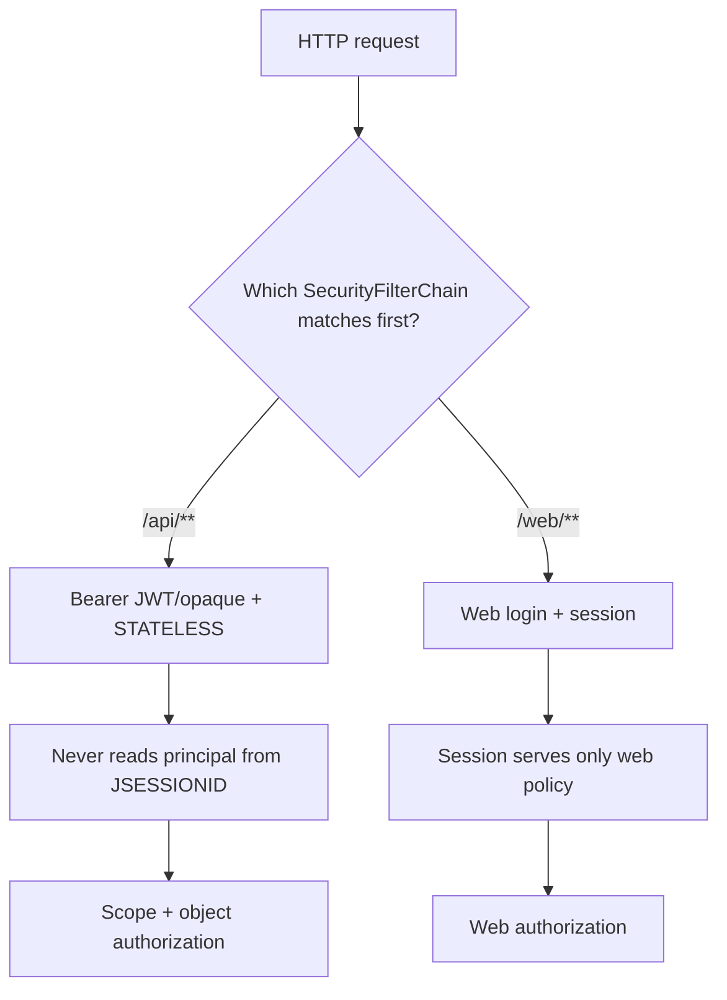

# Testing That an API Creates No Sessions or Reuses Identity Outside Policy

In a **Spring Security OAuth 2.0 / OIDC Resource Server**, a pure Bearer-token API is typically designed to be **stateless**: each HTTP request must be authenticated based on the credential accompanying that request, not on an HTTP login session or `SecurityContext` retained from a prior request. This is not merely a performance choice. It is a **security boundary** between users, services, tenants, and API calls.

A dangerous bug can look like this:

```text
Request 1: Authorization: Bearer <Alice's-token>
           → 200, principal = alice-123

Request 2: no Authorization sent
           → still 200, principal = alice-123    (WRONG)

Request 3: Authorization: Bearer <Bob's-token>
           → still reads Alice's data            (WRONG)
```

These requests may share the same TCP connection, the same browser, the same `JSESSIONID` cookie, or the same thread in the server pool. **None of those may cause the Resource Server to reuse Alice's identity** when endpoint policy requires the current request's Bearer access token.

This lesson explains how to **test** these conditions across multiple layers, instead of merely configuring `SessionCreationPolicy.STATELESS` and assuming the application is safe. The content belongs to the **Web Security and State** chapter in the **Spring Security OAuth 2.0 OIDC Resource Server** module.

**Example scope:** Java 17+, Spring Boot 3.x, Spring Security 6.x, Servlet/MVC stack, JWT access tokens; also notes how to apply this to opaque-token introspection. Tokens and issuers are synthetic data for learning purposes. Real applications must enforce the proper access-token profile, issuer, audience, scope, owner, and tenant.

## 1. Explicitly define what must be proved

An `orders-api` receives access tokens in a header:

```http
GET /api/orders/42 HTTP/1.1
Host: orders.example.test
Authorization: Bearer <alice-access-token>
```

Architecture requirement: **the token is verified during the current request; the authentication context is valid only for processing that request**, and must never be stored in a session cookie for reuse after the Bearer token is gone.

There are at least **six testable invariants**:

| Invariant | What is verified | Example failure to catch |
|---|---|---|
| **Creates no HTTP session** | Normal API requests create no new `HttpSession`. | `getSession()` in a controller/filter spawns a session. |
| **Issues no session authentication cookie** | API does not emit `JSESSIONID` as a Bearer auth mechanism. | After a Bearer request, the response includes `Set-Cookie: JSESSIONID=...`. |
| **Reads no old session authentication** | An existing session cannot substitute for a Bearer token on API routes. | Browser is logged into web; calling `/api/**` without a token still succeeds. |
| **Saves no SecurityContext to session** | JWT-authenticated request does not write login identity for later reuse. | Alice's token is persisted under `SPRING_SECURITY_CONTEXT`. |
| **Leaks no identity across requests** | Bob's request sees only Bob; tokenless requests see neither Alice nor Bob. | Thread-local/authentication cache retains prior request's principal. |
| **Skips no authorization policy** | Statelessness does not replace scope, audience, tenant, and owner checks. | Alice's valid token reads Bob's order merely because she authenticated. |

**"Stateless" must be an observable property verified by tests.** Inspecting one config line alone does not prove controllers, other filters, web libraries, or custom code never create sessions.

### 1.1. Sample scenarios

Assume we have:

- **Alice**: `sub=alice-123`, token with scope `orders:read`.
- **Bob**: `sub=bob-456`, token with scope `orders:read`.
- **Worker**: `client_id=orders-importer`, scope `orders:import`.
- **API**: `orders-api`, accepting only access tokens with the right issuer/audience.
- **Prior browser session**: may exist when a user visits a separate web UI in the same application.

Expected behavior set:

| Request | Permitted authentication | Expected status |
|---|---|---|
| Alice's Bearer token | Alice | Succeeds on endpoints Alice is authorized for. |
| Bob's Bearer token | Bob, **not Alice** | Succeeds on endpoints Bob is authorized for. |
| No Bearer token | No authenticated user | 401 on protected routes. |
| Invalid/expired Bearer token | No authenticated user | 401 on protected routes. |
| `JSESSIONID` cookie only | Does not use that session to authenticate `/api/**` | 401 on protected routes. |
| Web session cookie + Bob's Bearer token | Only Bob from Bearer token, per API contract | Must not use Alice's principal from the cookie. |
| Alice's token lacking route-required scope | Alice authenticated yet under-privileged | 403. |
| Alice's token with scope, order owned by Bob | Alice, no object permission | 403/404 per policy. |

These are **independent** checks: verifying no session exists does not prove object-level permissions; verifying 401 without a token does not prove no `JSESSIONID` appeared in the response.

## 2. Three kinds of state that must not be conflated

The word "state" is often used to mean different things.

### 2.1. HTTP session

`HttpSession` is Servlet-container-managed state linked via a session ID like `JSESSIONID`. A session-login web app can store `SecurityContext` or other data in the session for subsequent requests.

Example:

```text
Browser ----Cookie: JSESSIONID=abc----> Server
                          |
                          +--> session map
                               SPRING_SECURITY_CONTEXT
                               shoppingCart
                               locale
```

For a pure Bearer API, **never use this session to identify the caller**. If a controller accidentally reads `HttpSession` and trusts a `currentUser` attribute, the API violates its stateless design even if Spring Security is configured with `STATELESS`.

### 2.2. `SecurityContext` during the current request

Spring Security uses `SecurityContextHolder` to hold `SecurityContext`, which contains the current request's `Authentication`. This **is not synonymous** with an HTTP session.

A stateless Resource Server **still needs `SecurityContext`** during request processing so authorization filters, controllers, and services know the caller is authenticated. The rule is **not saving and reusing it outside policy**.

```text
Request Alice -> parse/validate token -> SecurityContext(Alice)
                                      -> authorize
                                      -> clear context

Request Bob   -> parse/validate token -> SecurityContext(Bob)
                                      -> authorize
                                      -> clear context

Request none  -> no valid Bearer      -> no authenticated user
```

### 2.3. Application state and caches

An API can store state in a database, cache, Redis, or external service while remaining stateless with respect to Bearer authentication. Examples:

- Order, cart, and workflow data.
- JWKS/public key caches for verifying JWTs.
- Introspection response caches with controlled TTLs.
- Rate-limit counters.
- Idempotency keys.
- Authorization entitlements cached per policy.

This state **does not turn a Bearer API into session login** as long as it is not used to identify subsequent requests while skipping credentials. However, caching authentication by user/cookie/IP or tenant without token binding easily causes permission leaks.

> **Key distinction:** "The API creates no sessions" is a stricter requirement than "Spring Security does not use sessions to retain `SecurityContext`." `STATELESS` alone does not control code that calls `request.getSession()` directly or third-party libraries creating sessions.

## 3. `SessionCreationPolicy` and easily confused semantics

Spring Security provides `SessionCreationPolicy`:

| Policy | General meaning | Suitable for pure Bearer APIs? |
|---|---|---|
| `ALWAYS` | Spring Security always creates a session. | No. |
| `IF_REQUIRED` | Spring Security creates a session when needed. | Should not be the default for Bearer APIs. |
| `NEVER` | Spring Security does not create a session itself, **but may use an existing one**. | **Not equivalent to stateless.** |
| `STATELESS` | Spring Security neither creates nor uses `HttpSession` to obtain `SecurityContext`. | Typical choice for Bearer Resource Servers. |

The easiest mistake to make:

```java
.sessionManagement(session ->
    session.sessionCreationPolicy(SessionCreationPolicy.NEVER))
```

**`NEVER` is not enough** if your goal is "the API never accepts identity from an old session." A browser can carry a `JSESSIONID` created earlier by web login; permitting use of existing sessions can cause the API to accept out-of-contract context if other components align that way.

For a Bearer API:

```java
.sessionManagement(session ->
    session.sessionCreationPolicy(SessionCreationPolicy.STATELESS))
```

is a sensible starting point. Afterward, still **test for session creation by non-Spring-Security components**.

### 3.1. SecurityContext repository

Spring Security has the `SecurityContextRepository` abstraction. Relevant implementations:

- `HttpSessionSecurityContextRepository`: can read/write context from the HTTP session.
- `RequestAttributeSecurityContextRepository`: stores context in request attributes, useful across dispatches of the same request.
- `DelegatingSecurityContextRepository`: combines multiple repositories per configuration.
- `NullSecurityContextRepository`: does not persist/read durable context via session for reuse.

When an API explicitly requires "never retrieve authenticated identity from `HttpSession`," you can specify:

```java
.securityContext(context -> context
    .securityContextRepository(new NullSecurityContextRepository()))
```

This **does not strip authentication from the current request**; `BearerTokenAuthenticationFilter` still populates context during request processing, without persisting it for reuse via this repository.

Do not overuse `NullSecurityContextRepository` in **browser login flows that need sessions**; restrict it to stateless API chains.

### 3.2. Request cache

`RequestCache` is typically used in login redirects to remember an unauthenticated user's original request. For Bearer APIs, saving protected requests in a session is unnecessary and can create unwanted state.

Use:

```java
.requestCache(cache ->
    cache.requestCache(new NullRequestCache()))
```

or disable caching appropriately. With `NullRequestCache`, a 401 Bearer request never saves a `SavedRequest` to replay later via an HTTP session.

### 3.3. Form login, HTTP Basic, OAuth2 Login, and Resource Server

An application may simultaneously use:

- `oauth2Login()` for browser redirects/SSO, typically using session/state.
- `formLogin()` for session-based web login.
- `httpBasic()` for HTTP Basic authentication.
- `oauth2ResourceServer().jwt()` or `opaqueToken()` for Bearer APIs.

None of these modes is inherently wrong. What matters is **each path must be covered by its right policy**. If `/api/**` accidentally hits a web chain using form login, tokenless requests may receive a 302 redirect instead of 401 or reuse a cookie principal. Tests must traverse real URLs and real chains.

---

## 4. Reference configuration for a stateless JWT API

Spring Boot 3.x / Spring Security 6.x example using access token issuer and audience:

```yaml
spring:
  security:
    oauth2:
      resourceserver:
        jwt:
          issuer-uri: https://auth.example.test/realms/orders
          audiences:
            - orders-api
```

Note that issuer/audience config is only part of token verification. For RFC 9068 JWT access tokens, enforce the appropriate **token profile** (including `typ` and required claims per version/implementation); never accept an ID Token just because it was signed by the same issuer.

### 4.1. Dependencies

Using Spring Boot parent/BOM for version management:

```xml
<dependencies>
    <dependency>
        <groupId>org.springframework.boot</groupId>
        <artifactId>spring-boot-starter-web</artifactId>
    </dependency>
    <dependency>
        <groupId>org.springframework.boot</groupId>
        <artifactId>spring-boot-starter-security</artifactId>
    </dependency>
    <dependency>
        <groupId>org.springframework.boot</groupId>
        <artifactId>spring-boot-starter-oauth2-resource-server</artifactId>
    </dependency>
    <dependency>
        <groupId>org.springframework.boot</groupId>
        <artifactId>spring-boot-starter-test</artifactId>
        <scope>test</scope>
    </dependency>
    <dependency>
        <groupId>org.springframework.security</groupId>
        <artifactId>spring-security-test</artifactId>
        <scope>test</scope>
    </dependency>
</dependencies>
```

### 4.2. Dedicated `SecurityFilterChain` for `/api/**`

```java
package com.example.orders.security;

import org.springframework.context.annotation.Bean;
import org.springframework.context.annotation.Configuration;
import org.springframework.http.HttpMethod;
import org.springframework.security.config.Customizer;
import org.springframework.security.config.annotation.web.builders.HttpSecurity;
import org.springframework.security.config.annotation.web.configurers.AbstractHttpConfigurer;
import org.springframework.security.config.http.SessionCreationPolicy;
import org.springframework.security.web.SecurityFilterChain;
import org.springframework.security.web.context.NullSecurityContextRepository;
import org.springframework.security.web.savedrequest.NullRequestCache;

@Configuration
public class ApiSecurityConfiguration {

    @Bean
    SecurityFilterChain apiSecurityFilterChain(HttpSecurity http)
            throws Exception {
        return http
            .securityMatcher("/api/**")
            .sessionManagement(session -> session
                .sessionCreationPolicy(SessionCreationPolicy.STATELESS))
            .securityContext(context -> context
                .securityContextRepository(
                    new NullSecurityContextRepository()))
            .requestCache(cache ->
                cache.requestCache(new NullRequestCache()))

            // Only for APIs accepting Bearer tokens via Authorization header,
            // not using sessions/cookies as an auth mechanism.
            .csrf(AbstractHttpConfigurer::disable)
            .formLogin(AbstractHttpConfigurer::disable)
            .httpBasic(AbstractHttpConfigurer::disable)
            .logout(AbstractHttpConfigurer::disable)

            .authorizeHttpRequests(auth -> auth
                .requestMatchers(HttpMethod.GET, "/api/public/ping")
                    .permitAll()
                .requestMatchers(HttpMethod.GET, "/api/identity")
                    .authenticated()
                .requestMatchers(HttpMethod.GET, "/api/orders/**")
                    .hasAuthority("SCOPE_orders:read")
                .requestMatchers(HttpMethod.POST, "/api/orders")
                    .hasAuthority("SCOPE_orders:write")
                .anyRequest().denyAll())
            .oauth2ResourceServer(oauth ->
                oauth.jwt(Customizer.withDefaults()))
            .build();
    }
}
```

**Purpose of each part:**

| Setting | Design guarantee aimed for | What it does NOT guarantee by itself |
|---|---|---|
| `securityMatcher("/api/**")` | Dedicates this chain to the API. | Path-mismatched routes may enter another chain. |
| `STATELESS` | Spring Security neither creates nor uses sessions for authentication context. | Controllers or other libraries not creating sessions. |
| `NullSecurityContextRepository` | Does not save security context into sessions via this repository. | Custom code not persisting authentication elsewhere. |
| `NullRequestCache` | Does not save requests into sessions for login flows. | Other middleware not creating sessions. |
| `csrf(disable)` | Disables CSRF filter for a Bearer API designed without cookie auth. | Unsafe if the API accepts cookie credentials or browser sessions. |
| `formLogin/httpBasic/logout(disable)` | Avoids accidentally enabling other login flows in the API chain. | Authentication mechanisms on other chains or custom filters. |
| `jwt()` | Bearer authentication via `JwtDecoder`. | Does not prove real tokens are signed/validated if tests use mocks. |
| `hasAuthority` | Checks operation category. | Ownership, tenant, and business policies. |
| `denyAll()` | Unlisted routes are denied by default. | Routes outside `securityMatcher` remain uncovered. |

Do not add `.anyRequest().authenticated()` as a shortcut for all undefined APIs, because a valid access token with an unrelated scope could slip through.

### 4.3. `STATELESS` differs from "no cookies at all"

An API response may legitimately include telemetry or infrastructure cookies depending on architecture; however, for the requirement **"the API creates no sessions,"** tests must target **HTTP session cookies (`JSESSIONID`)** and ensure cookies are never used for authentication.

Avoid asserting "the response has zero `Set-Cookie` headers whatsoever" if legitimate infrastructure emits unrelated cookies. Conversely, seeing no `Set-Cookie` header is **also not enough**: a request might read/reuse an existing session cookie without issuing a new one.

**Two separate tests are needed:**

1. **No creation:** request starts with no session, ends with no new session, and emits no `JSESSIONID`.
2. **No reuse:** request carrying an old session/old cookie still fails to authenticate in place of a Bearer token.

---

## 5. Risk model: where does "off-policy identity" come from?

### 5.1. Accessing with an old cookie instead of a token

A user logs into `/web/**` and gets a `JSESSIONID`. If `/api/**` accidentally reads the security context from the session, the browser can call the API without a Bearer token. This violates the API's trust model and can introduce CSRF risks when cookies are sent automatically.

```text
/web/login  -> JSESSIONID cookie holds Alice's login
/api/orders -> no Bearer, yet still sees Alice from session     (WRONG)
```

### 5.2. Reusing `SecurityContextHolder` via threads

Servlet containers typically use thread pools. Each worker thread can handle many requests **sequentially from different users**. A custom filter calling `SecurityContextHolder.getContext().setAuthentication(...)` without proper cleanup can leak Alice's principal onto Bob's request.

With standard Spring Security filters, context setup and teardown follow the framework-managed lifecycle. **Never replace the standard pipeline with an ad-hoc `ThreadLocal<Authentication>`** relying on container thread identity.

### 5.3. Caching identity with the wrong key

Anti-pattern example:

```java
// DO NOT USE:
private static Authentication lastAuthenticatedUser;

public Authentication getAuthentication(HttpServletRequest request) {
    if (request.getHeader("Authorization") == null) {
        return lastAuthenticatedUser;
    }
    return parseToken(request);
}
```

A cache keyed by user ID, client ID, IP, or tenant instead of binding properly to the token/context can likewise cause off-policy reuse. For introspection, if `active=true` results are cached per token, TTL and revocation policies must be explicit, never sharing another token's principal; **never turn a cache into "silent login" for requests missing Bearer credentials**.

### 5.4. Request attributes and async dispatch

Some contexts are stored in **request attributes** across multiple dispatches of **the same HTTP request**, not a cross-request session. Do not confuse legitimate request-scoped propagation with cross-request reuse.

However, if the application spawns async execution using `@Async`, `CompletableFuture`, schedulers, or message consumers, define **when `Authentication` is allowed to propagate**. A request-spawned task may need an explicitly delegated context; background tasks must never accidentally observe the latest request's principal due to thread reuse.

### 5.5. Multiple `SecurityFilterChain`s picking the wrong chain

Spring Security normally selects **the first matching chain**. A session-based web chain with too broad a matcher can accidentally capture API calls:

```text
@Order(1): securityMatcher("/**")      -> web login, session
@Order(2): securityMatcher("/api/**")  -> stateless Bearer

GET /api/orders/42 -> chain 1 selected (WRONG)
```

Test real URLs, methods, dispatcher types, and matcher ordering to ensure the API chain applies.

---

## 6. Test architecture: maintain multiple independent layers

No single test type proves everything. At minimum, use these layers:

| Test layer | Common tools | What it proves | What it CANNOT prove |
|---|---|---|---|
| **Unit tests** for security config/mappers | JUnit/Mockito | Isolated logic behaves as expected. | Real behavior of full filter chain and Servlet sessions. |
| **MockMvc + `jwt()`** | `spring-security-test` | HTTP authorization with a mock `Authentication`. | Bearer extraction/`JwtDecoder`/JWS, full session lifecycle. |
| **MockMvc + Bearer header + stub `JwtDecoder`** | `@SpringBootTest`, `@AutoConfigureMockMvc` | Real filter chain handling Bearer headers, session policy, and context across requests. | Real cryptographic JWT/JWKS validation, full network cookie behavior. |
| **HTTP integration on embedded server** | `RANDOM_PORT` + HTTP client | Status codes, cookies, session headers, multi-request over HTTP stack. | Key rotation/JWKS if decoder is still stubbed. |
| **Real-signed JWT / staging issuer** | Test keypair/JWKS or staging AS | Signature, issuer, audience, expiry, and token contract. | Business ownership unless fixtures are added. |
| **Concurrency/async tests** | Concurrent HTTP clients, executor tests | No principal bleed across thread pools/races. | All background paths if not simulated. |
| **Browser E2E for web+API** | Browser automation | Web session cookie exists yet API never reuses it off-policy. | All backend race/failure modes. |

Specifically, `jwt()` in Spring Security Test **does not run `JwtDecoder`**. If a test uses `jwt()` and concludes "the API creates no sessions because the Bearer filter processed the token," that conclusion exceeds what the test actually proved.

### 6.1. What is a real test of the Bearer flow?

A test request should send the header:

```http
Authorization: Bearer alice-test-token
```

and let `BearerTokenAuthenticationFilter` extract the token, invoke a test `JwtDecoder`, and create `JwtAuthenticationToken`. The test decoder can return a synthetic `Jwt` object to test **the filter chain**, while clearly noting **signatures are not verified**. A separate test suite must pass real signed JWTs through a key/JWKS-validating decoder.

---

## 7. Fixture for inspecting a request's identity

A simple test endpoint returns the subject authenticated by Spring Security. **Use only in test/dev or where data is permitted**; never expose claim-dumping endpoints publicly in production.

```java
package com.example.orders.api;

import java.util.Map;

import org.springframework.security.core.annotation.AuthenticationPrincipal;
import org.springframework.security.oauth2.jwt.Jwt;
import org.springframework.web.bind.annotation.GetMapping;
import org.springframework.web.bind.annotation.RestController;

@RestController
public class IdentityProbeController {

    @GetMapping("/api/identity")
    public Map<String, String> identity(
            @AuthenticationPrincipal Jwt jwt) {
        return Map.of("sub", jwt.getSubject());
    }

    @GetMapping("/api/public/ping")
    public Map<String, String> ping() {
        return Map.of("status", "ok");
    }
}
```

With the security rule `GET /api/identity → authenticated()` and a properly working Bearer filter:

- Alice's token → body `{"sub":"alice-123"}`.
- Bob's token → body `{"sub":"bob-456"}`.
- No token → 401, controller **is not invoked**.
- Invalid token → 401, controller **is not invoked**.

If two security mechanisms exist in the same application, the controller above only handles `Jwt` principals; with opaque tokens, you may receive `OAuth2AuthenticatedPrincipal` instead of `Jwt`. Do not conclude "no authentication occurred" just because a controller cast the wrong principal type.

---

## 8. Stubbing `JwtDecoder` to test the filter chain, not cryptography

A **test-only** configuration can map fixed tokens to `Jwt` objects. It helps prove that a request genuinely **requires its own Bearer header**, that context is not saved to a session, and that Alice/Bob are never swapped.

```java
package com.example.orders.test;

import java.time.Instant;
import java.util.List;

import org.springframework.boot.test.context.TestConfiguration;
import org.springframework.context.annotation.Bean;
import org.springframework.context.annotation.Primary;
import org.springframework.security.oauth2.jwt.BadJwtException;
import org.springframework.security.oauth2.jwt.Jwt;
import org.springframework.security.oauth2.jwt.JwtDecoder;

@TestConfiguration
public class StubJwtDecoderConfiguration {

    @Bean
    @Primary
    JwtDecoder testJwtDecoder() {
        return token -> {
            String subject;
            String scope;

            switch (token) {
                case "alice-test-token" -> {
                    subject = "alice-123";
                    scope = "orders:read";
                }
                case "bob-test-token" -> {
                    subject = "bob-456";
                    scope = "orders:read";
                }
                case "worker-test-token" -> {
                    subject = "orders-importer";
                    scope = "orders:import";
                }
                default -> throw new BadJwtException(
                    "Rejected test token");
            }

            Instant now = Instant.now();
            return Jwt.withTokenValue(token)
                .header("alg", "RS256")
                .issuer("https://auth.example.test/realms/orders")
                .subject(subject)
                .audience(List.of("orders-api"))
                .issuedAt(now.minusSeconds(30))
                .expiresAt(now.plusSeconds(600))
                .claim("scope", scope)
                .build();
        };
    }
}
```

**Warning:** this decoder trusts arbitrary strings in tests and **verifies no RSA/JWS signatures**. It must never be loaded in production profiles. When using `@Import(StubJwtDecoderConfiguration.class)` in tests, ensure no production config registers a decoder with precedence causing the test bean to be ignored; `@Primary` helps disambiguate multiple valid beans yet does not fix every context-wiring issue.

This example only illustrates **testing filter state isolation**. Tests for tampered payloads, `typ`, audience/issuer validators, or JWKS must run against a **real decoder and JWTs signed with test keys**.

---

## 9. MockMvc: proving Bearer requests create no sessions

Using the sample app with `ApiSecurityConfiguration` and `IdentityProbeController`, write the test:

```java
package com.example.orders.security;

import static org.junit.jupiter.api.Assertions.assertNull;
import static org.junit.jupiter.api.Assertions.assertTrue;
import static org.springframework.test.web.servlet.request.MockMvcRequestBuilders.get;
import static org.springframework.test.web.servlet.result.MockMvcResultMatchers.jsonPath;
import static org.springframework.test.web.servlet.result.MockMvcResultMatchers.status;

import com.example.orders.test.StubJwtDecoderConfiguration;
import org.junit.jupiter.api.Test;
import org.springframework.beans.factory.annotation.Autowired;
import org.springframework.boot.test.autoconfigure.web.servlet.AutoConfigureMockMvc;
import org.springframework.boot.test.context.SpringBootTest;
import org.springframework.context.annotation.Import;
import org.springframework.http.HttpHeaders;
import org.springframework.test.web.servlet.MockMvc;
import org.springframework.test.web.servlet.MvcResult;

@SpringBootTest
@AutoConfigureMockMvc
@Import(StubJwtDecoderConfiguration.class)
class StatelessBearerApiTest {

    @Autowired
    MockMvc mvc;

    @Test
    void validBearerRequestDoesNotCreateHttpSession() throws Exception {
        MvcResult result = mvc.perform(
                get("/api/identity")
                    .header(HttpHeaders.AUTHORIZATION,
                        "Bearer alice-test-token"))
            .andExpect(status().isOk())
            .andExpect(jsonPath("$.sub").value("alice-123"))
            .andReturn();

        // getSession(false) only checks whether a session exists,
        // WITHOUT creating a new session like default getSession().
        assertNull(result.getRequest().getSession(false));

        // Avoid asserting "no Set-Cookie at all": the app/infrastructure
        // may emit other cookies unrelated to HTTP sessions.
        assertTrue(
            result.getResponse().getHeaders(HttpHeaders.SET_COOKIE)
                .stream()
                .noneMatch(value ->
                    value.toLowerCase(java.util.Locale.ROOT)
                        .contains("jsessionid="))
        );
    }
}
```

**These two assertions catch different kinds of bugs:**

- `getSession(false) == null` catches sessions created during the request inside the Servlet test environment.
- Absence of `JSESSIONID` in `Set-Cookie` catches session cookies emitted on the HTTP response.

If a request **is passed an existing session** in a test, `getSession(false)` will be non-null even though the API **created no new session**. Do not use the "session is null" assertion when testing reuse of an existing session; use the dedicated test shown later.

### 9.1. Do not call `getSession()` inside the assertion itself

A buggy test can create a session while checking:

```java
// DO NOT USE: default getSession() creates a session.
assertNotNull(result.getRequest().getSession());
```

When verifying the API creates no session, read only:

```java
result.getRequest().getSession(false)
```

and inspect response headers with `getHeaders("Set-Cookie")` or an equivalent helper; never mistake a test-created session for an application bug.

### 9.2. Public API routes should not create sessions either

Public routes such as `GET /api/public/ping` may require no token, yet must remain stateless when inside the API chain:

```java
@Test
void publicPingDoesNotCreateSession() throws Exception {
    MvcResult result = mvc.perform(get("/api/public/ping"))
        .andExpect(status().isOk())
        .andReturn();

    assertNull(result.getRequest().getSession(false));
}
```

A public route might accidentally call `HttpSession` to count page views or store locale. This test catches **controller/interceptor** bugs that Bearer-only route tests might miss.

---

## 10. Testing that consecutive requests do not inherit identity

This is the core of the topic: **never reusing identity outside policy**.

### 10.1. Alice → no token

Sequence to test:

```text
Request A:
  Authorization: Bearer alice-test-token
  /api/identity → 200 Alice

Request B:
  no Authorization
  /api/identity → 401, not Alice
```

Example:

```java
@Test
void authenticationFromPreviousRequestIsNotReused() throws Exception {
    mvc.perform(get("/api/identity")
            .header(HttpHeaders.AUTHORIZATION,
                "Bearer alice-test-token"))
        .andExpect(status().isOk())
        .andExpect(jsonPath("$.sub").value("alice-123"));

    mvc.perform(get("/api/identity"))
        .andExpect(status().isUnauthorized());
}
```

Because request B sends no credential, it must never keep using Alice even within the same `MockMvc` instance or the same test thread. This test catches many context-cleanup or global-cache bugs; still, a single sequential test alone does not guarantee no leaks under concurrency.

### 10.2. Alice → Bob

```java
@Test
void secondBearerTokenDeterminesSecondIdentity() throws Exception {
    mvc.perform(get("/api/identity")
            .header(HttpHeaders.AUTHORIZATION,
                "Bearer alice-test-token"))
        .andExpect(status().isOk())
        .andExpect(jsonPath("$.sub").value("alice-123"));

    mvc.perform(get("/api/identity")
            .header(HttpHeaders.AUTHORIZATION,
                "Bearer bob-test-token"))
        .andExpect(status().isOk())
        .andExpect(jsonPath("$.sub").value("bob-456"));
}
```

If Bob's request returns `alice-123`, suspect a global authentication cache, uncleaned `ThreadLocal`, session reading, or controller code reading a principal outside `SecurityContext`.

### 10.3. Alice → invalid token

```java
@Test
void invalidBearerDoesNotFallBackToPreviousAuthentication()
        throws Exception {
    mvc.perform(get("/api/identity")
            .header(HttpHeaders.AUTHORIZATION,
                "Bearer alice-test-token"))
        .andExpect(status().isOk());

    mvc.perform(get("/api/identity")
            .header(HttpHeaders.AUTHORIZATION,
                "Bearer unknown-test-token"))
        .andExpect(status().isUnauthorized());
}
```

There must never be logic like:

```text
if token invalid:
    use previous session principal
```

An invalid token must cause **the current request** to be rejected; never fall back to the previous request's identity or a browser cookie.

### 10.4. Do not authenticate by "the previous call was valid"

Some API gateways/microservice middleware cache "last successful authentication" per TCP connection, IP, or thread. However:

- Keep-alive HTTP connections can serve many requests.
- Reverse proxies can multiplex requests from different clients.
- NAT puts multiple users behind the same IP.
- Servlet worker threads are reused.
- A browser can switch accounts inside the same window.

Therefore, never use **connection ID, IP, browser tab, thread ID, or non-credential cookies** as proof that the current request shares the same authentication.

---

## 11. Testing deliberate submission of an old session to the API

No-session-creation tests only cover **starting with no session**. To prove the API **never reuses sessions**, construct a `MockHttpSession` containing an old `SecurityContext` and pass it into the API request.

### 11.1. Session already holding an authenticated user

Example:

```java
import static org.springframework.test.web.servlet.request.MockMvcRequestBuilders.get;
import static org.springframework.test.web.servlet.result.MockMvcResultMatchers.jsonPath;
import static org.springframework.test.web.servlet.result.MockMvcResultMatchers.status;

import java.util.List;

import org.junit.jupiter.api.Test;
import org.springframework.http.HttpHeaders;
import org.springframework.mock.web.MockHttpSession;
import org.springframework.security.authentication.UsernamePasswordAuthenticationToken;
import org.springframework.security.core.authority.SimpleGrantedAuthority;
import org.springframework.security.core.context.SecurityContextImpl;
import org.springframework.security.web.context.HttpSessionSecurityContextRepository;

@Test
void existingWebSessionCannotAuthenticateBearerApi() throws Exception {
    MockHttpSession webSession = new MockHttpSession();

    var legacyAuthentication =
        new UsernamePasswordAuthenticationToken(
            "legacy-web-user",
            "unused",
            List.of(new SimpleGrantedAuthority("SCOPE_orders:read")));

    var legacyContext = new SecurityContextImpl();
    legacyContext.setAuthentication(legacyAuthentication);

    webSession.setAttribute(
        HttpSessionSecurityContextRepository.SPRING_SECURITY_CONTEXT_KEY,
        legacyContext);

    // The API must not pull identity from the session when Bearer is missing.
    mvc.perform(get("/api/identity").session(webSession))
        .andExpect(status().isUnauthorized());

    // With Bob's Bearer token, principal must be Bob, not the web-session user.
    mvc.perform(get("/api/identity")
            .session(webSession)
            .header(HttpHeaders.AUTHORIZATION,
                "Bearer bob-test-token"))
        .andExpect(status().isOk())
        .andExpect(jsonPath("$.sub").value("bob-456"));
}
```

Notably, this test **deliberately supplies an existing session**, so it **cannot** assert `getSession(false)==null`. The goal here is proving **the old session is not used to authenticate the API**, not that the session vanished from the request object.

If the tokenless response returns 200, check:

1. Is `STATELESS` actually applied to `/api/identity`?
2. Is a web chain matching first?
3. Is the chain's `SecurityContextRepository` reading `HttpSession`?
4. Is a custom authentication filter/`OncePerRequestFilter` reusing the session?
5. Is the controller manually querying session attributes to identify the user?

### 11.2. Testing that sessions are not overwritten by Bearer

With the same `webSession`, after Bob's Bearer request, you can assert that the session attribute holding the legacy identity **was not overwritten** by the API chain:

```java
Object before = webSession.getAttribute(
    HttpSessionSecurityContextRepository.SPRING_SECURITY_CONTEXT_KEY);

mvc.perform(get("/api/identity")
        .session(webSession)
        .header(HttpHeaders.AUTHORIZATION,
            "Bearer bob-test-token"))
    .andExpect(status().isOk());

Object after = webSession.getAttribute(
    HttpSessionSecurityContextRepository.SPRING_SECURITY_CONTEXT_KEY);

org.junit.jupiter.api.Assertions.assertSame(before, after);
```

This is a useful assertion for "the API does not save Bearer-token context into the session." However, it does not replace searching for **other session attributes** that custom code might write. If your app stores `CURRENT_USER` or `accessToken` under custom keys, assert on those keys per your contract.

### 11.3. Sending a cookie over HTTP differs from passing `MockHttpSession`

A test written as:

```java
mvc.perform(get("/api/identity")
    .cookie(new jakarta.servlet.http.Cookie("JSESSIONID", "abc")))
```

does not by itself prove cookie `abc` resolved to **a real `HttpSession` in MockMvc**. Depending on container simulation, the cookie may just be a raw header that resolves to no session. Therefore use both:

- **MockMvc tests with `MockHttpSession` pre-populated with a `SecurityContext`** to test Spring Security logic.
- **HTTP integration tests with an embedded server / browser** to test real session IDs sent via `Cookie` and `Set-Cookie`.

Never declare session isolation sound merely because a MockMvc request carrying a fake `JSESSIONID` returned 401 when no matching session even existed.

---

## 12. Testing across users and across token types

Do not test with only one user.

### 12.1. User A and User B

Minimum scenarios:

```text
1. Bearer Alice → principal Alice.
2. Bearer Bob → principal Bob.
3. No token after Alice → 401.
4. No token after Bob → 401.
5. Invalid token after Alice → 401.
6. Alice cookie/session + Bearer Bob → principal Bob.
7. Alice cookie/session, no Bearer → 401.
```

If scopes match, the identity probe response must still distinguish the exact subject. If an endpoint simply returns 200 for both Alice and Bob, **you cannot tell whether the test accidentally reused the old principal**. That is why a subject-returning probe endpoint/test fixture or a mock domain service recording the actor is so valuable.

### 12.2. User tokens and Client Credentials tokens

Client Credentials typically do not represent a logged-in human user. The API must recognize:

- Whether the actor is a user or a workload per issuer/token profile.
- That a worker scope like `orders:import` does not automatically grant permission to read user data.
- `sub` may be a service identity per grant/profile.
- Never borrow "the user authenticated in the previous request" to fill in a subject for a service token lacking user context.

Negative test example:

```java
@Test
void workerScopeCannotReadUserOrders() throws Exception {
    mvc.perform(get("/api/orders/42")
            .header(HttpHeaders.AUTHORIZATION,
                "Bearer worker-test-token"))
        .andExpect(status().isForbidden());
}
```

This test uses the stub `JwtDecoder` with `scope=orders:import` for the worker. Route `GET /api/orders/**` requires `SCOPE_orders:read`, so even though the token is mocked valid, it must return 403.

### 12.3. Multiple issuers or tenants

If the API accepts multiple issuers, never store principals in a static variable keyed solely by `sub`, because `sub=123` from issuer A can differ from issuer B. Any cache/identity mapping may need `(issuer, subject)` plus resource/tenant namespacing. Tests should cover two tokens sharing **the same `sub` from different issuers**, and tokens with valid scopes yet wrong audience/tenant.

For JWTs, reject invalid issuer/audience inside `JwtDecoder`/validators before creating `Authentication`. For opaque tokens, match the introspection response against the token contract/resource binding. Statelessness **is not** an excuse to skip issuer/audience validation.

---

## 13. Testing multiple `SecurityFilterChain`s: web sessions must not leak into the API

An application may have both a **session-based web UI** and a **Bearer-token API**. That is valid if filter chains are strictly partitioned.

Example architecture:

```text
/api/** → JWT Resource Server / STATELESS / no session authentication
/web/** → formLogin or oauth2Login / sessions allowed
```

Diagram:



### 13.1. Illustrative dual-chain configuration

```java
package com.example.orders.security;

import org.springframework.context.annotation.Bean;
import org.springframework.context.annotation.Configuration;
import org.springframework.core.annotation.Order;
import org.springframework.security.config.Customizer;
import org.springframework.security.config.annotation.web.builders.HttpSecurity;
import org.springframework.security.config.annotation.web.configurers.AbstractHttpConfigurer;
import org.springframework.security.config.http.SessionCreationPolicy;
import org.springframework.security.web.SecurityFilterChain;
import org.springframework.security.web.context.NullSecurityContextRepository;
import org.springframework.security.web.savedrequest.NullRequestCache;

@Configuration
public class MultiChainSecurityConfiguration {

    @Bean
    @Order(1)
    SecurityFilterChain apiChain(HttpSecurity http) throws Exception {
        return http
            .securityMatcher("/api/**")
            .csrf(AbstractHttpConfigurer::disable)
            .sessionManagement(session -> session
                .sessionCreationPolicy(SessionCreationPolicy.STATELESS))
            .securityContext(context -> context
                .securityContextRepository(
                    new NullSecurityContextRepository()))
            .requestCache(cache ->
                cache.requestCache(new NullRequestCache()))
            .authorizeHttpRequests(auth -> auth
                .requestMatchers("/api/public/ping").permitAll()
                .anyRequest().authenticated())
            .oauth2ResourceServer(oauth ->
                oauth.jwt(Customizer.withDefaults()))
            .build();
    }

    @Bean
    @Order(2)
    SecurityFilterChain webChain(HttpSecurity http) throws Exception {
        return http
            .securityMatcher("/web/**")
            .authorizeHttpRequests(auth -> auth
                .anyRequest().authenticated())
            .formLogin(Customizer.withDefaults())
            .build();
    }
}
```

**This example illustrates chain partitioning**, not a complete orders authorization policy: a real API needs `hasAuthority("SCOPE_orders:read")`, `hasAuthority("SCOPE_orders:write")` per HTTP method, and object-level checks. `/web/**` needs product-appropriate CSRF, session, and login flows. Do not deploy both section 4's `ApiSecurityConfiguration` and `MultiChainSecurityConfiguration` side by side if both handle `/api/**` without explicit precedence.

### 13.2. Testing chain configuration

A web+API test suite should prove:

1. After `/web/login`, the browser receives a cookie/session per web policy.
2. Sending that same cookie to `GET /api/identity` **without Bearer** → **401**.
3. Sending that same cookie plus Bob's Bearer → **Bob**, not the web user.
4. Alice's Bearer on `/web/**` does not count as web login unless web policy allows it.
5. `/api/public/ping` runs publicly without creating a session.
6. `/api/orders/**` routes still enforce scopes, not just `authenticated()`.
7. URLs outside `/api/**` and `/web/**` do not accidentally bypass security.

Without a catch-all chain, an endpoint outside both `securityMatcher`s may receive none of the expected security policies. Design a default policy for remaining URLs and test against novel paths.

### 13.3. Path mismatches and proxies

When a reverse proxy rewrites `/api/v1/**` to `/orders/**`, know the exact path Spring Security sees at the Servlet layer. Test using public URLs through the gateway rather than hitting controller mappings directly in tests. Verify forwarded headers/proxy config do not break matchers or route endpoints into the web session chain.

Never trust `X-Forwarded-*` headers supplied arbitrarily by Internet callers to choose security policies unless the gateway/proxy scrubs and controls them.

---

## 14. Testing over real HTTP and `Set-Cookie`

MockMvc is valuable, yet does not replace socket/Servlet-container testing of cookie lifecycles. An integration test can boot Spring Boot on a random port and send real requests via `java.net.http.HttpClient`.

### 14.1. Directional example

```java
@SpringBootTest(webEnvironment =
    SpringBootTest.WebEnvironment.RANDOM_PORT)
@Import(StubJwtDecoderConfiguration.class)
class StatelessHttpIntegrationTest {

    @LocalServerPort
    int port;

    private final java.net.http.HttpClient client =
        java.net.http.HttpClient.newHttpClient();

    @Test
    void bearerResponseDoesNotIssueJsessionid() throws Exception {
        var request = java.net.http.HttpRequest.newBuilder()
            .uri(java.net.URI.create(
                "http://localhost:" + port + "/api/identity"))
            .header("Authorization", "Bearer alice-test-token")
            .GET()
            .build();

        var response = client.send(
            request,
            java.net.http.HttpResponse.BodyHandlers.ofString());

        assertEquals(200, response.statusCode());
        assertTrue(response.headers()
            .allValues("Set-Cookie").stream()
            .noneMatch(value ->
                value.toLowerCase(java.util.Locale.ROOT)
                    .contains("jsessionid=")));
    }
}
```

This is a **directional** test class assuming standard JUnit/Spring imports, app context, and test controller are present. If the server uses TLS, switch to HTTPS with test trust material; never disable TLS verification in production.

### 14.2. Observing cookies at proxy layers

When running through a real gateway:

```text
Client
  -> CDN / WAF
  -> Ingress / API Gateway
  -> Reverse proxy
  -> Spring Boot container
```

An outer layer may issue cookies for sticky routing or security challenges even if Spring Boot creates no `HttpSession`. So whenever you see `Set-Cookie`, identify **which layer issued it**. "Creates no sessions" typically aims to prevent **authentication sessions** and `JSESSIONID`, though if the system contract demands "strictly zero cookies," enforce it at every layer on the path.

Tests should capture:

- Application-side Servlet `HttpSession`.
- `Set-Cookie` headers from the embedded server.
- `Set-Cookie` headers from staging via ingress/gateway.
- Subsequent requests when the browser/client sends cookies back.
- Possible session affinity/path rewrites causing wrong route policies.

### 14.3. A crucial protocol test: cookie-only request

```http
GET /api/identity HTTP/1.1
Host: orders.example.test
Cookie: JSESSIONID=old-web-session
```

**Expectation:** HTTP 401 on protected routes, never accepting a principal from the session. The test must use **a cookie bound to a real session created by a web flow** if proving container/browser-level integration. A fabricated cookie with no server-side session will return 401 even in an app that has an "accepts old sessions" bug, simply because there is no session to read.

---

## 15. SecurityContext lifecycle and thread memory

Spring Security uses `SecurityContextHolder` to access the running request's `Authentication`. In synchronous Servlet apps, the common strategy uses `ThreadLocal`, and filters/framework code must populate and clear the context within the lifecycle.

### 15.1. Never store authentication in static variables

Anti-pattern example:

```java
// DO NOT USE.
public final class CurrentUserHolder {
    public static Authentication currentAuthentication;
}
```

Two concurrent requests can overwrite each other. On a multi-threaded server, Bob's request can read Alice's object due to a race, and sequential tests may miss it.

### 15.2. Never let custom ThreadLocals outlive the request

Anti-pattern example:

```java
// DO NOT USE.
private static final ThreadLocal<String> ACTIVE_USER =
    new ThreadLocal<>();

void onRequestStart(String userId) {
    ACTIVE_USER.set(userId);
}

String currentUser() {
    return ACTIVE_USER.get(); // No reliable cleanup.
}
```

If a custom `ThreadLocal` is genuinely needed, clear it in `finally` or integrate with the framework lifecycle. Even better, **prefer Spring `SecurityContext` and the verified principal** over building a parallel identity channel. Pay special attention to async dispatches, propagation, and thread pooling.

### 15.3. Do not test `SecurityContextHolder` carelessly on JUnit threads

In Spring Security Test, `SecurityContextHolder` can be tied to the test execution context, request builders, and mock security environment. An assertion like:

```java
// Caution: not sole proof of server cleanup.
assertNull(SecurityContextHolder.getContext().getAuthentication());
```

after `MockMvc.perform(...)` may reflect test framework setup rather than production lifecycle. Prefer **next-request behavior** (no Bearer → 401, Bob → Bob), plus end-to-end HTTP tests. If measuring thread-local cleanup directly, design fixtures with explicit thread/dispatcher boundaries.

### 15.4. Async and `DelegatingSecurityContext...`

When using `@Async` or executors, Spring Security provides wrappers to **explicitly** propagate `SecurityContext` to tasks that need it. That can be valid when a job continues an authorized request. Yet later tasks must never implicitly see an unrelated request's context.

Principles:

- Propagate identity only when the business flow genuinely needs it.
- Prefer passing an **immutable actor context** with the minimum permitted data.
- Never use global/current-user static caches.
- Never hold Bearer tokens in long-lived tasks without explicit policy/reason.
- For tasks running after the request, check whether permissions must be re-verified at execution time.
- Test concurrent tasks to catch thread-pool bleed.

---

## 16. Concurrent requests: catching identity mix-ups under load

Sequential Alice → Bob tests are only the start. A `ThreadLocal`/global-cache bug might surface rarely except under concurrent requests.

### 16.1. Concurrency scenario

```text
Thread 1: Request Alice, token A, expect subject Alice
Thread 2: Request Bob, token B, expect subject Bob
Thread 3: Request Worker, token C, expect subject Worker
Thread 4: Request no-token, expect 401
... repeated against the same server with connection pooling
```

A stress test can:

1. Build a batch of 100–1000 test requests with different tokens and tokenless calls.
2. Send them concurrently via an HTTP client against an embedded server.
3. Verify **every response** matches that specific request's credential.
4. Forbid any tokenless response from returning 200.
5. Forbid token B from receiving subject A.
6. Inspect error logs for `SecurityContext` leakage or context-cleanup failures.

Request counts are test suggestions, not performance SLAs. Never run stress tests against a production Authorization Server or generate unauthorized load. With a stub decoder, this proves identity isolation only; test real JWS verification with signed JWT fixtures and a real decoder.

### 16.2. Mixed session states

Concurrent tests should also include:

- Requests with Alice's web session alongside Bob's Bearer token.
- Tokenless requests carrying an old web session.
- Invalid-token requests carrying a web cookie.
- Requests using Alice's and Bob's tokens over the same HTTP keep-alive pool.
- Requests using tokens from two tenants to verify object-level authorization.

Avoid assuming "same HTTP client instance" means same authenticated user. HTTP clients can maintain a **cookie jar**; explicitly control cookie handling in tests so you know exactly which headers are sent.

### 16.3. Distinguishing code bugs from test contamination

When running multiple tests against one application context, one test may store a `MockHttpSession` or mock authentication and pollute later tests. Follow these practices:

- Set test fixtures explicitly on every request.
- Avoid static mutable token/user variables.
- Never reuse a `MockHttpServletRequest` whose security attributes were mutated.
- Never assume test methods run in order.
- Use a fresh request builder per request.
- For intentional stateful sequences, keep the sequence inside **one test method**.
- When running tests in parallel, isolate session/cookie jars and mock server fixtures per test case.

---

## 17. CSRF and CORS are not proof an API is stateless

A common misconception is "CSRF is disabled so the API is stateless" or "CORS is enabled so the API accepts no cookies." Both are false.

### 17.1. CSRF

CSRF matters whenever browsers can **automatically send credentials**, such as session cookies. Bearer tokens explicitly added by JavaScript/clients to the `Authorization` header are not auto-sent just because the browser holds cookies, so many pure Bearer APIs disable the CSRF filter on the API chain.

However, if the API also accepts:

- Session cookies for authentication.
- Cookies carrying authentication tokens sent automatically.
- Browser-auto-sent HTTP Basic auth in certain contexts.
- Session-backed OAuth login browser flows.

you cannot simply disable CSRF across the entire application without evaluating risk. A hybrid Bearer + cookie API can still be vulnerable to CSRF despite inconsistent `STATELESS` lines across chains.

### 17.2. CORS

CORS controls whether cross-origin browser JavaScript can **read responses** or send certain requests. It **is not authentication**. Setting `Access-Control-Allow-Credentials: false` does not stop non-browser HTTP clients from sending cookies or session IDs. Restricting CORS alone does not prove the API ignores `JSESSIONID`.

When configuring CORS:

- Use an explicit origin allowlist; never combine wildcards carelessly with credentials.
- Allow the `Authorization` header if frontends are permitted to send Bearer tokens.
- Handle `OPTIONS` preflights properly without requiring Bearer tokens where preflights must be public.
- Never treat CORS as a substitute for scope/tenant/owner checks.
- Test cookie-only requests directly via an HTTP client, not only from a browser.

### 17.3. Browser E2E

A valid E2E test can:

1. Log into `/web/**` as Alice to establish a session cookie.
2. Call `/api/identity` without Bearer from the same browser.
3. Expect 401—must not pick up Alice from the web session.
4. Supply Bob's Bearer token on the API request.
5. Expect principal Bob, not Alice.
6. Remove the Bearer token and call again.
7. Expect 401 even though the cookie remains present.

**Do not clear browser cookies just to make tests pass.** The whole point is proving the cookie genuinely exists yet cannot cross the API's authentication boundary.

---

## 18. Tokens and principals must not be reused across non-equivalent trust sources

Beyond HTTP sessions, identity can be reused improperly when an application handles multiple token issuers or token profiles.

### 18.1. JWT access tokens vs. ID Tokens

An OIDC ID Token may be signed by the same issuer yet is intended for the client application, not `orders-api`. The API must verify audience, token type, and profile—not just signatures. Never accept an ID Token and build an `Authentication` because the user "just logged into the web," even if the ID Token has the same `sub` as an access token.

### 18.2. Access tokens from another API

A token with `aud=payments-api` is not a token for `orders-api`. You cannot say "this token was already verified at another service, so reuse the `Authentication`" when the token fails the current resource's contract.

### 18.3. Opaque tokens and introspection caches

With opaque tokens:

```text
Bearer token -> OpaqueTokenIntrospector -> AS active metadata
             -> OAuth2AuthenticatedPrincipal
```

If caching introspection results, the cache reduces round-trips yet must still:

- Key by token and an appropriate **resource/issuer/client/policy namespace**.
- Never use a cached principal for requests lacking a Bearer token.
- Never serve token A's result for token B.
- Bound TTL to `exp`/revocation policy.
- Fail closed when unable to validate a token, never falling back to the last successful token.
- Check scopes and tenant/owner on every request.

A poorly designed cache can cause **identity reuse** even with zero `HttpSession`s. Therefore stateless tests should include sequences with different tokens and tokenless requests.

---

## 19. HTTP status codes and error behavior to test

| Case | Expected outcome |
|---|---|
| Credential-requiring API route, no Bearer | Typically **401 Unauthorized** and `WWW-Authenticate: Bearer`. |
| Bearer token with bad signature, expired, or wrong issuer/audience | Typically **401**; optionally `error="invalid_token"`. |
| Valid Bearer token lacking scope | Typically **403 Forbidden**, possibly `insufficient_scope`. |
| Valid Bearer token with scope, caller does not own resource | **403** or **404** per existence-hiding policy. |
| Public API route | 200/appropriate response, creates no authenticated session. |
| Valid CORS `OPTIONS` preflight | Handled per CORS policy, does not treat cookies as auth. |
| Upstream JWKS/introspection failure | Does not authenticate; status depends on error handling, yet **never lets the request through**. |

Note: **401 and 403 alone do not prove no session was created.** An API can return 401 while still creating a session to save a `SavedRequest` or CSRF token. Always pair HTTP status assertions with `getSession(false)` and `Set-Cookie` checks when zero-session behavior is the goal.

### 19.1. Checking `WWW-Authenticate`

Example test:

```java
import static org.hamcrest.Matchers.startsWith;
import static org.springframework.test.web.servlet.result.MockMvcResultMatchers.header;

@Test
void noTokenGetsBearerChallenge() throws Exception {
    mvc.perform(get("/api/identity"))
        .andExpect(status().isUnauthorized())
        .andExpect(header().string(
            "WWW-Authenticate", startsWith("Bearer")));
}
```

The header does not necessarily contain `error="invalid_token"` when the client **sent no credential**. Per RFC 6750, the Bearer challenge may omit an error code in that case.

---

## 20. Comprehensive test matrix for sessionless APIs

Below are cases to include in your test plan.

| # | Precondition | Request | Key expectation |
|---:|---|---|---|
| 1 | No session | Bearer Alice → `GET /api/identity` | 200 Alice; `getSession(false)==null`; no `JSESSIONID` issued. |
| 2 | No session | No Bearer → `GET /api/identity` | 401; creates no session; Bearer challenge. |
| 3 | No session | Invalid Bearer | 401; creates no session; no fallback. |
| 4 | No session | Public ping | 200; creates no session. |
| 5 | Same test method after Alice | New request, no Bearer | 401, does not reuse Alice. |
| 6 | Same test method after Alice | Bearer Bob | 200 Bob, does not reuse Alice. |
| 7 | After Bob | Invalid Bearer | 401, does not reuse Bob. |
| 8 | Alice's web session exists | Alice cookie/session, no Bearer | 401 on API. |
| 9 | Alice's web session exists | Alice cookie/session + Bearer Bob | 200 Bob. |
| 10 | Alice's web session exists | Bearer Bob to API | Does not overwrite web session's `SPRING_SECURITY_CONTEXT`. |
| 11 | Bearer worker | `GET /api/orders/**` needing `orders:read` | 403 if worker only has `orders:import`. |
| 12 | Bearer Alice with scope | Read Bob's order | 403/404 per ownership policy. |
| 13 | Bearer Alice for right resource | Valid issuer/audience token | Authentication succeeds for request scope. |
| 14 | Token for another API's audience | Call `orders-api` | 401 from real decoder/validator. |
| 15 | OIDC ID Token instead of access token | Call `orders-api` | Rejected per access-token profile. |
| 16 | Session cookie + invalid token | Call API | 401, no fallback to cookie. |
| 17 | Multiple requests on same thread | Interleaved Alice/Bob/none | Each response matches its request's credential. |
| 18 | Concurrent requests | Token A/B/none | No principal bleed/race. |
| 19 | Web login chain allowed to create sessions | `/web/**` | Session per web policy; does not bleed into `/api/**`. |
| 20 | Reverse proxy rewrites URL | Actual public API path | Hits stateless Bearer chain, not captured by web chain. |
| 21 | Newly added API endpoint | No dedicated rule | Deny-by-default, never accepted merely because authenticated. |
| 22 | No Bearer yet client sends `X-User-Id` | Call API | 401; never trusts client-asserted headers. |
| 23 | Opaque token A then token B | Two introspection/cache lookups | Never serves A's cached principal for B. |
| 24 | Token revoked while cache expires | Call API | Introspection/policy denies, never extends session. |

This table spans multiple layers. Do not cram everything into one `MockMvc` class: group tests by **filter/session**, **real HTTP/cookies**, **JWT signatures/validators**, **domain authorization**, and **concurrency** so failures are easy to localize.

---

## 21. Mistakes that create a false sense of security in tests

### Mistake 1: Asserting only `STATELESS` in code

```java
.sessionManagement(session ->
    session.sessionCreationPolicy(SessionCreationPolicy.STATELESS))
```

Not enough to prove other controllers/filters never call `request.getSession()`. Run real requests through the filters and assert no session + no `JSESSIONID`.

### Mistake 2: Asserting only absence of `Set-Cookie`

Not issuing a new cookie does not mean the API **does not read old sessions**. Inject a `MockHttpSession` with authentication and run a cookie-only test through the server.

### Mistake 3: Testing only a single request

One succeeding Alice request does not prove request B inherits no identity. Write **Alice → none**, **Alice → Bob**, **Alice → invalid**, and concurrency tests.

### Mistake 4: Using `jwt()` and claiming the Bearer filter ran

`jwt()` mocks `Authentication`, skipping the decoder and token extraction. Use an **Authorization header + `JwtDecoder` stub** to test the filter path, plus **signed JWTs** to test cryptography.

### Mistake 5: Using `SessionCreationPolicy.NEVER` instead of `STATELESS`

`NEVER` can use existing sessions. For APIs that must ignore session authentication, use `STATELESS` and test with pre-existing sessions.

### Mistake 6: Using a fake `JSESSIONID` cookie not backed by a server session

MockMvc may not map a synthetic cookie to an `HttpSession`. That test fails to prove **real** sessions are not reused.

### Mistake 7: Checking `getSession()` which mutates state

`getSession()` can **create a session**; use `getSession(false)`. This is a critical technical distinction in no-session tests.

### Mistake 8: Inferring statelessness from 401/403 status codes

An authentication error can still return alongside creating a session to store `SavedRequest`. Check both the response and the session lifecycle.

### Mistake 9: Deleting web cookies before testing the API

If cookies are always deleted, the test never proves the API rejects **existing cookies**. Keep the cookie intentionally in boundary tests.

### Mistake 10: No session created, yet custom cache still holds the user

A static/`ThreadLocal`/`IP -> Authentication` map can reuse principals even with zero `HttpSession`s. Run multi-user and no-token sequences to catch this.

### Mistake 11: Disabling CSRF app-wide when web still uses cookies

Header-only Bearer APIs may justify disabling CSRF; browser session flows do not. Separate chains per policy rather than applying one disable call across all URLs.

### Mistake 12: Treating CORS as authorization

CORS does not stop curl or service clients from sending cookies/headers. Never replace token authentication with an origin allowlist.

### Mistake 13: Trusting `X-User` or `X-Tenant` from clients

A reverse proxy may inject user headers in a gateway-authenticated design, yet that is a **separate contract**: the gateway must strip client-supplied headers and sign/protect forwarded info. A Bearer API must never accept `X-User-Id` from the Internet as authentication.

### Mistake 14: API uses two filter chains yet tests call controllers directly

Calling a controller in a unit test proves nothing about chain matching. Tests must run through `MockMvc` or HTTP integration with real URLs and methods.

### Mistake 15: Accepting an ID Token because its `sub` matches the logged-in user

ID Tokens are not API credentials. Validate **audience, token type/profile, issuer, and scopes** of access tokens rather than relying on frontend OIDC login sessions.

### Mistake 16: Test data contains only Alice

If a domain route always returns 200 for any identity, an Alice/Bob swap bug can go unnoticed. Use distinct subject/tenant fixtures and owner-specific queries.

### Mistake 17: Using a test decoder in production

A stub `JwtDecoder` for `"alice-test-token"` verifies no signatures. Restrict it to `@TestConfiguration`/test classpath and maintain real decoder tests.

### Mistake 18: Falling back to web sessions when the AS errors out

If introspection or JWKS times out, the app must never say "Alice is in the session, so let it through." Without trustworthy verification, **fail closed**; operators handle dependency outages separately.

---

## 22. Tracing failures when tests fail

### 22.1. API emits `JSESSIONID` on valid Bearer tokens

Places to check:

1. Does a Servlet controller/filter/interceptor call `request.getSession()`?
2. Is `HttpSession` injected into a controller/service?
3. Does `RequestCache`/`SavedRequest` create a session via an authentication entry point?
4. Is there an `HttpSession`-backed CSRF token repository?
5. Do Spring MVC flash attributes/redirect flows create a session?
6. Is a web/form-login filter chain handling `/api/**`?
7. Was the cookie issued by the app, gateway, or ingress?
8. Does a tracing/feature-flag library create a session on its own?

**Do not rush to strip `Set-Cookie` at the proxy** and call it fixed: the container can still create and store sessions; hiding the cookie leaves the root cause intact.

### 22.2. Tokenless API returns 200

Check:

- Were `permitAll()` or `authenticated()` rules placed on the wrong path?
- Which `SecurityFilterChain` matched first?
- Is a principal being read from an old session?
- Is a custom `AuthenticationProvider`/filter setting a user from headers?
- Is there static/context leakage?
- Did the test leave a class-level `@WithMockUser` or `jwt()` enabled?
- Is `Authentication` cached by user/IP?
- Did the controller bypass security and return data directly?

A tokenless request **may only succeed** on endpoints explicitly marked public by policy; protected `/api/identity` must return 401.

### 22.3. Bob receives Alice's principal

Common culprits:

- `ThreadLocal` from custom code missing `remove()`.
- `SecurityContext` stored in a static singleton or servlet session.
- Overly broad cache key.
- Token-to-principal mapping failing to separate tokens/issuers/tenants.
- Test builder accidentally reusing `.with(jwt())` or `MockHttpSession`.
- An interceptor injecting a principal from a cookie even though the route requires Bearer.

Reproduce sequentially with Alice → Bob first; then test concurrency/multiple threads. In debug logs, use request IDs and pseudonymized principals; **never print real access tokens**.

### 22.4. Tokenless API returns 302 login

Likely `formLogin()`/`oauth2Login()` or the web chain captured the API route. Inspect security matchers and authentication entry points; Bearer Resource Servers normally return `WWW-Authenticate: Bearer` instead of redirecting to browser login.

### 22.5. Valid token returns 403

The token may lack `SCOPE_orders:read` (or the converter misread `scope`/`scp` claims). That is an **authorization failure**, not a session bug. Still, tests must confirm there is no fallback to a higher-privileged web session. Never change `hasAuthority(...)` to `authenticated()` just to make a test pass.

### 22.6. No session created, yet API still suffers CSRF

If the browser auto-sends credentials besides Bearer headers, CSRF must be evaluated. Identify the true auth mechanism on the API path. "Creates no HTTP session" does not eliminate CSRF when cookie-borne bearer tokens or HTTP Basic credentials are still sent automatically by browsers.

---

## 23. Acceptance criteria and operational readiness

A development team can agree on **acceptance criteria** like these:

1. All `/api/**` requests enter the dedicated stateless Bearer filter chain.
2. API requests starting with no session **create no `HttpSession`**, except explicitly approved and documented exceptions.
3. Bearer API responses issue no `JSESSIONID` as an authentication session.
4. `JSESSIONID` from web flows cannot authenticate `/api/**` when a Bearer token is missing.
5. Bearer requests never persist `SPRING_SECURITY_CONTEXT` into HTTP sessions.
6. Alice/Bob/none/invalid token sequences always preserve exact per-request identity.
7. Concurrent requests never bleed authentication across `ThreadLocal`, static state, or caches.
8. Access tokens with invalid issuer/audience/type/signature/expiry are rejected.
9. Valid tokens lacking scope or owner/tenant rights are still rejected.
10. JWKS/introspection or identity service failures **never fall back** to session identity.
11. Browser/web flows may use sessions per their own policy, without leaking into the API.
12. CI runs filter/session/HTTP integration tests sufficient to catch regressions; content QA and code security reviews follow project workflows.

### 23.1. Safe logging and metrics

Track these signals:

| Suggested metric/event | Purpose |
|---|---|
| `api_session_created_total` | Detects unintended session creation in the API. |
| `api_jsessionid_set_cookie_total` | Detects API responses emitting session cookies. |
| `api_bearer_authentication_failure_total{reason=...}` | Tracks missing tokens, invalid tokens, wrong audience, expired. |
| `api_authorization_denied_total{reason=...}` | Tracks missing scope, owner, tenant. |
| `api_security_chain_selected_total{chain=...}` | Confirms the right chain ran if instrumented. |
| `introspection_cache_hit_total` | When using opaque token caches, tracks TTL/revocation assumptions. |
| `security_context_isolation_violation_total` | Internal counter when tests/canaries detect leaked context. |

Metric names are suggestions, not built-in Spring Security metrics. Never use raw tokens, `sub`, `jti`, or unnormalized order IDs as metric labels; high cardinality and data leaks are both dangerous. In error logs, record only correlation IDs, error categories, and sanitized metadata.

### 23.2. Wire tests into CI without hitting production with real tokens

- Use test tokens, test keys, or a staging AS.
- Never put production refresh tokens/client secrets into source or test reports.
- Never log raw `Authorization` headers in logs/traces.
- On staging with web login and API, use test accounts to verify cookie boundaries.
- Never scan real users' session IDs to hunt for bugs.
- For concurrency tests, cap load appropriately for the environment; never disrupt a production AS.

---

## 24. End-to-end verification flow

```mermaid
sequenceDiagram
    participant Browser
    participant API as Spring Resource Server
    participant AS as Authorization Server
    participant Web as Web Session Store

    Note over Browser,Web: Web login may create a valid session for /web/**
    Browser->>Web: Cookie JSESSIONID -> Alice's session
    Web-->>Browser: Web context Alice

    Note over Browser,API: API accepts only per-request Bearer credentials
    Browser->>API: GET /api/identity, Alice's Bearer token
    API->>AS: Validate JWT via keys / introspect if needed
    AS-->>API: Alice's token valid
    API-->>Browser: 200 subject=alice; no JSESSIONID created

    Browser->>API: GET /api/identity, JSESSIONID cookie only
    API-->>Browser: 401; does not use Alice's web session

    Browser->>API: GET /api/identity, Bob's Bearer token + old cookie
    API->>AS: Validate Bob's token
    AS-->>API: Bob's token valid
    API-->>Browser: 200 subject=bob; not alice

    Browser->>API: GET /api/identity, invalid Bearer token
    API-->>Browser: 401; no fallback to session/cache
```

In real JWT deployments, JWT verification can occur locally via `JwtDecoder` and cached JWKS rather than calling the Authorization Server on every request. The diagram combines both options to emphasize that **every request must be authenticated by its own token** per policy.

### 24.1. Difference between "no session" and "no identity reuse"

```text
No session created:
  GET /api/identity + Bearer Alice
  -> request.getSession(false) == null
  -> response has no Set-Cookie: JSESSIONID

No session reused:
  /web/login created Alice's session
  GET /api/identity + Cookie JSESSIONID, no Bearer
  -> 401

No identity leaked:
  Request A + Bearer Alice -> Alice
  Request B + Bearer Bob   -> Bob
  Request C + no Bearer    -> 401
  Request D + invalid JWT  -> 401
```

To claim an API meets the stateless authentication boundary, **verify all three**, not just one.

---

## 25. Technical references

- [Spring Security — Session Management (Servlet)](https://docs.spring.io/spring-security/reference/servlet/authentication/session-management.html): `SessionCreationPolicy`, stateless authentication, and session configuration.
- [Spring Security API — SessionCreationPolicy](https://docs.spring.io/spring-security/site/docs/current/api/org/springframework/security/config/http/SessionCreationPolicy.html): differences between `NEVER` and `STATELESS`.
- [Spring Security API — NullSecurityContextRepository](https://docs.spring.io/spring-security/site/docs/current/api/org/springframework/security/web/context/NullSecurityContextRepository.html): repository that does not persist security context.
- [Spring Security API — NullRequestCache](https://docs.spring.io/spring-security/site/docs/current/api/org/springframework/security/web/savedrequest/NullRequestCache.html): request cache that does not save requests.
- [Spring Security — SecurityContextHolder](https://docs.spring.io/spring-security/reference/servlet/authentication/architecture.html): `SecurityContext`/`Authentication` in the lifecycle.
- [Spring Security — OAuth 2.0 Resource Server JWT](https://docs.spring.io/spring-security/reference/servlet/oauth2/resource-server/jwt.html): Bearer authentication and JWT validation.
- [Spring Security — Opaque Token Resource Server](https://docs.spring.io/spring-security/reference/servlet/oauth2/resource-server/opaque-token.html): introspection and authentication principals.
- [Spring Security — Testing](https://docs.spring.io/spring-security/reference/servlet/test/index.html): `MockMvc`, `jwt()`/`opaqueToken()`, and filter chain integration.
- [Spring Security — CSRF](https://docs.spring.io/spring-security/reference/servlet/exploits/csrf.html): when CSRF matters with cookies/sessions.
- [Spring Security — CORS](https://docs.spring.io/spring-security/reference/servlet/integrations/cors.html): browser CORS preflights and security.
- [RFC 6750 — OAuth 2.0 Bearer Token Usage](https://www.rfc-editor.org/rfc/rfc6750.html): Bearer requests and `WWW-Authenticate`.
- [RFC 9068 — JWT Profile for OAuth 2.0 Access Tokens](https://www.rfc-editor.org/rfc/rfc9068.html): JWT access tokens for APIs.
- [RFC 7662 — OAuth 2.0 Token Introspection](https://www.rfc-editor.org/rfc/rfc7662.html): opaque token validation and active metadata.
- [OWASP — Session Management Cheat Sheet](https://cheatsheetseries.owasp.org/cheatsheets/Session_Management_Cheat_Sheet.html): session IDs, cookies, and security lifecycle.
- [OWASP — Cross-Site Request Forgery Prevention Cheat Sheet](https://cheatsheetseries.owasp.org/cheatsheets/Cross-Site_Request_Forgery_Prevention_Cheat_Sheet.html): risks from browser-auto-sent credentials.

**Conclusion:** `SessionCreationPolicy.STATELESS` is an important configuration yet **does not replace testing**. A policy-compliant Resource Server must prove that API requests create no authentication sessions, do not read old sessions as credentials, and do not reuse `Authentication` from other requests. Test **no-session creation**, **existing-session rejection**, **Alice → Bob → none → invalid**, and **concurrency**, while keeping all token validation, scope, and object-level authorization layers intact.
