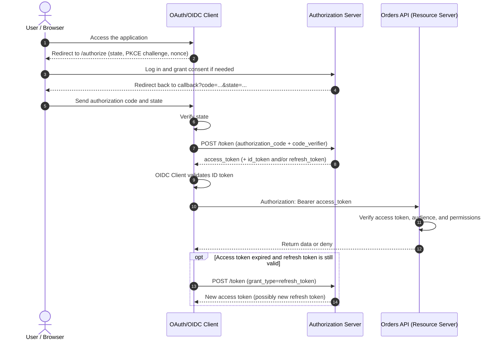

# Access token, refresh token, authorization code, and ID token

In systems using **OAuth 2.0**, **OpenID Connect (OIDC)**, and **Spring Security Resource Server**, the four credentials `authorization code`, `access token`, `refresh token`, and `ID token` often appear together yet serve **four distinct purposes**. Understanding each one accurately helps you design login, API authorization, and session renewal flows safely—while avoiding mistaking an ID token for resource access permission.

> **Example context:** The application `app.example.com` is the **OAuth/OIDC Client**; `login.example.com` is the **Authorization Server / OpenID Provider**; `api.example.com` is the **Resource Server** providing the Orders API. Users log in through a browser. Java configuration examples use Spring Boot 3.x / Spring Security 6.x; endpoint names and claims may vary by identity provider.

## 1. What do OAuth 2.0 and OIDC solve?

- **OAuth 2.0** is an **authorization** framework: the client receives bounded permission to call protected resources. That permission is represented by an `access token`, typically accompanied by `scope` and `audience`.
- **OIDC** is an **identity authentication** layer built on top of OAuth 2.0. When the client requests the `openid` scope, the OIDC provider can additionally issue an **ID token** so the client can verify the login event and user identity.
- **Spring Security Resource Server** is the component protecting the API: it receives the `access token` over HTTP, validates the token, and decides whether the request has sufficient permissions. It does not need to render login screens or handle `authorization code` or `refresh token` exchanges itself.

Primary roles:

| Role | Responsibility |
|---|---|
| **Resource Owner / End User** | The user who owns the data or the authenticating subject; some OAuth flows have no direct human user. |
| **Client** | Web app, mobile app, or service wanting to call an API; initiates the authorization flow and stores tokens according to client type. |
| **Authorization Server / OpenID Provider** | Authenticates users, handles consent, issues codes and tokens, and provides metadata/JWKS or introspection. |
| **Resource Server** | API protecting resources; validates the access token before serving data. |

**Distinguish two core questions:**

- "Is the client allowed to call `GET /api/orders`?" → **Access token** plus the resource server's policies.
- "Who is the user who just authenticated with the identity provider?" → **ID token** verified by the OIDC client.

## 2. Comparison table of the four types

| Value | When is it issued? | Where is it used? | Typical characteristics | Not used for |
|---|---|---|---|---|
| **Authorization code** | After user authentication/consent in the Authorization Code Flow | **Client → token endpoint** of the Authorization Server to exchange for tokens | Very short-lived, single-use, usually an opaque string; bound to client, redirect URI, and PKCE | Calling APIs or proving identity directly |
| **Access token** | Upon successful authorization grant, or when the client refreshes tokens | **Client → Resource Server**, usually via `Authorization: Bearer ...` | Bounded lifetime; can be a JWT or opaque; permissions and intended recipients defined by the Authorization Server | Replacing an ID token to conclude "the user is logged in" |
| **Refresh token** | May be issued alongside the access token depending on client, scope, and policy | **Client → token endpoint** to request a new access token | Usually longer-lived than access tokens; must be stored securely, subject to revocation/rotation | Sending to a Resource Server |
| **ID token** | In an **OIDC** flow with the `openid` scope | **OpenID Provider → OIDC Client**, so the client verifies the login outcome | **JWT**, containing `iss`, `sub`, `aud`, `exp`, `iat`, and relevant OIDC claims | Being accepted as an API access token |

Do not infer a token's type from whether a string has three dot-separated parts: an access token can also be a JWT. **Purpose, intended recipient (`aud`), protocol, and validation rules** determine where a token may be used.

## 3. Overall flow: Authorization Code + PKCE + OIDC

The **Authorization Code Flow with PKCE** is the standard approach for web applications and native/device apps with interactive login. Suppose the client requests `openid profile orders.read`, and the Authorization Server supports issuing refresh tokens per policy.



In this flow, the **authorization code only goes to the token endpoint**, the **refresh token is only used with the Authorization Server**, the **ID token is validated by the client**, and the **access token is the credential accepted by the resource server**.

### Step A — Client initiates the authorization request

Illustrative URL wrapped across lines for readability:

```http
GET /oauth2/authorize?
    response_type=code&
    client_id=web-client&
    redirect_uri=https%3A%2F%2Fapp.example.com%2Fcallback&
    scope=openid%20profile%20orders.read&
    state=STATE_RANDOM&
    nonce=NONCE_RANDOM&
    code_challenge=BASE64URL_SHA256_VERIFIER&
    code_challenge_method=S256 HTTP/1.1
Host: login.example.com
```

Key parameters:

- `response_type=code` requests the Authorization Code Flow.
- `client_id` identifies the registered application; it is **not a secret**.
- `redirect_uri` must be registered and matched strictly according to the Authorization Server's policy.
- `scope=openid` makes the request an OIDC request; `orders.read` is an illustrative permission for the Orders API. Which scopes are actually granted remains up to the server.
- `state` binds the redirect response to the initiating request, preventing CSRF and session mix-ups at the client.
- `nonce` binds the ID token to the OIDC authentication request; the client must verify the nonce per the applicable flow to prevent replay/token injection.
- `code_challenge` is derived from a client-side random secret `code_verifier`: `BASE64URL(SHA256(ASCII(code_verifier)))`, without padding. The client keeps the verifier; **never send the verifier in the authorization request**.

### Step B — Client receives the authorization code

After login/consent, the browser is redirected to a registered callback:

```text
https://app.example.com/callback?code=CODE_VALUE&state=STATE_RANDOM
```

The client compares `state` with the value stored for that transaction. `code` is merely a **temporary voucher to exchange for tokens**. It does not carry API permissions for the resource server. The Authorization Server must limit its lifetime, prevent reuse, and bind the code to the client/redirect URI as well as PKCE if requested.

Do not log the code or treat it like a password. Because the code travels through the browser and redirects, applications should also minimize leakage via browser history, referrer headers, analytics scripts, and external links on the callback page.

### Step C — Exchange the authorization code for tokens

The client sends a direct request to the token endpoint over HTTPS:

```http
POST /oauth2/token HTTP/1.1
Host: login.example.com
Content-Type: application/x-www-form-urlencoded

grant_type=authorization_code&
code=CODE_VALUE&
redirect_uri=https%3A%2F%2Fapp.example.com%2Fcallback&
client_id=web-client&
code_verifier=ORIGINAL_HIGH_ENTROPY_VERIFIER
```

The request above illustrates a **public client** using PKCE. A **confidential client** must authenticate using its registered method (e.g., HTTP Basic, `private_key_jwt`, or another method supported by the server); do not assume `client_id` alone is sufficient. The Authorization Server verifies `code_verifier` against the stored challenge and checks the code, client, and redirect URI before issuing tokens.

Example response; optional fields depend on scopes, client, and policy:

```json
{
  "access_token": "ACCESS_TOKEN_VALUE",
  "token_type": "Bearer",
  "expires_in": 300,
  "scope": "openid profile orders.read",
  "id_token": "SIGNED_ID_TOKEN_JWT",
  "refresh_token": "REFRESH_TOKEN_VALUE"
}
```

`refresh_token` may be **absent**; never assume every OIDC login returns a refresh token. In the OIDC Authorization Code Flow, an ID token is issued when the OIDC request is valid; how claims and tokens are populated depends on the implementation.

## 4. Access token — permission to call the Resource Server

### 4.1. What question does an access token answer?

An access token represents **authorization for a specific resource/scope**. The client presents the token when accessing the API:

```http
GET /api/orders/42 HTTP/1.1
Host: api.example.com
Authorization: Bearer ACCESS_TOKEN_VALUE
```

`Bearer` means any party holding the token can use it within the token's scope and the API's acceptance rules, unless an additional sender-constraining mechanism (such as mTLS or DPoP) is used. Therefore, TLS, short lifetimes, least-privilege scopes, and token leakage prevention are essential.

Information the resource server cares about when making a decision:

- **Issuer (`iss`)**: Which Authorization Server issued the token?
- **Audience (`aud`)**: Was the token issued **for this API**? A valid token for API A must not automatically work on API B.
- **Timestamps**: Has `exp` expired, is `nbf` already active; allow only a small, explicitly bounded clock skew.
- **Scope/authority**: for example, `orders.read` permits reading orders, not automatically writing.
- **Access control context**: order ownership, tenant, business roles, and application-layer access policies must still be checked. Scopes do not replace object-level authorization checks.

An access token does not necessarily represent a human user: in `client_credentials`, permissions may be granted to an **application**. Therefore, do not infer "which user account this is" merely from holding a valid access token.

### 4.2. JWT access tokens and opaque access tokens

A **JWT access token** typically has three parts `header.payload.signature` (when it is a signed JWT/JWS). Example *illustrative* decoded payload:

```json
{
  "iss": "https://login.example.com",
  "sub": "user-42",
  "aud": ["orders-api"],
  "iat": 1999996400,
  "exp": 2000000000,
  "scope": "orders.read orders.write",
  "client_id": "web-client"
}
```

- Being able to **decode** a JWT does not mean it is **verified**. The Resource Server must check signature, allowed algorithms, trusted key source, issuer, audience, and expiration before trusting any claims.
- Claims, `scope` vs. `scp` formatting, role representations, and audience formats vary across providers. Do not assume all JWTs share the exact same structure.
- Locally verified JWTs are convenient but may remain valid until expiration even if permissions change or the token is revoked, unless additional mechanisms are implemented.

An **opaque access token** is a string with no public payload format. The Resource Server typically calls the Authorization Server's **introspection endpoint** (using resource-server credentials) to check whether the token is still `active` and retrieve associated scopes/metadata. Network validation introduces latency and availability dependencies; caching or revocation handling must be designed around API sensitivity.

> **Principle:** A Resource Server does not guess validity by splitting strings; it must use the JWT verifier or introspection matching the token format actually issued by the Authorization Server.

### 4.3. Which API is an access token allowed to call?

Suppose a client receives four different access tokens:

| Token | Audience | Scope | Expected result at the Orders API |
|---|---|---|---|
| A | `orders-api` | `orders.read` | Allowed to read if the token is valid and resource policies permit |
| B | `billing-api` | `billing.read` | **Must be rejected**: wrong audience |
| C | `orders-api` | `orders.write` | Lacks `orders.read` for a read endpoint |
| D | `orders-api` | `orders.read`, but expired | **Must be rejected**: expired |

Evaluate **audience first**, then **scope/authority**, and then detailed business policies. Never grant access solely because a token has a valid signature.

## 5. Refresh token — obtaining a new token when the access token expires

Access tokens are typically issued with relatively short lifetimes. Sending the user back through login every time a token expires creates a poor experience. A **refresh token** allows an **eligible** client to request a new access token without repeating the full login flow.

```http
POST /oauth2/token HTTP/1.1
Host: login.example.com
Content-Type: application/x-www-form-urlencoded

grant_type=refresh_token&
refresh_token=REFRESH_TOKEN_VALUE&
client_id=web-client
```

This illustrates a public client. A confidential client must still authenticate via its registered method. The Authorization Server verifies that the refresh token is valid, belongs to the eligible client, and remains authorized to mint tokens; it then returns a new access token, sometimes accompanied by a **new refresh token**.

```json
{
  "access_token": "NEW_ACCESS_TOKEN_VALUE",
  "token_type": "Bearer",
  "expires_in": 300,
  "refresh_token": "ROTATED_REFRESH_TOKEN_VALUE"
}
```

**Refresh token rotation:** the server issues a new refresh token after a single use and invalidates the old one. The client must **replace** its stored token from the response and handle reuse/revocation errors. For public clients, measures like rotation or sender-constraining help detect/mitigate stolen token abuse; follow current security guidance.

Operational guidelines:

- **Never send a refresh token to the Orders API.** The API expects an access token; the refresh token belongs only at the token endpoint.
- **Do not assume refresh tokens last forever.** They can expire, be revoked, or become invalid when the user logs out, changes security credentials, or server policy changes.
- **Do not assume scopes can expand on refresh.** New tokens remain bounded by what the server/client permits.
- **Protect token storage.** Backends/confidential clients should store them server-side with least-privilege access and proper encryption/authorization. For browsers, consider a **Backend for Frontend (BFF)** architecture using `HttpOnly`, `Secure` session cookies with `SameSite` policy and CSRF protection. Storing refresh tokens in JavaScript-accessible storage increases XSS impact.
- **Handle `invalid_grant`:** when a refresh token is expired or invalid, clear the corresponding state and have the client restart the login or authorization flow; avoid infinite refresh loops.

Do not use a refresh token as a "session token" for other applications to assume the user is currently online; its sole meaning is the ability to request new tokens subject to Authorization Server conditions.

## 6. ID token — verifying the OIDC login outcome

### 6.1. ID tokens serve the client, not arbitrary APIs

In OIDC, an **ID token is always a JWT**. It is a signed assertion from the OpenID Provider about an authentication event for **a specific client**. The OIDC client (Relying Party) uses the ID token to establish a login session after validating it per the protocol. Illustrative payload:

```json
{
  "iss": "https://login.example.com",
  "sub": "user-42",
  "aud": "web-client",
  "iat": 1999996400,
  "exp": 2000000000,
  "auth_time": 1999996300,
  "nonce": "NONCE_RANDOM",
  "name": "Nguyen Van A",
  "email": "user@example.com",
  "email_verified": true
}
```

Claim explanations:

| Claim | Role |
|---|---|
| `iss` | Identifies the trusted OIDC issuer. |
| `sub` | Stable identifier of the subject **within the issuer's scope**; the `(iss, sub)` pair is preferable to email for identifying a user. |
| `aud` | Client ID permitted to receive the ID token, e.g., `web-client`; typically **different** from API audiences. |
| `exp`, `iat` | Expiration and issuance timestamps; the OIDC client must validate them per specification. |
| `nonce` | Value matched against the login request when the flow uses a nonce. |
| `auth_time` | Time of user authentication, present when requested or required by policy. |
| `azp` | Authorized party, evaluated when multi-audience conditions apply. |
| `name`, `email`, `email_verified` | **Optional** profile claims; do not assume they are always present or that email is immutable. |

The **OIDC client** must verify the signature using the provider's keys, allowed algorithms, `iss`, `aud`, `exp`, nonce when sent, and applicable OIDC conditions such as `azp`/`auth_time`. Never trust an ID token merely because you can Base64URL-decode its payload.

### 6.2. Why doesn't a Resource Server accept an ID token as an access token?

Suppose an ID token has `aud = web-client`. It proves the provider authenticated the subject **for `web-client`**; it makes no statement about `orders.read` permission on `orders-api`. If the API accepts this token just because it shares the same issuer and has a valid signature, the API breaks the boundary between **authentication** and **authorization**.

Therefore:

- **Client logging users in**: use an OIDC flow (in Spring Security, the client can use `oauth2Login`) and validate the ID token.
- **Resource Server protecting endpoints**: use `oauth2ResourceServer` and validate **access tokens** with the proper audience, lifetime, and permissions.
- **API needing user info**: inspect trusted claims in the access token or use an appropriate user/authorization mechanism; the OIDC `UserInfo` endpoint itself also uses an appropriate access token rather than sending an ID token to the Orders API.

An expired ID token does not necessarily mean the entire application session has ended; the client's session has its own lifecycle. Conversely, having an unexpired ID token never allows skipping access token validation on every API request.

## 7. Configuring Spring Security OAuth 2.0 Resource Server

This section assumes the Orders API is a Spring MVC application exposing `/api/orders/**` and trusting the Authorization Server at `https://login.example.com`. Choosing JWT or opaque **must match the actual access token format**.

### 7.1. When the access token is a JWT

Required Gradle (Groovy DSL) dependencies in a Spring Boot project with plugins and versions already configured:

```groovy
dependencies {
    implementation 'org.springframework.boot:spring-boot-starter-web'
    implementation 'org.springframework.boot:spring-boot-starter-security'
    implementation 'org.springframework.boot:spring-boot-starter-oauth2-resource-server'
}
```

`application.yml` configuration for the Orders API issuer and audience (the `audiences` property is supported in current Spring Boot 3.x releases; older versions may require a custom `OAuth2TokenValidator<Jwt>`):

```yaml
spring:
  security:
    oauth2:
      resourceserver:
        jwt:
          issuer-uri: https://login.example.com
          audiences:
            - orders-api
```

When the provider supports standard metadata, `issuer-uri` allows Spring Security to discover the provider/JWK Set configuration and verify JWTs. The Resource Server must verify the signature, `iss`, expiration, and the **API's audience**. Do not substitute the OIDC client's `client_id` for `orders-api` unless that is genuinely the audience model issued by the Authorization Server and registered for the API.

A configuration protecting endpoints by granted permissions:

```java
package com.example.orders.security;

import org.springframework.context.annotation.Bean;
import org.springframework.context.annotation.Configuration;
import org.springframework.http.HttpMethod;
import org.springframework.security.config.Customizer;
import org.springframework.security.config.annotation.web.builders.HttpSecurity;
import org.springframework.security.config.http.SessionCreationPolicy;
import org.springframework.security.web.SecurityFilterChain;

@Configuration
public class SecurityConfig {

    @Bean
    SecurityFilterChain securityFilterChain(HttpSecurity http) throws Exception {
        return http
            .authorizeHttpRequests(auth -> auth
                .requestMatchers(HttpMethod.GET, "/api/orders/**")
                    .hasAuthority("SCOPE_orders.read")
                .requestMatchers(HttpMethod.POST, "/api/orders/**")
                    .hasAuthority("SCOPE_orders.write")
                .anyRequest().authenticated()
            )
            .oauth2ResourceServer(oauth2 ->
                oauth2.jwt(Customizer.withDefaults())
            )
            .sessionManagement(session ->
                session.sessionCreationPolicy(SessionCreationPolicy.STATELESS)
            )
            .build();
    }
}
```

By default, Spring Security maps OAuth scopes in the `scope`/`scp` claim to authorities prefixed with `SCOPE_`; thus `orders.read` corresponds to `SCOPE_orders.read`. If your provider uses a different claim or permission structure, configure an appropriate `JwtAuthenticationConverter` and verify the resulting mapping.

**Example limitations:** The policy above only covers token validation and route checks. A real API must still check access to specific orders, tenant isolation, ownership, handling of other HTTP methods, CORS, and input validation. If cookies are also used for authentication in the same application, review CSRF policy instead of mechanically copying a bearer-token API configuration.

Example API call:

```bash
curl -i \
  -H "Authorization: Bearer ACCESS_TOKEN_VALUE" \
  https://api.example.com/api/orders/42
```

When the access token is valid and contains `orders.read`, the request passes the route security layer; returning order 42 still depends on business authorization checks.

### 7.2. When the access token is opaque

If the Authorization Server issues opaque access tokens, use introspection instead of a JWT decoder:

```yaml
spring:
  security:
    oauth2:
      resourceserver:
        opaquetoken:
          introspection-uri: https://login.example.com/oauth2/introspect
          client-id: orders-api-introspection
          client-secret: REPLACE_WITH_SECRET_FROM_SECURE_CONFIG
```

In Java, switch the Resource Server configuration to:

```java
.oauth2ResourceServer(oauth2 ->
    oauth2.opaqueToken(Customizer.withDefaults())
)
```

Introspection credentials belong to the **resource server** and must come from environment variables or a secret manager rather than being committed directly. The introspection endpoint name and authentication method are defined by the Authorization Server. Rules like `hasAuthority("SCOPE_orders.read")` continue to work if the introspection response includes scopes mapped compatibly. Inspect the audience/target attributes returned by your provider and add verification policies if needed; do not infer that an `"active"` opaque token is automatically valid for every API.

**A Resource Server does not need to implement** receiving `authorization code`, exchanging `code_verifier`, refreshing via refresh tokens, or logging users in with ID tokens. Those are responsibilities of the OAuth/OIDC **Client** and Authorization Server. If a single application acts as both a web client and an API, clearly configure each role with appropriate security filter chains and paths.

### 7.3. Error codes to distinguish

| Scenario | Where detected | Typical outcome |
|---|---|---|
| Missing `Authorization: Bearer` when calling a protected API | Resource Server | `401 Unauthorized`, client must supply an access token |
| Access token has invalid signature, wrong issuer, wrong audience, or is expired | Resource Server | `401 Unauthorized` / `invalid_token` |
| Valid access token but missing `orders.read` | Resource Server | `403 Forbidden` / possibly `insufficient_scope` |
| Authorization code expired, already used, or PKCE mismatch | Token endpoint | OAuth error `invalid_grant` |
| Refresh token expired, revoked, or does not belong to client | Token endpoint | OAuth error `invalid_grant` |
| ID token has wrong issuer, client audience, or nonce | OIDC Client | Login fails; do not create a session from that token |

`401` and `403` errors from an API do not mean the client should send a refresh token or ID token to retry. If the access token is expired and a valid refresh token is available, the **client** proactively refreshes at the token endpoint and retries the API with the **new access token**.

## 8. Common misconceptions and risks

1. **Using an ID token to call an API:** both can be JWTs, but their `aud` and purposes differ. An API only accepts access tokens issued for it.
2. **Validating only the signature:** a valid signature is not enough; you need `iss`, `aud`, lifetime, scopes, and resource policies.
3. **Treating a refresh token as a long-lived access token:** refresh tokens are sent only to the Authorization Server, where refresh/revocation rules apply.
4. **Skipping PKCE because `state` is present:** `state` prevents session mix-up/CSRF on redirects; PKCE binds the party exchanging the code to the party that initiated the request. They mitigate different risks.
5. **Using `sub` or email directly to infer permissions:** knowing who the subject is does not replace resource and tenant authorization checks.
6. **Believing scopes automatically protect every object:** `orders.read` may allow read operations at the API level; requests to view another user's order must still be denied without business-level permission.
7. **Putting tokens in URLs/logs/traces:** bearer tokens, refresh tokens, and codes can leak through logs, analytics, proxies, and browser history. Send access tokens only in headers over HTTPS; scrub sensitive values from telemetry.
8. **Storing refresh tokens carelessly in the browser:** XSS can read JavaScript-accessible storage. Choose storage architecture based on client type, threat model, PKCE, and provider guidance.
9. **Assuming tokens immediately update after revocation:** self-contained JWTs often remain valid until `exp` unless revocation/session controls are implemented. Use appropriate lifetimes, narrow scopes/audiences, and additional revocation checks when required by the domain.
10. **Confusing Spring Security roles:** `oauth2Login` is for web apps acting as an OIDC Client; `oauth2ResourceServer` is for APIs protected by access tokens. One service can use both, but routes and rules must be explicitly designed.

## 9. Flow self-check example

Suppose a client receives three values after exchanging an authorization code: access token A with `aud=orders-api`, `scope=orders.read`, valid `exp`; ID token B with `aud=web-client`; and valid refresh token C.

| Request | Which value to use | Why? |
|---|---|---|
| Read `GET /api/orders/42` | **A** | The Resource Server requires an access token with the right audience and scope. |
| Establish login session in the OIDC Client | **B** | The client validates the ID token to learn the authentication result. |
| Request a new access token after A expires | **C** | The refresh token is sent to the token endpoint. |
| Exchange the temporary voucher right after callback | **Authorization code + code_verifier** | The client performs the `authorization_code` grant with the Authorization Server. |
| Log in to a different client using B | **Do not use B** | The ID token was issued for `web-client`, not arbitrary clients. |

For integration testing in a development environment, you can sequentially call the API **with no token**, with an **expired access token**, with a **wrong-audience access token**, with an **insufficient-scope access token**, and then with a **valid access token with sufficient scope**. Expected responses demonstrate authentication (`401`), authorization (`403`), and application data handling respectively. Never send ID tokens or refresh tokens to the API in these cases.

## 10. Lifecycle takeaways

- **Authorization code:** short-lived, single-use credential used with PKCE to **exchange for tokens**.
- **Access token:** credential bounding **API access permissions**; the Resource Server verifies token type, issuer, audience, lifetime, and scopes/policies.
- **Refresh token:** sensitive credential for **renewing access tokens at the Authorization Server**; subject to rotation or revocation.
- **ID token:** JWT issued by the OIDC provider for the **client to verify login**; never a ticket to call APIs.

When building a Spring Security Resource Server, start from the question **"Which audience and authorities is this API allowed to accept in an access token?"** Authorization codes, refresh tokens, and ID tokens belong to other stages of the OAuth 2.0/OIDC system and do not replace that answer.
