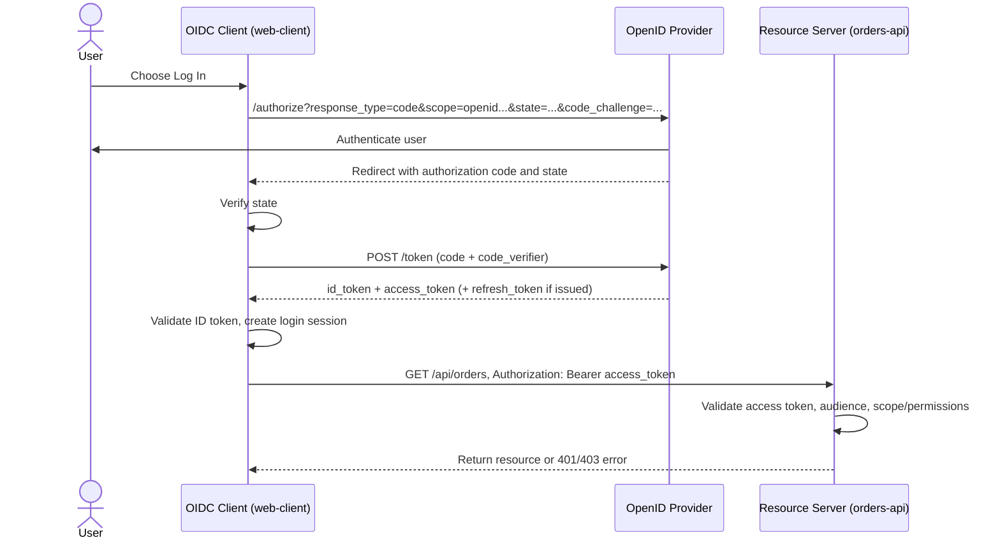

# ID Tokens Serve the OIDC Client and Do Not Replace Access Tokens for Calling APIs

## 1. One login, two different security questions

When a user logs in with OpenID Connect (OIDC), the application can receive both an **ID token** and an **access token**. These two tokens may be issued by the same Identity Provider, both be long character strings, and even both use the JWT format. However, they serve **two different target recipients and two different purposes**:

- **The ID token** answers for the **OIDC Client (Relying Party)**: "Which user was just authenticated, and which client does this authentication result belong to?"
- **The access token** lets the **OAuth 2.0 Resource Server (API)** evaluate: "Is the request carrying this token permitted to access this resource/API with the corresponding permissions?"

Core takeaway: **An ID token is not a license to call APIs.** An application holding a valid ID token must still use an appropriate access token when calling an OAuth 2.0–protected API.

For example, after logging into an order management application:

1. The web application receives an ID token to establish the user's login session.
2. The application receives an access token with the `orders:read` permission targeted at `orders-api`.
3. When calling `GET /api/orders`, the application sends the access token in the `Authorization: Bearer ...` header.
4. The Resource Server validates the access token, its intended recipient (`aud`), lifetime, and permissions; the API does not use the ID token to make authorization decisions.

OIDC is built on top of OAuth 2.0 and adds a **user identity authentication layer**. Therefore, **authentication** (who just logged in) must be distinguished from **authorization** (which resources may be accessed).

## 2. Roles in the system

| Component | Role | Related token |
| --- | --- | --- |
| End User | The user who performs login and uses the application. | Not the server-side party responsible for validating ID tokens or access tokens. |
| OpenID Provider (OP) / Authorization Server | Authenticates users, issues tokens, and publishes metadata/JWKS or an introspection endpoint. | Issues ID tokens; issues access tokens per policy and granted scopes. |
| OIDC Client / Relying Party | Application requesting login; validates the ID token and creates the login context/session. | **Consumes the ID token**; may use an access token to call APIs. |
| Resource Server | API hosting protected resources; validates the token attached to requests and enforces authorization rules. | **Consumes access tokens** valid for its API. |

In Spring Security, these two roles typically correspond to two separate configurations: `oauth2Login()`/OAuth2 Client supports OIDC login, while `oauth2ResourceServer()` protects endpoints with Bearer access tokens. A single system can act as both a client and expose resource server endpoints, but the authentication rules for each endpoint must remain explicit.

## 3. What is an ID token and who is allowed to use it?

**An ID token is an authentication token standardized by OpenID Connect**, typically a digitally signed JWT. It is issued by an OpenID Provider to a registered client so the client recognizes which user just logged in and can verify the authentication result.

Example **illustrative payload** of a decoded ID token (not a complete JWT):

```json
{
  "iss": "https://login.example.test/realms/demo",
  "sub": "user-123",
  "aud": "web-client",
  "exp": 1893456000,
  "iat": 1893452400,
  "auth_time": 1893452350,
  "nonce": "nonce-from-login-request",
  "email": "user@example.test"
}
```

Claims to understand properly:

| Claim | Meaning for the OIDC Client |
| --- | --- |
| `iss` | Issuer identifier of the OpenID Provider. The client only accepts trusted issuers. |
| `sub` | Stable user identifier **within the issuer's scope**; combine `iss` + `sub` when identifying linked accounts. |
| `aud` | Intended recipient of the ID token: usually contains the **OIDC Client's `client_id`**, e.g. `web-client`, not an API name. |
| `exp`, `iat` | Expiration and issuance timestamps; the client must enforce valid time checks. |
| `nonce` | Value binding the login response to the authentication request that sent `nonce`, helping prevent replay/substitution in applicable flows. |
| `auth_time`, `acr`, `amr` | Information about authentication time, level, and methods, when provided or requested by the OP. |
| `name`, `email`, `picture`... | Profile claims that may be provided based on scopes/policy; not guaranteed to always exist and never an API permission by default. |

Some ID tokens also include `azp` (authorized party), especially when `aud` is multi-valued. Validating `azp` must follow the OIDC rules applicable to the specific flow and token.

**The client must never merely Base64-decode an ID token and trust its contents.** It must use a reliable OIDC configuration, verifying the signature/allowed algorithms, issuer, audience, expiration, and flow-specific checks (`nonce` if present, `azp`, `auth_time`/`acr` requirements when applicable). The `state` value in the authorization request must also be verified at the callback to prevent session mix-up/CSRF; `state` is not an ID token claim.

An ID token proves a login event **for the client that received the token**. Forwarding it to another API does not make that API a valid audience.

## 4. What is an access token and why does an API need it?

**An access token is an authorization credential for accessing protected resources.** It is issued by the Authorization Server according to policies, granted permissions, and target resource recipients. The API treats the token as a request credential, checking that the token is valid and has sufficient permissions before returning data.

An access token typically takes one of two common formats:

- **JWT access token:** The Resource Server usually verifies the signature via JWKS and checks trusted claims, timestamps, audience, and permissions.
- **Opaque access token:** The Resource Server cannot infer permissions by decoding the string; it typically uses token introspection or a verification mechanism provided by the Authorization Server.

Example **illustrative payload** of a JWT access token intended for the orders API:

```json
{
  "iss": "https://login.example.test/realms/demo",
  "sub": "user-123",
  "aud": ["orders-api"],
  "client_id": "web-client",
  "scope": "orders:read orders:write",
  "exp": 1893454200,
  "iat": 1893452400
}
```

Actual fields depend on the provider and access-token profile: some use `scope`, some use `scp`, and some provide none of these claims because the token is opaque. This example **does not imply that all access tokens must be JWTs** or that an issuer automatically emits `orders-api` as an audience: the application must register and request permissions/audiences through mechanisms supported by the provider.

In this example, the API should only accept the token if it has verified that the token is valid, `aud` matches `orders-api`, and the endpoint's required permission is present. The `orders:read` permission can be used for `GET /api/orders`; `orders:write` may be required for write operations.

An access token **does not automatically authenticate a user's identity for an OIDC Client**. Having an access token also does not guarantee an interactive user login session exists: OAuth 2.0 also supports non-interactive flows such as `client_credentials`.

## 5. Comparing ID token, access token, and refresh token

| Criterion | ID token | Access token | Refresh token |
| --- | --- | --- | --- |
| Purpose | Conveys user authentication outcome to the OIDC Client. | Grants access to protected resources/APIs. | Obtains a new access token when the old one expires, per issuance policy. |
| Consumer | OIDC Client with the matching `client_id`. | Resource Server / API the token targets. | Authorization Server at the token endpoint. |
| Format | Usually a JWT per the OIDC ID Token spec. | Can be JWT or opaque. | Not required to be a JWT; usually opaque. |
| `aud` when JWT | Client receiving the ID token (`client_id`). | API/resource receiving the access token (per issuer/profile). | Not generally applicable. |
| Typical contents | `iss`, `sub`, `aud`, `exp`, `iat`, sometimes `nonce`, `auth_time`, and profile claims. | Issuer, subject/client, audience, expiration, scopes/permissions (if JWT). | Secret/opaque value used at the token endpoint. |
| Used as `Authorization: Bearer` to call APIs? | **No.** | **Yes**, when valid for that API. | **No.** |
| Used to infer API access permissions? | **No.** | Only after the API validates it and applies authorization policies. | No. |

An ID token may include `email` or user groups for UI display or session setup, but the presence of these claims does not turn an ID token into an access token and does not replace API authorization checks.

## 6. Authorization Code + PKCE flow with OIDC

Example of `web-client` logging a user in and then calling `orders-api`:



An authorization request may include these parameters:

```http
GET /authorize?response_type=code
  &client_id=web-client
  &redirect_uri=https%3A%2F%2Fapp.example.test%2Flogin%2Foauth2%2Fcode%2Fdemo
  &scope=openid%20profile
  &state=client-generated-state
  &code_challenge=...
  &code_challenge_method=S256
  &nonce=client-generated-nonce
```

This is shown across multiple lines for readability; on the wire, parameters are URL-encoded into a single valid URL. `openid` requests OIDC processing; `state` protects request/callback correlation; PKCE binds the authorization code to the client that initiated the flow. `nonce` can be used to bind the ID token to the login request, and if sent, the client must verify its value in the ID token according to OIDC rules.

A token endpoint response might look like this (values shortened for illustration):

```json
{
  "access_token": "eyJ...access...",
  "id_token": "eyJ...id...",
  "token_type": "Bearer",
  "expires_in": 1800,
  "scope": "openid profile orders:read"
}
```

Tokens are not always granted every requested scope. The orders scope in this example only appears if configured, requested, and approved under the Authorization Server's policy. The response may also include `refresh_token`, depending on the client, grant, and policy.

**The two usages after receiving the response are completely different:**

```http
GET /api/orders HTTP/1.1
Host: api.example.test
Authorization: Bearer <access_token>
```

```http
GET /api/orders HTTP/1.1
Host: api.example.test
Authorization: Bearer <id_token>
```

The first request uses the right **token type** (the API must still validate the token and permissions). The second request is wrong in **semantics and audience**: the ID token targets `web-client` and must be rejected by the API. They cannot be swapped simply because both are JWTs, share the same `sub`, or are signed by the same issuer.

## 7. Relationship to Spring Security OAuth2 Client and Resource Server

### 7.1. OIDC Client handles the ID token at login

Example configuration of a Spring Boot application acting as an OIDC Client with an OpenID Provider supporting discovery:

```yaml
spring:
  security:
    oauth2:
      client:
        registration:
          demo:
            provider: demo
            client-id: web-client
            client-secret: ${OIDC_CLIENT_SECRET}
            authorization-grant-type: authorization_code
            scope:
              - openid
              - profile
        provider:
          demo:
            issuer-uri: https://login.example.test/realms/demo
```

```java
@Configuration
class WebLoginSecurityConfig {

    @Bean
    SecurityFilterChain webSecurity(HttpSecurity http) throws Exception {
        return http
                .authorizeHttpRequests(auth -> auth
                        .requestMatchers("/").permitAll()
                        .anyRequest().authenticated())
                .oauth2Login(Customizer.withDefaults())
                .build();
    }
}
```

When OIDC login succeeds, Spring Security can represent the principal as an `OidcUser`; ID token details are accessed via `OidcUser#getIdToken()`. In a standard login flow, the framework handles token validation based on the client/provider configuration. The application still must configure issuer, redirect URIs, HTTPS, and session policies properly.

Example reading identity **server-side** after login:

```java
@GetMapping("/me")
Map<String, String> me(@AuthenticationPrincipal OidcUser user) {
    return Map.of(
            "subject", user.getSubject(),
            "issuer", user.getIdToken().getIssuer().toString());
}
```

This example is for a **login application using sessions and an OIDC principal**; it is not a controller for an API authenticating solely via Bearer tokens. The client normally should not forward the raw ID token to APIs, nor manually construct a Bearer credential from `getIdToken().getTokenValue()`.

### 7.2. Resource Server accepts only access tokens valid for the API

On the `orders-api` side, Spring Security can use a JWT Resource Server:

```yaml
spring:
  security:
    oauth2:
      resourceserver:
        jwt:
          issuer-uri: https://login.example.test/realms/demo
```

```java
@Configuration
class ApiSecurityConfig {

    @Bean
    SecurityFilterChain apiSecurity(HttpSecurity http) throws Exception {
        return http
                .authorizeHttpRequests(auth -> auth
                        .requestMatchers(HttpMethod.GET, "/api/orders/**")
                        .hasAuthority("SCOPE_orders:read")
                        .anyRequest().authenticated())
                .oauth2ResourceServer(oauth2 -> oauth2.jwt(Customizer.withDefaults()))
                .build();
    }
}
```

This example illustrates a **separate API application** from the OIDC Client in section 7.1; if both roles live in the same application, `SecurityFilterChain` beans must be organized with appropriate paths and ordering. The configuration above assumes the issuer mints JWT access tokens and matching scopes. By default, Spring Security maps `scope`/`scp` to authorities prefixed with `SCOPE_`, though actual claim structures and mappings must match your provider.

**Configuring `issuer-uri` and verifying the signature is not enough to prove a token was issued for this API.** If the resource server only checks signature, issuer, and expiration without **validating the audience**, an ID token from the same issuer could be mistakenly accepted as a valid Bearer JWT on an endpoint that only requires `.authenticated()`. Never assume the framework automatically distinguishes ID tokens from access tokens in all cases.

For a JWT Resource Server, add an audience policy expected by the API, such as `orders-api`:

```java
@Configuration
class JwtValidationConfig {

    private static final String ISSUER =
            "https://login.example.test/realms/demo";
    private static final String API_AUDIENCE = "orders-api";

    @Bean
    JwtDecoder jwtDecoder() {
        NimbusJwtDecoder decoder = NimbusJwtDecoder
                .withIssuerLocation(ISSUER)
                .build();

        OAuth2TokenValidator<Jwt> standard =
                JwtValidators.createDefaultWithIssuer(ISSUER);

        OAuth2TokenValidator<Jwt> audience = jwt -> {
            if (jwt.getAudience().contains(API_AUDIENCE)) {
                return OAuth2TokenValidatorResult.success();
            }
            return OAuth2TokenValidatorResult.failure(
                    new OAuth2Error(
                            "invalid_token",
                            "JWT audience does not include this API",
                            null));
        };

        decoder.setJwtValidator(
                new DelegatingOAuth2TokenValidator<>(standard, audience));
        return decoder;
    }
}
```

Key classes used include `NimbusJwtDecoder`, `JwtDecoder`, `JwtValidators`, `Jwt`, `OAuth2TokenValidator`, `OAuth2TokenValidatorResult`, `DelegatingOAuth2TokenValidator`, and `OAuth2Error`. This pattern illustrates adding a validator; check against your Spring Security version and provider audience/token-type rules. For strict systems, verify the exact **access token type**, trusted algorithms/issuer, `aud` rules, expiration, and any additional claims required by the API; do not treat matching `aud` as the entirety of authorization policy.

If the Authorization Server issues **opaque access tokens**, the resource server must configure introspection instead of a JWT decoder, such as `spring.security.oauth2.resourceserver.opaquetoken.introspection-uri`, `client-id`, and `client-secret`. Never attempt to decode an opaque token as a JWT simply because the system uses OIDC.

### 7.3. Client using an access token when calling an API

A logged-in application can obtain the access token from `OAuth2AuthorizedClient` and attach it to outgoing HTTP requests to the Resource Server. Illustrative snippet:

```java
@GetMapping("/call-orders")
String callOrders(
        @RegisteredOAuth2AuthorizedClient("demo")
        OAuth2AuthorizedClient authorizedClient) {

    String accessToken = authorizedClient
            .getAccessToken()
            .getTokenValue();

    // HTTP client sends to orders-api:
    // Authorization: Bearer <accessToken>
    return "Use this access token in the outgoing API request";
}
```

This snippet only shows **where to obtain the access token**, not a complete HTTP client example. In a real application, use an HTTP client configured to attach the access token to outgoing requests, handle expiration/refresh per policy, and avoid returning the token to the frontend or logging it.

### 7.4. Which token does the UserInfo endpoint use?

When an OIDC Client calls the OpenID Provider's **UserInfo endpoint** to fetch additional user claims, it sends an **access token** authorized to access UserInfo per OIDC/provider rules. The ID token still serves to confirm login at the client; it does not replace the access token when calling UserInfo.

## 8. Why must an API reject an ID token even if its signature is valid?

Suppose an API sees an ID token with a valid signature from a trusted issuer, containing `sub=user-123` and still unexpired. That still does not allow the API to serve orders because:

1. **Wrong audience:** The ID token has `aud=web-client`; the actual API is `orders-api`. The token was issued solely for the designated client to process.
2. **Wrong purpose:** The ID token proves an authentication outcome to the client; it does not carry an OAuth 2.0 resource authorization contract.
3. **Missing authorization context:** Identity claims (`email`, `name`, `sub`) do not tell whether the user is allowed to read/modify specific orders. Even if the token contains a custom `roles` claim, the API cannot bypass its own token/audience rules.
4. **Increases token substitution risk:** Mistakenly accepting a token issued for another party erodes the boundary between login authentication and resource authorization.

In practice, a JWT parser can decode both and verify both signatures. **Being parseable with a valid signature does not mean a token is valid for an endpoint.** The Resource Server must verify the exact issuer, intended recipient, lifetime, token type per applicable profile, and required permissions.

Example endpoint authorization filter behavior:

| Request | Appropriate handling |
| --- | --- |
| Valid JWT but `aud=web-client`, while API requires `orders-api` | **401 Unauthorized** because the Bearer token is invalid for this API. |
| Valid access token for `orders-api` with only `orders:read`, calling an action requiring `orders:write` | **403 Forbidden** because the token authenticated but lacks permission. |
| Expired access token, invalid signature, or untrusted issuer | **401 Unauthorized**. |
| Valid access token, matching audience, and sufficient permissions | Proceed to business/data-object checks before processing the request. |

Never infer from `sub=user-123` that the user can read every order: record ownership, tenant isolation, and business permissions remain essential after token validation.

## 9. Common mistakes

### Mistake 1: "Both ID token and access token are JWTs, so they are interchangeable"

JWT is only a **format**. Security meaning is determined by the protocol, issuer, audience, claims, and validation policy. An access token may even be opaque; comparing two JWT strings visually reveals nothing about access rights.

### Mistake 2: "The ID token has email or roles, so the API can use it for authorization"

Email, display name, and avatar are identity/profile details. Custom roles inside an ID token still do not replace an access token issued for the API. If the API needs roles/permissions, define the permission model in the access token or a trusted internal authorization source tied to the API-validated token.

### Mistake 3: "Enabling `oauth2ResourceServer().jwt()` automatically rejects all ID tokens"

Never assume that. A token with a valid signature and issuer can pass basic JWT checks; without audience and token-type validation, the API risks mistakenly accepting a client's JWT. You must configure policies confirming the access token belongs to the resource server.

### Mistake 4: "Successful OIDC login means the API must return data"

Successful login only establishes a login session at the client. The API still must verify the access token, permissions, tenant, and business rules. If the client lacks an access token with the right audience/scope, it must request the proper permissions via OAuth 2.0 rather than substituting the ID token.

### Mistake 5: "Expose the access token directly to the browser for easy debugging"

Both access tokens and ID tokens may carry sensitive details or be usable in security-sensitive contexts. Avoid logging raw tokens, passing them in URLs, or storing them unnecessarily. With server-side web apps/BFFs, keep tokens on the server and send only the needed business data to the browser.

## 10. Quick troubleshooting scenarios

| Symptom | What to check |
| --- | --- |
| User is logged in, yet API calls return `401` | Which token is the request sending? Was `id_token` confused with `access_token`? Is the access token unexpired, with the right issuer and API audience? |
| API returns `403` despite a valid access token | Does scope/authority match what the endpoint requires? Does Spring's `SCOPE_` mapping match the issuer's claims? Are other authorization rules blocking it? |
| JWT decoding fails even though the OP issued the token | Is the access token actually a JWT, or is it opaque? Are JWKS/issuer/algorithms configured correctly? |
| OIDC login does not produce an `OidcUser` | Did the authorization request include the `openid` scope and is the OIDC client registered properly? Check provider/discovery config and login response. |
| API unexpectedly accepts an ID token on an `.authenticated()` endpoint | Check your audience validator and token profile; confirm the API only accepts access tokens targeted at itself. |
| API identifies the right user but returns wrong tenant data | Check tenant/ownership authorization at the business layer in addition to JWT validation. |

## 11. Design principles to remember

A secure OIDC/OAuth 2.0 flow should clearly define **who issues**, **who receives**, and **what is permitted** for every token:

1. **At the OIDC Client:** request `openid` when login is needed; handle callbacks safely; validate the ID token and establish the appropriate session/principal.
2. **When calling an API:** obtain an access token issued for that resource and required permissions; send it via `Authorization: Bearer <access_token>` over HTTPS.
3. **At the Resource Server:** validate the access token using JWT validation or introspection; check issuer, lifetime, audience/token profile, and scopes/permissions, then enforce data-level authorization.
4. **When renewing access:** use an authorized refresh-token flow or re-run the authorization flow; never fall back to using an ID token as an access token.

**One-sentence rule:** **An ID token is for the OIDC Client to know who just logged in; an access token is for the Resource Server to evaluate API access permissions.** Both tokens can appear in the same login flow, yet they can never swap roles.
