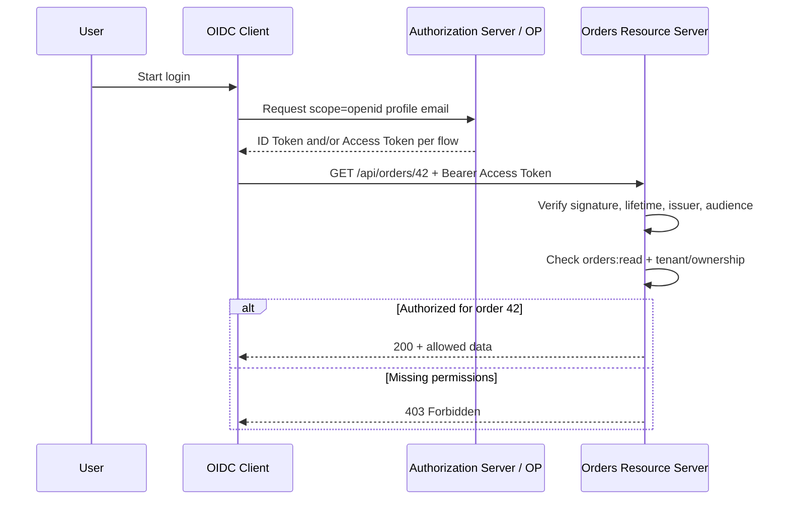

# `openid`, `profile`, and `email` Scopes Do Not Automatically Become Business Permissions

In systems using **Spring Security OAuth 2.0/OIDC Resource Server**, logging in successfully and receiving a token is only the starting point. A dangerous misconception is seeing `openid profile email` on a token and concluding that the user is allowed to read orders, edit customer profiles, approve payments, or access administrative APIs. Those three scopes primarily serve **OIDC login and identity information requests**; they do not define those business permissions.

For example, a user logs in via an OpenID Provider (OP) and consents to sharing their name and email with the application. That does not mean they are permitted to call `GET /api/orders/42`, and it certainly does not mean they can read someone else's orders. The Resource Server must enforce explicit authorization policies for specific operations and resources.

## 1. Separating three easily conflated concepts

| Concept | Question to answer | Example | Limitation |
|---|---|---|---|
| **Authentication** | Who is making the request? | User has identity `iss` + `sub`; valid token | Does not automatically permit reading or modifying data |
| **OIDC identity scopes and claims** | Which details about the user may the client request? | `openid`, `profile`, `email`; `name`, `email` claims | Not a list of business operations |
| **Authorization** | Is this subject allowed to perform this action on this resource? | `orders:read`, `orders:create`, ownership policy, tenant | Requires rules defined and enforced by the business system |

`scope` is a general OAuth 2.0 concept; **a scope defined by the Authorization Server *can* represent API access permissions**. However, the standard OIDC scopes `openid`, `profile`, and `email` serve a different purpose. Therefore, you cannot apply a rule of "having any scope means having business permissions" to every scope value.

## 2. What do `openid`, `profile`, and `email` actually mean?

### `openid`: requesting OpenID Connect

In OIDC, the presence of `openid` in an authentication request signals to the Authorization Server that the client wants to run an OpenID Connect flow. In a compliant OIDC flow, the client receives an **ID Token** to verify the login event and the user's identity.

`openid` **does not mean**:

- The user already has a provisioned, authorized account in every application using the same OP.
- The token is permitted to call any API in the organization.
- The user has default permissions such as `ROLE_USER`, `ROLE_ADMIN`, or `orders:read`.

Even when an access token's `scope` string contains `openid`, the Resource Server must still determine whether the token was issued **for this API** and carries the required permissions.

### `profile`: requesting basic profile attributes

The `profile` scope requests identity claims such as `name`, `given_name`, `family_name`, `preferred_username`, `picture`, `locale`, etc., according to OIDC rules and OP capabilities.

The scope name is easily misunderstood: `profile` **does not mean** "allowed to edit other people's profiles" or "allowed to access the entire customer profile database." It solely relates to requesting **the logged-in user's profile data**.

### `email`: requesting email address and verification status

The `email` scope requests the `email` and `email_verified` claims. `email_verified = true` only reflects that the OP verified control of that email address using the OP's mechanism; it is **not** confirmation that the user is an employee, administrator, order approver, or authorized to send emails on the organization's behalf.

In particular, email addresses can change, and OIDC does not guarantee uniqueness across all subjects. Never use email alone as a long-term user identifier key; within a single issuer, the **`iss` + `sub`** pair is a much more stable starting point for account linking.

> **Note on claims:** `profile` and `email` are scopes used to *request* information. They do not guarantee every claim will always appear: the OP may not support them, may lack data, or may withhold certain claims depending on context. These claims are typically returned via the UserInfo Endpoint or ID Token in an OIDC flow; never assume they appear inside the access token sent to your API.

## 3. Distinguishing ID Token and Access Token before checking permissions

| Token | Consumer | Primary contents and purpose | What should the Resource Server do? |
|---|---|---|---|
| **ID Token** | OIDC client / Relying Party | Confirms the login event; contains OIDC claims like `sub`, `iss`, `aud`, optionally `name`, `email` | **Do not** accept it in place of an access token to call APIs |
| **Access Token** | Designated Resource Server | Proves the client holds an authorization grant for resources, with scopes/claims per the Authorization Server | Verify the token is valid, matches `iss`, matches `aud`, is unexpired, and has sufficient business permissions |

Example of an OIDC login request (values shortened):

```text
scope=openid profile email
```

These are **scopes requested by the client**. It does not mean the returned access token will contain exactly these scopes, nor does it mean `orders-api` is authorized. Inspect the **actually issued access token**, its audience, and resource policies. With opaque access tokens, the Resource Server needs introspection rather than local JWT decoding.

The proper processing flow can be visualized as follows:



Logging in through the OP and granting access to `orders-api` are **two separate decisions**. The ID Token proves login information to the client; never use it as an API access pass.

## 4. How does Spring Security turn scopes in a JWT into `GrantedAuthority`?

With default JWT Resource Server configuration, Spring Security reads scopes from common claims such as `scope` or `scp` on the **validated access token** and prepends `SCOPE_` to create `GrantedAuthority` instances.

Example hypothetical access token payload:

```json
{
  "iss": "https://login.example.com/realms/shop",
  "sub": "user-123",
  "aud": ["orders-api"],
  "scope": "openid profile email",
  "exp": 1893456000
}
```

In this case, a `JwtAuthenticationToken` may receive the authorities:

```text
SCOPE_openid
SCOPE_profile
SCOPE_email
```

This is **purely a mechanical translation of scope names into authorities**. Spring Security does not automatically interpret `SCOPE_email` as "allowed to view the customer list," or `SCOPE_profile` as "allowed to edit personal details." Developers must specify which authority protects which endpoint.

Example of a **business-wise incorrect** configuration:

```java
// WRONG: Allows exporting all customers just because the user consented
// to share their email during OIDC login.
.requestMatchers(HttpMethod.GET, "/api/customers/export")
    .hasAuthority("SCOPE_email")
```

If the access token contains `email`, that rule can grant access to sensitive data without checking an actual `customers:export` permission. Likewise, `authenticated()` only proves authentication occurred; using it for sensitive endpoints remains far too permissive.

> **Nuance:** Not every access token includes `openid`, `profile`, or `email` in its `scope` claim. Spring Security only maps values actually present in the token; it does not infer scopes from the login screen or from the ID Token.

## 5. Designing business permissions explicitly

Suppose the application has the following requirements:

| Feature | Required API condition | Additional contextual conditions |
|---|---|---|
| View orders | `orders:read` | Only view orders within the granted tenant and ownership scope |
| Create order | `orders:create` | Only create for an allowed tenant |
| Cancel order | `orders:cancel` | Order is not finalized and subject has cancellation rights |
| Export customer data | `customers:export` | Export role/policy, valid customer scope |

These permissions can come from one of the following models, depending on architecture:

1. **OAuth API scopes** registered and issued by the Authorization Server, e.g., `orders:read` or `orders.read`, checked by the Resource Server as `SCOPE_orders:read` / `SCOPE_orders.read` respectively.
2. **Custom permission claims** in the access token, e.g., `permissions: ["orders:read", "orders:create"]`, issued by a trusted token issuer after resolving permissions. The Resource Server maps them to `PERM_orders:read`, `PERM_orders:create`.
3. **Permissions stored in the business system**: the API links `iss` + `sub` to an internal account and queries roles, policies, ownership relations, or tenants. This is helpful when permissions change frequently or depend on data state.

All three approaches can work together. The core rule is that **the relationship between permissions and actions must be explicitly defined**, never deriving `orders:read` from `openid`, `profile`, `email`, or an email domain. Permissions in a token also never replace per-record authorization checks.

## 6. Example Spring Boot Resource Server configuration with business permissions

The following example uses Spring Security for **Servlet/MVC**, JWT access tokens, and assumes the Authorization Server emits a `permissions` claim **issued by a trusted system**. This is an application/Authorization Server convention, not a mandatory OIDC claim.

### 6.1. Purpose-built access token

Illustrative payload (signature and some time claims omitted):

```json
{
  "iss": "https://login.example.com/realms/shop",
  "sub": "user-123",
  "aud": ["orders-api"],
  "scope": "openid profile email",
  "tenant_id": "tenant-a",
  "permissions": ["orders:read", "orders:create"],
  "exp": 1893456000
}
```

- `iss`: token issued by the expected Authorization Server.
- `aud`: token targets `orders-api`, preventing tokens issued for other apps/APIs from being accepted.
- `scope`: granted OAuth/OIDC values; here including the identity scopes.
- `permissions`: business permissions granted under a custom convention.
- `tenant_id`: contextual attribute issued by a trusted Authorization Server; this claim alone is still not sufficient to view a specific order.

For JWT tokens, the Resource Server must verify the signature and required constraints **before** trusting claims for decisions. Never take claims from an unverified JWT, request body, or client-supplied header to grant permissions.

### 6.2. Configuring issuer and audience

Add `spring-boot-starter-oauth2-resource-server` along with the required Web/Security dependencies for your application. In `application.yml`:

```yaml
spring:
  security:
    oauth2:
      resourceserver:
        jwt:
          issuer-uri: https://login.example.com/realms/shop
          audiences:
            - orders-api
```

`issuer-uri` lets Spring Security configure JWT issuer validation; `audiences` requires the token to be issued for this API. Values must match your actual OP/Authorization Server configuration. Spring Security also verifies the signature and time claims like `exp` and `nbf` per the JWT Resource Server configuration. If your provider uses a custom token format or validation rules, configure accordingly; verifying the signature alone **is not enough** for authorization.

### 6.3. Mapping custom `permissions` alongside OIDC scopes

```java
import java.util.Collection;
import java.util.LinkedHashSet;
import java.util.Set;

import org.springframework.context.annotation.Bean;
import org.springframework.context.annotation.Configuration;
import org.springframework.http.HttpMethod;
import org.springframework.security.config.annotation.method.configuration.EnableMethodSecurity;
import org.springframework.security.config.annotation.web.builders.HttpSecurity;
import org.springframework.security.core.GrantedAuthority;
import org.springframework.security.oauth2.server.resource.authentication.JwtAuthenticationConverter;
import org.springframework.security.oauth2.server.resource.authentication.JwtGrantedAuthoritiesConverter;
import org.springframework.security.web.SecurityFilterChain;

@Configuration
@EnableMethodSecurity
public class SecurityConfig {

    @Bean
    SecurityFilterChain securityFilterChain(
            HttpSecurity http,
            JwtAuthenticationConverter jwtConverter) throws Exception {

        http
            .authorizeHttpRequests(auth -> auth
                .requestMatchers(HttpMethod.GET, "/api/public/**").permitAll()
                .requestMatchers(HttpMethod.GET, "/api/orders/**")
                    .hasAuthority("PERM_orders:read")
                .requestMatchers(HttpMethod.POST, "/api/orders")
                    .hasAuthority("PERM_orders:create")
                .anyRequest().authenticated()
            )
            .oauth2ResourceServer(oauth2 -> oauth2
                .jwt(jwt -> jwt.jwtAuthenticationConverter(jwtConverter))
            );

        return http.build();
    }

    @Bean
    JwtAuthenticationConverter jwtConverter() {
        // Keep mapping OAuth scopes -> SCOPE_*.
        JwtGrantedAuthoritiesConverter scopes =
            new JwtGrantedAuthoritiesConverter();

        // Independent business permissions -> PERM_*.
        JwtGrantedAuthoritiesConverter permissions =
            new JwtGrantedAuthoritiesConverter();
        permissions.setAuthoritiesClaimName("permissions");
        permissions.setAuthorityPrefix("PERM_");

        JwtAuthenticationConverter converter = new JwtAuthenticationConverter();
        converter.setJwtGrantedAuthoritiesConverter(jwt -> {
            Set<GrantedAuthority> result = new LinkedHashSet<>();

            Collection<GrantedAuthority> grantedScopes = scopes.convert(jwt);
            Collection<GrantedAuthority> grantedPermissions = permissions.convert(jwt);

            if (grantedScopes != null) {
                result.addAll(grantedScopes);
            }
            if (grantedPermissions != null) {
                result.addAll(grantedPermissions);
            }
            return result;
        });
        return converter;
    }
}
```

With the sample access token above, the Resource Server can produce the authorities:

```text
SCOPE_openid
SCOPE_profile
SCOPE_email
PERM_orders:read
PERM_orders:create
```

The `GET /api/orders/**` endpoint **only** checks `PERM_orders:read`. Having `SCOPE_openid`, `SCOPE_profile`, or `SCOPE_email` does not bypass this requirement.

> **Important:** The configuration above illustrates reading the `permissions` claim; it does **not** grant those permissions itself. The Authorization Server or an authorization management component must issue trusted claims. If permissions live in a separate database and change frequently, checking permissions directly in the API may be preferable to waiting for a token to expire.

### 6.4. Checking permissions per record and tenant

`PERM_orders:read` is usually only **permission to perform an operation type**; it does not prove a user may read **order 42**. Combine it with relationship checks against business data.

Example service using method security:

```java
@Service
public class OrderService {
    private final OrderRepository orders;

    public OrderService(OrderRepository orders) {
        this.orders = orders;
    }

    @PreAuthorize("hasAuthority('PERM_orders:read') " +
                  "and @orderPolicy.canRead(authentication, #orderId)")
    public OrderDto getOrder(UUID orderId) {
        return orders.findDtoById(orderId)
                .orElseThrow(OrderNotFoundException::new);
    }
}
```

A corresponding policy (repository methods and domain types are illustrative and should be implemented per application):

```java
@Component("orderPolicy")
public class OrderPolicy {
    private final OrderRepository orders;

    public OrderPolicy(OrderRepository orders) {
        this.orders = orders;
    }

    public boolean canRead(Authentication authentication, UUID orderId) {
        if (!(authentication instanceof JwtAuthenticationToken bearer)) {
            return false;
        }

        Jwt jwt = bearer.getToken();
        String tenantId = jwt.getClaimAsString("tenant_id");
        if (tenantId == null) {
            return false;
        }

        return orders.existsByIdAndTenantIdAndOwnerSubject(
                orderId, tenantId, jwt.getSubject());
    }
}
```

This assumes `OrderRepository` has a method `existsByIdAndTenantIdAndOwnerSubject(UUID id, String tenantId, String ownerSubject)`. In a real system, map users to an internal identifier based on `iss` + `sub` and validate that `tenant_id` is within granted bounds rather than trusting a client-supplied tenant name. For admin accounts allowed cross-scope read access, write an explicit policy branch and audit access. Also ensure every code path serving sensitive data enforces the same policy, rather than protecting one controller and leaking through another endpoint.

If you prefer fetching permissions from a database instead of a `permissions` claim, the service/policy can evaluate roles, memberships, order state, transaction limits, and ownership at call time. That approach is especially useful when permissions may be revoked before a JWT expires.

## 7. What if the Authorization Server issues real API scopes?

OAuth scopes do not exist solely for identity attributes. If the system **has defined** `orders.read` as an authorization scope for the Orders API, the Authorization Server can issue an access token:

```json
{
  "aud": ["orders-api"],
  "scope": "orders.read",
  "sub": "user-123"
}
```

Then the Resource Server can enforce:

```java
.requestMatchers(HttpMethod.GET, "/api/orders/**")
    .hasAuthority("SCOPE_orders.read")
```

This is a case where **an API scope carries business meaning because the system's security contract defines it that way**. It differs from assigning arbitrary permissions to `openid`, `profile`, or `email`. Even `orders.read` may still only represent an operation-level permission; tenant, ownership, and record-status checks remain necessary when business rules require them.

In the **client credentials** flow (machine-to-machine), there is usually no logged-in user requesting `profile` or `email`; the API requires scopes/permissions designed for service principals and distinct policies for calling applications.

## 8. How should scenarios be handled?

| Scenario | Expected outcome | Reason |
|---|---|---|
| Valid access token, matching `aud`, only `openid profile email`; calling `GET /api/orders/42` | **403** | Authenticated, but missing `orders:read` |
| Valid access token, matching `aud`, `permissions: ["orders:read"]`, order 42 belongs to the tenant/user | **200** (if record exists and other rules pass) | Sufficient operation and record-level permissions |
| Valid access token with `orders:read`, but order 42 belongs to someone else | **403**, or **404** if policy hides resource existence | Not permitted to read this record |
| Expired token, invalid signature, untrusted issuer, or `aud` lacks `orders-api` | **401** | Token is invalid for this API |
| Client sends an ID Token in `Authorization: Bearer ...` to call the Orders API | **Rejected** | ID Token is for the OIDC client, not an API access pass |
| User has `email_verified = true` and a corporate-domain email | **Does not automatically become admin** | Identity claims do not replace business-granted roles/permissions |

The HTTP codes in the table assume standard Bearer token policies without custom overrides. In particular, 401 typically indicates missing/invalid Bearer token authentication; 403 indicates authenticated but lacking permissions.

## 9. Common mistakes and how to avoid them

**1. Using `hasAuthority("SCOPE_email")` to protect a customer-data endpoint.**

`email` is requested to obtain the OIDC user's email claim, not permission to view customer records. Define `customers:read`/`customers:export` and enforce actual policies.

**2. Converting every logged-in user into `ROLE_ADMIN` or `ROLE_EMPLOYEE` solely from `profile`, `email`, or an email suffix.**

Application roles must be granted by a trusted authorization source and constrained by tenant/organization. In multi-tenant apps, the same person can hold different roles in different tenants.

**3. Seeing the `email` claim in the ID Token and assuming it is already in the access token.**

The two tokens have different recipients, structures, and purposes. The Resource Server must work with an access token issued for itself with its own claim contract.

**4. Validating only the signature while ignoring audience.**

A validly signed JWT may still be intended for a different application. Checking `aud` prevents token confusion across APIs and reduces the risk of mistakenly accepting an ID Token signed by the same OP.

**5. Checking permissions only at the route level while skipping record-level authorization.**

`orders:read` does not mean permission to view every order. Which user, tenant, and state a resource belongs to remains a business decision at the Resource Server.

**6. Treating every claim inside an access token as permanently granted permission.**

Claims reflect the state granted when the token was minted. When immediate permission revocation is required, consider short token lifetimes, introspection, a policy/authorization service, or dynamic API-side permission checks.

**7. Mixing up `hasRole` and `hasAuthority`.**

By Spring Security convention, `hasRole("ADMIN")` looks for the `ROLE_ADMIN` authority; `hasAuthority("PERM_orders:read")` checks the exact string granted. Never accidentally prepend `ROLE_` to an authority prefixed with `SCOPE_` or `PERM_`.

## 10. How to self-audit your authorization design

Before shipping a sensitive endpoint, make sure you can answer these questions:

1. **Which token does the API accept?** JWT or opaque access token, which issuer, which audience, what lifetime, and what validation mechanism?
2. **Where do permissions come from?** OAuth API scopes, a `permissions` claim from a trusted issuer, or an internal database/policy service?
3. **What action does each permission grant?** For example, `orders:read` for reading orders, `customers:export` for exporting data, documented and granted under least privilege.
4. **Are there constraints on specific resources?** Owner, tenant, organizational unit, document state, approval level...
5. **What happens when permissions are missing?** Missing/invalid access tokens are rejected; authenticated users lacking permissions receive 403 or a policy-compliant resource-hiding response.
6. **What happens when permissions are revoked?** Does token lifetime, introspection, or dynamic authorization meet the system's requirements?

A valuable security test creates two tokens **for the same identity**: token A with only OIDC identity scopes, and token B with the corresponding business permissions. Sensitive APIs must reject A and only process B when all resource-level conditions pass. Then test B against an order from another tenant to verify the API still blocks horizontal access (IDOR/BOLA).

## Conclusion

`openid` signals that the client requests an OIDC flow; `profile` and `email` request identity attributes. They **do not automatically generate permissions to view, edit, delete, or approve business data**. Spring Security can map scopes in an access token to `SCOPE_*`, but the mapping mechanism does not alter what those scopes mean. A Resource Server must validate that the token targets the right recipient, map granted permissions according to the application's security contract, and continue enforcing per-resource authorization.

### References

- [OpenID Connect Core 1.0 — Standard Claims and Requesting Claims using Scope Values](https://openid.net/specs/openid-connect-core-1_0.html#ScopeClaims)
- [RFC 6749, §3.3 — Access Token Scope](https://www.rfc-editor.org/rfc/rfc6749#section-3.3)
- [Spring Security — OAuth 2.0 Resource Server JWT](https://docs.spring.io/spring-security/reference/servlet/oauth2/resource-server/jwt.html)
- [Spring Boot — OAuth2 Resource Server configuration](https://docs.spring.io/spring-boot/reference/security/oauth2.html)
