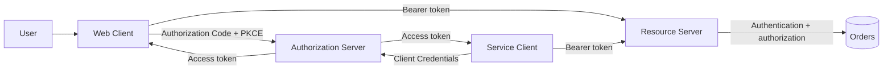
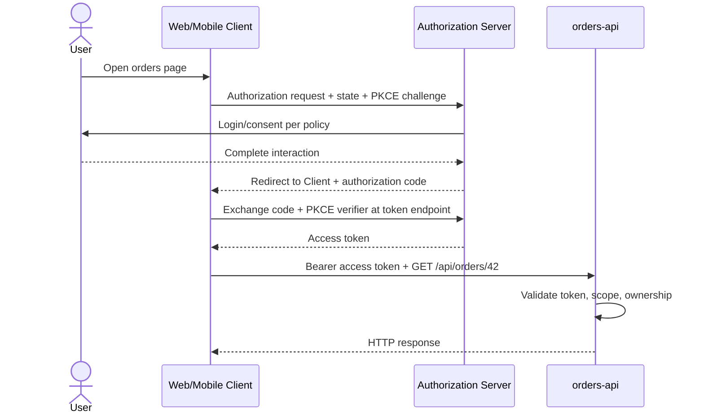
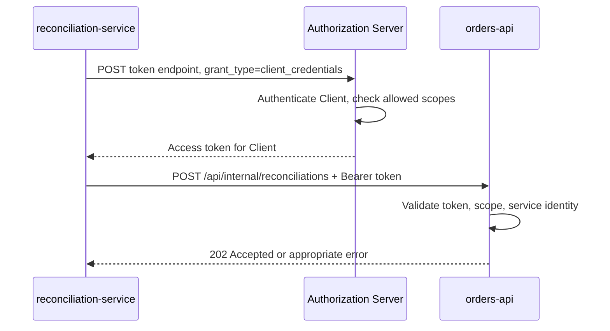
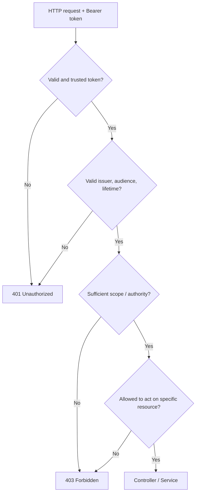

# Authorization Code and Client Credentials Flows Seen from the Token-Receiving API

## 1. The problem: one API, two token issuance contexts

Suppose a system has an `orders-api` with two access needs:

- **End user:** Logs into a web app and views their own orders.
- **Automated service:** A scheduled reconciliation job calls the API to update payment status or export reports.

Both clients ultimately send the same form of request:

```http
GET /api/orders/42 HTTP/1.1
Host: orders.example.com
Authorization: Bearer <access-token>
```

However, the authorization context differs. For a user, the token typically represents access granted in the context of a logged-in subject; for an automated service, the token typically represents permissions of the Client/service itself.

**Authorization Code** and **Client Credentials** are two OAuth 2.0 grant types—that is, two ways a **Client obtains an access token** from the Authorization Server. For the Resource Server, what matters most is **whether the access token is trustworthy, intended for this API, and permits the requested operation**. The API must not assume every valid token represents an end user.

This lesson focuses on what the token-receiving API server needs to understand: token paths, relevant claims, identity differences, how Spring Security validates tokens, and how to enforce resource-level authorization.

## 2. Roles in an OAuth 2.0/OIDC system

| Role | Primary responsibility | Example |
|---|---|---|
| **Resource Owner** | Entity with rights over the resource; typically a user in Authorization Code scenarios | Customer who owns the order |
| **Client** | Application requesting permissions and calling APIs | Web application, mobile app, `reconciliation-service` |
| **Authorization Server (AS)** | Handles authorization, authenticates Clients when required, and issues access tokens | OAuth 2.0/OIDC server |
| **Resource Server (RS)** | Hosts resources and validates access tokens/permissions before allowing operations | `orders-api` |



Each grant type handles **the token issuance step prior to calling the API**. When receiving the HTTP request, the Resource Server does not see how redirects, login, or Client authentication took place, unless the Authorization Server intentionally embeds trustworthy attributes into the token/introspection response and the system agrees on how to interpret them.

## 3. Authorization Code: user participates in granting access

### 3.1. Flow sequence

Authorization Code is typically used when a Client has an interactive user. The Client sends the browser to the Authorization Server to authenticate and grant consent, receives an **authorization code** via redirect, and exchanges the code for tokens at the token endpoint.

For modern applications, use **Authorization Code + PKCE**. The Client generates `code_verifier` and `code_challenge` to bind the authorization code exchange, reducing the risk of someone stealing and redeeming the code. Confidential clients must also perform Client authentication as required by the Authorization Server.



Key steps:

1. The Client requests access permissions, such as scope `orders.read`.
2. The Authorization Server handles user authentication and consent if required by policy.
3. The Authorization Server returns a short-lived code to the Client's valid `redirect_uri`.
4. The Client calls the token endpoint to exchange the code and sends the PKCE `code_verifier`.
5. The Client sends the **access token** in the `Authorization` header when calling `orders-api`.
6. The API validates the token and checks whether the user is permitted to view that specific order.

**The Resource Server never receives the authorization code to exchange for tokens**, does not handle `redirect_uri`, and does not verify `code_verifier`. Checks such as request anti-forgery via `state` and PKCE verification live between the Client and Authorization Server.

### 3.2. Distinguishing the token endpoint from API endpoints

A code-exchange request sent to the Authorization Server might look like:

```http
POST /oauth2/token HTTP/1.1
Host: id.example.com
Content-Type: application/x-www-form-urlencoded

grant_type=authorization_code&code=<code>&redirect_uri=https%3A%2F%2Fapp.example.com%2Fcallback&client_id=web-client&code_verifier=<verifier>
```

The snippet above illustrates common parameters. If the Client is confidential, it must use Client authentication as required by the AS; sending `client_id` alone does not replace Client authentication.

A token response might look like:

```json
{
  "access_token": "<user-access-token>",
  "token_type": "Bearer",
  "expires_in": 900,
  "scope": "orders.read"
}
```

Afterwards, the Client sends the token to the Resource Server:

```http
GET /api/orders/42 HTTP/1.1
Host: orders.example.com
Authorization: Bearer <user-access-token>
```

The two requests go to **two servers with two different duties**. The API only cares whether the issued access token satisfies its policy.

### 3.3. How does OIDC relate?

OpenID Connect (OIDC) adds an identity authentication layer on top of OAuth 2.0. In a compliant OIDC flow—such as Authorization Code requesting the `openid` scope—the Client can additionally receive an **ID token**.

| Token | Primary purpose | Consumer |
|---|---|---|
| **Access token** | Permission to access protected resources | Resource Server |
| **ID token** | Information about the authentication event / user identity | OIDC Client |

**Do not use an ID token in place of an access token to call an API.** An ID token typically has the OIDC application's Client ID as `aud`. Having a valid signature on an ID token does not prove it was issued for `orders-api` or permits `orders.read`.

Plain OAuth 2.0 Authorization Code does not require an ID token. The presence of OIDC does not change the Resource Server's responsibility to validate the access token.

### 3.4. Access token from a user context

Illustrative JWT access token payload:

```json
{
  "iss": "https://id.example.com",
  "sub": "user-417",
  "aud": ["orders-api"],
  "iat": 1893455100,
  "exp": 1893456000,
  "client_id": "web-client",
  "scope": "orders.read",
  "tenant_id": "tenant-east"
}
```

In this example:

- `iss` is the token issuer trusted by the API.
- `sub` is the subject the token represents; under this example contract, `user-417` is the user ID.
- `aud` specifies the Resource Server allowed to accept the token; `orders-api` must validate its audience.
- `iat` and `exp` represent issued-at and expiration timestamps.
- `client_id` may indicate which Client was issued the token, if the token profile provides that claim.
- `scope` states the granted OAuth permissions, here `orders.read`.
- `tenant_id` is a custom claim, which should only be relied upon when the Authorization Server guarantees its semantics and value.

This is an **illustrative** payload; not every access token is a JWT or carries the exact same set of claims. The Resource Server must align on claim interpretation with the issuer.

For `GET /api/orders/42`, the `orders.read` scope only indicates the request has functional read permission. The API must still verify that order `42` belongs to `user-417` or that the user has a special business role permitted to read it. This is the boundary that prevents accessing other people's data.

## 4. Client Credentials: Client requests permissions for itself

### 4.1. Flow sequence

Client Credentials is used for **machine-to-machine** communication when a service needs to call an API without an interactive end-user login step. The Client authenticates itself with the Authorization Server and requests an access token within the scopes permitted by the AS.



Here there is no redirect, authorization code, or PKCE. The token represents the **Client/service according to the issuer's convention**, and does not by default represent a logged-in customer.

### 4.2. Example of obtaining a token

Example using HTTP Basic to authenticate a confidential client at the token endpoint over HTTPS:

```bash
curl --request POST 'https://id.example.com/oauth2/token' \
  --user "$CLIENT_ID:$CLIENT_SECRET" \
  --header 'Content-Type: application/x-www-form-urlencoded' \
  --data-urlencode 'grant_type=client_credentials' \
  --data-urlencode 'scope=orders.reconcile'
```

`CLIENT_ID` and `CLIENT_SECRET` are simply placeholders for protected credentials. Depending on the server, Client authentication can also use private-key JWT, mTLS, or other supported methods. **Never store a client secret in frontend JavaScript or a public client application.**

Example response:

```json
{
  "access_token": "<service-access-token>",
  "token_type": "Bearer",
  "expires_in": 600,
  "scope": "orders.reconcile"
}
```

Then the Client calls the API:

```http
POST /api/internal/reconciliations HTTP/1.1
Host: orders.example.com
Authorization: Bearer <service-access-token>
Content-Type: application/json

{"batchId":"batch-202","processedCount":100}
```

The Resource Server validates the token and the service's permissions on the reconciliation API. A Client Credentials token **is not unlimited admin power** and may only be used on the resources/endpoints for which it was granted permission.

### 4.3. Access token in a service context

Illustrative JWT example:

```json
{
  "iss": "https://id.example.com",
  "sub": "reconciliation-service",
  "aud": ["orders-api"],
  "iat": 1893455400,
  "exp": 1893456000,
  "client_id": "reconciliation-service",
  "scope": "orders.reconcile",
  "principal_type": "service"
}
```

`principal_type` here is a **custom claim**, not a mandatory standard OAuth 2.0 claim. Not every Authorization Server sets `sub` equal to the Client ID or emits `client_id` in the same format.

If the API has a specific rule that "only services may call the reconciliation endpoint," use a **verified contract between the AS and the API**—for example, an AS-managed `principal_type` claim combined with a Client ID allowlist—rather than guessing from the appearance of the `sub` string. The API must never trust a self-asserted Client header like `X-Principal-Type: service` to elevate privileges.

### 4.4. Is there an OIDC ID token in Client Credentials?

Client Credentials is an OAuth 2.0 grant type and has no end-user login event. It normally uses an **access token** to access APIs and does not produce an OIDC ID token for a user.

If a backend must act **on behalf of a user**, design a proper delegation/authorization mechanism—such as using a user-involved flow or token exchange supported by your architecture. Never manually inject a user ID into a Client Credentials token and treat it as user-delegated authorization.

## 5. Comparison from the token-receiving API's perspective

| Aspect | Authorization Code | Client Credentials |
|---|---|---|
| How the Client obtains the token | Redirect and exchange authorization code, preferably with PKCE | Authenticates itself at the token endpoint |
| User involvement | Typically involves user interaction | No end user in the flow |
| Subject the token typically represents | User / delegated session at the Client | Client or service |
| Example scope | `orders.read` | `orders.reconcile` |
| What Resource Server receives | Bearer access token | Bearer access token |
| Does the API receive the authorization code? | No | No authorization code exists |
| Can the API automatically tell grant type from the Bearer header? | No | No |
| Typical business checks | Scope + user ownership/tenant | Scope + service identity/permissions |
| OIDC relationship | Can produce an ID token for the Client | Does not authenticate an end user |

**Grant type describes how the token was issued**, and is not required to be written into a `grant_type` claim in the access token. You cannot reliably distinguish the two flows merely because a token has `sub`, `client_id`, a particular scope name, or looks like a JWT.

If API policy must distinguish principal types, the Authorization Server and Resource Server must agree on a trustworthy mechanism: a signed claim with explicit semantics, a verified introspection response, separate scope/client sets, or a combination of those. A Client Credentials token could also be misconfigured in the AS to receive user scopes, so authorization boundaries must be designed at both the AS and the API.

## 6. How does the Resource Server validate an access token?

### 6.1. Common steps for both flows

1. **Extract the access token** from the request, typically via the `Authorization: Bearer ...` header.
2. **Validate the token:** signature and required claims for JWTs, or token status from introspection for opaque tokens.
3. **Verify issuer and audience:** token comes from a trusted AS and was issued for this API.
4. **Verify lifetime:** token is unexpired and satisfies `nbf`/any applicable time constraints.
5. **Determine trusted subject and scopes/authorities:** use only data vouched for by the AS.
6. **Endpoint authorization:** HTTP method, path, scopes/roles, and principal type when needed.
7. **Business authorization:** data owner, tenant, record state, and internal domain rules.



A `401 Unauthorized` typically means the API has not accepted the authentication credentials (missing token, expired, invalid signature, wrong audience). A `403 Forbidden` typically means the API authenticated the caller but denied access due to insufficient permissions. For records not belonging to the user, systems may return `403` or `404` depending on policies against leaking resource existence.

### 6.2. JWT vs. opaque token is independent of grant type

**JWT access token:** The API can verify the digital signature using trusted public keys (usually fetched from JWKS) and then validate `iss`, `aud`, `exp`, `nbf`, and required claims. Merely Base64URL-decoding the payload **does not prove a token is valid**. A signed JWT does not inherently encrypt its payload.

**Opaque access token:** The API cannot decode the token string itself to discover permissions; it uses the AS's introspection endpoint or an issuer-provided mechanism. The `active` response and attributes such as `scope`, `sub`, and `client_id` must be interpreted according to the system contract.

Both Authorization Code and Client Credentials **can use either JWT or opaque tokens**, depending on the AS.

### 6.3. Response table when the API receives a token

| Scenario | Typical response | Interpretation |
|---|---|---|
| No token sent to a protected endpoint | `401 Unauthorized` | Missing authentication credentials |
| Token has invalid signature or is expired | `401 Unauthorized` | Token rejected |
| Valid signature, but `aud` belongs to another API | `401 Unauthorized` | Not issued for this Resource Server |
| Valid token, missing required scope | `403 Forbidden` | Insufficient functional permissions |
| User token attempting to read another user's order | `403 Forbidden` or `404 Not Found` | Denied by resource-level authorization |
| Service token has scope, but Client is not on allowlist | `403 Forbidden` | Denied by service-identity policy |
| Token and all permissions satisfy rules | Appropriate `2xx` | Request processed |

The API can use the `WWW-Authenticate: Bearer` header to report Bearer token errors per specification. Never include access tokens or internal secrets in error messages/logs.

## 7. Implementing with Spring Security OAuth2 Resource Server

### 7.1. Dependencies and issuer

Spring Boot with Gradle example:

```groovy
dependencies {
    implementation 'org.springframework.boot:spring-boot-starter-web'
    implementation 'org.springframework.boot:spring-boot-starter-security'
    implementation 'org.springframework.boot:spring-boot-starter-oauth2-resource-server'
}
```

Example Resource Server configuration accepting JWTs:

```yaml
spring:
  security:
    oauth2:
      resourceserver:
        jwt:
          issuer-uri: https://id.example.com
```

Spring Security can discover metadata/JWKS from the issuer and validate JWTs. The API must configure the real issuer and **add audience validation if an explicit boundary for `orders-api` is required**. Configuring issuer alone does not replace business authorization policies.

### 7.2. Endpoint authorization by scope

```java
import org.springframework.context.annotation.Bean;
import org.springframework.context.annotation.Configuration;
import org.springframework.http.HttpMethod;
import org.springframework.security.config.Customizer;
import org.springframework.security.config.annotation.web.builders.HttpSecurity;
import org.springframework.security.config.http.SessionCreationPolicy;
import org.springframework.security.web.SecurityFilterChain;

@Configuration
public class ApiSecurityConfig {

    @Bean
    SecurityFilterChain filterChain(HttpSecurity http) throws Exception {
        return http
            .csrf(csrf -> csrf.disable())
            .sessionManagement(s -> s
                .sessionCreationPolicy(SessionCreationPolicy.STATELESS))
            .authorizeHttpRequests(auth -> auth
                .requestMatchers("/api/public/**").permitAll()
                .requestMatchers(HttpMethod.GET, "/api/orders/**")
                    .hasAuthority("SCOPE_orders.read")
                .requestMatchers(HttpMethod.POST,
                    "/api/internal/reconciliations")
                    .hasAuthority("SCOPE_orders.reconcile")
                .anyRequest().denyAll())
            .oauth2ResourceServer(oauth2 ->
                oauth2.jwt(Customizer.withDefaults()))
            .build();
    }
}
```

Meaning:

- `oauth2ResourceServer(...jwt(...))` receives and validates JWT Bearer tokens. The API does not need to execute Authorization Code or Client Credentials flows itself.
- By default, Spring Security usually converts `scope`/`scp` into authorities prefixed with `SCOPE_`. Scope `orders.read` becomes `SCOPE_orders.read`; the converter can be customized to match your token profile.
- `GET /api/orders/**` accepts only principals with the order-reading scope; `POST /api/internal/reconciliations` requires the reconciliation permission.
- `anyRequest().denyAll()` denies endpoints without an explicitly designed policy.
- This stateless API example uses only Bearer tokens in the Authorization header, so CSRF is disabled. **Do not copy disabling CSRF** into applications using cookie-based authentication without evaluating CSRF risk.

Scope alone does not guarantee "this endpoint is only for services" if the AS could grant the same scope to a user Client. When needed, add policies checking principal type/Client identity and configure the AS to issue scopes accurately.

### 7.3. Dedicated audience validation

A JWT should only be accepted if `aud` contains `orders-api`. Example `JwtDecoder` configuration adding an audience validator while retaining default issuer/lifetime validators:

```java
import org.springframework.context.annotation.Bean;
import org.springframework.security.oauth2.core.DelegatingOAuth2TokenValidator;
import org.springframework.security.oauth2.core.OAuth2Error;
import org.springframework.security.oauth2.core.OAuth2TokenValidator;
import org.springframework.security.oauth2.core.OAuth2TokenValidatorResult;
import org.springframework.security.oauth2.jwt.Jwt;
import org.springframework.security.oauth2.jwt.JwtDecoder;
import org.springframework.security.oauth2.jwt.JwtDecoders;
import org.springframework.security.oauth2.jwt.JwtValidators;
import org.springframework.security.oauth2.jwt.NimbusJwtDecoder;

@Bean
JwtDecoder jwtDecoder() {
    String issuer = "https://id.example.com";

    NimbusJwtDecoder decoder =
        (NimbusJwtDecoder) JwtDecoders.fromIssuerLocation(issuer);

    OAuth2TokenValidator<Jwt> audience = jwt ->
        jwt.getAudience().contains("orders-api")
            ? OAuth2TokenValidatorResult.success()
            : OAuth2TokenValidatorResult.failure(
                new OAuth2Error("invalid_token", "Invalid audience", null));

    decoder.setJwtValidator(new DelegatingOAuth2TokenValidator<>(
        JwtValidators.createDefaultWithIssuer(issuer), audience));
    return decoder;
}
```

This is a Java example for a Resource Server using JWTs and a fixed issuer; real projects should externalize the issuer into environment configuration and ensure key sources/algorithms are properly set. Depending on your Spring Boot version, equivalent property-based audience configuration may be used instead of a bean.

A token with `iss=https://id.example.com` and `scope=orders.read` but `aud=inventory-api` must still be rejected by `orders-api`.

### 7.4. Checking ownership after authentication

With a JWT access token, a Controller can extract `sub` via the principal:

```java
import java.util.UUID;
import org.springframework.security.core.annotation.AuthenticationPrincipal;
import org.springframework.security.oauth2.jwt.Jwt;
import org.springframework.web.bind.annotation.GetMapping;
import org.springframework.web.bind.annotation.PathVariable;
import org.springframework.web.bind.annotation.RequestMapping;
import org.springframework.web.bind.annotation.RestController;

@RestController
@RequestMapping("/api/orders")
public class OrderController {
    private final OrderService orderService;

    public OrderController(OrderService orderService) {
        this.orderService = orderService;
    }

    @GetMapping("/{orderId}")
    public OrderDto getOrder(
            @PathVariable UUID orderId,
            @AuthenticationPrincipal Jwt jwt) {
        return orderService.findVisibleOrder(orderId, jwt.getSubject());
    }
}
```

`findVisibleOrder` is an illustrative business method that must verify whether the order belongs to the authenticated subject or is viewable by role/tenant. Example service logic:

```java
Order order = orderRepository.findById(orderId)
    .orElseThrow(OrderNotFoundException::new);

if (!order.getOwnerSubject().equals(authenticatedSubject)) {
    throw new AccessDeniedException("Order access denied");
}

return orderMapper.toDto(order);
```

This example assumes the AS guarantees `sub` is the user ID on user-facing endpoints. When using Client Credentials, do not take `sub` and apply a "user owns order" rule if the AS populates `sub` with the Client ID. Internal APIs must enforce distinct service policies.

### 7.5. If the access token is opaque

Configure introspection instead of JWT:

```yaml
spring:
  security:
    oauth2:
      resourceserver:
        opaque-token:
          introspection-uri: https://id.example.com/oauth2/introspect
          client-id: MY_INTROSPECTION_CLIENT_ID
          client-secret: MY_INTROSPECTION_CLIENT_SECRET
```

`MY_INTROSPECTION_CLIENT_ID` and `MY_INTROSPECTION_CLIENT_SECRET` are merely placeholder names here; in production, retrieve credentials securely from environment variables or a secret manager and never commit secrets to a repository.

```java
// In SecurityFilterChain, use opaque token instead of jwt:
.oauth2ResourceServer(oauth2 ->
    oauth2.opaqueToken(Customizer.withDefaults()))
```

The API uses introspection to validate the token and retrieve trusted attributes per the AS contract. The JWT and opaque configurations here are **two distinct implementation options**—do not combine both snippets into a single configuration example.

## 8. Four API scenarios to handle properly

### Scenario 1: User views their own order

An authenticated user token has:
 
```text
iss       = https://id.example.com
aud       = orders-api
sub       = user-417
client_id = web-client
scope     = orders.read
```

Request:

```http
GET /api/orders/42 HTTP/1.1
Host: orders.example.com
Authorization: Bearer <user-access-token>
```

The API validates issuer/audience/lifetime, `SCOPE_orders.read`, and verifies that order `42`'s `ownerSubject` is `user-417`. If the user changes the path to `/api/orders/43` where order `43` belongs to someone else, the API must deny it even though the scope is unchanged. This layer prevents **Broken Object Level Authorization (BOLA)**.

### Scenario 2: Service submits reconciliation results

A service token has:

```text
iss            = https://id.example.com
aud            = orders-api
sub            = reconciliation-service
client_id      = reconciliation-service
scope          = orders.reconcile
principal_type = service  (custom AS claim)
```

Request:

```http
POST /api/internal/reconciliations HTTP/1.1
Host: orders.example.com
Authorization: Bearer <service-access-token>
Content-Type: application/json

{"batchId":"batch-202"}
```

The API validates the token, checks the reconciliation scope, checks Client identity/`principal_type` if specified by the contract, and verifies that the batch is valid and within permitted processing scope. A service holding only `orders.reconcile` does not automatically gain access to read all user orders.

### Scenario 3: Valid token with wrong audience

A token has a valid signature and `orders.read` scope, yet `aud=billing-api`. `orders-api` must still reject it: the token was issued for another resource. Signature and scope validation **do not replace audience validation**.

### Scenario 4: A Resource Server calls another Resource Server

A Client calls `orders-api` with a token having `aud=orders-api`. If `orders-api` needs to call `billing-api`, it should not blindly forward that same token. The second API may reject it due to the wrong audience. If the service calls downstream under its own authority, it can use Client Credentials for `billing-api`'s audience. If it must act on behalf of the user, use an appropriate delegation/token exchange mechanism as designed for your system.

## 9. Common mistakes

| Mistake | Consequence | Fix |
|---|---|---|
| Sending an OIDC ID token to an API | API receives the wrong token type, likely wrong audience/purpose | Send an access token intended for the API |
| Treating every `sub` as a user ID | Client Credentials tokens are processed like user tokens | Align `sub`, Client ID, and principal type semantics with the AS |
| Inferring grant type solely from payload | Misgrants permissions based on unverified claim assumptions | Rely on verified token/introspection contracts |
| Decoding JWT without verifying signature | Accepts caller-forged claims | Use a trusted `JwtDecoder`, verifying signature and claims |
| Skipping `aud` validation | API accepts tokens issued for other services | Bind audience per Resource Server |
| Treating `orders.read` scope as permission to read all orders | Leaks other users' data | Enforce ownership and tenant checks in the business layer |
| Using Client Credentials in a public frontend and embedding secrets | Exposes Client credentials | Use flows suited to Client type; keep secrets on the backend |
| Forwarding the raw token to downstream APIs | Wrong audience, wrong permissions | Obtain dedicated tokens or use proper delegation |
| Disabling CSRF in cookie-based apps without review | Creates CSRF vulnerabilities | Evaluate authentication surfaces and enable needed protection |
| Logging access tokens or client secrets | Leaks Bearer tokens and Client secrets | Use HTTPS, mask tokens, never log secrets |

## 10. Observing Resource Server behavior over HTTP

The following assumes a real `orders-api` and Authorization Server. `USER_ACCESS_TOKEN` and `SERVICE_ACCESS_TOKEN` must hold access tokens **issued via their respective flows** with the proper audience.

```bash
# Protected endpoint with no token: typically returns 401
curl -i 'https://orders.example.com/api/orders/42'

# User token: must still pass order ownership checks
curl -i -H "Authorization: Bearer $USER_ACCESS_TOKEN" \
  'https://orders.example.com/api/orders/42'

# Service token: calls reconciliation endpoint with matching scope
curl -i -X POST \
  -H "Authorization: Bearer $SERVICE_ACCESS_TOKEN" \
  -H 'Content-Type: application/json' \
  --data '{"batchId":"batch-202"}' \
  'https://orders.example.com/api/internal/reconciliations'
```

If you get `401`, check issuer, audience, signature/JWKS or introspection, `exp`, and how the Bearer token is sent. If you get `403`, check the scope mapped to `SCOPE_...`, allowed identity, and resource-level permissions. Never "fix" a `403` by changing a sensitive endpoint to `permitAll()`.

## 11. Reinforcement questions

**Q1.** The Client uses Authorization Code + PKCE. Does the Resource Server have to verify `code_verifier` on every API request?

**Answer:** No. The Authorization Server verifies PKCE when the Client exchanges the authorization code for tokens; the Resource Server validates the issued access token.

**Q2.** When an API receives `Authorization: Bearer ...`, can it know for certain which grant type obtained the token?

**Answer:** No. Grant type is not required to be embedded in the token. The API must rely on token/introspection attributes with trusted semantics and agreed policies.

**Q3.** Does a Client Credentials access token have a `sub` claim?

**Answer:** It may. The meaning of `sub` depends on the Authorization Server and token profile; do not assume it represents an end user.

**Q4.** A JWT has a valid signature and `orders.read`, yet `aud=inventory-api`. Should `orders-api` accept it?

**Answer:** No. Audience must match the resource the token was issued to access.

**Q5.** A user has `orders.read` but tries to read someone else's order. How should the API handle it?

**Answer:** Reject per policy (typically `403` or `404`). OAuth scopes do not replace object-level permission checks.

## 12. Takeaways

Authorization Code and Client Credentials differ in **how the Client obtains an access token** and in **the subject context**. At the Resource Server, however, the core pipeline is the same: **extract Bearer token → validate token and issuer/audience/lifetime → resolve trusted scopes/identity → enforce endpoint authorization → enforce authorization on real data**.

Authorization Code typically serves access in a user context; Client Credentials typically serves service-to-service communication. Spring Security handles token validation and authority checks; the application must complete ownership, tenant, and service-identity rules. That combination enables the Resource Server to protect the API across both scenarios.
