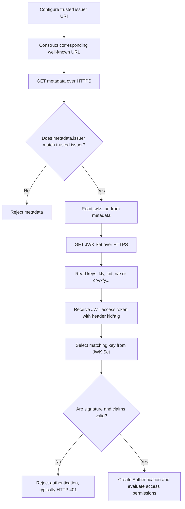

# OIDC Discovery, OAuth Metadata, and Issuer Key Information

When integrating a **Spring Security OAuth 2.0 Resource Server**, we usually start with one piece of configuration: the **issuer URI** of the Authorization Server/OpenID Provider (OP). From this URI, the application can discover where to fetch public keys to verify JWT signatures and find other endpoints published by the issuer. This mechanism is called *discovery* or *metadata discovery*.

The three most important questions of this lesson:

1. **Whom to trust?** Which issuer is configured as trusted, and does the metadata document genuinely belong to that issuer?
2. **Where to fetch configuration?** Through which URLs do OIDC Discovery and OAuth 2.0 Authorization Server Metadata publish endpoints?
3. **Which key verifies the token?** Which public key set does `jwks_uri` point to, and how does the Resource Server pick a key to verify JWT signatures?

Discovery helps the application locate configuration, but it **does not automatically guarantee that every access token is valid, intended for the API, or sufficiently authorized**. After finding the keys, the Resource Server must still verify signature, validity window, `iss`, `aud`, and appropriate access policies.

## 1. Distinguishing the roles and documents

| Concept | Role | Example |
|---|---|---|
| **Authorization Server (AS)** | Issues OAuth 2.0 access tokens and may issue refresh tokens; owns OAuth endpoints | `https://login.example.test/realms/shop` |
| **OpenID Provider (OP)** | Authorization Server supporting OpenID Connect, capable of issuing ID tokens and user authentication details | Same enterprise login system |
| **Issuer identifier** | URL identifier of the issuer, treated as the trust boundary | `https://login.example.test/realms/shop` |
| **OIDC Provider Configuration** | JSON document describing an OP: `issuer`, `jwks_uri`, OAuth/OIDC endpoints, and capabilities | `.../.well-known/openid-configuration` |
| **OAuth Authorization Server Metadata** | JSON document per RFC 8414 describing an AS, usable when OIDC is not deployed | `.../.well-known/oauth-authorization-server/...` |
| **JWK Set (JWKS)** | JSON document containing multiple JSON Web Keys, typically public keys for verifying signatures | URL pointed to by `jwks_uri` in metadata |
| **Resource Server** | API receiving access tokens, validating them, and enforcing access control | `https://api.example.test` |

**An issuer URI is a trust identifier, not the JWKS URL itself.** The application uses the issuer to fetch metadata; metadata points to `jwks_uri`; JWKS holds keys; keys support token signature verification.

In OIDC, discovery can also include an *issuer discovery* step to locate an OP from a user identifier via WebFinger. For a Resource Server with a known, configured issuer URI, the focus is **fetching provider configuration from that issuer**—not discovering an arbitrary issuer from a username or from data sent by an API caller.

## 2. Journey diagram: issuer → metadata → JWKS → JWT validation



The diagram describes the **signed JWT** branch. If the API validates **opaque access tokens**, it typically calls the **introspection endpoint** instead of decoding JWTs with JWKS; metadata may publish an introspection endpoint, though configuration and execution differ.

Two types of checks must be kept separate:

- **Metadata check:** Is this genuinely the issuer the system intends to trust?
- **Token check:** Was the token signed by a valid key of that issuer, is it within its validity window, and does it meet the Resource Server's conditions?

A publicly accessible JSON file—even metadata or JWKS reachable over HTTPS—**does not automatically become a trust anchor for any API**. Trust must start from an explicitly configured/allowed issuer.

## 3. OIDC and OAuth 2.0 Discovery URLs: similar data, different path rules

### 3.1. OIDC Discovery: `openid-configuration`

OpenID Connect Discovery 1.0 defines the configuration document URL by **appending** `/.well-known/openid-configuration` to the normalized issuer per the specification's rules.

Example issuer without a path:

```text
Issuer:
  https://login.example.test

OIDC Provider Configuration:
  https://login.example.test/.well-known/openid-configuration
```

Example issuer **with a path**:

```text
Issuer:
  https://login.example.test/realms/shop

OIDC Provider Configuration:
  https://login.example.test/realms/shop/.well-known/openid-configuration
```

Illustrative request:

```http
GET /realms/shop/.well-known/openid-configuration HTTP/1.1
Host: login.example.test
Accept: application/json
```

A successful endpoint returns a JSON document. The `issuer` field inside the document must match the expected issuer exactly; the document URL and `issuer` **are not the same string**.

### 3.2. OAuth 2.0 Authorization Server Metadata: RFC 8414

RFC 8414 defines publishing OAuth metadata using the well-known suffix `/.well-known/oauth-authorization-server`. When the issuer has a path, RFC 8414's rule is to **insert** `/.well-known/oauth-authorization-server` between the host and the issuer's path.

```text
Issuer:
  https://login.example.test

OAuth AS Metadata:
  https://login.example.test/.well-known/oauth-authorization-server

Issuer with path:
  https://login.example.test/realms/shop

OAuth AS Metadata:
  https://login.example.test/.well-known/oauth-authorization-server/realms/shop
```

A key difference to remember:

| Issuer | OIDC Discovery 1.0 | OAuth Metadata RFC 8414 |
|---|---|---|
| `https://login.example.test` | `https://login.example.test/.well-known/openid-configuration` | `https://login.example.test/.well-known/oauth-authorization-server` |
| `https://login.example.test/realms/shop` | `https://login.example.test/realms/shop/.well-known/openid-configuration` | `https://login.example.test/.well-known/oauth-authorization-server/realms/shop` |

RFC 8414 also allows an application profile using the `openid-configuration` suffix with **RFC 8414's insertion rule**. For an issuer with a path, that address looks like:

```text
https://login.example.test/.well-known/openid-configuration/realms/shop
```

That means in integration environments, you may encounter **two different `openid-configuration` locations** for the same path-bearing issuer: OIDC Discovery's append rule and RFC 8414's insert rule. Authorization Servers may publish multiple locations for compatibility; clients/libraries query the variants they support.

**Never assume all of the endpoints above exist.** Check your provider's documentation and the discovery behavior of the library you use.

### 3.3. What about metadata for the Resource Server itself?

Do not confuse the **issuer's** metadata document with the **resource/API's** metadata document:

- **Authorization Server Metadata (RFC 8414):** describes where tokens are issued, keys, and capabilities of the Authorization Server.
- **Protected Resource Metadata (RFC 9728):** describes a protected API, such as its `resource` identifier and the list of `authorization_servers` accepted by the API, published at the default suffix `/.well-known/oauth-protected-resource`.

Example Protected Resource Metadata:

```json
{
  "resource": "https://api.example.test",
  "authorization_servers": [
    "https://login.example.test/realms/shop"
  ],
  "scopes_supported": ["orders.read", "orders.write"]
}
```

RFC 9728 documents help clients locate the right Authorization Server for an API in systems supporting that mechanism. They **do not replace** the issuer's `openid-configuration`, `oauth-authorization-server`, or JWKS.

## 4. Reading an OIDC Provider Configuration document

Suppose the OIDC endpoint of the issuer above returns the following data. This is an **illustrative example**; the domain and endpoints are not for real connections:

```json
{
  "issuer": "https://login.example.test/realms/shop",
  "authorization_endpoint": "https://login.example.test/realms/shop/protocol/openid-connect/auth",
  "token_endpoint": "https://login.example.test/realms/shop/protocol/openid-connect/token",
  "userinfo_endpoint": "https://login.example.test/realms/shop/protocol/openid-connect/userinfo",
  "jwks_uri": "https://login.example.test/realms/shop/protocol/openid-connect/certs",
  "response_types_supported": ["code"],
  "subject_types_supported": ["public"],
  "id_token_signing_alg_values_supported": ["RS256"],
  "scopes_supported": ["openid", "profile", "email", "orders.read"],
  "grant_types_supported": ["authorization_code", "refresh_token", "client_credentials"],
  "token_endpoint_auth_methods_supported": ["client_secret_basic", "private_key_jwt"]
}
```

Field meanings:

| Metadata field | What is it for? | How does the Resource Server care? |
|---|---|---|
| `issuer` | Exact identifier of the OP/AS | **Crucial**: matched against the configured issuer and the JWT's `iss` claim. |
| `jwks_uri` | URL to fetch the JSON Web Key Set | **Crucial when validating JWTs** with public keys. |
| `authorization_endpoint` | Where clients redirect users to request authorization | Mainly for OAuth/OIDC clients; pure Resource Server APIs do not normally call it directly. |
| `token_endpoint` | Where clients exchange codes/credentials for tokens | Not where the Resource Server validates JWTs on each request. |
| `userinfo_endpoint` | Where OIDC clients retrieve user claims in protocol flows | Not required for an API to authorize access tokens. |
| `response_types_supported` | Response types supported by the OP | Used for OIDC client configuration. |
| `subject_types_supported` | How the OP represents subject identifiers | Used by OIDC clients; e.g., `public`/`pairwise`. |
| `id_token_signing_alg_values_supported` | Signing algorithms supported by the OP for **ID tokens** | Should not be mechanically assumed identical to the API's **access token** signing algorithm. |
| `scopes_supported` | Scopes supported or advertised by the server | Capability advertisement only; does not prove a caller was granted any scope. |
| `grant_types_supported` | Grant types supported by the AS | Useful for OAuth clients selecting a flow. |
| `token_endpoint_auth_methods_supported` | Client authentication methods at the token endpoint | For OAuth clients; not the API's bearer token authentication mechanism. |

Required fields must be checked against **each specification**. For instance, OIDC Discovery requires `issuer`, `authorization_endpoint`, `jwks_uri`, `response_types_supported`, `subject_types_supported`, and `id_token_signing_alg_values_supported`; other endpoints are conditional or recommended. In OAuth AS Metadata (RFC 8414), `issuer` is required; whether endpoints are required depends on the grant types the AS supports, and `jwks_uri` is optional metadata that may be published. Do not enforce OIDC's required-field checklist on a pure OAuth AS that does not implement OIDC.

URLs inside metadata **do not necessarily** share a path prefix with the issuer. Only the `issuer` identifier must match strictly per trust rules; actual endpoints come from verified metadata or trusted configuration documentation. Never construct a token endpoint or JWKS URI by arbitrary string concatenation such as `issuer + "/certs"`.

## 5. What are JSON Web Key and JSON Web Key Set?

### 5.1. JWK: representing a cryptographic key in JSON

**JWK** (JSON Web Key, RFC 7517) describes a key with attributes such as key type, intended use, algorithm, and identifier. A public RSA JWK might carry these fields:

```json
{
  "kty": "RSA",
  "kid": "rsa-signing-2026-11",
  "use": "sig",
  "alg": "RS256",
  "n": "<base64url-public-modulus>",
  "e": "AQAB"
}
```

The `n` value in this example is a placeholder, not a real key.

| Attribute | Meaning |
|---|---|
| `kty` | Key type: e.g., `RSA`, `EC`, or `OKP` depending on supported algorithms. |
| `kid` | *Key ID*, a label helping locate the matching key within a key set. |
| `use` | General intended use, typically `sig` (signature) or `enc` (encryption). |
| `key_ops` | Permitted operations for the key, e.g., `verify`; semantics must align with `use` when both are present. |
| `alg` | Algorithm associated with the key, e.g., `RS256`; does not replace the verifier's trusted-algorithm configuration. |
| `n` and `e` | Modulus and public exponent for RSA keys. |
| `crv`, `x`, `y` | Common parameters for compatible elliptic curve keys. |
| `x5c`/`x5t` | X.509 certificate chain or thumbprint, if published by the issuer. |

`kid` **is not a password, not proof that a key is trustworthy, and not a signature**. A token can self-declare any `kid`; the verifier uses it merely as a *key-selection hint* inside the **key set already fetched from a trusted issuer**, and must still verify the cryptographic signature.

### 5.2. JWKS: a list of JWKs

A JWKS typically has this structure:

```json
{
  "keys": [
    {
      "kty": "RSA",
      "kid": "rsa-signing-2026-10",
      "use": "sig",
      "alg": "RS256",
      "n": "<old-public-modulus>",
      "e": "AQAB"
    },
    {
      "kty": "RSA",
      "kid": "rsa-signing-2026-11",
      "use": "sig",
      "alg": "RS256",
      "n": "<new-public-modulus>",
      "e": "AQAB"
    }
  ]
}
```

Having multiple keys in the set is normal when an issuer rotates signing keys (*key rotation*). The JSON is published at `jwks_uri`, for example:

```http
GET /realms/shop/protocol/openid-connect/certs HTTP/1.1
Host: login.example.test
Accept: application/json
```

With **asymmetric** signatures such as RSA or ECDSA:

- The Authorization Server holds the **private key** to sign tokens.
- The Resource Server uses the corresponding **public key** to verify signatures.
- Public keys can be published over HTTPS in JWKS; private keys must never be published there.

A public JWKS for signature verification **should never contain secret key material** such as RSA private parameter `d` or symmetric key `k`. OIDC Discovery specifies that published JWKS must not contain private or symmetric key values. Publishing clean keys is the issuer's responsibility; the Resource Server must still restrict which key sources it trusts.

### 5.3. How does a JWT use JWKS?

A JWT signed with JWS typically has the form:

```text
base64url(header).base64url(payload).base64url(signature)
```

Example header:

```json
{
  "alg": "RS256",
  "typ": "JWT",
  "kid": "rsa-signing-2026-11"
}
```

Illustrative payload:

```json
{
  "iss": "https://login.example.test/realms/shop",
  "sub": "customer-123",
  "aud": ["orders-api"],
  "exp": 1900000000,
  "scope": "orders.read"
}
```

The verification workflow at a logical level:

1. The decoder reads `alg` and `kid` to determine the appropriate check, **strictly within the allowed algorithm set**.
2. The decoder finds the key with the matching `kid` in the trusted issuer's JWKS, while checking key type, intended use, and algorithm constraints.
3. The decoder uses the public key to verify the signature over the encoded header and payload per JWS.
4. Once the signature is valid, the decoder must still validate timestamps, issuer, and API-specific conditions such as audience, token type, tenant, or required claims.
5. Only after authentication succeeds does Spring Security convert claims/scopes into an `Authentication` and authorities for authorization.

**No step may ever be replaced by "Base64URL-decode and trust the payload contents."** Base64URL is purely an encoding format, not proof of origin.

Never automatically fetch keys from arbitrary URLs supplied in a token header, such as `jku` or `x5u`. Letting an unverified token dictate the JWKS location risks accepting attacker-controlled keys or triggering unwanted outbound network requests. Key URLs must be constrained to trusted configuration/metadata sources.

## 6. The trust chain in OIDC/OAuth Metadata

Treat the administrator-configured issuer URI as the **starting point**:

```text
Allowed issuer
    │ (pre-configured or via a trusted onboarding process)
    ▼
Discovery metadata fetched over HTTPS
    │ verify metadata.issuer matches expected issuer
    ▼
jwks_uri inside trusted metadata
    │ fetch JWKS over a trusted connection
    ▼
Public key matching the token
    │ verify signature using an accepted algorithm
    ▼
JWT claims: iss / exp / nbf / aud / ...
    │ validate constraints per API contract
    ▼
Authentication → Authorization
```

Key points to watch:

**Match the issuer exactly.** If the configured issuer is `https://login.example.test/realms/shop` but metadata returns `https://login.example.test/realms/admin`, that document must not be trusted. Changing a path, realm, or trailing slash can carry a different meaning. In both OIDC Discovery and RFC 8414, verifying the `issuer` string is a security requirement, not cosmetic decoration.

**HTTPS must be verified properly.** An endpoint publishing public keys does not necessarily require login, yet the integrity of metadata and JWKS relies on trusted TLS connections and proper configuration management. Never disable HTTPS certificate validation just to "make it work" in real environments.

**Do not conflate ID tokens and access tokens.** OIDC metadata includes details for **ID token** validation by OIDC clients. The Resource Server must validate **access tokens** per the Authorization Server's contract. Sharing an issuer and sharing a JWKS does not mean an ID token is permitted as a bearer access token.

**Do not treat JWKS as a list of all active tokens.** JWKS only tells the verifier which keys may be used; it does not state whether an individual JWT has been revoked. A JWT with a valid signature can still be expired, have the wrong audience, or fail access policies.

**Do not infer permissions from metadata.** `scopes_supported` lists capabilities the server supports. Actual permissions granted to a request must come from a validated access token and the Resource Server's policies.

## 7. How keys change: JWKS caching and key rotation

An Authorization Server must rotate signing keys to limit exposure and support long-term operations. A common strategy is:

1. **Before rotation:** JWKS contains the old key `K1`; new tokens are currently signed with its matching private key.
2. **Publish the new key:** The AS adds public key `K2` to JWKS while keeping `K1`.
3. **Switch signing to K2:** New tokens carry `kid=K2`; older tokens with `kid=K1` may still be unexpired.
4. **Overlap window:** The Resource Server must be able to verify both tokens using `K1` and tokens using `K2`.
5. **Remove the old key from JWKS:** Only after accounting for token lifetimes, cache durations, and security policy; earlier removal may be required if a key is compromised.

```text
Time ───────────────────────────────────────────────────────────►

JWKS:
    [K1] ───► [K1, K2] ───────────────► [K2]

AS signs new JWTs:
     K1 ─────────► K2 ─────────────────► K2

Resource Server:
    caches K1, refreshes JWKS when needed, picks up K2, continues
    validating older tokens per policy until they expire
```

Practical consequences:

- If the Resource Server caches JWKS for too long, it may temporarily **fail to find the new `kid`** and reject tokens freshly signed with `K2`.
- If the AS removes `K1` before older tokens expire, those tokens may be rejected even though `exp` is still in the future.
- If a signing key is compromised, emergency key rotation can invalidate older tokens unexpectedly; that may be an intentional security decision.
- Caching and auto-refresh behavior depend on the library, HTTP response headers, and configuration; never assume every API request calls the JWKS endpoint.

When using standard JWT decoder mechanisms, Spring Security can pick up new public keys published by the issuer. However, resilience during network failures, refresh timing, and propagation delay for new keys still need to be evaluated in your target deployment environment.

## 8. Configuring Spring Boot Resource Server with `issuer-uri`

### 8.1. Basic dependencies

Maven example with Spring Boot:

```xml
<dependencies>
    <dependency>
        <groupId>org.springframework.boot</groupId>
        <artifactId>spring-boot-starter-security</artifactId>
    </dependency>
    <dependency>
        <groupId>org.springframework.boot</groupId>
        <artifactId>spring-boot-starter-oauth2-resource-server</artifactId>
    </dependency>
</dependencies>
```

Spring Boot's Resource Server starter provides the infrastructure required for common scenarios. At the Spring Security module level, JWT/JWS processing also relies on JOSE library support.

### 8.2. Configuration using discovery

```yaml
spring:
  security:
    oauth2:
      resourceserver:
        jwt:
          issuer-uri: https://login.example.test/realms/shop
          audiences:
            - orders-api
```

With this configuration, Spring Security uses the issuer to automatically discover provider configuration and JWKS via supported mechanisms. Enforcing `aud=orders-api` via the `audiences` property is supported in current Spring Boot releases; on other versions or when defining a custom `JwtDecoder`, ensure an audience validator is actually registered.

Spring Security may try supported discovery URL patterns, including the OIDC and RFC 8414 forms described earlier. For issuer `https://login.example.test/realms/shop`, the locations worth checking during integration are:

```text
https://login.example.test/realms/shop/.well-known/openid-configuration
https://login.example.test/.well-known/openid-configuration/realms/shop
https://login.example.test/.well-known/oauth-authorization-server/realms/shop
```

**Do not assume the exact endpoint probe order or metadata fetch timing is identical across all versions and configurations.** In some Spring Security versions, discovery runs when the first JWT needs decoding; in other configurations, decoder initialization may contact the Authorization Server earlier. If AS availability at startup is critical, choose your configuration strategy intentionally.

A basic endpoint protection configuration:

```java
@Configuration
public class SecurityConfiguration {

    @Bean
    SecurityFilterChain apiFilterChain(HttpSecurity http) throws Exception {
        return http
            .authorizeHttpRequests(auth -> auth
                .requestMatchers("/public/**").permitAll()
                .requestMatchers("/api/orders/**")
                    .hasAuthority("SCOPE_orders.read")
                .anyRequest().authenticated()
            )
            .oauth2ResourceServer(oauth2 ->
                oauth2.jwt(Customizer.withDefaults())
            )
            .build();
    }
}
```

This Java snippet illustrates the core configuration; imports and additional policies such as CORS, CSRF, sessions, and HTTP methods must fit your real application. Discovery and JWKS enable token validation; `authorizeHttpRequests` is what determines whether a request has sufficient permissions for a resource.

### 8.3. Specifying the JWKS URI directly

If the AS does not expose a metadata endpoint usable by Spring Security, or the application wants to declare the key location upfront without discovery during decoder initialization, you can configure:

```yaml
spring:
  security:
    oauth2:
      resourceserver:
        jwt:
          issuer-uri: https://login.example.test/realms/shop
          jwk-set-uri: https://login.example.test/realms/shop/protocol/openid-connect/certs
          audiences:
            - orders-api
```

Meaning:

- `issuer-uri` still defines the allowed issuer and enables validating the `iss` claim.
- `jwk-set-uri` specifies the exact JWKS endpoint, so the decoder does not need discovery to find it.
- `audiences` sets the expectation that tokens must target `orders-api`; actual values must follow your token issuance contract.

**If you configure only `jwk-set-uri` without an issuer validator, do not assume `iss` is being checked.** Key source and issuer validation are two independent constraints. Configuring both prevents gaps when bypassing discovery.

Never replace `issuer-uri` with the `openid-configuration` URL. Spring expects the **issuer identifier**, e.g., `https://login.example.test/realms/shop`, not `https://login.example.test/realms/shop/.well-known/openid-configuration`.

### 8.4. When to choose which configuration?

| Need | Typically appropriate approach | Notes |
|---|---|---|
| AS provides standard OIDC/OAuth metadata | Configure `issuer-uri` | Avoids hardcoding endpoints and verifies issuer from metadata. |
| AS has JWKS but lacks compatible discovery | Configure `issuer-uri` + `jwk-set-uri` | Manage accuracy of the JWKS address yourself. |
| Need to reduce startup dependency on discovery | Can specify `jwk-set-uri` while keeping `issuer-uri` | Token verification may still require network access to fetch/refresh JWKS. |
| AS issues opaque tokens instead of signed JWTs | Configure introspection / `OpaqueTokenIntrospector` | Never fetch JWKS to "decode" opaque tokens. |
| Multiple issuers/tenants | Maintain a trusted issuer allowlist and corresponding decoders/resolvers | Never blindly trust an issuer read from an unverified token. |

## 9. Manually inspecting metadata and JWKS

Even though Spring Security can auto-configure itself, inspecting metadata directly with HTTP tools is very useful during integration and environment troubleshooting.

### 9.1. Inspecting the OIDC document

```bash
curl --fail --show-error --silent \
  "https://login.example.test/realms/shop/.well-known/openid-configuration"
```

Check the relevant fields:

```json
{
  "issuer": "https://login.example.test/realms/shop",
  "jwks_uri": "https://login.example.test/realms/shop/protocol/openid-connect/certs"
}
```

This is a shortened illustration; a full OIDC document usually contains many more fields.

If `jq` is installed, you can filter quickly:

```bash
curl --fail --silent --show-error \
  "https://login.example.test/realms/shop/.well-known/openid-configuration" \
  | jq '{issuer, jwks_uri, authorization_endpoint, token_endpoint}'
```

### 9.2. Inspecting JWKS

Fetch the exact URL returned by `jwks_uri`:

```bash
curl --fail --show-error --silent \
  "https://login.example.test/realms/shop/protocol/openid-connect/certs"
```

You can inspect just key IDs and algorithms without dumping full public moduli into logs:

```bash
curl --fail --show-error --silent \
  "https://login.example.test/realms/shop/protocol/openid-connect/certs" \
  | jq '.keys[] | {kid, kty, use, alg}'
```

These commands verify endpoint reachability and JSON structure. **They do not prove any particular access token is valid.** Token verification must be performed by your cryptographic library and configured JWT validator.

### 9.3. When a request returns 401, where should you troubleshoot?

| Symptom | Possible cause | What to check |
|---|---|---|
| Discovery returns 404 | Confused OIDC/RFC 8414 URL rules, wrong realm, or AS does not publish that endpoint | Verify exact issuer, actual endpoint, and which metadata spec the server supports. |
| Discovery returns JSON, but issuer mismatches | Wrong tenant/realm, reverse proxy rewriting paths, or wrong issuer config | Compare `issuer-uri` against `issuer` field; never tweak strings to be "close enough." |
| JWKS endpoint returns 404/403 | Invalid `jwks_uri`, blocked by gateway, or misconfigured network | Re-read the URL returned by metadata and the Resource Server's network path. |
| JWT carries a new `kid`, yet decoder cannot find the key | Stale JWKS cache, unsynchronized rotation, or endpoint has not published the new key | Check rotation status, currently published JWKS, cache, and refresh behavior. |
| Signature invalid even though `kid` is found | Key mismatch, disallowed algorithm, or tampered JWT | Verify issuer, algorithm, signature, and actual issuing key. |
| JWT signature validates, yet still returns 401 | Wrong `iss`, `aud`, `exp`, `nbf`, or another validator failed | Check claims alongside API requirements. |
| JWT is valid, yet API returns 403 | Missing authority/scope, or lacking permission on the resource | Check `SCOPE_` mapping, URL rules, and method security. |
| Network to issuer works initially, then drops | Cache still has data, or key refresh failed during outage | Monitor connectivity, latency, timeouts, and cache/resilience settings. |

Enable only security logging appropriate for the environment. **Never log raw bearer tokens or sensitive data** while troubleshooting errors.

## 10. Published metadata does not mean the application may use every capability

Several common misunderstandings arise from seeing many endpoints in metadata:

- Metadata publishing `authorization_endpoint` and `token_endpoint` does not turn a Resource Server into an OAuth client performing login. The Resource Server receives and validates access tokens in requests.
- Metadata having `userinfo_endpoint` does not require the Resource Server to call UserInfo on every incoming token; UserInfo primarily belongs to OIDC client flows.
- Metadata having `introspection_endpoint` does not require validating JWTs via introspection; use introspection only when your token contract/configuration selects that mechanism.
- `scopes_supported` does not mean a user's access token holds every scope in the list.
- `id_token_signing_alg_values_supported` refers to ID tokens and does not prove all JWT access tokens are signed with the same algorithm.
- `jwks_uri` does not tell whether a token has been revoked and does not replace timestamp, audience, or data-level permission checks.

For bearer access tokens, the API must enforce independent conditions: **trusted issuer → valid signature/status → right audience/purpose → matching scopes/authorities → specific resource access permission**.

## 11. Multiple issuers, realms, and tenants: Discovery requires a trust allowlist

An application may accept JWTs from multiple issuers, such as:

```text
https://login.example.test/realms/merchant
https://login.example.test/realms/customer
```

Each issuer may have:

- Its own metadata.
- Its own `jwks_uri`.
- Different signing keys and rotation schedules.
- Different scope, claim, and principal semantics.

**Never** read the `iss` string from an unverified JWT and fetch metadata/JWKS from that address without checking an allowed list. A caller can craft arbitrary unverified JWT contents. Trusting a token-supplied URL allows attackers to steer the application toward an attacker-controlled issuer or trigger unintended internal network requests (SSRF).

The solution is maintaining an **issuer allowlist** or a vetted tenant onboarding flow; each issuer needs its corresponding decoder/validation policy. Spring Security supports resolving an `AuthenticationManager` per issuer/tenant, provided resolver selection is bound to a controlled trust boundary.

Likewise, never use an arbitrary public key from a "combined" JWKS to verify a token carrying a different `iss` without verifying the link between the issuer and the signing key. **Trusting a key** and **trusting an issuer** are two sides of the same decision.

## 12. Thought exercise: inspect the data and decide

Suppose the Resource Server is configured as:

```yaml
spring:
  security:
    oauth2:
      resourceserver:
        jwt:
          issuer-uri: https://login.example.test/realms/shop
          audiences: [orders-api]
```

And metadata returns:

```json
{
  "issuer": "https://login.example.test/realms/shop",
  "jwks_uri": "https://login.example.test/realms/shop/keys"
}
```

Evaluate each case:

**Case A — Matching issuer, new key appears.** The JWT carries `kid=new-key`, while cached JWKS only has `old-key`. The Resource Server needs a JWKS refresh mechanism per library/configuration; if no matching new key is found yet, **never accept the token merely because `kid` looks plausible**.

**Case B — Valid key, wrong audience.** The JWT is properly signed with the issuer's key and unexpired, yet `aud=["billing-api"]`. The `orders-api` Resource Server must **reject** it when the audience validator is configured properly. The right key is not enough to determine which API a token belongs to.

**Case C — Metadata from a different realm.** The discovery endpoint returns `issuer=https://login.example.test/realms/admin` even though the app configured realm `shop`. Do not use that metadata; investigate endpoint/proxy/configuration errors.

**Case D — Token has matching scope but lacks data permission.** The JWT is valid, `aud=["orders-api"]`, `scope="orders.read"`, yet the caller requests an order belonging to another account. Successful token validation and scope authorization must still be paired with record ownership/tenant checks.

**Case E — Opaque token.** The token has no JWS header and no `kid`. Do not try to "decode JWT" using JWKS; use introspection or the opaque token validation mechanism designed by the Authorization Server.

## 13. Checklist when integrating with a new issuer

When receiving an issuer URL from an identity team or provider, collect and verify the following details:

1. **Exact identifier:** The exact issuer string tokens assert in the `iss` claim.
2. **Actual discovery URL:** Does the system use OIDC Discovery, OAuth AS Metadata, or publish multiple locations?
3. **Metadata issuer:** Does the `issuer` field in JSON match the known identifier identically?
4. **JWKS URL:** Where does `jwks_uri` point; can the Resource Server reach it over HTTPS?
5. **Token type:** Signed JWT access tokens or opaque tokens requiring introspection?
6. **Signing algorithms:** Which algorithms does the API trust, and do they match key types in JWKS?
7. **Audience:** Which `aud` value must the Resource Server require?
8. **Access permissions:** How are `scope`/`scp` claims or custom permissions mapped to Spring Security authorities?
9. **Rotation/caching:** During key rotation, how far in advance is JWKS published, when are old keys removed, and how does the Resource Server's key refresh work?
10. **Operations:** Network connectivity, TLS, proxies, timeouts, and behavior when discovery/JWKS is temporarily unreachable.

This checklist helps resolve the dependency chain properly: **issuer → metadata → JWKS → token validation → authorization**. When a request is rejected, identifying which link in the chain failed leads directly to the root cause—rather than disabling signature verification or relaxing authorization rules.

## 14. Authoritative standards for deeper reading

- [OpenID Connect Discovery 1.0, Errata Set 2](https://openid.net/specs/openid-connect-discovery-1_0.html): defines OP metadata, `openid-configuration`, issuer verification, and `jwks_uri`.
- [RFC 8414 — OAuth 2.0 Authorization Server Metadata](https://www.rfc-editor.org/rfc/rfc8414): OAuth 2.0 metadata, well-known URL rules, and issuer validation.
- [RFC 7517 — JSON Web Key (JWK)](https://www.rfc-editor.org/rfc/rfc7517): JWK/JWKS structure and attributes such as `kty`, `kid`, `alg`, and `use`.
- [RFC 7515 — JSON Web Signature (JWS)](https://www.rfc-editor.org/rfc/rfc7515): signature and signed payload structure underlying signed JWTs.
- [RFC 9728 — OAuth 2.0 Protected Resource Metadata](https://www.rfc-editor.org/rfc/rfc9728): metadata document for an API/resource, distinct from issuer metadata.
- [Spring Security — OAuth 2.0 Resource Server JWT](https://docs.spring.io/spring-security/reference/servlet/oauth2/resource-server/jwt.html): configuring `issuer-uri`, `jwk-set-uri`, JWT validation, and key lifecycle.
