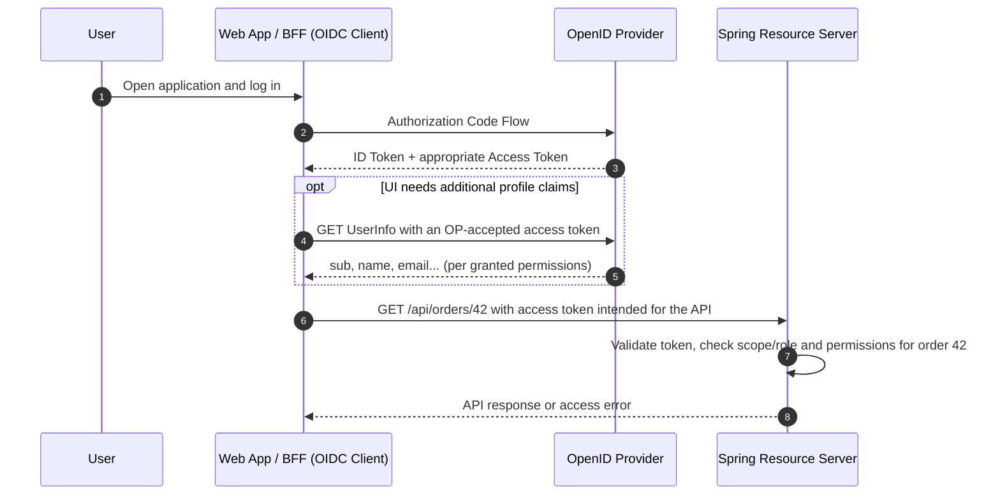
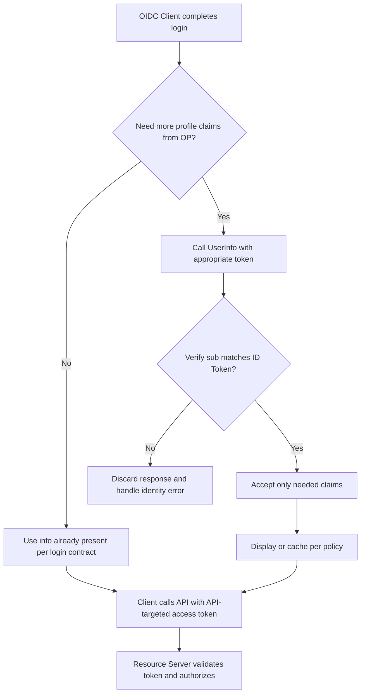

# The UserInfo Endpoint and Why It Does Not Need to Be Called on Every API Request by Default

In OpenID Connect (OIDC), the **UserInfo endpoint** is an OAuth 2.0–protected endpoint that allows a Client application to retrieve *claims* about a logged-in user from the OpenID Provider (OP). It is useful when an application needs display name, email, avatar picture, or profile attributes the Client is permitted to receive.

However, when building a **Spring Security OAuth 2.0 Resource Server**, a common question arises: *"The API already received an access token—should it call UserInfo to learn who the user is and verify whether they can access the API?"* The default answer is **no**. The Resource Server must validate the access token and enforce access control according to the API's policies. UserInfo solves a different problem: supplying user profile information to the Client when needed.

It is important to separate four distinct tasks:

1. **OIDC login:** The Client establishes the user's identity via the OpenID Provider.
2. **Reading profile attributes:** The Client may call UserInfo with an appropriate access token to fetch additional claims.
3. **Protecting the API:** The Resource Server validates the access token intended for the API, via JWT verification or opaque-token introspection.
4. **API authorization:** The Resource Server decides whether the caller may operate on a specific endpoint and data object.

UserInfo may participate in the second step. It **never replaces** the third or fourth step.

## 1. Where does the UserInfo endpoint sit in OIDC?

OIDC adds an identity authentication layer on top of OAuth 2.0. Typical components include:

| Component | Responsibility |
| --- | --- |
| **OpenID Provider (OP) / Authorization Server** | Authenticates users, issues tokens, and may expose a UserInfo endpoint. |
| **OIDC Client / Relying Party (RP)** | Runs the login flow, processes the ID Token, and optionally fetches additional claims via UserInfo. |
| **Resource Server** | Protects APIs using validated access tokens and authorization rules. |
| **UserInfo endpoint** | A protected resource of the OP that accepts an appropriate access token and returns End-User claims. |

In a real system, a Spring Boot application can act as both an OIDC Client (using `oauth2Login()`) and a Resource Server (using `oauth2ResourceServer()`). Even so, **the two roles and two processing pipelines remain distinct**.

Example common flow:



Key takeaway: **the Client can call UserInfo at login time or when refreshing profile data; the API does not need to call UserInfo again on every incoming request**. Furthermore, in an architecture with multiple Resource Servers, the token for UserInfo and the token for an API may have different audiences/scopes; never blindly forward any arbitrary Bearer token to UserInfo.

## 2. What data does UserInfo actually provide?

Typically, the OP publishes OIDC metadata at the discovery path:

```http
GET /.well-known/openid-configuration HTTP/1.1
Host: login.example.com
```

Example relevant metadata fields:

```json
{
  "issuer": "https://login.example.com",
  "authorization_endpoint": "https://login.example.com/oauth2/authorize",
  "token_endpoint": "https://login.example.com/oauth2/token",
  "userinfo_endpoint": "https://login.example.com/oidc/userinfo",
  "jwks_uri": "https://login.example.com/oauth2/jwks"
}
```

These addresses are purely illustrative: exact endpoints depend on the provider and tenant/realm configuration. The Client uses the `userinfo_endpoint` published by a **trusted OP**, rather than assembling an arbitrary URL itself.

To call UserInfo, the Client sends an **access token** issued and accepted by the OP for UserInfo:

```http
GET /oidc/userinfo HTTP/1.1
Host: login.example.com
Authorization: Bearer <oidc-access-token>
Accept: application/json
```

An illustrative JSON response:

```json
{
  "sub": "user-123",
  "name": "Nguyen Van A",
  "preferred_username": "nguyenvana",
  "email": "a@example.com",
  "email_verified": true,
  "picture": "https://cdn.example.com/avatar/user-123.png"
}
```

**The `sub` claim is core.** It identifies the End-User within the issuer's namespace; the OIDC Client must verify that `sub` from UserInfo **matches exactly** the `sub` in the corresponding ID Token before using any claims from UserInfo. If they do not match, the Client must discard the UserInfo payload due to the risk of attaching one user's data to another user's session.

Do not draw the following false assumptions from the illustrative JSON:

- `name`, `email`, `picture`, and `preferred_username` **are not guaranteed to always be present**; the OP decides which claims to return based on scopes, consent, policy, and actual data.
- Requesting OIDC scopes such as `openid profile email` only serves as a request for related claims; it **does not guarantee** every desired attribute will be returned.
- `email_verified: true` carries meaning under the provider's verification process; it does not automatically grant admin rights or permission to access an order.
- `email` and `preferred_username` can change. When mapping users, prefer the **`iss` + `sub`** pair or an identifier contract explicitly agreed upon with the OP; in multi-tenant systems, also account for tenant boundaries.
- UserInfo **has no default contract** requiring `roles`, `permissions`, `tenant_id`, or API ACLs. A specific OP may add custom claims, which must be designed and validated explicitly.

OIDC also supports representing UserInfo responses in formats other than plain JSON under specific configurations, such as signed JWTs. When using such responses, the Client must verify them according to the corresponding security policy. The examples below assume JSON responses transmitted over HTTPS.

## 3. Do not confuse UserInfo with ID Token, access token, and introspection

These four items often appear in the same system yet serve different functions:

| Component | Primary purpose | Typical consumer | Used directly to protect an API? |
| --- | --- | --- | --- |
| **ID Token** | Confirms login event and supplies identity claims to the OIDC Client. | OIDC Client. | **No**. APIs require a valid access token per the API's contract. |
| **Access Token** | Permits access to protected resources within granted scope; can be JWT or opaque. | Client sends to Resource Server. | **Yes**: Resource Server validates it, then authorizes. |
| **UserInfo endpoint** | Returns End-User claims to a Client holding an eligible access token. | OIDC Client. | **Not by default**. It is not a mandatory check on every API request. |
| **Token introspection endpoint** | Returns token metadata/status, especially useful for opaque tokens. | Resource Server authorized to introspect. | **Can** serve as the token validation mechanism, though authorization is still required. |

### An ID Token is not an API access token

An ID Token can be a signed JWT containing `iss`, `sub`, `aud`, `exp`, and other claims. A valid signature **does not mean** an API may accept this token in place of an access token: an ID Token's audience is typically the OIDC Client, whereas the Resource Server must accept tokens issued for its own API.

### UserInfo is not introspection

The two requests below serve two different goals:

```text
OIDC Client  --(OIDC access token)-->  /userinfo
               goal: fetch user profile claims

Resource Server --(token + RS credentials)--> /introspect
               goal: query token status and metadata
```

UserInfo returns user attributes; introspection can return `active`, `scope`, `client_id`, `sub`, `exp`, and related data per the Authorization Server's contract. **Never use UserInfo returning HTTP 200 as a general-purpose way to validate API tokens.** UserInfo only checks the token against UserInfo's own usage rules; it does not guarantee the token has the right audience/scopes for the API handling the request.

### Local JWT validation is not calling UserInfo

With JWTs, the Resource Server normally verifies the signature via a trusted JWK Set, checks timestamps (`exp`, `nbf`), issuer (`iss`), and configured audience (`aud`), and maps scopes/claims to authorities. This process may periodically fetch or refresh public keys, **but it creates no need to call UserInfo on every request**.

With opaque tokens, the Resource Server may need to contact the introspection endpoint whenever a token needs validation, depending on caching/deployment policy. That is a **choice of token validation mechanism**; it does not make UserInfo mandatory.

## 4. What does a Resource Server actually need to know to handle an API request?

Suppose the application exposes an endpoint:

```http
GET /api/orders/42
Authorization: Bearer <api-access-token>
```

The API must answer the following questions:

1. Was the token issued by a trusted issuer, is it unexpired, and does it have a valid signature or valid introspection status?
2. Is the token intended for this API? Does the API accept this audience and token type?
3. Does the token hold permission for the order-reading operation, such as authority `SCOPE_orders.read`?
4. Is the calling subject permitted to read **order 42**? Which owner/tenant does the order belong to? Are there special business rules?

These answers come from **validated token + security policy + business data**. A display name or email from UserInfo usually does nothing to answer "can this caller read order 42?"

An example API JWT access token might contain:

```json
{
  "iss": "https://login.example.com",
  "sub": "user-123",
  "aud": ["orders-api"],
  "exp": 1790000000,
  "scope": "orders.read",
  "tenant_id": "tenant-a"
}
```

Assuming the JWT has been properly validated, the API can use `sub` to identify the caller, `scope` to check operation permission, and `tenant_id` (if the system's token profile vouches for this claim) for data partitioning. Then the API checks ownership in the database. No extra request to `/userinfo` is needed to read `name` or `email`.

> **Identity authentication and resource authorization are two distinct steps.** UserInfo must not be used as a substitute for ownership/tenant checks, even if UserInfo returns a custom role claim.

## 5. Why is calling UserInfo on every API request usually poor design?

### 5.1. Returned data usually does not serve the API decision

Standard claims such as `name`, `picture`, and `locale` serve user experience. An order-update endpoint needs scope, tenant, ownership, and order-status data. Fetching UserInfo before every operation without needing its data only complicates the pipeline.

### 5.2. Increases latency and network coupling

If every API request must also call UserInfo, the API's response depends on the OP's response time:

```text
Without calling UserInfo:
Client --> API: validate token --> authorize --> database --> response

Calling UserInfo every time:
Client --> API --> OP /userinfo --> API --> authorize --> database --> response
```

Each network round trip adds latency and worsens tail latency. When the OP slows down or experiences an outage, an API that could otherwise validate JWTs locally becomes slow or fails due to an unnecessary dependency.

Hypothetical example: a system handles 500 API requests/second. If every request calls UserInfo, the application generates an extra ~**500 requests/second** against the OP, before even counting retries or parallel requests. These numbers illustrate load amplification, not a specific provider's performance limit.

### 5.3. Increases pressure on the OP and risks rate limits

The OP typically serves multiple Clients, login flows, token issuance, discovery, keys, and other APIs. Putting UserInfo on the hot path of every request increases traffic, cost, and the risk of timeouts, throttling, or quota exhaustion. As a result, an identity-issuance dependency inadvertently becomes a bottleneck for all business APIs.

### 5.4. Unnecessarily sends tokens to an external endpoint

A Bearer token is a credential: anyone holding it can use it within whatever conditions the token permits. Every time an access token travels across the network, it creates another hop requiring TLS, logging hygiene, proxy security, telemetry scrubbing, and error handling.

If an API receives a token specifically intended for `orders-api`, **do not send that token to UserInfo by default**. UserInfo's audience and token-acceptance policies may differ; forwarding to the wrong recipient also breaks trust boundaries. Only a component genuinely acting as a Client with an OP-issued eligible token should make that call.

### 5.5. Increases processing and storage of personal data

Email, date of birth, address, avatar, etc. may be unnecessary for the running API operation. Fetching and logging extra claims widens the sensitive data footprint the application must protect, when the API may only need the subject and relevant permissions.

### 5.6. UserInfo does not guarantee "strictly real-time" claims or "instant" permissions

Even when calling UserInfo on every request, the OP may return data from a cache or an unsynchronized directory source. Role or department claims (if present) are also not necessarily the Resource Server's authoritative permission source.

If your domain requires near-real-time permission revocation, design an appropriate mechanism such as short token lifetimes, introspection when requirements demand it, a denylist/revocation mechanism, or a consistent authorization service/DB. **Calling UserInfo repeatedly does not solve token revocation or permission synchronization by itself.**

## 6. Spring Security Resource Server handles requests without UserInfo

With Spring Boot 3 and Spring Security 6, basic dependencies:

```gradle
dependencies {
    implementation 'org.springframework.boot:spring-boot-starter-security'
    implementation 'org.springframework.boot:spring-boot-starter-oauth2-resource-server'
}
```

JWT issuer configuration:

```yaml
spring:
  security:
    oauth2:
      resourceserver:
        jwt:
          issuer-uri: https://login.example.com
```

The issuer in this example is an illustrative value and must match the token's real issuer. Spring Security configures a `JwtDecoder` to verify JWTs against the issuer and its metadata/JWK Set. When an API requires audience binding, configure an appropriate audience validator; `issuer-uri` alone must not be assumed to enforce all of your application's audience rules.

Example filter chain scoped to `/api/**`:

```java
import org.springframework.context.annotation.Bean;
import org.springframework.context.annotation.Configuration;
import org.springframework.http.HttpMethod;
import org.springframework.security.config.Customizer;
import org.springframework.security.config.annotation.web.builders.HttpSecurity;
import org.springframework.security.config.http.SessionCreationPolicy;
import org.springframework.security.web.SecurityFilterChain;

@Configuration
public class ApiSecurityConfig {

    @Bean
    SecurityFilterChain apiSecurity(HttpSecurity http) throws Exception {
        return http
            .securityMatcher("/api/**")
            .csrf(csrf -> csrf.disable())
            .sessionManagement(session -> session
                .sessionCreationPolicy(SessionCreationPolicy.STATELESS))
            .authorizeHttpRequests(auth -> auth
                .requestMatchers(HttpMethod.GET, "/api/me")
                    .hasAuthority("SCOPE_account.read")
                .requestMatchers(HttpMethod.GET, "/api/orders/**")
                    .hasAuthority("SCOPE_orders.read")
                .anyRequest().denyAll())
            .oauth2ResourceServer(oauth2 -> oauth2
                .jwt(Customizer.withDefaults()))
            .build();
    }
}
```

In this configuration:

- `oauth2ResourceServer().jwt()` validates JWT access tokens.
- `hasAuthority("SCOPE_account.read")` and `hasAuthority("SCOPE_orders.read")` are authorization rules based on Spring Security's default mapping of `scope`/`scp` claims to `SCOPE_*` authorities.
- `anyRequest().denyAll()` denies APIs without an explicit allow rule.
- `STATELESS` illustrates a Bearer token API. Disabling CSRF is only appropriate when the API **genuinely does not rely on automatically sent cookies** to authenticate requests; browser apps using sessions/cookies require dedicated CSRF protection.

These filters **do not automatically call UserInfo**. The JWT is verified by the decoder; authorization evaluates the authorities on `Authentication`.

### Endpoint `/api/me` does not need UserInfo to know `sub`

If you need to return basic identity details from the validated JWT:

```java
import java.util.Map;
import org.springframework.security.core.annotation.AuthenticationPrincipal;
import org.springframework.security.oauth2.jwt.Jwt;
import org.springframework.web.bind.annotation.GetMapping;
import org.springframework.web.bind.annotation.RestController;

@RestController
public class MeController {

    @GetMapping("/api/me")
    public Map<String, String> me(@AuthenticationPrincipal Jwt jwt) {
        return Map.of(
            "subject", jwt.getSubject(),
            "issuer", jwt.getIssuer().toString()
        );
    }
}
```

This example returns claims already validated by the decoder without querying the OP. If the API needs an application display name or internal profile info, it can use `iss` + `sub` to look up **the application's own data**:

```java
@GetMapping("/api/me/profile")
public ProfileDto myProfile(@AuthenticationPrincipal Jwt jwt) {
    return profileService.findByIdentity(
        jwt.getIssuer().toString(),
        jwt.getSubject()
    );
}
```

`ProfileDto` and `profileService` are illustrative domain components you must implement; the `/api/me/profile` endpoint also needs a matching allow rule in `SecurityFilterChain` (for instance, the same `account.read` scope). Internal profile lookups can use their own caching and update rules rather than routing every request through the OP.

If an endpoint must check object-level permissions, such as `/api/orders/{id}`, add owner/tenant checks in the service or policy layer. Holding the `orders.read` scope is only a prerequisite to call the operation; it does not grant access to read every order.

### What about opaque tokens?

If the access token is opaque, the Resource Server can use Spring Security's opaque-token support and introspection endpoint, for example:

```yaml
spring:
  security:
    oauth2:
      resourceserver:
        opaquetoken:
          introspection-uri: https://login.example.com/oauth2/introspect
          client-id: ${INTROSPECTION_CLIENT_ID}
          client-secret: ${INTROSPECTION_CLIENT_SECRET}
```

This is an illustrative configuration; the endpoint and credentials must come from a real Authorization Server, and the `SecurityFilterChain` must select `.opaqueToken(...)` instead of `.jwt(...)`. Calling introspection relates to **validating the access token**. It does not imply calling `/userinfo`.

## 7. Distinguishing applications using `oauth2Login()` vs. APIs using `oauth2ResourceServer()`

This is a very easy point of confusion in Spring projects:

| Spring Security scenario | Primary data and behavior |
| --- | --- |
| **`oauth2Login()` with OIDC** | The application acts as an OIDC Client. Spring Security can use `OidcUserService` and call UserInfo while building the login principal when conditions/configuration call for it. |
| **`oauth2ResourceServer().jwt()`** | The application acts as a Resource Server, obtaining a `JwtAuthenticationToken` from the validated JWT. Does not call UserInfo on every API request. |
| **`oauth2ResourceServer().opaqueToken()`** | The application retrieves token status/metadata via introspection, then authorizes. Introspection differs from UserInfo. |
| **Application acting as both Client and Resource Server** | Must clearly separate login and API security chains/flows, clarifying where tokens are received and who is authorized to call UserInfo. |

For example, if a Spring Web App uses OIDC login, it can obtain an `OidcUser` with claims to render the account UI after login. When a Client calls a JWT-protected API, `BearerTokenAuthenticationFilter` and the Resource Server's decoder process the token per the API configuration. Having called UserInfo during login does not create a requirement to call UserInfo on every subsequent API endpoint.

**Note on principals:** `OidcUser` is normally the principal on the OIDC Client/login side, while `JwtAuthenticationToken`/`Jwt` normally appears on the JWT Resource Server side. Never write an API controller expecting `OidcUser` if the endpoint is actually authenticated with Bearer JWTs.

## 8. When should UserInfo be called?

UserInfo remains valuable when your use case genuinely needs OP profile claims:

| Need | Should you call UserInfo? | Approach |
| --- | --- | --- |
| Display user's name, picture, or email after login | **Possibly**, when the ID Token lacks needed claims and the OP permits access. | OIDC Client fetches claims during login or when opening the profile page; cache appropriately. |
| Refresh OP-managed profile details | **Possibly** at sync points. | Define TTL, refresh policy, and allowed fields. |
| API verifying JWT signature and expiration | **No**. | Use JWT decoder/validators. |
| API checking whether an opaque access token is still active | **Do not use UserInfo**. | Use introspection or the token profile's mechanism. |
| API checking `orders.read` | **No**. | Check authorities mapped from the valid token. |
| API checking whether an order belongs to the caller or tenant | **Normally no**. | Check business data / authorization service. |
| Backend job using `client_credentials` with no End-User | **Normally inappropriate**. | Token represents a client/service, not a user session to query UserInfo. |
| API needing user attributes the OP does not emit in tokens | **Evaluate separately**. | Requires data contract, access rights, freshness, error handling, and caching; do not make it a default step on every request. |

An application may proactively call UserInfo when a user opens a profile page, after login, or in a designed synchronization job. If data is truly needed on every request for a critical business rule, evaluate whether **UserInfo is genuinely the authoritative data source** and whether latency bounds, token permissions, SLAs, privacy, and caching satisfy requirements.

## 9. Example of a Client calling UserInfo for its proper purpose

Suppose a BFF completed the OIDC Authorization Code Flow and received an ID Token plus an access token accepted by the OP at UserInfo. When the UI needs to update the display name, the BFF runs:

```bash
curl -i \
  -H "Authorization: Bearer ${OIDC_ACCESS_TOKEN}" \
  -H "Accept: application/json" \
  https://login.example.com/oidc/userinfo
```

The Client must perform these steps:

1. Obtain `userinfo_endpoint` from the configuration/discovery of the **exact trusted issuer**; use HTTPS.
2. Use only an access token of the right type authorized by the OP for UserInfo. Never send an ID Token, another API's access token, or a token from an untrusted source.
3. Read the `sub` claim and compare it **using exact string equality** against `sub` in the ID Token of the corresponding OIDC session. If they mismatch, discard the entire response.
4. Use only claims the application truly needs and is authorized for; handle missing claims, unexpected formats, or error responses.
5. Decide refresh/caching timing based on UI needs and OP policy, avoiding turning profile reads into a dependency of every API request.

The execution flow over time can be pictured as:



**Why is comparing `sub` mandatory?** If the UserInfo response does not belong to the same subject as the session's ID Token, using that `email`/`name` to link accounts can lead to identity confusion. Comparing `sub` is a security requirement of the OIDC Client flow; a pure Bearer-token Resource Server normally **does not even possess the Client's ID Token** to perform a comparable check.

## 10. Data and caching design when user information is needed

A system may require three groups of data:

| Data group | Examples | Appropriate source and read timing |
| --- | --- | --- |
| **Token identity and access rights** | `iss`, `sub`, `aud`, `scope`, `exp` | Validated token or introspection; used when handling API requests. |
| **User profile from OP** | `name`, `picture`, `email`, `locale` | UserInfo or granted OIDC claims; read when UI or sync jobs require it. |
| **Business data and object permissions** | Order owner, tenant, internal account state, membership | Application database/policy service; checked where business decisions occur. |

When caching UserInfo, consider:

- **Cache key:** Distinguish issuer + subject and Client/tenant/scope context when claims can vary by token or application; never mix profiles across users/tenants.
- **TTL and invalidation:** Match desired freshness, access rights, and OP contract; do not retain sensitive claims longer than necessary.
- **Optional fields:** Never assume every response contains the exact same email, avatar, or custom claim.
- **Transient failures:** If used solely to render an avatar, falling back to valid cached data or a placeholder may be fine. If an attribute governs business permissions, enforce an explicit fail-safe policy from an authoritative source—never silently allow access.
- **Token lifecycle:** Never reuse expired access tokens, and never log raw tokens or responses containing unnecessary personal data.

There is no single optimal TTL for all systems. For instance, display names can tolerate greater staleness than account-lock status or permissions over sensitive data. They are distinct data contracts requiring separate design.

## 11. Anti-patterns and how to fix them

### Scenario A: Every API calls UserInfo before running

```text
GET /api/orders/42
  -> call /userinfo to get sub/email
  -> check orders.read
  -> load order
```

**Problem:** The API gains a network dependency, risks forwarding tokens with the wrong audience, and still must check scope/ownership. If the token is a JWT with a validated `sub`, the subject can be read from `JwtAuthenticationToken` without calling UserInfo.

**Better design:**

```text
GET /api/orders/42
  -> Spring Resource Server validates access token
  -> check SCOPE_orders.read
  -> use validated iss + sub + tenant
  -> query and enforce ownership against business data
```

### Scenario B: UserInfo returns email, so email is used as the authorization key

```java
// Do not use email as an immutable identifier key:
boolean allowed = order.getOwnerEmail().equals(userInfo.getEmail());
```

Email can change, be absent, be unverified, or follow differing OP policies. Link identities using `iss` + `sub` and a stable internal identifier. Where email matching is strictly required, establish explicit verification and update contracts.

### Scenario C: UserInfo HTTP 200 means the token is allowed to call the API

False. Success at UserInfo only shows that the token was accepted by **UserInfo** under that endpoint's rules. Your API still must verify that the token was issued for itself and enforce access control. A token valid for service X is not automatically valid for service Y.

### Scenario D: Calling UserInfo on every request to detect revoked tokens

Inappropriate. If policy requires immediate token status, design **token introspection/revocation or a token lifetime and caching strategy** aligned with the Authorization Server. UserInfo is not a general-purpose protocol for querying a token's `active` status.

### Scenario E: `oauth2Login()` provides `OidcUser`, so REST APIs should also always receive `OidcUser`

False for pure JWT Resource Server APIs. `oauth2Login()` creates the login context on the OIDC Client side; `oauth2ResourceServer().jwt()` creates the Bearer token context on the API side. Pure Resource Server endpoints typically use `Jwt`, `JwtAuthenticationToken`, or `Authentication`. When both login styles coexist in one application, separate security filter chains and per-endpoint requirements.

### Scenario F: UserInfo contains role `ADMIN`, so use it directly to bypass all policies

Custom claims may only be used in authorization if the OP is an authoritative claim source under a specific contract, the token/response is trusted, updates are controlled, and permission semantics are explicitly defined. Even then, roles normally **do not replace** object-level checks (owner/tenant/data sharing).

## 12. Decision guide for a new endpoint

Suppose you are writing `GET /api/invoices/{invoiceId}`. Instead of automatically calling UserInfo, answer in order:

1. **Which token does the API accept?** JWT or opaque, which issuer, which audience? Is the token validation mechanism properly configured?
2. **Which functional permission is required?** `invoices.read` or a specialized authority?
3. **Which data constraints apply?** Owner, tenant, internal role, invoice status, or delegation relationship?
4. **Where does the data for each condition live?** Trusted token claim, database, or authorization service?
5. **Are additional OIDC profile details genuinely needed?** If yes, which Client is allowed to call UserInfo, when should it call, and are caching and `sub` verification in place?

If the answer to step 5 is "no," **do not add a UserInfo call**. If a dedicated page needs to display name/avatar, fetch profile data in the UI flow or via an on-demand sync. If real-time token status or permissions are needed, use the proper authentication and authorization mechanisms.

Example condensed decision table:

| Endpoint/feature | Key conditions | Call UserInfo per request? |
| --- | --- | --- |
| `GET /api/orders/{id}` | Valid JWT/introspection, `orders.read`, right owner/tenant | **No** |
| `POST /api/orders` | Valid token, `orders.write`, business rules | **No** |
| `GET /api/me` | Valid token, internal account info or allowed claims | **Not by default** |
| Profile page after OIDC login | Display profile claims from OP when missing or needing refresh | **Can call when needed** |
| Machine-to-machine API | Client/service identity, scopes, and service policies | **Not by default** |
| Opaque token validation | Token introspection/validator | **No; use introspection when needed** |

## 13. Principles to preserve during implementation

**UserInfo is an OIDC profile-claim source.** It is not a general authorization system and not proof that an access token can access arbitrary APIs.

**A JWT Resource Server can validate tokens without calling UserInfo each time.** The decoder checks signature, issuer, timestamps, and other configured constraints; the API enforces permissions using the trusted token and business data.

**Opaque tokens may require introspection—still not UserInfo.** The two endpoints have different semantics, credentials, and security contracts.

**The OIDC Client calls UserInfo only when needed and with an eligible access token.** It must verify `sub` matches the corresponding ID Token, handle missing claims, and protect personal data.

**APIs must enforce per-resource authorization.** `name`, `email`, or a successful UserInfo call does not replace scope, role, owner, tenant, and domain rule checks.

Accordingly, a clean architecture typically separates responsibilities as: **OIDC Client handles login experience and profile data; Spring Security Resource Server handles access token validation and resource protection; the business domain handles concrete authorization decisions.** All three responsibilities can live in the same application or separate services, without bolting a UserInfo call onto every API request.
