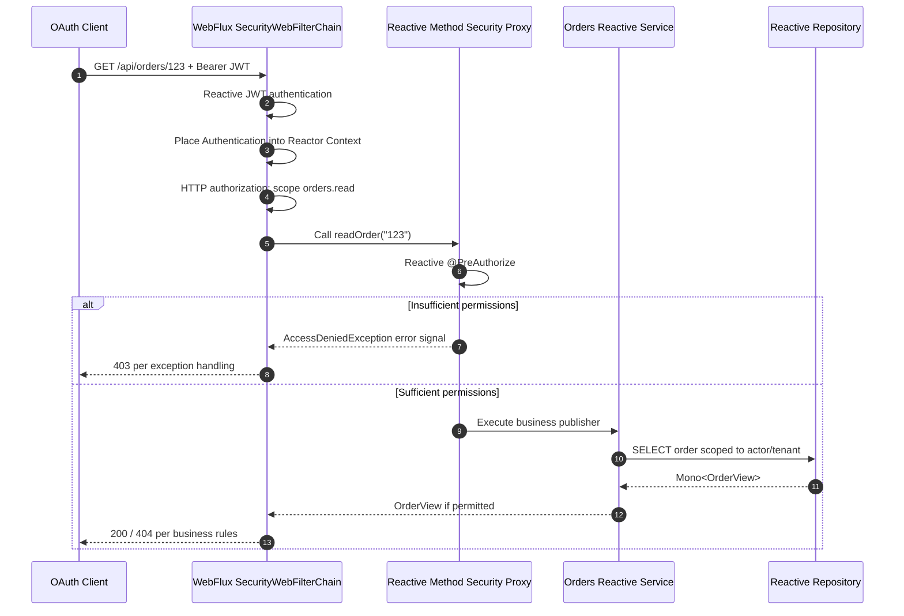
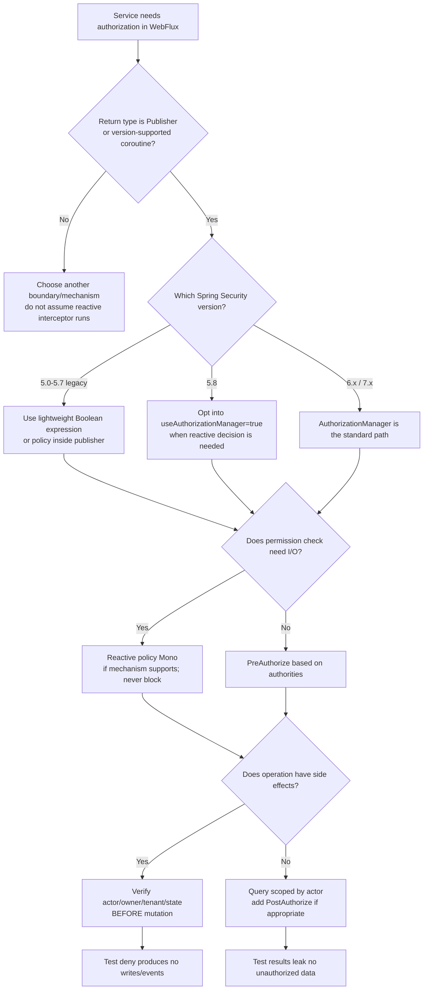

# Reactive Method Authorization by Version-Supported Mechanism

In a **Spring Security OAuth 2.0/OIDC Resource Server** using **Spring WebFlux**, the application must protect not only HTTP URLs but also business methods returning `Mono`, `Flux`, or reactive types supported by your framework version. The same access token carrying scope `orders.read` may be allowed to query orders, yet must not update or cancel them. Beyond scopes, the service must also verify who owns the resource, which tenant the caller belongs to, and whether the resource's state permits the action.

Spring Security provides **reactive method security** for this purpose. The tricky part is not writing `@PreAuthorize`, but understanding **which mechanism your version supports**: older Spring Security versions use legacy method security infrastructure; starting in **5.8**, the `AuthorizationManager` mechanism can be opted into, and starting in **6.0**, it is the default for `@EnableReactiveMethodSecurity`. Which return types expressions may produce, which interceptors run, how custom managers are written, and how certain annotations or filtering behave depend on the exact mechanism and version.

This lesson explains the boundaries you must master:

- **Reactive web authorization** protects HTTP exchanges using `SecurityWebFilterChain` and `ServerHttpSecurity`.
- **Reactive method authorization** protects calls to Spring-managed services using `@EnableReactiveMethodSecurity` and interceptors.
- **Reactor Context** carries `SecurityContext`/`Authentication` through a publisher chain; you cannot rely by default on Servlet `ThreadLocal`.
- **`Mono`/`Flux` and subscription timing** affect when policies are evaluated and when side effects execute.
- **Each Spring Security version's capabilities** determine whether expressions can return `Mono<Boolean>`, Kotlin coroutines are supported, custom `ReactiveAuthorizationManager`s are available, or newer API signatures apply.

The goal is designing method security that **uses the right mechanism, never blocks the event loop, verifies permissions before sensitive operations, and has proper tests**, instead of copying configurations from Servlet or an incompatible version.

## 1. Why Does WebFlux Need Dedicated Reactive Method Security?

In Spring MVC/Servlet, each request typically has one processing thread, and code can read Authentication from `SecurityContextHolder` via `ThreadLocal`. WebFlux, by contrast, is built on **Reactive Streams**: a single request can flow across multiple operators, schedulers, and threads.

Example service returning a publisher:

```java
public Mono<OrderView> findOrder(String orderId) {
    return repository.findById(orderId)
        .map(OrderView::from);
}
```

The method returns `Mono<OrderView>` immediately, while the database read happens upon **subscription**. If authorization only read a static ThreadLocal at the moment the Java method was invoked, it might not match the authentication context when the publisher is subscribed or after an operator switches threads.

Spring Security solves this with **`ReactiveSecurityContextHolder`**, storing and retrieving `SecurityContext` via **Reactor Context**. Reactive security interceptors use this information to make decisions inside the reactive processing chain.

### 1.1. Reactive Flow Diagram



In this flow, a request should proceed only when **both HTTP authorization and method/domain authorization** permit it. `@PreAuthorize` adds protection at the service boundary; it does not replace the JWT decoder verifying signature, issuer, audience, and timestamps.

### 1.2. Reactive Method Security Is Not Another WebFilter

| Layer | Component | Protected Target |
|---|---|---|
| Bearer authentication | `AuthenticationWebFilter` and Resource Server mechanisms | Request token/credential |
| HTTP authorization | `SecurityWebFilterChain` + `authorizeExchange` | HTTP method/path/exchange |
| Method security | `@EnableReactiveMethodSecurity` + reactive method interceptors | Spring bean methods |
| Domain authorization | Business service/policy/repository | Owner, tenant, state, and record-level permissions |

If an application only configures `authorizeExchange`, a service method invoked by a job, message consumer, or another service may bypass HTTP rules. When protection is needed directly at the service layer, enable method security and design actors/policies for non-HTTP entry points as well.

## 2. Version Map: Legacy, AuthorizationManager, and Modern APIs

The topic **“by version-supported mechanism”** requires distinguishing two things: which features a version provides, and **which mechanism is actually enabled** in the application.

| Version Group | Reactive Method Security | Guidance |
|---|---|---|
| **Spring Security 5.0–5.7** | Provides `@EnableReactiveMethodSecurity` using the legacy mechanism. Documentation focuses on `Publisher`-returning methods and synchronous `boolean/Boolean` expressions. | Keep `@PreAuthorize` simple; avoid returning `Mono<Boolean>` from expressions when unsupported; check the exact reference for your version |
| **Spring Security 5.8** | Introduces `@EnableReactiveMethodSecurity(useAuthorizationManager = true)` to opt into the new **`ReactiveAuthorizationManager`** mechanism. | Opt in explicitly when reactive authorization expressions are needed and test the new path |
| **Spring Security 6.0–6.3** | `@EnableReactiveMethodSecurity` uses `AuthorizationManager` (`useAuthorizationManager=true`) by default. | Usually `@EnableReactiveMethodSecurity` alone suffices; avoid writing legacy code out of old habit |
| **Spring Security 6.4–6.5** | Continues `AuthorizationManager`; `ReactiveAuthorizationManager.authorize(...)` and `AuthorizationResult` appear, while `check(...)`/`AuthorizationDecision` retain compatibility or are marked deprecated per release. | Customize managers per your exact version's Javadoc; prefer the new API if your build supports it |
| **Spring Security 7.x** | Continues `AuthorizationManager`-based reactive method security; older API signatures may be removed or changed. | Follow 7.x Javadoc and extension points instead of copying 5.8/6.x interface implementations verbatim |

Confirmed milestones: the **Spring Security Reactive Method Security** reference and **Reactive Migration Guide** state that 5.8 introduced `useAuthorizationManager=true`, and **6.0 switched the default to true**. This is also reflected in the `@EnableReactiveMethodSecurity` Javadoc in 6.5 showing `true` as the default.

### 2.1. Configuration for Spring Security 5.8 When Opting Into the New Mechanism

```java
import org.springframework.context.annotation.Configuration;
import org.springframework.security.config.annotation.method.configuration
    .EnableReactiveMethodSecurity;

@Configuration
@EnableReactiveMethodSecurity(useAuthorizationManager = true)
public class ReactiveMethodSecurityConfiguration {
}
```

In 5.8, this flag **explicitly opts into the new mechanism**. If maintaining a 5.8 application with plain `@EnableReactiveMethodSecurity`, do not assume full `AuthorizationManager` behavior is enabled.

### 2.2. Configuration for Spring Security 6.x and 7.x

```java
import org.springframework.context.annotation.Configuration;
import org.springframework.security.config.annotation.method.configuration
    .EnableReactiveMethodSecurity;

@Configuration
@EnableReactiveMethodSecurity
public class ReactiveMethodSecurityConfiguration {
}
```

In 6.0+, `AuthorizationManager` is the default. Therefore, repeating `useAuthorizationManager = true` is usually unnecessary. Writing it explicitly on a version that still supports the attribute works, but adds migration noise when APIs evolve.

### 2.3. Do Not Guess the Spring Security Version Solely from “Spring Boot”

A Spring Boot 2.x project might run Spring Security 5.x with overridden dependencies; Boot 3.x typically ships with Spring Security 6.x, and newer generations may use 7.x. **The actual resolved dependency version is the source of truth.**

When choosing code:

1. Inspect the resolved versions of `spring-security-config`, `spring-security-core`, and related modules.
2. Open the documentation for the **exact major/minor version** of Spring Security, not just the “latest” page.
3. Confirm which mechanism `@EnableReactiveMethodSecurity` activates.
4. Confirm that your expression and method return types are supported by the interceptor.
5. Verify custom `ReactiveAuthorizationManager`/interceptor signatures against Javadoc.
6. Test allow/deny behavior through the Spring-managed proxy, not just direct Java method calls.

**Do not upgrade libraries solely to write a simple expression**, but equally do not force a new `Mono<Boolean>` snippet into a legacy mechanism and “fix” it with `block()`.

## 3. `@EnableReactiveMethodSecurity` Differs from `@EnableMethodSecurity`

WebFlux applications use:

```java
@EnableReactiveMethodSecurity
```

Whereas many Servlet guides use:

```java
@EnableMethodSecurity
```

Both annotations serve a similar purpose at the method layer, but integrate Authentication differently. **Do not copy Servlet configuration into a WebFlux app expecting it to automatically understand Reactor Context.** In an application mixing Servlet and reactive modules or execution paths, verify which method-security infrastructure intercepts each bean.

### 3.1. Which Methods Are Eligible?

Traditional reactive method security requires protected Java methods to return an **`org.reactivestreams.Publisher`**:

```java
Mono<OrderView> getOrder(String orderId);
Flux<OrderView> findOrders(String tenantId);
Mono<Void> deleteOrder(String orderId);
```

Versions using the `AuthorizationManager` mechanism support additional reactive return types, including **Kotlin coroutines/`suspend` functions** per the corresponding documentation. This depends on the mechanism and version—it does not mean arbitrary custom types or synchronous Java methods returning `OrderView` automatically become reactive.

Do not assume these methods are intercepted in the same way:

```java
OrderView getOrder(String id);     // Synchronous Java return type
void deleteOrder(String id);      // Not a Publisher
CompletableFuture<OrderView> getAsync(String id);
```

If a business service must use synchronous/imperative method security, choose an appropriate boundary or another framework-supported mechanism rather than picking an arbitrary return type hoping the reactive annotation covers it.

### 3.2. Why Should Methods Build “Cold” Publishers?

A **cold** publisher typically starts data operations only when a subscriber subscribes:

```java
@PreAuthorize("hasAuthority('SCOPE_orders.update')")
public Mono<OrderView> updateOrder(String id, UpdateOrderCommand command) {
    return Mono.defer(() ->
        repository.findById(id)
            .flatMap(order -> updateAuthorizedOrder(order, command))
    );
}
```

`Mono.defer` avoids executing side-effecting work while merely assembling the publisher. For sensitive operations, ensure authentication and permission checks run **before the mutation chain is subscribed** and that every update step follows business checks.

An anti-pattern:

```java
@PreAuthorize("hasAuthority('SCOPE_orders.update')")
public Mono<OrderView> unsafeUpdate(String id) {
    legacyBlockingRepository.updateImmediately(id); // Synchronous side effect
    return Mono.just(new OrderView(id));
}
```

If any call path bypasses the interceptor, the method mutates immediately. Moreover, blocking JDBC on the event loop violates WebFlux architecture. Prefer a reactive data driver, place mutations inside the publisher after authorization, and verify object permissions before writing data.

## 4. WebFlux Resource Server: Baseline Configuration Example

With Spring Boot 3.x / Spring Security 6.x, a JWT WebFlux Resource Server typically uses:

```groovy
// build.gradle
dependencies {
    implementation 'org.springframework.boot:spring-boot-starter-webflux'
    implementation 'org.springframework.boot:spring-boot-starter-oauth2-resource-server'
    testImplementation 'org.springframework.boot:spring-boot-starter-test'
    testImplementation 'org.springframework.security:spring-security-test'
    testImplementation 'io.projectreactor:reactor-test'
}
```

Dependency versions should be managed by the Spring Boot BOM or your project's dependency management; never mix Spring Security modules across different major versions arbitrarily.

Example `application.yml`:

```yaml
spring:
  security:
    oauth2:
      resourceserver:
        jwt:
          issuer-uri: https://idp.example.com/realms/shop
          audiences:
            - orders-api
```

`issuer-uri` identifies the trusted issuer; `audiences` is supported by corresponding Boot lines to restrict tokens to this API. When declaring a custom `ReactiveJwtDecoder`, configure the corresponding validators explicitly rather than assuming Boot automatically attaches property-based rules to a custom decoder.

### 4.1. Configuring WebFlux HTTP Authorization

```java
import org.springframework.context.annotation.Bean;
import org.springframework.context.annotation.Configuration;
import org.springframework.http.HttpMethod;
import org.springframework.security.config.Customizer;
import org.springframework.security.config.annotation.method.configuration
    .EnableReactiveMethodSecurity;
import org.springframework.security.config.annotation.web.reactive
    .EnableWebFluxSecurity;
import org.springframework.security.config.web.server.ServerHttpSecurity;
import org.springframework.security.web.server.SecurityWebFilterChain;

@Configuration
@EnableWebFluxSecurity
@EnableReactiveMethodSecurity
public class ReactiveOrdersSecurityConfiguration {

    @Bean
    SecurityWebFilterChain securityWebFilterChain(
            ServerHttpSecurity http) {
        return http
            // Illustrates a pure Bearer-header API only, without cookies
            // or sessions used as credentials for write operations.
            .csrf(ServerHttpSecurity.CsrfSpec::disable)
            .authorizeExchange(exchanges -> exchanges
                .pathMatchers(HttpMethod.GET, "/api/orders/**")
                    .hasAuthority("SCOPE_orders.read")
                .pathMatchers(HttpMethod.POST, "/api/orders/**")
                    .hasAuthority("SCOPE_orders.create")
                .pathMatchers(HttpMethod.PUT, "/api/orders/**")
                    .hasAuthority("SCOPE_orders.update")
                .pathMatchers(HttpMethod.DELETE, "/api/orders/**")
                    .hasAuthority("SCOPE_orders.delete")
                .anyExchange().denyAll())
            .oauth2ResourceServer(oauth2 ->
                oauth2.jwt(Customizer.withDefaults()))
            .build();
    }
}
```

Notes:

- WebFlux uses **`SecurityWebFilterChain`** and **`ServerHttpSecurity`**, not Servlet `SecurityFilterChain`/`HttpSecurity`.
- WebFlux uses **`authorizeExchange`** and `pathMatchers`, not Servlet `authorizeHttpRequests`/`requestMatchers` in this example.
- JWT scopes like `orders.read` are typically converted by Spring Security into `SCOPE_orders.read` authorities; `hasAuthority` matches exact strings.
- `anyExchange().denyAll()` is a fail-closed fallback for undeclared routes and does not automatically handle CORS preflights, actuators, or other paths; add explicit policies where needed.
- Enabling reactive method security does not validate JWTs by itself; the decoder must still check signature, issuer, audience, timestamps, and token profile.

Disabling CSRF in this example is only appropriate when the API strictly authenticates via Bearer headers that browsers do not send automatically like cookies. If the app also uses cookies, browser sessions, or ambient credentials, design CSRF protection around that model.

### 4.2. Roles of HTTP and Method Security

```text
GET /api/orders/123
   |
   +-- JWT authentication: is the token valid?
   |
   +-- HTTP rule: does it have SCOPE_orders.read?
   |
   +-- @PreAuthorize: may the service method be invoked?
   |
   +-- Business policy: which actor/tenant owns order 123?
   |
   +-- Reactive repository: read permitted data
```

Do not leave only `.anyExchange().authenticated()` and drop method scopes unless business policies fully guard **every** path inside the service. Defense in depth helps prevent exposing new endpoints or non-HTTP service invocations.

## 5. Using `@PreAuthorize` with `Mono` and `Flux`

Suppose we have a DTO and command:

```java
public record OrderView(
    String id,
    String ownerIssuer,
    String ownerSubject,
    String tenantId,
    String status
) {}

public record UpdateOrderCommand(String deliveryAddress) {}
```

A reactive service with methods:

```java
import org.springframework.security.access.prepost.PreAuthorize;
import org.springframework.stereotype.Service;
import reactor.core.publisher.Flux;
import reactor.core.publisher.Mono;

@Service
public class OrderQueryService {

    private final ReactiveOrderRepository orders;

    public OrderQueryService(ReactiveOrderRepository orders) {
        this.orders = orders;
    }

    @PreAuthorize("hasAuthority('SCOPE_orders.read')")
    public Mono<OrderView> findOne(String orderId) {
        return orders.findById(orderId).map(OrderView::from);
    }

    @PreAuthorize("hasAuthority('SCOPE_orders.read')")
    public Flux<OrderView> listVisible(String tenantId) {
        return orders.findByTenantId(tenantId)
            .map(OrderView::from);
    }
}
```

`ReactiveOrderRepository`, `OrderView.from`, and the backend are illustrative; this snippet does not yet include full owner/tenant checks. `findByTenantId(tenantId)` is unsafe if `tenantId` comes directly from a query parameter without verifying the caller belongs to that tenant. A production service must obtain the actor from trusted authentication and filter in the repository according to data permissions.

### 5.1. When Does the Check Run?

With `@PreAuthorize` and supported reactive interceptors, Spring Security evaluates authorization inside the intercepted publisher path **before allowing the protected logic to execute**. When denied, the subscriber receives an error signal such as `AccessDeniedException` instead of successful data.

The laziness of `Mono` helps guard properly built reactive operations, but do not assume **every Java statement before `return Mono...` is automatically deferred**. Synchronous side effects inside the method body execute during assembly. Keeping assembly side-effect-free and checking permissions before mutation remains essential.

### 5.2. Do Not Confuse `hasRole` with Scopes

```java
@PreAuthorize("hasAuthority('SCOPE_orders.read')")
public Mono<OrderView> read(String id) { ... }
```

differs from:

```java
@PreAuthorize("hasRole('orders.read')")
public Mono<OrderView> read(String id) { ... }
```

`hasRole("orders.read")` looks for `ROLE_orders.read` by default, not `SCOPE_orders.read`. In JWT/opaque Resource Servers, OAuth scopes map to authorities prefixed with `SCOPE_`, so use `hasAuthority` explicitly. If a custom mapper changes prefixes, keep rules aligned.

### 5.3. HTTP Method Permissions Do Not Automatically Carry Into Service Methods

`@PreAuthorize("hasAuthority('SCOPE_orders.read')")` has no idea whether the original request used GET or POST unless that context is passed into the policy. It enforces permissions on the **service method** against the current Authentication. This is an advantage: the same method invoked from a WebFlux controller, message listener, or another service enforces the same rule when properly intercepted.

However, the application must provide an actor/security context for non-HTTP flows. Never assume a scheduled job inherits the Authentication of whichever user called an API earlier.

## 6. Reactor Context: Authentication Source for Reactive Method Security

`ReactiveSecurityContextHolder` provides key APIs:

```java
import org.springframework.security.core.Authentication;
import org.springframework.security.core.context.SecurityContext;
import org.springframework.security.core.context.ReactiveSecurityContextHolder;
import reactor.core.publisher.Mono;

Mono<Authentication> authentication =
    ReactiveSecurityContextHolder.getContext()
        .map(SecurityContext::getAuthentication);
```

In WebFlux Security, the filter chain binds context to the request's publisher/subscriber. A service can read Authentication **inside the pipeline**, for example:

```java
public Mono<String> currentUsername() {
    return ReactiveSecurityContextHolder.getContext()
        .map(SecurityContext::getAuthentication)
        .map(Authentication::getName);
}
```

Never call `SecurityContextHolder.getContext()` hoping a ThreadLocal on an arbitrary scheduler still holds the current HTTP request's user.

### 6.1. Testing Reactor Context with `contextWrite`

An HTTP-independent test can supply a mock Authentication:

```java
import org.springframework.security.authentication.TestingAuthenticationToken;
import org.springframework.security.core.Authentication;
import org.springframework.security.core.context.ReactiveSecurityContextHolder;
import reactor.test.StepVerifier;

Authentication auth =
    new TestingAuthenticationToken(
        "user-842", "unused", "SCOPE_orders.read");

StepVerifier.create(
    currentUsername()
        .contextWrite(
            ReactiveSecurityContextHolder.withAuthentication(auth)))
    .expectNext("user-842")
    .verifyComplete();
```

`contextWrite(ReactiveSecurityContextHolder.withAuthentication(auth))` sets context for **the test subscription**, not a production login session. In real WebFlux requests handled by security filters, the framework establishes the context.

### 6.2. Reactor Context Differs from ThreadLocal

```text
Synchronous Servlet:
  ThreadLocal SecurityContextHolder
      -> reads Authentication on request thread

WebFlux / Reactor:
  Subscriber Context
      -> ReactiveSecurityContextHolder
      -> Authentication along reactive chain
```

Never use `MODE_GLOBAL` or store Authentication in a singleton field to “fix” missing context. Doing so can share identities across users and cause severe security vulnerabilities.

### 6.3. How Does Context Propagate Across Schedulers?

Standard Reactor operators such as `publishOn`/`subscribeOn` preserve **Reactor Context** along the subscriber when used properly in the same chain. However, if code spawns a new subscription via `subscribe()`, launches an out-of-chain future/executor, or uses APIs without Reactor integration, context may not propagate.

Error-prone example:

```java
public Mono<Void> schedule(String orderId) {
    // Detached subscription: cannot rely on the original HTTP chain's
    // security context or error handling.
    publisherForSensitiveAction(orderId).subscribe();
    return Mono.empty();
}
```

For background tasks, pass the **minimal actor/authorization intent** and re-check permissions as needed, or use an intentional context-propagation mechanism. Never persist raw bearer tokens indefinitely for background jobs to reuse after expiration.

## 7. Legacy Mechanism: Synchronous Boolean Expressions

In versions prior to the `AuthorizationManager` mechanism, reactive method security documentation focused on Boolean expressions:

```java
@PreAuthorize("hasRole('ADMIN')")
public Mono<String> adminMessage() {
    return Mono.just("Hello");
}
```

`hasRole('ADMIN')` evaluates synchronously against authorities already in Authentication, fitting the legacy mechanism.

Conversely:

```java
@PreAuthorize("@policy.canRead(#orderId)")
public Mono<OrderView> read(String orderId) { ... }
```

if `policy.canRead(...)` returns `Mono<Boolean>`, **you cannot assume the legacy mechanism will subscribe and interpret that Mono as allow/deny**. An expression returning a Publisher on an unsupported branch can fail at runtime, reject the return type, or behave unexpectedly.

### 7.1. Why Never “Fix” It with `block()`?

Anti-pattern:

```java
@PreAuthorize("@policy.canRead(#orderId).block()")
public Mono<OrderView> read(String orderId) { ... }
```

In WebFlux, SpEL evaluates inside the reactive processing path. Calling `block()` can:

- Block the event-loop thread.
- Throw `block()/blockFirst()/blockLast() are blocking` errors on non-blocking schedulers.
- Degrade throughput and increase latency.
- Cause deadlocks or lose context if the pipeline is structured poorly.

Never use `block()` to force a reactive API into an unsupported mechanism. The right fix is **upgrading to a version-supported `AuthorizationManager` mechanism** or moving asynchronous checks into the service pipeline properly.

### 7.2. When Upgrading Isn't Immediately Possible

For legacy projects:

1. Keep `@PreAuthorize` limited to **lightweight synchronous checks** on already-loaded authorities.
2. Place I/O-bound policy checks inside `Mono.defer(...).flatMap(...)` in the service before sensitive reads or writes.
3. Ensure the publisher fails closed if the policy denies or errors.
4. Never perform blocking network or database calls on the event loop.
5. Keep HTTP authorization protecting routes and test non-HTTP flows.

Example policy inside the pipeline:

```java
@PreAuthorize("hasAuthority('SCOPE_orders.read')")
public Mono<OrderView> readWithReactivePolicy(String orderId) {
    return ReactiveSecurityContextHolder.getContext()
        .map(SecurityContext::getAuthentication)
        .flatMap(auth -> orderPolicy.canRead(auth, orderId))
        .filter(Boolean::booleanValue)
        .switchIfEmpty(Mono.error(
            new AccessDeniedException("Order access denied")))
        .then(repository.findById(orderId))
        .map(OrderView::from);
}
```

`orderPolicy.canRead` is a component returning `Mono<Boolean>`; the code illustrates reading permissions from a trusted source. Ensure the policy has no unintended side effects and does not query the order before authorization succeeds. If determining ownership requires reading the order, combine object retrieval and ownership checks inside a domain policy with appropriate transactional consistency.

Do not treat the pattern above as mandatory in place of all `@PreAuthorize` usage. It simply illustrates performing **asynchronous decisions inside the publisher** when your framework version does not support `Mono`-returning SpEL expressions.

## 8. AuthorizationManager Mechanism: Expressions Can Return Reactive Results

Starting in Spring Security **5.8 with `useAuthorizationManager=true`**, reactive method security supports expression beans returning **`Boolean` or `Mono<Boolean>`** per the documentation. From 6.0 onward, this mechanism is the default.

Example policy querying permissions from a reactive database or service:

```java
import org.springframework.security.access.expression.method
    .MethodSecurityExpressionOperations;
import org.springframework.stereotype.Component;
import reactor.core.publisher.Mono;

@Component("orderAccess")
public class ReactiveOrderAccessPolicy {

    private final ReactiveOrderAclRepository acl;

    public ReactiveOrderAccessPolicy(ReactiveOrderAclRepository acl) {
        this.acl = acl;
    }

    public Mono<Boolean> canRead(
            MethodSecurityExpressionOperations root,
            String orderId) {
        String principalName = root.getAuthentication().getName();
        return acl.existsReadableBy(orderId, principalName);
    }
}
```

`ReactiveOrderAclRepository` and `existsReadableBy` are application-defined domain abstractions. This method returns `Mono<Boolean>` without calling `block()`.

Service:

```java
import org.springframework.security.access.prepost.PreAuthorize;
import org.springframework.stereotype.Service;
import reactor.core.publisher.Mono;

@Service
public class ProtectedOrderQuery {

    private final ReactiveOrderRepository orders;

    public ProtectedOrderQuery(ReactiveOrderRepository orders) {
        this.orders = orders;
    }

    @PreAuthorize(
        "hasAuthority('SCOPE_orders.read') " +
        "and @orderAccess.canRead(#root, #orderId)")
    public Mono<OrderView> readOrder(String orderId) {
        return orders.findById(orderId).map(OrderView::from);
    }
}
```

In production, `#orderId` must be discoverable by Spring SpEL via parameter metadata (compiling with `-parameters` or adding `@P("orderId")` where needed). Otherwise, the expression may fail to resolve the parameter name. When in doubt, write unit/integration tests through the Spring-managed proxy for the real annotation.

**Security meaning:** the expression requires **both** `SCOPE_orders.read` and the ACL check to allow access. However, certain expression evaluator versions/configurations may have limitations when mixing synchronous SpEL boolean operators with `Mono<Boolean>` inside a single expression. To eliminate ambiguity, a more robust approach is:

```java
@PreAuthorize("@orderAccess.canReadWithScope(#root, #orderId)")
public Mono<OrderView> readOrder(String orderId) { ... }
```

and having `canReadWithScope` check the scope **in Java** before running the reactive ACL query:

```java
public Mono<Boolean> canReadWithScope(
        MethodSecurityExpressionOperations root,
        String orderId) {
    boolean hasReadScope = root.getAuthentication()
        .getAuthorities().stream()
        .anyMatch(a -> "SCOPE_orders.read".equals(a.getAuthority()));

    if (!hasReadScope) {
        return Mono.just(false);
    }

    return acl.existsReadableBy(orderId,
        root.getAuthentication().getName())
        .defaultIfEmpty(false);
}
```

An **expression returning `Mono<Boolean>` directly from a bean** has a cleaner contract; tests should confirm behavior for missing scope, missing ACL, empty Mono, and I/O errors. For sensitive policies, choose **fail-closed** semantics rather than treating `Mono.empty()` as permission.

### 8.1. Why Is `#root` Useful?

In reactive SpEL method security, a bean can accept `MethodSecurityExpressionOperations` via `#root` to access Authentication and the expression context through the supported API. Spring Security docs illustrate:

```java
@PreAuthorize("@authz.decide(#root)")
public Mono<String> endpoint() {
    return Mono.just("ok");
}
```

`@authz.decide(...)` can return `Mono<Boolean>` under the `AuthorizationManager` mechanism. There is no need to read ThreadLocal `SecurityContextHolder` inside policy beans.

### 8.2. Never Perform Blocking I/O in Reactive Expressions

Even when an expression returns a `Mono`, its body must still be **non-blocking**:

```java
// Do not do this:
public Mono<Boolean> canRead(...) {
    boolean allowed = jdbcTemplate.queryForObject(...);
    return Mono.just(allowed);
}
```

This runs synchronous JDBC **before creating the Mono**, blocking the event loop. Prefer a reactive repository or `WebClient`:

```java
public Mono<Boolean> canRead(...) {
    return r2dbcRepository.existsByOrderAndActor(...);
}
```

If blocking libraries cannot yet be removed, isolate the blocking boundary on a scheduler like `Schedulers.boundedElastic()` per your architecture and evaluate the trade-offs; never treat `Mono.just(blockingCall())` as non-blocking.

## 9. Writing a Custom `ReactiveAuthorizationManager`: Mind Version-Specific API Changes

When SpEL becomes hard to maintain, Spring Security supports **`ReactiveAuthorizationManager<T>`** to move decisions into Java. This is also an easy place to hit compilation or integration issues when copying snippets from another version.

### 9.1. Basic Contract Differs from Servlet AuthorizationManager

A reactive authorization manager typically receives:

```java
Mono<Authentication> authentication
```

whereas Servlet's authorization manager typically receives:

```java
Supplier<Authentication> authentication
```

The two are not interchangeable. In reactive method security, the generic target object can be `MethodInvocation` or `MethodInvocationResult` depending on before/after interception. In WebFlux HTTP authorization, the generic object is typically `AuthorizationContext`/`ServerWebExchange` per the corresponding API.

### 9.2. The Older `check(...)` API

In many 5.8/6.x versions, the interface defines:

```java
Mono<AuthorizationDecision> check(
    Mono<Authentication> authentication,
    T object);
```

Several 6.x releases still use `check` as the method to implement while **deprecating** it during the transition to `authorize`. Older tutorials may override `check`, whereas Spring Security 7.x compilers may no longer recognize it as a valid override.

### 9.3. The `authorize(...)` and `AuthorizationResult` API

Starting in Spring Security 6.4, the API introduces:

```java
Mono<AuthorizationResult> authorize(
    Mono<Authentication> authentication,
    T object);
```

In Spring Security 7.1, the `ReactiveAuthorizationManager` Javadoc lists `authorize(Mono<Authentication>, T)` as the primary method. Illustrative example **for an API line supporting that method**:

```java
import org.aopalliance.intercept.MethodInvocation;
import org.springframework.security.authorization.AuthorizationDecision;
import org.springframework.security.authorization.AuthorizationResult;
import org.springframework.security.authorization.ReactiveAuthorizationManager;
import org.springframework.security.core.Authentication;
import reactor.core.publisher.Mono;

public final class ReadOrdersMethodManager
        implements ReactiveAuthorizationManager<MethodInvocation> {

    @Override
    public Mono<AuthorizationResult> authorize(
            Mono<Authentication> authentication,
            MethodInvocation invocation) {

        return authentication
            .map(auth -> {
                boolean allowed = auth.getAuthorities().stream()
                    .anyMatch(grant ->
                        "SCOPE_orders.read".equals(grant.getAuthority()));
                return (AuthorizationResult)
                    new AuthorizationDecision(allowed);
            })
            .defaultIfEmpty(new AuthorizationDecision(false));
    }
}
```

This is a **pattern for the modern API**, not something to paste into a Spring Security 5.8 app without checking the interface. In 6.4/6.5, `authorize` may be a default method delegating to `check`; verify your exact Javadoc for backward-compatible overrides. In 7.x, `check` may no longer exist on the interface.

### 9.4. Do Not Register Custom Interceptors When Default Annotations Suffice

Most use cases only require:

```java
@EnableReactiveMethodSecurity
@PreAuthorize("hasAuthority('SCOPE_orders.read')")
```

Manually publishing `AuthorizationManagerBeforeReactiveMethodInterceptor`, altering pointcuts, or replacing interceptor beans can cause:

- Two interceptors guarding the same annotation.
- Annotations firing twice or evaluating in the wrong order.
- Other default annotations getting disabled unintentionally.
- Incorrect advisor ordering relative to transactions or tracing.
- Servlet configurations accidentally copied into WebFlux.

Only customize interceptors when requirements truly exceed SpEL or custom policy beans and after verifying **your version's mechanism**. When replacing one, follow your version's guide to **disable the preconfigured interceptor being replaced** rather than keeping all defaults and adding a second interceptor on the same pointcut.

## 10. `@PostAuthorize` in Reactive Flows: Inspecting Return Values and Limitations

`@PostAuthorize` checks conditions on **the method's return value**. It is useful when authorization depends on the object just retrieved from the database:

```java
import org.springframework.security.access.prepost.PostAuthorize;
import org.springframework.security.access.prepost.PreAuthorize;
import reactor.core.publisher.Mono;

@PreAuthorize("hasAuthority('SCOPE_orders.read')")
@PostAuthorize(
    "returnObject != null && " +
    "returnObject.ownerSubject == authentication.name")
public Mono<OrderView> readOrder(String id) {
    return orderRepository.findById(id)
        .map(OrderView::from);
}
```

In mechanisms and versions supporting post-authorization on publisher-emitted values, when the result does not belong to the principal, the subscriber does not receive the object as a successful response. **However, verify exact behavior on `Mono`/`Flux` and wrapper types in your version**, especially when returning collections, multi-item `Flux`, `Mono.empty()`, or coroutines.

### 10.1. `@PostAuthorize` Does Not Undo Side Effects

Do not do this:

```java
@PostAuthorize("returnObject.ownerSubject == authentication.name")
public Mono<OrderView> unsafeUpdate(String id, UpdateCommand cmd) {
    return repository.findById(id)
        .flatMap(order -> repository.save(order.apply(cmd)))
        .map(OrderView::from);
}
```

If the publisher executes the update and post-authorization then detects an owner mismatch, throwing an error to the subscriber **does not guarantee rolling back** the DB write or recalling an email, Kafka message, or HTTP call. Transaction boundaries, propagation, and drivers all affect rollback behavior.

For commands, prefer:

1. Requiring the update scope in `@PreAuthorize` or HTTP security.
2. Identifying the trusted principal and tenant.
3. Reading authoritative data and verifying owner/state **before mutation**.
4. Performing the update under appropriate transaction and concurrency controls.
5. Emitting events or external calls only after conditions are confirmed; consider the outbox pattern.

### 10.2. `@PostFilter`/`@PreFilter` Do Not Replace Filtered Queries

In newer versions using the `AuthorizationManager` mechanism, reactive method security supports interceptors for `@PreFilter` and `@PostFilter` per the documentation. However, **supported input/return types and how `Flux` or collections are filtered can vary across versions**; never assume every publisher shape is filtered identically.

For multi-tenant order lists, this is a dangerous design:

```java
@PostFilter("filterObject.tenantId == authentication.name")
public Flux<OrderView> listEveryOrder() {
    return repository.findAll().map(OrderView::from);
}
```

Beyond the risk of unsupported shapes in a given version, `findAll()` already loads every tenant's data before filtering at the application layer. Better:

```java
public Flux<OrderView> listVisible(CurrentActor actor) {
    return repository
        .findByTenantAndOwner(
            actor.tenantId(),
            actor.issuer(),
            actor.subject())
        .map(OrderView::from);
}
```

Enforcing object permissions in the query also works properly with pagination, backpressure, and multi-tenant isolation. Only use post-filtering as a secondary layer when your version supports the exact publisher type and without leaking data via side effects, caches, or logs.

## 11. Ownership/Tenant Authorization Cannot Be Replaced by Scopes

An OAuth 2.0 access token may carry:

```json
{
  "iss": "https://idp.example.com/realms/shop",
  "sub": "user-842",
  "aud": ["orders-api"],
  "scope": "orders.read orders.update",
  "tenant_id": "tenant-a"
}
```

This is an **illustrative payload**, not a signed token. After the Resource Server verifies the token, you can build an actor:

```java
public record CurrentActor(
    String issuer,
    String subject,
    String tenantId
) {}
```

In WebFlux, you can extract the actor from Reactor Context:

```java
import org.springframework.security.core.Authentication;
import org.springframework.security.core.context.ReactiveSecurityContextHolder;
import org.springframework.security.oauth2.server.resource.authentication
    .JwtAuthenticationToken;
import reactor.core.publisher.Mono;

@Component
public class ReactiveCurrentActor {

    public Mono<CurrentActor> current() {
        return ReactiveSecurityContextHolder.getContext()
            .map(context -> context.getAuthentication())
            .switchIfEmpty(Mono.error(
                new AccessDeniedException("Authentication required")))
            .map(this::resolve);
    }

    private CurrentActor resolve(Authentication authentication) {
        if (!(authentication instanceof JwtAuthenticationToken token)) {
            throw new AccessDeniedException("JWT principal required");
        }

        var jwt = token.getToken();
        if (jwt.getIssuer() == null ||
            jwt.getSubject() == null ||
            jwt.getClaimAsString("tenant_id") == null) {
            throw new AccessDeniedException("Actor claims missing");
        }
        return new CurrentActor(
            jwt.getIssuer().toString(),
            jwt.getSubject(),
            jwt.getClaimAsString("tenant_id"));
    }
}
```

Remaining imports include `@Component` and `AccessDeniedException`. This pattern assumes a JWT-only resource-server principal; for opaque tokens, the Authentication type differs and requires a corresponding adapter. **Never read JWT claims before `ReactiveJwtDecoder` has validated the token.**

### 11.1. Reactive Query Checking the Actor Before Reading

```java
@Service
public class AuthorizedOrderQueries {

    private final ReactiveCurrentActor actors;
    private final ReactiveOrderRepository repository;

    public AuthorizedOrderQueries(
            ReactiveCurrentActor actors,
            ReactiveOrderRepository repository) {
        this.actors = actors;
        this.repository = repository;
    }

    @PreAuthorize("hasAuthority('SCOPE_orders.read')")
    public Mono<OrderView> read(String orderId) {
        return actors.current()
            .flatMap(actor -> repository
                .findVisibleById(
                    orderId,
                    actor.issuer(),
                    actor.subject(),
                    actor.tenantId()))
            .switchIfEmpty(Mono.error(
                new OrderNotFoundException(orderId)))
            .map(OrderView::from);
    }
}
```

`findVisibleById` is a query designed to **find only orders belonging to the matching actor and tenant**. If a caller guesses another user's order ID, the repository returns no row. Depending on API policy, denial can be expressed as 403 or 404 to avoid disclosing resource existence.

### 11.2. Updates Must Also Check Current State

`SCOPE_orders.update` authorizes an action type, not editing every order. For writes:

```text
Valid token with SCOPE_orders.update
             |
             v
Retrieve actor from Reactor Context
             |
             v
Find order by id + owner + tenant
             |
             v
Check current state: DRAFT/SHIPPED/LOCKED
             |
             v
Update with transaction / optimistic locking
```

Use conditional updates on `id`, `tenant_id`, `owner`, `status`, and `version` to prevent TOCTOU races. For reactive databases, use `TransactionalOperator` or appropriate reactive transaction infrastructure; never mix imperative `@Transactional` with publishers assuming transactions automatically cover the whole subscription.

## 12. Kotlin Coroutines and Version-Specific Features

When services are written in Kotlin:

```kotlin
import org.springframework.security.access.prepost.PreAuthorize
import org.springframework.stereotype.Service

@Service
class OrderCoroutineService(
    private val repository: CoroutineOrderRepository
) {
    @PreAuthorize("hasAuthority('SCOPE_orders.read')")
    suspend fun findOrder(id: String): OrderView {
        return repository.findById(id)
            ?: throw OrderNotFoundException(id)
    }
}
```

In versions supporting the `AuthorizationManager` mechanism, Spring Security can apply reactive method security to **Kotlin suspending functions**. The documentation notes this as a benefit of the `AuthorizationManager` path introduced in 5.8.

Considerations:

- Verify matching Spring Security, Kotlin, and Coroutines dependency versions.
- Ensure methods can be AOP-intercepted. Kotlin classes/methods are `final` by default; you may need the `kotlin-spring`/all-open plugin or appropriate proxy configuration.
- Never perform blocking I/O inside a coroutine simply because `suspend` is present. Repositories must have non-blocking semantics.
- Test both allow and deny cases on the **real coroutine method via the Spring bean**, not only pure-Kotlin unit tests of the implementation.
- Never assume “a Java method returning a synchronous DTO is guarded reactively like a suspend method” — they are fundamentally different shapes.

## 13. AOP Proxies and Self-Invocation: Annotations Must Be Intercepted

Reactive method security typically relies on Spring AOP. This means an annotation on a Spring bean only takes effect when the call **passes through the proxy**.

Anti-pattern:

```java
@Service
public class OrderFacade {

    public Mono<OrderView> readViaFacade(String id) {
        return this.protectedRead(id); // self-invocation
    }

    @PreAuthorize("hasAuthority('SCOPE_orders.read')")
    public Mono<OrderView> protectedRead(String id) {
        return repository.findById(id).map(OrderView::from);
    }
}
```

Calling `this.protectedRead(id)` inside the same bean typically **bypasses the Spring proxy**, skipping the method-security interceptor. If an HTTP route calls `readViaFacade` and that method has no protection of its own, the API exposes an unguarded path that skips scope checks.

Solutions:

- Place protected methods on a separate bean invoked through a Spring proxy.
- Enforce business authorization at a consistent service boundary rather than relying solely on an annotation on a `this`-invoked method.
- Avoid instantiating Spring beans with `new` expecting AOP to work automatically.
- Do not assume private/final methods are proxied like public service methods.
- If using AspectJ weaving, verify actual semantics and extension points rather than applying proxy assumptions mechanically.

### 13.1. Tests Must Call the Spring Bean, Not Just the Raw Implementation

A plain test:

```java
var service = new OrderQueryService(fakeRepository);
StepVerifier.create(service.findOne("1")) ...
```

does not prove `@PreAuthorize` executes, because an instance created with `new` has no proxy. Such unit tests are great for testing business pipelines, whereas method-security tests need an application context with `@EnableReactiveMethodSecurity` enabled and an injected **proxied bean**.

## 14. Reactive Testing: StepVerifier for Method Authorization

A method-security test should observe **Reactor error signals**, rather than only asserting that a Java method call throws synchronously.

Suppose:

```java
@Service
public class SecureMessageService {

    @PreAuthorize("hasAuthority('SCOPE_messages.read')")
    public Mono<String> readMessage() {
        return Mono.just("restricted-message");
    }
}
```

Testing with the Spring context:

```java
import org.junit.jupiter.api.Test;
import org.springframework.beans.factory.annotation.Autowired;
import org.springframework.boot.test.context.SpringBootTest;
import org.springframework.security.access.AccessDeniedException;
import org.springframework.security.test.context.support.WithMockUser;
import reactor.test.StepVerifier;

@SpringBootTest
class SecureMessageServiceTest {

    @Autowired
    SecureMessageService messages;

    @Test
    @WithMockUser(authorities = "SCOPE_messages.read")
    void userWithScopeCanRead() {
        StepVerifier.create(messages.readMessage())
            .expectNext("restricted-message")
            .verifyComplete();
    }

    @Test
    @WithMockUser(authorities = "SCOPE_other.read")
    void userWithoutScopeIsDenied() {
        StepVerifier.create(messages.readMessage())
            .expectError(AccessDeniedException.class)
            .verify();
    }
}
```

This example assumes the test context enables reactive method security and calls the method through a Spring-managed proxy. `@WithMockUser` creates a mock Authentication; this test proves **authorization behavior**, not that a JWT decoder verified real token signatures or audiences.

### 14.1. Testing Without `@WithMockUser`

To control context directly on the publisher:

```java
Authentication auth = new TestingAuthenticationToken(
    "user-842",
    "unused",
    "SCOPE_messages.read");

StepVerifier.create(
        messages.readMessage()
            .contextWrite(
                ReactiveSecurityContextHolder.withAuthentication(auth)))
    .expectNext("restricted-message")
    .verifyComplete();
```

This tests Reactor Context without building a bearer JWT. Ensure `messages` is the proxied bean; a direct instance will not trigger method-security AOP even with `contextWrite`.

### 14.2. Testing Missing Authentication

A method requiring a scope when the subscription has no Authentication must be denied. You can test:

```java
StepVerifier.create(messages.readMessage())
    .expectError(AccessDeniedException.class)
    .verify();
```

In test classes with class-level `@WithMockUser` or context leaked from other tests, clear or isolate the context so an “anonymous” test does not accidentally inherit an Authentication. Depending on the version, the exact exception thrown when authentication is missing may vary; do not assume every branch throws the exact same subclass.

## 15. WebTestClient and Mock JWT: Testing HTTP + Method Rules

In WebFlux, use **`WebTestClient`**, not Servlet `MockMvc`, as the primary test harness.

Example:

```java
import org.junit.jupiter.api.Test;
import org.springframework.beans.factory.annotation.Autowired;
import org.springframework.boot.test.autoconfigure.web.reactive
    .AutoConfigureWebTestClient;
import org.springframework.boot.test.context.SpringBootTest;
import org.springframework.test.web.reactive.server.WebTestClient;

import static org.springframework.security.test.web.reactive.server
    .SecurityMockServerConfigurers.mockJwt;

@SpringBootTest
@AutoConfigureWebTestClient
class OrdersWebFluxAuthorizationTest {

    @Autowired
    WebTestClient client;

    @Test
    void readScopeCanAccessOrderEndpoint() {
        client.mutateWith(mockJwt().authorities(
                new SimpleGrantedAuthority("SCOPE_orders.read")))
            .get().uri("/api/orders/ORD-123")
            .exchange()
            .expectStatus().isOk();
    }

    @Test
    void wrongScopeIsForbidden() {
        client.mutateWith(mockJwt().authorities(
                new SimpleGrantedAuthority("SCOPE_other.read")))
            .get().uri("/api/orders/ORD-123")
            .exchange()
            .expectStatus().isForbidden();
    }
}
```

Add the `SimpleGrantedAuthority` import and project controller/service fixtures. The example assumes `ORD-123` exists and the caller is permitted by domain policy in the first test; if data does not exist, the response may be 404 even with the right scope. Do not use `@AutoConfigureMockMvc` for this WebFlux test.

**Important limitation:** `mockJwt()` creates a mock Authentication/JWT to test authorization. It can **bypass the real decoder and skip signature, issuer, audience, and expiration checks**. Therefore, a passing test does not prove a real bearer JWT would be safely accepted by the Resource Server.

To verify end-to-end authentication, send a Bearer JWT signed with a test key against an appropriately configured test `ReactiveJwtDecoder`/JWKS, and test tokens with invalid issuer, audience, signature, and expiration.

### 15.1. Testing JWT Claims Mapping Differs from Testing Method Authorization

If your goal is verifying that the claim:

```json
{"scope":"orders.read"}
```

is converted to `SCOPE_orders.read`, test `ReactiveJwtAuthenticationConverter` or the real authentication pipeline. If a test calls:

```java
mockJwt().authorities(
    new SimpleGrantedAuthority("SCOPE_orders.read"))
```

then the test **assigned the authority manually**, proving nothing about whether the converter parses raw claims properly.

### 15.2. Permission Matrix to Test

| Principal/Token | Method | Authorization-Layer Expectation |
|---|---|---|
| Has `SCOPE_orders.read` | `Mono<OrderView> read` | Proceeds to domain policy |
| Only `SCOPE_orders.write` | `read` requiring `orders.read` | Denied unless an alternative rule exists |
| Has `SCOPE_orders.update` | `Mono<Void> update` | Proceeds to domain policy |
| Only `SCOPE_orders.read` | `update` | Denied before mutation |
| No Authentication | Protected method | Denied |
| JWT wrong audience despite scope | Protected HTTP | Denied by authentication |
| Has read scope, order in another tenant | `read` | Denied / 404 per domain contract |
| Policy bean returns `Mono.just(false)` | `read` | Denied |
| Policy bean returns `Mono.empty()` | `read` | Confirm desired abstain/fail-closed behavior |
| Policy bean errors on DB call | `read` | Never grants fallback access |
| Unsubscribed publisher | Reactive method | Never assume side effects executed |

## 16. Testing Reactive Policies Independently of Spring AOP

One way to reduce test overhead is **extracting business decisions into a dedicated bean** and unit testing it with `StepVerifier`. Example:

```java
public final class TenantReadPolicy {

    private final ReactiveOrderAclRepository acl;

    public TenantReadPolicy(ReactiveOrderAclRepository acl) {
        this.acl = acl;
    }

    public Mono<Boolean> allowed(CurrentActor actor, String orderId) {
        if (actor.tenantId() == null) {
            return Mono.just(false);
        }
        return acl.existsByOrderAndTenantAndSubject(
                orderId, actor.tenantId(), actor.subject())
            .defaultIfEmpty(false);
    }
}
```

Unit test:

```java
@Test
void wrongTenantIsRejected() {
    CurrentActor actor = new CurrentActor(
        "https://idp.example.com/realms/shop",
        "user-842",
        "tenant-a");

    when(acl.existsByOrderAndTenantAndSubject(
        "ORD-999", "tenant-a", "user-842"))
        .thenReturn(Mono.just(false));

    StepVerifier.create(policy.allowed(actor, "ORD-999"))
        .expectNext(false)
        .verifyComplete();
}
```

This proves the **policy's logic**, not that Spring Security actually invokes `@PreAuthorize` when the service method is subscribed. Test through the proxied bean for wiring/annotations, and run real bearer integration tests for the decoder.

### 16.1. Testing “Deny Must Not Write to the DB”

For a reactive mutation:

```java
@PreAuthorize("hasAuthority('SCOPE_orders.update')")
public Mono<Void> update(String orderId, UpdateOrderCommand command) {
    return actors.current()
        .flatMap(actor -> repository
            .findWritableById(orderId, actor)
            .switchIfEmpty(Mono.error(
                new AccessDeniedException("Order is not writable"))))
        .flatMap(order -> repository.save(order.apply(command)))
        .then();
}
```

Tests should not only assert `expectError(AccessDeniedException.class)`, but also confirm **no save/update or outbox/event occurs** when the caller lacks scope or ownership. With R2DBC or dirty tracking, database integration tests may need to verify committed state directly rather than relying solely on Mockito `verify(repository, never()).save(...)`.

## 17. Common Mistakes from Mixing Version Mechanisms

| Symptom | Likely Cause | Resolution |
|---|---|---|
| `@PreAuthorize` does not run | `@EnableReactiveMethodSecurity` missing, or call bypassed proxy | Enable the right annotation and test the proxied bean |
| `@bean.check(...)` returning `Mono` fails to work | Running legacy method security | On 5.8 opt into `useAuthorizationManager=true`; on 6+ check defaults and version |
| Custom manager fails to compile after upgrade | `check`/`authorize` and return types changed | Read `ReactiveAuthorizationManager` Javadoc for your exact version |
| `@EnableMethodSecurity` does not see Reactor Context | Using Servlet mechanism incompatible with WebFlux | Use `@EnableReactiveMethodSecurity` |
| `SecurityContextHolder.getContext()` empty in operator | Relying on ThreadLocal in reactive code | Use `ReactiveSecurityContextHolder` |
| Authorization always returns 403 | Mismatched scope prefix, wrong matcher, lost Authentication context | Check `SCOPE_` mapping, test context, and Spring proxy |
| HTTP returns 401 while `StepVerifier` policy test passes | JWT decoder/issuer/audience issue | Test authentication separately with real Bearer tokens |
| `Mono.just(blockingCall())` slows the event loop | Synchronous call executes before creating Mono | Use reactive repositories, `Mono.defer`, and an appropriate scheduler if unavoidable |
| Service returns `OrderView` instead of Publisher | Return type incompatible with reactive interception | Return `Mono<OrderView>` or a version-supported reactive type |
| Kotlin `suspend fun` is not intercepted | Version/mechanism/proxy/all-open mismatch | Check coroutine support and Kotlin Spring plugin |
| `@PostAuthorize` returns 403 yet DB already changed | Checked after side effect | Move checks before mutation; control transactions/outbox |
| `Flux` returns another tenant's data | Checked scope only without actor-scoped query | Filter in the reactive repository / domain policy |
| Method security works via controller, bypassed internally | Self-invocation | Separate beans / enforce policies at a consistent boundary |
| Tests using `mockJwt()` always return 200 | Fixture granted full authorities manually | Test negative scopes and converter/decoder separately |
| New scheduler loses principal | Detached subscription / executor drops Context | Use intentional context propagation, never global context |
| Reading `sub` without distinguishing issuer | Multi-issuer collision | Use `iss + sub`, tenant, and policy |

### 17.1. Distinguishing HTTP 401, 403, and Reactive Errors

In a WebFlux request:

- **401 Unauthorized** typically occurs when no valid authentication is present, such as missing, invalid-signature, expired, or wrong-issuer/audience Bearer tokens.
- **403 Forbidden** typically occurs when Authentication is valid, but lacks an authority or is denied by method/domain policy.
- **StepVerifier** running a service outside HTTP typically sees `AccessDeniedException` or another error signal without an automatic HTTP status.
- If an API gateway or custom exception handler transforms responses, status/body may differ; security must still fail closed.

Never grant default authorities just to silence a 403. First isolate whether the failure lies in token authentication, HTTP matching, reactive method interception, or business policy.

## 18. Phased Migration

### 18.1. From Spring Security 5.7 or Earlier to 5.8

To adopt reactive `Mono<Boolean>` expressions:

1. Inventory methods using legacy `@EnableReactiveMethodSecurity`.
2. Inventory legacy custom expression handlers, voters, and metadata sources.
3. Enable `@EnableReactiveMethodSecurity(useAuthorizationManager=true)` on the appropriate configuration.
4. Test all `@PreAuthorize`/`@PostAuthorize`, role expressions, and result filtering used by the application.
5. Migrate custom policies to reactive beans / `AuthorizationManager` where the contract allows.
6. Verify AOP proxies and advisor/transaction ordering.

Do not assume the new flag preserves every internal behavior of legacy customizations. Migration requires evaluating every extension point the application overrode.

### 18.2. From 5.8 to Spring Security 6.x

Starting in 6.0, migration docs confirm `@EnableReactiveMethodSecurity` defaults to `AuthorizationManager`, so you can write:

```java
// 5.8: explicit opt-in when using the new mechanism
@EnableReactiveMethodSecurity(useAuthorizationManager = true)

// 6.0+: equivalent default
@EnableReactiveMethodSecurity
```

Additionally, projects must migrate to Spring Framework 6, Jakarta namespaces where applicable, and compatible dependencies. This lesson focuses specifically on the **reactive method authorization mechanism**; you do not need to redesign your entire web security architecture without cause.

### 18.3. From 6.3 to 6.4/6.5 or 7.x

When maintaining a custom `ReactiveAuthorizationManager`:

- Review `check(Mono<Authentication>, T)` vs. `authorize(Mono<Authentication>, T)`.
- Review `AuthorizationDecision`/`AuthorizationResult`; avoid unsafe casts.
- In 6.4+, `authorize` is introduced on the interface and `check` carries deprecation warnings in corresponding releases.
- In 7.x, prefer `authorize` as `check` may be removed.
- Never copy the **Servlet** `Supplier<Authentication>` variant into a reactive manager.
- Check version guides for custom advisor, pointcut, or annotation preconfiguration changes.

This API transition is a textbook example of **“by version-supported mechanism”**: the business logic stays identical while method signatures and integration behavior evolve.

### 18.4. Always Keep Boundary Regression Tests

After upgrading, maintain at least:

```text
Mono read method:
  read scope -> allow
  write scope only -> deny
  missing authentication -> deny

Reactive policy:
  Mono<Boolean> true -> allow
  Mono<Boolean> false -> deny
  Mono.empty/error -> handled per policy, never accidentally grants access

Flux / Kotlin suspend:
  test the actual return shapes the app uses, not just compilation

JWT/opaque authentication:
  valid issuer/audience/expiry -> pass
  invalid token -> reject

Domain:
  valid owner/tenant -> allow
  different tenant -> reject
  side effects on deny -> must not occur
```

## 19. Operational Principles for WebFlux Method Security

### 19.1. Avoid Blocking Inside the Authorization Pipeline

Rule of thumb:

```text
Authentication/authorization:
  Never run blocking JDBC directly on the Netty event loop.
  Never call RestTemplate and block().
  Prefer ReactiveJwtDecoder/WebClient/R2DBC.
  When blocking libraries are unavoidable, isolate the boundary cleanly.
```

Blocking inside authorization can inflate latency on **every request**, because even denied requests must wait on policy evaluation. For sensitive APIs, configure timeouts, cancellation, bounded retry policies, and upstream observability.

### 19.2. A Policy Failure Must Never Become an Allow

Anti-pattern:

```java
return acl.existsReadableBy(orderId, actor)
    .onErrorReturn(true); // NEVER DO THIS: AS/DB error => grant access
```

If permissions cannot be verified, deny or return an error per contract. Granting access when a policy service times out creates privilege escalation risks.

### 19.3. Never Spawn a Separate Subscription to “Pre-Check”

```java
policy.allowed(actor, id).subscribe(allowed -> {
    // race: main request continues executing in parallel
});
return repository.deleteById(id);
```

This is broken design: the policy subscription runs independently while the delete publisher can be subscribed without waiting for authorization. Keep the policy inside **the same reactive chain**:

```java
return policy.allowed(actor, id)
    .flatMap(allowed -> {
        if (!allowed) {
            return Mono.error(
                new AccessDeniedException("Denied"));
        }
        return repository.deleteById(id);
    });
```

When the actor must be fetched from Reactor Context, wrap the entire flow in `actors.current().flatMap(...)`. For sensitive writes, still enforce transactions and TOCTOU protection.

### 19.4. Authorization Context Can Become Stale

A JWT is a self-contained credential whose claims can become stale while the token remains valid. Opaque introspection can reflect revocation sooner, at the cost of latency or caching lag. Neither replaces live business permission checks when ownership, tenant membership, or resource state changes.

Never treat a JWT scope as blanket permission across all records. Enforce `iss`, `sub`, `aud`, and tenant checks per policy—especially when a service serves multiple APIs.

## 20. Guide to Choosing a Mechanism for Real Requirements

| Requirement | Mechanism to Consider | Notes |
|---|---|---|
| Check scope only before `Mono`/`Flux` | `@PreAuthorize("hasAuthority('SCOPE_...')")` | Use version-appropriate reactive method security |
| Call a non-blocking ACL service | `@PreAuthorize("@policy.decide(#root, #id)")` returning `Mono<Boolean>` | Requires version-supported `AuthorizationManager` mechanism |
| Not yet upgraded from legacy | Synchronous Boolean expressions or policy inside publisher | Never `block()` inside SpEL |
| Inspect read result | `@PostAuthorize` on supported return types | Do not use as primary guard for mutations; test return shape |
| Filter many orders by tenant | Reactive repository query with actor predicate | Never run `findAll()` hoping post-filtering suffices |
| Support Kotlin `suspend` | Version-supported coroutine mechanism | Verify proxy/open classes and coroutine libraries |
| Complex Java conditions | Custom policy bean or `ReactiveAuthorizationManager` | `check`/`authorize` signatures vary by version |
| API only needs HTTP route protection | `SecurityWebFilterChain.authorizeExchange` | Does not cover non-HTTP service invocations |
| Prove real scope/authentication | JWT/opaque integration tests with test AS/keys | `mockJwt()` only creates test fixtures |
| Delete/refund operations | Authorization before mutation + domain policy | Never use `@PostAuthorize` as the sole safeguard |

### 20.1. Decision Tree



## 21. Summary

```text
WEBFLUX / REACTIVE RESOURCE SERVER

Bearer access token
    |
    v
Reactive authentication
    |  JWT decode or opaque introspection
    |  verify issuer, audience, signature/time, or active
    v
Authentication in Reactor Context
    |
    +---- SecurityWebFilterChain / authorizeExchange
    |       HTTP method + path + authority
    |
    v
Spring-managed reactive service (proxy)
    |
    +---- @PreAuthorize before protected processing
    |       Boolean / Mono<Boolean> per version mechanism
    |
    +---- Domain authorization
    |       owner + tenant + ACL + resource state
    |
    +---- Reactive repository / Mono / Flux
    |
    +---- @PostAuthorize if read result needs checking
    |       does not roll back side effects
    |
    v
Publisher result or AccessDeniedException error signal

VERSION:
  <= 5.7: legacy reactive method security
  5.8: AuthorizationManager opt-in
  >= 6.0: AuthorizationManager by default
  6.4+: authorize()/AuthorizationResult API introduced
  7.x: use modern API contract, avoid legacy check()
```

**Reactive method authorization must match the mechanism genuinely supported by your Spring Security version.** For WebFlux, use `@EnableReactiveMethodSecurity`, `ReactiveSecurityContextHolder`, and compatible publishers or coroutines instead of bringing Servlet `HttpSecurity` or ThreadLocal into the pipeline. When asynchronous conditions are needed, choose the **`AuthorizationManager`** path introduced in 5.8 and defaulted in 6.0; never call `block()` to force a `Mono` into a `Boolean`.

Across every version, preserve three boundaries: **a trusted token**, **scopes/authorities permitting the operation type**, and **real object-level permissions**. Verify conditions before mutations rather than relying on `@PostAuthorize` to undo side effects. Finally, combine unit-tested policies, `StepVerifier` through proxies, `WebTestClient` authorization tests, and real JWT/opaque integration tests so no execution path ever grants access by default.

## References

- [Spring Security 6.5 Reference — EnableReactiveMethodSecurity](https://docs.spring.io/spring-security/reference/6.5/reactive/authorization/method.html): `ReactiveSecurityContextHolder`, `@EnableReactiveMethodSecurity`, `AuthorizationManager`, and reactive expressions.
- [Spring Security 6.5 Migration Guide — Reactive](https://docs.spring.io/spring-security/reference/6.5/migration/reactive.html): milestone **6.0 defaulting `useAuthorizationManager=true`**.
- [Spring Security 7.x Reference — Reactive Method Security](https://docs.spring.io/spring-security/reference/reactive/authorization/method.html): current-version guidance for reactive method annotations, custom policies, and interceptors.
- [Spring Security 6.5 API — EnableReactiveMethodSecurity](https://docs.spring.io/spring-security/reference/6.5/api/java/org/springframework/security/config/annotation/method/configuration/EnableReactiveMethodSecurity.html): Javadoc for `useAuthorizationManager`, proxy mode, and defaults.
- [Spring Security 7.x API — ReactiveAuthorizationManager](https://docs.spring.io/spring-security/reference/api/java/org/springframework/security/authorization/ReactiveAuthorizationManager.html): `authorize(Mono<Authentication>, T)` and `AuthorizationResult`.
- [Spring Security 6.5 Reference — Testing Reactive Method Security](https://docs.spring.io/spring-security/reference/6.5/reactive/test/method.html): `@WithMockUser` and `StepVerifier`.
- [Spring Security Reference — Testing OAuth 2.0 in Reactive Applications](https://docs.spring.io/spring-security/reference/reactive/test/web/oauth2.html): `mockJwt()`, `mockOpaqueToken()`, and `WebTestClient`.
- [Spring Security Reference — WebFlux Security](https://docs.spring.io/spring-security/reference/reactive/configuration/webflux.html): `@EnableWebFluxSecurity` and `SecurityWebFilterChain`.
- [Spring Security Reference — Reactive JWT Resource Server](https://docs.spring.io/spring-security/reference/reactive/oauth2/resource-server/jwt.html): `ReactiveJwtDecoder`, authorities, and JWT authentication.
- [Spring Security Reference — Reactive Opaque Token Resource Server](https://docs.spring.io/spring-security/reference/reactive/oauth2/resource-server/opaque-token.html): opaque introspection in WebFlux.
- [Project Reactor Reference — Context](https://projectreactor.io/docs/core/release/reference/advancedFeatures/context.html): Reactor Context and `contextWrite`.
- [Project Reactor Reference — Testing](https://projectreactor.io/docs/core/release/reference/testing.html): `StepVerifier`.
- [Spring Framework Reference — AOP Proxies](https://docs.spring.io/spring-framework/reference/core/aop/proxying.html): proxies, self-invocation, and method interception.
- [OWASP API Security 2023 — Broken Object Level Authorization](https://owasp.org/API-Security/editions/2023/en/0xa1-broken-object-level-authorization/): owner/tenant policies beyond OAuth scopes.
