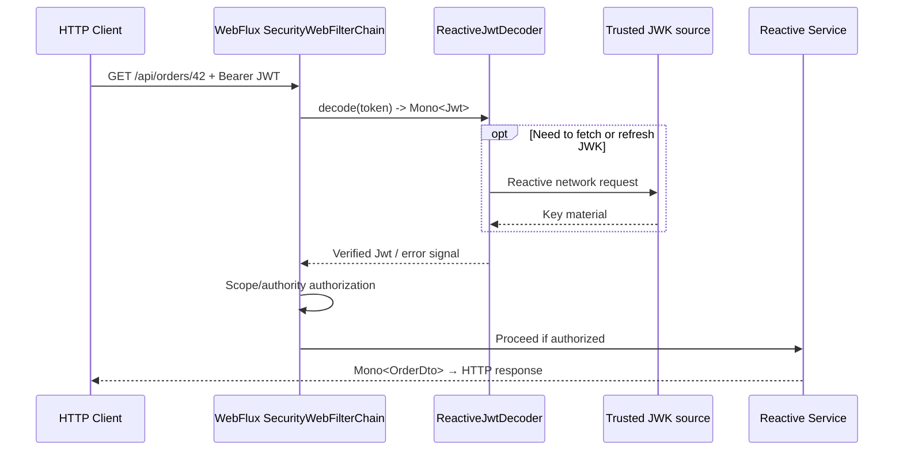
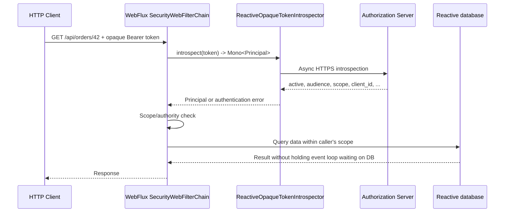

# Never Put Blocking Decoders, Introspectors, or User Lookups on the Event Loop

## 1. The Real-World Problem: A “Reactive” WebFlux API Where One Request Stalls Many Others

A Spring Boot application uses **Spring WebFlux** to expose an OAuth 2.0 Resource Server:

```http
GET /api/orders/42 HTTP/1.1
Host: orders.example.com
Authorization: Bearer <access-token>
```

The intended architecture is handling high request concurrency with a small number of I/O threads, rather than tying up a dedicated thread per request while waiting on a database or Authorization Server.

However, a developer might accidentally write:

```java
// UNSAFE example for the WebFlux event loop:
public Mono<UserProfile> lookup(String subject) {
    UserProfile profile = jdbcUserRepository.findBySubject(subject);
    return Mono.just(profile);
}
```

The `jdbcUserRepository.findBySubject(...)` call executes **the moment the Mono is created**, before Reactor even receives the publisher. When invoked during request handling on the event loop, the JDBC query can block the event-loop thread.

Another example:

```java
// DO NOT place block() inside a reactive authentication flow.
OAuth2AuthenticatedPrincipal principal =
    reactiveIntrospector.introspect(token).block();
```

Here the request waits synchronously for a network response while the event loop should be serving other connections.

**Core message of this lesson:** In Spring Security WebFlux, components that authenticate and enrich caller identity — **JWT decoders, opaque-token introspectors, and user/tenant/permission lookups** — must adhere to the reactive execution model. A method returning `Mono` is not automatically non-blocking; what matters is **whether the operations inside actually block threads and which scheduler they run on**.

### Learning Objectives

After this lesson, you will be able to:

1. Explain Reactor Netty's event loop and why blocking I/O increases latency for other requests.
2. Distinguish **ReactiveJwtDecoder** from **JwtDecoder**, and **ReactiveOpaqueTokenIntrospector** from **OpaqueTokenIntrospector**.
3. Configure `SecurityWebFilterChain` instead of mistakenly using Servlet's `SecurityFilterChain`.
4. Spot `block()`, `join()`, JDBC, JPA, `RestTemplate`, synchronous SDKs, and blocking DB-lookup validators.
5. Migrate I/O to R2DBC/`WebClient` or wrap unavoidable synchronous libraries with `Mono.fromCallable(...).subscribeOn(Schedulers.boundedElastic())`.
6. Avoid `Mono.just(blockingCall())`, `map(blockingCall)`, or misplaced `publishOn(...)`.
7. Design user/tenant-based authorization in a reactive chain without losing issuer, audience, and scope validation.
8. Observe failures under load tests, detect blocking operations, and distinguish HTTP 401/403 from system timeouts.
9. Understand `boundedElastic` limits, timeouts, caching, thread pools, and CPU-bound operations like JWT signature verification.

---

## 2. How Does the Event Loop Work in WebFlux?

### 2.1. Multi-Connection Processing Model

A Spring WebFlux stack typically runs on Reactor Netty. Reactor Netty uses a relatively small number of I/O threads to handle sockets, read data, emit events, and resume application steps once asynchronous results arrive.

Example:

```text
Client A ──┐
Client B ──┼──> Reactor Netty event-loop threads
Client C ──┘          |
                     ├── request decode
                     ├── WebFilter / authentication
                     ├── authorization
                     ├── controller
                     └── response write
```

Callbacks and operators execute on signals and may run on the thread associated with the signal source. **There is no guarantee that every operator automatically switches to a dedicated worker thread.**

If a callback holds an event-loop thread for 500 ms calling JDBC or waiting on introspection via a blocking HTTP client, other sockets/requests sharing that thread are forced to wait.

### 2.2. What Does “Non-Blocking” Mean?

With non-blocking I/O, the application submits a request and receives a `Mono`/`Flux` representing the eventual result; the current thread does not sit idle waiting on I/O.

Example:

```java
Mono<UserProfile> user =
    webClient.get()
        .uri("/users/{id}", userId)
        .retrieve()
        .bodyToMono(UserProfile.class);
```

When `WebClient` is configured with a reactive HTTP connector, waiting for the HTTP response does not tie up an event-loop thread with `Thread.sleep` or `block`.

Conversely:

```java
UserProfile user =
    restTemplate.getForObject(url, UserProfile.class);
```

is a synchronous call; the calling thread is held until the HTTP response arrives or an error occurs.

### 2.3. A Reactor Publisher Does Not Automatically Turn Synchronous Code into Asynchronous Code

All three snippets below **can still block**:

```java
Mono<User> one = Mono.just(userDao.findUser(id));

Mono<User> two = Mono.defer(() ->
    Mono.just(userDao.findUser(id)));

Mono<User> three = Mono.just(id)
    .map(userDao::findUser);
```

- `one` invokes the DAO **immediately** when constructing the `Mono`.
- `two` defers invoking the DAO until subscription, but still executes on the subscribing thread if no scheduler switch occurs.
- `three` runs the DAO inside `map` on the thread emitting upstream signals—very likely the event loop.

Merely changing a return type from `User` to `Mono<User>` **does not guarantee non-blocking execution**.

### 2.4. Why Does the Impact Spread Beyond One Request?

Suppose an event loop serves 200 connections. An authentication callback blocks for 300 ms calling a directory service:

```text
Event-loop-1:

T0        receive request A
T0+5ms    auth A → synchronous API call waiting 300 ms
T0+305ms  finally resumes handling events B, C, D, ...
```

Latency for B, C, and D spikes even if they do not perform any user lookup. If many concurrent requests trigger synchronous introspection, pressure piles onto the event loops and the system can become unresponsive under load.

This is a **thread starvation and tail latency problem**, not merely one request “running a bit slowly”.

---

## 3. Spring Security WebFlux Components That Must Use Reactive Types

Spring Security provides two distinct ecosystems by HTTP stack.

| Capability | Servlet/MVC | WebFlux/Reactive |
|---|---|---|
| HTTP security configuration | `HttpSecurity` | `ServerHttpSecurity` |
| Security filter chain | `SecurityFilterChain` | `SecurityWebFilterChain` |
| JWT decoder | `JwtDecoder` | `ReactiveJwtDecoder` |
| Opaque token introspector | `OpaqueTokenIntrospector` | `ReactiveOpaqueTokenIntrospector` |
| Request authorization | Servlet request manager | Reactive authorization manager |
| HTTP web client | Various options | `WebClient` is the standard non-blocking choice |
| Database integration | JDBC/JPA | R2DBC or equivalent reactive DB client |
| Controller return type | Can return objects directly | `Mono<T>` / `Flux<T>` are standard |
| HTTP integration testing | `MockMvc` | `WebTestClient` |

**Never use Servlet interfaces merely because their names look similar.** For instance, do not inject a synchronous `JwtDecoder` as the primary solution for Reactive JWT authentication when `ReactiveJwtDecoder` is available.

### 3.1. JWT Authentication Flow on WebFlux



`Mono<Jwt>` is a reactive contract, though it does not mean **all** signature verification work is CPU-free. Network key retrieval must be non-blocking; cryptographic decoding and signature verification still consume CPU and must be measured against your JWT profile and real load.

### 3.2. Opaque Token Flow



An unavailable AS is an upstream authentication failure; it must never become a “temporary allow”.

### 3.3. Never Run Authentication Logic via Manual `subscribe()`

In a reactive pipeline, the framework subscribes to collect results. If converter, introspector, or authorization code calls:

```java
directory.findUser(subject)
    .subscribe(user -> updateSecurityContext(user));

return Mono.just(unauthenticatedPrincipal);
```

then the user lookup executes outside the main pipeline, may complete **after** authorization has run, drops errors instead of propagating them to the caller, and risks attaching security state to the wrong context.

**Return a `Mono` encapsulating the entire authentication/authorization flow**, so Spring Security coordinates completion, cancellation, and error signals.

---

## 4. Table for Identifying Blocking Calls in the Authentication Path

| Operation | Why Can It Block? | Remediation |
|---|---|---|
| `Mono.block()` or `Flux.blockFirst()` | Holds thread waiting for result | Use `flatMap`, `map`, `zip`, `then` |
| `CompletableFuture.join()` / `Future.get()` | Holds thread waiting for future | Use true async/reactive adapters |
| `Thread.sleep(...)` | Blocks thread for duration | Use `Mono.delay` or an appropriate timer scheduler |
| `RestTemplate.getForObject(...)` | Synchronous HTTP | Use `WebClient` |
| JDBC `DataSource`/`PreparedStatement.executeQuery` | Synchronous DB driver | R2DBC or isolate on `boundedElastic` |
| Spring Data JPA/Hibernate | Persistence API typically backed by JDBC | Reactive/R2DBC repository or bounded worker scheduler |
| Synchronous LDAP/JDBC user directory | Waits on network/DB | Reactive driver, async client, or adapter |
| `Files.readAllBytes(...)` | Synchronous file I/O | Async API where suitable or offload |
| Internal DNS/SDK with sync-only API | May wait on I/O | Async client or offload |
| Decoder initialization fetching metadata over sync HTTP | May block startup/request | Use reactive decoder and trusted metadata/JWKS config |
| JWT signature verification | CPU work, not necessarily blocking I/O | Bound/measure load; do not offload every JWT blindly |
| BCrypt/Argon2 password hashing | CPU/memory-intensive | Evaluate scheduler/CPU and concurrency limits |
| Large JSON decode or heavy crypto | Can occupy event loop too long | Bound payload/CPU; consider a compute scheduler |

**Not every short “synchronous” Java call is a blocking I/O problem.** Reading a value from a map, checking `aud` with `contains`, or creating a `GrantedAuthority` does not need offloading to a thread pool. What must be avoided is **waiting on I/O** or **holding event-loop threads for long durations**.

---

## 5. Configuring a WebFlux JWT Resource Server at the Right Layer

### 5.1. Gradle Dependencies

Example Spring Boot WebFlux REST API:

```groovy
dependencies {
    implementation 'org.springframework.boot:spring-boot-starter-webflux'
    implementation 'org.springframework.boot:spring-boot-starter-security'
    implementation 'org.springframework.boot:spring-boot-starter-oauth2-resource-server'

    testImplementation 'org.springframework.boot:spring-boot-starter-test'
    testImplementation 'org.springframework.security:spring-security-test'
    testImplementation 'io.projectreactor:reactor-test'
}
```

If both `spring-boot-starter-web` and `spring-boot-starter-webflux` are present, Spring Boot may choose Servlet MVC as the web application type by default. Therefore, **adding a WebFlux dependency does not guarantee the app is running the reactive HTTP stack**. When building a WebFlux Resource Server, verify the app runs WebFlux and uses `SecurityWebFilterChain`.

### 5.2. Trusted Issuer

```yaml
spring:
  security:
    oauth2:
      resourceserver:
        jwt:
          issuer-uri: https://id.example.com/realms/shop
```

This is an example issuer. Replace it with the issuer/metadata/JWKS published by your AS and approved by the Resource Server.

In WebFlux, Spring Security can auto-configure an appropriate `ReactiveJwtDecoder` from configuration. **Never read `iss` from an unverified JWT to decide whether to trust the issuer.**

### 5.3. `SecurityWebFilterChain`

```java
package com.example.orders;

import org.springframework.context.annotation.Bean;
import org.springframework.context.annotation.Configuration;
import org.springframework.http.HttpMethod;
import org.springframework.security.config.Customizer;
import org.springframework.security.config.annotation.web.reactive.EnableWebFluxSecurity;
import org.springframework.security.config.web.server.ServerHttpSecurity;
import org.springframework.security.web.server.SecurityWebFilterChain;

@Configuration
@EnableWebFluxSecurity
public class ReactiveSecurityConfig {

    @Bean
    SecurityWebFilterChain apiSecurity(ServerHttpSecurity http) {
        return http
            .csrf(ServerHttpSecurity.CsrfSpec::disable)
            .authorizeExchange(exchanges -> exchanges
                .pathMatchers("/api/public/**").permitAll()
                .pathMatchers(HttpMethod.GET, "/api/orders/**")
                    .hasAuthority("SCOPE_orders.read")
                .pathMatchers(HttpMethod.POST, "/api/orders")
                    .hasAuthority("SCOPE_orders.write")
                .anyExchange().denyAll()
            )
            .oauth2ResourceServer(oauth2 ->
                oauth2.jwt(Customizer.withDefaults()))
            .build();
    }
}
```

Key points:

- This is a **`SecurityWebFilterChain`** using **`ServerHttpSecurity`**.
- The API validates access tokens as JWTs.
- `authorizeExchange` evaluates authorities derived from the authenticated token.
- Public endpoints use `permitAll`; undeclared endpoints use `denyAll`.
- `csrf(...disable)` in this example applies to an API accepting **pure Bearer tokens sent via the Authorization header**, not web sessions/cookies. If the API uses browser cookies or ambient credentials, re-evaluate CSRF.
- Configuring only the issuer does not bind the audience for every API; add an audience validator matching your contract.

In a WebFlux app that does not use sessions for API authentication, Resource Server Bearer requests are authenticated per token on every request. Never read a web login session as a bypass.

### 5.4. Why Doesn't This Configuration Need Manual Thread Creation?

When using `oauth2ResourceServer(...jwt(...))` with a reactive decoder, Spring Security composes Publishers for authentication. Application code does not need to spawn `Thread`s or call `subscribeOn` on every request.

Only when **introducing a genuinely blocking dependency** into the pipeline do you need to replace or technically isolate it.

---

## 6. ReactiveJwtDecoder: Do Not Arbitrarily Wrap a Blocking JwtDecoder

### 6.1. Two Interfaces with Different Contracts

For Servlet:

```java
Jwt jwt = jwtDecoder.decode(token); // JwtDecoder
```

For WebFlux:

```java
Mono<Jwt> jwt = reactiveJwtDecoder.decode(token);
```

Similar names do not mean you can take a synchronous decoder, call `decode` directly on the event loop, and wrap it in `Mono.just(...)`.

Broken example:

```java
// DO NOT DO THIS:
ReactiveJwtDecoder badAdapter = token -> {
    Jwt jwt = blockingDecoder.decode(token);
    return Mono.just(jwt);
};
```

`blockingDecoder.decode(token)` executes on the current thread. If it performs synchronous network I/O to fetch JWKS or metadata, the event loop blocks. Even if keys are cached, mixing the two contracts undermines the architectural model.

### 6.2. Using a Real Reactive Decoder

When using Spring Boot auto-configuration as in Section 5, manual decoder bean declaration is usually unnecessary.

When custom configuration is needed—such as explicitly configuring a JWKS endpoint and audience validator:

```java
package com.example.orders;

import org.springframework.context.annotation.Bean;
import org.springframework.context.annotation.Configuration;
import org.springframework.security.oauth2.core.DelegatingOAuth2TokenValidator;
import org.springframework.security.oauth2.core.OAuth2Error;
import org.springframework.security.oauth2.core.OAuth2TokenValidator;
import org.springframework.security.oauth2.core.OAuth2TokenValidatorResult;
import org.springframework.security.oauth2.jwt.Jwt;
import org.springframework.security.oauth2.jwt.JwtValidators;
import org.springframework.security.oauth2.jwt.NimbusReactiveJwtDecoder;
import org.springframework.security.oauth2.jwt.ReactiveJwtDecoder;

@Configuration
public class ReactiveJwtValidationConfig {

    @Bean
    ReactiveJwtDecoder reactiveJwtDecoder() {
        String issuer = "https://id.example.com/realms/shop";

        // Trusted URL configured by the system, never taken from the JWT header.
        String jwksUri =
            "https://id.example.com/realms/shop/protocol/openid-connect/certs";

        NimbusReactiveJwtDecoder decoder =
            NimbusReactiveJwtDecoder
                .withJwkSetUri(jwksUri)
                .build();

        OAuth2TokenValidator<Jwt> audience = jwt ->
            jwt.getAudience().contains("orders-api")
                ? OAuth2TokenValidatorResult.success()
                : OAuth2TokenValidatorResult.failure(
                    new OAuth2Error(
                        "invalid_token", "Invalid audience", null));

        decoder.setJwtValidator(
            new DelegatingOAuth2TokenValidator<>(
                JwtValidators.createDefaultWithIssuer(issuer),
                audience));

        return decoder;
    }
}
```

**This is an alternative decoder configuration overriding auto-config when you need explicit control over JWKS and validators.** Replace placeholders with real issuer/JWKS values, verify builder API compatibility with your Spring Security version, and ensure allowed algorithms match your contract.

Do not precede JWT decoding with a synchronous DB query just to “verify the user still exists” if that query could block the event loop.

### 6.3. Token-Level Validators Should Be Lightweight and CPU-Synchronous

`OAuth2TokenValidator<Jwt>` is an interface returning a **synchronous** result, suited for non-I/O claim checks:

```java
OAuth2TokenValidator<Jwt> audience = jwt ->
    jwt.getAudience().contains("orders-api")
        ? OAuth2TokenValidatorResult.success()
        : OAuth2TokenValidatorResult.failure(
            new OAuth2Error("invalid_token", "Wrong audience", null));
```

Do not write:

```java
// DO NOT DO THIS: synchronous validator calling a blocking DB.
OAuth2TokenValidator<Jwt> membership = jwt -> {
    boolean active = jdbcMembershipDao.isActive(
        jwt.getSubject(),
        jwt.getClaimAsString("tenant_id"));

    return active
        ? OAuth2TokenValidatorResult.success()
        : OAuth2TokenValidatorResult.failure(
            new OAuth2Error("invalid_token", "Inactive membership", null));
};
```

Because the validator does not return `Mono`, it has no way to await asynchronous DB I/O cleanly within that interface.

**Separate responsibilities:**

- Issuer, timestamps, audience, claim formatting: token-level validators.
- Active membership/tenant lookups requiring DB queries: reactive authentication converter, reactive authorization manager, or service policy.
- If membership is a mandatory condition for establishing Authentication, place the lookup in the reactive authentication pipeline before returning a successful Authentication.
- If membership is only needed for a specific endpoint, place it in that endpoint's authorization or service layer.

### 6.4. JWKS and Networking

A JWT decoder may need to fetch or refresh JWKS upon encountering a new key or cache expiration. This is **network I/O** requiring a non-blocking path. Use a reactive decoder implementation built for that environment with fixed trust configuration.

Never use JOSE headers `jku`, `x5u`, or unverified claim URLs to fetch keys from arbitrary hosts. Aside from blocking risks, that creates SSRF and trust-bypass vulnerabilities.

When the AS/JWKS endpoint is slow, enforce timeouts, proper refresh/caching management, and monitoring. Never treat a token as valid when its signature cannot be verified.

---

## 7. ReactiveOpaqueTokenIntrospector: Avoid RestTemplate/block() on Every Request

### 7.1. Why Is Introspection Especially Sensitive for the Event Loop?

With opaque tokens, the Resource Server may send **one HTTP request to the Authorization Server per API request** or rely on policy-approved caching.

If you use a blocking HTTP client directly on the event loop:

```java
// UNSAFE:
public Mono<OAuth2AuthenticatedPrincipal> introspect(String token) {
    OAuth2AuthenticatedPrincipal result =
        blockingIntrospector.introspect(token);
    return Mono.just(result);
}
```

then AS latency directly translates into event-loop thread hold time. When AS latency rises, the API can unexpectedly stall large numbers of connections.

### 7.2. Configuring Opaque Tokens in WebFlux

Example `application.yml`:

```yaml
spring:
  security:
    oauth2:
      resourceserver:
        opaquetoken:
          introspection-uri: https://id.example.com/oauth2/introspect
          client-id: ${INTROSPECTION_CLIENT_ID}
          client-secret: ${INTROSPECTION_CLIENT_SECRET}
```

Environment variables are placeholders. Never commit real client secrets or log the Resource Server's HTTP Basic credentials.

WebFlux configuration:

```java
@Bean
SecurityWebFilterChain apiSecurity(ServerHttpSecurity http) {
    return http
        .authorizeExchange(exchanges -> exchanges
            .pathMatchers("/api/public/**").permitAll()
            .pathMatchers("/api/orders/**")
                .hasAuthority("SCOPE_orders.read")
            .anyExchange().denyAll())
        .oauth2ResourceServer(oauth2 ->
            oauth2.opaqueToken(Customizer.withDefaults()))
        .build();
}
```

`opaqueToken(...)` is an option **replacing** `jwt(...)` when the API's token contract uses opaque access tokens. Do not enable both configurations without an explicit design for selecting and validating multiple token types.

### 7.3. Delegating to a Reactive Introspector

When token-level audience checks are needed alongside `active`:

```java
package com.example.orders;

import java.util.Collection;
import org.springframework.beans.factory.annotation.Value;
import org.springframework.context.annotation.Bean;
import org.springframework.context.annotation.Configuration;
import org.springframework.security.oauth2.core.OAuth2AuthenticatedPrincipal;
import org.springframework.security.oauth2.server.resource.introspection.BadOpaqueTokenException;
import org.springframework.security.oauth2.server.resource.introspection.ReactiveOpaqueTokenIntrospector;
import org.springframework.security.oauth2.server.resource.introspection.SpringReactiveOpaqueTokenIntrospector;
import reactor.core.publisher.Mono;

@Configuration
public class OpaqueIntrospectionConfig {

    @Bean
    ReactiveOpaqueTokenIntrospector reactiveOpaqueTokenIntrospector(
            @Value("${spring.security.oauth2.resourceserver.opaquetoken.introspection-uri}")
            String uri,
            @Value("${spring.security.oauth2.resourceserver.opaquetoken.client-id}")
            String clientId,
            @Value("${spring.security.oauth2.resourceserver.opaquetoken.client-secret}")
            String clientSecret) {

        ReactiveOpaqueTokenIntrospector delegate =
            new SpringReactiveOpaqueTokenIntrospector(
                uri, clientId, clientSecret);

        return token -> delegate.introspect(token)
            .flatMap(principal -> {
                Object aud = principal.getAttribute("aud");

                boolean matches =
                    "orders-api".equals(aud)
                    || (aud instanceof Collection<?> values
                        && values.contains("orders-api"));

                if (!matches) {
                    return Mono.error(
                        new BadOpaqueTokenException(
                            "Token is not intended for orders-api"));
                }

                return Mono.just(principal);
            });
    }
}
```

Meaning:

1. The delegate handles introspection with the AS via the reactive contract.
2. Audience logic runs after the AS returns an accepted principal.
3. `flatMap` emits `Mono.error(...)` when the audience does not match.
4. There is no `block()`, `RestTemplate`, or JDBC in the introspector wrapper.

**Version note:** Constructors and builders on `SpringReactiveOpaqueTokenIntrospector` depend on the Spring Security version. Use the API matching your project version; what matters is choosing a **true reactive implementation** and avoiding blocking HTTP libraries on the event loop.

If the AS does not return `aud` because the contract guarantees token audience scoping via the Resource Server's introspection identity, verify that guarantee with integration tests. If the contract requires `aud`, reject tokens missing the field. `active=true` alone does not replace audience or scopes.

### 7.4. Never Subscribe Manually to “Call the AS Early”

Wrong:

```java
// DO NOT DO THIS:
public Mono<OAuth2AuthenticatedPrincipal> introspect(String token) {
    delegate.introspect(token)
        .subscribe(principal -> audit(principal));

    return Mono.empty();
}
```

`subscribe()` spawns an independent task and the method returns before authentication results are verified. Introspection failures can be lost or recorded outside the authorization flow.

Better:

```java
return delegate.introspect(token)
    .doOnNext(principal ->
        auditNonBlockingMetadataOnly(principal));
```

`doOnNext` is only appropriate if `auditNonBlockingMetadataOnly` is **fast, non-blocking, and does not alter permissions**. If auditing requires DB or network calls, use a reactive API chained with `flatMap/thenReturn` or publish events to an asynchronous pipeline with clear delivery guarantees.

### 7.5. Responses and Upstream Failures

Distinguish:

- Introspection `active=false`: token is rejected.
- Introspection `active=true` with mismatched `aud`: token rejected by the API per contract.
- `active=true` with valid audience but missing scope: authentication succeeds, authorization denies.
- AS timeout or TLS failure: **unable to verify**; do not conclude the token is forged and never allow the request through.

Never write `onErrorResume(error -> Mono.just(allowAllPrincipal))` to “keep the API running” when the AS is unreachable. That is a **fail-open vulnerability**.

---

## 8. User, Tenant, and Permission Lookups: When Are They Needed and Where Do They Belong?

An application may need to know:

- Does `sub` in the token correspond to an active internal user?
- Does the user still belong to the requested tenant?
- Is the accounting/admin role still active?
- Is the client `billing-worker` allowed to call an internal endpoint?
- Does the subject have access to order `42`?

Not every question requires a DB lookup during token authentication.

### 8.1. Distinguishing Token Validation from Business Authorization

| Check | Typically Appropriate Layer |
|---|---|
| JWT signature, issuer, `exp`, `nbf`, audience | `ReactiveJwtDecoder` + validators |
| Opaque token `active`, audience per contract | `ReactiveOpaqueTokenIntrospector` |
| URL scope/authority | `SecurityWebFilterChain` |
| User must have an active internal profile to authenticate | Reactive authentication converter/manager |
| User still belongs to tenant on endpoint call | Reactive authorization manager or Service |
| Which tenant/owner a record belongs to | Reactive Service/Repository query |
| Per-order roles | Scoped service/permission lookup |

If membership changes must take effect immediately, DB/entitlement lookups may be necessary. If token claims suffice for a policy with short token lifetimes, not every request needs a user query.

**Do not cram all business logic into the JWT decoder simply because the decoder receives the token first.**

### 8.2. R2DBC Instead of JDBC/JPA for Reactive Data Paths

Example dependencies:

```groovy
dependencies {
    implementation 'org.springframework.boot:spring-boot-starter-data-r2dbc'
    // Declare the R2DBC driver matching your actual database.
}
```

Reactive repository:

```java
package com.example.orders;

import org.springframework.data.repository.reactive.ReactiveCrudRepository;
import reactor.core.publisher.Mono;

public interface UserRepository
        extends ReactiveCrudRepository<UserEntity, Long> {

    Mono<UserEntity> findByIssuerAndSubject(
        String issuer,
        String subject);
}
```

`UserEntity` is a domain class defined according to your real schema. Crucially, these methods return `Mono` because the backend and driver are genuinely reactive—not a manual JDBC wrapper interface.

### 8.3. Using `flatMap` to Await Reactive User Lookups

Wrong:

```java
// DO NOT DO THIS:
Mono<UserEntity> userMono =
    userRepository.findByIssuerAndSubject(issuer, subject);

UserEntity user = userMono.block();
return Mono.just(user);
```

Right:

```java
public Mono<UserEntity> loadUser(
        String issuer,
        String subject) {

    return userRepository
        .findByIssuerAndSubject(issuer, subject)
        .switchIfEmpty(Mono.error(
            new UserNotFoundException("User not active")));
}
```

`UserNotFoundException` is an illustrative domain exception. Depending on whether it runs in authentication or authorization, the app must map it to an appropriate 401/403/404 response without leaking user existence or defaulting to 500.

### 8.4. User Lookup in a Reactive Converter After JWT Decoding

In Spring Security WebFlux, the decoder validates the JWT before converting it into `Authentication`. When the entire API requires an active internal user, you can use a converter returning `Mono<AbstractAuthenticationToken>`.

Example:

```java
package com.example.orders;

import java.util.ArrayList;
import java.util.Collection;
import org.springframework.core.convert.converter.Converter;
import org.springframework.security.authentication.BadCredentialsException;
import org.springframework.security.core.GrantedAuthority;
import org.springframework.security.core.authority.SimpleGrantedAuthority;
import org.springframework.security.authentication.AbstractAuthenticationToken;
import org.springframework.security.oauth2.jwt.Jwt;
import org.springframework.security.oauth2.server.resource.authentication.JwtAuthenticationToken;
import org.springframework.security.oauth2.server.resource.authentication.JwtGrantedAuthoritiesConverter;
import reactor.core.publisher.Mono;

public final class UserAwareJwtAuthenticationConverter
        implements Converter<Jwt, Mono<AbstractAuthenticationToken>> {

    private final UserRepository users;

    private final JwtGrantedAuthoritiesConverter scopes =
        new JwtGrantedAuthoritiesConverter();

    public UserAwareJwtAuthenticationConverter(
            UserRepository users) {
        this.users = users;
    }

    @Override
    public Mono<AbstractAuthenticationToken> convert(Jwt jwt) {
        String issuer = jwt.getIssuer().toString();
        String subject = jwt.getSubject();

        return users.findByIssuerAndSubject(issuer, subject)
            .filter(UserEntity::isActive)
            .switchIfEmpty(Mono.error(
                new BadCredentialsException(
                    "Authenticated user is not active")))
            .map(user -> {
                Collection<GrantedAuthority> result =
                    new ArrayList<>(scopes.convert(jwt));

                if (user.isTenantAdmin()) {
                    result.add(new SimpleGrantedAuthority(
                        "ROLE_TENANT_ADMIN"));
                }

                return (AbstractAuthenticationToken)
                    new JwtAuthenticationToken(jwt, result);
            });
    }
}
```

Wiring into `SecurityWebFilterChain`:

```java
@Bean
SecurityWebFilterChain apiSecurity(
        ServerHttpSecurity http,
        UserRepository userRepository) {

    return http
        .authorizeExchange(auth -> auth
            .pathMatchers("/api/orders/**")
                .hasAuthority("SCOPE_orders.read")
            .anyExchange().denyAll())
        .oauth2ResourceServer(oauth2 -> oauth2
            .jwt(jwt -> jwt.jwtAuthenticationConverter(
                new UserAwareJwtAuthenticationConverter(
                    userRepository))))
        .build();
}
```

This is a **custom alternative replacing the simple JWT converter setup**, not a second bean to register simultaneously. Ensure decoder/issuer/audience checks are configured and your user model exposes `isActive()` and `isTenantAdmin()`.

When defining `ROLE_TENANT_ADMIN`, clarify which tenant that role applies to. If the role only applies within one tenant, never treat it as a global authority that bypasses tenant checks in the service.

### 8.5. Should User Lookups Happen in Authentication or Authorization?

Compare two contracts:

**Contract A: “Every request carrying this token is authenticated only if the user is active in the local directory.”** Then the user lookup is a mandatory prerequisite for creating Authentication, making a reactive JWT converter reasonable.

**Contract B: “Only `/api/tenants/{tenant}/admin/**` requires an admin membership check.”** Do not query the user/tenant DB on every public or protected request. Place the lookup in that endpoint's authorization or service layer.

Never put business-membership DB calls inside a synchronous `OAuth2TokenValidator<Jwt>`, because that interface is not reactive and cannot await I/O cleanly.

---

## 9. Data Authorization with a Reactive Repository: Scopes Are Not Enough

Once a token is valid and holds `SCOPE_orders.read`, the service must still determine which orders the user may view.

### 9.1. A JWT with the Right Scope Is Not Sufficient

Example:

```json
{
  "iss": "https://id.example.com/realms/shop",
  "sub": "user-417",
  "aud": ["orders-api"],
  "scope": "orders.read",
  "tenant_id": "tenant-alpha"
}
```

Request:

```http
GET /api/tenants/tenant-beta/orders/order-42 HTTP/1.1
Authorization: Bearer <token-of-tenant-alpha>
```

The token may authenticate cleanly, yet it must never read a Beta order when the caller is only authorized for Alpha.

### 9.2. Reactive Repository with Permission Predicates

Spring Data R2DBC example:

```java
package com.example.orders;

import org.springframework.data.repository.reactive.ReactiveCrudRepository;
import reactor.core.publisher.Mono;

public interface OrderRepository
        extends ReactiveCrudRepository<OrderEntity, String> {

    Mono<OrderEntity> findByIdAndTenantIdAndOwnerSubject(
        String id,
        String tenantId,
        String ownerSubject);
}
```

`OrderEntity` is a simplified domain class with `id`, `tenantId`, `ownerSubject`, `amount`, and `status`. The repository returns `Mono` backed by a genuinely reactive driver.

Service:

```java
package com.example.orders;

import org.springframework.http.HttpStatus;
import org.springframework.security.access.AccessDeniedException;
import org.springframework.stereotype.Service;
import org.springframework.web.server.ResponseStatusException;
import reactor.core.publisher.Mono;

@Service
public class OrderService {

    private final OrderRepository orders;

    public OrderService(OrderRepository orders) {
        this.orders = orders;
    }

    public Mono<OrderDto> findVisible(
            String orderId,
            String requestedTenant,
            String verifiedTenant,
            String verifiedSubject) {

        if (!verifiedTenant.equals(requestedTenant)) {
            return Mono.error(new AccessDeniedException(
                "Tenant access denied"));
        }

        return orders.findByIdAndTenantIdAndOwnerSubject(
                orderId, verifiedTenant, verifiedSubject)
            .switchIfEmpty(Mono.error(
                new ResponseStatusException(
                    HttpStatus.NOT_FOUND)))
            .map(order -> new OrderDto(
                order.getId(),
                order.getAmount(),
                order.getStatus()));
    }
}
```

`OrderEntity` and `OrderDto` are illustrative domain components. `verifiedTenant` and `verifiedSubject` must come from **verified** Authentication/entitlement sources—never trust self-declared headers, path segments, or body fields.

This code never calls `block()`, never loads all records to filter in memory, and never returns an entity exposing every field. The query enforces tenant and owner boundaries right in the database.

### 9.3. Reactive Controller

```java
package com.example.orders;

import org.springframework.security.core.annotation.AuthenticationPrincipal;
import org.springframework.security.oauth2.jwt.Jwt;
import org.springframework.web.bind.annotation.GetMapping;
import org.springframework.web.bind.annotation.PathVariable;
import org.springframework.web.bind.annotation.RestController;
import reactor.core.publisher.Mono;

@RestController
public class OrderController {

    private final OrderService service;

    public OrderController(OrderService service) {
        this.service = service;
    }

    @GetMapping("/api/tenants/{tenantId}/orders/{orderId}")
    public Mono<OrderDto> detail(
            @PathVariable String tenantId,
            @PathVariable String orderId,
            @AuthenticationPrincipal Jwt jwt) {

        String verifiedTenant =
            jwt.getClaimAsString("tenant_id");

        return service.findVisible(
            orderId,
            tenantId,
            verifiedTenant,
            jwt.getSubject());
    }
}
```

In a real application, `tenant_id` is a mandatory claim whose type and value must be validated before use. This example assumes a validator already ensured the claim is a valid string. Otherwise, fail closed instead of letting a `NullPointerException` produce a 500.

### 9.4. Never Use JDBC Inside a Reactive Service

Wrong:

```java
public Mono<OrderDto> detail(String id) {
    OrderEntity entity = jpaRepository.findById(id)
        .orElseThrow();

    return Mono.just(mapToDto(entity));
}
```

Better when possible:

```java
public Mono<OrderDto> detail(String id) {
    return reactiveOrderRepository.findById(id)
        .map(this::mapToDto);
}
```

If JPA/JDBC cannot be replaced yet, isolate blocking I/O off the event loop as covered in Section 10.

---

## 10. When Synchronous Libraries Are Unavoidable: Wrap Properly with `boundedElastic`

Not every system can immediately rewrite all JDBC/JPA or third-party SDKs to be reactive. Reactor provides `Schedulers.boundedElastic()` to execute blocking tasks on a bounded thread pool without holding the event loop.

### 10.1. Minimal Adapter Pattern

Suppose `LegacyUserDirectory` only offers a synchronous method:

```java
public interface LegacyUserDirectory {
    UserProfile loadBySubject(String subject);
}
```

Wrap it:

```java
package com.example.orders;

import reactor.core.publisher.Mono;
import reactor.core.scheduler.Schedulers;

public final class LegacyUserAdapter {

    private final LegacyUserDirectory directory;

    public LegacyUserAdapter(
            LegacyUserDirectory directory) {
        this.directory = directory;
    }

    public Mono<UserProfile> load(String subject) {
        return Mono.fromCallable(
                () -> directory.loadBySubject(subject))
            .subscribeOn(Schedulers.boundedElastic());
    }
}
```

Key points:

- `Mono.fromCallable` **defers** the synchronous call until subscription.
- `subscribeOn(Schedulers.boundedElastic())` runs the upstream publisher on a scheduler suited for dedicating threads to blocking calls.
- The event loop does not wait directly on `loadBySubject`.
- Directory results and errors flow downstream as standard reactive signals.

This is a **transitional strategy**, not equal to genuine reactive I/O. `boundedElastic` has bounded threads and queues; if synchronous calls are too slow or too frequent, pools and databases can still saturate and spike latency.

### 10.2. Never Use `Mono.just(...)` for Blocking Calls

Wrong:

```java
return Mono.just(
    legacyDirectory.loadBySubject(subject))
    .subscribeOn(Schedulers.boundedElastic());
```

`legacyDirectory.loadBySubject(subject)` executes **before** the publisher is created, so placing `subscribeOn` afterward cannot isolate the call.

Right:

```java
return Mono.fromCallable(
        () -> legacyDirectory.loadBySubject(subject))
    .subscribeOn(Schedulers.boundedElastic());
```

### 10.3. `Mono.defer` Is Not Enough Without a Scheduler

```java
return Mono.defer(() -> Mono.just(
    legacyDirectory.loadBySubject(subject)));
```

This defers execution until subscription, yet may still execute on the event loop. Add offloading:

```java
return Mono.fromCallable(
        () -> legacyDirectory.loadBySubject(subject))
    .subscribeOn(Schedulers.boundedElastic());
```

### 10.4. `publishOn` Cannot Fix Preceding Blocking Calls

Wrong:

```java
return Mono.just(subject)
    .map(legacyDirectory::loadBySubject)
    .publishOn(Schedulers.boundedElastic());
```

`publishOn` only switches schedulers for operators **after** it; `map` may already execute on the event loop.

You could write:

```java
return Mono.just(subject)
    .publishOn(Schedulers.boundedElastic())
    .map(legacyDirectory::loadBySubject);
```

though `Mono.fromCallable(...).subscribeOn(...)` is usually clearer and less error-prone when isolating a single blocking API.

### 10.5. Adapter for a Legacy Synchronous Introspector

If you have a synchronous `OpaqueTokenIntrospector` that cannot yet be replaced with a reactive implementation:

```java
package com.example.orders;

import org.springframework.security.oauth2.core.OAuth2AuthenticatedPrincipal;
import org.springframework.security.oauth2.server.resource.introspection.OpaqueTokenIntrospector;
import org.springframework.security.oauth2.server.resource.introspection.ReactiveOpaqueTokenIntrospector;
import reactor.core.publisher.Mono;
import reactor.core.scheduler.Schedulers;

public final class LegacyIntrospectionAdapter
        implements ReactiveOpaqueTokenIntrospector {

    private final OpaqueTokenIntrospector legacy;

    public LegacyIntrospectionAdapter(
            OpaqueTokenIntrospector legacy) {
        this.legacy = legacy;
    }

    @Override
    public Mono<OAuth2AuthenticatedPrincipal> introspect(
            String token) {

        return Mono.fromCallable(
                () -> legacy.introspect(token))
            .subscribeOn(Schedulers.boundedElastic());
    }
}
```

The adapter avoids blocking the event loop, though limitations remain:

- A `boundedElastic` thread is tied up waiting on the HTTP response.
- Configure timeouts on the **synchronous HTTP client**; Reactor `timeout(...)` does not always abort an underlying socket or JDBC call immediately.
- Enforce concurrency limits, pool sizes, and queue bounds.
- Never log tokens/client secrets or send them to unapproved endpoints.
- Long term, migrate to a `ReactiveOpaqueTokenIntrospector` using non-blocking I/O.

**Never wrap an introspector with `new Thread(...)` per request.** Unbounded thread creation exhausts resources whenever the AS slows down.

### 10.6. JDBC User Lookup Adapter

Example:

```java
public Mono<UserProfile> findUser(String subject) {
    return Mono.fromCallable(() ->
            jdbcUserRepository.findUserBySubject(subject))
        .subscribeOn(Schedulers.boundedElastic())
        .switchIfEmpty(Mono.error(
            new UserNotFoundException("Not found")));
}
```

The `switchIfEmpty` handling assumes `findUserBySubject` may return null and `Mono.fromCallable` will complete empty. Depending on your actual DAO, you may need to unwrap `Optional` or handle specific exceptions.

Do not remove JDBC connection limits merely because work moved to `boundedElastic`. Offloading thread pools does not increase database connections or maximum DB throughput.

---

## 11. `block()`, `toFuture().join()`, and `subscribe()` in the Authentication Path

### 11.1. `block()` on the Event Loop

Example:

```java
public Mono<OrderDto> getOrder(String id) {
    UserProfile profile =
        reactiveUserClient.findCurrentUser().block();

    return reactiveOrders.findByIdAndOwner(id, profile.id())
        .map(OrderDto::from);
}
```

`block()` waits synchronously. On Reactor threads marked non-blocking, Reactor may throw errors like “block()/blockFirst()/blockLast() are blocking, which is not supported in thread ...”. However, **not every blocking call is automatically detected and thrown by Reactor**.

Right:

```java
public Mono<OrderDto> getOrder(String id) {
    return reactiveUserClient.findCurrentUser()
        .flatMap(profile ->
            reactiveOrders.findByIdAndOwner(
                id, profile.id()))
        .map(OrderDto::from);
}
```

### 11.2. `CompletableFuture.join()` Is Also Blocking

Wrong:

```java
return Mono.just(
    asyncDirectory.findUser(subject).join());
```

Even though the API has “async” in its name, `join()` blocks the calling thread until the future completes.

If an API returns a genuinely asynchronous `CompletionStage<UserProfile>`:

```java
return Mono.fromCompletionStage(
    () -> asyncDirectory.findUser(subject));
```

Verify that `findUser`'s implementation is truly async and does not perform blocking work **before returning the `CompletionStage`**.

### 11.3. Never Call `subscribe()` in a Controller to Fetch Data

Wrong:

```java
@GetMapping("/api/users/me")
public Mono<UserProfile> me() {
    userService.me().subscribe(user ->
        this.lastUser = user);

    return Mono.just(this.lastUser);
}
```

This introduces race conditions, shared mutable state, and swallows errors instead of propagating them to the response. It can even leak user data across concurrent requests.

Right:

```java
@GetMapping("/api/users/me")
public Mono<UserProfile> me() {
    return userService.me();
}
```

Spring WebFlux subscribes and coordinates the HTTP response from the returned `Publisher`.

### 11.4. Never Turn Authentication Errors into Permissive Values

Wrong:

```java
return introspector.introspect(token)
    .onErrorResume(error ->
        Mono.just(createAnonymousAdminPrincipal()));
```

If the AS times out or rejects a token, returning an elevated principal makes the system **fail open**.

Use proper error mapping and challenges, but **never grant privileges when authentication is unproven**.

---

## 12. Schedulers: Pick the Right Tool, Do Not “Sprinkle subscribeOn” Everywhere

Reactor provides different schedulers. Choosing a scheduler is a resource and semantics decision.

| Scheduler | General Characteristics | Use For |
|---|---|---|
| Reactor Netty event loop | Handles I/O events, small thread count | HTTP network pipeline and brief callbacks |
| `Schedulers.boundedElastic()` | Bounded thread pool suited for isolating blocking work | Adapters for legacy sync JDBC/SDK/HTTP until replaced |
| `Schedulers.parallel()` | Pool tuned for CPU work, not long blocking I/O | Controlled CPU-bound tasks |
| Dedicated scheduler | Custom thread/queue/concurrency bounds | Specific dependencies with clear limits and metrics |
| `Schedulers.immediate()` | Runs immediately on the current thread | Does not offload blocking calls |

### 12.1. BoundedElastic Is Not Infinite

Suppose 2,000 concurrent requests call a synchronous directory service taking 400 ms. When far fewer threads/connections exist than requests, remaining requests must queue.

Even though the event loop is unblocked, the system can still suffer:

- High queue latency.
- Large backlogs of waiting requests.
- Exhausted connection pools.
- Cascading timeouts.
- Memory pressure from many live Publishers/requests.
- Sharp spikes in p95/p99 latency.

Therefore, enforce **bulkheads, timeouts, and concurrency limits**, alongside a plan to replace sync libraries with reactive ones if workload is significant.

### 12.2. Creating a Dedicated Scheduler for Risky Dependencies

A specialized blocking SDK may need isolation from the shared `boundedElastic` pool:

```java
Scheduler directoryScheduler =
    Schedulers.newBoundedElastic(
        16,    // max threads
        200,   // queued tasks per thread
        "legacy-directory");
```

Then:

```java
return Mono.fromCallable(
        () -> legacyDirectory.load(subject))
    .subscribeOn(directoryScheduler);
```

These numbers are illustrative, **not a universally optimal default**. Custom schedulers require lifecycle management (`dispose()` on shutdown) and alignment with connection pools, SLAs, and load.

Never create a dedicated scheduler **per request**. That quickly leads to thread leaks and resource exhaustion.

### 12.3. CPU-Bound Work Differs from Blocking I/O

JWT asymmetric signature verification consumes CPU. For standard tokens and configurations, the cost may be small enough to run inline. However, verifying large batches of oversized tokens, slow crypto providers, or complex claim processing can lengthen event-loop callbacks.

If that becomes an issue in practice:

1. Profile decode/verify durations, CPU usage, and event-loop lag.
2. Bound JWT/header/claim sizes and allowed algorithms/keys.
3. Consider a bounded compute scheduler or controlled offloading.
4. Do not blindly push every CPU operation onto `boundedElastic` thinking “reactive means zero computation”.
5. Never disable signature validation or weaken algorithms for performance.

Heavy CPU-bound work requires **bounding and managing CPU**, not simply throwing more threads at it.

---

## 13. Timeouts Do Not Replace Unblocking Held Threads

### 13.1. Timeouts for Reactive Network Calls

Example:

```java
return reactiveDirectory.findUser(subject)
    .timeout(Duration.ofSeconds(2))
    .onErrorMap(
        java.util.concurrent.TimeoutException.class,
        error -> new DirectoryUnavailableException(
            "Directory lookup timed out", error));
```

Domain exceptions are illustrative. On authentication paths, map timeouts to appropriate failure outcomes; **never let the user through** when the directory cannot verify them.

With `WebClient`, also configure connect and response timeouts at the HTTP connector and pool/network level rather than relying solely on an outer Reactor `timeout`.

### 13.2. JDBC Adapter Timeouts Are Not Perfect Interrupts

```java
Mono.fromCallable(() -> legacyJdbc.lookup(subject))
    .subscribeOn(Schedulers.boundedElastic())
    .timeout(Duration.ofSeconds(2));
```

After two seconds, the subscriber receives a timeout and cancellation signal. However, the synchronous JDBC call on the worker thread **may not stop immediately**; depending on the driver and cancellation support, it may keep waiting on the DB.

Therefore, also configure:

- JDBC socket and query timeouts.
- Database statement timeouts.
- Connection pool limits.
- Concurrency caps on active lookups.
- Circuit breakers or bulkheads when workload warrants.

**Never treat a Reactor `timeout` as a guarantee that a blocking dependency has released its resources.**

### 13.3. Avoid Unbounded Retries in Authentication

If AS introspection returns 503 and every request retries multiple times, the system can amplify traffic and worsen the outage.

If retries are used, ensure:

- Apply only to retryable errors per policy.
- Bound attempt counts and total duration.
- Use appropriate backoff and jitter.
- Cap concurrency.
- Guarantee tokens/secrets are never redirected to another endpoint.
- Never retry `active=false` as a transient network error.

API/gateway rate limiting may also be necessary to protect the AS during authentication bursts.

---

## 14. Caching: Reduce Calls Without Weakening Permission Constraints

### 14.1. JWKS Caching

JWT decoders typically cache JWK material per implementation. Caching avoids calling the AS on every request, while still needing key rotation support and never trusting revoked/expired keys beyond policy.

Avoid this scenario:

```text
JwtDecoder:
  every request → synchronous HTTP to JWKS
```

Making a synchronous network round-trip per token severely degrades WebFlux performance.

### 14.2. Introspection Caching

Opaque tokens can require frequent introspection. Caching reduces network calls at the cost of a revocation propagation window.

An entry:

```text
token T:
  active=true
  scope=orders.read
  aud=orders-api
  exp=...
  cached_at=...
```

must never live forever. Design:

- TTL aligned with acceptable stale-authorization windows.
- Never cache past `exp` if provided by the AS.
- Derive cache keys safely without logging raw Bearer tokens.
- Add invalidation/revocation hooks if rapid revocation is required.
- Avoid caching negative results or AS errors inappropriately.
- Never reuse an `active=true` result from one Resource Server for another API with a different audience binding.

Never treat caching as a shortcut to “skip introspection for speed” when contracts require near-real-time status.

### 14.3. User Lookup Caching

A user may be locked, lose tenant membership, or have roles changed after a token is issued. When caching user/tenant records:

- Enforce TTL and invalidation policies.
- Key users by `issuer + subject` in multi-issuer setups.
- Never substitute a global role for a tenant-scoped role.
- Never share cached DTOs or authorization results across users or tenants.
- Never allow a cache hit to bypass data-level permission checks.

**Caching gains must be balanced against authorization freshness.**

---

## 15. Reactor Context and Reactive SecurityContext

### 15.1. SecurityContext Should Not Be Read via Servlet ThreadLocal

In the Servlet stack, developers typically use:

```java
SecurityContextHolder.getContext().getAuthentication();
```

In WebFlux, a request can switch threads while awaiting I/O. The reactive security context is bound to **Reactor Context** and managed by Spring Security along the Publisher chain.

Therefore, never write code assuming a `ThreadLocal` holds the right Authentication across all threads.

### 15.2. Using ReactiveSecurityContextHolder

When a service needs Authentication from the reactive context:

```java
package com.example.orders;

import org.springframework.security.core.Authentication;
import org.springframework.security.core.context.ReactiveSecurityContextHolder;
import reactor.core.publisher.Mono;

public class CurrentCallerService {

    public Mono<String> currentSubject() {
        return ReactiveSecurityContextHolder.getContext()
            .map(securityContext ->
                securityContext.getAuthentication())
            .map(Authentication::getName);
    }
}
```

In controllers, you can inject `Principal` or `@AuthenticationPrincipal Jwt` via Spring WebFlux argument resolution. When a service needs subject or tenant, **passing verified context explicitly** as method parameters often makes logic easier to test.

### 15.3. Why Can Manual `subscribe()` Lose Context?

Detaching a task from the pipeline with an unmanaged `subscribe()` can prevent Reactor Context, errors, and cancellation from propagating properly from the original request. This is especially dangerous when the task needs the principal for authentication or authorization.

Never run authentication or authorization in fire-and-forget mode while letting the request proceed. **Security decisions must complete within the pipeline handling the request.**

---

## 16. Error Boundaries: 401, 403, 404, and Upstream Errors

A reactive application must still adhere to the HTTP Bearer error model.

| Condition | Detection Layer | Typical Outcome |
|---|---|---|
| Protected endpoint, no token | Authentication entry point | `401` + Bearer challenge |
| JWT bad signature, expired, wrong issuer | Reactive decoder | `401 invalid_token` |
| JWT wrong audience | Token validator | `401` |
| Opaque token `active=false` | Reactive introspector | `401` |
| Valid token missing scope | Reactive authorization | `403` |
| Valid token with scope, wrong tenant/owner | Domain authorization | `403` or `404` |
| AS introspection timeout/TLS failure | Upstream authentication dependency | Fail closed; status per handler |
| User directory unreachable | Upstream dependency | Never assume user is valid |
| Order absent within permitted scope | Reactive Repository | `404` per policy |

### 16.1. Never Turn Network Errors into `permitAll`

Wrong:

```java
return reactiveIntrospector.introspect(token)
    .onErrorResume(error ->
        Mono.just(fakeAuthenticatedPrincipal()));
```

When the AS fails, this constructs a valid Authentication—a classic **fail-open** flaw.

Better: preserve the error signal and distinguish invalid-token errors from infrastructure errors for proper responses and monitoring. Some upstream outages should return 5xx or service-unavailable responses, **never protected resources**.

### 16.2. Never Let Timeouts Create Race Conditions

If a request times out while a blocking directory call is still running on a worker thread, never allow a late callback to update a shared variable like `currentUser` or `currentAuthorities` used by other requests.

Keep state scoped to the Publisher/request context, minimize side effects, and never store principals in mutable static fields.

---

## 17. Observability and Metrics: Detecting a Blocked Event Loop

An application may not throw exceptions even while running blocking libraries. Real observability is required.

### 17.1. Common Symptoms

- Abnormal latency on `reactor-http-nio-*` threads.
- API p95/p99 spikes whenever the AS or DB slows down.
- A few user-lookup requests slowing down unrelated public endpoints.
- Low CPU utilization paired with dropping throughput while waiting on sync JDBC/HTTP.
- Growing `boundedElastic` queues and partial request timeouts.
- Exhausted HTTP client or DB connection pools.
- Concurrent bursts hitting the introspection backend with rising response times.
- Dramatic latency shifts when caching reduces AS calls.

### 17.2. Useful Metrics

| Metric / Observation | Meaning |
|---|---|
| HTTP response latency p50/p95/p99 | Overall and tail latency |
| Event-loop pending tasks/lag | Indicates event-loop threads being held too long |
| Thread dumps / async-profiler | Detects JDBC, socket reads, `Thread.sleep`, `Future.get` |
| Reactor scheduler active/queued tasks | Detects `boundedElastic` saturation |
| JDBC connection pool usage | Distinguishes thread starvation from DB connection exhaustion |
| WebClient connection pool pending/acquired | Outbound HTTP bottlenecks |
| AS introspection latency/error rate | IdP slowdowns or outages |
| JWT decode/validation duration | CPU load or JWK refresh overhead |
| User directory lookup duration | Slow entitlement lookups |
| HTTP 401/403/5xx by error category | Separates auth failures, permission denials, and outages |

Never record raw Bearer tokens, client secrets, or sensitive user attributes in traces.

### 17.3. Thread Dumps Revealing Blocking

Seeing stack traces for `reactor-http-nio-3` inside:

```text
java.net.SocketInputStream.socketRead(...)
org.postgresql.jdbc.PgPreparedStatement.executeQuery(...)
java.util.concurrent.CompletableFuture.join(...)
java.lang.Thread.sleep(...)
```

is a strong signal to investigate which request path placed a blocking operation onto the event loop.

A single thread dump alone does not prove the complete root cause; correlate it with latency, workload, and call graphs.

### 17.4. BlockHound in Test Environments

**BlockHound** can detect certain instrumented blocking calls executed on Reactor non-blocking threads. In compatible setups, it helps catch accidental `Thread.sleep` or blocking API calls.

Notes:

- It is an optional test/diagnostic library, not a required component of Spring Security.
- Choose versions compatible with your Reactor/JDK and configure required Java agent/JVM flags if applicable.
- Not every blocking operation is instrumented.
- It does not replace load tests, thread dumps, and code reviews.
- Never conclude an app is guaranteed non-blocking solely because BlockHound reported no errors.

Conceptual snippet:

```java
// In a test setup compatible with your JVM and dependencies:
BlockHound.install();
```

Then run tests triggering a blocking call on a Reactor non-blocking scheduler to verify detection works. This is a **practical tip**, not a guarantee that every project can copy and run it unmodified in every environment.

---

## 18. Testing Behavior with WebTestClient and StepVerifier

### 18.1. Reactive Web Testing Differs from MockMvc

Spring WebFlux uses `WebTestClient` for HTTP integration tests. To test `Mono`/`Flux` in isolation, use `StepVerifier`.

Example dependencies:

```groovy
dependencies {
    testImplementation 'org.springframework.boot:spring-boot-starter-test'
    testImplementation 'org.springframework.security:spring-security-test'
    testImplementation 'io.projectreactor:reactor-test'
}
```

### 18.2. WebTestClient: Missing Token and Missing Scope

Assume the app exposes `GET /api/orders/{id}` and configures `SecurityWebFilterChain`.

```java
package com.example.orders;

import org.junit.jupiter.api.Test;
import org.springframework.beans.factory.annotation.Autowired;
import org.springframework.boot.test.autoconfigure.web.reactive.AutoConfigureWebTestClient;
import org.springframework.boot.test.context.SpringBootTest;
import org.springframework.test.web.reactive.server.WebTestClient;

@SpringBootTest(webEnvironment = SpringBootTest.WebEnvironment.RANDOM_PORT)
@AutoConfigureWebTestClient
class ReactiveResourceServerTest {

    @Autowired
    WebTestClient client;

    @Test
    void protectedApiWithoutTokenReturns401() {
        client.get()
            .uri("/api/orders/42")
            .exchange()
            .expectStatus().isUnauthorized();
    }

    @Test
    void malformedBearerTokenIsRejected() {
        client.get()
            .uri("/api/orders/42")
            .header("Authorization", "Bearer bad.token.value")
            .exchange()
            .expectStatus().isUnauthorized();
    }
}
```

When using an example issuer/JWKS URL, the test context needs a matching test decoder/JWKS to avoid depending on a live AS. The outcome for `Bearer bad.token.value` also depends on decoder/filter configuration. This test verifies HTTP behavior only; it does not prove every path is free of event-loop blocking.

### 18.3. Mocking JWT Authentication in WebFlux Tests

Spring Security Test provides `mockJwt()` to simulate JWT Authentication for WebFlux:

```java
import static org.springframework.security.test.web.reactive.server
    .SecurityMockServerConfigurers.mockJwt;

client.mutateWith(mockJwt().authorities(
        new SimpleGrantedAuthority("SCOPE_orders.read")))
    .get()
    .uri("/api/orders/42")
    .exchange()
    .expectStatus().isOk();
```

This requires importing `SimpleGrantedAuthority` and a test controller returning success when authorized. **`mockJwt()` does not verify real JWT signatures or exercise JWKS fetching.** To test the decoder/validators, use a real `ReactiveJwtDecoder` with test JWKs and properly signed test JWTs.

### 18.4. StepVerifier for Reactive Lookups

Example with a reactive directory:

```java
@Test
void userLookupReturnsExpectedUser() {
    Mono<UserEntity> result =
        userRepository.findByIssuerAndSubject(
            "https://id.example.com/realms/shop",
            "user-417");

    StepVerifier.create(result)
        .assertNext(user ->
            assertEquals("user-417", user.getSubject()))
        .verifyComplete();
}
```

`assertEquals` is a JUnit assertion; a matching repository fixture/test database is required. This tests the Reactive Publisher's output, **not whether the DB driver is non-blocking**. Confirming non-blocking execution requires integration testing and observing the real driver and event loop.

### 18.5. Testing That a Blocking Adapter Uses the Right Scheduler

A technical test can check the thread name on which the legacy directory runs:

```java
Mono<String> workerName = Mono.fromCallable(() -> {
        legacyDirectory.loadBySubject("user-417");
        return Thread.currentThread().getName();
    })
    .subscribeOn(Schedulers.boundedElastic());

StepVerifier.create(workerName)
    .assertNext(name ->
        assertTrue(name.contains("boundedElastic")))
    .verifyComplete();
```

This test illustrates execution offloading. It does not verify timeouts, connection pools, cancellation, or authentication correctness. Exact thread names can vary with scheduler configs and Reactor versions, so production testing should use more reliable scheduler instrumentation rather than hardcoding thread-name strings.

### 18.6. Do Not Hang Tests with `block()` on the Event Loop

In test code outside request/event loops, `block()` is sometimes used to inspect final values. However, never carry that habit into reactive controllers, filters, converters, or services. Prefer `StepVerifier` to assert completions and errors cleanly without risking indefinite hangs.

---

## 19. Implementation Mistake and Remediation Matrix

| Mistake | Consequence | Remediation |
|---|---|---|
| Using sync `JwtDecoder` in WebFlux pipeline | Can block while decoding or fetching keys | Use `ReactiveJwtDecoder` |
| Using sync HTTP introspector per request | Event loop waits on AS | Use `ReactiveOpaqueTokenIntrospector` |
| `Mono.just(jdbcDao.findUser())` | JDBC runs before Mono | `fromCallable` + `boundedElastic` or R2DBC |
| `Mono.defer` without offloading | Blocking still runs on current thread | Offload explicitly with `subscribeOn` |
| `map(legacyCall)` then `publishOn` | Offload happens too late | Reorder or use `fromCallable` |
| Calling `block()` in WebFilter/Controller | Thread starvation or Reactor error | Use `flatMap` |
| Calling `CompletableFuture.join()` | Synchronous wait | `Mono.fromCompletionStage` |
| Detached `subscribe()` to load user | Races, lost errors/cancellation/context | Return Mono to framework |
| DB lookup in `OAuth2TokenValidator<Jwt>` | Sync validator blocks | Move to reactive converter/authorization |
| Using `Schedulers.parallel()` for sync HTTP/JDBC | Blocks CPU scheduler | Bounded `boundedElastic` or reactive client |
| Spawning a new thread per token | Thread/memory exhaustion | Shared, bounded scheduler |
| Offloading without JDBC timeout | Worker threads held indefinitely | Driver timeout + pool limits |
| `timeout` assuming blocking call was aborted | Sync call may keep running | Timeout at actual dependency |
| Caching `active=true` indefinitely | Revoked tokens stay valid | TTL/invalidation per contract |
| Granting default access when introspection errors | Fail-open authentication | Propagate error signal, deny safely |
| Reading ThreadLocal `SecurityContextHolder` | Wrong context after thread switch | `ReactiveSecurityContextHolder` / explicit caller |
| Fetching JWK from token `iss` URL | SSRF / trust bypass | Issuer/JWK allowlist |
| Checking scope without audience | Cross-resource token replay | Audience validation |
| Checking scope without tenant/owner | BOLA/IDOR | Reactive repository with permission predicates |
| Testing `mockJwt()` and assuming decoder is non-blocking | Test bypasses decoder | Integration test with real decoder/JWKS |
| Checking throughput while ignoring p99 | Hides tail latency | Measure latency, event loop, and pools under load |

---

## 20. Strategy for Migrating from Blocking to Reactive

Suppose an application already runs WebFlux, but uses:

```text
JWT decoding:         custom synchronous decoder
Opaque introspection: RestTemplate
User lookup:          Spring Data JPA
Business queries:     JDBC
Cache:                synchronous Redis client
```

You do not need to “rewrite everything in a single commit” to apply the principles, but you should bound risk at each step.

### Step 1: Map the Request Path and Blocking Calls

Trace the flow:

```text
Bearer request
  → token resolver
  → JWT decode / introspection
  → user lookup
  → tenant membership
  → endpoint permission
  → order DB query
  → response
```

Mark the actual library and method at each step. Never treat “async” in a name or a `Mono` return type as proof.

### Step 2: Use the Right Spring Security Reactive APIs

- `SecurityWebFilterChain` + `ServerHttpSecurity`.
- `ReactiveJwtDecoder` for JWTs.
- `ReactiveOpaqueTokenIntrospector` for opaque tokens.
- Authorities/authorization via `authorizeExchange` or reactive managers.
- Never use Servlet `SecurityFilterChain` in WebFlux configuration.

### Step 3: Replace Blocking I/O Clients

- `RestTemplate` → `WebClient` wherever possible.
- JPA/JDBC on hot request paths → R2DBC / compatible reactive drivers.
- Synchronous user directories → async/reactive APIs or `boundedElastic` adapters.

### Step 4: Offload Legacy Calls That Cannot Yet Be Replaced

```java
Mono.fromCallable(() -> legacyCall())
    .subscribeOn(Schedulers.boundedElastic());
```

Enforce concurrency/timeout limits and monitor the pool. Never spawn a new thread per request.

### Step 5: Keep All Security Checks Intact

Going reactive **never means relaxing verification**:

- Signature, issuer, expiration, audience, and token profile.
- Scopes/authorities.
- Tenant/user/client bindings.
- Record- and field-level permissions.
- Never accept tokens when introspection cannot verify them.
- Never return data before authorization checks complete.

### Step 6: Test Under Real Load and Slow Downstream Conditions

Simulate:

- Normal and slow AS introspection.
- JWKS cache hits and misses.
- 10 ms, 200 ms, and timed-out user lookups.
- Slow DBs or exhausted connection pools.
- High request concurrency across few event-loop threads.
- Invalid, expired, or wrong-audience tokens; missing scopes or tenants.
- Clients canceling requests before downstream responds.

Track throughput, p95/p99, event-loop lag, scheduler queues, and HTTP statuses. The goal is not merely “avoiding `IllegalStateException`”, but **ensuring the system never stalls the event loop on blocking I/O**.

---

## 21. Self-Check Questions

**Question 1.** Why is `Mono.just(jdbcDao.findById(id))` not non-blocking?

**Answer:** JDBC is invoked eagerly when evaluating the argument to `Mono.just`, potentially blocking on the request/event-loop thread. `Mono.just` merely wraps an already-computed result.

**Question 2.** Is `Mono.defer(() -> Mono.just(legacyCall()))` safe enough?

**Answer:** No. It defers execution until subscription, but does not switch threads; the blocking call can still execute on the event loop.

**Question 3.** When a synchronous SDK cannot be removed yet, which Reactor pattern fits?

**Answer:** `Mono.fromCallable(() -> sdk.call()).subscribeOn(Schedulers.boundedElastic())`, paired with SDK-level timeouts, pool bounds, and concurrency limits. This is a transitional workaround, not true non-blocking I/O.

**Question 4.** What is the difference between `publishOn` and `subscribeOn` in a blocking adapter?

**Answer:** `publishOn` switches the scheduler for operators downstream of it; if a blocking `map` ran before `publishOn`, it is already too late. Placing `subscribeOn` on `Mono.fromCallable` executes the source itself on the chosen scheduler.

**Question 5.** Can `RestTemplate` be used to introspect opaque tokens inside `ReactiveOpaqueTokenIntrospector`?

**Answer:** Never directly on the event loop. Use a reactive introspector and non-blocking client; if a sync implementation must stay temporarily, offload it with strict bounds.

**Question 6.** Does checking audience via `jwt.getAudience().contains("orders-api")` need `boundedElastic`?

**Answer:** No. It is a tiny in-memory CPU operation without network or DB waits. Just ensure the token is validated and the validator sits at the right layer.

**Question 7.** Why not call JDBC to check membership inside `OAuth2TokenValidator<Jwt>`?

**Answer:** That validator has a synchronous API; JDBC would block the validator thread. If live membership checks are needed, use a reactive converter, authorization manager, or service with an appropriate reactive repository/client.

**Question 8.** Does `Mono.fromCallable(...).timeout(Duration.ofSeconds(2))` guarantee a JDBC query stops after two seconds?

**Answer:** No. A reactive timeout terminates the subscriber, but the blocking call may keep running; enforce driver/DB timeouts/cancellations and worker-pool limits.

**Question 9.** If the introspection service times out, can tokens temporarily pass so the API stays up?

**Answer:** No. Unverified tokens must result in safe denial or an infrastructure error response, never default access.

**Question 10.** Does a WebFlux `mockJwt()` test prove JWT decoding is non-blocking?

**Answer:** No. It mocks Authentication and skips the real decoder. Test the actual decoder/JWKS, inspect threads, and measure latency under real load.

**Question 11.** Why not use ThreadLocal `SecurityContextHolder` as the user source in every reactive operator?

**Answer:** Reactive pipelines can switch threads; Spring Security WebFlux stores context in Reactor Context. Use `ReactiveSecurityContextHolder` or pass the verified principal.

**Question 12.** With `SCOPE_orders.read`, may a user view orders from another tenant?

**Answer:** No. The Resource Server must still check tenant/owner and scope DB queries accordingly, whether the pipeline is reactive or Servlet-based.

**Question 13.** If a JWT decoder uses reactive `WebClient` to fetch JWKs, does signature verification CPU still matter?

**Answer:** Yes. Non-blocking networking does not make cryptography free of CPU cost. Monitor decode latency, bound tokens and algorithms, and consider controlled compute scheduling if load tests prove it necessary.

**Question 14.** Does `boundedElastic` solve everything when 10,000 concurrent requests call a synchronous directory?

**Answer:** No. Both the pool and queue are bounded, and the directory/DB still has finite capacity. You need backpressure/concurrency limits, timeouts, appropriate caching, and ideally a reactive client.

---

## 22. Key Takeaways

In a **Spring Security WebFlux Resource Server**, never place **synchronous JWT/JWKS lookups, synchronous opaque-token introspection, or synchronous JDBC/HTTP user/tenant lookups** directly onto event-loop threads. A `Mono` Publisher only describes a computation; it **does not automatically make blocking calls non-blocking**.

Preferred choices:

1. **Reactive native:** `ReactiveJwtDecoder`, `ReactiveOpaqueTokenIntrospector`, `WebClient`, R2DBC, and Publishers composed with `flatMap`/`map` without `block()`.
2. **Transitional adapter when legacy dependencies remain:** `Mono.fromCallable(...).subscribeOn(Schedulers.boundedElastic())`, combined with driver timeouts, pool/concurrency limits, and scheduler monitoring.
3. **Permissions independent of threading:** Preserve issuer, signature, audience, `active`, scope, tenant, owner, and object-level checks. Never fail open when downstream dependencies slow down or fail.

The ultimate goal is keeping **the event loop free to serve connections**, while I/O-bound work runs asynchronously or in controlled isolation and every authentication and authorization decision completes **before any data is returned to the client**.
