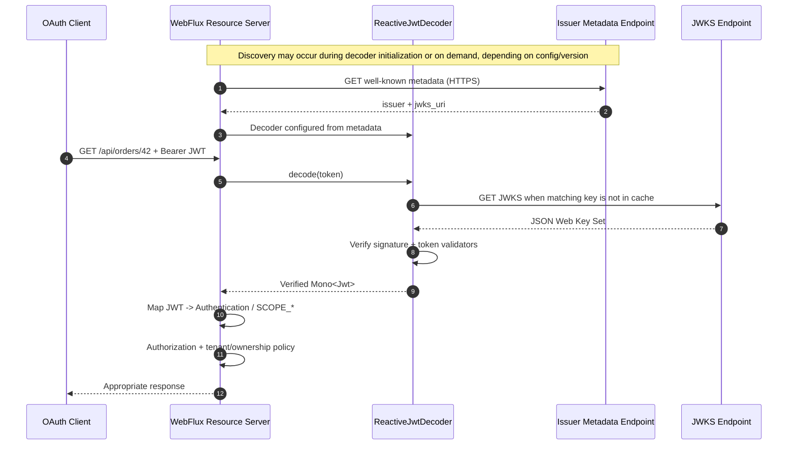

# Metadata Discovery, JWKS Fetching, and Outbound Connectivity Requirements

In a **Spring Security OAuth 2.0 / OIDC Resource Server** using **WebFlux**, verifying a JWT access token is more than splitting a string into three parts. The Resource Server must know **which issuer is trusted**, **which public keys are permitted to verify signatures**, **which API the access token is intended for**, and **how to fetch and refresh keys** when the Authorization Server changes configuration or rotates signing keys.

When `issuer-uri` is configured, Spring Security can discover **issuer metadata** to obtain the **JWKS (JSON Web Key Set)** address. `ReactiveJwtDecoder` then uses the JWKS to verify JWT signatures. This flow has **outbound connectivity requirements**: DNS, HTTPS, truststore, proxy, egress firewall, latency, timeouts, caching, and Authorization Server availability can all affect whether the API accepts tokens.

Basic example:

```yaml
spring:
  security:
    oauth2:
      resourceserver:
        jwt:
          issuer-uri: https://login.example.com/realms/orders
```

The configuration looks short, yet underneath it carries many responsibilities:

1. Identify the exact issuer and a valid metadata endpoint per OIDC Discovery or OAuth Authorization Server Metadata.
2. Read `issuer` and `jwks_uri` published by the trusted metadata.
3. Fetch the public key set from `jwks_uri` over HTTPS.
4. Verify the JWS signature using a key with matching `kid`/`kty`/`alg` and the Resource Server's algorithm policy.
5. Validate `iss`, `exp`, `nbf`, `aud`, token type, and other required claims per contract.
6. Convert the verified JWT into an `Authentication` and authorities such as `SCOPE_orders.read`.
7. Periodically or on demand, fetch new keys according to the implementation's cache/refresh mechanism to support key rotation.
8. When metadata or JWKS is unreachable, **fail closed**—never skip signature verification to keep the API running.

**Key takeaway:** metadata discovery and JWKS form the **trust supply chain for JWT verification**, not a form of user login, and not per-request token introspection. Optimizing network/key caching is important, but it must never weaken issuer and signature trustworthiness.

> **Lesson context:** The Orders API runs Spring Boot 3.x, Spring Security 6.x, **Spring WebFlux**, and Reactor Netty; the Authorization Server has issuer `https://login.example.com/realms/orders`, and the Resource Server requires audience `orders-api`. Examples focus on RSA-signed JWT access tokens. Hostnames, claims, and expiration times shown are illustrative and do not represent a real system. Decoder initialization, caching, and builder API behavior may differ across Spring Security versions; verify against the version in use when applying.

## 1. Three Easily Confused URLs: Issuer, Metadata, and JWKS

These three concepts are related but **do not replace one another**.

| Concept | Example | Responsibility |
|---|---|---|
| **Issuer URI** (`issuer-uri`) | `https://login.example.com/realms/orders` | Identity of the Authorization Server trusted by the Resource Server; tokens must carry a matching `iss` |
| **Metadata endpoint** | `https://login.example.com/realms/orders/.well-known/openid-configuration` | Publishes a JSON document describing the issuer, `jwks_uri`, and other capabilities |
| **JWKS URI** (`jwk-set-uri`) | `https://login.example.com/realms/orders/protocol/openid-connect/certs` | Returns the public keys used to verify signatures |

When an issuer includes a path, constructing the metadata URL follows **different rules across specifications and implementations**. Do not blindly append `/.well-known/...` to an arbitrary URL without checking the provider.

### 1.1. Issuer Is a Trusted Identity, Not Just a Base URL

In a JWT:

```json
{
  "iss": "https://login.example.com/realms/orders",
  "sub": "customer-42",
  "aud": ["orders-api"],
  "scope": "orders.read"
}
```

`iss` indicates the entity that issued the token per contract. The Resource Server must accept **the exact configured issuer**, rather than loosening matching to trust any URL on the same domain.

Example:

```text
Configured issuer:
https://login.example.com/realms/orders

JWT issuer:
https://login.example.com/realms/payments
```

These are two distinct issuers, even on the same host. A token signed by some key set **is not enough for the Orders API to accept** if the issuer is wrong.

### 1.2. What Does Metadata Tell Us?

An OIDC-style metadata document may contain:

```json
{
  "issuer": "https://login.example.com/realms/orders",
  "authorization_endpoint":
    "https://login.example.com/realms/orders/protocol/openid-connect/auth",
  "token_endpoint":
    "https://login.example.com/realms/orders/protocol/openid-connect/token",
  "jwks_uri":
    "https://login.example.com/realms/orders/protocol/openid-connect/certs",
  "response_types_supported": ["code"],
  "subject_types_supported": ["public"],
  "id_token_signing_alg_values_supported": ["RS256"]
}
```

**The fields directly relevant to a Resource Server** are:

- `issuer`: used to confirm the metadata belongs to the configured issuer.
- `jwks_uri`: where to fetch trusted public keys for JWS verification.

Fields like `authorization_endpoint` or `token_endpoint` serve OAuth/OIDC client flows; **they do not mean the Resource Server must call them to verify every JWT access token**.

An easily missed detail: `id_token_signing_alg_values_supported` belongs to OpenID Connect metadata describing ID tokens; **it does not automatically define the policy of accepted JWT access token algorithms** on the Resource Server. The API needs its own algorithm allowlist and token profile.

### 1.3. OIDC Discovery and OAuth AS Metadata

Relevant standard specifications:

- **OpenID Connect Discovery** publishes OpenID Provider information via the well-known `openid-configuration` endpoint.
- **RFC 8414** defines OAuth 2.0 Authorization Server Metadata, typically via `.well-known/oauth-authorization-server`.
- **RFC 7517** defines JWK and JWKS; `RFC 7515` describes JSON Web Signature.

Example of an issuer with a path:

```text
Issuer:
https://login.example.com/realms/orders

Typical OIDC metadata:
https://login.example.com/realms/orders/.well-known/openid-configuration

OAuth AS metadata per RFC 8414 rules:
https://login.example.com/.well-known/oauth-authorization-server/realms/orders
```

Spring Security supports discovery mechanisms per configuration/version and may try appropriate endpoints. **Do not claim all providers support the same well-known URL**. If a provider does not implement discovery, configure the officially issued JWKS URI.

## 2. Why Must JWT Fetch JWKS?

A JWT access token is typically a **JWS signed with an asymmetric key**. The Authorization Server holds the private key, while the Resource Server needs the public key to verify the signature.

Example compact JWT:

```text
BASE64URL(header).BASE64URL(payload).BASE64URL(signature)
```

The header may contain:

```json
{
  "alg": "RS256",
  "typ": "at+jwt",
  "kid": "signing-key-2026-11"
}
```

Payload:

```json
{
  "iss": "https://login.example.com/realms/orders",
  "sub": "customer-42",
  "aud": ["orders-api"],
  "scope": "orders.read",
  "exp": 2000000000
}
```

From the `kid` in the header, the decoder can **select** a public key in the JWKS; however, `kid` is **untrusted information prior to signature verification**, not proof that any key or issuer is valid.

### 2.1. What Is a JWKS?

A simple JWKS:

```json
{
  "keys": [
    {
      "kty": "RSA",
      "kid": "signing-key-2026-11",
      "use": "sig",
      "alg": "RS256",
      "n": "BASE64URL_MODULUS_TRUNCATED_FOR_EXAMPLE",
      "e": "AQAB"
    },
    {
      "kty": "RSA",
      "kid": "signing-key-2026-12",
      "use": "sig",
      "alg": "RS256",
      "n": "ANOTHER_BASE64URL_MODULUS_EXAMPLE",
      "e": "AQAB"
    }
  ]
}
```

The `n` values are placeholders, not valid RSA keys. A real JWKS contains valid JWK values.

Important fields:

| Field | Role |
|---|---|
| `keys` | List of JWKs |
| `kty` | Key type: `RSA`, `EC`, etc. |
| `kid` | Key identifier helping the decoder pick a key |
| `use` | Intended use, such as `sig` for signatures |
| `key_ops` | Permitted key operations if published |
| `alg` | Algorithm suggested/constrained by key metadata per policy |
| `n`/`e` | Public RSA key components |
| `crv`/`x`/`y` | Public EC key components, when using EC |

JWKS is for **distributing public keys**. Private keys must stay in the Authorization Server/HSM/KMS or a controlled signing facility and **must never be published** in a public JWKS.

### 2.2. Having a Matching `kid` Is Not Enough to Trust a Token

A request with header:

```json
{
  "alg": "RS256",
  "kid": "signing-key-2026-11"
}
```

must not be accepted merely because `kid` is found in the JWKS. The decoder must use the corresponding public key to **verify the signature over the exact signing input**. If the payload is altered by even one byte without the valid private key, signature validation fails.

`kid` is a **key-selection hint**, not proof of integrity or access permission.

### 2.3. Why Restrict Algorithms?

If a misconfigured decoder simply trusts the `alg` value self-declared by the token, it can suffer from algorithm confusion issues. The Resource Server's policy must accept **only the JWS algorithms agreed upon with the issuer**, such as RS256 or ES256, matching the API and key type.

Do not "improve compatibility" by accepting `alg=none` or any algorithm in the token header. Never use a public RSA key as an HMAC secret in custom logic.

## 3. Diagram of the Full Metadata → JWKS → JWT Authentication Flow



**The diagram illustrates only the logical steps.** Exact timing of metadata and JWKS fetches depends on version, initialization strategy, HTTP caching, and key state. Not every JWT request triggers a `GET JWKS` or `GET metadata`.

### 3.1. Times When Outbound Connectivity May Be Needed

| Moment | Outbound connection that may occur | Why |
|---|---|---|
| Decoder created from `issuer-uri` | GET issuer metadata | Locate `jwks_uri` and confirm issuer metadata |
| First JWT request / cold key cache | GET JWKS | Retrieve public key for signature verification |
| AS rotates to sign with a new `kid` | Refresh JWKS | Find the new key not yet in cache |
| Key cache expires per implementation | GET JWKS | Refresh public keys |
| Issuer/JWKS host changes IP | New DNS/TCP/TLS as needed | Establish connection to endpoint |
| JWKS endpoint unavailable while old key is cached | May not need network for tokens using old key | Depends on cache and validator |
| Normal per-request traffic when key is cached | Usually **no** JWKS HTTP call | Signature verification is a local operation |

Unlike opaque token introspection—where opaque tokens typically require querying the AS for token status on every validation unless cached—public-key-signed JWTs allow **local verification** once the key is held.

## 4. WebFlux Config: Using `issuer-uri` Only

### 4.1. Dependencies

Gradle Groovy DSL:

```groovy
dependencies {
    implementation 'org.springframework.boot:spring-boot-starter-webflux'
    implementation 'org.springframework.boot:spring-boot-starter-security'
    implementation 'org.springframework.boot:spring-boot-starter-oauth2-resource-server'
}
```

If the application is primarily WebFlux, do not arbitrarily add `spring-boot-starter-web` and expect auto-configuration to still pick a reactive web application; when both MVC and WebFlux are on the classpath, Spring Boot follows specific rules to choose the web application type that must be checked carefully.

### 4.2. application.yml

```yaml
spring:
  security:
    oauth2:
      resourceserver:
        jwt:
          issuer-uri: https://login.example.com/realms/orders
          audiences:
            - orders-api
```

**`issuer-uri`** provides issuer trust and metadata discovery. **`audiences`** is supported in corresponding Spring Boot versions; with a custom decoder or other versions, a custom audience validator is required.

Spring Security can typically use issuer metadata/JWKS and build an appropriate decoder. Validators for `iss`, timestamps, and configured conditions must remain intact. If the resource requires JWT access tokens per **RFC 9068**, you must also validate token type `at+jwt` and profile-required claims.

### 4.3. SecurityWebFilterChain

```java
package com.example.orders.security;

import org.springframework.context.annotation.Bean;
import org.springframework.context.annotation.Configuration;
import org.springframework.http.HttpMethod;
import org.springframework.security.config.Customizer;
import org.springframework.security.config.web.server.ServerHttpSecurity;
import org.springframework.security.web.server.SecurityWebFilterChain;

@Configuration
public class OrdersResourceServerSecurity {

    @Bean
    SecurityWebFilterChain apiSecurity(ServerHttpSecurity http) {
        return http
            .authorizeExchange(auth -> auth
                .pathMatchers(HttpMethod.GET, "/api/orders/**")
                    .hasAuthority("SCOPE_orders.read")
                .pathMatchers(HttpMethod.POST, "/api/orders/**")
                    .hasAuthority("SCOPE_orders.write")
                .anyExchange().authenticated()
            )
            .oauth2ResourceServer(oauth2 ->
                oauth2.jwt(Customizer.withDefaults())
            )
            .build();
    }
}
```

When `oauth2ResourceServer().jwt()` is enabled:

1. Spring Security WebFlux inserts the appropriate reactive Bearer authentication mechanism.
2. `ServerBearerTokenAuthenticationConverter` extracts the Bearer credential.
3. `ReactiveJwtDecoder` verifies the token.
4. The JWT is converted into an `Authentication` and `SCOPE_*` authorities.
5. `authorizeExchange` checks functional permissions.
6. The service must still enforce resource-level access.

The example chain covers all requests under the `anyExchange().authenticated()` policy. If there are web login or admin/actuator routes, design separate security matchers and chains appropriately.

### 4.4. Do Not Confuse Issuer Metadata with OAuth2 Login

A Resource Server **does not need to initiate OIDC browser login** just to fetch public keys. `issuer-uri` is used during access token verification. It differs from `spring.security.oauth2.client.registration.*`, which is for OAuth2 Client/OIDC login.

If a JWT is missing or invalid, the API normally returns a **401 Bearer challenge**, not an HTML redirect to `/login` or the OpenID Provider page.

## 5. What Happens at Startup?

An important operational question: **Must the Resource Server connect to the Authorization Server to start up?**

The answer depends on configuration and the Spring Security/Spring Boot version:

- When creating a decoder from `issuer-uri`, some discovery mechanisms may query issuer metadata during decoder creation/initialization.
- Some configuration strategies defer (lazy-load) discovery until the decoder is used.
- JWKS public keys may likewise be fetched only when a JWT needs verification or the cache needs refreshing.
- If decoder initialization genuinely requires metadata and the AS is unavailable, the application may **fail at startup**.
- If discovery is deferred, the application may reach a ready state, yet JWT requests will still fail until metadata/JWKS can be fetched.

**Do not claim** all Spring Security versions always GET metadata at startup, or always wait for the first request. Check the behavior of the **version and decoder style** in your project.

### 5.1. Why Does Startup Coupling Matter?

Suppose a deployment has 20 pods. All pods restart during an issuer metadata endpoint outage. If every pod requires discovery to initialize its decoder, the rollout can suffer mass startup failures.

Operational measures:

- Set fixed issuer URI and JWKS URI per environment, never from unverified input.
- Run smoke tests against metadata/JWKS before rollout.
- Separate discovery failures from business database errors for diagnostics.
- Decide whether readiness should verify the ability to fetch JWKS.
- Consider configuring **`issuer-uri` + `jwk-set-uri`** when you know the key endpoint upfront and want to reduce metadata discovery dependency.
- Monitor AS availability, DNS, TLS, and key rotation.
- Never work around issues by disabling signature validation.

### 5.2. Successful Startup Does Not Guarantee Subsequent Requests Can Verify Tokens

If the decoder is created without yet fetching JWKS, the first request carrying a JWT may be the first time the app encounters:

- DNS lookup.
- HTTPS certificate validation.
- Proxy/network egress.
- JWKS JSON parsing.
- HTTP timeout or 404.
- Missing matching `kid`.

Therefore, testing **startup capability** and testing **JWT verification requests** are two distinct goals. A `/actuator/health` returning 200 does not by itself prove the JWKS endpoint is reachable.

## 6. Configuring `issuer-uri` + `jwk-set-uri` to Avoid Runtime Discovery

If the provider gives an explicit JWKS URI, both can be configured:

```yaml
spring:
  security:
    oauth2:
      resourceserver:
        jwt:
          issuer-uri: https://login.example.com/realms/orders
          jwk-set-uri: https://login.example.com/realms/orders/protocol/openid-connect/certs
          audiences:
            - orders-api
```

Benefits of this approach:

1. The Resource Server **already knows the key retrieval URL**, avoiding `jwks_uri` discovery via metadata during configuration.
2. It still retains issuer identity to **validate the JWT `iss`** via the corresponding auto-config mechanism.
3. It can reduce a network dependency at initialization/first use.
4. It makes egress allowlists and environment-specific endpoint URLs easier to control.

**However, it does not eliminate outbound connectivity entirely:** the JWT decoder still needs to fetch JWKS public keys when they are not cached or when a refresh is required. If keys are uncached and the JWKS endpoint fails, verification has no trusted key to proceed.

### 6.1. Is Configuring Only `jwk-set-uri` Enough?

Example:

```yaml
spring:
  security:
    oauth2:
      resourceserver:
        jwt:
          jwk-set-uri: https://login.example.com/realms/orders/protocol/openid-connect/certs
```

When only the JWKS URI is known, the decoder can use public keys to verify signatures, but **it does not automatically infer which issuer to accept** without a separate `iss` configuration/validator.

A token signed with a key in the JWKS whose `iss` does not match the contract must be rejected. Therefore, you should:

- Keep `issuer-uri` alongside `jwk-set-uri` if supported by the framework/config.
- Or build a custom decoder and attach `JwtValidators.createDefaultWithIssuer(issuer)`/the corresponding validator.
- Validate audience, timestamps, and other required claims.

**A public key match does not equate to sufficient conditions to trust an access token.** Issuer and audience must be verified independently.

### 6.2. Should Metadata/JWKS Be Hardcoded in Every Application?

Hardcoding an **approved URI** in environment configuration differs from hardcoding key material. Pinning the JWKS URI per environment is often reasonable for network control. However:

- When the AS changes endpoints, new configuration must be deployed.
- You must ensure the host, path, and tenant/realm are accurate.
- Never point a production API to a staging issuer/JWKS.
- Operational documentation must cover ownership and endpoint change procedures.

Never set `jwk-set-uri` to a URL sent by an HTTP caller. Metadata/JWKS is **trust anchor configuration**, not a business parameter.

## 7. Creating a Custom `ReactiveJwtDecoder` from a JWKS URI

When you want exact control over the HTTP client and validators, WebFlux can provide a `ReactiveJwtDecoder` bean.

The following example **skips discovery** because an approved JWKS URI is already known. It demonstrates an issuer validator, an audience validator, and a permitted signing algorithm.

```java
package com.example.orders.security;

import java.util.List;

import org.springframework.context.annotation.Bean;
import org.springframework.context.annotation.Configuration;
import org.springframework.security.oauth2.core.OAuth2Error;
import org.springframework.security.oauth2.core.OAuth2TokenValidator;
import org.springframework.security.oauth2.core.OAuth2TokenValidatorResult;
import org.springframework.security.oauth2.jwt.Jwt;
import org.springframework.security.oauth2.jwt.JwtValidators;
import org.springframework.security.oauth2.jwt.NimbusReactiveJwtDecoder;
import org.springframework.security.oauth2.jwt.ReactiveJwtDecoder;
import org.springframework.security.oauth2.jose.jws.SignatureAlgorithm;
import org.springframework.security.oauth2.core.DelegatingOAuth2TokenValidator;

@Configuration
public class OrdersJwtDecoderConfiguration {

    private static final String ISSUER =
        "https://login.example.com/realms/orders";

    private static final String JWKS_URI =
        "https://login.example.com/realms/orders/protocol/openid-connect/certs";

    @Bean
    ReactiveJwtDecoder reactiveJwtDecoder() {
        NimbusReactiveJwtDecoder decoder =
            NimbusReactiveJwtDecoder.withJwkSetUri(JWKS_URI)
                .jwsAlgorithm(SignatureAlgorithm.RS256)
                .build();

        OAuth2TokenValidator<Jwt> issuerAndTimestamps =
            JwtValidators.createDefaultWithIssuer(ISSUER);

        OAuth2TokenValidator<Jwt> audience = jwt -> {
            if (jwt.getAudience() != null
                    && jwt.getAudience().contains("orders-api")) {
                return OAuth2TokenValidatorResult.success();
            }

            return OAuth2TokenValidatorResult.failure(
                new OAuth2Error(
                    "invalid_token",
                    "Required audience orders-api is missing",
                    null
                )
            );
        };

        decoder.setJwtValidator(
            new DelegatingOAuth2TokenValidator<>(
                List.of(issuerAndTimestamps, audience)
            )
        );

        return decoder;
    }
}
```

The code illustrates **Java 17+ / Spring Security 6.x**; overloads and builder APIs may vary in a specific version.

Explanation:

- `withJwkSetUri(JWKS_URI)` uses the configured key endpoint, not requiring discovery via metadata.
- `jwsAlgorithm(SignatureAlgorithm.RS256)` restricts the JWS algorithm per agreement with the AS (if the AS uses ES256, update per contract; never accept arbitrary algorithms).
- `JwtValidators.createDefaultWithIssuer(ISSUER)` combines standard checks, including issuer and timestamps per implementation.
- The audience validator requires the JWT to be issued for `orders-api`.
- `DelegatingOAuth2TokenValidator` combines the conditions.
- `setJwtValidator` replaces previous validators, so you must **preserve** the needed default/issuer validators when adding new checks.

### 7.1. A Custom Decoder Can Override Boot Auto-Configuration

When an application registers a `ReactiveJwtDecoder` bean, Spring Boot typically uses that bean instead of auto-creating one from `spring.security.oauth2.resourceserver.jwt.issuer-uri`.

Important consequences:

- If the custom decoder **does not** attach an issuer validator, `issuer-uri` in YAML does not guarantee `iss` is still checked.
- If the custom decoder does not attach an audience validator, the `audiences` property may not apply as you expect.
- If the custom decoder permits an algorithm outside the contract, having the right JWKS URI is still not enough protection.

**Do not write a custom decoder just to "make the token work" and accidentally drop default validation checks.** Customize only for specific requirements and re-verify the policy contract.

### 7.2. Never Fetch JWKS from Arbitrary `jku` or `x5u` Headers

A JWS header may carry fields like `jku` or `x5u` pointing to keys/certificates. **Never treat a URL inside an unverified JWT as a trusted key source**.

If an API accepts arbitrary URLs from a token header, an attacker can specify a JWKS they control and sign tokens with their own private key. This behavior introduces both SSRF risk and breaks the issuer trust model.

Key sources must come from:

1. Controlled Resource Server configuration, **or**
2. Metadata from a configured/permitted issuer fetched over a trusted channel.

## 8. WebClient in `ReactiveJwtDecoder`: Configuring Outbound Connections

In WebFlux, HTTP calls to JWKS should use a **reactive HTTP client** instead of making the event loop wait on a blocking client. Spring Security can use `WebClient` as the transport for `NimbusReactiveJwtDecoder` on versions supporting the corresponding builder.

An example creating a `WebClient` with **Reactor Netty HttpClient** and timeouts:

```java
package com.example.orders.security;

import java.time.Duration;

import io.netty.channel.ChannelOption;
import reactor.netty.http.client.HttpClient;

import org.springframework.context.annotation.Bean;
import org.springframework.context.annotation.Configuration;
import org.springframework.http.client.reactive.ReactorClientHttpConnector;
import org.springframework.web.reactive.function.client.WebClient;

@Configuration
public class JwksHttpClientConfiguration {

    @Bean("jwksWebClient")
    WebClient jwksWebClient() {
        HttpClient httpClient = HttpClient.create()
            .option(
                ChannelOption.CONNECT_TIMEOUT_MILLIS,
                500
            )
            .responseTimeout(Duration.ofSeconds(2))
            .followRedirect(false);

        return WebClient.builder()
            .clientConnector(
                new ReactorClientHttpConnector(httpClient)
            )
            .build();
    }
}
```

These are **illustrative timeouts**, not optimal defaults. If metadata and JWKS endpoints have higher latency or are deployed across proxies/regions, tune them according to SLAs and measurements.

### 8.1. Using That WebClient in the Decoder

```java
package com.example.orders.security;

import org.springframework.beans.factory.annotation.Qualifier;
import org.springframework.context.annotation.Bean;
import org.springframework.context.annotation.Configuration;
import org.springframework.security.oauth2.jwt.NimbusReactiveJwtDecoder;
import org.springframework.security.oauth2.jwt.ReactiveJwtDecoder;
import org.springframework.security.oauth2.jwt.JwtValidators;
import org.springframework.security.oauth2.jose.jws.SignatureAlgorithm;
import org.springframework.web.reactive.function.client.WebClient;

@Configuration
public class OrdersJwksDecoderConfiguration {

    @Bean
    ReactiveJwtDecoder reactiveJwtDecoder(
        @Qualifier("jwksWebClient") WebClient jwksClient
    ) {
        NimbusReactiveJwtDecoder decoder =
            NimbusReactiveJwtDecoder
                .withJwkSetUri(
                    "https://login.example.com/realms/orders/protocol/openid-connect/certs"
                )
                .webClient(jwksClient)
                .jwsAlgorithm(SignatureAlgorithm.RS256)
                .build();

        decoder.setJwtValidator(
            JwtValidators.createDefaultWithIssuer(
                "https://login.example.com/realms/orders"
            )
        );

        return decoder;
    }
}
```

**This is a configuration variant**: if the application requires the `orders-api` audience, add an audience validator as in the previous section rather than calling only `createDefaultWithIssuer`. Do not register both decoder examples in this lesson simultaneously as **two `ReactiveJwtDecoder` beans** without an explicit selection mechanism.

The `webClient(...)` builder method is supported on compatible Spring Security versions; verify against the Javadoc for your project's version. If your environment uses a different builder/transport API, keep the core requirement: **a trusted decoder + an HTTP client with timeouts/TLS + the right validators**.

### 8.2. Timeouts to Distinguish

| Timeout type | Meaning | If too long/missing |
|---|---|---|
| **Connect** | Waiting to establish TCP connection | Requests hang when host/network is unreachable |
| **Response/read** | Waiting for bytes/response from endpoint | Slow JWKS slows down JWT requests |
| **Pending acquire** | Waiting to acquire a connection from pool | Requests queue up when pool is exhausted |
| **Overall deadline** | Total request duration across multiple phases | Cannot guarantee SLA even with connect/read timeouts |
| **DNS lookup** | Waiting for hostname resolution | May not be covered by connect timeout |
| **TLS handshake** | Waiting for TLS verification/setup | Requires separate timeout check per client implementation |

`responseTimeout(Duration.ofSeconds(2))` is not necessarily an **end-to-end deadline** covering all DNS/TLS, queuing, and retry steps. To guarantee total latency, design timeouts/deadlines at the appropriate layer and verify connection cancellation on expiration.

### 8.3. Does Every Request Use WebClient to Call JWKS?

No. The HTTP transport is used by the decoder **when keys need to be fetched or refreshed**. Once the matching key is cached, most JWT verification is local and requires no outbound request.

What to verify in operations are cache policy, key rotation, and cold-cache behavior. Never use "API request RPS" directly to estimate JWKS RPS; the traffic relationship is completely different from opaque token introspection.

## 9. Metadata Discovery Is Also a Separate Outbound Connection

When creating a decoder from an issuer, the discovery step may use **a different HTTP client or a different phase** than the HTTP client used to fetch JWKS.

This impacts custom design:

- Calling only `NimbusReactiveJwtDecoder.withJwkSetUri(...).webClient(...)` **does not** configure timeouts for **issuer metadata discovery**, because that example **skips discovery**.
- If you want automatic discovery with a custom-configured HTTP client, use the mechanism supported by your API/version or manage the discovery step yourself per trusted standards before building the decoder.
- Do not write a custom metadata downloader that blindly takes any `jwks_uri` and trusts whatever host appears in JSON without checking.
- The metadata response must have the right `issuer` and a valid `jwks_uri` per contract.
- If metadata published by the AS changes, the decoder may not automatically detect the new URL in every runtime; URI/cache usage and decoder lifecycle depend on the implementation.

### 9.1. When to Avoid Discovery in the Application?

If the Authorization Server has a fixed JWKS endpoint per environment and you want the API to skip metadata calls, configuring **issuer URI + JWKS URI** is a clear choice.

Example:

```text
issuer (validation):
  https://login.example.com/realms/orders

jwks_uri (transport):
  https://login.example.com/realms/orders/protocol/openid-connect/certs
```

However, **never remove the issuer validator just to skip discovery**. Those are two different decisions: *not needing to query metadata* and *not needing to check the issuer*. The second can break the trust boundary.

### 9.2. Metadata Endpoints Must Never Be Built from an Unverified Token

Do not do this:

```text
Unverified JWT payload iss
       |
       v
Build https://{iss}/.well-known/openid-configuration
       |
       v
Fetch metadata / JWKS
       |
       v
Trust whatever keys are returned
```

If you do, an attacker can issue a JWT with an `iss` they control, serve their own JWKS, and make the token "verify successfully."

Better:

```text
Token issuer hint
      |
      v
Match against configured, bounded issuer allowlist
      |
      v
Use decoder belonging to that trusted issuer
      |
      v
Verify signature + exact issuer + API audience
```

In multi-issuer setups, a hint from an unverified token **can serve for routing** into a set of already-trusted decoders, never as a **basis to expand the set of accepted issuers**.

## 10. Distinguishing the Three Layers of JWT Protection

When a token reaches the WebFlux API:

```text
1. Select trust configuration
   issuer-uri / jwk-set-uri / allowed algorithms
            |
            v
2. Cryptographic + claim validation
   signature, exp, nbf, iss, aud, typ/profile ...
            |
            v
3. Authorization
   SCOPE_*, role, subject/client, tenant, owner,
   resource state, business policy
```

### 10.1. A Valid Signature Is Not Enough

A JWT signed by a trusted issuer may be meant for `billing-api` rather than `orders-api`.

```json
{
  "iss": "https://login.example.com/realms/orders",
  "aud": ["billing-api"],
  "scope": "orders.read"
}
```

If the Resource Server checks only signature and issuer while omitting audience, the token can be **misused on the wrong resource**. Thus `aud=orders-api` must be a dedicated condition per contract.

### 10.2. A Valid JWKS Does Not Replace Expiration

A token with a valid signature whose `exp` is in the past must be rejected. `nbf` in the future must also be handled by the timestamp validator and reasonable clock skew. Spring provides standard validators; if replacing them with a custom validator, keep the necessary checks.

### 10.3. An ID Token Is Not an Access Token

An OIDC ID token is meant for the **OIDC client** to convey login authentication details. An API Resource Server must require an **OAuth access token** intended for it.

An ID token can share the same issuer and JWKS as an access token. Therefore, checking "valid signature" alone cannot reliably distinguish the two token types. You need audience, token type/profile, and contract rules so **ID tokens are never accepted as access tokens**.

With the RFC 9068 JWT access-token profile, `typ=at+jwt` is an important token type signal alongside profile-required claims. Design validation intentionally rather than assuming every decoder version enforces full RFC 9068 automatically.

## 11. Key Rotation: The Most Critical Case for Reloading JWKS

Authorization Servers routinely rotate signing keys to reduce private key exposure risk, comply with operational schedules, or respond to incidents. Example:

```text
T0  AS signs tokens with kid=A
T1  JWKS publishes public keys A and B
T2  AS begins signing new tokens with kid=B
T3  Tokens using kid=A remain valid until exp
T4  kid=A tokens expire; AS then removes public key A
```

During the transition window, the JWKS should retain enough public keys for Resource Servers to verify **both still-valid older tokens and new tokens**, per AS policy.

### 11.1. Why Not Remove the Old Key Immediately?

If the AS switches to signing with B and deletes A from the JWKS immediately at T2, valid tokens signed with A may fail verification on Resource Servers with cold/refreshed caches. That triggers widespread 401 errors even though the tokens have not expired.

A rotation plan must consider:

- Access token max lifetime.
- Clock skew across systems.
- Publishing the new key ahead of signing with it.
- RS JWKS cache TTL and refresh behavior.
- Multiple AS pods potentially updating keys asynchronously.
- Rollback capability if key B has issues.

### 11.2. When the Decoder Encounters a New `kid`

Suppose a new token has:

```json
{
  "alg": "RS256",
  "kid": "B"
}
```

The RS cache only holds key A. A refresh-capable decoder can request a fresh JWKS from the AS and find key B.

However:

- Refresh behavior on an unknown `kid` depends on implementation and caching.
- If the JWKS endpoint fails, the RS cannot trust key B just because the token says `kid=B`.
- If the JWKS response lacks B, the token must be rejected.
- If B is present but the signature does not match, the token is still rejected.
- There is no such thing as "new `kid`, so skip the signature once to avoid user errors."

### 11.3. Emergency Rotation and Revocation

If private key A is compromised, the AS may need to pull A early and revoke the effect of older tokens even before `exp`. Yet if an RS still has public key A cached, some tokens may continue to verify locally until the key cache/validation policy is updated.

**JWKS key rotation is not by itself an instant per-token revocation mechanism.** For urgent revocation requirements, additional mechanisms may be needed:

- Short-lived JWT access tokens.
- Denylist/`jti` revocation where designed.
- Session/client status checks per policy.
- Switching to opaque/introspection for use cases requiring centralized state.
- Controlled push invalidation/rolling restarts/configuration updates.

How much is needed depends on your threat model and revocation SLA.

## 12. JWKS Caching and Outages

### 12.1. Why Cache Keys?

JWKS public keys change much less frequently than API traffic. If a decoder fetched JWKS on every JWT request, it would turn signed JWTs into a per-request HTTP dependency similar to introspection, while risking overloading the AS.

Decoders normally maintain a **public key cache** per implementation. When a token uses an existing valid key, verification runs locally:

```text
JWT request
  |
  v
Read kid/alg
  |
  v
Find matching cached trusted key
  |
  v
Verify signature locally
  |
  v
Apply validators and authorization
```

### 12.2. Do Not Hardcode a TTL Assumption Without Checking the Implementation

JWKS caching can be influenced by:

- Spring Security/Nimbus version.
- HTTP response cache headers.
- An explicitly injected cache object.
- Key-miss refresh and rotation logic.
- In-memory vs. custom caches.
- Caching policy for keys vs. failure results.

Therefore, do not claim "Spring always caches JWKS for exactly 5 minutes" or "a new `kid` always triggers an immediate network call" without verifying your version. A production system should verify actual rotation/failure behavior with tests.

### 12.3. Outage with Cached Keys vs. Outage with Cold Cache

| Scenario | Risk / expected behavior |
|---|---|
| Metadata endpoint down, decoder needs discovery | Cannot build decoder or first request fails depending on config |
| JWKS endpoint down, cold cache | No trusted public key; JWT authentication cannot succeed |
| JWKS endpoint down, matching key still cached and valid | May still verify locally, depending on cache/implementation |
| JWKS endpoint down, token has unknown `kid` | No new key to verify; fail closed |
| JWKS endpoint returns malformed JSON | Cannot use new keys; never accept token automatically |
| JWKS endpoint returns an unexpected key change | Must verify signature/alg/kid and trust; monitor anomalous key rotation |
| JWKS endpoint replaced with redirect to another host | Exfiltration/SSRF/trust confusion risk; requires strict redirect policy |

Allowing "stale keys" when the AS is down is a **risk trade-off**: it can help availability for tokens signed by older keys, while delaying the effect of key revocation. Never allow "verify without a key" as a fallback option.

## 13. HTTP/TLS and Outbound Networking Must Be Designed Intentionally

Metadata and JWKS are typically HTTP GET calls to hostnames outside the pod/container. Although public keys are public data, **the channel fetching them must authenticate the right server**. If an attacker can alter the JWKS response, they can inject a public key they control where the Resource Server treats it as trusted.

### 13.1. What Must HTTPS Protect?

- TLS verifies the hostname the application connects to.
- The certificate chain must be trusted via the truststore/CA.
- Prevents attackers on the network path from spoofing JWKS or metadata.
- Never disable hostname verification to "fix an SSL handshake."
- Never install a trust-all certificate manager in production.
- Never fetch JWKS over plaintext HTTP on an untrusted network.

**Public keys are not secrets, but the integrity and origin of public keys are critical.** The fact that JWKS contains no private keys **does not mean this endpoint can skip HTTPS**.

### 13.2. Private CAs and Truststores

If a staging issuer uses a private CA:

```text
Resource Server JVM truststore
    |
    +-- trusted corporate staging CA
            |
            +-- certificate for login.staging.example.com
```

Ensure:

1. The CA is administratively approved.
2. The certificate SAN matches the hostname.
3. The chain is valid and the certificate is unexpired.
4. The JVM/container uses the actually configured truststore.
5. System clocks are accurate to validate TLS certificates and JWT timestamps.

Never import an unknown CA JVM-wide or set an `insecureTrustManager` to bypass certificate errors.

### 13.3. DNS/Egress/Firewall

A pod might verify JWTs on a developer machine yet fail in production because:

- Kubernetes `NetworkPolicy` blocks egress to the issuer/JWKS.
- Cluster DNS fails to resolve the hostname.
- Firewall/proxy blocks HTTPS port 443.
- A corporate proxy requires special configuration.
- NAT/egress gateway runs out of connections or ports.
- A TLS inspection proxy uses an unrecognized CA.
- The endpoint returns a redirect to a new host blocked by egress policy.

If `jwks_uri` resides on a different host from the issuer, **allowlist the actual JWKS host as well**, not just the issuer host. Do not open unrestricted Internet egress just to fetch one public endpoint.

### 13.4. Reverse Proxy Path Rewriting

Configured issuer:

```text
https://login.example.com/realms/orders
```

yet a proxy may forward metadata to a different internal path. If the AS publishes metadata stating:

```json
{
  "issuer": "http://internal-service:8080/realms/orders",
  "jwks_uri": "http://internal-service:8080/certs"
}
```

while the Resource Server trusts the public HTTPS issuer, fix the **AS/proxy external URL configuration**. Never disable `iss` validation just to accept metadata containing wrong internal URLs.

## 14. Redirects and SSRF During Metadata/JWKS Fetching

Discovery runs over HTTP, so both source and destination must be controlled.

### 14.1. Risk of Attacker-Controlled URLs

An unsafe design:

```text
GET /api/resource
Authorization: Bearer token

Read unverified JWT iss/jku
    |
    v
Construct URL from untrusted claim
    |
    v
GET arbitrary host
    |
    v
Trust returned JWKs
```

An attacker can force the server to call:

- Internal network endpoints/cloud metadata services.
- A host impersonating the Authorization Server.
- An attacker-controlled JWKS.
- A non-TLS endpoint returning forged keys.

Solution:

1. Configure the issuer allowlist at deployment time.
2. Only perform discovery against approved issuers.
3. Verify metadata `issuer` exactly matches the configured issuer.
4. Only use `jwks_uri` on hosts/schemes permitted by policy.
5. Never automatically follow redirects to unauthorized hosts.
6. Bound timeouts, response sizes, and redirect counts.
7. Never accept keys supplied by HTTP callers outside the contract.

### 14.2. Can the JWKS URI Be on a Different Host from the Issuer?

Yes, depending on how the Authorization Server deploys metadata. For example, the issuer is at `login.example.com` while `jwks_uri` is at `keys.example-cdn.com`.

The requirement is not **forcing the exact same hostname**, but rather that the **JWKS URI must be published through trusted issuer metadata or provided by trusted configuration**, along with proper HTTPS/allowlist/routing policies.

If using a CDN, ensure JWKS distribution cannot be tampered with, cache headers align with key rotation, and CDN domains/CAs sit inside the approved trust boundary.

## 15. WebFlux Does Not Mean There Are No I/O Dependencies

With `ReactiveJwtDecoder`, metadata/JWKS fetches can use a reactive HTTP client. However:

- TLS handshakes, DNS, and networking still incur latency.
- A cold key cache can make the first request wait.
- A downed JWKS endpoint can cause authentication to fail.
- Reactor event loops are bounded; custom blocking code can cause starvation.
- Adding `block()`/`subscribe()` inside a decoder/converter can break context, latency, and error propagation.
- Creating a new decoder per request can discard caches and multiply network traffic.

### 15.1. Anti-Pattern: Creating a Decoder per Request

```java
// WRONG: illustrative anti-pattern not for production Resource Servers.
public Mono<Jwt> decodeOnEveryRequest(String token) {
    ReactiveJwtDecoder decoder =
        NimbusReactiveJwtDecoder.withJwkSetUri(JWKS_URI).build();

    return decoder.decode(token);
}
```

Re-creating the decoder each time can lose reuse/caches/client resources and increase JWKS loads.

**Better:** create `ReactiveJwtDecoder` as a long-lived bean/singleton managing the HTTP client and cache in the application context, and reuse it across requests.

### 15.2. Do Not Block the Event Loop When Fetching Metadata

A custom implementation like:

```java
// WRONG: blocking network call in reactive path.
Mono<Jwt> unsafeDecode(String token) {
    String jwksJson = restTemplate.getForObject(
        "https://login.example.com/jwks", String.class
    );
    return Mono.just(parseAndTrustJwt(token, jwksJson));
}
```

not only blocks threads but also bypasses Spring Security's verification mechanisms. Use standard `ReactiveJwtDecoder` and a reactive HTTP client.

If integrating a legacy blocking SDK is unavoidable, isolate it on an appropriate scheduler with bounded concurrency, while still avoiding hand-rolling cryptographic validation.

## 16. Timeouts, Connection Pooling, and Deadlines

When a JWT needs to fetch JWKS, a request can depend on outbound HTTP. Therefore, you need:

- Connect timeout.
- Response/read timeout.
- Pool acquisition timeout if using a connection pool.
- DNS/TLS handshake timeouts per the HTTP client.
- An overall deadline when SLAs are strict.
- Bounded retries and cancellation.

### 16.1. Budget Example

Suppose the API targets p95 under 800 ms, and the business DB takes 400 ms on most requests. If the first request spends 2 seconds fetching JWKS, it breaches the SLA. You cannot just "increase the API timeout" and expect no impact.

Options:

- Warm the JWKS cache in a controlled way before putting a pod into service.
- Use a reliable, managed JWKS endpoint/CDN.
- Set HTTP timeouts aligned with SLAs and real latencies.
- Define behavior for cold/unknown key caches.
- Measure p95/p99 latency separately for decode/remote key fetches.
- Watch single-flight/cache refresh behavior to prevent multiple concurrent requests from hammering JWKS.

### 16.2. Do Not Turn a JWKS Outage into a Retry Storm

Suppose all requests carry an unknown `kid` while the AS is slow. If every request retries 3 times without throttling/caching/deduplication, the AS takes amplified load while already degraded.

Retries should:

- Have bounded attempt counts and an overall deadline.
- Apply only to potentially transient network/5xx errors if permitted by contract.
- Never infinitely retry tokens with bad signatures or wrong issuer/audience.
- Never switch the JWKS URL to a host outside the allowlist.
- Use backoff/jitter to reduce thundering herds.
- Never turn failures into "skip verification."

## 17. From JWKS to Authentication in Spring Security WebFlux

After `ReactiveJwtDecoder` verifies a token, it returns a `Mono<Jwt>` containing the accepted token claims. Spring Security then proceeds to build an `Authentication`.

```text
Authorization: Bearer JWT
       |
       v
ServerBearerTokenAuthenticationConverter
       |
       v
BearerTokenAuthenticationToken (unauthenticated)
       |
       v
JwtReactiveAuthenticationManager
       |
       v
ReactiveJwtDecoder.decode()
  ├── JWKS public key from cache/HTTPS
  ├── JWS signature
  ├── issuer / timestamp / audience / token profile
       |
       v
JwtAuthenticationToken (authenticated)
       |
       v
Reactor SecurityContext
       |
       v
authorizeExchange / reactive method security / service policy
```

Given the claim:

```json
{
  "scope": "orders.read orders.write"
}
```

authorities are normally mapped to:

```text
SCOPE_orders.read
SCOPE_orders.write
```

**This is a post-authentication result**, not data trusted upon reading a base64url payload. Only after key/claim validators accept the token can scopes be used to make permission decisions.

### 17.1. Reactor SecurityContext Instead of ThreadLocal

In WebFlux, authentication flows with the **Reactor Context**; reactive code can access it via:

```java
import org.springframework.security.core.context.ReactiveSecurityContextHolder;
import reactor.core.publisher.Mono;

Mono<String> currentSubject =
    ReactiveSecurityContextHolder.getContext()
        .map(ctx -> ctx.getAuthentication().getName());
```

Do not use Servlet-style ThreadLocal `SecurityContextHolder` as the default solution in reactive pipelines. Do not `block()` to fetch the user and continue on the event loop.

### 17.2. Object-Level Permission Checks Are Still Needed

A valid JWT with scope `orders.read` **does not prove** the subject can view someone else's order. After `Authentication`, the service must check owner/tenant/delegation/resource state per policy.

Metadata/JWKS only help answer **was the token signed by a trusted issuer and does it satisfy validators?**. They cannot answer **who owns order 42**.

## 18. 401, 403, and JWKS Dependency Errors

| Scenario | Interpretation | Typical response |
|---|---|---|
| No Bearer token on protected API | Missing authentication | **401**, `WWW-Authenticate: Bearer` |
| Invalid JWT signature | Cannot verify | **401 invalid_token** |
| Expired or not-yet-valid JWT | Rejected by validators | **401 invalid_token** |
| Wrong JWT `iss` | Disallowed issuer | **401 invalid_token** |
| Wrong JWT `aud` | Token not meant for API | **401 invalid_token** |
| JWT `kid` matches no key and refresh finds none | Cannot verify | **401 invalid_token** or corresponding error |
| Valid token missing `SCOPE_orders.read` | Rejected by authorization | **403 insufficient_scope** when applicable |
| Valid token/sufficient scope, wrong tenant/owner | Rejected by object policy | **403** or **404** per contract |
| Metadata/JWKS endpoint timeout | Missing required key/metadata | **Fail closed**, HTTP error mapping depends on config |
| Invalid TLS certificate | No trust in endpoint | **Fail closed**, fix TLS, never disable verification |
| JWKS endpoint returns 429/5xx | Dependency failure or rate limit | Never accept JWT automatically; classify operational error |
| Metadata issuer mismatch | Misconfigured trust/provider | Do not use that metadata |

Some framework configurations may map JWKS fetch failures to an authentication failure (401), while some dependency errors return 5xx if the application configures appropriate exception handling. **Do not claim Spring always returns 503** when JWKS is down, and never disguise all dependency failures as "the user logged in incorrectly."

### 18.1. Do Not Redirect to OIDC HTML Login

A Resource Server API receiving Bearer tokens should generally return Bearer 401/403 per RFC 6750. If a web login app runs alongside it, separate `SecurityWebFilterChain` instances so API calls never fall into `oauth2Login`/form login flows.

Key or metadata errors are not requests for the browser to log in again. They may indicate an AS/network/rotation incident to resolve on the server side.

### 18.2. How to Distinguish Token Errors from Network Errors?

Group metrics/logs cleanly:

```text
jwt_validation_error = expired / bad_signature / wrong_issuer
                      / wrong_audience / unsupported_algorithm

jwks_dependency_error = dns / tls / connect_timeout / response_timeout
                      / http_404 / http_429 / http_5xx / invalid_json

discovery_error = metadata_not_found / issuer_mismatch
                / invalid_metadata / network_error
```

Never log raw JWTs. You may log `kid` after treating it as **untrusted, bounded data**, alongside the error class and non-sensitive issuer config ID. Avoid metric labels with unbounded cardinality driven by arbitrary attacker-supplied `kid` values.

## 19. Monitoring for Metadata/JWKS and Key Rotation

Useful metrics:

| Metric / signal | Meaning |
|---|---|
| `jwt.decode.duration` | Time spent by the decoder processing JWTs |
| `jwks.fetch.total` | Number of JWKS fetches |
| `jwks.fetch.duration` | HTTP key fetch latency |
| `jwks.fetch.error` | DNS/TLS/timeout/HTTP/parse errors |
| `jwks.cache.hit/miss` | Cache effectiveness, if exposed by implementation |
| `jwt.invalid_signature` | Signature failures; spikes during rotation anomalies |
| `jwt.unknown_kid` | Key ID not in cache/not published |
| `metadata.discovery.error` | Issuer metadata errors |
| `jwks.keys.count` | Number of published public keys per environment |
| `tls.handshake.failures` | HTTPS certificate/network errors |
| `authentication.401.rate` | Spike in API authentication failures |
| `pod.startup.failures` | Possibly linked to discovery/AS outages |

These are **suggested metric names**, not all provided out of the box by Spring Security. You can instrument WebClient/Reactor Netty, Actuator/Micrometer, and a decoder wrapper.

### 19.1. How to Avoid Leaking JWTs in Telemetry

Never put into logs, traces, or metrics:

- Raw `Authorization` headers.
- Compact JWT strings.
- Private keys or secrets.
- Full JWT payloads containing PII.
- Attacker-controlled dynamic unverified `jku`/`iss` URLs as metric labels.
- High-cardinality token-specific identifiers.

Log allowlisted issuer configuration IDs, endpoint hostnames, response statuses, latencies, and error classes. If recording `sub`/`jti` for auditing, enforce clear personal-data policies and access controls.

## 20. Testing Discovery and JWKS with a Controlled Fake Issuer

Tests using only `mockJwt()` in WebFlux are very useful for checking authorization, yet **they do not verify HTTP discovery or real JWKS fetching**. To test this properly, use an HTTP test server or test Authorization Server instance with metadata/JWKS and a test keypair.

### 20.1. Test Components

Example fake issuer:

```text
http://localhost:<test-port>/issuer
    |
    +-- /.well-known/openid-configuration
    |      issuer   = exact fake issuer
    |      jwks_uri = http://localhost:<test-port>/issuer/jwks
    |
    +-- /jwks
           keys = [public key A, public key B]
```

`http://localhost` in tests is used inside an isolated environment. Production must use HTTPS and proper certificate validation. When testing an issuer with a path, the **actual metadata route** must follow OIDC/RFC 8414 or specific test configuration; the diagram shows logical structure rather than forcing every endpoint under one prefix.

The fake issuer must sign JWTs with a **test private key**, while the JWKS publishes only the corresponding public keys. Never copy production private keys into test fixtures.

### 20.2. Scenarios to Test

| Test case | Fake metadata/JWKS | Expectation |
|---|---|---|
| Valid issuer metadata | Valid `issuer` and `jwks_uri` | Decoder locates trusted JWKS endpoint |
| Wrong metadata issuer | JSON `issuer` differs from configured URI | Metadata is not trusted |
| Metadata 404 | No discovery endpoint | Config/decoder cannot discover via that flow |
| Malformed metadata JSON | Malformed JSON/missing required fields | Untrusted URL is never used |
| JWT key A, JWKS has A | Valid signature | Decode succeeds if claims are valid |
| JWT key A with bad signature | Key A present in JWKS | Decode fails |
| JWT wrong issuer | Valid signature | Issuer validator rejects |
| JWT wrong audience | Valid signature | Audience validator rejects |
| JWT expired `exp` | Valid signature | Timestamp validator rejects |
| JWT disallowed `alg` | JWKS has another key | Decoder rejects |
| JWT `kid=B` and JWKS moves from A to A+B | Key rotation | Depending on refresh mechanism, decode succeeds once B is loaded |
| JWT non-existent `kid=C` | JWKS has only A+B | Decode fails |
| JWKS 429/500/timeout | Outbound failure | Fail closed, no Authentication created |
| JWKS invalid TLS certificate | TLS handshake fails | Truststore is not bypassed |
| JWKS redirects to disallowed host | 302 response | Out-of-policy URL/keys are not trusted |
| JWKS cache warm, endpoint down | Key A already cached | Observe version/cache behavior without guessing |
| Startup while metadata is down | Fake metadata unavailable | Record version's startup/lazy behavior |

### 20.3. Testing WebFlux Authorization Separately from Decoder Networking

Spring Security Test supports `mockJwt()` with `WebTestClient`:

```java
import static org.springframework.security.test.web.reactive.server
    .SecurityMockServerConfigurers.mockJwt;

client.mutateWith(
        mockJwt().jwt(jwt -> jwt
            .subject("customer-42")
            .claim("scope", "orders.read"))
    )
    .get()
    .uri("/api/orders/42")
    .exchange()
    .expectStatus().isOk();
```

The example can return 200 only if the handler/fixture and object policy allow `customer-42` to read order 42. More importantly, **`mockJwt()` bypasses the decoder and JWKS HTTP**: it does not prove signature verification, issuer discovery, audience validation, TLS, or key rotation work properly.

To **truly test JWKS**, send a Bearer JWT signed with the test private key through the filter chain and use a fake metadata/JWKS server called by the decoder.

### 20.4. Testing Cold Cache and Key Rotation

A practical scenario:

```text
Step 1: Fake JWKS publishes A
Step 2: Send JWT signed with A, verify success
Step 3: Fake JWKS publishes A+B
Step 4: Send JWT signed with B, observe refresh on unknown kid
Step 5: Fake JWKS removes A after token A validity window
Step 6: Test tokens A and B under actual policy/cache
Step 7: Temporarily shut down JWKS server, test warm vs. cold cache
```

Refresh/timing results must be measured **according to your version and cache configuration**; do not force tests to expect a fixed TTL if the implementation does not guarantee one.

## 21. Rollout Planning and Health Checks

### 21.1. Should Readiness Call JWKS?

It depends on operational strategy. A health check probing external dependencies can catch outages before taking traffic, yet if every pod continuously GETs metadata/JWKS, the system can create extra load or cause all pods to go unready simultaneously during AS blips.

Options:

- Separate **liveness** (process is alive) from **readiness** (able to serve requests).
- Do not call JWKS from liveness probes at high frequency.
- Use controlled startup warmup or synthetic verification if approved by security/SRE.
- Use short timeouts and avoid health checks that trigger unnecessary JWKS refreshes.
- Monitor verification capability on a proper test token, avoiding production tokens/sensitive credentials in logs.
- When the AS is down while cached keys remain, decide readiness per SLA and threat model rather than an absolute rule.

### 21.2. Environment-Specific Configuration

| Environment | Issuer | JWKS |
|---|---|---|
| Development | `https://login.dev.example.com/realms/orders` | Dev issuer's JWKS |
| Staging | `https://login.staging.example.com/realms/orders` | Staging issuer's JWKS |
| Production | `https://login.example.com/realms/orders` | Production JWKS |

Each environment requires:

- Exact issuer/audience.
- Exact host/certificate/CA.
- Proper network egress.
- Matching permitted algorithm policy.
- Never mixing tokens or keys across dev/staging/prod.
- Testing rotation and rollback before major rollouts.

### 21.3. When the JWKS Endpoint URL Changes

If the AS changes metadata `jwks_uri` from host/path A to B:

- Resource Servers configured with a fixed `jwk-set-uri` must have their configuration updated.
- Discovery-based Resource Servers may only learn the URL when building the decoder, depending on implementation; they do not necessarily poll metadata continuously.
- Update egress allowlists and truststores if the host/CA changes.
- Do not merely change DNS for the hostname and ignore TLS SANs.
- Perform a rollout/canary and test new tokens signed with keys from endpoint B.

## 22. Common Design Mistakes

### 22.1. "JWT Uses Local Validation So It Needs No Internet/Network"

Wrong: if using issuer discovery and JWKS, the RS needs outbound HTTPS at least when fetching metadata/new keys. Only **after trusted keys are cached** can many requests verify offline.

### 22.2. "Using `issuer-uri` Is Enough to Validate Audience"

Wrong: issuer identifies **who issued** the token, whereas audience identifies **which API the token is for**. Configure `audiences`/a custom validator when the resource contract requires it.

### 22.3. "Having `jwk-set-uri` Means No Need to Check `iss`"

Wrong: matching a public key does not automatically bind the issuer. Keep `issuer-uri` or an issuer validator in custom decoders.

### 22.4. "JWKS Endpoints Are Public So HTTPS Can Be Skipped"

Wrong: an attacker can tamper with public keys in transit, tricking the Resource Server into trusting a fake key. TLS integrity/origin authentication is a security requirement.

### 22.5. "`kid` Present in JWKS Means the Signature Is Valid"

Wrong: `kid` only selects the key; signature verification must still be executed.

### 22.6. "Token Header `jku` Is a JWKS Source"

Wrong: unverified headers can be controlled by an attacker. Use only trusted configuration or allowlisted issuer metadata.

### 22.7. "Every HTTP Request Must Fetch JWKS to Be Secure"

Unnecessary: key caching enables local verification; fetching JWKS on every request adds needless network dependency. Cache properly and refresh on rotation.

### 22.8. "Key Rotation Means Deleting the Old Key Immediately"

This can reject still-valid tokens on pods with cold caches. Overlap keys according to token max lifetime and security incident policy.

### 22.9. "If JWKS Cannot Be Fetched, Skip Signature Validation"

Never. Without a trusted public key, **fail closed**.

### 22.10. "MockJwt Tests Prove Discovery/JWKS Works"

No. `mockJwt()` supplies an Authentication in tests without going through signature verification. Use signed test JWTs and a fake JWKS server to test network/crypto.

### 22.11. "WebFlux Should Use RestTemplate to Fetch JWKS and `block()`"

Unsuitable for the reactive event loop. Prefer `ReactiveJwtDecoder` and a non-blocking HTTP client.

### 22.12. "Keeping Public Keys in the Repository Is the Best Protection Against AS Outages"

Pinning public keys removes JWKS network dependency, but introduces **manual rotation risk and stale keys**. If this choice fits policy, maintain update procedures, overlapping keys, and issuer/audience/alg checks. Do not assume it is universally better than discovery/JWKS for all systems.

## 23. Choosing an Architecture Based on Requirements

| Model | Benefits | Trade-offs |
|---|---|---|
| **`issuer-uri` automatic discovery** | Minimal config, follows provider metadata | Network discovery dependency depending on lifecycle; requires trusting metadata |
| **`issuer-uri` + `jwk-set-uri`** | No need to discover JWKS URI; still validates issuer | Must update URI if AS changes endpoint |
| **Custom `ReactiveJwtDecoder` + WebClient** | Customizes timeouts, TLS, algorithms, cache/validators | Easy to omit checks if misconfigured |
| **Pinned static public key** | No runtime JWKS HTTP needed | Manual key rotation, risk of stale/untrusted keys |
| **Opaque token + introspection** | Centralized token state, can reflect revocations faster | Per-request AS dependency, higher latency/capacity cost if uncached |

Selection should be based on:

- Availability of the AS/JWKS endpoint.
- Key rotation and revocation requirements.
- Issuer/audience security boundaries.
- Request SLAs, egress policies, proxies, and TLS.
- Scale across multiple Resource Servers.
- Ability to test and monitor when the AS loses connectivity.

## 24. Practical Troubleshooting Runbook

Suppose the Orders API returns 401 for all new JWTs after a rotation.

**Step 1 — Separate the error categories**

- `invalid_token` due to bad signature?
- New `kid` missing from JWKS/cached keys?
- Metadata issuer mismatch?
- JWKS HTTP 404/5xx/timeout?
- Token has wrong `aud` or `iss`?
- Algorithm changed from RS256 to ES256 while the Resource Server only allows RS256?

**Step 2 — Check trusted config**

```text
spring.security.oauth2.resourceserver.jwt.issuer-uri
spring.security.oauth2.resourceserver.jwt.jwk-set-uri (if present)
spring.security.oauth2.resourceserver.jwt.audiences (if supported)
custom ReactiveJwtDecoder validators/allowed algorithms
```

Do not log raw tokens. Check hostname, realm, trailing slash, and exact issuer match per contract.

**Step 3 — Check networking from the pod**

- Does DNS resolve the issuer/JWKS host?
- Do egress firewall/NetworkPolicy allow port 443?
- Are TLS certificate SAN/chain still valid?
- Is a proxy altering responses/redirects?
- Does the JWKS endpoint return the expected `keys` and the new key's `kid`?
- Are HTTP status/latency/timeouts abnormal?

**Step 4 — Check key rotation**

- Did the AS publish the new public key before signing with it?
- Are multiple AS instances serving different JWKS?
- Are pod caches refreshing via the expected mechanism?
- Was the old key removed too early?
- Do JWT header `kid` and `alg` match the plan?

**Step 5 — Remediate by root cause**

- Fix network/TLS or URLs if wrong.
- Fix AS/proxy external metadata issuer/JWKS URI if misconfigured.
- Restore JWKS key overlap if rotation orphaned older tokens.
- Tune cache/warmup per version and policy.
- Roll back signing keys if a safe procedure exists without weakening security.
- Never turn on `permitAll()` or skip JWT verification.

### 24.1. Canary Scenario When Changing Signing Keys

Before rollout:

1. Publish key B in the JWKS alongside A.
2. Canary RS verifies A-signed and B-signed tokens in controlled tests.
3. Confirm audience, issuer, alg, and typ/profile validators.
4. Start signing new tokens with B.
5. Monitor 401s/signature errors/unknown `kid` cluster-wide.
6. Keep key A until A-signed tokens expire per contract, except during a security incident.
7. Remove A and verify post-rotation state.

## 25. Key Points to Remember

- **`issuer-uri`** is the trusted Authorization Server identity; it commonly supports metadata discovery.
- **Metadata** publishes `issuer` and `jwks_uri`; the Resource Server must trust metadata only from configured/allowlisted issuers.
- **JWKS** contains public keys to verify JWS; private keys must never be published.
- **`kid`/`alg`** are header hints to select a key/algorithm and do not prove a token is valid.
- **Local JWT verification** is an advantage once keys are cached, yet **discovery and JWKS still need HTTPS/networking** at initialization or rotation/refresh.
- **`issuer-uri` + `jwk-set-uri`** can avoid metadata discovery while preserving issuer validation in matching configurations; `jwk-set-uri` alone does not guarantee `iss`.
- **Custom `ReactiveJwtDecoder`** beans must preserve signature, issuer, expiry/not-before, audience, algorithm, and token-profile checks per contract.
- **WebFlux** uses `ReactiveJwtDecoder`/a reactive HTTP client, never blocking the event loop with `RestTemplate.block()`.
- **TLS, truststores, DNS, proxies, egress, timeouts, and redirect policies** are all part of key-fetching security.
- **Key rotation** requires public key overlap, cache refresh, and monitoring; an unknown `kid` must never bypass signature validation.
- **A JWKS outage** with a cold cache differs from an outage with cached keys; every scenario must fail closed when trusted evidence is absent.
- **`mockJwt()`** only tests simulated authorization and does not replace signed JWT + fake metadata/JWKS endpoint tests.
- **Valid scopes and signatures do not replace object permissions**: the service must still check tenant, ownership, and business policy.

## 26. Standards and References

- [OpenID Connect Discovery 1.0](https://openid.net/specs/openid-connect-discovery-1_0.html): OpenID Provider metadata, `issuer`, and `jwks_uri`.
- [RFC 8414 — OAuth 2.0 Authorization Server Metadata](https://www.rfc-editor.org/rfc/rfc8414): metadata and well-known URI rules.
- [RFC 7517 — JSON Web Key (JWK)](https://www.rfc-editor.org/rfc/rfc7517): JWK and JSON Web Key Set.
- [RFC 7515 — JSON Web Signature (JWS)](https://www.rfc-editor.org/rfc/rfc7515): JWS signatures, protected headers, and signing input.
- [RFC 7519 — JSON Web Token (JWT)](https://www.rfc-editor.org/rfc/rfc7519): token claims such as `iss`, `aud`, `exp`, `nbf`.
- [RFC 8725 — JWT Best Current Practices](https://www.rfc-editor.org/rfc/rfc8725): algorithms, trust, and JWT risks.
- [RFC 9068 — JWT Profile for OAuth 2.0 Access Tokens](https://www.rfc-editor.org/rfc/rfc9068): distinguishing JWT access tokens and profile requirements.
- [Spring Security — Reactive OAuth 2.0 Resource Server JWT](https://docs.spring.io/spring-security/reference/reactive/oauth2/resource-server/jwt.html): `ReactiveJwtDecoder`, issuer discovery, validation, and JWT customization.
- [Spring Security — WebFlux Configuration](https://docs.spring.io/spring-security/reference/reactive/configuration/webflux.html): `SecurityWebFilterChain` and `ServerHttpSecurity`.
- [Spring Framework — WebClient](https://docs.spring.io/spring-framework/reference/web/webflux-webclient.html): reactive HTTP client, connectors, and filters.
- [Reactor Netty Reference](https://projectreactor.io/docs/netty/release/reference/): TCP/HTTP connections, timeouts, SSL/TLS, and observability.

**Conclusion:** In a WebFlux JWT Resource Server, **metadata discovery locates the trusted JWKS source, JWKS supplies public keys, and `ReactiveJwtDecoder` verifies signatures and access token claims**. The system operates securely only when outbound connections to metadata/JWKS are governed by trusted URIs, proper HTTPS/TLS, appropriate egress/proxy/timeouts, and intentional key caching/rotation. Even though cached public keys enable offline verification for many requests, **never accept a JWT when a trusted key is missing, issuer/audience is wrong, or the signature is invalid**.
