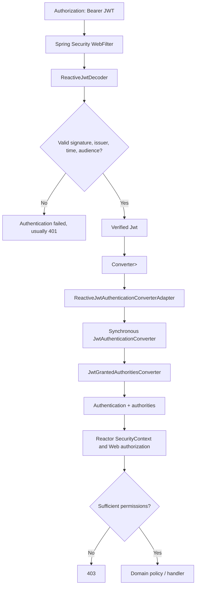
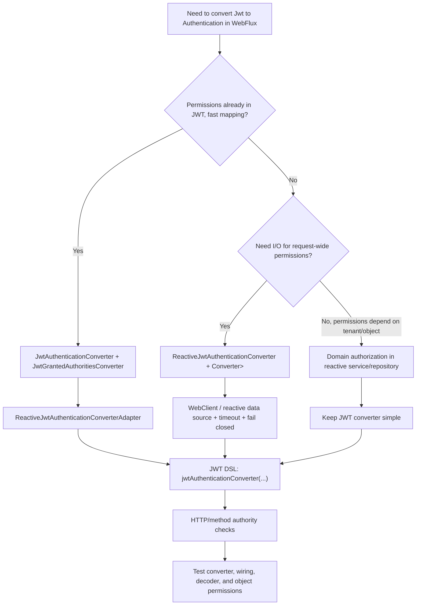

# ReactiveJwtAuthenticationConverterAdapter and Limitations of Synchronous Converters

In a **Spring Security OAuth 2.0 Resource Server** using **Spring WebFlux**, after a JWT access token is verified by `ReactiveJwtDecoder`, it must be turned into an `Authentication` containing a principal and a list of `GrantedAuthority` instances. By default Spring Security includes standard scope-mapping mechanics, yet many systems need to read a `permissions` claim, change the `SCOPE_` prefix, or customize the principal display name.

In Servlet applications, we commonly configure `JwtAuthenticationConverter` and `JwtGrantedAuthoritiesConverter`. When moving to WebFlux, the question arises: **Can that synchronous converter be reused?** Spring Security provides `ReactiveJwtAuthenticationConverterAdapter` specifically for this situation. However, the word "Reactive" in its name **does not turn blocking computation into non-blocking execution**. The adapter is only appropriate for adapting an *imperative converter that executes quickly without blocking I/O* into a `Mono`-returning contract.

This lesson distinguishes between a **synchronous converter wrapped with the adapter**, **`ReactiveJwtAuthenticationConverter` which natively supports an authorities publisher**, and a **custom converter using `Mono`/`Flux` when asynchronous interaction is needed**. Examples apply to **Spring Boot 3, Spring Security 6, Java 17+, and WebFlux**, focusing on JWT Resource Servers; verify exact libraries and APIs against your actual version.

## 1. Why Is a Converter Needed After JWT Verification?

An access token may contain:

```json
{
  "iss": "https://identity.example.com/realms/shop",
  "sub": "user-123",
  "aud": ["orders-api"],
  "scope": "orders.read orders.write",
  "permissions": ["reports.export"],
  "exp": 1900000000
}
```

This is only an **illustrative JWT payload**, not a signed token. The Resource Server may trust the claims **only after the decoder accepts the signature, issuer, expiration, audience, and mandatory token profile conditions**.

Distinct responsibilities:

| Component | Primary responsibility |
| --- | --- |
| `ReactiveJwtDecoder` | Decodes and **verifies** the JWT according to configured policy. |
| JWT authentication converter | Converts an **accepted JWT** into an `Authentication`, including principal name and authorities. |
| `SecurityWebFilterChain` | Checks whether the request is permitted to access an endpoint by HTTP path/method. |
| Reactive method security | Checks permissions at the service method when enabled and invoked through the proper proxy. |
| Domain authorization | Checks tenant, owner, ACL, or permissions on a **specific record**. |

When a token carries `scope = "orders.read orders.write"`, the default scope converter normally produces:

```text
SCOPE_orders.read
SCOPE_orders.write
```

`hasAuthority("SCOPE_orders.read")` compares the **exact authority string** produced. If the prefix is changed to `PERM_`, authorization rules must change accordingly.

## 2. Position of the Adapter in the WebFlux Pipeline



The diagram depicts the **adapter-based branch**. If using a purely reactive `ReactiveJwtAuthenticationConverter`, the adapter step is replaced by that converter.

Critical boundary: **The adapter does not replace `ReactiveJwtDecoder`**. The converter receives the `Jwt` object only after decoding/verification in the real execution path, so it has no responsibility to verify signatures, fetch JWKS, or parse the `Authorization` header.

## 3. Three Converter Contracts to Distinguish

This is the root cause of most type errors when copying MVC configuration into WebFlux.

| Converter type | Java contract | Function |
| --- | --- | --- |
| `JwtGrantedAuthoritiesConverter` | `Converter<Jwt, Collection<GrantedAuthority>>` | Reads scopes/claims and returns authorities **synchronously**. |
| `JwtAuthenticationConverter` | `Converter<Jwt, AbstractAuthenticationToken>` | Builds an `Authentication` **synchronously**, usually `JwtAuthenticationToken`. |
| `ReactiveJwtAuthenticationConverterAdapter` | `Converter<Jwt, Mono<AbstractAuthenticationToken>>` | **Wraps** a synchronous converter of the second type into the reactive contract. |
| `ReactiveJwtAuthenticationConverter` | `Converter<Jwt, Mono<AbstractAuthenticationToken>>` | Converts `Authentication` via the reactive API; can consume authorities from a `Flux`. |
| Custom reactive converter | `Converter<Jwt, Mono<AbstractAuthenticationToken>>` | Builds `Authentication` with `Mono`/`Flux` when specialized logic is needed. |

Important detail:

```java
Converter<Jwt, AbstractAuthenticationToken> imperative;

Converter<Jwt, Mono<AbstractAuthenticationToken>> reactive;
```

These two types are **not equivalent**. Even though both ultimately produce an `Authentication`, WebFlux requires a publisher that can participate in the reactive authentication pipeline.

Similarly:

```java
Converter<Jwt, Collection<GrantedAuthority>> synchronousAuthorities;

Converter<Jwt, Flux<GrantedAuthority>> reactiveAuthorities;
```

`ReactiveJwtAuthenticationConverterAdapter` accepts a converter that **constructs an `Authentication`**, not directly a converter returning only `Collection<GrantedAuthority>`. To reuse `JwtGrantedAuthoritiesConverter`, attach it to `JwtAuthenticationConverter` before constructing the adapter.

## 4. Exact API of `ReactiveJwtAuthenticationConverterAdapter`

The class resides in package:

```java
org.springframework.security.oauth2.server.resource.authentication
    .ReactiveJwtAuthenticationConverterAdapter
```

Its signature can be summarized as:

```java
public class ReactiveJwtAuthenticationConverterAdapter
        implements Converter<Jwt, Mono<AbstractAuthenticationToken>> {

    public ReactiveJwtAuthenticationConverterAdapter(
            Converter<Jwt, AbstractAuthenticationToken> delegate);

    public Mono<AbstractAuthenticationToken> convert(Jwt jwt);
}
```

This is an **explanatory signature**, not source code to copy as a class with the same name as Spring Security's. `delegate` is the imperative converter. The adapter fulfills the reactive contract required by the WebFlux JWT DSL.

In Spring Security's API documentation, the adapter is described as intended for a **non-blocking imperative converter**. It makes no promise to offload JDBC calls, synchronous HTTP clients, or `Thread.sleep` onto another worker thread.

```text
Verified Jwt
  -> Adapter
      -> imperative delegate receives Jwt
      -> returns AbstractAuthenticationToken
  -> Mono<AbstractAuthenticationToken> for the reactive pipeline
```

**Changing the return shape to `Mono` does not automatically make work inside the delegate non-blocking.**

## 5. Appropriate Use Case: Mapping Only Claims Already Present in the JWT

A synchronous converter is generally appropriate when it only:

- Reads `scope` or `scp` already verified by the decoder.
- Splits a scope string or reads a claim list.
- Prepends `SCOPE_`, `PERM_`, or an approved namespace prefix.
- Maps permission aliases via an immutable in-memory `Map`.
- Picks a claim for the principal name, such as `sub` or `preferred_username`.
- Builds `SimpleGrantedAuthority` and `JwtAuthenticationToken` without waiting on I/O.

Example:

```text
scope = "orders.read orders.write"
  -> JwtGrantedAuthoritiesConverter
  -> [SCOPE_orders.read, SCOPE_orders.write]
  -> JwtAuthenticationToken
```

Small, deterministic work making no network/DB calls can be shared between MVC and WebFlux via the adapter. That is the **core use case** of `ReactiveJwtAuthenticationConverterAdapter`.

If the policy must query a database or entitlement service to determine live permissions, the problem is different: the outcome depends on **I/O** and requires either a reactive publisher or a dedicated domain authorization check.

## 6. Minimal Example: Wrapping the Default `JwtAuthenticationConverter`

```java
import org.springframework.core.convert.converter.Converter;
import org.springframework.security.authentication.AbstractAuthenticationToken;
import org.springframework.security.oauth2.jwt.Jwt;
import org.springframework.security.oauth2.server.resource.authentication.JwtAuthenticationConverter;
import org.springframework.security.oauth2.server.resource.authentication.ReactiveJwtAuthenticationConverterAdapter;
import reactor.core.publisher.Mono;

Converter<Jwt, Mono<AbstractAuthenticationToken>> adapter =
    new ReactiveJwtAuthenticationConverterAdapter(
        new JwtAuthenticationConverter());
```

Here `JwtAuthenticationConverter` reads authorities using its standard mechanism and builds the authentication. The adapter wraps that result into the type WebFlux expects.

If you only want **default scopes**, Spring Security WebFlux already provides a suitable default converter, so declaring this bean is unnecessary. The adapter is most useful when you **already have a custom imperative converter** or need to share convention mappings across both stacks.

## 7. Full Example: Changing Claim and Prefix Synchronously

Suppose the Authorization Server issues:

```json
{
  "iss": "https://identity.example.com/realms/shop",
  "sub": "subject-123",
  "aud": ["orders-api"],
  "permissions": "orders.read,orders.write,reports.export"
}
```

The API wants to use these authorities:

```text
PERM_orders.read
PERM_orders.write
PERM_reports.export
```

Spring Security 6.1+ allows customizing the delimiter:

```java
import org.springframework.context.annotation.Bean;
import org.springframework.context.annotation.Configuration;
import org.springframework.core.convert.converter.Converter;
import org.springframework.security.authentication.AbstractAuthenticationToken;
import org.springframework.security.oauth2.jwt.Jwt;
import org.springframework.security.oauth2.server.resource.authentication.JwtAuthenticationConverter;
import org.springframework.security.oauth2.server.resource.authentication.JwtGrantedAuthoritiesConverter;
import org.springframework.security.oauth2.server.resource.authentication.ReactiveJwtAuthenticationConverterAdapter;
import reactor.core.publisher.Mono;

@Configuration
public class AuthorityConverterConfig {

    @Bean
    Converter<Jwt, Mono<AbstractAuthenticationToken>>
    customJwtAuthenticationConverter() {
        JwtGrantedAuthoritiesConverter permissions =
            new JwtGrantedAuthoritiesConverter();

        permissions.setAuthoritiesClaimName("permissions");
        permissions.setAuthorityPrefix("PERM_");
        permissions.setAuthoritiesClaimDelimiter("\\s*,\\s*");

        JwtAuthenticationConverter imperative =
            new JwtAuthenticationConverter();
        imperative.setJwtGrantedAuthoritiesConverter(permissions);

        return new ReactiveJwtAuthenticationConverterAdapter(imperative);
    }
}
```

What is happening:

1. `setAuthoritiesClaimName("permissions")`: selects only the `permissions` claim on the configured converter.
2. `setAuthoritiesClaimDelimiter("\\s*,\\s*")`: splits the string on commas and surrounding whitespace; this is a **regex**.
3. `setAuthorityPrefix("PERM_")`: prepends the prefix to each split value.
4. `JwtAuthenticationConverter` builds the `Authentication` from the JWT and authorities.
5. The adapter supplies `Mono<AbstractAuthenticationToken>` to WebFlux.

**Note:** `setAuthoritiesClaimName("permissions")` does not automatically combine both `scope` and `permissions`. If the API needs two permission sources, define a controlled composite mapping.

For a claim shaped like `["orders.read", "orders.write"]`, the elements are already a collection; the delimiter mainly applies when the claim is a **string**, not as a tool to coerce arbitrary JSON objects into permission strings.

## 8. Wiring the Converter into `SecurityWebFilterChain`

Gradle:

```gradle
dependencies {
    implementation 'org.springframework.boot:spring-boot-starter-webflux'
    implementation 'org.springframework.boot:spring-boot-starter-security'
    implementation 'org.springframework.boot:spring-boot-starter-oauth2-resource-server'
}
```

YAML:

```yaml
spring:
  security:
    oauth2:
      resourceserver:
        jwt:
          issuer-uri: https://identity.example.com/realms/shop
```

Security chain:

```java
import org.springframework.context.annotation.Bean;
import org.springframework.context.annotation.Configuration;
import org.springframework.core.convert.converter.Converter;
import org.springframework.http.HttpMethod;
import org.springframework.security.authentication.AbstractAuthenticationToken;
import org.springframework.security.config.Customizer;
import org.springframework.security.config.web.server.ServerHttpSecurity;
import org.springframework.security.oauth2.jwt.Jwt;
import org.springframework.security.web.server.SecurityWebFilterChain;
import reactor.core.publisher.Mono;

@Configuration
public class ReactiveApiSecurityConfig {

    @Bean
    SecurityWebFilterChain apiSecurity(
            ServerHttpSecurity http,
            Converter<Jwt, Mono<AbstractAuthenticationToken>>
                customJwtAuthenticationConverter) {

        return http
            .csrf(ServerHttpSecurity.CsrfSpec::disable)
            .authorizeExchange(exchanges -> exchanges
                .pathMatchers(HttpMethod.GET, "/api/orders/**")
                    .hasAuthority("PERM_orders.read")
                .pathMatchers(HttpMethod.POST, "/api/orders")
                    .hasAuthority("PERM_orders.write")
                .anyExchange().denyAll())
            .oauth2ResourceServer(oauth2 -> oauth2
                .jwt(jwt -> jwt.jwtAuthenticationConverter(
                    customJwtAuthenticationConverter)))
            .build();
    }
}
```

Explanation:

- WebFlux uses **`ServerHttpSecurity` and `SecurityWebFilterChain`**, not Servlet's `HttpSecurity` and `SecurityFilterChain`.
- The JWT DSL's `jwtAuthenticationConverter(...)` accepts the reactive type `Converter<Jwt, Mono<AbstractAuthenticationToken>>`.
- Registering a converter bean **is not proof that the bean is automatically attached to every chain**. Here we pass it explicitly to the DSL.
- Rules use exact `PERM_orders.read`, matching the prefix generated by the converter.
- `anyExchange().denyAll()` protects unpermitted URLs in the chain covering the application.
- The example disables CSRF under the assumption of a **pure Bearer-header API**, not using auto-attached cookies as credentials. For cookie/BFF/web sessions, design CSRF separately.

This chain declares no narrow `securityMatcher`, so it acts as the default catch-all for exchanges. If the application has multiple `SecurityWebFilterChain` beans, design matchers and `@Order` carefully so docs, Actuator, or admin endpoints are not left exposed.

## 9. Verifying the Result with a Real Request

A verified token has:

```json
{
  "sub": "alice",
  "permissions": "orders.read,orders.write"
}
```

Request:

```http
GET /api/orders/101
Authorization: Bearer <signed-access-token>
```

When the converter is wired into the JWT DSL:

```text
Jwt decoder: accepts token
JwtGrantedAuthoritiesConverter:
  PERM_orders.read
  PERM_orders.write
JwtAuthenticationConverter:
  JwtAuthenticationToken(name=alice, authorities=[...])
ReactiveJwtAuthenticationConverterAdapter:
  Mono<AbstractAuthenticationToken>
HTTP authorization:
  hasAuthority("PERM_orders.read") -> sufficient functional permission
Domain authorization:
  must still verify tenant, owner/ACL of order 101
```

`PERM_orders.read` clears the functional gate; **it does not automatically let Alice view every order**. The Resource Server must still check owner, tenant, or sharing rules in business logic.

## 10. Changing the Principal Name Does Not Alter the Underlying JWT Identity

`JwtAuthenticationConverter` supports:

```java
imperative.setPrincipalClaimName("preferred_username");
```

This affects `Authentication.getName()` when that claim has a valid value; it does not change the signature, `iss`, `sub`, or the principal claim inside the JWT.

Example:

```json
{
  "iss": "https://identity.example.com",
  "sub": "user-123",
  "preferred_username": "alice"
}
```

After configuration, `getName()` can return `"alice"`, yet reliable identity for linking records should generally rely on **`issuer + subject`** or a trusted mapped internal user ID. Usernames and emails can change, collide across issuers, or be recycled.

On `ReactiveJwtAuthenticationConverter`, `setPrincipalClaimName(...)` is also available in compatible Spring Security 6.1+ versions.

**Changing the principal name is a representation choice, not a privilege grant.** Do not use `preferred_username` in place of checking `sub`/issuer in domain policies without a proper identity contract.

## 11. `scope`, `scp`, Roles, and Internal Permissions Are Different Namespaces

Tokens may contain:

```json
{
  "scope": "orders.read",
  "scp": ["orders.read"],
  "roles": ["support"],
  "permissions": ["reports.export"]
}
```

Do not assume all of these claims produce the same authority. Define clearly:

| Source | Example authority | Who defines its meaning? |
| --- | --- | --- |
| `scope`/`scp` | `SCOPE_orders.read` | Scope contract between issuer and API. |
| `permissions` | `PERM_reports.export` | Permissions contract trusted by the API. |
| `roles` | `ROLE_SUPPORT` | Application/domain role mapping per issuer. |
| `tenant_id` | Not automatically a `GrantedAuthority`. | Tenant/identity context; requires membership check. |
| `client_id` | Not automatically `ROLE_ADMIN`. | OAuth client metadata; requires separate policy. |

`hasAuthority("PERM_orders.read")` compares exact authority strings. `hasRole("ADMIN")` normally uses the `ROLE_ADMIN` convention and will not match `PERM_ADMIN` or `SCOPE_ADMIN`.

If using `JwtGrantedAuthoritiesConverter` to change the prefix to `ROLE_`, evaluate the **actual semantics of the claim**. An OAuth scope named `admin` does not automatically equate to an application administrator role.

## 12. The Adapter Does Not Automatically Make Blocking Calls Reactive

This is the single most important limitation in this lesson:

```java
Converter<Jwt, AbstractAuthenticationToken> blockingDelegate =
    jwt -> {
        // Suppose there is a JDBC query or blocking HTTP client here.
        return loadAuthenticationFromBlockingSystem(jwt);
    };

Converter<Jwt, Mono<AbstractAuthenticationToken>> wrapped =
    new ReactiveJwtAuthenticationConverterAdapter(blockingDelegate);
```

**This is an anti-pattern.** The adapter satisfies the reactive type contract, yet `loadAuthenticationFromBlockingSystem(jwt)` remains synchronous work that blocks waiting for a result. Running on an event-loop thread, it can hold that thread for a long time, hurting many other requests.

Keep two concepts distinct:

```text
API returns Mono
    !=
I/O inside automatically becomes non-blocking
```

The adapter is not a database client, reactive HTTP client, scheduler, bulkhead, or circuit breaker. Never assume from the class name that it offloads blocking operations.

Spring Security API docs describe the adapter as a way to use a **non-blocking imperative converter**. If the converter must make network/DB calls, design according to the sections below.

## 13. Why Is Blocking in the Authentication Path Especially Dangerous?

Every protected request requires authentication. If the converter makes a blocking external call each time:

```text
1000 concurrent requests
  -> JWT decode
  -> 1000 synchronous HTTP/DB calls inside the converter
  -> threads held waiting on I/O
  -> response latency spikes and system easily overloads
```

In WebFlux, event-loop threads typically serve **many concurrent connections**, rather than dedicating an independent Servlet thread per request. A prolonged blocking call can cause:

- Delayed handling of other HTTP requests sharing the event loop.
- Accumulation of pending publishers and connection pressure.
- Cascading timeouts to downstream services.
- Spiking p99 latency even when CPU is low.
- Degraded effectiveness of backpressure.
- Difficulty isolating identity provider or entitlement service failures.

When authorization enrichment lives in the JWT converter, every request to JWT-protected endpoints may pay the enrichment latency, even endpoints that do not need that entitlement data.

Weigh **which permissions must be resolved at authentication** versus **which permissions should be checked in the domain service after token verification**.

## 14. Calling `.block()` Inside a Converter Is Not a Solution for `Mono`

An anti-pattern:

```java
JwtAuthenticationConverter imperative = new JwtAuthenticationConverter();

Converter<Jwt, Collection<GrantedAuthority>> bad =
    jwt -> entitlementWebClient
        .get()
        .uri("/entitlements")
        .retrieve()
        .bodyToFlux(String.class)
        .map(SimpleGrantedAuthority::new)
        .collectList()
        .block();

imperative.setJwtGrantedAuthoritiesConverter(bad);
```

This snippet uses reactive `WebClient` and then calls `.block()` to force the result back into a synchronous collection. When executed in the WebFlux authentication pipeline, `.block()` may be rejected by Reactor on a non-blocking thread or stall processing, depending on execution context.

Wrapping it afterward:

```java
new ReactiveJwtAuthenticationConverterAdapter(imperative);
```

**does not fix the root problem**. A reactive client forced through `.block()` still becomes a synchronous blocking wait.

The right direction is returning `Flux<GrantedAuthority>`/`Mono<AbstractAuthenticationToken>` from a reactive converter, or separating external data checks into a domain authorization policy with a reactive interface.

## 15. Calling `.subscribe()` Does Not Produce a Correct Authentication Result Either

Another anti-pattern:

```java
Converter<Jwt, AbstractAuthenticationToken> bad = jwt -> {
    entitlementWebClient.get()
        .uri("/entitlements")
        .retrieve()
        .bodyToFlux(String.class)
        .subscribe(value -> updateSharedAuthorities(value));

    return new JwtAuthenticationToken(jwt, List.of());
};
```

**Do not use this pattern.** `subscribe()` launches work detached from the authentication publisher, which may finish **after** `JwtAuthenticationToken` has already been created. Authorization may run with an empty, inconsistent, or shared-mutable list of authorities across requests.

Beyond race conditions, fire-and-forget subscriptions lose error handling, cancellation, tracing context, and per-request timeout control.

In reactive authentication, **compose** all required publishers into the same chain so authentication completes only after all mandatory steps finish.

## 16. Using `ReactiveJwtAuthenticationConverter` When Authorities Need a `Flux`

Spring Security provides the class:

```java
org.springframework.security.oauth2.server.resource.authentication
    .ReactiveJwtAuthenticationConverter
```

Main contract:

```java
Converter<Jwt, Mono<AbstractAuthenticationToken>>
```

And method:

```java
setJwtGrantedAuthoritiesConverter(
    Converter<Jwt, Flux<GrantedAuthority>> converter);
```

Key difference from the imperative version:

```text
JwtAuthenticationConverter:
    Converter<Jwt, Collection<GrantedAuthority>>

ReactiveJwtAuthenticationConverter:
    Converter<Jwt, Flux<GrantedAuthority>>
```

Because the converter returns a `Flux`, it can compose asynchronous results using `flatMap`, `concatWith`, `collectList`, `timeout`, or other Reactor operators.

However, **using a class with "Reactive" in its name does not guarantee code inside the callback is non-blocking**. If you place a synchronous JDBC `findById()` inside `Flux.defer(...)` and run on the event loop, the blocking problem remains. Reactive design requires **genuinely non-blocking dependencies** or controlled offloading.

## 17. Even with Only Local Claims, the Reactive Converter Still Works

You are not required to use the adapter if you prefer sticking completely to the reactive API. You can wrap a synchronous collection from a simple converter into a `Flux`:

```java
import org.springframework.context.annotation.Bean;
import org.springframework.core.convert.converter.Converter;
import org.springframework.security.authentication.AbstractAuthenticationToken;
import org.springframework.security.core.GrantedAuthority;
import org.springframework.security.oauth2.jwt.Jwt;
import org.springframework.security.oauth2.server.resource.authentication.JwtGrantedAuthoritiesConverter;
import org.springframework.security.oauth2.server.resource.authentication.ReactiveJwtAuthenticationConverter;
import reactor.core.publisher.Flux;
import reactor.core.publisher.Mono;

@Bean
Converter<Jwt, Mono<AbstractAuthenticationToken>>
reactiveLocalConverter() {
    JwtGrantedAuthoritiesConverter scope =
        new JwtGrantedAuthoritiesConverter();

    scope.setAuthorityPrefix("SCOPE_");

    ReactiveJwtAuthenticationConverter reactive =
        new ReactiveJwtAuthenticationConverter();
    reactive.setJwtGrantedAuthoritiesConverter(
        jwt -> Flux.fromIterable(scope.convert(jwt)));

    return reactive;
}
```

This simply turns an already-computed collection into a `Flux`; calling `scope.convert(jwt)` is **synchronous and must be lightweight**. This option is convenient if you later want to add reactive permission sources using a converter with the same contract.

Both designs are reasonable for local mapping:

```text
A. JwtAuthenticationConverter
      + ReactiveJwtAuthenticationConverterAdapter

B. ReactiveJwtAuthenticationConverter
      + Flux.fromIterable(JwtGrantedAuthoritiesConverter.convert(jwt))
```

**There is no need to rewrite every synchronous converter into reactive code** just to use WebFlux, provided they are small, pure CPU work with no blocking.

## 18. When Are Permissions Genuinely Needed from an External Source?

Some use cases:

- Querying an entitlement service for live `reports.export` permission.
- Reading membership/roles from a reactive database.
- Checking multi-tenant policies or short-lived grants.
- Fetching permissions that change faster than the JWT lifetime.
- Applying a resource-specific policy after the caller has been authenticated.

Yet **not all of these belong in the JWT authentication converter**. If permission depends on the `orderId` being accessed, the converter only sees the JWT and knows nothing about the specific endpoint/domain object; perform **domain authorization in the service**.

Example:

```text
JWT scope:
   orders.read

WebFlux HTTP authorization:
   hasAuthority("SCOPE_orders.read")

Reactive domain service:
   membership.canReadOrders(issuer, sub, tenantId)
   AND orderRepository.findVisibleToOwner(...)
```

Only pull external data into `Authentication` when it is a **request-wide authority** and when adding an external call to the authentication path is an intentional decision accounting for latency, errors, and revocation.

## 19. Example: Using `WebClient` to Fetch Authorities Asynchronously

Suppose a trusted internal entitlement service returns a JSON array of permissions for a verified JWT's `(issuer, subject)` pair:

```json
[
  "reports.export",
  "orders.approve"
]
```

A reactive converter can return `Flux<GrantedAuthority>`:

```java
import java.time.Duration;
import java.util.Set;

import org.springframework.core.convert.converter.Converter;
import org.springframework.security.authentication.BadCredentialsException;
import org.springframework.security.core.GrantedAuthority;
import org.springframework.security.core.authority.SimpleGrantedAuthority;
import org.springframework.security.oauth2.jwt.Jwt;
import org.springframework.security.oauth2.server.resource.authentication.JwtGrantedAuthoritiesConverter;
import org.springframework.web.reactive.function.client.WebClient;
import reactor.core.publisher.Flux;

public final class EntitlementAuthoritiesConverter
        implements Converter<Jwt, Flux<GrantedAuthority>> {

    private static final Set<String> ALLOWED = Set.of(
        "reports.export", "orders.approve");

    private final JwtGrantedAuthoritiesConverter scopes =
        new JwtGrantedAuthoritiesConverter();

    private final WebClient trustedEntitlements;

    public EntitlementAuthoritiesConverter(WebClient trustedEntitlements) {
        this.trustedEntitlements = trustedEntitlements;
    }

    @Override
    public Flux<GrantedAuthority> convert(Jwt jwt) {
        if (jwt.getIssuer() == null
                || jwt.getSubject() == null
                || jwt.getSubject().isBlank()) {
            return Flux.error(new BadCredentialsException(
                "Verified issuer and subject required"));
        }

        Flux<GrantedAuthority> scopeAuthorities =
            Flux.fromIterable(scopes.convert(jwt));

        Flux<GrantedAuthority> liveEntitlements =
            trustedEntitlements.get()
                .uri(builder -> builder
                    .path("/v1/entitlements")
                    .queryParam("issuer", jwt.getIssuer().toString())
                    .queryParam("subject", jwt.getSubject())
                    .build())
                .retrieve()
                .bodyToFlux(String.class)
                .filter(ALLOWED::contains)
                .map(value -> (GrantedAuthority)
                    new SimpleGrantedAuthority("PERM_" + value))
                .timeout(Duration.ofSeconds(1));

        return Flux.concat(scopeAuthorities, liveEntitlements)
            .distinct(GrantedAuthority::getAuthority);
    }
}
```

This is an **illustrative composition pattern**, not a complete production HTTP client setup. Configure `trustedEntitlements` with a **fixed base URL**, appropriate service-to-service authentication or mTLS, TLS verification, response body/connection/concurrency limits, a controlled retry policy, and an endpoint returning JSON per contract. Never use an unverified `iss` as a dynamic URL for arbitrary outbound requests.

Important: in this example, the entitlement service **must be an authoritative source** for the permissions the API trusts. If that service returns arbitrary client-influenced permissions, the `ALLOWED` filter only constrains known names—**it does not prove the permission was legitimately granted**. Authorization of the entitlement service itself is part of the trust boundary.

Never casually use `onErrorResume(e -> Flux.empty())` when remote entitlements are **required** for authentication/authorization. When upstream fails, the authentication chain should fail closed per policy, rather than silently producing an incomplete authority set or letting callers past `.authenticated()` rules.

## 20. Wiring the Reactive Converter into the JWT DSL

Create a converter bean from the previous component:

```java
import org.springframework.context.annotation.Bean;
import org.springframework.core.convert.converter.Converter;
import org.springframework.security.authentication.AbstractAuthenticationToken;
import org.springframework.security.oauth2.jwt.Jwt;
import org.springframework.security.oauth2.server.resource.authentication.ReactiveJwtAuthenticationConverter;
import reactor.core.publisher.Mono;

@Bean
Converter<Jwt, Mono<AbstractAuthenticationToken>>
remoteAuthoritiesConverter(
        EntitlementAuthoritiesConverter entitlementAuthorities) {

    ReactiveJwtAuthenticationConverter converter =
        new ReactiveJwtAuthenticationConverter();
    converter.setJwtGrantedAuthoritiesConverter(
        entitlementAuthorities);
    return converter;
}
```

Then pass this bean into:

```java
.oauth2ResourceServer(oauth2 -> oauth2
    .jwt(jwt -> jwt.jwtAuthenticationConverter(
        remoteAuthoritiesConverter)))
```

The variable `remoteAuthoritiesConverter` above represents the bean injected into the `SecurityWebFilterChain` factory method; wire it cleanly as in Section 8.

**Do not wrap `ReactiveJwtAuthenticationConverter` in `ReactiveJwtAuthenticationConverterAdapter`**. The reactive converter already returns `Mono<AbstractAuthenticationToken>`. The adapter only accepts an imperative `Converter<Jwt, AbstractAuthenticationToken>`, not a publisher-producing converter.

## 21. Choosing Where to Enforce Authorization: In the Converter or in the Service?

This is an architectural decision with major impact on system load:

| Permission to check | Appropriate place | Why |
| --- | --- | --- |
| JWT `scope = orders.read` | Authentication converter and HTTP policy. | Data is already in the token; fast mapping. |
| Fixed role/permission in verified claim | Converter with allowlist/contract. | No extra I/O required. |
| Current tenant membership | Reactive domain service/policy. | Depends on request tenant and live state. |
| Owner of an order | Reactive repository/service authorization. | Depends on specific object, not available in JWT. |
| API-wide entitlement from trusted service | Reactive converter or policy layer. | Must weigh latency/failures/TTL. |
| Scope meant for a different audience | **Never create a trusted authority** for this API. | Decoder/token profile must reject wrong-audience tokens. |
| `roles` claim from an unauthorized issuer | Ignore or reject per contract. | Prevents privilege escalation. |

The authentication converter creates identity and authorities. It **does not replace** domain authorization, should never call `findById(orderId)` without checking tenant, and should not stuff every system-wide permission into `Authentication` "just in case."

## 22. How Does `ReactiveSecurityContextHolder` Relate to the Converter?

In WebFlux, Spring Security carries `SecurityContext` in the subscription's **Reactor Context**, rather than relying on Servlet's default `ThreadLocal`.

In a reactive controller/service:

```java
Mono<Authentication> current =
    ReactiveSecurityContextHolder.getContext()
        .map(SecurityContext::getAuthentication);
```

The converter receives the decoder-verified `Jwt` and returns a publisher emitting `Authentication`; Spring Security integrates that result into the request's security context.

**Do not look up the current `Authentication` via `SecurityContextHolder.getContext()` inside an imperative converter in WebFlux.** `SecurityContextHolder` is typically ThreadLocal-backed, whereas the reactive authentication flow follows the subscription. Moreover, the JWT converter is **already passed the exact `Jwt` to map**, so reading an earlier security context is unnecessary.

If a policy needs request data such as `tenantId` or `orderId`, a converter taking only `Jwt` is usually the wrong place. Use post-authentication service authorization where those selectors are explicitly defined.

## 23. Why `publishOn` Does Not Make a Blocking Converter Safe

A publisher using:

```java
return Mono.just(jwt)
    .publishOn(Schedulers.parallel())
    .map(blockingConverter::convert);
```

**remains an anti-pattern** if `blockingConverter` makes synchronous JDBC/HTTP calls. `Schedulers.parallel()` is designed for non-blocking CPU work, not long-waiting I/O tasks.

If you are forced to keep a legacy imperative library, the controlled offload pattern is:

```java
Converter<Jwt, Mono<AbstractAuthenticationToken>> bridge =
    jwt -> Mono.fromCallable(() -> blockingConverter.convert(jwt))
        .subscribeOn(Schedulers.boundedElastic());
```

This **differs** from using the default adapter: we explicitly assign the blocking operation to an appropriate scheduler. Still, `boundedElastic` uses bounded threads/queues and does not create true non-blocking I/O. You must control max concurrency, timeouts, DB connections, cancellation, tracing, and total work as pods scale.

If a reactive equivalent exists (R2DBC, `WebClient`, or a reactive policy service), prefer it. Do not introduce a heavy blocking dependency into the authentication path solely because legacy code exists.

## 24. Being Careful When Mapping Empty Results or Converter Errors

Scenarios:

```text
Valid Jwt
    -> converter succeeds, empty authorities
    -> caller may still be treated as authenticated
    -> endpoints requiring only .authenticated() may become accessible
```

This **differs from**:

```text
Valid Jwt
    -> converter fails because mandatory entitlement service is unavailable
    -> authentication does not complete successfully
```

When writing a reactive converter, do not turn every error into:

```java
.onErrorResume(ex -> Flux.empty())
```

unless **it is explicitly established** that the extra permissions are purely optional and endpoints cannot become over-privileged when data is missing.

Principles:

- Missing permission claim or unrecognized value: never create out-of-contract authorities.
- Mandatory permission data cannot be verified/checked: **fail closed**.
- An upstream failure is not proof the caller lacks permission; telemetry should separate `unavailable` from `denied`.
- Token with invalid signature/issuer/audience: reject at the decoder; never query an entitlement service trying to "rescue" the token.

Never construct a fake `JwtAuthenticationToken` containing `ROLE_ADMIN` when an exception occurs.

## 25. Key Considerations for Timeouts, Caching, and Circuit Breakers

If calling an entitlement service during JWT authentication, every request can trigger extra remote I/O. Design:

1. Connect and response timeouts on `WebClient`/HTTP client.
2. Connection limits and in-flight call caps so one failing service does not stall the whole API.
3. Retries only for conditional transient errors, with low attempt counts and jitter; avoid amplifying into a retry storm.
4. A circuit breaker to fail fast when the dependency is down; **never bypass authentication** because the breaker is open.
5. Limits on entitlement JSON response size and authority cardinality.
6. Permission caching if performance requires it, namespaced by issuer/subject/audience/tenant policy with an appropriate TTL.
7. Permission revocation delay: caching tokens/entitlements can allow revoked permissions to persist for the TTL duration.
8. Metrics separating converter latency, remote timeouts, 5xx, forbidden responses, and authorization failures.

A request denied due to **missing permission** is a business outcome distinct from a request that could not be checked due to an **upstream error**. Final HTTP status depends on exception handling; do not assume every `WebClient` timeout automatically turns into 503. What matters is never turning errors into default permissions.

## 26. Multiple Issuers: Same Claim Name Does Not Guarantee Same Permission

Two Authorization Servers:

```text
issuer A: https://identity-a.example.com
issuer B: https://identity-b.example.com
```

may both emit:

```json
{
  "permissions": ["admin"]
}
```

Yet `admin` from Issuer A may apply only to resources owned by A, while B follows a completely different contract. **The adapter does not classify permission sources for you.**

For a multi-issuer Resource Server, ensure:

- Trust only an **approved configured issuer list**, never accepting a JWT self-advertising an arbitrary JWKS URL.
- Appropriate decoder/`AuthenticationManager` verifies the issuer before mapping.
- Authority mapping is scoped by issuer and token profile.
- Audience validator matches the protected resource.
- Canonical permission names and allowlists; never blindly turn every `roles=["admin"]` into `ROLE_ADMIN`.
- Avoid using raw `sub` as a global identity across two issuers.

If the converter calls a remote service, requests to that service must convey the verified issuer and subject, while authenticating the **Resource Server itself** to that service. Never trust authorities sent by the client in an extra header.

## 27. Audience Validation and Mapping Are Two Independent Steps

A JWT with a valid signature from a trusted issuer yet:

```json
{
  "aud": ["payments-api"],
  "scope": "orders.read"
}
```

**must not be accepted by `orders-api`** if policy requires the `orders-api` audience. The converter could still turn the claim into `SCOPE_orders.read`, yet that does not legitimize a token meant for a different API.

Validation must run in `ReactiveJwtDecoder`/token validators:

```text
Verify signature + issuer + exp/nbf + audience + token profile
    -> Jwt
    -> Authentication converter
    -> HTTP/domain authorization
```

Never use `JwtAuthenticationConverter` as a substitute for token verification. A `Jwt` constructed in a unit test via `Jwt.withTokenValue(...)` is likewise not a signature-verified token.

**Why emphasize this?** Because when migrating from Servlet to WebFlux, developers may copy only the converter and `hasAuthority(...)` rules while forgetting to configure the corresponding `ReactiveJwtDecoder` and audience validator.

## 28. Difference Between JWT and Opaque Token Converters

In WebFlux:

```text
JWT Resource Server:
  ReactiveJwtDecoder
  -> Jwt
  -> Converter<Jwt, Mono<AbstractAuthenticationToken>>

Opaque Resource Server:
  ReactiveOpaqueTokenIntrospector
  -> OAuth2AuthenticatedPrincipal
  -> reactive opaque authentication handling
```

`ReactiveJwtAuthenticationConverterAdapter` is **only for JWT conversion**; it does not alter authorities of opaque tokens obtained via introspection.

If the application supports opaque tokens, configure the matching conversion/introspector and verify scope/authority policies on the proper path. Even though clients send:

```http
Authorization: Bearer <token>
```

in both cases, that does not mean the JWT converter applies to every Bearer credential.

## 29. Method Security and Service Authorization After the Converter

Reactive method security:

```java
import org.springframework.context.annotation.Configuration;
import org.springframework.security.config.annotation.method.configuration.EnableReactiveMethodSecurity;

@Configuration
@EnableReactiveMethodSecurity
public class ReactiveMethodSecurityConfig {}
```

A service method returning a publisher:

```java
@PreAuthorize("hasAuthority('PERM_orders.read')")
public Mono<OrderDto> getOrder(
        String tenantId,
        Long orderId) {
    return orderPolicy.requireCanRead(tenantId, orderId)
        .then(orderRepository.findVisibleOrder(tenantId, orderId))
        .map(OrderDto::from);
}
```

`OrderDto`, `orderPolicy`, and `orderRepository` are illustrative domain types/abstractions to implement. `@PreAuthorize` checks the **authority produced by the authentication converter**; `orderPolicy` must still check permissions on the specific record.

Notes:

- `@EnableReactiveMethodSecurity` is not enabled by Servlet's `@EnableMethodSecurity`.
- Method security normally requires a Spring-managed bean/proxy; **self-invocation** bypassing the proxy may skip the interceptor.
- Tests instantiating `new Service(...)` do not verify method security annotations are active.
- Reactor Context propagates authentication per subscription, not Servlet's default ThreadLocal `SecurityContextHolder`.

If your JWT converter produces `PERM_orders.read`, HTTP/method rules must check **that exact string**.

## 30. Testing the Adapter with `StepVerifier`

Isolate converter unit tests from the HTTP server to verify mapping accurately:

```java
import static org.assertj.core.api.Assertions.assertThat;

import org.junit.jupiter.api.Test;
import org.springframework.security.core.GrantedAuthority;
import org.springframework.security.oauth2.jwt.Jwt;
import org.springframework.security.oauth2.server.resource.authentication.JwtAuthenticationConverter;
import org.springframework.security.oauth2.server.resource.authentication.JwtGrantedAuthoritiesConverter;
import org.springframework.security.oauth2.server.resource.authentication.ReactiveJwtAuthenticationConverterAdapter;
import reactor.test.StepVerifier;

class AdapterTest {

    @Test
    void convertsTwoScopesWithoutBlockingIo() {
        JwtGrantedAuthoritiesConverter scopes =
            new JwtGrantedAuthoritiesConverter();

        JwtAuthenticationConverter imperative =
            new JwtAuthenticationConverter();
        imperative.setJwtGrantedAuthoritiesConverter(scopes);

        ReactiveJwtAuthenticationConverterAdapter adapter =
            new ReactiveJwtAuthenticationConverterAdapter(imperative);

        Jwt jwt = Jwt.withTokenValue("not-a-signed-token")
            .header("alg", "RS256")
            .claim("sub", "alice")
            .claim("scope", "orders.read orders.write")
            .build();

        StepVerifier.create(adapter.convert(jwt))
            .assertNext(auth -> {
                assertThat(auth.getName()).isEqualTo("alice");
                assertThat(auth.getAuthorities())
                    .extracting(GrantedAuthority::getAuthority)
                    .containsExactlyInAnyOrder(
                        "SCOPE_orders.read",
                        "SCOPE_orders.write");
            })
            .verifyComplete();
    }
}
```

The test needs `reactor-test`, JUnit, and AssertJ dependencies. The name `"not-a-signed-token"` intentionally highlights that **`Jwt.withTokenValue` creates only a unit-test object**, without calling `ReactiveJwtDecoder` or verifying JWT signatures.

This test proves:

1. The adapter accepts synchronous `JwtAuthenticationConverter`.
2. `convert(jwt)` returns a `Mono` emitting an `Authentication`.
3. `scope` turns into two authorities.
4. The principal name is taken from `sub`.

It **does not prove the converter is wired into the JWT DSL**, nor does it benchmark blocking behavior; add corresponding integration/performance tests.

## 31. Testing a Reactive Converter with Authorities from `Flux`

A standalone unit test for `ReactiveJwtAuthenticationConverter`:

```java
import org.springframework.security.core.authority.SimpleGrantedAuthority;
import org.springframework.security.oauth2.server.resource.authentication.ReactiveJwtAuthenticationConverter;
import reactor.core.publisher.Flux;
import reactor.test.StepVerifier;

ReactiveJwtAuthenticationConverter converter =
    new ReactiveJwtAuthenticationConverter();

converter.setJwtGrantedAuthoritiesConverter(jwt ->
    Flux.just(
        new SimpleGrantedAuthority("SCOPE_orders.read"),
        new SimpleGrantedAuthority("PERM_reports.export")));

StepVerifier.create(converter.convert(jwt))
    .assertNext(auth ->
        assertThat(auth.getAuthorities())
            .extracting(GrantedAuthority::getAuthority)
            .contains(
                "SCOPE_orders.read",
                "PERM_reports.export"))
    .verifyComplete();
```

This snippet assumes a test fixture providing `jwt` and the AssertJ/JUnit/`GrantedAuthority` imports from the prior section. It shows that `ReactiveJwtAuthenticationConverter` itself can collect authorities from a `Flux`.

For real integration with an entitlement service, use an **HTTP stub server** returning success, timeouts, 401/403, 429, 5xx, malformed bodies, and size limits; do not merely mock `Flux.just(...)` and conclude the WebClient/transport is safe.

## 32. `WebTestClient` Testing HTTP Policy: Understanding the Limits of `mockJwt()`

Spring Security Test supports `mockJwt()` for WebFlux:

```java
import static org.springframework.security.test.web.reactive.server.SecurityMockServerConfigurers.mockJwt;
import static org.springframework.security.test.web.reactive.server.SecurityMockServerConfigurers.springSecurity;

WebTestClient client = WebTestClient
    .bindToApplicationContext(applicationContext)
    .apply(springSecurity())
    .configureClient()
    .build();

client.mutateWith(mockJwt().authorities(
        new SimpleGrantedAuthority("PERM_orders.read")))
    .get()
    .uri("/api/orders/101")
    .exchange()
    .expectStatus().isOk();
```

This example sits in a test fixture that already has `applicationContext`, `WebTestClient`, and an endpoint returning success for an authorized caller. `import` statements in Java source must be written on single valid lines, as shown above.

**`mockJwt()` creates a simulated `Authentication`**. When `.authorities(...)` is set directly, it **does not prove**:

- `ReactiveJwtDecoder` verified signature, issuer, audience, and expiry.
- `JwtGrantedAuthoritiesConverter` actually extracted permissions from the token.
- `ReactiveJwtAuthenticationConverterAdapter` was wired into the JWT DSL.
- The entitlement service was called or timed out according to policy.

`mockJwt()` is very useful for testing HTTP authorization/method security, yet it must be complemented with converter unit tests, configuration integration tests, and real signed JWTs to verify the full pipeline.

## 33. Testing the Real Converter Path Through WebFlux Authentication

One way to verify wiring without real signing keys yet is using a **test `ReactiveJwtDecoder` stub** in a WebFlux test context so the decoder returns a fixture `Mono.just(jwt)`:

```text
HTTP Authorization: Bearer test-token
  -> Spring Security WebFilters
  -> ReactiveJwtDecoder test stub returns Jwt with claims
  -> converter wired in JWT DSL
  -> authority mapping
  -> HTTP 200/403 rule per test
```

This test proves **the converter and JWT DSL are connected**, while the decoder stub **does not prove crypto**.

For end-to-end verification, use genuinely signed JWTs with a test issuer/JWK Set:

```text
signed JWT with scope orders.read, aud orders-api -> auth succeeds
signed JWT missing scope -> 403 at authorization
signed JWT with wrong audience -> authentication rejected
signed JWT with wrong issuer -> authentication rejected
expired signed JWT -> authentication rejected
JWT with tampered payload and original signature -> authentication rejected
```

Token signing/test keys must be used strictly in test environments. In particular, never treat `"alg": "RS256"` in the header of a unit-test `Jwt` as proof that signature verification ran.

## 34. Test Matrix for Synchronous Converter Boundaries

| Scenario | Converter type to use | What tests must prove |
| --- | --- | --- |
| Two-value `scope` string | Adapter + `JwtAuthenticationConverter`. | Both `SCOPE_*` authorities match. |
| CSV `permissions` | Adapter + `JwtGrantedAuthoritiesConverter`, Spring Security 6.1+. | Delimiter splitting and prefix work accurately. |
| `permissions` claim as array | Adapter + claim converter. | Each element maps to the right authority. |
| Prefix changed from `SCOPE_` to `PERM_` | Adapter suffices if local mapping. | HTTP/method rules use the new prefix. |
| Selecting `preferred_username` for `getName` | Adapter + principal claim setting. | `getName` changes while `sub`/issuer remain canonical identity. |
| Converter contains `Thread.sleep`/blocking JDBC | **Do not use adapter as offload**. | Detect blocking I/O and measure event-loop latency. |
| Permissions fetched via reactive WebClient | `ReactiveJwtAuthenticationConverter` + `Flux`. | Publisher awaits remote decision, handles timeouts/fails closed. |
| Remote permission source unavailable | Reactive converter/policy with explicit error handling. | Never turns errors into default permissions or mis-caches. |
| Token with bad signature/audience | `ReactiveJwtDecoder`/validators. | Does not run mapping to legitimize invalid tokens. |
| Right scope, wrong tenant | Reactive domain service/policy. | Never reads cross-tenant data. |
| JWT via `mockJwt()` | HTTP authorization test. | Do not infer decoder/adapter wiring was tested. |
| Real signed JWT through WebFlux | Full integration test. | Decoder, converter, HTTP rules, and method policy wire properly. |
| Multi-issuer claim colliding on `admin` | Issuer-scoped mapping. | No privilege escalation from an unauthorized issuer. |

When writing tests, include both **allowed** and **rejected** cases, because a misplaced `denyAll()` can also turn every negative test "green" without proving mapping actually works.

## 35. Common Mistakes When Migrating from MVC to WebFlux

### 35.1. Passing `JwtAuthenticationConverter` Directly into the Reactive DSL

```java
// Does not match the contract expecting Mono.
.jwtAuthenticationConverter(new JwtAuthenticationConverter())
```

Use `ReactiveJwtAuthenticationConverterAdapter` or a properly typed reactive converter.

### 35.2. Passing a Collection-Only Converter to the Adapter

```java
// Wrong delegate type.
new ReactiveJwtAuthenticationConverterAdapter(
    new JwtGrantedAuthoritiesConverter());
```

Attach `JwtGrantedAuthoritiesConverter` to `JwtAuthenticationConverter`, then wrap the **Authentication converter**.

### 35.3. Using the Adapter to Hide Blocking JDBC or HTTP Clients

A blocking delegate can still stall the event loop. Migrate to reactive dependencies or perform controlled offloading if unavoidable.

### 35.4. Calling `.block()` on `WebClient` Inside a Synchronous Converter

That is a reverse blocking bridge. Return a `Flux` and let the authentication pipeline compose publishers.

### 35.5. Calling `.subscribe()` to Fetch Permissions and Returning Authentication Immediately

Creates races and detached side effects: authorization may evaluate before permissions finish loading.

### 35.6. Assuming "Reactive" Means Every Callback Is Automatically Non-Blocking

`Mono.fromCallable` wrapping JDBC is still blocking unless offloaded. Safety comes from actual code/dependencies, not return types.

### 35.7. Changing Prefix Without Updating Rules

If the converter produces `PERM_orders.read` while `hasAuthority("SCOPE_orders.read")` is configured, valid callers are denied.

### 35.8. Mapping Every `roles` Claim to Admin Privileges

Map only claims from issuers/token profiles permitted by the API, with explicit allowlist semantics.

### 35.9. Using ThreadLocal `SecurityContextHolder` Inside a WebFlux Converter

The converter already receives `Jwt`; do not rely on the request thread. Reactive context travels with the subscription.

### 35.10. Using `mockJwt().authorities(...)` and Concluding the Production Converter Works

Mock authorities bypass the mapping code under test. Write direct converter tests and separate wiring tests.

## 36. Troubleshooting: Changed the Converter, Yet Requests Still Return 403

If the JWT is accepted yet the route lacks permissions:

1. **Verify the real stack.** Is the app running WebFlux or MVC? Was `HttpSecurity` accidentally imported instead of `ServerHttpSecurity`?
2. **Verify the bean is used.** Is `jwtAuthenticationConverter(...)` attached to `oauth2ResourceServer().jwt()` on the right `SecurityWebFilterChain`?
3. **Verify the claim.** Does the actual token have `scope`, `scp`, `permissions`, or a nested claim?
4. **Verify the delimiter.** Is the claim `"a b"`, `"a,b"`, or a JSON array `["a","b"]`?
5. **Verify the prefix.** Does the converter produce `SCOPE_`, `ROLE_`, or `PERM_`; which string does the rule check?
6. **Verify the principal name.** Did `setPrincipalClaimName` change `getName()` and alter a domain lookup?
7. **Verify issuer/audience.** Is a token signed by the right issuer but meant for another API being rejected at the decoder?
8. **Check for blocking I/O.** Are `.block()`, `Thread.sleep`, JDBC, or a synchronous HTTP client present in the converter?
9. **Check for remote errors.** Did an entitlement service timeout/5xx fail authentication, or was it swallowed by `onErrorResume`?
10. **Check external context assumptions.** Does the converter read `SecurityContextHolder` or ThreadLocal instead of the `Jwt` argument?
11. **Check method security.** Did HTTP matchers pass while `@PreAuthorize` checks a different authority?
12. **Check domain policy.** 403/404 may come from owner/tenant authorization rather than the converter.
13. **Separate mock tests from signed-token tests.** `mockJwt()` does not exercise `ReactiveJwtDecoder`.

When diagnosing, you may log **normalized authority counts and names** at an allowed level, but never write raw access tokens, `Authorization` headers, full claims, client secrets, or sensitive identity data into logs.

## 37. Architecture Decision Guide



Prefer the simpler option when it satisfies requirements:

- **Local deterministic mapping** → the adapter is a clear, low-code choice.
- **Reactive enrichment genuinely needed for Authentication** → use a reactive converter, treating I/O and failures as a security dependency.
- **Tenant/owner authorization** → enforce in the service/repository per request and object; do not stuff everything into JWT conversion.

## 38. Official References

- [Spring Security 6.5 — OAuth 2.0 Resource Server JWT in WebFlux](https://docs.spring.io/spring-security/reference/6.5/reactive/oauth2/resource-server/jwt.html): JWT DSL and adapter examples for mapping authorities.
- [Spring Security API — ReactiveJwtAuthenticationConverterAdapter](https://docs.spring.io/spring-security/site/docs/6.5.6/api/org/springframework/security/oauth2/server/resource/authentication/ReactiveJwtAuthenticationConverterAdapter.html): constructor taking `Converter<Jwt, AbstractAuthenticationToken>` and `Mono<AbstractAuthenticationToken>` contract.
- [Spring Security API — ReactiveJwtAuthenticationConverter](https://docs.spring.io/spring-security/reference/6.5/api/java/org/springframework/security/oauth2/server/resource/authentication/ReactiveJwtAuthenticationConverter.html): converter accepting `Converter<Jwt, Flux<GrantedAuthority>>`.
- [Spring Security 6.5 — Reactive OAuth2 Resource Server](https://docs.spring.io/spring-security/reference/6.5/reactive/oauth2/index.html): `ReactiveJwtDecoder`, JWT/opaque WebFlux authentication.
- [Reactor — Context](https://projectreactor.io/docs/core/release/reference/advancedFeatures/context.html): per-subscription metadata and `contextWrite`, contrasted with `ThreadLocal`.

## 39. Conclusion

`ReactiveJwtAuthenticationConverterAdapter` is an **intentional type bridge**: it accepts a **synchronous, non-blocking `Converter<Jwt, AbstractAuthenticationToken>`**—commonly `JwtAuthenticationConverter` paired with `JwtGrantedAuthoritiesConverter`—and provides **`Converter<Jwt, Mono<AbstractAuthenticationToken>>`** to the JWT authentication pipeline in WebFlux.

It is well suited for reusing fast, pure in-memory claim, scope, prefix, and principal-name mappings. It is **not a tool that makes JDBC, synchronous REST clients, or `.block()` non-blocking**; it does not manage schedulers, replace `ReactiveJwtDecoder`, or replace HTTP/domain authorization rules.

When permissions must come from asynchronous data sources, use `ReactiveJwtAuthenticationConverter` with `Flux<GrantedAuthority>` or a genuinely reactive converter; design timeouts, bounded concurrency, fail-closed behavior, and error-state tests. When permissions depend on **tenant, owner, or a specific object**, place checks in the reactive service/repository instead of trying to pull everything into JWT conversion.

**Key takeaway:** *The adapter helps a synchronous converter **fit the contract** of WebFlux; only a non-blocking implementation and proper authorization design make it **fit the behavior** of WebFlux.*
