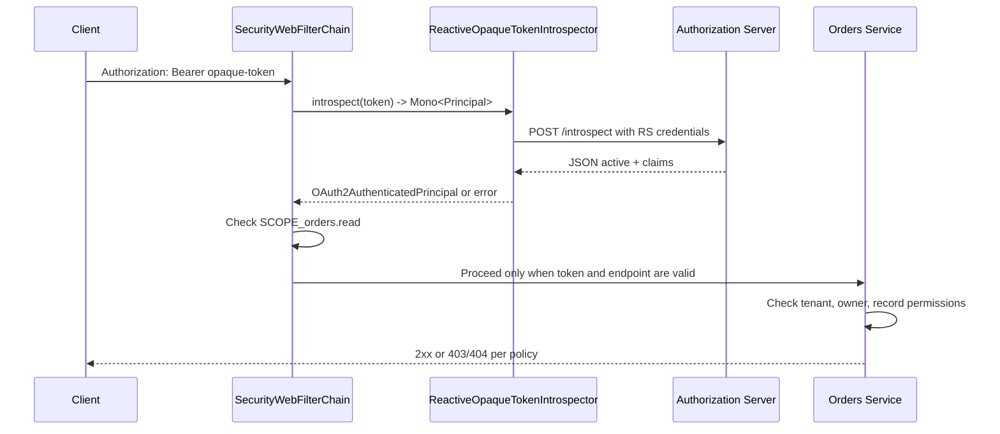

# SpringReactiveOpaqueTokenIntrospector and Version-Specific Configuration

## 1. The Problem: Same Introspection Idea, Different Configuration Code Across Versions

Suppose a **Spring WebFlux** application acts as an OAuth 2.0 Resource Server. The API protects orders using an opaque access token:

```http
GET /api/orders/42 HTTP/1.1
Host: orders.example.com
Authorization: Bearer <opaque-access-token>
Accept: application/json
```

The Resource Server cannot verify the signature of an opaque string on its own the way a JWT decoder does. Instead, it sends the token to the Authorization Server's (AS) **OAuth 2.0 Token Introspection Endpoint**, receives token attributes, and decides whether to let the request proceed.

Spring Security provides `SpringReactiveOpaqueTokenIntrospector` to handle this for the **WebFlux/reactive stack**. A common issue when learning or upgrading the framework is encountering different ways to instantiate it:

```java
// Commonly seen in code using Spring Security 5.6–6.4:
new SpringReactiveOpaqueTokenIntrospector(
    introspectionUri, clientId, clientSecret);
```

and:

```java
// Recommended approach starting in Spring Security 6.5+:
SpringReactiveOpaqueTokenIntrospector
    .withIntrospectionUri(introspectionUri)
    .clientId(clientId)
    .clientSecret(clientSecret)
    .build();
```

Both snippets serve the same purpose, yet have **different API lifecycles**. The `withIntrospectionUri(...)` factory builder appeared **in Spring Security 6.5**; the three-`String` constructor was marked deprecated-for-removal starting in 6.5. Copying the builder code into a 6.4 project causes compilation errors; keeping the old constructor in newer projects triggers deprecation warnings and future upgrade risks.

**Lesson goal:** understand what `SpringReactiveOpaqueTokenIntrospector` is, how it works, how to configure it via properties/DSL/beans, how to pick APIs compatible with your Spring Security version, along with the security and reactive requirements that must not be overlooked.

### After This Lesson, You Will Be Able To

1. Explain how `ReactiveOpaqueTokenIntrospector` and `SpringReactiveOpaqueTokenIntrospector` differ at the interface/implementation level.
2. Understand the WebFlux flow: `Bearer token → introspection → principal → authorities → authorization`.
3. Choose the **6.5+ builder**, the **constructors available in older releases**, and avoid confusing them with the legacy `NimbusReactiveOpaqueTokenIntrospector`.
4. Use Spring Boot `opaquetoken.*` configuration when default introspection suffices.
5. Declare a `@Bean ReactiveOpaqueTokenIntrospector` or attach an introspector via `ServerHttpSecurity` when custom policies are needed.
6. Design a custom `WebClient` and handle TLS, Basic client authentication, and timeouts without blocking the event loop.
7. Wrap `delegate.introspect(token)` to validate audience/client/claims so tokens issued for other APIs are rejected.
8. Preserve proper `SCOPE_` mapping, error handling, tenant isolation, and business permissions.
9. Test the introspector independently and test WebFlux HTTP endpoints without mistaking mock authentication for real introspection.
10. Consult version-matched API documentation during migrations instead of copying snippets from a different version.

---

## 2. How Does Introspection Work?

### 2.1. The Resource Server Must Query the Authorization Server

For opaque tokens, the Resource Server usually has no information to interpret the token string locally. It uses a **pre-configured** introspection endpoint and credentials issued by the AS specifically to the introspection caller.

An illustrative request:

```http
POST /oauth2/introspect HTTP/1.1
Host: id.example.com
Authorization: Basic <credentials-of-resource-server>
Content-Type: application/x-www-form-urlencoded

token=<opaque-access-token>
```

An illustrative response:

```json
{
  "active": true,
  "sub": "user-417",
  "client_id": "shop-web",
  "aud": ["orders-api"],
  "scope": "orders.read orders.write",
  "tenant_id": "tenant-alpha",
  "exp": 1893456000
}
```

If the AS does not consider the token active, the response is typically:

```json
{
  "active": false
}
```

Per RFC 7662, `active` indicates the token's status in the context of the AS and the introspecting party. Attributes such as `scope`, `sub`, `client_id`, `aud`, `iss`, or `exp` may be disclosed depending on the contract.

Distinguish **HTTP 200 from the introspection endpoint** from **`"active": true` in the body**: the AS can return HTTP 200 with `{"active":false}`; that is **not** a valid token.

### 2.2. Flow Inside Spring Security WebFlux



In WebFlux:

- `SecurityWebFilterChain` defines security filters and authorization rules.
- `ServerHttpSecurity` is the WebFlux configuration DSL.
- `ReactiveOpaqueTokenIntrospector` is the interface used to introspect tokens reactively.
- `SpringReactiveOpaqueTokenIntrospector` is Spring's implementation that calls the HTTP introspection endpoint.
- The returned `Mono<OAuth2AuthenticatedPrincipal>` participates in the reactive authentication pipeline.
- After authentication succeeds, `BearerTokenAuthentication` holds the principal and mapped authorities.

**Do not confuse with Servlet/MVC:** `HttpSecurity`, `SecurityFilterChain`, and `OpaqueTokenIntrospector` are not the types to use for reactive WebFlux in this lesson.

### 2.3. `active=true` Does Not Replace API Authorization

For example:

```json
{
  "active": true,
  "aud": ["billing-api"],
  "scope": "orders.read",
  "sub": "user-417"
}
```

If the current service is `orders-api` and requires audience `orders-api`, this token must still be rejected even though `active=true` and the scope name matches.

A token with the right audience but lacking `orders.read` also must not access the order-read endpoint. And a token with full scope still needs tenant/owner checks in the Service or Repository.

Three layers must remain separate:

```text
Token status / intended Resource Server
    → active, audience, issuer, or token contract

Endpoint authorization
    → SCOPE_orders.read, client policy, role

Object-level authorization
    → tenant, owner, membership, record ACL
```

---

## 3. Core API: Interfaces, Classes, and Packages

### 3.1. `ReactiveOpaqueTokenIntrospector`

The reactive interface has the form:

```java
package org.springframework.security.oauth2.server.resource.introspection;

public interface ReactiveOpaqueTokenIntrospector {
    Mono<OAuth2AuthenticatedPrincipal> introspect(String token);
}
```

This is an **abbreviated signature for illustration**, not the entire library source.

Characteristics:

- Accepts a `String` containing the Bearer token value.
- Returns a `Mono` carrying an authenticated principal or an error signal.
- Does not force the implementation to use HTTP; it can delegate to an AS, token store, policy-bound cache, or another trusted service.
- When a token is rejected, the implementation must signal an appropriate error—**never** fabricate a dummy principal.
- Must not self-subscribe or call `block()` on the authentication path.

### 3.2. `SpringReactiveOpaqueTokenIntrospector`

Fully qualified name:

```text
org.springframework.security.oauth2.server.resource.introspection
  .SpringReactiveOpaqueTokenIntrospector
```

This class is the `ReactiveOpaqueTokenIntrospector` implementation that calls an OAuth 2.0 introspection endpoint. It has existed since **Spring Security 5.6**.

Despite its name, `SpringReactiveOpaqueTokenIntrospector` is not a `JwtDecoder`. It does not decode/verify JWT tokens locally to determine whether a token is active; instead, it relies on the introspection response from a trusted AS. An AS can introspect strings that look like JWTs if the contract calls for it, in which case authentication is still **introspection**.

### 3.3. `OAuth2AuthenticatedPrincipal` and `BearerTokenAuthentication`

When introspection succeeds, the result typically has type `OAuth2AuthenticatedPrincipal` with:

- `getName()`: principal name per mapping.
- `getAttributes()`: map of processed claims/attributes from introspection.
- `getAuthorities()`: `GrantedAuthority` instances used for authorization.
- `getAttribute("sub")`, `getAttribute("client_id")`, etc., if disclosed by the AS.

Spring Security can create a `BearerTokenAuthentication` from the principal. Never assume `@AuthenticationPrincipal Jwt` works in opaque-token mode; that type is used in a JWT Resource Server, not as the default opaque principal.

Illustrative Controller example:

```java
@GetMapping("/api/whoami")
public Mono<Map<String, String>> whoami(
        @AuthenticationPrincipal OAuth2AuthenticatedPrincipal principal) {

    String subject = principal.getAttribute("sub");
    return Mono.just(Map.of(
        "subject", subject == null ? "" : subject));
}
```

Only expose fields permitted by the API contract. This endpoint needs a matching `authorizeExchange` rule if the default is deny-all.

---

## 4. Version Matrix: Choosing the Exact Constructor, Builder, and Converter API

This section is critical when reading older examples and migrating projects.

| Spring Security | `SpringReactiveOpaqueTokenIntrospector` | Common instantiation approach | Notes |
|---|---|---|---|
| Before 5.6 | Not present yet | May see `NimbusReactiveOpaqueTokenIntrospector` in older projects | Check the exact version |
| 5.6 to 6.2 | Present | Three-`String` constructor or `WebClient` constructor | Do not copy the 6.5+ builder |
| 6.3 to 6.4 | Present | Constructors; `setAuthenticationConverter(...)` added in 6.3 | `NimbusReactiveOpaqueTokenIntrospector` is legacy and recommended for replacement in newer lines |
| 6.5.x | Present | **Builder `withIntrospectionUri(...).clientId(...).clientSecret(...).build()`** | Builder added in 6.5; three-`String` constructor deprecated-for-removal |
| 7.0.x | Present | Builder recommended | Avoid writing new code depending on the deprecated constructor when possible |
| 7.1.x | Present | Builder; `postProcessor(...)` added in 7.1.0 | Verify patch version and customization needs |

Key points from the API docs:

- `SpringReactiveOpaqueTokenIntrospector`: **Since 5.6**.
- `setAuthenticationConverter(...)`: **Since 6.3**.
- `withIntrospectionUri(...)` and `Builder`: **Since 6.5**.
- Constructor `(String introspectionUri, String clientId, String clientSecret)`: **@Deprecated(since="6.5", forRemoval=true)**; 7.1 docs still list it, but it should not be treated as stable long-term.
- `Builder.postProcessor(...)`: **Since 7.1.0**; do not use in code that must compile on 6.5.

Never assume "we are on Java 17 so the builder must exist." The **actual resolved Spring Security artifact version** determines which APIs exist.

### 4.1. Why Does the Project Report `Cannot resolve method 'withIntrospectionUri'`?

Likely because the code was taken from 6.5/7.x docs while the dependency is Spring Security 6.4 or older.

The fix is:

1. Check the version of `spring-security-oauth2-resource-server` your application resolves.
2. If you must stay on 6.4, use a 6.4-compatible API such as the appropriate constructor.
3. If upgrading is planned, update the BOM/dependency management consistently before switching code to the builder.
4. Do not "fix" it by importing Servlet `SpringOpaqueTokenIntrospector`, as that class does not implement the reactive interface.

### 4.2. Why Does the Project Warn About a Deprecated Constructor?

On 6.5 and later:

```java
new SpringReactiveOpaqueTokenIntrospector(
    uri, clientId, clientSecret);
```

still compiles, but the IDE/compiler emits a deprecation warning. That does not mean runtime is broken yet. Still, the builder is the replacement to use for new code on versions that support it.

### 4.3. `NimbusReactiveOpaqueTokenIntrospector` and Migration

Some legacy codebases use:

```java
new NimbusReactiveOpaqueTokenIntrospector(
    uri, clientId, clientSecret);
```

In newer Spring Security branches, `NimbusReactiveOpaqueTokenIntrospector` is marked deprecated with guidance to migrate to `SpringReactiveOpaqueTokenIntrospector`.

When switching classes, do not just change the import: verify **HTTP authentication behavior, claim mapping, converters, timeouts, and unit/integration tests**, especially if the code previously customized introspection using Nimbus classes.

### 4.4. Spring Boot and Spring Security Mapping

Spring Boot manages Spring Security versions through dependency management/BOM. Do not guess the Security version merely by looking at `spring-boot-starter-webflux` or the Java version.

With Gradle/Maven, inspect your project's **dependency graph/resolved versions** and consult the matching Spring Security documentation. Never force a single mismatched `spring-security-oauth2-resource-server` version alongside other Security modules just to get the builder method.

Official documentation has branches `/6.4/`, `/6.5/`, `/7.0/`, and current. When copying snippets, check the docs URL branch and `@Since` in the Javadoc.

---

## 5. Minimal Configuration via Spring Boot Properties — Where to Start

If you only need to call the introspection endpoint and use standard scope mapping, **you usually do not need to declare a `SpringReactiveOpaqueTokenIntrospector` bean manually**.

### 5.1. Dependencies

Example `build.gradle` for a WebFlux API:

```groovy
dependencies {
    implementation 'org.springframework.boot:spring-boot-starter-webflux'
    implementation 'org.springframework.boot:spring-boot-starter-security'
    implementation 'org.springframework.boot:spring-boot-starter-oauth2-resource-server'

    testImplementation 'org.springframework.boot:spring-boot-starter-test'
    testImplementation 'org.springframework.security:spring-security-test'
    testImplementation 'io.projectreactor:reactor-test'
}
```

Spring Boot/plugins/dependency management and the Java toolchain must be compatible with the Spring Security version in use.

**Verify the actual web stack:** if both `spring-boot-starter-web` and `spring-boot-starter-webflux` are on the classpath, the application may default to MVC/Servlet; your `SecurityWebFilterChain` configuration may not run as expected. This lesson assumes the app is genuinely a WebFlux Resource Server.

### 5.2. `application.yml`

```yaml
spring:
  security:
    oauth2:
      resourceserver:
        opaquetoken:
          introspection-uri: https://id.example.com/oauth2/introspect
          client-id: ${INTROSPECTION_CLIENT_ID}
          client-secret: ${INTROSPECTION_CLIENT_SECRET}
```

Explanation:

- `introspection-uri`: endpoint provided by the trusted AS, never derived from a client-supplied URL.
- `client-id`: Resource Server/introspection client identifier per the AS contract.
- `client-secret`: secret used to authenticate to the AS; must come from a secret manager or secure environment variable.
- `opaquetoken` is the **exact property name** in Spring Boot Resource Server configuration (one word, not `opaque-token` here).

**Never commit real credentials to the repository**, and never log HTTP Basic headers or form bodies containing access tokens.

### 5.3. Simple `SecurityWebFilterChain`

```java
package com.example.orders;

import org.springframework.context.annotation.Bean;
import org.springframework.context.annotation.Configuration;
import org.springframework.http.HttpMethod;
import org.springframework.security.config.Customizer;
import org.springframework.security.config.annotation.web.reactive.EnableWebFluxSecurity;
import org.springframework.security.config.web.server.ServerHttpSecurity;
import org.springframework.security.web.server.SecurityWebFilterChain;

@Configuration
@EnableWebFluxSecurity
public class SecurityConfig {

    @Bean
    SecurityWebFilterChain apiSecurity(ServerHttpSecurity http) {
        return http
            .csrf(ServerHttpSecurity.CsrfSpec::disable)
            .authorizeExchange(exchanges -> exchanges
                .pathMatchers("/api/public/**").permitAll()
                .pathMatchers(HttpMethod.GET, "/api/orders/**")
                    .hasAuthority("SCOPE_orders.read")
                .pathMatchers(HttpMethod.POST, "/api/orders")
                    .hasAuthority("SCOPE_orders.write")
                .anyExchange().denyAll()
            )
            .oauth2ResourceServer(oauth2 -> oauth2
                .opaqueToken(Customizer.withDefaults()))
            .build();
    }
}
```

This is the idiomatic configuration for WebFlux:

- `ServerHttpSecurity`, `SecurityWebFilterChain`, and `authorizeExchange` belong to the reactive stack.
- `opaqueToken(Customizer.withDefaults())` enables introspection.
- Spring Boot uses the `opaquetoken` properties to provide a default introspector when appropriate.
- `SCOPE_orders.read` is checked after Authentication is built from the introspection result.
- `anyExchange().denyAll()` allows only operations with explicit rules.

**CSRF:** this sample disables CSRF for a pure Bearer-header API, not a browser app with session/cookie authentication. If the application has web sessions, design a separate chain or an appropriate CSRF policy.

### 5.4. What Does This Configuration Do?

For a request:

```http
GET /api/orders/42 HTTP/1.1
Authorization: Bearer opaque-demo-token
```

Spring Security will attempt to:

1. Extract the Bearer credential.
2. Call the reactive introspector against the trusted endpoint.
3. Inspect the introspection result and `active` status.
4. Build an `OAuth2AuthenticatedPrincipal` with attributes/authorities per the implementation.
5. Use `authorizeExchange` to check `SCOPE_orders.read`.
6. Allow entry to the Controller/Service if policy passes.
7. Continue enforcing tenant, owner, and object-level authorization in business logic.

Missing tokens on protected endpoints typically receive `401`; valid tokens missing the required scope typically receive `403`.

### 5.5. When Is No Custom Bean Needed?

If the AS returns `scope` in a compatible profile, the Resource Server only needs `active` + scope, and there are no special requirements for `aud`/client/claim mapping, properties + DSL are usually sufficient to start.

**However**, if the API needs audience binding or other token-contract conditions that the AS does not enforce on its own, you must add the appropriate policy. Never assume the default configuration verifies all business claims.

---

## 6. Spring Security 6.5+ Configuration: The `withIntrospectionUri` Builder

### 6.1. Bean Using the Builder

Example for Spring Security **6.5 and later**:

```java
package com.example.orders;

import org.springframework.beans.factory.annotation.Value;
import org.springframework.context.annotation.Bean;
import org.springframework.context.annotation.Configuration;
import org.springframework.security.oauth2.server.resource.introspection.ReactiveOpaqueTokenIntrospector;
import org.springframework.security.oauth2.server.resource.introspection.SpringReactiveOpaqueTokenIntrospector;

@Configuration
public class IntrospectionConfig {

    @Bean
    ReactiveOpaqueTokenIntrospector introspector(
            @Value("${spring.security.oauth2.resourceserver.opaquetoken.introspection-uri}")
            String introspectionUri,
            @Value("${spring.security.oauth2.resourceserver.opaquetoken.client-id}")
            String clientId,
            @Value("${spring.security.oauth2.resourceserver.opaquetoken.client-secret}")
            String clientSecret) {

        return SpringReactiveOpaqueTokenIntrospector
            .withIntrospectionUri(introspectionUri)
            .clientId(clientId)
            .clientSecret(clientSecret)
            .build();
    }
}
```

Benefits:

- Follows the recommended 6.5+ API.
- Avoids the deprecated three-`String` constructor.
- Centralized configuration source, easy to inject from a secret store.
- Bean still exposes the `ReactiveOpaqueTokenIntrospector` interface type, making it easy to replace or decorate later.

**Note:** When no custom policy is needed, this bean largely duplicates Spring Boot auto-configuration; only add it when there is a clear reason.

### 6.2. The Builder Encodes Client Credentials Automatically

The Javadoc for `Builder.clientId(...)` and `Builder.clientSecret(...)` states that the builder **encodes the supplied values automatically**. Therefore, you should pass the **raw (unencoded) Client ID and Client secret**.

For example, if the secret contains `+` or spaces:

```text
raw client secret:  demo+secret 42
```

do not URL-encode it into `demo%2Bsecret%2042` before passing it to the builder. Double-encoding can cause AS authentication to fail.

For legacy code using constructors in older versions, check the constructor contract and implementation of that exact version before changing how special characters are handled. **Never apply a single encoding trick blindly across all API versions.**

### 6.3. A Custom Bean Can Replace Auto-Configuration

Spring Boot normally creates a default `ReactiveOpaqueTokenIntrospector` only if no compatible custom bean exists. When you declare a bean of the same type, it can be used instead of the auto-configured default.

If there are multiple `ReactiveOpaqueTokenIntrospector` beans or multiple `SecurityWebFilterChain` instances, specify clearly which bean each API uses. Use `.introspector(...)` in the DSL to avoid ambiguity when needed.

### 6.4. `postProcessor(...)` on Builder Since 7.1

In Spring Security **7.1.0 and later**, the builder adds `postProcessor(Consumer<SpringReactiveOpaqueTokenIntrospector>)` to configure the instance after it is built.

This method **does not exist in 6.5 or 7.0**. If project source must run across multiple version lines, do not rely on it.

For example, if you only need `setAuthenticationConverter(...)` and do not need the builder post-processor, configure it explicitly:

```java
SpringReactiveOpaqueTokenIntrospector introspector =
    SpringReactiveOpaqueTokenIntrospector
        .withIntrospectionUri(uri)
        .clientId(clientId)
        .clientSecret(clientSecret)
        .build();

// setAuthenticationConverter API is available since 6.3.
// Set a converter designed to satisfy the claim/authority contract:
introspector.setAuthenticationConverter(myConverter);
```

`myConverter` is an illustrative converter that you must define with the proper reactive type, not a framework-provided variable. Section 11/12 explores customization further.

---

## 7. Spring Security 5.6–6.4 Configuration: Constructors

### 7.1. Three-Argument Constructor

On versions that have `SpringReactiveOpaqueTokenIntrospector` but **lack the 6.5 builder**, the common instantiation is:

```java
@Bean
ReactiveOpaqueTokenIntrospector introspector(
        @Value("${spring.security.oauth2.resourceserver.opaquetoken.introspection-uri}")
        String uri,
        @Value("${spring.security.oauth2.resourceserver.opaquetoken.client-id}")
        String clientId,
        @Value("${spring.security.oauth2.resourceserver.opaquetoken.client-secret}")
        String clientSecret) {

    return new SpringReactiveOpaqueTokenIntrospector(
        uri, clientId, clientSecret);
}
```

This is an **example for the older API line**, not the preferred choice for 6.5+.

Keep the interface return type so Spring Security wires it cleanly; the difference lies only in instantiating the implementation.

### 7.2. Constructor Accepting a WebClient

Another constructor form:

```java
new SpringReactiveOpaqueTokenIntrospector(
    introspectionUri,
    configuredWebClient);
```

This form exists in the versions mentioned above and fits cases requiring custom transport settings such as timeouts or HTTP client authentication.

Crucial point: with the `WebClient` constructor, **the provided `WebClient` must already be configured with proper authentication for the introspection endpoint**. Do not assume the constructor automatically adds Basic credentials when it only receives a URI and a `WebClient`.

For instance, the `WebClient` must include `Authorization: Basic ...` or whichever mechanism the AS requires, along with TLS, timeouts, connection pool, proxy, and required policies.

### 7.3. Why Not Keep the Constructor Forever?

The three-`String` constructor was marked deprecated-for-removal starting in 6.5. Its continued presence in 7.1 Javadoc does not guarantee it will stay forever.

If the codebase is already on 6.5+ with no backward-compatibility constraint, migrating to the builder early reduces technical debt and aligns with the recommended public API.

---

## 8. Configuration via DSL: Properties, `introspectionUri`, and `introspector`

Spring Security offers several places to configure opaque-token introspection. They are not entirely equal in precedence.

### 8.1. Properties — Default Configuration

```yaml
spring:
  security:
    oauth2:
      resourceserver:
        opaquetoken:
          introspection-uri: https://id.example.com/oauth2/introspect
          client-id: ${INTROSPECTION_CLIENT_ID}
          client-secret: ${INTROSPECTION_CLIENT_SECRET}
```

Use when deep customization is not needed. Spring Boot auto-configuration typically provides an appropriate introspector bean.

### 8.2. DSL — Declaring URI and Credentials Directly

```java
@Bean
SecurityWebFilterChain security(ServerHttpSecurity http) {
    return http
        .authorizeExchange(exchanges -> exchanges
            .anyExchange().authenticated())
        .oauth2ResourceServer(oauth2 -> oauth2
            .opaqueToken(opaque -> opaque
                .introspectionUri(
                    "https://id.example.com/oauth2/introspect")
                .introspectionClientCredentials(
                    "resource-server-client",
                    "secret-from-secure-config")))
        .build();
}
```

This is a visual example of the API, **not how production secrets should be hardcoded**.

The WebFlux DSL offers `introspectionUri(...)` and `introspectionClientCredentials(...)`. When set via the DSL, this configuration can **override the corresponding properties** in Spring Boot.

### 8.3. DSL — Attaching a Custom Introspector

```java
@Bean
SecurityWebFilterChain apiSecurity(
        ServerHttpSecurity http,
        ReactiveOpaqueTokenIntrospector introspector) {

    return http
        .authorizeExchange(exchanges -> exchanges
            .pathMatchers("/api/public/**").permitAll()
            .pathMatchers("/api/orders/**")
                .hasAuthority("SCOPE_orders.read")
            .anyExchange().denyAll())
        .oauth2ResourceServer(oauth2 -> oauth2
            .opaqueToken(opaque -> opaque
                .introspector(introspector)))
        .build();
}
```

`introspector(...)` lets you replace **the entire introspection component** used in this chain. Ideal when you have a delegate + audience policy, custom transport, or converter.

### 8.4. Selection Table

| Approach | When to use | Points to watch |
|---|---|---|
| Boot `opaquetoken.*` | Standard configuration | Minimal code, follows BOM/auto-config |
| WebFlux DSL `introspectionUri + introspectionClientCredentials` | Want to specify directly on a chain | Can override properties; never hardcode secrets |
| `@Bean ReactiveOpaqueTokenIntrospector` | Want to decorate/override the default | Avoid ambiguous multiple beans of the same type |
| DSL `.introspector(custom)` | Want to bind an explicit introspector to a chain | Takes precedence for the configured chain |
| `SpringReactiveOpaqueTokenIntrospector.withIntrospectionUri(...)` | Custom bean on Spring Security 6.5+ | Builder encodes credentials automatically |
| Constructor `new SpringReactiveOpaqueTokenIntrospector(...)` | Code on 5.6–6.4 branch | Three-`String` constructor deprecated since 6.5 |
| Constructor accepting `WebClient` | Custom HTTP transport | WebClient must carry proper authentication itself |

Mixing properties, custom beans, and DSL overrides in the same configuration can be hard to follow. **Choose one clear source of truth** and add beans/DSL only when justified by extra requirements.

---

## 9. Custom WebClient: Timeouts, TLS, Credentials, and Staying Non-Blocking

`SpringReactiveOpaqueTokenIntrospector` can be constructed with a configured `WebClient`. Choose this when the AS has connection requirements beyond the defaults.

### 9.1. Custom WebClient Example with Reactor Netty

A configuration for versions providing the `(String, WebClient)` constructor:

```java
package com.example.orders;

import java.time.Duration;
import org.springframework.beans.factory.annotation.Value;
import org.springframework.context.annotation.Bean;
import org.springframework.context.annotation.Configuration;
import org.springframework.http.client.reactive.ReactorClientHttpConnector;
import org.springframework.security.oauth2.server.resource.introspection.ReactiveOpaqueTokenIntrospector;
import org.springframework.security.oauth2.server.resource.introspection.SpringReactiveOpaqueTokenIntrospector;
import org.springframework.web.reactive.function.client.WebClient;
import reactor.netty.http.client.HttpClient;

@Configuration
public class CustomIntrospectionHttpConfig {

    @Bean
    ReactiveOpaqueTokenIntrospector introspector(
            @Value("${spring.security.oauth2.resourceserver.opaquetoken.introspection-uri}")
            String uri,
            @Value("${spring.security.oauth2.resourceserver.opaquetoken.client-id}")
            String clientId,
            @Value("${spring.security.oauth2.resourceserver.opaquetoken.client-secret}")
            String clientSecret) {

        HttpClient client = HttpClient.create()
            .responseTimeout(Duration.ofSeconds(3));

        WebClient introspectionWebClient =
            WebClient.builder()
                .clientConnector(
                    new ReactorClientHttpConnector(client))
                .defaultHeaders(headers ->
                    headers.setBasicAuth(clientId, clientSecret))
                .build();

        return new SpringReactiveOpaqueTokenIntrospector(
            uri, introspectionWebClient);
    }
}
```

This illustrates HTTP Basic client authentication when permitted by the AS. If the AS uses `private_key_jwt`, mTLS, or another client authentication method, configure it according to the contract—do not force Basic auth.

### 9.2. A Timeout Is Not a Complete Resilience Policy

`responseTimeout` in Reactor Netty sets the response timeout per client semantics. In production systems, also consider:

- TCP connect timeout.
- TLS handshake timeout.
- Connection pool size and pending acquisition limits.
- DNS/proxy behavior.
- Overall per-request deadline.
- Bounding concurrent introspection requests.
- Limiting retries on retryable errors.
- Latency p95/p99 metrics and AS availability.

A slow AS response can leave many API requests waiting, even if the event loop is not blocked the way JDBC/RestTemplate blocks it. **Reactive does not automatically solve capacity, timeouts, and overload.**

### 9.3. Do Not Use RestTemplate Wrapped in `Mono.just`

Wrong:

```java
@Override
public Mono<OAuth2AuthenticatedPrincipal> introspect(String token) {
    OAuth2AuthenticatedPrincipal principal =
        blockingIntrospector.introspect(token);

    return Mono.just(principal);
}
```

The synchronous call already ran on the current thread before the Mono was created; the event loop can be blocked.

Prefer `SpringReactiveOpaqueTokenIntrospector` with `WebClient`. If a temporary blocking implementation is unavoidable, use:

```java
return Mono.fromCallable(() ->
        legacyIntrospector.introspect(token))
    .subscribeOn(Schedulers.boundedElastic());
```

and bound worker/HTTP timeouts. This is only a **transitional adapter**: the blocking call still occupies a worker thread and may not abort immediately upon Reactor timeout.

### 9.4. Never Let the Client Choose the Introspection URL

Wrong in principle:

```java
String url = request.getHeader("X-Introspection-Endpoint");
```

Using that URL to send the access token creates an **SSRF** risk and leaks Bearer tokens to untrusted servers.

The introspection URL must come from trusted configuration or an allowlist. In multi-issuer setups, implement an explicit trusted-endpoint selection mechanism; never spray the same token across arbitrary AS endpoints until one returns `active=true`.

---

## 10. Configuring WebFlux Chains and HTTP Authorization

An application might serve:

```text
/api/**  → opaque Bearer Resource Server
/web/**  → OIDC/web session login
```

With multiple `SecurityWebFilterChain` beans, Spring Security WebFlux picks a chain by matcher and order.

### 10.1. Dedicated API Chain

```java
package com.example.orders;

import org.springframework.context.annotation.Bean;
import org.springframework.context.annotation.Configuration;
import org.springframework.core.annotation.Order;
import org.springframework.http.HttpMethod;
import org.springframework.security.config.Customizer;
import org.springframework.security.config.web.server.ServerHttpSecurity;
import org.springframework.security.web.server.SecurityWebFilterChain;
import org.springframework.security.web.server.util.matcher.ServerWebExchangeMatchers;

@Configuration
public class ApiChainsConfig {

    @Bean
    @Order(1)
    SecurityWebFilterChain apiChain(
            ServerHttpSecurity http,
            ReactiveOpaqueTokenIntrospector introspector) {

        return http
            .securityMatcher(
                ServerWebExchangeMatchers.pathMatchers("/api/**"))
            .csrf(ServerHttpSecurity.CsrfSpec::disable)
            .authorizeExchange(exchanges -> exchanges
                .pathMatchers(HttpMethod.GET, "/api/public/ping")
                    .permitAll()
                .pathMatchers(HttpMethod.GET, "/api/orders/**")
                    .hasAuthority("SCOPE_orders.read")
                .pathMatchers(HttpMethod.POST, "/api/orders")
                    .hasAuthority("SCOPE_orders.write")
                .anyExchange().denyAll())
            .oauth2ResourceServer(oauth2 -> oauth2
                .opaqueToken(opaque ->
                    opaque.introspector(introspector)))
            .build();
    }
}
```

Additional imports for `ReactiveOpaqueTokenIntrospector` and WebFlux classes were shown in earlier examples.

**You need another/catch-all chain for URLs outside `/api/**`** if the application also serves web endpoints; `anyExchange().denyAll()` in the API chain only protects requests that matched that chain.

### 10.2. Matcher and Rule Ordering

`securityMatcher(...)` selects the entire chain, while `pathMatchers(...)` inside `authorizeExchange` selects rules within the matched chain.

Never place a catch-all web chain before the API chain, or API requests may receive a login redirect instead of a `401` Bearer challenge.

### 10.3. CORS and Preflight

Browsers may send `OPTIONS` preflight requests without an access token. Configure CORS properly on the API chain using a `CorsConfigurationSource` allowing the desired origins/methods/headers, instead of forcing preflight requests through pointless introspection.

Never use `permitAll("/api/**")` just to fix a CORS error; real requests still require tokens and scopes.

---

## 11. Custom Decorator: Audience, Client, and Claim Contracts Before Authorization

### 11.1. Why Use a Decorator?

The default introspector handles **token introspection** and maps metadata according to Spring Security's profile. However, the API may additionally require:

- Audience must contain `orders-api`.
- `client_id` must be in an allowlist for internal endpoints.
- Token must carry a subject or tenant claim of the expected type.
- Token is confirmed by the AS as an access token matching the contract.
- A required claim must be normalized before constructing the principal.

**Never conclude `active=true` is enough.** Requirements beyond the default must either be guaranteed explicitly by the AS or verified at the Resource Server.

### 11.2. Audience-Checking Decorator

An example independent of how the delegate was created:

```java
package com.example.orders;

import java.util.Collection;
import org.springframework.security.oauth2.core.OAuth2AuthenticatedPrincipal;
import org.springframework.security.oauth2.server.resource.introspection.BadOpaqueTokenException;
import org.springframework.security.oauth2.server.resource.introspection.ReactiveOpaqueTokenIntrospector;
import reactor.core.publisher.Mono;

public final class AudienceCheckingIntrospector
        implements ReactiveOpaqueTokenIntrospector {

    private final ReactiveOpaqueTokenIntrospector delegate;
    private final String expectedAudience;

    public AudienceCheckingIntrospector(
            ReactiveOpaqueTokenIntrospector delegate,
            String expectedAudience) {

        this.delegate = delegate;
        this.expectedAudience = expectedAudience;
    }

    @Override
    public Mono<OAuth2AuthenticatedPrincipal> introspect(
            String token) {

        return delegate.introspect(token)
            .flatMap(principal -> {
                Object audience = principal.getAttribute("aud");

                boolean allowed =
                    expectedAudience.equals(audience)
                    || (audience instanceof Collection<?> values
                        && values.contains(expectedAudience));

                if (!allowed) {
                    return Mono.error(
                        new BadOpaqueTokenException(
                            "Token audience not accepted"));
                }

                return Mono.just(principal);
            });
    }
}
```

This condition accepts:

```json
{"aud": "orders-api"}
```

or:

```json
{"aud": ["orders-api", "reports-api"]}
```

but rejects:

```json
{"aud": ["billing-api"]}
```

or a response missing `aud`.

Matching uses an **exact identifier**; never use `String.contains("orders-api")`, which could wrongly accept `orders-api-admin`.

This policy is appropriate when **the contract mandates `aud`**. If the AS omits `aud` but performs resource-specific introspection based on the calling Resource Server's identity, verify that via documentation and integration tests before adopting that approach.

### 11.3. Wiring the Decorator for Spring Security 6.5+

```java
@Configuration
public class PolicyIntrospectorConfig {

    @Bean
    ReactiveOpaqueTokenIntrospector introspector(
            @Value("${spring.security.oauth2.resourceserver.opaquetoken.introspection-uri}")
            String uri,
            @Value("${spring.security.oauth2.resourceserver.opaquetoken.client-id}")
            String clientId,
            @Value("${spring.security.oauth2.resourceserver.opaquetoken.client-secret}")
            String clientSecret) {

        ReactiveOpaqueTokenIntrospector delegate =
            SpringReactiveOpaqueTokenIntrospector
                .withIntrospectionUri(uri)
                .clientId(clientId)
                .clientSecret(clientSecret)
                .build();

        return new AudienceCheckingIntrospector(
            delegate, "orders-api");
    }
}
```

This **replaces** `IntrospectionConfig` from Section 6; do not declare two competing `ReactiveOpaqueTokenIntrospector` beans unintentionally.

To use this on 6.4 or earlier, replace **only the delegate creation step** with the compatible constructor. The decorator class still uses the `ReactiveOpaqueTokenIntrospector` interface.

### 11.4. Combining Client ID and Tenant

Some endpoints require a Client allowlist:

```java
String clientId = principal.getAttribute("client_id");

if (!allowedClients.contains(clientId)) {
    return Mono.error(
        new BadOpaqueTokenException("Client not accepted"));
}
```

This snippet illustrates token-level Client binding. Decide whether **this policy applies to the whole API or only specific endpoints**. Never treat `client_id` as equivalent to `aud`, and never take the allowed client list from an HTTP body or header.

If client permissions depend on tenant or live database state, use a **`ReactiveAuthorizationManager`** or a service using proper reactive I/O; never block the event loop with JDBC inside the decorator.

### 11.5. Distinguishing Token Errors from Permission Errors

- Audience fails token acceptance criteria → typically handled as an authentication failure, returning `401`.
- Token accepted but lacks authority to read orders → authorization failure, typically `403`.
- Has authority, but order does not belong to tenant/owner → Service denies with `403` or `404` per policy.

Do not force everything into `invalid_token` or everything into `403`. Enforcing checks at the right layer reflects the true error semantics.

---

## 12. Custom Principal and Authority Mapping: `setAuthenticationConverter` Since 6.3

### 12.1. What Does the Converter Do?

`SpringReactiveOpaqueTokenIntrospector` provides:

```java
setAuthenticationConverter(
    Converter<OAuth2TokenIntrospectionClaimAccessor,
              Mono<? extends OAuth2AuthenticatedPrincipal>>
);
```

According to the Javadoc, this API has existed since **Spring Security 6.3**. It converts introspection claims into a principal following the application's policy.

If you only need to add or adjust authorities **after** the delegate finishes introspection, decorating the principal with `map(...)` is often simpler and less tied to a specific implementation.

### 12.2. Default Scope Mapping

Introspection response:

```json
{
  "active": true,
  "scope": "orders.read orders.write",
  "sub": "user-417"
}
```

Under standard Spring Security mapping, each scope becomes a `GrantedAuthority`:

```text
SCOPE_orders.read
SCOPE_orders.write
```

With a URL rule:

```java
.pathMatchers(HttpMethod.GET, "/api/orders/**")
    .hasAuthority("SCOPE_orders.read")
```

Do not confuse `hasAuthority("orders.read")` with `hasAuthority("SCOPE_orders.read")`, and do not use `hasRole("orders.read")` to check a scope.

### 12.3. Decorating the Principal While Preserving Authorities

The following example keeps default authorities intact while showing how to repackage a principal when genuinely needed:

```java
package com.example.orders;

import org.springframework.security.oauth2.core.OAuth2AuthenticatedPrincipal;
import org.springframework.security.oauth2.core.DefaultOAuth2AuthenticatedPrincipal;
import org.springframework.security.oauth2.server.resource.introspection.ReactiveOpaqueTokenIntrospector;
import reactor.core.publisher.Mono;

public final class PrincipalMappingIntrospector
        implements ReactiveOpaqueTokenIntrospector {

    private final ReactiveOpaqueTokenIntrospector delegate;

    public PrincipalMappingIntrospector(
            ReactiveOpaqueTokenIntrospector delegate) {
        this.delegate = delegate;
    }

    @Override
    public Mono<OAuth2AuthenticatedPrincipal> introspect(
            String token) {

        return delegate.introspect(token)
            .map(principal ->
                new DefaultOAuth2AuthenticatedPrincipal(
                    principal.getName(),
                    principal.getAttributes(),
                    principal.getAuthorities()));
    }
}
```

This example **does not alter privileges**, so in practice you would not write a wrapper just for that; it merely illustrates the constructor. When writing custom mappings, ensure you keep the `SCOPE_...` authorities from the AS and never grant `ROLE_ADMIN` based on a client-supplied request attribute.

### 12.4. Adding Privileges from a Database

Suppose you need to look up a tenant's current accounting role; use a trusted privilege source and a reactive repository:

```java
return delegate.introspect(token)
    .flatMap(principal -> membershipService
        .loadMembership(
            principal.getAttribute("sub"),
            principal.getAttribute("tenant_id"))
        .map(membership ->
            createPrincipalWithAllowedAuthorities(
                principal, membership)));
```

`membershipService.loadMembership(...)` must return a `Mono<Membership>` backed by non-blocking I/O (R2DBC/WebClient), and `createPrincipalWithAllowedAuthorities(...)` is an illustrative helper you implement yourself.

Do not use:

```java
// DO NOT DO THIS in a callback running on the event loop:
return delegate.introspect(token)
    .map(principal -> jdbcDao.loadMembership(
        principal.getAttribute("sub")));
```

That hides blocking JDBC inside `map`. If it cannot be replaced yet, wrap it in a bounded `Mono.fromCallable(...).subscribeOn(Schedulers.boundedElastic())` adapter. Do not treat `setAuthenticationConverter` as automatically suited for arbitrary DB queries: returning a `Mono` from the converter does not replace placing business policies in the proper layer.

### 12.5. Converter Version Differences

- **5.6–6.2:** Do not use `setAuthenticationConverter` (Since 6.3); customize via a decorator or version-appropriate extension.
- **6.3–6.4:** Converter API exists, but no builder yet.
- **6.5+ and 7.x:** Both converter and builder exist.
- **7.1+:** Builder adds `postProcessor` for post-build customization.

Never mix APIs introduced in later versions into code targeting earlier versions.

---

## 13. Opaque Tokens Have Multiple Response Cases to Interpret

### 13.1. `active=false`

```json
{
  "active": false
}
```

The Resource Server must reject the token; protected endpoints typically return `401` with a Bearer challenge.

### 13.2. `active=true`, Wrong Audience

```json
{
  "active": true,
  "aud": ["billing-api"],
  "scope": "orders.read"
}
```

`AudienceCheckingIntrospector` must reject this if the API requires `orders-api`.

### 13.3. `active=true`, Right Audience, Missing Scope

```json
{
  "active": true,
  "aud": ["orders-api"],
  "scope": "profile.read"
}
```

The token is introspected and passes audience policy, but the endpoint requires `SCOPE_orders.read`, so it typically returns `403`.

### 13.4. `active=true`, Right Scope, Wrong Tenant

```json
{
  "active": true,
  "aud": ["orders-api"],
  "scope": "orders.read",
  "sub": "user-417",
  "tenant_id": "tenant-alpha"
}
```

Request:

```http
GET /api/tenants/tenant-beta/orders/42 HTTP/1.1
Authorization: Bearer <valid-alpha-token>
```

Filters must verify tenant identity from the principal/entitlements and scope queries by tenant/owner. **Never trust `tenant-beta` in the URL as granted permission**, and never fetch all orders and filter afterward.

### 13.5. AS Returns an HTTP Error or Is Unreachable

If the introspection endpoint times out, fails TLS, returns HTTP 401 due to bad RS credentials, or returns HTTP 5xx, the Resource Server cannot infer `active=false` from an absent response. It must **fail safely**, never building a valid principal or returning data.

Depending on the exception pipeline, the API may return a server/upstream error instead of `401 invalid_token`. Distinguish these in logs/metrics and never print raw access tokens.

### 13.6. HTTP Status Matrix

| Input | Introspection/token level | Endpoint/business | Typical outcome |
|---|---|---|---|
| Protected request without Bearer | Not introspected | Unauthenticated | `401` |
| Inactive token | `active=false` | Not executed | `401` |
| Active token, wrong audience | Validator rejects | Not executed | `401` |
| Active token, missing required `aud` | Validator rejects | Not executed | `401` |
| Right `aud`, missing scope | Authentication succeeds | Insufficient authority | `403` |
| Sufficient scope, wrong owner/tenant | Authentication succeeds | Service/Repository rejects | `403`/`404` |
| Token meets all criteria | Succeeds | Business logic runs | `2xx` or domain status |
| Introspection service failure | Cannot verify | No privileges granted | Safe error, depends on handler |

---

## 14. Operational Limits of Reactive Introspection

### 14.1. Non-Blocking Does Not Mean Free

When calling the AS, even a non-blocking `WebClient` still consumes:

- Sockets and connection pool slots.
- Memory for pending requests.
- CPU to parse HTTP and claims.
- AS processing capacity.
- Network latency and TLS overhead.

With high request throughput and per-request introspection, the AS can become a bottleneck. Monitor concurrency, response times, and pool metrics.

### 14.2. Timeouts and Cancellation

A `Mono.timeout(...)` terminates the publisher at a deadline, but does not replace WebClient connect/response timeouts and connection pool limits.

If you replace WebClient with a synchronous JDBC/HTTP adapter on `boundedElastic`, Reactor cancellation **does not guarantee** the blocking OS socket/driver call stops immediately; configure timeouts in the underlying library as well.

### 14.3. Retries Must Be Bounded

Never retry `active=false` as an infrastructure failure. For transient network errors, if retrying, bound attempts, backoff, and total duration to avoid amplifying AS load.

Never use `onErrorResume(error -> Mono.just(adminPrincipal))` or any similar fail-open pattern.

### 14.4. Introspection Caching and Revocation

Some applications cache principals/metadata to reduce AS calls. However, caching `active=true` allows a revoked token to keep working until the TTL expires.

Requirements:

- Choose a cache TTL matching your risk tolerance and never exceeding `exp` if present.
- Never log raw tokens or cache keys containing verbatim tokens.
- Never reuse an audience-checked result from API A for API B.
- Implement an invalidation/revocation policy if permissions must change quickly.
- Never treat cached memberships/roles as guaranteed current privileges in all contexts.

### 14.5. Protecting Introspection Credentials

The introspection Client secret is **not** the end user's access token. Both credentials are sensitive, but serve different roles:

- Access token: received by the Resource Server in inbound Bearer headers and sent only to the trusted AS endpoint.
- Introspection Client ID/secret: used by the Resource Server to authenticate itself to the AS.
- Session/OIDC ID tokens: have no default role in opaque introspection.

Never emit either credential type into request logs, traces, error payloads, or support tickets.

---

## 15. WebTestClient, mockOpaqueToken, and Testing the Introspector

### 15.1. Separate Tests into Three Tiers

An effective test suite distinguishes:

1. **Introspector unit tests:** test the audience decorator, claim contracts, and error-signal handling.
2. **Security HTTP tests:** test `SecurityWebFilterChain`, `SCOPE_`, and 401/403 with `WebTestClient`.
3. **Introspection integration tests:** test outbound HTTP to a mock AS, Basic credentials, form-encoded token body, `active`, and AS errors.

A test using only mock authentication **does not prove** the real AS was called.

### 15.2. Unit Testing the Audience Decorator with StepVerifier

Example using JUnit 5, Spring Security, and Reactor Test:

```java
package com.example.orders;

import java.util.List;
import java.util.Map;
import org.junit.jupiter.api.Test;
import org.springframework.security.oauth2.core.DefaultOAuth2AuthenticatedPrincipal;
import org.springframework.security.oauth2.server.resource.introspection.BadOpaqueTokenException;
import org.springframework.security.oauth2.server.resource.introspection.ReactiveOpaqueTokenIntrospector;
import reactor.core.publisher.Mono;
import reactor.test.StepVerifier;

class AudienceCheckingIntrospectorTest {

    private ReactiveOpaqueTokenIntrospector fakeDelegate(
            String audience) {

        return token -> Mono.just(
            new DefaultOAuth2AuthenticatedPrincipal(
                "user-417",
                Map.of("aud", List.of(audience),
                       "scope", List.of("orders.read")),
                List.of()));
    }

    @Test
    void rejectsTokenForAnotherApi() {
        AudienceCheckingIntrospector introspector =
            new AudienceCheckingIntrospector(
                fakeDelegate("billing-api"), "orders-api");

        StepVerifier.create(
                introspector.introspect("sample-token"))
            .expectError(BadOpaqueTokenException.class)
            .verify();
    }

    @Test
    void acceptsTokenForThisApi() {
        AudienceCheckingIntrospector introspector =
            new AudienceCheckingIntrospector(
                fakeDelegate("orders-api"), "orders-api");

        StepVerifier.create(
                introspector.introspect("sample-token"))
            .expectNextCount(1)
            .verifyComplete();
    }
}
```

This test uses no real access token. It proves **audience decorator logic**, not HTTP credentials or AS behavior. `Map.of` and `List.of` require Java 9+; older Java 8 projects can substitute equivalent collections.

### 15.3. Testing HTTP Authorization with WebTestClient

With `spring-security-test` for WebFlux, you can mock an authenticated opaque principal:

```java
import static org.springframework.security.test.web.reactive.server
    .SecurityMockServerConfigurers.mockOpaqueToken;

client.mutateWith(
        mockOpaqueToken().authorities(
            new SimpleGrantedAuthority("SCOPE_orders.read")))
    .get()
    .uri("/api/orders/42")
    .exchange()
    .expectStatus().isOk();
```

Here `client` is a `WebTestClient` configured with the application context, and `/api/orders/42` needs a handler/fixture returning success when permitted.

**Important limitation:** `mockOpaqueToken()` injects a simulated Authentication and can **bypass real introspection**. Never use this test to conclude the AS verified `active`, the audience decorator ran, or the WebClient is configured properly.

### 15.4. Testing Missing Token

```java
client.get()
    .uri("/api/orders/42")
    .exchange()
    .expectStatus().isUnauthorized();
```

For Bearer-protected endpoints, you can also check the `WWW-Authenticate` header. If the API returns 302 to a login page, check whether a web login chain matched by mistake.

### 15.5. Testing Missing Scope

```java
client.mutateWith(
        mockOpaqueToken().authorities(
            new SimpleGrantedAuthority("SCOPE_profile.read")))
    .get()
    .uri("/api/orders/42")
    .exchange()
    .expectStatus().isForbidden();
```

The mock is authenticated but lacks `SCOPE_orders.read`, so the test focuses on authorization.

### 15.6. Integration Testing with an AS Stub

To prove introspection truly works, use a controlled mock HTTP server (such as WireMock, MockWebServer, or equivalent):

- Point `introspection-uri` to the local test stub.
- Configure test credentials—never production secrets.
- Have the stub assert a `POST` request with a form-encoded `token=...` body and proper authentication.
- Return distinct responses: `active=false`, active with right audience/missing scope, active with wrong audience.
- Send a Bearer token to the WebFlux test HTTP endpoint.
- Observe `401/403` and verify the Controller does not execute when authentication is rejected.
- Stub slow/timeout or 5xx responses to confirm the system does not fail open.

Only this tier exercises the **real `SpringReactiveOpaqueTokenIntrospector` + HTTP transport**, catching differences across versions.

### 15.7. Test Checklist When Upgrading Versions

| Case | Related configuration | Goal |
|---|---|---|
| 6.5+ builder constructs cleanly | `withIntrospectionUri` | Confirm version compatibility |
| Basic credentials with `+`/spaces | Builder encoding | No double-encoding |
| Active false | Introspection delegate | Token is rejected |
| Active true, valid audience and scope | Delegate + decorator | Access to endpoint allowed |
| Active true, wrong audience | Audience policy | Reject cross-resource token |
| Active true, missing required `aud` | Audience policy | Fail closed |
| Active true, missing scope | Authorization rule | 403 |
| AS returns HTTP 401 due to bad RS credentials | HTTP client/AS | Never fail open |
| AS timeout | Timeout/error mapping | No Authentication granted |
| Legacy constructor migration | 6.4 → 6.5+ | Preserve scope/claim mapping behavior |
| Multiple introspector beans | DI/DSL | Correct bean wired to each chain |
| `mockOpaqueToken` passes | SecurityWebFilterChain | Proves authorization only |
| WebClient HTTPS/cert mismatch | TLS trust | Never disable certificate validation |
| Slow R2DBC tenant lookup | Reactive pipeline | Never block event loop |

---

## 16. Common Version-Related Configuration Errors

### 16.1. `Cannot resolve method withIntrospectionUri`

**Cause:** Actual Spring Security version is older than 6.5.

**Fix:** Use a constructor available in that version, or upgrade dependencies consistently via the BOM.

### 16.2. Deprecated Constructor Warning

**Cause:** `new SpringReactiveOpaqueTokenIntrospector(uri, id, secret)` running on 6.5+.

**Fix:** Migrate to the builder. Do not ignore the warning just because runtime still works today.

### 16.3. Importing the Wrong Servlet Class

Wrong:

```java
import org.springframework.security.oauth2.server.resource.introspection
    .SpringOpaqueTokenIntrospector;
```

That class is the **Servlet implementation**, not `SpringReactiveOpaqueTokenIntrospector`. In Java source, imports must be on a single line; the block above wraps only to highlight the name difference.

**Use for WebFlux:**

```java
import org.springframework.security.oauth2.server.resource.introspection.SpringReactiveOpaqueTokenIntrospector;
import org.springframework.security.oauth2.server.resource.introspection.ReactiveOpaqueTokenIntrospector;
```

### 16.4. Importing `SecurityFilterChain` by Mistake

Servlet:

```java
SecurityFilterChain filterChain(HttpSecurity http)
```

WebFlux:

```java
SecurityWebFilterChain filterChain(ServerHttpSecurity http)
```

Do not "fix" compile errors by renaming the method while keeping the Servlet DSL.

### 16.5. AS Returns 401 with a Custom WebClient

The custom WebClient may not be sending Client credentials, may be using the wrong auth method, or credentials may be double-encoded.

First verify that the WebClient is actually passed to the `(uri, WebClient)` constructor and that the AS receives proper HTTP Basic/mTLS/private-key authentication per the contract.

### 16.6. AS Returns `active=true` and API Lets Wrong-Audience Tokens Through

Default behavior may not enforce API-specific audience policy. You need a validator/decorator or verified AS resource-specific introspection. **`active=true` does not replace `aud`.**

### 16.7. Token Has Scope, Yet `hasAuthority` Always Returns 403

Scope mapping may not be producing `SCOPE_orders.read` as the rule expects, or a custom converter dropped the default authorities.

Inspect the `scope` returned by the AS, the principal's authorities, and the exact authority string in `authorizeExchange`. Never grant all scopes just to silence a 403.

### 16.8. Every Request Calls the AS Even on Public Endpoints

`permitAll` at the authorization step does not necessarily skip the Bearer filter. If a Client sends a bad token to a public endpoint, authentication can fail before authorization.

If public endpoints must ignore Bearer tokens completely, configure a separate public chain without enabling the opaque Resource Server and order matchers properly; never disable security haphazardly.

### 16.9. Mock Tests Pass, Yet Production AS Fails

`mockOpaqueToken()` can bypass outbound HTTP. Add integration tests with an AS stub to verify URI, credentials, TLS, body, `active`, and error behavior.

### 16.10. Calling `block()` Inside a Reactive Introspector

Example:

```java
return Mono.just(
    legacyClient.introspect(token).block());
```

This can block the event loop and defeats the reactive architecture. Use a delegate returning `Mono` and compose with `map/flatMap`; offload sync libraries onto a dedicated scheduler only when no better option exists.

---

## 17. Practical Selection Matrix

Suppose you are tasked with deploying a WebFlux Resource Server across several environments:

| Environment | Requirement | Approach |
|---|---|---|
| Older Spring Security 6.4 project | Basic token introspection only | Use Boot properties; if custom bean needed, use compatible constructor |
| 6.4 project needing custom timeouts | Slow AS | `(uri, WebClient)` constructor with authenticated WebClient and timeouts |
| New 6.5+ project | Standard introspection | Boot properties + `opaqueToken`; add bean only if needed |
| 6.5+ project needing audience check | Tokens issued solely for `orders-api` | Builder as delegate + `AudienceCheckingIntrospector` |
| 7.0+ project | Upgrading old constructor code | Prefer builder and test compatibility |
| 7.1+ project needing converter customization | Custom principal mapping | `setAuthenticationConverter` or builder `postProcessor` where suitable |
| Project accepting multiple API audiences | Distinct chains | Introspector/authorization policy per API surface |
| AS issues JWTs but requires online revocation | Must introspect every request | Can use opaque-token support per AS contract |
| User/tenant membership requires DB lookup | Live permissions | Reactive user/tenant lookup in authentication/authorization/service |
| AS omits `aud` yet claims RS binding | Resource-specific introspection | Verify contract with cross-resource token tests |

There is no rule that "using the newest version means writing custom beans." **The configuration with the least code is still usually best** when it accurately satisfies the token and API contracts.

---

## 18. Self-Check Questions

**Question 1.** How does `SpringReactiveOpaqueTokenIntrospector` differ from `SpringOpaqueTokenIntrospector`?

**Answer:** The former implements `ReactiveOpaqueTokenIntrospector` for WebFlux; the latter implements the synchronous `OpaqueTokenIntrospector` interface on the Servlet stack. They cannot substitute for each other in bean wiring.

**Question 2.** Which version introduced `SpringReactiveOpaqueTokenIntrospector.withIntrospectionUri(...)`?

**Answer:** Spring Security **6.5**. Older versions provide constructors instead.

**Question 3.** Was the three-argument `(uri, clientId, clientSecret)` constructor removed immediately in 6.5?

**Answer:** No. It was marked **deprecated-for-removal since 6.5**; 7.1 documentation still lists it, but new code should move to the builder and not depend on it remaining indefinitely.

**Question 4.** When was `setAuthenticationConverter(...)` introduced?

**Answer:** In Spring Security **6.3**, per the class Javadoc.

**Question 5.** Can `Builder.postProcessor(...)` be used on 6.5?

**Answer:** No; that API was introduced in **7.1.0**.

**Question 6.** Why should you not URL-encode `clientSecret` before passing it to the 6.5+ builder?

**Answer:** The builder encodes Client ID/secret automatically. Passing an already-encoded value causes double-encoding and AS client-authentication rejection.

**Question 7.** When is a custom `ReactiveOpaqueTokenIntrospector` bean unnecessary?

**Answer:** When Spring Boot properties and the default DSL already satisfy the introspection contract and no custom audience, claim, or HTTP configuration is required.

**Question 8.** Do `active=true` and `scope=orders.read` guarantee the token is meant for `orders-api`?

**Answer:** No. Audience/resource binding must be guaranteed by the AS or verified by the RS according to the contract.

**Question 9.** Why might a custom `WebClient` cause the AS to return HTTP 401?

**Answer:** The `WebClient` passed to the constructor may lack proper Client authentication or send wrong credentials. Configure Basic/mTLS/private-key JWT per the contract with proper TLS and encoding.

**Question 10.** Is it safe to call `block()` to fetch the introspection result in a WebFlux filter?

**Answer:** No. `Mono` must be composed asynchronously; blocking on the event loop causes stalls and can trigger Reactor errors.

**Question 11.** Does `mockOpaqueToken()` verify that `SpringReactiveOpaqueTokenIntrospector` called the AS?

**Answer:** No. It mocks an Authentication for HTTP authorization tests; you need an AS stub or integration test to verify real outbound introspection.

**Question 12.** What does a token with the right audience but missing `SCOPE_orders.read` typically receive?

**Answer:** Typically `403 Forbidden` from endpoint authorization, not `401 invalid_token`.

**Question 13.** If an API defines multiple `SecurityWebFilterChain` beans, what must you watch out for?

**Answer:** Matcher order; the first matching chain wins. Wire the right introspector per API surface and do not assume later chains add cumulative rules.

**Question 14.** If Spring Security 6.4 and 6.5 show two different examples, which one should you pick?

**Answer:** Pick based on your project's actual resolved version. On 6.4 use the compatible constructor/bean API; on 6.5+ use the builder if creating an instance manually. Never bump a single Security artifact alone just to get the builder.

**Question 15.** If the AS introspection endpoint is unavailable, may the Resource Server treat the token as active to continue processing?

**Answer:** No. When a token cannot be verified, fail safely or return an appropriate infrastructure error; never grant default access.

---

## 19. Official References by Version

Always verify the API against your target version before choosing code:

- [Spring Security 6.4 — `SpringReactiveOpaqueTokenIntrospector` API](https://docs.spring.io/spring-security/site/docs/6.4.12/api/org/springframework/security/oauth2/server/resource/introspection/SpringReactiveOpaqueTokenIntrospector.html): constructors prior to the builder era.
- [Spring Security 6.5 — `SpringReactiveOpaqueTokenIntrospector` API](https://docs.spring.io/spring-security/reference/6.5/api/java/org/springframework/security/oauth2/server/resource/introspection/SpringReactiveOpaqueTokenIntrospector.html): 6.5 builder, 6.3 converter, and deprecated constructor.
- [Spring Security 6.5 — WebFlux Opaque Token Resource Server](https://docs.spring.io/spring-security/reference/6.5/reactive/oauth2/resource-server/opaque-token.html): properties, beans, and DSL.
- [Spring Security 7.x — Current `SpringReactiveOpaqueTokenIntrospector` API](https://docs.spring.io/spring-security/reference/api/java/org/springframework/security/oauth2/server/resource/introspection/SpringReactiveOpaqueTokenIntrospector.html): current-version reference.
- [Spring Security 7.x — `Builder` API](https://docs.spring.io/spring-security/reference/api/java/org/springframework/security/oauth2/server/resource/introspection/SpringReactiveOpaqueTokenIntrospector.Builder.html): `clientId`, `clientSecret`, `build`, and `postProcessor` where supported.
- [Spring Security — Reactive Opaque Token Reference](https://docs.spring.io/spring-security/reference/reactive/oauth2/resource-server/opaque-token.html): introspection flow, authority mapping, and customization.
- [RFC 7662 — OAuth 2.0 Token Introspection](https://www.rfc-editor.org/rfc/rfc7662): semantics of `active` and metadata.
- [RFC 6750 — OAuth 2.0 Bearer Token Usage](https://www.rfc-editor.org/rfc/rfc6750): Bearer credential presentation and error responses.

Online documentation can shift across minor/patch releases. If your codebase uses an older branch, open the Javadoc for that exact version rather than assuming the "current" page compiles in your project.

## 20. Takeaways

**`SpringReactiveOpaqueTokenIntrospector` is the introspection implementation for Spring Security WebFlux**, returning `Mono<OAuth2AuthenticatedPrincipal>` via the `ReactiveOpaqueTokenIntrospector` interface. It communicates with the Authorization Server over reactive I/O; it is not a `JwtDecoder` and must never be wrapped with `block()` calls on the event loop.

**Choose the API matching your actual version:**

- **Spring Security 5.6–6.4:** use the compatible constructor or rely on Spring Boot auto-configuration.
- **Spring Security 6.5+:** when instantiating manually, prefer `withIntrospectionUri(uri).clientId(id).clientSecret(secret).build()`.
- **Spring Security 6.3+:** `setAuthenticationConverter` is available when custom principal mapping is needed.
- **Spring Security 7.1+:** builder adds `postProcessor` where appropriate.

From a security standpoint, configuring HTTP introspection correctly is only the first step. The Resource Server must still verify that the token is active, check audience/Resource Server binding, enforce scopes, validate Client/tenant when required by contract, and check record-level permissions. A custom WebClient must use a trusted AS, Client authentication, HTTPS, timeouts, and never leak tokens.

In practice, start with **Boot properties + `SecurityWebFilterChain`** when sufficient; add beans/decorators only for explicit policy needs, and **test both real introspection and authorization**. That lets your WebFlux project upgrade Spring Security across versions without sacrificing reactiveness or data protection.
