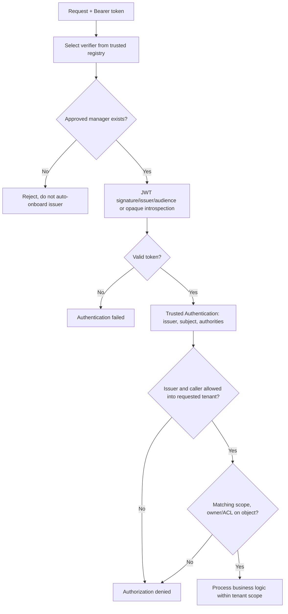
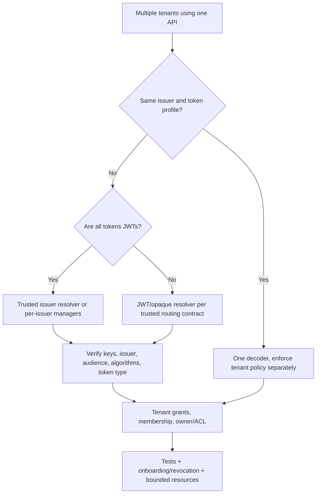

# Tenants, issuers, and token verification strategies can differ

In a **Spring Security OAuth 2.0 / OIDC Resource Server** serving multiple tenants, a single `issuer-uri` and a single `JwtDecoder` are not always enough. One enterprise may use its own IdP, another enterprise may share an IdP across multiple organizations, and a legacy system may only issue **opaque access tokens** requiring introspection. Tenants may also use different **audiences, signing algorithms, JWK Sets, token profiles, scopes, and authorization models**.

A common architectural mistake is conflating three concepts: **tenant** (data boundary), **issuer** (token-issuing party), and **token verification strategy** (decoder, keys, endpoints, validators). A JWT with a valid signature from issuer A **does not automatically grant access to tenant B's data**. Conversely, a `tenant_id` or `iss` field read from an unverified JWT payload **cannot serve as trusted evidence on its own**.

This lesson covers the trust model, selecting a JWT/opaque verifier per tenant, using `JwtIssuerAuthenticationManagerResolver`, configuring validators per issuer, distinguishing the issuer from permissions within a tenant, Servlet and WebFlux examples, securing dynamic onboarding, caching, key rotation, and multi-tenant testing. Examples are based on **Spring Boot 3 / Spring Security 6**; URLs, tenant IDs, and tokens are placeholder data that must be replaced with configurations approved by administration.

## 1. Three concepts that must stay separate

| Concept | Question it answers | Example | What it does not prove on its own |
| --- | --- | --- | --- |
| **Tenant** | Which data, customer, or business policy? | `acme`, `beta` | Whether the tenant has its own IdP or not. |
| **Issuer (`iss`)** | Who issued the token and is responsible for the claims? | `https://login.acme.example/realms/prod` | Whether the caller has access to every tenant. |
| **Verification strategy** | Which mechanism does the API use to verify the token? | JWT/JWKS, opaque introspection | Whether the caller owns the business object. |
| **Audience (`aud`)** | Which protected resource is the access token intended for? | `orders-api` | Whether the token can be used on another API with the same issuer. |
| **Principal identity** | Which principal has been authenticated? | `(verifiedIssuer, verifiedSubject)` | Whether the principal has current tenant membership. |

Some real-world relationships:

```text
Tenant A -------- Issuer A -------- JWT + JWKS A
Tenant B -------- Issuer B -------- JWT + JWKS B
Tenant C ----+
             +---- Issuer Shared --- JWT + JWKS Shared
Tenant D ----+
Tenant E -------- Issuer Legacy --- opaque introspection
```

**Tenants and issuers do not have a mandatory one-to-one relationship.** During a migration, a tenant may trust both the old issuer and the new issuer for a certain period. A shared issuer can authenticate users across multiple tenants, yet data access permissions must still remain isolated.

## 2. SaaS orders-api example

Suppose the application has the following policies:

| Tenant | Trusted issuer/authority | Token | Audience |
| --- | --- | --- | --- |
| `acme` | `https://login.acme.example/realms/prod` | JWT RS256 | `orders-api` |
| `beta` | `https://sso.beta.example/tenant` | JWT with approved algorithm | `orders-api-beta` |
| `gamma` | `https://login.platform.example/shared` | JWT RS256 | `orders-api` |
| `delta` | `https://login.platform.example/shared` | JWT RS256 | `orders-api` |
| `legacy` | Legacy Authorization Server | Opaque token | Per introspection contract |

Hypothetical token for Alice belonging to Acme:

```json
{
  "iss": "https://login.acme.example/realms/prod",
  "sub": "alice",
  "aud": ["orders-api"],
  "scope": "orders.read orders.write",
  "exp": 1900000000
}
```

The JSON above is only an **illustrative payload, not a real signed JWT**. Even if the token has a valid signature, Alice **must not read Beta's orders** simply because she has the `orders.read` scope.

```http
GET /api/tenants/beta/orders/201
Authorization: Bearer <acme-access-token>
```

The API must verify **whether the issuer is trusted for tenant Beta**, whether Alice has Beta membership, and whether order 201 falls within what Alice is permitted to read.

## 3. Standard authentication and authorization flow



The flow has three independent decisions:

1. **Resolve strategy:** use the issuer hint or tenant route to select from an **existing, approved** set of verifiers.
2. **Authenticate:** the JWT decoder/introspector actually validates the token against the corresponding issuer/keys/audience/profile.
3. **Authorize:** the domain service checks tenant membership, scope, role/permission, and object-level policy.

**A hint used to select a verifier is not itself proof of authentication.** Only after step 2 succeeds are claims trusted; only after step 3 is data manipulation permitted.

## 4. Ways to identify a tenant

| Source | Example | Can be used to | Must not do |
| --- | --- | --- | --- |
| JWT `iss` | `https://idp-a.example` | Look up the trusted issuer registry. | Automatically fetch JWKS for an arbitrary issuer and trust it. |
| JWT `tenant_id` | `tenant_id=acme` | Select the tenant per token contract after verification. | Trust unsigned data or claims from an unauthorized issuer. |
| Subdomain | `acme.api.example.com` | Route to a configured tenant. | Treat a client-sent Host header as membership. |
| URL path | `/api/tenants/acme/orders` | Specify the tenant the client wants to act on. | Allow access just because the client knows the tenant slug. |
| Header | `X-Tenant-Id: acme` | Tenant hint per API contract. | Trust it as the caller's token/role. |
| Opaque introspection response | `active`, `aud`, `sub` | Read claims from a trusted authority. | Use IdP A's result to verify token B. |
| mTLS certificate | Authenticated service identity | Map M2M tenant per policy. | Trust a fingerprint/cert without validating the chain. |

A tenant derived from the route can help select a **fixed manager**; however, the request route, header, or host **is still untrusted input**. After the token is verified, you must check whether the token/identity is permitted to operate within that specific tenant.

## 5. An unverified JWT `iss` is untrusted input

Compact JWS JWT:

```text
base64url(header).base64url(payload).base64url(signature)
```

An attacker can craft:

```json
{
  "iss": "https://attacker.example/issuer",
  "sub": "administrator",
  "scope": "orders.read orders.write"
}
```

and sign it with their own key. If the Resource Server does:

```java
// ANTI-PATTERN: do not create a trusted decoder from JWT input.
String issuer = readUnverifiedIssuer(rawToken);
JwtDecoder decoder = JwtDecoders.fromIssuerLocation(issuer);
return decoder.decode(rawToken);
```

then an attacker-controlled issuer can be trusted by the API, or the API may suffer from **SSRF, DNS rebinding, issuer-cardinality DoS, or JWKS/discovery amplification**. A decoder built from an unapproved URL is not a valid trust model.

**Mandatory boundary:** an unverified `iss` is only a **lookup hint into an allowlist**; the selected verifier must validate the signature, issuer, audience, and token profile. Never auto-provision an issuer from a token.

## 6. When is a single `issuer-uri` enough?

If Gamma and Delta share **the same issuer/JWKS and token profile**, one decoder can be sufficient:

```yaml
spring:
  security:
    oauth2:
      resourceserver:
        jwt:
          issuer-uri: https://login.platform.example/shared
```

After authentication, the service still needs:

```text
requestedTenant = gamma or delta
verifiedIssuer = shared issuer
verifiedSubject = alice
membership = lookup(requestedTenant, issuer, subject)
order = query(id, tenantId, owner/ACL)
```

A single decoder for a shared issuer does not mean every user from that issuer has access to all tenants.

Conversely, when two issuers have different JWT keys/audiences/profiles, you should not disable issuer validation to force sharing a single decoder. Select a manager per trusted issuer instead.

## 7. `JwtIssuerAuthenticationManagerResolver` in Servlet

Spring Security 6.2+ provides:

```java
import org.springframework.security.oauth2.server.resource.authentication.JwtIssuerAuthenticationManagerResolver;

JwtIssuerAuthenticationManagerResolver resolver =
    JwtIssuerAuthenticationManagerResolver.fromTrustedIssuers(
        "https://login.acme.example/realms/prod",
        "https://sso.beta.example/tenant");
```

The resolver extracts the issuer hint from the Bearer JWT to look up the corresponding `AuthenticationManager` in the **trusted issuer set**. Issuers outside the list are rejected; looking up a manager does not mean trusting the token before verification.

For configurations sharing the same verification contract, `fromTrustedIssuers` is a simple solution. Spring Security can **lazy-initialize** each issuer's manager/JWT decoder when the first request arrives, reducing IdP dependencies at startup, though this can increase first-request latency and fail if the JWKS/discovery endpoint is unavailable.

**Do not assume this API solves per-issuer audience validators and scope mapping.** When policies differ, create separately configured managers.

## 8. `SecurityFilterChain` for two trusted issuers

```java
import org.springframework.context.annotation.Bean;
import org.springframework.context.annotation.Configuration;
import org.springframework.http.HttpMethod;
import org.springframework.security.config.annotation.web.builders.HttpSecurity;
import org.springframework.security.config.http.SessionCreationPolicy;
import org.springframework.security.oauth2.server.resource.authentication.JwtIssuerAuthenticationManagerResolver;
import org.springframework.security.web.SecurityFilterChain;

@Configuration
public class MultiIssuerSecurityConfig {

    @Bean
    SecurityFilterChain apiSecurity(HttpSecurity http) throws Exception {
        var resolver =
            JwtIssuerAuthenticationManagerResolver.fromTrustedIssuers(
                "https://login.acme.example/realms/prod",
                "https://sso.beta.example/tenant");

        return http
            .csrf(csrf -> csrf.disable())
            .sessionManagement(session -> session
                .sessionCreationPolicy(SessionCreationPolicy.STATELESS))
            .authorizeHttpRequests(auth -> auth
                .requestMatchers(
                    HttpMethod.GET, "/api/tenants/{tenantId}/orders/**")
                    .hasAuthority("SCOPE_orders.read")
                .anyRequest().denyAll())
            .oauth2ResourceServer(oauth2 -> oauth2
                .authenticationManagerResolver(resolver))
            .build();
    }
}
```

The example uses a path-variable matcher to avoid confusing another route with a tenant route. A real application must test matchers with its specific Spring MVC/path matching and reverse proxy configuration.

- The JWT must be verified by the manager for the trusted issuer.
- `SCOPE_orders.read` is a functional authority and **does not verify tenant membership**.
- `STATELESS` only tells Spring Security not to rely on an HTTP session to restore Authentication.
- `csrf.disable()` is only appropriate if the API uses Bearer headers exclusively and does not rely on automatically attached browser cookies as credentials.
- `anyRequest().denyAll()` closes undeclared URLs in the chain. Add any actual routes used by the application.

## 9. Audience is a different condition from issuer

A JWT:

```json
{
  "iss": "https://login.acme.example/realms/prod",
  "aud": ["payments-api"],
  "sub": "alice",
  "scope": "orders.read"
}
```

may be validly signed by the Acme issuer yet not intended for `orders-api`. The API must reject it if the protected resource requires `aud=orders-api`.

```text
Verified signature AND trusted iss
  AND valid exp/nbf
  AND correct aud/token type
    -> Authentication
    -> scope + tenant + object authorization
```

If Beta uses `orders-api-beta` while Acme uses `orders-api`, each issuer needs the appropriate audience validator. Do not rely on `fromTrustedIssuers` as automatic proof that the audience is valid. `iss` states who issued the token; `aud` states who the token is intended for.

## 10. Trusted issuer policy and registry

A minimal model:

```java
public record IssuerPolicy(
    String issuer,
    String jwkSetUri,
    String audience,
    String tenantId
) {}
```

Example approved by the control plane:

```text
Acme:
  issuer      = https://login.acme.example/realms/prod
  jwkSetUri   = https://login.acme.example/realms/prod/keys
  audience    = orders-api
  algorithm   = RS256

Beta:
  issuer      = https://sso.beta.example/tenant
  jwkSetUri   = https://sso.beta.example/tenant/jwks
  audience    = orders-api-beta
  algorithm   = ES256 (if accepted by policy)
```

This is an illustrative configuration; real JWK URLs must be obtained from the IdP/trusted configuration, never guessed by path convention. A production registry should store or reference:

- Exact issuer URI and `ACTIVE`/`DISABLED` status.
- JWK Set URI or introspection endpoint with approved TLS/network policy.
- JWS algorithm allowlist, audience, token profile, and clock skew.
- Claim/authority mapping and trust scope for each issuer.
- Tenant-issuer grants and identity linking policy.
- Activation/retirement timestamps, audit/versioning, and revocation mechanisms.

Do not use `tenantId` in the record above as proof of a one-to-one relationship when **a single issuer serves multiple tenants**. For a shared issuer, separate the verification profile from tenant grants.

## 11. Creating a dedicated JWT manager with an audience validator

The Servlet code below creates an `AuthenticationManager` according to a trusted profile:

```java
import org.springframework.security.authentication.AuthenticationManager;
import org.springframework.security.authentication.ProviderManager;
import org.springframework.security.oauth2.core.DelegatingOAuth2TokenValidator;
import org.springframework.security.oauth2.core.OAuth2Error;
import org.springframework.security.oauth2.core.OAuth2TokenValidator;
import org.springframework.security.oauth2.core.OAuth2TokenValidatorResult;
import org.springframework.security.oauth2.jwt.Jwt;
import org.springframework.security.oauth2.jwt.JwtValidators;
import org.springframework.security.oauth2.jwt.NimbusJwtDecoder;
import org.springframework.security.oauth2.server.resource.authentication.JwtAuthenticationProvider;

public final class JwtManagerFactory {

    public static AuthenticationManager create(IssuerPolicy p) {
        NimbusJwtDecoder decoder =
            NimbusJwtDecoder.withJwkSetUri(p.jwkSetUri())
                .build();

        OAuth2TokenValidator<Jwt> audience = jwt ->
            jwt.getAudience().contains(p.audience())
                ? OAuth2TokenValidatorResult.success()
                : OAuth2TokenValidatorResult.failure(
                    new OAuth2Error(
                        "invalid_token", "Wrong audience", null));

        decoder.setJwtValidator(
            new DelegatingOAuth2TokenValidator<>(
                JwtValidators.createDefaultWithIssuer(p.issuer()),
                audience));

        return new ProviderManager(
            new JwtAuthenticationProvider(decoder));
    }

    private JwtManagerFactory() {}
}
```

Key points:

1. The JWK Set URI must come from **the issuer's trusted configuration**, not from the JWT header/payload.
2. The decoder verifies the signature using that profile's keys.
3. Validators check `iss`, timestamps, and `aud` per policy.
4. The provider only creates an Authentication after the token has been verified.

This snippet intentionally omits full JWS algorithm configuration, HTTP timeouts/JWK caching, or token `typ` checks. In a real deployment, these must be configured **per issuer**; do not merely write "ES256" in YAML and assume the decoder accepts only that algorithm.

## 12. Using a map of approved managers

```java
import java.util.Map;
import jakarta.servlet.http.HttpServletRequest;
import org.springframework.context.annotation.Bean;
import org.springframework.security.authentication.AuthenticationManager;
import org.springframework.security.authentication.AuthenticationManagerResolver;
import org.springframework.security.oauth2.server.resource.authentication.JwtIssuerAuthenticationManagerResolver;

@Bean
AuthenticationManagerResolver<HttpServletRequest>
approvedJwtManagers() {
    IssuerPolicy acme = new IssuerPolicy(
        "https://login.acme.example/realms/prod",
        "https://login.acme.example/realms/prod/keys",
        "orders-api", "acme");

    IssuerPolicy beta = new IssuerPolicy(
        "https://sso.beta.example/tenant",
        "https://sso.beta.example/tenant/jwks",
        "orders-api-beta", "beta");

    Map<String, AuthenticationManager> managers = Map.of(
        acme.issuer(), JwtManagerFactory.create(acme),
        beta.issuer(), JwtManagerFactory.create(beta));

    return new JwtIssuerAuthenticationManagerResolver(
        managers::get);
}
```

Inject this bean into `SecurityFilterChain` and use it:

```java
.oauth2ResourceServer(oauth2 -> oauth2
    .authenticationManagerResolver(approvedJwtManagers))
```

`approvedJwtManagers` in the DSL is an **injected variable**, not an expression implicitly available in every class. When a token has an `iss` not present in the map, the resolver has no authorized manager to authenticate it. That is the intended behavior.

If the same issuer accepts multiple audiences or tenant-specific token profiles, design an appropriate registry/validator rather than assuming a `<issuer, tenant>` map captures every combination.

## 13. Is selecting a manager by unverified `iss` safe?

It can be safe **when used as an allowlist lookup key**:

```text
unverified JWT iss
  -> exact-match trusted registry lookup
  -> selected manager/decoder with trusted keys
  -> verified JWT iss, signature, aud, exp/nbf
  -> principal
```

It is unsafe when:

```text
unverified JWT iss
  -> build new URL/JWKS decoder
  -> trust the new issuer
  -> authenticate
```

You must bound the number of managers/decoders, timeouts, and network resources. Unknown tokens must be rejected **before the system creates any new trusted issuer**.

Spring Security provides a multi-issuer resolver, but implementers remain responsible for constraining trust sources when using a constructor that accepts a dynamic resolver.

## 14. Tenant path/host only selects context, not permissions

Example:

```http
GET /api/tenants/beta/orders/201
Authorization: Bearer <signed-acme-jwt>
```

Suppose Acme is a trusted issuer for the general API. A properly verified token **does not mean** the caller is allowed into Beta. The domain policy needs:

```text
issuerAllowedForTenant(beta, verifiedIssuer)
AND activeMembership(beta, verifiedIssuer, verifiedSubject)
AND hasRequiredFunctionalAuthority
AND objectBelongsToTenantAndCallerCanAccess
```

Client-chosen host/path/header values only indicate the **requested tenant**. An `X-Tenant-Id` matching a customer name is not a credential. Do not allow a gateway to forward a client-spoofable `X-User` header if upstream uses that header as the principal; strip/rewrite at the trusted boundary and verify again.

## 15. Issuer-to-tenant relationships and membership should be separated

A domain model:

```text
Tenant
  id, status

TrustedIssuer
  issuerUri, verificationPolicyId, status

TenantIssuerGrant
  tenantId, issuerUri, status

Membership
  tenantId, issuerUri, subject, role, status

Order
  id, tenantId, ownerIssuer, ownerSubject, ...
```

When calling `GET /api/tenants/beta/orders/201`:

1. Authenticate the token using the trusted issuer/strategy.
2. Extract verified `(issuer, subject)`.
3. Verify that Tenant Beta is active.
4. Verify that the issuer is granted permission to authenticate callers for Beta.
5. Verify that the subject has active membership/role in Beta.
6. Verify that order 201 belongs to Beta and the owner/ACL permits access.

Applications may use an internal user ID or a policy engine instead of this schema. The invariant does not change: **issuer authentication and tenant authorization are two separate questions**.

## 16. Shared issuer serving Gamma and Delta

A token:

```json
{
  "iss": "https://login.platform.example/shared",
  "sub": "alice",
  "aud": ["orders-api"],
  "scope": "orders.read",
  "tenant_id": "gamma"
}
```

is authenticated by a decoder for the shared issuer. If the request targets Delta:

```http
GET /api/tenants/delta/orders/900
```

then policy must decide:

- Is the token contract **single-tenant**? If so, disallow using a token with claim `gamma` in Delta.
- Does the token represent a user who can belong to **multiple tenants**? Then verify active membership in Delta.
- Is the issuer authorized to assert `tenant_id` for the application? If not, do not use this claim as a decision source.

**Not every user of a shared issuer has access to every tenant under that issuer.**

## 17. One tenant accepting two issuers during migration

Acme migrates from an old IdP to a new one:

```text
Old issuer: https://old-idp.acme.example
New issuer: https://login.acme.example/realms/prod
```

Both should only be trusted during an **approved overlap window**. You need:

- A clear sunset deadline for the old issuer.
- Audience/algorithm/JWKS and scope mapping for each issuer.
- Identity linking between `(oldIssuer, oldSub)` and `(newIssuer, newSub)` through a controlled process.
- No automatic account merging based on matching email, username, or subject.
- Tests for tokens from the old issuer after registry revocation.
- Synchronization of the trusted list across all pods.

**Removing the login button for the old IdP does not automatically make the Resource Server stop accepting tokens it issued.**

## 18. The `(issuer, subject)` identity is a namespace

Two tokens can share:

```text
sub = "42"
```

yet:

```text
Issuer Acme -> Alice
Issuer Beta -> Bob
```

If the database stores `ownerSubject="42"` without binding the issuer or a canonical internal user ID, the two principals can collide. A proper domain key is:

```text
(verifiedIssuer, verifiedSubject)
```

or a mapping:

```text
(iss, sub) -> trusted identity linking -> internalUserId
```

Do not treat `email`, `preferred_username`, display name, or a standalone `sub` as a global identity without an explicit contract. Even an `email_verified` claim does not automatically confirm that two accounts across two IdPs belong to the same person.

## 19. Mixing JWT and opaque tokens in one API

Example:

```text
Acme   -> JWT + JwtAuthenticationProvider
Beta   -> JWT + JwtAuthenticationProvider
Legacy -> opaque + OpaqueTokenAuthenticationProvider
```

In Servlet, Spring Security uses:

```java
AuthenticationManagerResolver<HttpServletRequest>
```

to choose the strategy. Two managers can be created as follows:

```java
AuthenticationManager jwt = new ProviderManager(
    new JwtAuthenticationProvider(acmeJwtDecoder));

AuthenticationManager opaque = new ProviderManager(
    new OpaqueTokenAuthenticationProvider(legacyIntrospector));
```

The `acmeJwtDecoder` and `legacyIntrospector` objects **must be configured from trusted policies**, not from the raw request.

Do not choose "JWT if the token has two dots, opaque otherwise." An opaque token can also contain dots; the string's shape does not prove which verification profile applies.

## 20. JWT/opaque resolver by trusted route

Suppose the contract is:

```text
/api/tenants/acme/...   -> Acme JWT only
/api/tenants/legacy/... -> Legacy opaque only
```

An illustrative resolver:

```java
import jakarta.servlet.http.HttpServletRequest;
import org.springframework.security.authentication.AuthenticationManager;
import org.springframework.security.authentication.AuthenticationManagerResolver;
import org.springframework.security.oauth2.core.OAuth2AuthenticationException;
import org.springframework.security.oauth2.core.OAuth2Error;

AuthenticationManagerResolver<HttpServletRequest> resolver =
    request -> {
        String path = request.getServletPath();

        if (path.startsWith("/api/tenants/acme/")) {
            return acmeJwtManager;
        }
        if (path.startsWith("/api/tenants/legacy/")) {
            return legacyOpaqueManager;
        }

        throw new OAuth2AuthenticationException(
            new OAuth2Error(
                "invalid_token",
                "Unsupported tenant route",
                null));
    };
```

`acmeJwtManager` and `legacyOpaqueManager` are pre-built managers from trusted configuration. Then:

```java
.oauth2ResourceServer(oauth2 -> oauth2
    .authenticationManagerResolver(resolver))
```

In production, use a route matcher that handles context path, URL normalization, proxy rewrites, encoded paths, and trailing slashes. `startsWith` only demonstrates the principle of selecting a fixed manager and **does not replace real security routing tests**.

The path only **selects the verifier**; it does not prove the caller has tenant permissions. For JWT, the decoder must reject tokens with a different issuer/audience. For opaque tokens, introspection must return valid status/claims from the right authority.

## 21. Opaque introspection can differ per tenant

Two legacy authorities might use:

| Factor | Legacy A | Legacy B |
| --- | --- | --- |
| Introspection URI | `https://idp-a.example/introspect` | `https://idp-b.example/check_token` |
| Client authentication | Client A | Client B |
| Audience | `orders-api-a` | `orders-api-b` |
| Claim policy | `scope` string | `permissions` array |
| Network/TLS | Trust config A | Trust config B |
| Cache/revocation | TTL/active policy A | TTL/active policy B |

Do not share one default `OpaqueTokenIntrospector` across all tenants if endpoints, credentials, or token contracts differ.

```json
{
  "active": true,
  "sub": "user-123",
  "aud": ["orders-api-a"],
  "scope": "orders.read"
}
```

`active: true` is **only one part** of the decision to accept a token. The API must still verify audience, scope, and tenant/domain policy per contract.

Introspection errors such as **timeout, 429, 5xx, TLS, or client credential failures** are not proof of `active:false`; you must fail closed, without negative-caching them as an inactive conclusion. Against random opaque token spraying, rate limits, bulkheads, and timeouts protect upstream services.

## 22. JWS algorithm, JWK Set, and `kid` per issuer

Issuer Acme uses RS256, while Beta may use ES256 if approved. The decoder must be configured as:

```text
Trusted Issuer A -> JWK Set A -> allowed JWS algorithms A
Trusted Issuer B -> JWK Set B -> allowed JWS algorithms B
```

Do not:

- Trust an arbitrary `alg` header without an allowlist.
- Accept `alg=none` for protected APIs.
- Fetch JWKs from `jku` or `x5u` URLs supplied by an attacker inside a JWT.
- Use key A to verify a token claiming issuer B.
- Treat `kid` as a global identifier unbound from the issuer.
- Try every algorithm in a global key store until a signature matches.

Two IdPs can share `kid="key-1"` while having different public keys. **Namespace key selection and caches by trusted issuer/JWK Set**.

Key rotation requires controlling cache refresh, TLS, timeouts, propagation lag across pods, and when old keys are retired; never let an unverified token alter the JWKS source.

## 23. An OIDC ID Token is not an OAuth access token for a Resource Server

An ID Token might look like:

```json
{
  "iss": "https://login.acme.example/realms/prod",
  "sub": "alice",
  "aud": ["web-oidc-client"]
}
```

An ID Token is used by an OIDC Client to authenticate an End-User after login. It **is not automatically an access token for `orders-api`** even when validly signed by the same issuer.

A Resource Server needs to verify:

- The audience of the **protected resource**.
- The token profile/type per the IdP contract, if `typ`, `token_use`, or similar claims exist.
- The actual scopes/permissions meant for the business API.
- Issuer, signature, expiry, not-before, and other validators.

Do not use an ID Token in place of a Bearer access token just because both are JWTs. Client/BFF `oauth2Login()` and API `oauth2ResourceServer()` have separate responsibilities.

## 24. Authority mapping must depend on issuer authority

Issuer A:

```json
{"scope": "orders.read orders.write", "roles": ["admin"]}
```

Issuer B:

```json
{"scp": ["order:read"], "permissions": ["admin"]}
```

The word `admin` alone does not state whether it means tenant administration or system-wide administration. Intentional mapping:

```text
Issuer A: "orders.read" -> "SCOPE_orders.read"
Issuer B: "order:read"  -> "SCOPE_orders.read"
Issuer A: "admin"       -> map to tenant permission only if granted by policy
Issuer B: "admin"       -> ignore if issuer B is not authorized to grant admin
```

Use an allowlist of valid scopes/permissions per **issuer/token profile**. `JwtGrantedAuthoritiesConverter` or a custom converter produces authorities from a verified JWT, but **does not itself define which issuer is authorized to grant global roles**.

`SCOPE_orders.read` must still be constrained by tenant membership and owner/ACL checks when operating on objects.

## 25. WebFlux requires a reactive resolver

In Spring WebFlux, the Servlet equivalent is:

```java
import org.springframework.security.oauth2.server.resource.authentication.JwtIssuerReactiveAuthenticationManagerResolver;

JwtIssuerReactiveAuthenticationManagerResolver resolver =
    JwtIssuerReactiveAuthenticationManagerResolver.fromTrustedIssuers(
        "https://login.acme.example/realms/prod",
        "https://sso.beta.example/tenant");
```

And the DSL:

```java
import org.springframework.context.annotation.Bean;
import org.springframework.security.config.web.server.ServerHttpSecurity;
import org.springframework.security.web.server.SecurityWebFilterChain;

@Bean
SecurityWebFilterChain apiSecurity(ServerHttpSecurity http) {
    return http
        .csrf(ServerHttpSecurity.CsrfSpec::disable)
        .authorizeExchange(exchanges -> exchanges
            .pathMatchers("/api/**").authenticated()
            .anyExchange().denyAll())
        .oauth2ResourceServer(oauth2 -> oauth2
            .authenticationManagerResolver(resolver))
        .build();
}
```

`resolver` must be created or injected in the actual method. WebFlux uses `SecurityWebFilterChain`, `ServerHttpSecurity`, `ReactiveJwtDecoder`, and `ReactiveAuthenticationManagerResolver`; Servlet uses their imperative counterparts.

When mixing JWT and opaque tokens in WebFlux, select from the appropriate trusted `ReactiveAuthenticationManager` instances, such as a reactive JWT manager and a reactive opaque manager, without calling `.block()` on a synchronous HTTP client on the event loop. A subscription-scoped Reactor `SecurityContext` does not replace tenant authorization in the service layer.

## 26. Dynamic onboarding must not mean dynamic trust

A SaaS platform may want to add a new issuer without restarting. Spring Security supports a dynamic manager registry:

```java
import java.util.concurrent.ConcurrentHashMap;
import java.util.concurrent.ConcurrentMap;
import org.springframework.security.authentication.AuthenticationManager;
import org.springframework.security.oauth2.server.resource.authentication.JwtIssuerAuthenticationManagerResolver;

ConcurrentMap<String, AuthenticationManager> approved =
    new ConcurrentHashMap<>();

JwtIssuerAuthenticationManagerResolver resolver =
    new JwtIssuerAuthenticationManagerResolver(approved::get);
```

Only **after an admin/control plane approves** a policy:

```java
approved.put(policy.issuer(),
    JwtManagerFactory.create(policy));
```

On revocation:

```java
approved.remove(issuer);
```

This illustrates a concurrent map and does not yet solve atomic snapshots, in-flight races, multi-pod synchronization, or cache invalidation.

**Dangerous anti-pattern:**

```java
approved.computeIfAbsent(untrustedIssuer,
    x -> createManagerFromUnverifiedJwtIssuer(x));
```

The snippet above allows any Bearer token to trigger creation of a trusted manager, opening the door to SSRF, auto-trust, and resource exhaustion. **Issuer onboarding must live in an authorized control plane**, never in the request data plane.

## 27. Issuer/tenant onboarding workflow

1. Receive the issuer URL from the tenant through an authenticated and authorized administrative workflow.
2. Verify the HTTPS URL, hostname/domain, TLS, metadata, and JWK/introspection endpoints.
3. Lock down audience, token type, allowed algorithms, expiry/skew, and scope mapping.
4. Test valid JWT/opaque tokens as well as tokens with wrong issuer/key/audience/alg.
5. Create the tenant-to-issuer grant and identity linking policy if needed.
6. Control who is allowed to grant which roles/permissions for the API.
7. Activate the policy version, audit the operation, and synchronize across pods.
8. Monitor first-request latency, JWKS rotation, and introspection availability.
9. Provide an explicit rollback or issuer disablement path.
10. Include cross-tenant tests and immediate revocation capability in the trust registry.

Adding a trusted issuer is an **authentication boundary change**; it is not just adding a hostname to a database table. Tenant A must also never be able to add an issuer for Tenant B without corresponding administrative authority.

## 28. Revoking an issuer across multiple pods

In a cluster:

```text
Pod A: trust registry v10
Pod B: trust registry v10
Pod C: trust registry v9
```

If issuer X is disabled in v10 but pod C still trusts v9, tokens from X may continue to be accepted on pod C.

Operations need:

- A trusted, versioned configuration/registry source.
- Synchronization and consistent snapshot application across managers, validators, and tenant grants.
- Monitoring of the time from revocation until every instance rejects tokens.
- Never keeping old decoders/managers indefinitely after an issuer is disabled.
- Protection against races with in-flight requests and mid-flight policy updates.
- Cache invalidation when changing algorithms, audience, JWK sources, or authority mappings.
- Full auditing of trust changes, approvers, and rollbacks.

**System-wide revocation propagation time is a security SLO**, not automatically zero just because a database row was updated.

## 29. Defending against DoS via random issuers/tokens

An attacker can send:

```text
iss=random1.attacker.example
iss=random2.attacker.example
...
```

With a proper registry, these issuers are rejected **without issuing an HTTP discovery request to the new issuer**.

Additional layers of defense:

| Resource | Measure |
| --- | --- |
| HTTP headers and Bearer token length | Enforce limits at ingress/server before decoding. |
| Decoder/manager registry | Bounded, modified only via the control plane. |
| JWKS HTTP client | TLS, timeouts, allowed destinations, connection caps. |
| Opaque introspection | Per-upstream bulkhead, rate limiting, timeouts. |
| Negative cache | Only for confirmed inactive tokens, short TTL, max entries. |
| Positive cache | Bound by expiry/revocation freshness and authority namespace. |
| Metrics | Never use arbitrary tokens or raw issuers as high-cardinality labels. |
| Proxy/host routing | Allowed hosts, path normalization, and network policies. |

A negative cache does not stop random opaque token floods because every new token still misses the cache. Combine it with global/source rate limits and concurrency caps.

## 30. Cache keys must be trust-namespaced

Two opaque introspection clients may observe the same token differently according to their permissions. Do not use a cache key consisting only of:

```text
SHA256(rawToken)
```

if the cache is shared across IdPs or clients with different authority.

Instead, scope it as:

```text
namespace = trusted issuer/introspection-uri/client/policy-version
tokenFingerprint = HMAC-SHA256(secret, rawToken)
cacheKey = namespace + ":" + tokenFingerprint
```

Never store raw tokens in logs, metric labels, or cache keys. Bound input size before HMAC; protect the HMAC secret; enforce caps on TTL and entry count.

For JWTs, JWK caches must also be scoped to the issuer/JWK Set. `kid` is only a **key identifier within a key set**, not a global identifier.

## 31. Distinguishing HTTP error types

| Case | Layer | Typical result |
| --- | --- | --- |
| Missing Bearer token | Authentication | `401`. |
| Untrusted `iss` | Resolver | `401`. |
| Invalid signature, JWK, or algorithm | JWT validation | `401`. |
| Wrong audience or token profile | Token validation | `401`. |
| Opaque introspection confirms `active:false` | Authentication | `401`. |
| Valid token, missing `orders.read` | HTTP/method authorization | `403`. |
| Valid issuer, not granted for tenant path | Tenant authorization | `403` or `404`. |
| Same tenant, not the order owner | Object authorization | `403` or `404`. |
| Opaque IdP timeout/429/5xx | Dependency unavailable | Fail closed; final status per error mapping. |

Do not treat a `403` as proof that the domain policy ran: an HTTP filter might have rejected the request before the controller. Do not leak "Bob's order belongs to Beta" to a rejected caller via a `404` response difference.

In telemetry, separate `untrusted_issuer`, `invalid_signature`, `wrong_audience`, `scope_denied`, `tenant_denied`, `introspection_unavailable`, and `policy_version_mismatch`; avoid logging tokens, client secrets, or sensitive claims.

## 32. Multi-issuer and JWT test matrix

| # | Token and scenario | Expected outcome |
| --- | --- | --- |
| 1 | Validly signed Acme JWT, `aud=orders-api`, valid scope | Authenticates; subject to domain policy. |
| 2 | Validly signed Beta JWT, `aud=orders-api-beta` | Authenticates via Beta manager. |
| 3 | Self-signed JWT from attacker issuer | Rejected; never fetches attacker JWKS. |
| 4 | Acme JWT with `iss` altered to Beta, original signature kept | Rejected. |
| 5 | Acme JWT with `aud=payments-api` | Rejected as wrong audience. |
| 6 | Acme JWT with valid scope calling tenant Beta | Rejected by issuer-to-tenant grant check. |
| 7 | Shared JWT with `tenant_id=gamma` calling Delta | Rejected if caller lacks Delta permission. |
| 8 | Shared issuer user belonging to both Gamma and Delta | Authorized appropriately for the selected tenant. |
| 9 | Expired JWT or `nbf` beyond allowed skew | Rejected. |
| 10 | JWT using an `alg` outside policy | Rejected. |
| 11 | Two issuers using the same `kid` | Does not mix up JWKs from another issuer. |
| 12 | ID Token with `aud=web-client` | Rejected as an API access token. |
| 13 | Different issuers sharing `sub=42` | Does not merge distinct owners. |
| 14 | Issuer revoked in registry | Rejected on all pods within SLO. |
| 15 | Valid JWT for wrong order owner | Never returns another user's data. |

You must have both **positive and negative tests**. A filter chain that locks down every route can make negative tests pass even when the verification strategy is not properly implemented.

## 33. Testing JWT cryptography vs. testing converters

`Jwt.withTokenValue("test-only")` can construct a `Jwt` to test an authority converter, but **it never verifies a signature**.

Real crypto/registry tests require:

1. Creating separate test key pairs/JWK Sets for issuers A and B.
2. Signing access tokens with the corresponding test private keys.
3. Sending tokens through the real `JwtDecoder`/HTTP Resource Server.
4. Testing wrong `iss`, wrong `aud`, invalid signature, expiration, `nbf`, and algorithms outside the allowlist.
5. Testing token A against manager B or tenant B.
6. Testing a spoofed issuer and verifying no decoder/JWKS fetch is created.

In Spring Security Test, `MockMvc` `.with(jwt())` and WebFlux `mockJwt()` build a test authentication and **typically bypass production cryptographic decoding**. Use them for HTTP authorization checks, and add signed-token integration tests for the trust boundary.

## 34. Testing opaque and mixed strategies

| Scenario | What must be proven |
| --- | --- |
| Legacy opaque `active:true` with valid profile | Authentication succeeds using the right introspector. |
| Legacy opaque `active:false` | Token is rejected. |
| Introspection timeout/429/5xx | Fails closed; not negative-cached as inactive. |
| Legacy A token sent to Legacy B manager | Rejected if not belonging to authority B. |
| Acme JWT sent to opaque-only route | Rejected. |
| Legacy opaque token sent to JWT-only route | Rejected. |
| Client changes tenant path/header | Cannot bypass verifier or tenant policy. |
| Flood of random opaque tokens | Rate/bulkhead/timeout limits protect upstream. |
| Introspection client credentials rotated | Policy/cache/namespace updates properly. |

Use an HTTP stub server for introspection to test **POST requests, client authentication, response parsing, error classification, timeouts, and response sizes**. A mocked introspector returning a principal does not prove the real upstream protocol is correct.

## 35. Direct service calls must still enforce tenant boundaries

An API with proper JWT authentication can still suffer from **BOLA/IDOR**:

```java
return orderRepository.findById(orderId);
```

because the query ignores tenant and owner. With an owner-only policy:

```sql
SELECT *
FROM orders
WHERE id = :orderId
  AND tenant_id = :requestedTenant
  AND owner_issuer = :verifiedIssuer
  AND owner_subject = :verifiedSubject
```

or use a clearly defined ACL/tenant admin policy.

Test cases:

- Same tenant, different owner.
- Different tenant, same subject.
- Same `sub`, different issuer.
- Tenant A admin attempting to access tenant B.
- Membership revoked while the JWT is still unexpired.
- List/count/export/nested resources and caches keyed by caller/tenant.
- Service methods called **directly**, bypassing the REST controller.

This ensures a GraphQL resolver, message consumer, or another service cannot bypass policy just because an older HTTP controller had a tenant check.

## 36. Runbook when only one tenant gets 401/403

1. Verify whether the tenant path/host and gateway rewrites are correct.
2. Compare the token's issuer against the trusted registry **without logging the raw token**.
3. Check the policy version on each pod; has the issuer been disabled/revoked?
4. Check whether the resolver picks the right manager and whether any stale manager/decoder cache exists.
5. Check the JWKS/discovery URI, TLS, `kid`, key rotation, and allowed algorithms.
6. Check issuer, audience, expiry, not-before, and access-token profile.
7. Check scope claims, `scp`, `permissions`, and per-issuer authority prefixes.
8. Check issuer-to-tenant grants and membership/role/owner records in the database.
9. For opaque tokens, distinguish `active:false` from timeout/429/5xx/bad credentials.
10. Compare metrics and errors across tenants to separate global issues from tenant-specific ones.
11. Never fix a 401 by disabling signature, issuer, or audience validation.
12. After fixing, run both positive and negative tests across multiple tenants.

Never log the Authorization header, full JWT, client secret, JWK private key, session ID, or introspection responses containing PII. Logging the request ID, trusted issuer alias, policy version, and error category is enough for most investigations.

## 37. Architecture selection roadmap



Follow this order:

1. Draw the **trust map**: tenant ↔ issuer ↔ token format ↔ audience.
2. Choose the source of truth for the registry, tenant grants, membership, and canonical identity.
3. Design issuer/route lookups exclusively from trusted configuration.
4. Configure JWT decoders or opaque introspectors to match the trust profile.
5. Map scopes/roles per issuer using allowlist semantics.
6. Enforce tenant/object checks in domain services and scoped data queries.
7. Design onboarding, revocation, key rotation, and multi-pod synchronization.
8. Bound HTTP inputs, JWKS/introspection networking, and caches.
9. Test signed JWTs, wrong issuer/audience, mixed tokens, shared-issuer tenants, and owner mismatches.
10. Monitor 401/403 by cause, audit changes, and maintain a rollback plan.

## 38. References

- [Spring Security 6.5 — OAuth 2.0 Resource Server Multi-tenancy (Servlet)](https://docs.spring.io/spring-security/reference/6.5/servlet/oauth2/resource-server/multitenancy.html): multi-issuer resolvers, JWT + opaque, dynamic tenant managers.
- [Spring Security 6.5 — JWT Resource Server (Servlet)](https://docs.spring.io/spring-security/reference/6.5/servlet/oauth2/resource-server/jwt.html): issuer, JWK Set, audience, algorithms, and validators.
- [Spring Security — Multi-tenancy Reactive](https://docs.spring.io/spring-security/reference/6.5-SNAPSHOT/reactive/oauth2/resource-server/multitenancy.html): `JwtIssuerReactiveAuthenticationManagerResolver`.
- [Spring Security — `JwtIssuerAuthenticationManagerResolver` API](https://docs.spring.io/spring-security/reference/6.5/api/java/org/springframework/security/oauth2/server/resource/authentication/JwtIssuerAuthenticationManagerResolver.html): `fromTrustedIssuers` and dynamic manager lookup.
- [RFC 7519 — JSON Web Token](https://www.rfc-editor.org/rfc/rfc7519): `iss`, `sub`, `aud`, `exp`.
- [RFC 7662 — OAuth 2.0 Token Introspection](https://www.rfc-editor.org/rfc/rfc7662): `active` and introspection security.
- [RFC 6750 — OAuth 2.0 Bearer Token Usage](https://www.rfc-editor.org/rfc/rfc6750): Bearer credentials and HTTP error semantics.

## 39. Conclusion

**Tenant**, **issuer**, and **verification strategy** are not the same concept. The issuer identifies who issued the token; the strategy defines the JWT keys/algorithms/validators or opaque introspection; the tenant is the data boundary that must be managed separately. In a multi-customer system, you may have one issuer for many tenants, many issuers for one tenant, or multiple token formats side by side.

When multiple JWT issuers are trusted, `JwtIssuerAuthenticationManagerResolver.fromTrustedIssuers(...)` is a suitable starting point. When audience, algorithm, or claim mapping requirements differ, configure a separate manager/decoder per trusted issuer. For both JWT and opaque tokens, use a resolver that selects verifiers from trusted policy rather than relying on token shape or caller-supplied URLs.

**The most important security principle:** an unverified `iss` is only a **hint for an allowlist lookup**, not an invitation to auto-create a trusted IdP. After verifying the token, the Resource Server must still check **issuer-to-tenant grants, membership, scopes, and owner/ACL**; otherwise, the system can still leak cross-tenant data even when JWT signatures are completely valid.

**Key takeaway:** *Verifying the right token issuer lets us trust an identity; only tenant and business policies decide which resources that identity may access.*
