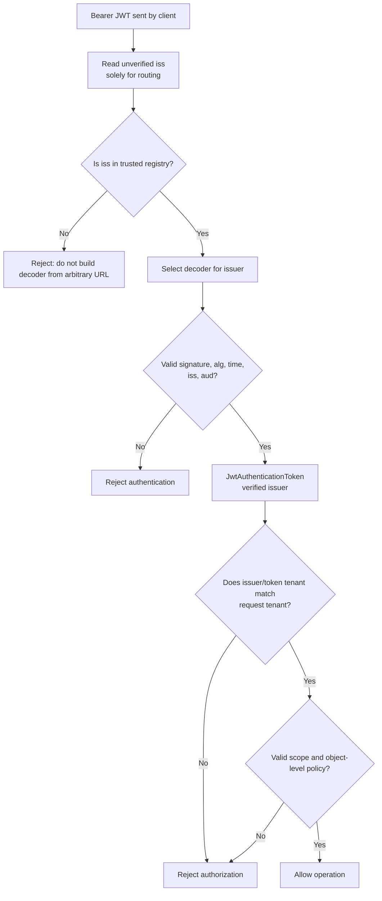
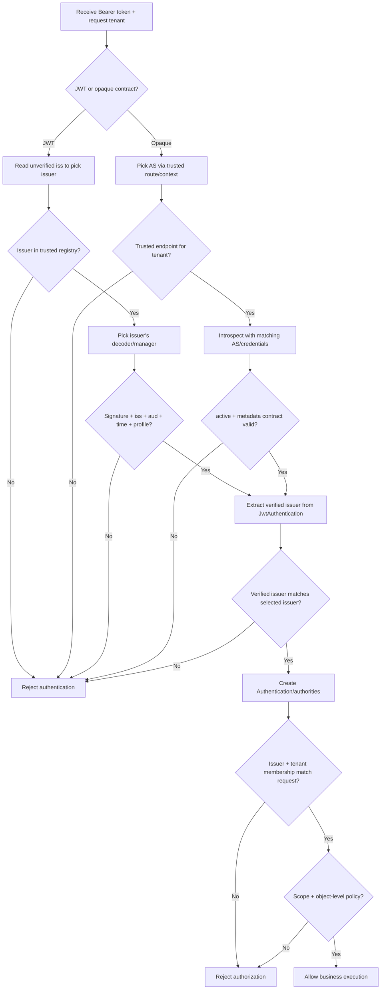

# Binding the selected issuer to the final verification result

In a **Spring Security OAuth 2.0/OIDC Resource Server** serving **multiple tenants**, an API may trust multiple Authorization Servers (AS) or multiple realms of the same Identity Provider (IdP). Each tenant can have a different issuer, JWT signing key set, audience policy, and scope names. To authenticate a Bearer token, the system typically has to **select an issuer** first before applying the corresponding verification mechanism.

This is a particularly critical security boundary: in a JWT, the `iss` field resides in the payload and can be **read before checking the signature**. Readable does not mean trustworthy. An attacker can craft a JWT string containing `"iss": "https://idp.alpha.example/realms/alpha"` and send it to the API. If the application uses that value to load configuration from an arbitrary URL, automatically grant permissions, or skip validating the final issuer, multi-tenancy can lead to **issuer confusion**, **token substitution**, **SSRF**, or cross-tenant privilege escalation.

The principle of this lesson:

> **An issuer read before verification is only a routing hint; the issuer of an accepted Authentication must be confirmed by a verifier belonging to the selected trusted source.**

In short:

```text
unverified iss
    -> select from trusted issuer list
    -> decoder/introspector for selected issuer
    -> actually verify token
    -> confirm verified issuer == selected issuer
    -> confirm audience / token profile / timestamps
    -> check business tenant and scopes
    -> only then grant access
```

This lesson focuses on **binding the selected issuer to the final verification result** in the **Multi-tenancy** chapter: distinguishing routing from attestation, Spring Security multi-issuer configuration, tenant selection variants by URL/host/token, JWT/JWKS, opaque introspection, WebFlux, preventing cross-tenant leakage, and negative testing to prove no path violates the trust boundary.

## 1. Context: why must a Resource Server select an issuer?

Suppose an Orders API accepts access tokens from two realms:

| Tenant | Trusted issuer | Expected audience | Order read scope |
|---|---|---|---|
| **alpha** | `https://idp.alpha.example/realms/alpha` | `orders-api` | `orders.read` |
| **beta** | `https://idp.beta.example/realms/beta` | `orders-api` | `orders.read` |

Alpha token:

```json
{
  "iss": "https://idp.alpha.example/realms/alpha",
  "sub": "user-842",
  "aud": ["orders-api"],
  "scope": "orders.read",
  "tenant_id": "alpha",
  "exp": 1893459600
}
```

Beta token:

```json
{
  "iss": "https://idp.beta.example/realms/beta",
  "sub": "user-842",
  "aud": ["orders-api"],
  "scope": "orders.read",
  "tenant_id": "beta",
  "exp": 1893459600
}
```

These are **illustrative payloads**, not signed JWTs; the timestamps do not represent real token lifetimes. Sharing `sub=user-842` and the same scope does not mean they are the same user or permission set. `sub` normally has identity meaning **only within the issuer's scope**. Likewise, the identical string `SCOPE_orders.read` does not automatically allow a beta token to read alpha's data.

The Resource Server must answer:

1. Which issuer did the token come from **according to a verified source**?
2. Was the token signed with a trusted key belonging to that issuer?
3. Is the token still valid in terms of timestamps, audience, and profile?
4. Which tenant is this request trying to access?
5. Does the caller have permission on the requested tenant/resource?

Answering just one of these five questions is insufficient to grant access.

### 1.1. Trust chain diagram



The critical point sits at **node E**: the verifier must check the issuer **after** proving the token is valid. Node B only decides which verifier to try; never turn a pre-verification hint into a conclusion that "the user belongs to alpha."

## 2. Three concepts that must not be conflated

| Value | Where does it come from? | Trust level before auth | Proper usage |
|---|---|---|---|
| **Issuer hint** | `iss` in unverified JWT or tenant named in request | **Untrusted** | Pick a configuration in the allowlist, never grant permissions |
| **Validated issuer** | Claims from **post-verification** JWT or trusted introspection metadata | Trusted within verifier/contract scope | Confirm the token's issuer identity |
| **Business tenant** | Tenant in path/host/business context, combined with membership/DB | Request routing alone proves no permission | Confirm the actor may operate on that tenant |

Example:

```http
GET /tenants/alpha/orders/ORD-123 HTTP/1.1
Authorization: Bearer TOKEN_FROM_BETA
```

If the resolver reads `iss=beta` and verifies the beta token successfully, **authentication of the beta token may be valid**. However, the request is targeting **tenant alpha**. Access must not be granted simply because beta is a generally trusted issuer. Business policy must check whether a beta token is permitted in alpha per contract; in a one-issuer-per-tenant model, it must **deny**.

In other words:

- **Token validation:** "This token was genuinely issued by beta and is meant for this API."
- **Tenant authorization:** "Is this beta identity allowed to access tenant alpha?"

Binding the selected issuer to the final verification result solves the first part; binding the verified issuer to the business tenant solves the second. Both must be present.

## 3. Two phases in multi-issuer JWT authentication

### Phase A — Routing with unverified information

A JWT typically has the structure:

```text
base64url(header).base64url(payload).base64url(signature)
```

The payload may contain:

```json
{
  "iss": "https://idp.alpha.example/realms/alpha",
  "sub": "user-842",
  "scope": "orders.read"
}
```

This section can be read without a signing key. An attacker can also edit it and produce a JWT with an invalid signature. Thus pre-verification `iss` should only:

1. Be extracted via a parsing mechanism with strict input bounds and clear error handling.
2. Be matched **exactly** against an issuer in the trusted registry.
3. Lead to **a verifier configured from a trusted source**.
4. Reject if the issuer is not in the registry, rather than attempting to fetch a new URL.

Never use it to build a principal, connect to a tenant database, decide permissions, accept roles, or make arbitrary web calls.

### Phase B — Verifying with the selected verifier

Once alpha's configuration is selected, alpha's verifier must check at least the applicable conditions:

- Valid JWS signature under **alpha's trusted key source**.
- Signing algorithm allowed by policy; never accept `alg=none` or disallowed algorithms.
- `iss` **from the verified claims** equals the selected alpha issuer.
- `aud` contains the allowed resource identifier, such as `orders-api`.
- `exp`, `nbf`, and time conditions per validator/token profile.
- The token is a **valid API access token**, not a misused ID token; enforce `typ`/`client_id`/`azp`/`token_use` if required by contract.
- Only afterward map trusted `scope`/claims into `GrantedAuthority`.

If the signature is valid but `iss` does not match alpha's issuer, **it must be rejected**. If the issuer matches but the audience is `payments-api`, **it must be rejected**. If the token is valid yet the route targets another tenant, authorization must still **reject**.

### 3.1. Logical conditions

Notation:

- `I_route`: issuer chosen during the routing phase.
- `I_verified`: token issuer **after authentication**.
- `I_expected(tenant)`: issuer bound by trust policy to the accessed tenant.
- `A_expected`: API audience.

Required condition in a one-issuer/one-tenant model:

```text
I_route ∈ TrustedIssuers

SignatureValid(token, keysFor(I_route))
AND IssuerValid(token, I_route)
AND AudienceValid(token, A_expected)
AND TimeAndTokenProfileValid(token)

I_verified == I_route
AND I_verified == I_expected(requestTenant)

AND HasRequiredScope(Authentication)
AND HasDomainPermission(Authentication, requestedObject)
```

In a **one issuer managing multiple tenants** model, `I_verified == I_expected(requestTenant)` can hold for several tenants. In that case, you must additionally check `tenant_id`, membership, ACL, or domain policy; the issuer alone **does not distinguish** two tenants sharing an IdP.

### 3.2. Not merely "reading `iss` a second time"

If both reads inspect the same unverified payload, matching values **prove nothing**. The final binding is only meaningful when:

1. The signature is verified using trusted keys for the selected issuer.
2. A validator checks the `iss` claim post-verification.
3. The resulting Authentication is built **from the verified token itself**, not from request metadata.

Never construct a `JwtAuthenticationToken` from a `Jwt` built out of unverified claims and assume comparing two `iss` strings is secure.

## 4. Common ways to select an issuer

### 4.1. Selecting by `iss` in the JWT

```text
Bearer JWT
   |
   v
unverified iss = alpha
   |
   v
is alpha in trusted registry?
   |
   v
alpha JwtDecoder
   |
   v
verify signature + validate iss + aud + time
```

This is the pattern supported by Spring Security via **`JwtIssuerAuthenticationManagerResolver`** in Servlet or **`JwtIssuerReactiveAuthenticationManagerResolver`** in WebFlux. The initial issuer value is a hint; **trusted issuers** must come from trusted configuration.

### 4.2. Selecting by tenant URL

```http
GET /tenants/alpha/orders/ORD-123
Authorization: Bearer ...
```

The application maps the slug `alpha` to the known alpha issuer. A token with `iss=beta` must be rejected by alpha's decoder, even if beta is also a trusted issuer elsewhere in the API.

This choice works well when the accessed resource cleanly identifies the tenant in the URL. However, a caller-controlled path **is only a configuration selector input**, not proof the caller has rights in that tenant.

### 4.3. Selecting by host/subdomain

```text
alpha.api.example.com -> issuer alpha
beta.api.example.com  -> issuer beta
```

The host can come from the HTTP Host header or proxy headers like `X-Forwarded-Host`; they must be handled per **trusted proxy configuration**. Never trust an arbitrary caller-sent `X-Tenant-ID`/`X-Forwarded-Host`. Even after picking the right issuer via host, the token must still be verified and the business tenant checked.

### 4.4. Selecting by token prefix or opaque token metadata

An opaque token may carry a namespace/prefix by contract:

```text
alpha_opaque_token_...
beta_opaque_token_...
```

The prefix is only a **routing hint** if the system explicitly defines it; an attacker can spoof a prefix. You must send the token to the appropriate introspection endpoint, verify the response, and enforce final issuer/resource binding. Without a safe prefix, select the issuer from a tenant route or client context established from a trusted source.

### 4.5. Never select an issuer by email domain

An email `alice@alpha.example` or `preferred_username` passed by the client is not proof that an access token came from issuer alpha. Emails can change, collide, be unverified, or be absent from client-credentials tokens. Separate **discovery/user experience** from **token trust validation**.

## 5. Multi-issuer JWT configuration with Spring Security Servlet

In Spring Security Servlet, `JwtIssuerAuthenticationManagerResolver` supports selecting an `AuthenticationManager` by issuer and building/resolving managers per trusted issuer.

Example **static** trust configuration:

```java
import jakarta.servlet.http.HttpServletRequest;

import org.springframework.context.annotation.Bean;
import org.springframework.context.annotation.Configuration;
import org.springframework.http.HttpMethod;
import org.springframework.security.authentication.AuthenticationManagerResolver;
import org.springframework.security.config.annotation.web.builders.HttpSecurity;
import org.springframework.security.config.annotation.web.configurers.AbstractHttpConfigurer;
import org.springframework.security.config.http.SessionCreationPolicy;
import org.springframework.security.oauth2.server.resource.authentication
    .JwtIssuerAuthenticationManagerResolver;
import org.springframework.security.web.SecurityFilterChain;

@Configuration
public class MultiIssuerApiSecurity {

    @Bean
    AuthenticationManagerResolver<HttpServletRequest> issuerResolver() {
        return JwtIssuerAuthenticationManagerResolver.fromTrustedIssuers(
            "https://idp.alpha.example/realms/alpha",
            "https://idp.beta.example/realms/beta"
        );
    }

    @Bean
    SecurityFilterChain apiSecurity(
            HttpSecurity http,
            AuthenticationManagerResolver<HttpServletRequest> issuerResolver)
            throws Exception {

        return http
            .securityMatcher("/api/**")
            // Only for pure Bearer-header APIs; do not use browser
            // cookies/sessions as credentials for write operations.
            .csrf(AbstractHttpConfigurer::disable)
            .sessionManagement(session -> session
                .sessionCreationPolicy(SessionCreationPolicy.STATELESS))
            .authorizeHttpRequests(auth -> auth
                .requestMatchers(HttpMethod.GET, "/api/orders/**")
                    .hasAuthority("SCOPE_orders.read")
                .requestMatchers(HttpMethod.POST, "/api/orders/**")
                    .hasAuthority("SCOPE_orders.create")
                .anyRequest().denyAll())
            .oauth2ResourceServer(oauth2 -> oauth2
                .authenticationManagerResolver(issuerResolver))
            .build();
    }
}
```

This is a Servlet example for Spring Security versions providing the `fromTrustedIssuers` factory. On older versions, constructor/factory signatures may differ; use the API matching your project's version. Production configuration also needs real endpoints/methods, CORS/CSRF aligned with the credential model, auditing, and fallback chains when multiple chains exist.

### 5.1. Why use `fromTrustedIssuers`?

The resolver can inspect the issuer claim **before** verifying the token to decide which manager handles it. When calling:

```java
JwtIssuerAuthenticationManagerResolver.fromTrustedIssuers(
    "https://idp.alpha.example/realms/alpha",
    "https://idp.beta.example/realms/beta"
)
```

this list is **the application's source of trust**, not a list taken from tokens. When a token declares `iss=https://attacker.example`, that issuer does not automatically become a new AS. This prevents arbitrary discovery/JWKS retrieval against attacker-chosen addresses.

### 5.2. Where exactly does the verifier check the issuer?

In a properly configured standard flow, each issuer is resolved through a decoder bound to that issuer and its corresponding validators. **A resolver only provides security value when the selected manager/decoder actually verifies and binds the issuer.** If an application replaces the factory with a custom resolver returning a manager that "accepts any issuer" or a decoder that parses without validating, trusted issuer routing **is no longer sufficient**.

Unsafe example:

```java
// DO NOT DO THIS: route by iss and immediately trust payload.
String issuer = parseIssuerWithoutVerification(token);
if (trustedIssuers.contains(issuer)) {
    return authenticationCreatedFromUnverifiedClaims(token);
}
```

This snippet only proves the attacker typed an issuer string present in the allowlist, not that the issuer actually minted the token.

### 5.3. Notes on audience

`JwtIssuerAuthenticationManagerResolver.fromTrustedIssuers(...)` solves **multi-issuer resolution**, which does not mean it automatically knows Orders API requires `aud=orders-api` in every system. When the API requires a specific audience, configure an audience validator via the decoder/manager or token profile and **test it in practice**.

In particular, properties like:

```yaml
spring:
  security:
    oauth2:
      resourceserver:
        jwt:
          issuer-uri: https://idp.alpha.example/realms/alpha
          audiences:
            - orders-api
```

typically configure a default single-issuer setup. If you replace the JWT decoder branch with a **custom multi-issuer `authenticationManagerResolver`**, do not assume every auto-configured validator applies to **each decoder inside the resolver**. Verify explicitly in code/config and tests.

## 6. Building a per-issuer decoder with final validators

For APIs needing per-tenant control over algorithms, JWKS endpoints, and audiences, create an **immutable configuration registry**:

```java
public record TrustedIssuerConfig(
    String issuer,
    String jwkSetUri,
    String audience
) {}
```

Example application-managed configuration:

```java
import java.util.Map;

Map<String, TrustedIssuerConfig> trusted = Map.of(
    "https://idp.alpha.example/realms/alpha",
    new TrustedIssuerConfig(
        "https://idp.alpha.example/realms/alpha",
        "https://idp.alpha.example/realms/alpha/protocol/openid-connect/certs",
        "orders-api"
    ),
    "https://idp.beta.example/realms/beta",
    new TrustedIssuerConfig(
        "https://idp.beta.example/realms/beta",
        "https://idp.beta.example/realms/beta/protocol/openid-connect/certs",
        "orders-api"
    )
);
```

These are **illustrative** URLs; `jwkSetUri` and discovery endpoints must match the actual IdP. Never infer an issuer's JWKS endpoint by concatenating paths arbitrarily without an explicit contract.

### 6.1. Mandatory validators: issuer and audience

Example creating `NimbusJwtDecoder` from a JWKS URI **already trusted in the registry**:

```java
import org.springframework.security.oauth2.core.OAuth2Error;
import org.springframework.security.oauth2.core.OAuth2TokenValidator;
import org.springframework.security.oauth2.core.OAuth2TokenValidatorResult;
import org.springframework.security.oauth2.jwt.Jwt;
import org.springframework.security.oauth2.jwt.JwtValidators;
import org.springframework.security.oauth2.jwt.NimbusJwtDecoder;
import org.springframework.security.oauth2.core.DelegatingOAuth2TokenValidator;
import org.springframework.security.oauth2.jose.jws.SignatureAlgorithm;

public final class TrustedJwtDecoders {

    public static NimbusJwtDecoder create(TrustedIssuerConfig config) {
        NimbusJwtDecoder decoder = NimbusJwtDecoder
            .withJwkSetUri(config.jwkSetUri())
            // Illustrates only the case where the AS signs with RS256 per contract.
            .jwsAlgorithm(SignatureAlgorithm.RS256)
            .build();

        // Includes default timestamp and issuer validators.
        OAuth2TokenValidator<Jwt> issuerAndDefaults =
            JwtValidators.createDefaultWithIssuer(config.issuer());

        OAuth2TokenValidator<Jwt> audience = jwt -> {
            if (jwt.getAudience().contains(config.audience())) {
                return OAuth2TokenValidatorResult.success();
            }
            return OAuth2TokenValidatorResult.failure(
                new OAuth2Error(
                    "invalid_token",
                    "Token audience is not accepted",
                    null
                ));
        };

        decoder.setJwtValidator(
            new DelegatingOAuth2TokenValidator<>(
                issuerAndDefaults, audience));

        return decoder;
    }
}
```

Note:

- `withJwkSetUri(config.jwkSetUri())` pulls the URL **from trusted configuration**, not from arbitrary `iss`, `jku`, or `x5u` in the token.
- `jwsAlgorithm(SignatureAlgorithm.RS256)` is appropriate only when the AS contract specifies RS256. Never enable multiple algorithms indiscriminately just so "any token verifies."
- `JwtValidators.createDefaultWithIssuer(config.issuer())` verifies the issuer claim **after the token signature is accepted**, alongside version-appropriate default validators.
- The audience validator requires `aud` to contain `orders-api`; missing or wrong audiences are rejected.
- If the API enforces a token profile like **RFC 9068**, add `typ`/token-use/client-binding validators per contract. This example does not cover every RFC requirement.

**Common pitfall:** calling `decoder.setJwtValidator(audienceOnly)` **replaces existing validators** unless composed with issuer/default validators, potentially dropping `iss` and timestamp checks by accident. Above, both validators are explicitly combined.

### 6.2. Creating an AuthenticationManager using that decoder

```java
import org.springframework.security.authentication.AuthenticationManager;
import org.springframework.security.oauth2.server.resource.authentication.JwtAuthenticationProvider;

public static AuthenticationManager managerFor(TrustedIssuerConfig config) {
    JwtAuthenticationProvider provider =
        new JwtAuthenticationProvider(
            TrustedJwtDecoders.create(config));

    return provider::authenticate;
}
```

`JwtAuthenticationProvider` uses the decoder and its converter to authenticate the token and produce an Authentication. If the application customizes `JwtAuthenticationConverter` to map roles/scopes, that converter **runs only after the decoder**, never reading unverified claims from the routing phase.

### 6.3. Binding the selected issuer and manager via configuration

A realistic registry can be initialized as:

```java
Map<String, AuthenticationManager> managers =
    trusted.values().stream()
        .collect(Collectors.toUnmodifiableMap(
            TrustedIssuerConfig::issuer,
            TrustedJwtDecoders::managerFor));
```

How the issuer resolver uses it:

```text
unverified issuer = alpha
   |
   v
trusted.get("alpha issuer") -> TrustedIssuerConfig(alpha)
   |
   v
managers.get("alpha issuer") -> JwtAuthenticationProvider
   |
   v
decoder with alpha JWKS
   |
   v
issuer validator == alpha + audience validator == orders-api
```

When wiring this map to a custom `AuthenticationManagerResolver`, **the resolver's API/constructor depends on your Spring Security version**; you do not necessarily have to write an `iss` parser separate from the framework. If you only need a trusted issuer list without per-issuer audiences, prefer `JwtIssuerAuthenticationManagerResolver.fromTrustedIssuers(...)`; if you need a custom registry, ensure managers are **built from their corresponding `TrustedIssuerConfig`** and never share a single decoder missing an issuer validator.

### 6.4. Why not use a single decoder with all JWKS combined?

A dangerous design:

```text
token claims iss = alpha
       |
       v
verify signature using "all keys from every issuer"
       |
       v
if signature matches any key -> accept
```

If beta's key can sign a token claiming `iss=alpha` and the system fails to enforce the matching key source and issuer, **cross-issuer token substitution** can occur. A per-issuer decoder with its dedicated key source and issuer validator is far easier to govern.

Key ID `kid` is also **not a global issuer identity**. Two AS instances can use the same `kid`. Only resolve `kid` within the **selected issuer's JWKS**, never in an unnamespaced global key store.

## 7. Attack scenario: a beta token claiming to be alpha

Suppose an attacker holds a JWT signed by beta's key with modified claims:

```json
{
  "iss": "https://idp.alpha.example/realms/alpha",
  "sub": "admin",
  "aud": ["orders-api"],
  "scope": "orders.delete"
}
```

The token claims issuer alpha. The resolver picks alpha's decoder.

Expected behavior:

1. Alpha is a trusted issuer, so **alpha's decoder may be selected**.
2. Alpha's decoder accepts signatures only from alpha's trusted keys.
3. Because the token was signed with beta's key, signature verification must fail.
4. No Authentication is created; the route never reaches the controller.

If an attacker crafts a payload without a valid signature, `iss` may still be read for routing, yet **no privileges are granted**.

### 7.1. What if two issuers share a signing key?

In some systems, multiple realms/issuers share key material or a common signing service. In that case, a valid signature **does not distinguish issuers on its own**. The issuer validator becomes doubly important, and you must also ask:

- Which AS is actually permitted to mint tokens with which issuer?
- Is there a safeguard ensuring one party cannot arbitrarily sign tokens claiming another party's issuer?
- Does key reuse break the defined trust boundary?
- Should keys, applications, or resources be separated by issuer?

If one AS can use the same private key to sign tokens with any `iss`, signature + issuer string alone cannot tell **who truly generated the payload**. This is a **trust contract and key governance** problem, not merely Java configuration.

### 7.2. Never use `kid` or `jku` to bypass the trusted registry

A JWT header can contain:

```json
{
  "alg": "RS256",
  "kid": "key-1",
  "jku": "https://attacker.example/jwks.json"
}
```

Never fetch `jku` or `x5u` from an unverified header. If a library or implementation honors arbitrary header key locations, an attacker can make the API fetch the attacker's key and verify the attacker's own signed JWT.

The JWKS URI must be bound to the issuer in the trusted registry or metadata discovery constrained to trusted issuers. Key rotation must also update within the **proper trust namespace**, never allowing a new key to switch issuers.

## 8. Dangerous case: valid issuer, wrong audience

Token:

```json
{
  "iss": "https://idp.alpha.example/realms/alpha",
  "aud": ["billing-api"],
  "sub": "user-842",
  "scope": "orders.read"
}
```

If alpha's decoder only checks signature and `iss`, it could authenticate a token **not issued for Orders API**. Having the same `orders.read` scope string is insufficient; the token might belong to Billing API or another resource.

**Audience is an independent constraint from issuer.** One issuer can mint tokens for many APIs. A multi-issuer configuration must enforce:

```text
valid issuer     -> token issued by a trusted AS
valid audience   -> token issued for this Resource Server
valid scope      -> token allowed to perform this action type
valid tenant     -> actor allowed into the requested tenant/resource
```

In the decoder setup in section 6, the audience validator is added to **every decoder**. A test for "alpha JWT with audience `billing-api`" must be rejected despite valid signature and issuer.

### 8.1. `azp`/`client_id` do not replace `aud`

Some AS implementations return `azp`, `client_id`, or `appid`. These identify the client, not the resource audience. Do not treat `client_id=shop-web` as proof that the token is meant for Orders API unless the AS token profile contract explicitly defines it and security policy has reviewed it.

### 8.2. An OIDC ID token is not an API access token

An OIDC **ID token** attests an authentication event to an OAuth client/Relying Party; its `aud` is normally the client ID. A Resource Server requires an appropriate **access token**. If an ID token comes from an allowlisted issuer without the `orders-api` audience, it must be rejected. Never relax the audience validator to accept ID tokens for convenience.

For JWT access tokens under **RFC 9068**, there are concrete rules for issuer, audience, token type, and claims. Enforce the AS/Resource Server's exact profile, not just signatures.

## 9. Binding the verified issuer to the request's tenant

Suppose a multi-tenant API exposes URLs like:

```http
GET /api/tenants/alpha/orders/ORD-123 HTTP/1.1
Authorization: Bearer VALID_BETA_TOKEN
```

If the API uses `JwtIssuerAuthenticationManagerResolver` reading the token's `iss`, beta's decoder can verify the beta token successfully. However, the request should still only proceed if the beta actor has **valid authorization** for tenant alpha.

In a one-tenant-per-issuer model, the rule is simple:

```text
token issuer == issuer configured for route tenant
```

This must execute **after token verification**, operating on `JwtAuthenticationToken.getToken()` produced by Spring Security from a valid decoder.

### 9.1. Policy bean checking tenant and issuer

Suppose business tenant slugs `alpha`/`beta` map 1-to-1 to issuers:

```java
import java.util.Map;
import java.util.Objects;

import org.springframework.security.core.Authentication;
import org.springframework.security.oauth2.server.resource.authentication
    .JwtAuthenticationToken;
import org.springframework.stereotype.Component;

@Component("tenantAccess")
public class TenantAccessPolicy {

    private final Map<String, String> issuerByTenant = Map.of(
        "alpha", "https://idp.alpha.example/realms/alpha",
        "beta", "https://idp.beta.example/realms/beta"
    );

    public boolean mayAccess(
            Authentication authentication,
            String requestedTenant) {

        if (!(authentication instanceof JwtAuthenticationToken jwtAuth)) {
            return false;
        }

        String expectedIssuer = issuerByTenant.get(requestedTenant);
        if (expectedIssuer == null) {
            return false;
        }

        var jwt = jwtAuth.getToken();
        String verifiedIssuer = jwt.getIssuer() == null
            ? null
            : jwt.getIssuer().toString();

        return Objects.equals(expectedIssuer, verifiedIssuer)
            && Objects.equals(
                requestedTenant,
                jwt.getClaimAsString("tenant_id"));
    }
}
```

This example checks **both issuer and `tenant_id`**, fitting cases where the AS has a contract to emit a tenant claim. This claim is not standard across all OAuth 2.0/OIDC setups, so only rely on it when the IdP guarantees it is authenticated and constrained with exact semantics. If the app does not use `tenant_id`, replace it with authoritative membership/ACL checks.

### 9.2. Calling the policy from a service method

```java
import org.springframework.security.access.prepost.PreAuthorize;
import org.springframework.stereotype.Service;

@Service
public class OrderQueryService {

    private final OrderRepository orders;

    public OrderQueryService(OrderRepository orders) {
        this.orders = orders;
    }

    @PreAuthorize(
        "hasAuthority('SCOPE_orders.read') " +
        "and @tenantAccess.mayAccess(authentication, #tenant)")
    public OrderView readOrder(String tenant, String orderId) {
        return orders.findVisibleByTenantAndId(tenant, orderId)
            .orElseThrow(OrderNotFoundException::new);
    }
}
```

For the annotation to take effect, you need `@EnableMethodSecurity`, a Spring-managed bean, invocation through a proxy, and the proper Spring Security context. For SpEL `#tenant`, ensure parameter names are preserved at compile time (`-parameters`) or use `@P` depending on your version.

`OrderRepository`, `OrderView`, and `OrderNotFoundException` are illustrative domain abstractions. In practice, queries must also check **owner/membership**: two users in the same tenant are not automatically allowed to view all of each other's orders.

### 9.3. Never use a tenant from the request body to prove permission

Anti-pattern:

```java
if (requestBody.tenantId().equals(pathTenant)) {
    repository.deleteOrder(orderId);
}
```

An attacker can supply any tenant in the body. That condition only compares two caller-controlled values without binding to the verified Authentication or DB record. Tenant checks must rely on the trusted principal and domain data; mutations must happen **after** policy checks.

## 10. One issuer can serve multiple tenants

Not every system has a 1-to-1 tenant ↔ issuer mapping. An IdP can serve:

```text
issuer: https://login.example.com/realms/enterprise
    |
    +-- tenant alpha
    +-- tenant beta
    +-- tenant gamma
```

In that setup:

```text
verified iss = enterprise issuer
```

only proves the token belongs to this AS. It **does not distinguish** alpha, beta, and gamma. You also need:

- `tenant_id` issued by the AS under a trusted policy;
- Tenant memberships/roles from an authorization service;
- Tenant-specific resource permissions in the DB;
- Clearly defined owner, manager, delegated access, or support access rules.

If user A is a member of both alpha and beta, switching active tenants must still bind the **operation to the selected tenant**. Never use an active tenant header to bypass membership validation.

### 10.1. Identity keys should include the issuer

`sub=user-842` is not inherently unique across multiple issuers. A safe identity key usually starts with:

```text
IdentityKey = (verifiedIssuer, subject)
```

and continues:

```text
AuthorizationContext =
  IdentityKey + requestedTenant + role/permissions + object state
```

If a project links two identities from two issuers to a single internal user, that must be a **controlled account-linking workflow**, not inferred from matching `sub` or email values.

### 10.2. Cross-tenant service accounts

A `client_credentials` token may represent a service like `nightly-order-job` rather than an interactive user. Interpret `client_id`, `sub`, and `scope` according to a dedicated contract. If a service holds cross-tenant privileges, express them explicitly, scope them to specific resources, and audit them—never grant cross-tenant access just because the issuer is "system."

## 11. Selecting the issuer by route: requires both authentication and final validation

Instead of reading `iss`, a system can pick the tenant from the URL before inspecting the token:

```text
/api/tenants/alpha/** -> alpha's manager
/api/tenants/beta/**  -> beta's manager
```

This is a strong option when routes reliably identify the tenant. A beta token sent to an alpha route is checked by **alpha's decoder** and rejected. Even so, you must still:

1. Extract the route tenant safely without relying on untrusted headers.
2. Look up the tenant in the trusted registry rather than inventing an AS from an unknown slug.
3. Use a decoder with an issuer validator bound to that tenant.
4. Keep business authorization checking record ownership and tenant.

### 11.1. Do not assume MVC `URI_TEMPLATE_VARIABLES` exist before the controller

In a Servlet filter chain, security filters can run **before** Spring MVC handler mapping resolves path variables. Thus code like:

```java
// Do not assume this attribute already exists in a security filter:
request.getAttribute(
    HandlerMapping.URI_TEMPLATE_VARIABLES_ATTRIBUTE);
```

will not reliably extract `tenant` when the resolver runs. If building a custom path-based resolver, use a **path parser/matcher directly at the filter layer** with strict URL normalization rules, or separate `SecurityFilterChain`s per fixed route.

### 11.2. Never construct a decoder from a request parameter

Anti-pattern:

```java
String tenant = request.getParameter("tenant");
String issuer = "https://" + tenant + ".example.com";
JwtDecoder decoder = JwtDecoders.fromIssuerLocation(issuer);
```

An attacker can alter `tenant`, construct an arbitrary hostname, and trigger metadata discovery/JWKS retrieval to unauthorized addresses or cause DoS. Change it to:

```java
TrustedIssuerConfig config = registry.findByTenant(tenant);
if (config == null) {
    throw new BadCredentialsException("Unknown tenant");
}
// Fetch a pre-built verifier from trusted configuration.
AuthenticationManager manager = managers.get(config.issuer());
```

Here `registry`/`managers` are trusted application configuration services. Never derive `issuer` or `jwkSetUri` from public input.

## 12. Metadata discovery, JWKS, and SSRF risks

Spring Security can use OIDC/OAuth issuer discovery metadata to locate related endpoints (including `jwks_uri`). This is safer when the issuer comes from a **trusted registry** and the HTTP client is hardened.

Conversely:

```text
unverified JWT iss = http://169.254.169.254/...
       |
       v
JwtDecoders.fromIssuerLocation(iss)
       |
       v
HTTP request to internal address
```

is a severe SSRF pattern when raw issuers are used without an allowlist.

### 12.1. Defenses

- Accept issuers only from a governed allowlist/registry.
- Enforce HTTPS for AS/JWKS in production with valid TLS verification.
- Ensure egress/network policies restrict where the Resource Server can connect.
- Disallow HTTP redirects sending discovery/JWKS requests to arbitrary addresses.
- Enforce timeouts, response size limits, and JSON/JWK format checks.
- Never take JWKS URIs from unverified `jku`/`x5u` JWT headers.
- Cache configs/keys scoped to the right issuer, handling rotation safely.
- Never use a shared key store without issuer namespacing.

### 12.2. Issuer names must match exactly

Examples:

```text
https://idp.example.com/realms/alpha
https://idp.example.com/realms/alpha/
https://IDP.example.com/realms/alpha
https://idp.example.com/realms/Alpha
```

These **should not be treated as implicitly equivalent** in `iss` verification rules. The issuer string is an AS-published identifier; the application must use the **exact issuer from metadata/contract**.

Never use `startsWith`, `contains`, or loose domain comparisons:

```java
// DO NOT DO THIS:
if (issuer.startsWith("https://idp.example.com/realms/")) {
    trust(issuer);
}
```

An unmanaged new issuer under the same domain/realm namespace could still be untrusted. Never let a DNS suffix substitute for an explicit issuer approval decision.

### 12.3. Never treat "same provider" as proof

Two realms on the same Keycloak/Auth0/Entra deployment can have entirely different token-issuance policies. Sharing a vendor or domain **does not automatically make** every realm a trusted issuer. The trusted set must be the explicit list of issuers your system has vetted and can revoke.

## 13. Reactive WebFlux: same rules, different APIs

In **Spring WebFlux**, a Resource Server uses `SecurityWebFilterChain` and `ServerHttpSecurity`; `Authentication` and JWT claim validation still require post-verification issuer binding.

Configuration example using a multi-issuer resolver:

```java
import org.springframework.context.annotation.Bean;
import org.springframework.context.annotation.Configuration;
import org.springframework.http.HttpMethod;
import org.springframework.security.config.annotation.web.reactive.EnableWebFluxSecurity;
import org.springframework.security.config.web.server.ServerHttpSecurity;
import org.springframework.security.oauth2.server.resource.authentication
    .JwtIssuerReactiveAuthenticationManagerResolver;
import org.springframework.security.web.server.SecurityWebFilterChain;

@Configuration
@EnableWebFluxSecurity
public class ReactiveMultiIssuerSecurity {

    @Bean
    SecurityWebFilterChain apiSecurity(ServerHttpSecurity http) {
        JwtIssuerReactiveAuthenticationManagerResolver resolver =
            JwtIssuerReactiveAuthenticationManagerResolver.fromTrustedIssuers(
                "https://idp.alpha.example/realms/alpha",
                "https://idp.beta.example/realms/beta"
            );

        return http
            .csrf(ServerHttpSecurity.CsrfSpec::disable)
            .authorizeExchange(auth -> auth
                .pathMatchers(HttpMethod.GET, "/api/orders/**")
                    .hasAuthority("SCOPE_orders.read")
                .anyExchange().denyAll())
            .oauth2ResourceServer(oauth2 -> oauth2
                .authenticationManagerResolver(resolver))
            .build();
    }
}
```

This example relies on the modern factory; verify `JwtIssuerReactiveAuthenticationManagerResolver` APIs against your project's Spring Security version. The snippet shows only tenant resolution and HTTP authorization; production configs also need per-issuer audience validators, CORS, error handling, and remaining routes.

### 13.1. Reactor Context does not replace issuer validation

After authentication succeeds, WebFlux typically stores the `SecurityContext` in the **Reactor Context**, accessed via `ReactiveSecurityContextHolder`. It does not create a security boundary between issuers on its own: if the decoder is wrong, the Reactor Context simply propagates the **wrong `Authentication`** downstream.

Therefore, verify the token before placing the principal into context, then use the verified `iss` to enforce tenant checks in the reactive service:

```java
return ReactiveSecurityContextHolder.getContext()
    .map(SecurityContext::getAuthentication)
    .flatMap(auth -> tenantPolicy.allowed(auth, requestedTenant))
    .filter(Boolean::booleanValue)
    .switchIfEmpty(Mono.error(
        new AccessDeniedException("Tenant access denied")))
    .then(orderRepository.findVisibleById(...));
```

This is a **conceptual pattern**; replace `tenantPolicy`, `requestedTenant`, `orderRepository`, and `...` with real domain code. In a reactive flow, `tenantPolicy.allowed` returns `Mono<Boolean>`, never calling `block()` on the event loop.

### 13.2. `Mono`/`Flux` is not a way to skip security checks

`Mono` defers execution until subscription; security filters and method interceptors must attach context and authorization into the same reactive chain. Never use a detached `subscribe()` to check permissions in parallel with a data query—that creates a race condition:

```java
// Unsafe: authorization runs detached from the operation.
tenantPolicy.allowed(authentication, tenant).subscribe();
return repository.deleteById(orderId);
```

Compose them instead:

```java
return tenantPolicy.allowed(authentication, tenant)
    .flatMap(allowed -> {
        if (!allowed) {
            return Mono.error(new AccessDeniedException("Denied"));
        }
        return repository.deleteById(orderId);
    });
```

Issuer binding, tenant authorization, and mutations must live in the **exact same pipeline**, never assuming a side-effect subscription protects another subscription.

## 14. Opaque tokens: no JWT issuer to pre-read

With an **opaque access token**, the Resource Server may not be able to read any `iss` from the Bearer string. Selecting the issuer/introspection endpoint must rely on:

- Tenant from route or host **mapped via a trusted registry**;
- Verified client context/service contract;
- Token prefix only when the AS defines an explicit routing contract, still followed by verification;
- A trusted introspection gateway capable of validating tokens across multiple issuers.

Never do:

```java
String issuer = decodeJwtWithoutVerification(opaqueToken).getIssuer();
```

An opaque token does not have to be a JWT; even if the string happens to contain dots, never treat it as a JWT to guess an issuer.

### 14.1. Binding introspection results to the selected issuer

Suppose tenant alpha maps to:

```text
issuer = https://idp.alpha.example/realms/alpha
introspection-uri = https://idp.alpha.example/oauth2/introspect
resource-server credential = alpha-orders-api
```

The Resource Server calls the **trusted endpoint**. If the AS returns metadata:

```json
{
  "active": true,
  "iss": "https://idp.alpha.example/realms/alpha",
  "aud": ["orders-api"],
  "scope": "orders.read",
  "sub": "user-842"
}
```

a wrapper can verify:

```text
introspection response trusted
AND active accepted by delegate
AND returned iss == selected issuer alpha
AND aud contains orders-api
```

If the response omits `iss`, note that **RFC 7662 does not require every AS to return it**. You then need another strong contract: for instance, alpha's endpoint only introspects alpha tokens and uses Resource Server credentials exclusive to alpha. If an AS could return `active` for beta's token without issuer metadata, the Resource Server cannot easily prove the token belongs to the selected issuer. Never drop the constraint and still call it issuer verification.

### 14.2. Servlet decorator example for post-introspection issuer checks

```java
import java.util.Collection;
import java.util.Objects;

import org.springframework.security.oauth2.core.OAuth2AuthenticatedPrincipal;
import org.springframework.security.oauth2.server.resource.introspection
    .BadOpaqueTokenException;
import org.springframework.security.oauth2.server.resource.introspection
    .OpaqueTokenIntrospector;

public final class IssuerBoundOpaqueIntrospector
        implements OpaqueTokenIntrospector {

    private final OpaqueTokenIntrospector delegate;
    private final String selectedIssuer;
    private final String requiredAudience;

    public IssuerBoundOpaqueIntrospector(
            OpaqueTokenIntrospector delegate,
            String selectedIssuer,
            String requiredAudience) {
        this.delegate = Objects.requireNonNull(delegate);
        this.selectedIssuer = Objects.requireNonNull(selectedIssuer);
        this.requiredAudience = Objects.requireNonNull(requiredAudience);
    }

    @Override
    public OAuth2AuthenticatedPrincipal introspect(String token) {
        OAuth2AuthenticatedPrincipal principal =
            delegate.introspect(token);

        if (!selectedIssuer.equals(principal.getAttribute("iss"))) {
            throw new BadOpaqueTokenException(
                "Introspected token issuer not accepted");
        }

        Object aud = principal.getAttribute("aud");
        boolean audienceMatches =
            (aud instanceof String s && requiredAudience.equals(s))
            || (aud instanceof Collection<?> values
                && values.contains(requiredAudience));

        if (!audienceMatches) {
            throw new BadOpaqueTokenException(
                "Introspected token audience not accepted");
        }
        return principal;
    }
}
```

The decorator **only** checks attributes after the delegate has verified the token with the AS. It does not check `active` itself, call APIs from untrusted inputs, or modify `principal.getAuthorities()`. If the delegate throws an exception, propagate it so no fallback principal is granted.

### 14.3. WebFlux opaque introspection

In WebFlux, the equivalent is `ReactiveOpaqueTokenIntrospector`:

```java
import reactor.core.publisher.Mono;
import org.springframework.security.oauth2.core.OAuth2AuthenticatedPrincipal;
import org.springframework.security.oauth2.server.resource.introspection
    .ReactiveOpaqueTokenIntrospector;
import org.springframework.security.oauth2.server.resource.introspection
    .BadOpaqueTokenException;

public final class IssuerBoundReactiveIntrospector
        implements ReactiveOpaqueTokenIntrospector {

    private final ReactiveOpaqueTokenIntrospector delegate;
    private final String selectedIssuer;

    public IssuerBoundReactiveIntrospector(
            ReactiveOpaqueTokenIntrospector delegate,
            String selectedIssuer) {
        this.delegate = delegate;
        this.selectedIssuer = selectedIssuer;
    }

    @Override
    public Mono<OAuth2AuthenticatedPrincipal> introspect(String token) {
        return Mono.defer(() -> delegate.introspect(token))
            .switchIfEmpty(Mono.error(new BadOpaqueTokenException(
                "Missing introspection principal")))
            .map(principal -> {
                if (!selectedIssuer.equals(
                        principal.getAttribute("iss"))) {
                    throw new BadOpaqueTokenException(
                        "Introspection issuer mismatch");
                }
                return principal;
            });
    }
}
```

In production, add contract-required audience/resource checks, timeouts/HTTP error policies, and credential protection. Neither `Mono.empty()` nor `onError` may turn into an authorized principal. `Mono.defer` keeps delegate invocation inside the subscription, though it does not make a blocking HTTP client non-blocking.

### 14.4. Never probe all introspection endpoints unconditionally

An implementation might try:

```text
Try AS alpha
  if inactive -> try AS beta
  if inactive -> try AS gamma
  until one returns active=true
```

This approach causes multiple issues:

- Sends the same bearer credential to more parties than necessary.
- Increases latency, load, and token exposure in logs/metrics.
- Leaves ambiguity if a token could be active at two ASs with different semantics.
- Easily misses final issuer binding when picking "whichever said active."
- Risks dangerous fallback behavior to another AS during an outage.

If an architecture genuinely needs a federated introspection service, use a **trusted gateway with explicit issuer-source/binding contracts** or select the AS from a controlled context. Never default to "try every AS and trust the first hit."

## 15. Dynamic multi-tenancy: safe issuer onboarding and offboarding

The trusted issuer registry may be updated as new tenants are onboarded. Updating the registry **is a trust configuration change**, not ordinary business data.

An onboarding workflow should include:

1. Verifying issuer identity, metadata URL, JWKS URI, and tenant ownership.
2. Defining accepted audience/token profile, algorithms, scopes, and principals.
3. Checking TLS, endpoint reachability, response size/timeouts, and egress policies.
4. Writing registry configuration from a controlled admin source.
5. Creating decoders/managers **hard-bound** to the registered trusted issuer.
6. Testing that the new issuer's tokens cannot access other tenants.
7. Having a revocation path and manager/JWKS/cache invalidation when the tenant is offboarded.

### 15.1. Why is invalidation necessary?

A resolver may cache `AuthenticationManager`s/decoders per issuer. If a tenant is offboarded while caches still hold the old manager or trust predicate, verify that new requests cannot continue using the revoked issuer.

Never assume deleting a single row from the registry database immediately stops every instance from accepting tokens; check:

- Per-issuer manager caches;
- JWKS caches;
- Introspection result caches;
- Replica configuration propagation;
- Gateway allowlists;
- Long-lived sessions or asynchronous jobs.

Proper offboarding must have a defined policy propagation SLO tested across the cluster.

### 15.2. Do not create a new decoder on every request

`JwtDecoder` may need metadata/JWKS calls and maintain key caches. Rebuilding a decoder by `iss` on every request causes:

- High latency and network overhead;
- Discovery DoS vulnerability;
- Lack of key cache/rotation control;
- Races during config updates;
- SSRF risk if issuers are not allowlisted.

Reuse decoders/managers keyed by **trusted issuer key** with explicit lifecycle and invalidation rules.

### 15.3. Multi-issuer config in a database still needs review

An issuer record entered directly by a tenant admin should not be trusted as a new API issuer on its own. Require a review workflow verifying domain, ownership, token-signing contract, resource audience, and tenant admin privileges. Data sitting in a DB is not "more trustworthy than a request" if external users can edit it freely.

## 16. Distinguishing issuer authentication errors from tenant authorization errors

| Case | Layer | Typical HTTP result |
|---|---|---|
| Missing or malformed JWT | Authentication | 401 |
| `iss` not in allowlist | Authentication/routing | 401 |
| Invalid signature for selected issuer | Authentication | 401 |
| Valid signature, `iss` mismatches expected issuer | Authentication | 401 |
| Valid issuer, `aud` not intended for API | Authentication | 401 |
| Expired or not-yet-valid token | Authentication | 401 |
| Valid token missing `SCOPE_orders.read` | Authorization | 403 |
| Valid beta token requesting tenant alpha | Domain/tenant authorization | 403 or 404 per policy |
| Token with scope, caller does not own order | Domain authorization | 403 or 404 per policy |
| JWKS/AS endpoint timeout or 5xx | Infrastructure/authentication unavailable | Must fail closed; HTTP status per exception handler |

Do not turn every authentication failure into 403 or every business denial into 401. For Bearer tokens under **RFC 6750**, 401 typically includes `WWW-Authenticate: Bearer` with an optional error code; missing scopes can yield `insufficient_scope` and 403. Exception handlers or gateways may customize details, but must never alter the deny decision.

### 16.1. Do not leak overly detailed internal issuer info

When an issuer is untrusted, the API should not tell an anonymous caller:

```text
We only trust https://idp.alpha.example/... and
https://idp.beta.example/...
```

Return a generic invalid-token message; log a **safe error code** or policy-normalized internal issuer ID server-side. Never log raw bearer tokens or arbitrary JWT headers containing sensitive data.

## 17. Negative testing: proving issuer routing alone cannot grant access

Testing only "valid alpha token gets 200" is insufficient. A multi-issuer mechanism must test cases with a **matching issuer hint but invalid signature, scope, or resource**.

### 17.1. Required JWT matrix

| Token/Request | Expected outcome |
|---|---|
| Alpha JWT signed by alpha, `iss=alpha`, `aud=orders-api` | Passes authentication; evaluated by scope/domain policy |
| Beta JWT signed by beta, `iss=beta`, `aud=orders-api` | Passes authentication; limited to beta permissions per policy |
| Forged token `iss=alpha` with garbage signature | Authentication rejected |
| Token signed by beta key with `iss=alpha` | Rejected by alpha verification/key policy |
| Token signed by alpha with `iss=beta` | Rejected by beta verification/key policy |
| Valid alpha token with `aud=payments-api` | Authentication rejected |
| Expired alpha token / future `nbf` | Authentication rejected |
| Token with `iss=https://attacker.example` | Rejected before making any discovery request |
| Token with `jku` pointing to attacker | Never fetches arbitrary JWKS; verifies with trusted key source |
| Token with `alg=none` or unsupported algorithm | Rejected |
| Valid beta token hitting `/tenants/alpha/**` | Tenant authorization rejected |
| Alpha token with only `orders.read` calling DELETE | Authorization rejected |
| Two tokens with identical `sub` from alpha and beta | Not treated as the same identity without account linking |
| Issuer missing/extra trailing slash mismatches exact issuer | Rejected per contract |
| JWT claiming `tenant_id=alpha` targeting object owned by beta | Domain authorization rejected |

**Specifically test cross-key/cross-issuer cases:** these prove **initial issuer routing is never mistaken for proof**. In integration tests, use real JWTs signed with **separate test keys** and real decoders instead of merely mocking `Authentication`.

### 17.2. Unit testing issuer and audience validators

You can test claim validators with a `Jwt` fixture:

```java
import java.time.Instant;
import java.util.List;

import org.junit.jupiter.api.Test;
import org.springframework.security.oauth2.core.OAuth2TokenValidatorResult;
import org.springframework.security.oauth2.jwt.Jwt;
import org.springframework.security.oauth2.jwt.JwtValidators;

import static org.assertj.core.api.Assertions.assertThat;

class JwtIssuerClaimValidatorTest {

    @Test
    void rejectsIssuerDifferentFromSelectedIssuer() {
        Jwt jwt = Jwt.withTokenValue("synthetic.jwt.token")
            .header("alg", "RS256")
            .issuer("https://idp.beta.example/realms/beta")
            .audience(List.of("orders-api"))
            .issuedAt(Instant.now().minusSeconds(5))
            .expiresAt(Instant.now().plusSeconds(600))
            .subject("user-842")
            .build();

        var validator = JwtValidators.createDefaultWithIssuer(
            "https://idp.alpha.example/realms/alpha");

        OAuth2TokenValidatorResult result = validator.validate(jwt);
        assertThat(result.hasErrors()).isTrue();
    }
}
```

This is a **unit test for claim validators**, **not** real signature verification since `Jwt.withTokenValue(...)` creates a synthetic parsed object. It does not replace decoder integration tests signed with separate alpha and beta keys.

### 17.3. Limitations of testing with `mockJwt()`

In Spring Security Test, `MockMvc`:

```java
mockMvc.perform(get("/api/orders/123")
    .with(jwt().jwt(jwt ->
        jwt.claim("iss", "https://idp.alpha.example/realms/alpha"))
        .authorities(
            new SimpleGrantedAuthority("SCOPE_orders.read"))));
```

helps test controller/service authorization once `Authentication` is mocked. It typically **bypasses the real decoder**, so it **does not prove**:

- The signature matches alpha's key source;
- The issuer resolver enforces an allowlist;
- `iss` was checked by the validator;
- Audience and time checks actually ran;
- Untrusted issuers cannot trigger remote discovery.

Therefore, multi-issuer testing must include a **real compact Bearer JWT path through the filter chain and real decoder** (with controlled test JWKS/IdPs) to verify the trust boundary.

### 17.4. Integration test with two test JWKS servers

A rigorous test setup:

```text
Test Issuer A:
  iss = https://issuer-a.test
  JWKS = key-A

Test Issuer B:
  iss = https://issuer-b.test
  JWKS = key-B

Application:
  trusted issuers = [A, B]
  audience = orders-api
```

Test requests:

```text
token-A-signed-A -> 200 if scope and tenant match
token-B-signed-B -> 200 if scope and tenant match
token-claims-A-signed-B -> 401
token-claims-B-signed-A -> 401
token-A-aud-other -> 401
token-A-to-tenant-B -> 403/404 per policy
unknown-issuer -> 401, zero HTTP requests to unknown URL
```

To test issuer discovery, use clearly routed mock OIDC metadata/JWKS endpoints. If tests use static JWKS URIs in a trusted registry, verify no requests go to URLs from token headers. Never call production IdPs or commit real private keys into the repository.

### 17.5. Unit testing post-authentication tenant policy

Using `TenantAccessPolicy` from section 9:

```java
Jwt jwt = Jwt.withTokenValue("test-token")
    .header("alg", "RS256")
    .issuer("https://idp.beta.example/realms/beta")
    .subject("user-842")
    .claim("tenant_id", "beta")
    .build();

JwtAuthenticationToken auth =
    new JwtAuthenticationToken(jwt);

boolean allowed = policy.mayAccess(auth, "alpha");
assertThat(allowed).isFalse();
```

This is a **policy unit test** using a pre-verified mock Authentication. It proves the logic "beta cannot access alpha," not real beta token signature verification.

### 17.6. Testing opaque introspection

With opaque tokens and two AS endpoints, test:

- Alpha token introspected at alpha, `active=true, iss=alpha` → accepted if audience/scope match.
- Beta token sent to alpha endpoint, AS returns `active=false` → rejected.
- Alpha endpoint returns `active=true, iss=beta` → rejected by alpha's decorator.
- Response `active=true` missing `iss` when required by policy → rejected.
- Endpoint down/timeout → no fallback principal granted.
- Valid `scope` targeting another tenant → rejected by domain authorization.

A fake `OpaqueTokenIntrospector` suffices for wrapper tests; a mock HTTP introspection server checks RFC 7662 parsing; real IdP environments need dedicated client-credential and AS contract tests.

## 18. Common design flaws and fixes

| Anti-pattern | Why it is dangerous | Right approach |
|---|---|---|
| Treating pre-verify `iss` as the real issuer | Attacker crafts JWT payload | Use only as a hint; verify signature + final issuer |
| Building issuer URLs from untrusted input | SSRF/discovery to arbitrary servers | Trusted registry/allowlist |
| One decoder accepting any issuer without checking `iss` | Cross-issuer substitution | Decoder + issuer validator bound to selected issuer |
| Matching `iss` while skipping signature | Forged token claims right issuer | Mandatory signature/token authenticity check |
| Checking signature while skipping audience | Token meant for another API gets replayed | Per-manager audience validator |
| Using global `kid` to select keys | Two issuers can share `kid` | Look up key inside issuer-scoped JWKS |
| Trusting `jku`/`x5u` in header | Attacker points to their own JWKS | Use only trusted configured key sources |
| Matching issuers with `startsWith` | Unintended trust in unknown realms/issuers | Exact issuer matching |
| Allowing beta token on alpha route because beta is trusted | Valid authentication does not prove tenant auth | Bind verified issuer to requested tenant |
| Comparing tenant from two request parameters | Caller controls both | Compare against verified principal + domain data |
| Using `sub` without issuer | Identity collision across ASs | Key identity by `(issuer, sub)` |
| Using email as primary cross-issuer identity | Emails change, collide, or lack verification | Controlled account linking |
| Relying on Spring Boot JWT properties in a custom resolver without testing | Validators might not attach to each manager | Explicitly create and verify validators |
| Creating a new decoder per request | DoS/latency and discovery risk | Cache managers per trusted issuer with lifecycle control |
| Offboarding an issuer while keeping cached managers | Keeps trusting revoked issuer tokens | Invalidate registry/managers/caches across all instances |
| HTTP tests using only `mockJwt()` | Bypasses decoder, signature, and issuer resolver | Test compact JWTs signed with test keys |
| Retrying another AS on opaque introspection timeout and accepting | Token confusion and credential leakage | Pick trusted endpoint, fail closed |
| Treating "token active" as valid scope/tenant | Active is only token state | Enforce separate scope, audience, and object policies |

### 18.1. Distinguish misconfiguration from invalid tokens

If tokens from a legitimate issuer consistently return 401:

1. Does the token's issuer **match the configured issuer metadata character-for-character**?
2. Which issuer's manager did the resolver select?
3. Are the JWKS URI, algorithm, and key rotation aligned with that issuer?
4. Does the signature pass?
5. Do `aud`, `exp`, `nbf`, and the token profile pass?
6. Did a custom JWT validator accidentally **overwrite** default issuer/time validators?
7. If multiple `SecurityFilterChain`s exist, which chain is the request hitting?

Never "fix" it by removing issuer/audience validators or adding `permitAll()`. Find the exact failing point at the trust boundary.

## 19. Observing the system without leaking data

Useful logging/metrics for a multi-issuer Resource Server:

```text
requestCorrelationId
issuerRegistryKey (normalized)
tenantRouteId (normalized)
authenticationMechanism = JWT / OPAQUE
selectedVerifierId
validationOutcome = success / invalid_signature / issuer_mismatch /
                    audience_mismatch / expired / upstream_failure
authorizationOutcome = allow / deny
JWKS refresh / cache hit / AS latency
```

Never log raw values such as:

```text
Authorization: Bearer eyJ...
raw compact JWT or opaque token
client_secret/introspection credentials
unfiltered full token claims
private keys
```

An issuer from an **unverified token** can be an arbitrarily long attacker-controlled string or contain log-injection characters. Never put it directly into unbounded-cardinality metric labels. Log `issuer_known=false` or an internal ID from the trusted registry instead.

### 19.1. Show two distinct moments in traces

A complete trace can show:

```text
issuer_selection:
  selected = alpha
  source = unverified-iss
  trusted_registry_match = yes

token_verification:
  signature = valid
  verified_issuer = alpha
  audience = orders-api
  token_profile = accepted

tenant_authorization:
  requested_tenant = alpha
  allowed = yes
```

You do not need to log raw JWTs to prove this. Use controlled IDs and states. In particular, when tracing a 403 caused by a tenant mismatch, do not confuse it with a 401 from an unverified token issuer.

## 20. Step-by-step implementation workflow

A reliable workflow for a multi-tenant Resource Server:

1. **Define the trust model:** one issuer/one tenant or one issuer/many tenants? Which ASs may issue access tokens?
2. **Build the trusted registry:** exact issuer URI, JWKS/introspection endpoints, algorithms, token profile, audience, scopes, and tenant mapping.
3. **Choose routing hints:** unverified `iss`, tenant URL, trusted host, or opaque prefix per contract; never use hints to grant permissions.
4. **Look up issuer in allowlist:** reject if missing/mismatched; never discover from attacker input.
5. **Select verifier from registry:** decoders/AS credentials must come from trusted config, not arbitrary token headers.
6. **Verify the token:** signature/active, timestamps, `iss`, audience, token type/alg per contract.
7. **Bind final issuer:** the issuer from the **verified** result must match the selected issuer; reject if different.
8. **Create Authentication:** map scopes/permissions from verified claims, never from request headers.
9. **Bind business tenant:** match issuer/`tenant_id`/membership against the route/resource tenant; never trust URL or body alone.
10. **Check scope/domain:** `SCOPE_...`, owner, ACL, state, and update authorization before mutations.
11. **Test cross-issuer cases:** signed-A/claims-B, wrong audience, unknown issuer, wrong tenant, wrong token profile, and JWKS key confusion.
12. **Operate the trust lifecycle:** onboarding/offboarding, cache invalidation, secret/JWKS rotation, fail-closed handling, and safe observability.

### 20.1. Decision tree



For opaque introspection that does not return `iss`, the "verified issuer" node must rely on **equivalent proof from the AS contract** (dedicated endpoint/token audience/resource binding)—never pretend missing metadata still proves the issuer.

## 21. Summary

```text
1. ROUTING (not authentication yet)
   unverified JWT iss / route tenant
           |
           v
   trusted issuer registry (exact match)
           |
           v
   selected issuer + selected verifier

2. VERIFICATION (security proof)
   selected key source / trusted introspection endpoint
           |
           v
   signature or active token confirmation
           |
           v
   verified iss == selected issuer
   aud matches API, valid time/algorithm/profile
           |
           v
   trusted Authentication

3. AUTHORIZATION (access rights)
   SCOPE_orders.read / SCOPE_orders.update
           |
           v
   requested tenant + membership/owner/ACL
           |
           v
   permitted data or mutation
```

**Selecting an issuer is not proof the token was issued by that issuer.** In multi-tenant JWT handling, an `iss` read before signature verification may only serve as a **hint to select a verifier in the allowlist**. The verifier must prove the signature using the issuer's keys and confirm **the post-verification issuer matches the selected issuer**, while validating audience, timestamps, and token profile. For opaque tokens, trusted introspection endpoints and metadata must establish the same issuer binding.

Even after a token has been authenticated for the right issuer, the Resource Server must **bind the issuer/identity to the tenant the request actually accesses**, verifying scopes and per-resource permissions. This cleanly separates three non-interchangeable questions: **"Who issued the token?", "Which API and operation is the token for?", and "What may the caller do on this tenant/object?"**

## References

- [Spring Security Reference — Multitenancy (Servlet Resource Server)](https://docs.spring.io/spring-security/reference/servlet/oauth2/resource-server/multitenancy.html): `JwtIssuerAuthenticationManagerResolver`, trusted issuers, and resolving AuthenticationManager.
- [Spring Security Reference — Multitenancy (Reactive Resource Server)](https://docs.spring.io/spring-security/reference/reactive/oauth2/resource-server/multitenancy.html): resolving multiple issuers in WebFlux.
- [Spring Security Reference — JWT Resource Server (Servlet)](https://docs.spring.io/spring-security/reference/servlet/oauth2/resource-server/jwt.html): JWT decoder, issuer, audience, and mapping authorities.
- [Spring Security Reference — Reactive JWT Resource Server](https://docs.spring.io/spring-security/reference/reactive/oauth2/resource-server/jwt.html): decoder/Authentication in WebFlux.
- [Spring Security Reference — Opaque Token Resource Server](https://docs.spring.io/spring-security/reference/servlet/oauth2/resource-server/opaque-token.html): introspection and principal.
- [Spring Security Reference — Reactive Opaque Token Resource Server](https://docs.spring.io/spring-security/reference/reactive/oauth2/resource-server/opaque-token.html): `ReactiveOpaqueTokenIntrospector`.
- [Spring Security API — JwtIssuerAuthenticationManagerResolver](https://docs.spring.io/spring-security/reference/api/java/org/springframework/security/oauth2/server/resource/authentication/JwtIssuerAuthenticationManagerResolver.html): Servlet issuer resolver.
- [Spring Security API — JwtIssuerReactiveAuthenticationManagerResolver](https://docs.spring.io/spring-security/reference/api/java/org/springframework/security/oauth2/server/resource/authentication/JwtIssuerReactiveAuthenticationManagerResolver.html): Reactive issuer resolver.
- [Spring Security API — JwtValidators](https://docs.spring.io/spring-security/reference/api/java/org/springframework/security/oauth2/jwt/JwtValidators.html): issuer/default validators.
- [RFC 8414 — OAuth 2.0 Authorization Server Metadata](https://www.rfc-editor.org/rfc/rfc8414): issuer/metadata and discovery.
- [OpenID Connect Discovery 1.0](https://openid.net/specs/openid-connect-discovery-1_0.html): OIDC metadata, issuer, and `jwks_uri`.
- [RFC 7519 — JSON Web Token (JWT)](https://www.rfc-editor.org/rfc/rfc7519): `iss`, `aud`, `exp`, `nbf`, and token claim semantics.
- [RFC 8725 — JSON Web Token Best Current Practices](https://www.rfc-editor.org/rfc/rfc8725): preventing algorithm/key confusion and cross-JWT confusion.
- [RFC 9068 — JWT Profile for OAuth 2.0 Access Tokens](https://www.rfc-editor.org/rfc/rfc9068): issuer, audience, token type, and JWT access token profile.
- [RFC 7662 — OAuth 2.0 Token Introspection](https://www.rfc-editor.org/rfc/rfc7662): `active`, introspection metadata, and Resource Server contract.
- [RFC 6750 — OAuth 2.0 Bearer Token Usage](https://www.rfc-editor.org/rfc/rfc6750): Bearer credentials and 401/403 errors.
- [RFC 8707 — Resource Indicators for OAuth 2.0](https://www.rfc-editor.org/rfc/rfc8707): resource indicators/audience.
- [OWASP API Security Top 10 (2023) — Broken Object Level Authorization](https://owasp.org/API-Security/editions/2023/en/0xa1-broken-object-level-authorization/): object/tenant authorization beyond token validation.
