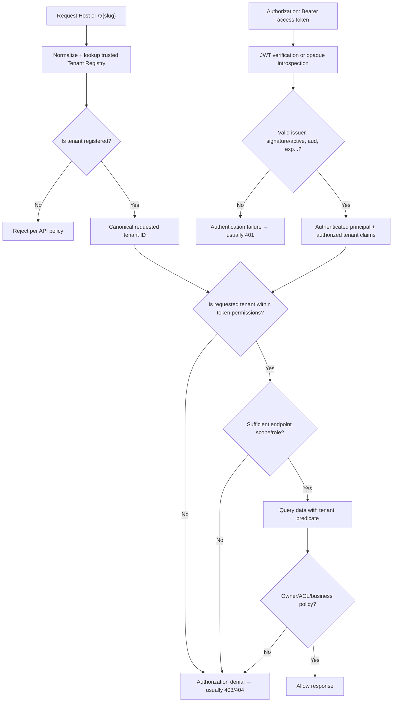

# Identifying a tenant via host or path and cross-checking against the token

## 1. Problem statement: a request path is not an authorized identity

In a **multi-tenant** system, a Spring Security OAuth 2.0 Resource Server application may serve multiple organizations on shared infrastructure. Each organization is a **tenant**; for example:

- Tenant **Acme** has the internal identifier `t-acme`.
- Tenant **Beta** has the internal identifier `t-beta`.
- Both share an order-management API with isolated resources and permissions.

A client can select the target tenant via **hostname**:

```http
GET /api/orders/ord-101 HTTP/1.1
Host: acme.api.example.test
Authorization: Bearer <alice-access-token>
```

Or via **path**:

```http
GET /t/acme/api/orders/ord-101 HTTP/1.1
Host: api.example.test
Authorization: Bearer <alice-access-token>
```

Even though the client sends Acme's URL, that does not mean the client is **authorized** to use Acme's resources. `Host` and path are the **requested resource address**, not proof of tenant membership.

An attacker holding a valid token for Beta might try sending:

```http
GET /t/acme/api/orders/ord-101 HTTP/1.1
Host: api.example.test
Authorization: Bearer <valid-token-for-beta>
```

If the API only checks `authenticated()` or `SCOPE_orders:read` without cross-checking the URL tenant against the token's tenant, it introduces a **cross-tenant authorization / Broken Object Level Authorization (BOLA)** vulnerability.

**Core principle of this lesson:**

> **The tenant selected by host/path must be present in a trusted catalog; the token must be verified for issuer, signature, audience, and lifetime; afterward, the API must cross-check the token's tenant permissions against the request tenant and filter data by tenant in the service/repository.**

This content belongs to the **Multi-tenancy** chapter of the **Spring Security OAuth 2.0 OIDC Resource Server** module. Primary examples use Spring Boot 3.x, Spring Security 6.x, Java 17+, and Spring MVC/Servlet; the end of the lesson explains how to adapt the principles to WebFlux. Domains, tokens, and IDs are placeholder data.

---

## 2. Model: three distinct tenant values

A multi-tenant API typically encounters at least three concepts:

1. **Requested tenant**: the tenant chosen by the client via hostname or path.
2. **Authorized tenant**: the tenant(s) in which the **authenticated access token** permits the caller to act.
3. **Data tenant**: the tenant that owns the queried record, table, schema, or dataset.

Example:

| Component | Value | Source |
|---|---|---|
| URL | `https://acme.api.example.test/api/orders/ord-101` | HTTP request sent by client through gateway |
| Requested tenant | `t-acme` | Mapping table host → canonical tenant ID |
| Token `tenant_id` | `t-beta` | Claim in the access token verified by the Resource Server |
| Database `orders.tenant_id` | `t-acme` | Tenant column/key of the data |
| Outcome | **Deny** | Requested tenant differs from authorized tenant |

If the API checks only token validity and read scope, Beta can mistakenly read Acme's data. If the API trusts only the `/t/acme` URL, a client can change the path to impersonate a tenant.

### 2.1. Tenant slug vs. canonical tenant ID

URLs use friendly slugs:

```text
/t/acme/api/orders
/t/beta/api/orders
```

Meanwhile, databases and tokens may use stable IDs:

```text
acme -> t-acme
beta -> t-beta
```

Do not compare a path slug directly against a claim that might use a different ID format. Maintain a **Tenant Registry** as the controlled mapping source.

Example:

| Allowed hostname | Allowed slug | Canonical tenant ID |
|---|---|---|
| `acme.api.example.test` | `acme` | `t-acme` |
| `beta.api.example.test` | `beta` | `t-beta` |

There is no entry for `attacker.example.test` or `unknown.api.example.test`. Unregistered hosts/slugs must be rejected; **never auto-create a new tenant just because a string appears in a URL**.

### 2.2. Scope is not tenant membership

A token might contain:

```json
{
  "iss": "https://auth.example.test/realms/orders",
  "sub": "bob-456",
  "aud": ["orders-api"],
  "scope": "orders:read",
  "tenant_id": "t-beta"
}
```

`orders:read` specifies the **operation type** of reading orders. It does not grant Bob permission to read Acme's orders. The actual requirement is:

```text
Valid access token
AND audience contains orders-api
AND required scope present
AND requestedTenantId == authorizedTenantId
AND order.tenant_id == requestedTenantId
AND object-level owner/ACL policy allows the operation
```

Never treat `tenant_id` or `scope` from a JWT payload **whose signature has not been verified** as a source of authority.

---

## 3. Two tenant-selection strategies

### 3.1. Tenant via hostname

Example:

```text
acme.api.example.test  → t-acme
beta.api.example.test  → t-beta
```

Advantages:

- Short URLs per organization.
- Easy separation of branding, certificates, routing, or rate limits by host.
- Fits subdomain-per-tenant models well.

Limitations and risks:

- `Host` in an HTTP request is client-supplied; an attacker can alter it.
- Behind a reverse proxy, the application might see the backend hostname instead of the public hostname.
- `Forwarded` and `X-Forwarded-Host` can be spoofed if the gateway fails to sanitize them.
- Customer custom domains require ownership verification and lifecycle management.
- DNS, wildcard subdomains, IDN/Punycode, and canonicalization issues can cause misrouting.
- Incorrectly trusting `Host` when building URLs, redirects, or password-reset links causes host-header injection.

**You must map hosts to tenants via an allowlist/registry**, never split an arbitrary prefix and treat it as a tenant ID.

Do not do this:

```java
// DO NOT USE as a tenant authorization mechanism:
String tenant = request.getHeader("Host")
    .split("\\.")[0];
```

This code fails to check whether the host is in an allowed domain, mishandles ports/IPv6/proxies, and treats a client-sent header as a verified identifier.

### 3.2. Tenant via path

Example:

```text
https://api.example.test/t/acme/api/orders
https://api.example.test/t/beta/api/orders
```

Advantages:

- No need for wildcard DNS or per-tenant TLS certificates.
- Easy to route in controllers: `@PathVariable String tenantSlug`.
- Convenient for tenant discovery and API Gateways.

Risks:

- An attacker can change the slug from `acme` to `beta`.
- URL rewriting between the gateway and application can cause different layers to see different tenants.
- Encoded slashes, double encoding, dot segments, semicolon/matrix parameters, and path normalization differences can make the security check and controller interpret **different paths**.
- Extracting the tenant from raw `getRequestURI()` via manual substring slicing can diverge from what Spring MVC route matching resolved.
- Renamed tenant slugs must map to a stable canonical ID; never use mutable slugs as permanent authorization keys.

Prefer reading the slug from a **Spring MVC-resolved path variable**, then looking it up in a registry with format validation.

### 3.3. What if both host and path indicate a tenant?

Example:

```http
GET /t/beta/api/orders/ord-101 HTTP/1.1
Host: acme.api.example.test
Authorization: Bearer <token-for-acme>
```

Never arbitrarily decide "host wins over path" or "path wins over host" unless explicitly specified by contract. Sound options:

1. **Only one source is valid per route**: host-based endpoints carry no tenant slug; path-based endpoints live on a neutral host.
2. **Require both to match the same canonical tenant ID** if the design allows both to appear together.
3. **Reject conflicts** with 400/403/404 per documented public policy.

Never "pick whichever one matches the token" to rescue conflicting requests, as automatic fallback makes the API hard to audit and can introduce confused-deputy behavior.

---

## 4. Complete trust chain



You may order tenant resolution before or after authentication depending on architecture. What matters is **never granting access before both sources have been verified and cross-checked**.

### 4.1. A valid token can still be rejected

Valid Beta token, request to Acme's host:

```text
JWT signature: PASS
iss: PASS
aud: PASS
exp: PASS
scope orders:read: PASS
requested tenant: t-acme
token tenant: t-beta
tenant binding: FAIL
→ DENY
```

This is normally an **authorization failure** because the token authenticated successfully but lacks permission for the requested tenant. Never turn it into 200 just because the scope matches.

### 4.2. Never trust tenant claims before verifying the token

Do not do this:

```java
// WRONG: parsing the payload before verifying the JWT and using it for authorization.
String tenant = parseUnverifiedJwt(token)
    .getClaim("tenant_id");
```

A JWT is Base64URL-readable, **not a trusted data container just because it is JSON**. An attacker can edit `tenant_id`, `scope`, and `sub` if the application fails to verify signature, issuer, and audience.

For opaque tokens, never parse arbitrary strings looking for a tenant. The Resource Server uses `OpaqueTokenIntrospector` and trusts only attributes returned by an authorized AS introspection endpoint.

---

## 5. Designing the contract with the Authorization Server

Before writing Spring Security code, the API and Identity teams must agree on the token contract.

Example **single shared issuer** model:

```json
{
  "iss": "https://auth.example.test/realms/orders",
  "sub": "alice-123",
  "aud": ["orders-api"],
  "scope": "orders:read orders:write",
  "client_id": "web-portal",
  "tenant_id": "t-acme",
  "exp": 1890003600
}
```

In this model:

- `iss`: trusted issuer; not a dedicated tenant.
- `aud`: resource identifier `orders-api`.
- `tenant_id`: **custom claim** defined by the AS, required for user tokens targeting this API.
- `sub`: stable subject within the issuer's namespace, not automatically the owner of every record.
- `scope`: operational privileges, not a replacement for tenant authorization.
- `client_id`: OAuth client that requested the token, not synonymous with tenant.
- `exp`: token expiration time, not the lifetime of the user's membership.

`tenant_id` is not a mandatory claim across OAuth 2.0/OIDC/JWT RFCs in general. The API may rely on it only if the issuer commits to minting it accurately with a clear profile, and the decoder/introspector has verified the token.

### 5.1. One token represents a single tenant

Simplest approach: each token carries exactly one canonical tenant:

```json
"tenant_id": "t-acme"
```

Whenever a user switches tenants in the UI, the OAuth client must obtain an **access token for the new tenant** via an issuer-supported flow. Never let the frontend merely change the path while keeping a Beta token to access Acme data.

This model nicely bounds the blast radius: a leaked token only grants access to that single tenant when all check layers hold.

### 5.2. One token authorized for multiple tenants

Some systems require tokens shaped like:

```json
{
  "tenant_ids": ["t-acme", "t-beta"]
}
```

This is also a **custom claim** with no universal schema. If chosen, the application contract must specify:

- The claim must be an array of strings, rejecting arbitrary scalars.
- Which issuers are authorized to emit it.
- Every tenant ID is canonicalized and registered.
- Maximum number of tenants; how oversized lists are handled.
- How missing, empty, or wrongly typed claims are rejected.
- Whether scopes/roles must be **scoped per tenant**.
- How access to one tenant is revoked while the token remains alive.

A list of tenants **does not mean** every scope is allowed on every tenant, especially administrative permissions. If entitlements follow a structure like `permissionsByTenant`, the parser/validator must enforce that exact schema rather than unioning all permissions.

### 5.3. Multiple issuers: which tenant corresponds to which issuer?

Another model uses **one issuer/realm per tenant**:

```text
t-acme -> https://id.example.test/realms/acme
t-beta -> https://id.example.test/realms/beta
```

This establishes an **identity provider/issuer** boundary distinct from the shared-issuer model. With multiple issuers:

1. The Tenant Registry must record which issuers are allowed for each tenant.
2. The Resource Server selects decoders/introspection clients only from an **onboarded allowlist**.
3. Tokens must verify cleanly against the matching issuer and key source.
4. The requested tenant must match the issuer registered for that tenant.
5. `tenant_id` may still be needed if an issuer serves multiple logical tenants.
6. `sub` must be namespaced by `iss`; identical `sub` values from different issuers do not necessarily represent the same user.

Never read `iss` from an **unverified** token and automatically trust that issuer URL. When using `JwtIssuerAuthenticationManagerResolver`, supply explicit trusted issuers or a custom resolver backed by a registry allowlist; unverified `iss` may only serve as a **hint to select within an established trust set**.

### 5.4. Client Credentials are not user memberships

A service-to-service token represents a workload, not an interactive user:

```json
{
  "iss": "https://auth.example.test/realms/orders",
  "client_id": "orders-importer",
  "sub": "orders-importer-service",
  "aud": ["orders-api"],
  "scope": "orders:import",
  "tenant_id": "t-acme"
}
```

Do not treat this token's `sub` as a human order owner. Workload APIs must enforce a **dedicated actor profile and permissions** (e.g., allowing only the importer to write batches into its granted tenant). Never let a `client_credentials` token bypass user authorization due to missing username checks.

---

## 6. Trustworthiness of `Host` and proxy headers

### 6.1. The Host header is client input

`request.getServerName()` in Servlet can be derived from the `Host` header or proxy/container settings. It is not automatically a "server-verified" value in every deployment. An attacker can send:

```http
GET /api/orders HTTP/1.1
Host: acme.api.example.test
Authorization: Bearer <beta-token>
```

That is why you **never use the Host header alone to grant tenant membership**. The host only selects the target tenant in the registry; the verified token must still prove the caller has rights in that tenant.

### 6.2. Do not trust `X-Forwarded-Host` directly from the Internet

Behind a reverse proxy:

```text
Client → CDN/WAF → Ingress/API Gateway → Spring Boot
```

Spring Boot may receive headers such as:

```http
Forwarded: host=acme.api.example.test;proto=https
X-Forwarded-Host: acme.api.example.test
X-Forwarded-Proto: https
```

These headers are trustworthy **only if the gateway/proxy strips client-supplied values and emits authoritative ones**. If a public backend accepts arbitrary `X-Forwarded-Host` headers, attackers can spoof hosts to internal layers.

A secure deployment configuration requires:

- The backend accepts traffic exclusively from trusted proxies.
- Proxies **strip/overwrite** forwarded headers from untrusted clients.
- Spring enables forwarded-header handling only in deployments with a verified network path.
- With multiple proxy hops, define trusted hops and chain merging rules accurately.
- Hosts are matched against the allowlist after trusted forwarding resolution.
- Test conflicting `Host` and `X-Forwarded-Host` headers directly to confirm which value the system uses.

### 6.3. Conditional Spring forwarded-header configuration

Spring Boot provides the property:

```yaml
server:
  forward-headers-strategy: framework
```

This is an **example** for when an application runs behind a trusted proxy and wants the framework to process forwarded headers. Never enable it blindly on a backend reachable directly from the Internet or behind proxies that do not scrub headers. Depending on infrastructure, `native` or container/gateway settings may fit better. Verify against your version and deployment.

Never read manually:

```java
// DO NOT USE: users can send this header themselves.
String tenantHost = request.getHeader("X-Forwarded-Host");
```

and turn it into a tenant. If you need the proxied host, read it from the **server request already normalized by the framework/proxy per your trust model**, then apply the allowlist and token binding.

### 6.4. Host normalization and allowlist

For DNS names, normalize strictly **per contract**:

- Lowercase using `Locale.ROOT` since DNS names are case-insensitive.
- Accept only hostnames present in the registry; never derive a tenant from a substring.
- If trailing dots are allowed, canonicalize consistently.
- If supporting IDNs, standardize on A-label/Punycode and verify domain ownership.
- Reject hostnames containing spaces, control characters, paths, URL schemes, or commas.
- If routes distinguish ports, decide whether port is part of the mapping key; `getServerName()` omits the port.
- Never use `endsWith("example.test")` carelessly, as `notexample.test` or unregistered subdomains can slip through.

For customer custom domains, enforce DNS verification, TLS certificate/ownership checks, mapping lifecycles, old-domain revocation, **subdomain takeover** prevention, and stale mapping cleanup. Never let tenant A register a domain currently belonging to tenant B.

---

## 7. Path normalization and route variables

### 7.1. Prefer Spring MVC path variables

Use:

```java
@GetMapping("/t/{tenantSlug}/api/orders/{orderId}")
public OrderDto get(
        @PathVariable String tenantSlug,
        @PathVariable String orderId,
        @AuthenticationPrincipal Jwt jwt) {
    // Resolve tenantSlug via registry and bind against token.
}
```

Instead of doing it manually:

```java
// DO NOT USE:
String tenant = request.getRequestURI().split("/")[2];
```

URL decoding, servlet context paths, reverse proxy rewrites, semicolon parameters, and encoded separators can make string splitting diverge from Spring's route matcher. Worse, the application might **authorize one path while querying data for another**.

### 7.2. Path patterns prone to discrepancies

Test with variants such as:

```text
/t/acme/api/orders/42
/t/AcMe/api/orders/42
/t/%61cme/api/orders/42
/t/acme%2Fbeta/api/orders/42
/t/acme/../beta/api/orders/42
/t/acme;foo=bar/api/orders/42
/t//api/orders/42
/t/%252Fbeta/api/orders/42
```

Do not assume a given string always passes or always fails across every container. **How proxies, servlet containers, and Spring Security's firewall handle encoding depends on configuration and version.** The key criteria are:

1. The proxy and application **never interpret different tenants**.
2. Queried records never belong to a different tenant than the authorized one.
3. Invalid inputs are rejected rather than falling back to a "default tenant."
4. Tenant slugs are extracted only after a single designed normalization/decoding rule.
5. Tenant route patterns are tested over real HTTP, not just controller unit tests.

### 7.3. Constrained slugs

If the product permits only lowercase ASCII slugs like `acme` or `beta-02`, validate with:

```java
private static final Pattern TENANT_SLUG =
    Pattern.compile("[a-z0-9](?:[a-z0-9-]{0,61}[a-z0-9])?");
```

`Pattern.matcher(...).matches()` ensures the entire slug conforms. Never `trim()` or lowercase a path value to "fix up" strange inputs unless that is a documented canonicalization rule. If supporting historical aliases/slugs, map them in a controlled way to **the same canonical tenant ID**.

---

## 8. Designing a Tenant Registry backed by a trusted data source

Example record describing a tenant:

```java
package com.example.orders.tenancy;

public record TenantDescriptor(
    String tenantId,
    String slug,
    String publicHost,
    String expectedIssuer
) {}
```

In a shared-issuer model:

```text
TenantDescriptor(
  tenantId="t-acme",
  slug="acme",
  publicHost="acme.api.example.test",
  expectedIssuer="https://auth.example.test/realms/orders"
)
```

The registry can live in immutable configuration, a controlled database, or a tenant-management service. Never allow clients to modify mappings via an unprotected endpoint.

### 8.1. A simple example registry

```java
package com.example.orders.tenancy;

import java.util.Locale;
import java.util.Map;
import java.util.regex.Pattern;

import org.springframework.http.HttpStatus;
import org.springframework.stereotype.Component;
import org.springframework.web.server.ResponseStatusException;

@Component
public final class TenantRegistry {

    private static final String ISSUER =
        "https://auth.example.test/realms/orders";

    private static final Pattern SLUG =
        Pattern.compile("[a-z0-9](?:[a-z0-9-]{0,61}[a-z0-9])?");

    private final Map<String, TenantDescriptor> byHost;
    private final Map<String, TenantDescriptor> bySlug;

    public TenantRegistry() {
        TenantDescriptor acme = new TenantDescriptor(
            "t-acme", "acme",
            "acme.api.example.test", ISSUER);
        TenantDescriptor beta = new TenantDescriptor(
            "t-beta", "beta",
            "beta.api.example.test", ISSUER);

        this.byHost = Map.of(
            acme.publicHost(), acme,
            beta.publicHost(), beta
        );
        this.bySlug = Map.of(
            acme.slug(), acme,
            beta.slug(), beta
        );
    }

    public TenantDescriptor byTrustedHost(String serverName) {
        if (serverName == null || serverName.isBlank()) {
            throw unknownTenant();
        }
        String host = normalizeHost(serverName);
        TenantDescriptor result = byHost.get(host);
        if (result == null) {
            throw unknownTenant();
        }
        return result;
    }

    public TenantDescriptor byPathSlug(String slug) {
        if (slug == null || !SLUG.matcher(slug).matches()) {
            throw unknownTenant();
        }
        TenantDescriptor result = bySlug.get(slug);
        if (result == null) {
            throw unknownTenant();
        }
        return result;
    }

    private static String normalizeHost(String value) {
        String host = value.toLowerCase(Locale.ROOT);
        if (host.endsWith(".")) {
            host = host.substring(0, host.length() - 1);
        }

        // Example for simple ASCII DNS hosts only, not
        // URLs, IPv6 literals, hosts with ports, or multi-value headers.
        if (!host.matches("[a-z0-9.-]+")
                || host.length() > 253
                || host.startsWith(".")
                || host.contains("..")) {
            throw unknownTenant();
        }
        return host;
    }

    private static ResponseStatusException unknownTenant() {
        // Choose 404 to avoid confirming unknown tenants externally.
        return new ResponseStatusException(
            HttpStatus.NOT_FOUND, "Resource not found");
    }
}
```

**Scope of illustration:** `byTrustedHost(...)` receives the **server name already resolved by the Servlet container/framework per the deployment's trust model**. It **does not make the Host header trustworthy on its own**. The example hardcodes the registry for learning; production should use versioned config/DB with auditing, validation, lifecycles, and tests. The host regex above fits only agreed-upon ASCII DNS hosts; if supporting IDNs, IPv6, or custom ports, design canonicalization explicitly.

Never add:

```java
// DO NOT USE:
return byHost.getOrDefault(host, defaultTenant);
```

for unknown hosts. **Default-tenant fallback** is one of the most common causes of cross-tenant data leakage.

### 8.2. Do not take the tenant ID directly from a Header

`X-Tenant-Id` can be useful inside **infrastructure** if an authenticated gateway strips Internet-supplied headers and signs/protects identity metadata over an explicit trust channel. However, in a Resource Server receiving Internet requests, never use:

```java
String tenantId = request.getHeader("X-Tenant-Id");
```

as proof the client may access that tenant. Callers can set this header themselves. Cross-checking against a verified token and registry is always required; if gateway-enforced identity forwarding exists, it must be a **dedicated security contract**.

---

## 9. Binding policy: cross-checking the selected tenant against the verified JWT

Once a JWT passes `JwtDecoder`, Spring Security provides the `Jwt` principal. We need a policy enforcing:

- The token's issuer matches the trusted issuer for the tenant.
- Audience contains `orders-api`.
- `tenant_id` is a non-blank string.
- The `tenant_id` value **strictly equals** the resolved canonical tenant ID.
- If the route is for users, the actor profile must be user per contract.
- Scope/role authorization and owner/tenant checks are enforced separately.

### 9.1. Application-layer policy

```java
package com.example.orders.tenancy;

import java.util.List;

import org.springframework.security.access.AccessDeniedException;
import org.springframework.security.oauth2.jwt.Jwt;
import org.springframework.stereotype.Component;

@Component
public final class TenantBindingPolicy {

    private static final String API_AUDIENCE = "orders-api";

    public VerifiedTenantActor requireUser(
            Jwt jwt, TenantDescriptor requestedTenant) {

        if (jwt == null || requestedTenant == null) {
            throw denied();
        }

        // The JwtDecoder layer MUST also verify issuer/audience.
        // Re-checking makes the per-tenant binding explicit.
        if (jwt.getIssuer() == null
                || !requestedTenant.expectedIssuer().equals(
                    jwt.getIssuer().toString())
                || !jwt.getAudience().contains(API_AUDIENCE)) {
            throw denied();
        }

        Object rawTenant = jwt.getClaim("tenant_id");
        if (!(rawTenant instanceof String tokenTenant)
                || tokenTenant.isBlank()
                || !requestedTenant.tenantId().equals(tokenTenant)) {
            throw denied();
        }

        Object rawActorType = jwt.getClaim("actor_type");
        // actor_type is a CUSTOM CLAIM of this illustrative contract.
        if (!(rawActorType instanceof String actorType)
                || !"user".equals(actorType)) {
            throw denied();
        }

        String subject = jwt.getSubject();
        if (subject == null || subject.isBlank()) {
            throw denied();
        }

        return new VerifiedTenantActor(
            requestedTenant.tenantId(),
            jwt.getIssuer().toString(),
            subject
        );
    }

    private static AccessDeniedException denied() {
        // Do not log raw tokens or leak claim mismatches.
        return new AccessDeniedException(
            "Access is not permitted for this tenant");
    }
}
```

Output record:

```java
package com.example.orders.tenancy;

public record VerifiedTenantActor(
    String tenantId,
    String issuer,
    String subject
) {}
```

**`actor_type=user` is purely a hypothetical contract** for the user endpoint example. Spring Security and OAuth 2.0 **do not emit that claim by default**. If your AS lacks this claim, define a reliable way to distinguish users from workloads, or design endpoints with distinct actor policies. **Never omit the check and assume every `sub` is a user.**

### 9.2. Why not silently "fix" a tenant mismatch?

Anti-pattern:

```java
// WRONG: taking the token's tenant and silently redirecting the request.
String effectiveTenant = jwt.getClaimAsString("tenant_id");
return orderRepository.findById(orderId); // tenant not filtered
```

If the request URL points to Acme while the token belongs to Beta, the app might serve Beta data under Acme's URL or worse fetch an order by an unscoped ID. That breaks auditing, caching, links, and authorization semantics.

Policy should **reject mismatched requests**, never search for another tenant to make the request succeed. If a user switches tenants, the client must use a valid URL and token per the product's allowed flow.

### 9.3. For multi-tenant membership tokens

If a token carries `tenant_ids`:

```json
{
  "tenant_ids": ["t-acme", "t-beta"]
}
```

a dedicated validator can check that it is an array of strings and match exact canonical IDs:

```java
static boolean membershipContains(Object raw, String requested) {
    if (!(raw instanceof java.util.List<?> values)) {
        return false;
    }
    if (values.isEmpty()) {
        return false;
    }
    for (Object value : values) {
        if (!(value instanceof String s) || s.isBlank()) {
            return false; // Entire claim must conform to schema.
        }
    }
    return values.contains(requested);
}
```

This is only a **membership predicate**. It does not prove the user holds an admin role or write scope in the chosen tenant. For tenant-partitioned entitlements, policy must validate **permissions for that specific tenant**, not take the union of all roles across the token.

---

## 10. Where to place validation: JWT decoder or authorization layer?

Not all tenant errors fall into the same category.

| Condition | Appropriate layer | Typical behavior |
|---|---|---|
| Invalid JWT signature, expired token | **Authentication / decoder** | 401. |
| Token issuer mismatches trusted issuer | **Authentication / decoder** | 401. |
| Token wrong audience for API | **Authentication / decoder** | 401. |
| `tenant_id` wrong type/missing in required token profile | Token contract validator or authorization policy by design | Reject; status depends on boundary. |
| Valid token with `tenant_id=t-beta`, URL targets `t-acme` | **Request-specific tenant authorization** | Typically 403 or 404. |
| Valid token, matching tenant, missing `orders:read` | HTTP/method authorization | 403. |
| Valid token, matching tenant, sufficient scope, another user's order | Domain object authorization | 403/404. |
| Unregistered host/slug | Routing/tenant resolution | 404/400 or equivalent API policy. |

A token can be valid for Beta when used on Beta's URL, yet rejected on Acme's URL. Therefore **request-specific tenant binding** usually belongs in authorization and does not necessarily make the token itself "invalid" under the authentication contract. In a **one issuer per tenant** model, the decoder may also be selected from the requested tenant and reject tokens from other issuers right at authentication.

### 10.1. Shared JWT validator for issuer and audience

Example Boot configuration:

```yaml
spring:
  security:
    oauth2:
      resourceserver:
        jwt:
          issuer-uri: https://auth.example.test/realms/orders
          audiences:
            - orders-api
```

The corresponding auto-configuration can validate issuer and audience; if you declare a custom `JwtDecoder` bean, actively attach issuer, audience, timestamp, and profile validators.

**Never use `tenant_id` in place of `iss` or `aud`.** A token with a valid tenant claim meant for another API must still be rejected.

### 10.2. Why shouldn't tenant binding live only in the controller?

Controller checks are a visible enforcement point, yet other paths can bypass them:

- Services invoked by scheduled jobs or message consumers.
- GraphQL resolvers that do not share the same controller path.
- Export/bulk endpoints that forget the tenant check.
- A new controller querying the repository directly.
- Async methods where context changes.

A production design should **combine**:

1. Token validation at the authentication boundary.
2. Tenant authorization at the method/service layer or via custom `AuthorizationManager`.
3. Queries/filters keyed by the canonical tenant ID.
4. Database row-level security where appropriate.
5. Tests across all entry points, including batch, list, and export endpoints.

---

## 11. Sample controllers: one Host-based endpoint, one Path-based endpoint

### 11.1. Business service using a verified actor

In this example, the service **never reads the Host header, token string, or path slug itself**. It accepts a `VerifiedTenantActor` that has already passed tenant binding.

```java
package com.example.orders.api;

public record OrderDto(
    String id,
    String status
) {}
```

Service:

```java
package com.example.orders.api;

import com.example.orders.tenancy.VerifiedTenantActor;
import org.springframework.http.HttpStatus;
import org.springframework.stereotype.Service;
import org.springframework.web.server.ResponseStatusException;

@Service
public final class OrderQueryService {

    private final OrderRepository repository;

    public OrderQueryService(OrderRepository repository) {
        this.repository = repository;
    }

    public OrderDto readOwnOrder(
            String orderId, VerifiedTenantActor actor) {

        OrderEntity entity = repository
            .findByIdAndTenantIdAndOwnerIssuerAndOwnerSubject(
                orderId,
                actor.tenantId(),
                actor.issuer(),
                actor.subject()
            )
            .orElseThrow(() -> new ResponseStatusException(
                HttpStatus.NOT_FOUND, "Order not found"));

        return new OrderDto(entity.getId(), entity.getStatus());
    }
}
```

Repository concept:

```java
package com.example.orders.api;

import java.util.Optional;
import org.springframework.data.jpa.repository.JpaRepository;

public interface OrderRepository
        extends JpaRepository<OrderEntity, String> {

    Optional<OrderEntity>
        findByIdAndTenantIdAndOwnerIssuerAndOwnerSubject(
            String id,
            String tenantId,
            String ownerIssuer,
            String ownerSubject
        );
}
```

In this sample code, `OrderEntity` is a hypothetical entity with fields `id`, `tenantId`, `ownerIssuer`, `ownerSubject`, and `status`. A real project needs matching JPA mappings, schemas, migrations, and indexes.

Logical query:

```sql
SELECT id, status
FROM orders
WHERE id = :requested_order_id
  AND tenant_id = :verified_tenant_id
  AND owner_issuer = :verified_issuer
  AND owner_subject = :verified_subject;
```

**Never** do `findById(orderId)` skipping the tenant filter. Querying with tenant and owner predicates prevents data leaks and makes "not found" indistinguishable from "unauthorized" to attackers if the API uses a concealment policy.

### 11.2. Host-based controller

```java
package com.example.orders.api;

import com.example.orders.tenancy.TenantBindingPolicy;
import com.example.orders.tenancy.TenantDescriptor;
import com.example.orders.tenancy.TenantRegistry;
import com.example.orders.tenancy.VerifiedTenantActor;

import jakarta.servlet.http.HttpServletRequest;

import org.springframework.http.HttpHeaders;
import org.springframework.security.core.annotation.AuthenticationPrincipal;
import org.springframework.security.oauth2.jwt.Jwt;
import org.springframework.web.bind.annotation.GetMapping;
import org.springframework.web.bind.annotation.PathVariable;
import org.springframework.web.bind.annotation.RestController;

@RestController
public class HostTenantOrderController {

    private final TenantRegistry registry;
    private final TenantBindingPolicy policy;
    private final OrderQueryService service;

    public HostTenantOrderController(
            TenantRegistry registry,
            TenantBindingPolicy policy,
            OrderQueryService service) {
        this.registry = registry;
        this.policy = policy;
        this.service = service;
    }

    @GetMapping("/api/orders/{orderId}")
    public OrderDto getOrder(
            HttpServletRequest request,
            @PathVariable String orderId,
            @AuthenticationPrincipal Jwt jwt) {

        TenantDescriptor requested =
            registry.byTrustedHost(request.getServerName());

        VerifiedTenantActor actor =
            policy.requireUser(jwt, requested);

        return service.readOwnOrder(orderId, actor);
    }
}
```

The method name `byTrustedHost` is only valid when the deployment has engineered trusted host resolution and an allowlist. `getServerName()` itself **does not authenticate the Host header**; an attacker can manipulate `Host`, yet **cannot bypass tenant binding by doing so**.

### 11.3. Path-based controller

```java
package com.example.orders.api;

import com.example.orders.tenancy.TenantBindingPolicy;
import com.example.orders.tenancy.TenantDescriptor;
import com.example.orders.tenancy.TenantRegistry;
import com.example.orders.tenancy.VerifiedTenantActor;

import org.springframework.security.core.annotation.AuthenticationPrincipal;
import org.springframework.security.oauth2.jwt.Jwt;
import org.springframework.web.bind.annotation.GetMapping;
import org.springframework.web.bind.annotation.PathVariable;
import org.springframework.web.bind.annotation.RestController;

@RestController
public class PathTenantOrderController {

    private final TenantRegistry registry;
    private final TenantBindingPolicy policy;
    private final OrderQueryService service;

    public PathTenantOrderController(
            TenantRegistry registry,
            TenantBindingPolicy policy,
            OrderQueryService service) {
        this.registry = registry;
        this.policy = policy;
        this.service = service;
    }

    @GetMapping("/t/{tenantSlug}/api/orders/{orderId}")
    public OrderDto getOrder(
            @PathVariable String tenantSlug,
            @PathVariable String orderId,
            @AuthenticationPrincipal Jwt jwt) {

        TenantDescriptor requested =
            registry.byPathSlug(tenantSlug);

        VerifiedTenantActor actor =
            policy.requireUser(jwt, requested);

        return service.readOwnOrder(orderId, actor);
    }
}
```

Here, **the slug comes from a path route matched by Spring MVC**. Tenant binding still checks the JWT and the repository filters by canonical tenant. Never trust the path simply because the client supplied it.

### 11.4. Two controllers can share the same service

A system may expose both host-based and path-based APIs, provided the contract is clear:

- Host-based paths carry no tenant slug.
- Path-based routes use an allowlisted neutral API host.
- If a host-based domain and path-based route can combine, the server checks for conflicts or restricts routes.
- Both flow through **the same binding policy and tenant-scoped data access**.
- No default-tenant fallback, and no raw slugs in SQL.

Controller-level binding makes the logic clear in this lesson; when you have hundreds of endpoints, move resolution and binding into middleware, services, or method policies to avoid copy-paste errors and test coverage gaps.

---

## 12. Configuring Spring Security HTTP authorization

Suppose the API has only the instructional endpoints shown above and tokens are verified as JWTs from a shared issuer:

```java
package com.example.orders.security;

import org.springframework.context.annotation.Bean;
import org.springframework.context.annotation.Configuration;
import org.springframework.http.HttpMethod;
import org.springframework.security.config.Customizer;
import org.springframework.security.config.annotation.web.builders.HttpSecurity;
import org.springframework.security.config.annotation.web.configurers.AbstractHttpConfigurer;
import org.springframework.security.config.http.SessionCreationPolicy;
import org.springframework.security.web.SecurityFilterChain;

@Configuration
public class OrdersApiSecurityConfig {

    @Bean
    SecurityFilterChain apiSecurity(HttpSecurity http)
            throws Exception {
        return http
            .sessionManagement(session -> session
                .sessionCreationPolicy(SessionCreationPolicy.STATELESS))
            .csrf(AbstractHttpConfigurer::disable)
            .authorizeHttpRequests(auth -> auth
                .requestMatchers(HttpMethod.GET,
                    "/api/public/ping")
                    .permitAll()
                .requestMatchers(HttpMethod.GET,
                    "/api/orders/**",
                    "/t/*/api/orders/**")
                    .hasAuthority("SCOPE_orders:read")
                .requestMatchers(HttpMethod.POST,
                    "/api/orders",
                    "/t/*/api/orders")
                    .hasAuthority("SCOPE_orders:write")
                .anyRequest().denyAll())
            .oauth2ResourceServer(oauth ->
                oauth.jwt(Customizer.withDefaults()))
            .build();
    }
}
```

This pattern is for **Servlet/Spring MVC**. `csrf(...disable)` is suitable when the API uses Bearer headers exclusively without browser cookies/sessions for authentication; applications combining web login need separate CSRF and `SecurityFilterChain` designs. Any public endpoint must never leak tenant details or rely on separate ambient credentials.

Two authorization layers:

1. **HTTP matcher**: token needs the `SCOPE_orders:read` authority.
2. **Tenant binding + service**: token must be authorized for the requested tenant and allowed to read that specific order.

A request with the right scope but wrong tenant **is still denied**. Never replace tenant binding with `.authenticated()`.

### 12.1. Method security to reduce controller coupling

With `@EnableMethodSecurity`, you can invoke a policy bean in an expression:

```java
@PreAuthorize(
    "hasAuthority('SCOPE_orders:read') and " +
    "@tenantAuthorization.canRead(authentication, #tenantId)"
)
public MonoOrResult read(...);
```

This is **conceptual syntax only**; in a real Servlet service the method returns a normal domain type, while WebFlux has its own reactive method authorization. Crucially, `tenantId` passed in must be the **resolved canonical tenant ID**, not a client header. Any SpEL policy bean must inspect the verified `Authentication`, never parse raw tokens.

If the annotation sits on a method not intercepted by a Spring proxy (internal self-invocation, non-bean instance, missing method security config), the rule may silently not execute. Always test requests through the real runtime path and retain data-scoped queries for defense in depth.

---

## 13. Choosing issuer and decoder in a multi-tenant model

Two primary models have very different consequences.

### 13.1. Model A: one issuer, `tenant_id` claim

```text
Issuer:
  https://auth.example.test/realms/orders

JWKS:
  https://auth.example.test/realms/orders/jwks

Tokens:
  alice -> tenant_id=t-acme
  bob   -> tenant_id=t-beta
```

The Resource Server configures **one decoder** with issuer/audience validation. After decoding, the API compares `tenant_id` against the canonical requested tenant ID.

Advantages:

- Fewer decoder and JWKS caches.
- Fits tenant isolation inside a single identity realm.
- Easy shared configuration.

Considerations:

- Tenant-switching privileges are governed by the AS/authorization policy.
- An already-issued JWT may retain stale membership until expiration.
- `tenant_id` must be an issuer-minted claim with clear semantics, not an arbitrary client header.
- If a user belongs to multiple tenants, explicitly choose between single-tenant tokens and multi-tenant entitlements.

### 13.2. Model B: one issuer per tenant

```text
Tenant Acme:
  issuer = https://id.example.test/realms/acme
  jwks   = https://id.example.test/realms/acme/certs

Tenant Beta:
  issuer = https://id.example.test/realms/beta
  jwks   = https://id.example.test/realms/beta/certs
```

There are at least two implementation approaches:

- **Select the `AuthenticationManager`/decoder by requested tenant** resolved from host/path via the registry, and verify tokens against **that exact tenant's issuer**.
- **Select the issuer from the token as a hint** via `JwtIssuerAuthenticationManagerResolver` with **trusted** issuers, then perform tenant binding to ensure the token's issuer matches the request's tenant.

In either option, never trust an issuer simply because a JWT header or payload points to its URL. Metadata discovery or JWKS fetching from arbitrary unverified issuers easily leads to **SSRF** and authentication bypass.

### 13.3. Pseudocode for selecting a decoder per tenant

```text
requestedTenant = resolve(host_or_path)           // registry allowlist
expectedIssuer = requestedTenant.expectedIssuer  // trusted config

manager = preconfiguredManagerFor(expectedIssuer)
if manager missing:
    reject

authentication = manager.authenticate(bearerToken)
  -> verify signature with trusted JWKS for expected issuer
  -> require JWT iss == expectedIssuer
  -> require aud contains orders-api
  -> validate exp/nbf and token profile

check requestedTenant vs verified tenant entitlement
check scope
check business owner/data tenant
```

Key point: `expectedIssuer` comes from the **trusted registry**, never read from `jwt.getClaim("iss")` prior to validation to spin up a new manager.

### 13.4. Beta issuer token sent to Acme's hostname

```http
GET /api/orders HTTP/1.1
Host: acme.api.example.test
Authorization: Bearer <token-signed-by-beta-issuer>
```

With a resolver choosing the issuer from Acme's host, Beta's token is rejected at **authentication** due to key/issuer mismatch. With a resolver choosing from global trusted issuers and comparing tenants afterward, the token may authenticate as Beta and then be denied at **authorization**. Both are valid as long as **Acme access is denied** and error semantics are documented.

Never "try every issuer until one accepts the token" and grant tenant access without further checks. Trying issuers indiscriminately also amplifies load and expands the trust surface unnecessarily.

---

## 14. Common cross-tenant bug hotspots in business logic

### 14.1. Fetching a record by ID alone

Wrong:

```java
OrderEntity order = repository.findById(orderId)
    .orElseThrow(NotFoundException::new);
return toDto(order);
```

Sound per tenant policy:

```java
OrderEntity order = repository
    .findByIdAndTenantIdAndOwnerIssuerAndOwnerSubject(
        orderId, actor.tenantId(), actor.issuer(), actor.subject())
    .orElseThrow(NotFoundException::new);
```

Owner checks may differ for tenant administrators or shared-order delegation use cases. Even then, **a tenant predicate is always required** unless a cross-tenant policy is explicitly designed, audited, and enforced.

### 14.2. List, search, and export

When implementing:

```text
GET /t/acme/api/orders?page=0
GET /t/acme/api/orders/export
POST /t/acme/api/orders/search
```

do not validate the tenant once and then query the entire table. Repositories and data access must enforce tenant constraints on **every** list, search, export, and total count query. A classic bug is filtering the list SQL with `WHERE tenant_id` while omitting it on the count or export query, leaking counts or rows from other tenants.

### 14.3. Bulk operations

Example:

```json
{
  "orderIds": [
    "acme-ord-1",
    "beta-ord-7"
  ]
}
```

A request on Acme's URL containing a Beta ID must **never update Beta**, even if the token holds `orders:write` for Acme. Queries and UPDATE statements must include the tenant predicate for every ID and verify results before committing.

If an API supports cross-tenant batches, that is a **separate policy** for specially authorized service actors; never let a user endpoint accidentally become a cross-tenant batch API.

### 14.4. Object stores, file attachments, and search indexes

An order may reference files in S3/Blob/CDN or documents in Elasticsearch/OpenSearch. Tenant isolation must extend to:

- Object storage keys, buckets, and ACLs.
- Signed download URLs and token expiration.
- Search filters and index aliases.
- Event stream partition keys.
- Audit logs and export artifacts.
- Background jobs receiving tenant context.

Never have a controller check the tenant while a service issues a signed URL for another tenant's object simply because the client supplied the object key.

### 14.5. Caches and key namespaces

Wrong:

```java
@Cacheable(cacheNames = "orders", key = "#orderId")
OrderDto findOrder(String orderId) { ... }
```

If IDs are only unique per tenant or responses vary by permissions, such a key can serve another tenant's data out of cache. Namespace cache keys by tenant and authorization context:

```text
orders:<canonicalTenantId>:<orderId>:<visibilityPolicyVersion>
```

If different users can view different fields of the same order, the cache key or authorization check must also distinguish representation/visibility, or skip caching post-policy DTOs globally.

Never include raw Bearer tokens in cache keys or logs. Caching **never** replaces tenant-scoped database filters or object-level permissions.

### 14.6. Database isolation does not automatically mean table-per-tenant

Common models:

| Model | Strength | Risk to control |
|---|---|---|
| Shared DB, shared tables + `tenant_id` | Easy operations, simple deployment. | Every query must filter by tenant; easy to forget a predicate. |
| Shared DB, schema-per-tenant | Schema separation, convenient for some ops. | Wrong tenant routing/schema switch; pooled connections retaining prior schema. |
| Database-per-tenant | Stronger data-plane isolation. | Wrong connection routing; migrations, credentials, and ops overhead. |
| Database Row-Level Security | DB enforces tenant policy partially independent of app queries. | DB session variables/connection reuse, privileged bypass, misconfigured policies. |

Even with schema-per-tenant or database-per-tenant, you must cross-check the URL tenant against the token; picking the wrong datasource from `Host` can drop a Beta user into Acme's DB if no binding policy exists.

---

## 15. Accurate rejections: 401, 403, 404, and 421

A request can be rejected at multiple boundaries. There is no single mandatory status code for every tenant mismatch, but behavior must be **consistent**.

| Scenario | Rejecting layer | Common status |
|---|---|---|
| No Bearer token on protected route | Missing authentication | **401** with `WWW-Authenticate: Bearer`. |
| Token bad signature/issuer/audience/exp | Token validation | **401**. |
| Active token missing read scope | Authorization | **403**. |
| Valid Beta token, Acme request | Tenant binding authorization | **403** or **404** per concealment policy. |
| Tenant slug absent from registry | Routing/tenant resolution | **404** or **400** per API contract. |
| Host not among served virtual hosts | Host routing/security | **400**, **404**, or **421 Misdirected Request** per gateway/server design. |
| Matching tenant, sufficient scope, another user's order | Object-level authorization | **403** or **404**. |
| AS/JWKS/introspection unreachable | Dependency validation failure | Fail closed; HTTP status per exception/error policy. |

**`421 Misdirected Request` is not Spring Security's default status for every Host mismatch.** It applies to specific HTTP routing/server authority situations; only use it when the gateway/app has an explicit contract for it.

When returning `404` to conceal resource existence, avoid timing or error-body differences that leak tenant/object enumeration, and still record full internal audit logs.

### 15.1. Why not always return 401 for a tenant mismatch?

With a token validly verified for Beta, an Acme request fails because the caller **lacks permission for Acme**, not necessarily because the token is an invalid credential. Returning 403 is usually clearer. In a model that picks the resolver from the requested issuer, a Beta token sent to Acme can be rejected directly by the JWT validator and return 401. What matters is that **logic and error contracts match the trust model**, rather than forcing every deployment into one status code.

### 15.2. Never leak tenant information in responses

Do not return:

```json
{
  "error": "Token belongs to t-beta but URL requested t-acme",
  "ownerEmail": "alice@acme.example.test"
}
```

unless required and explicitly permitted by policy. Clients only need to know the request was denied; internal logs can record reason codes and pseudonymized tenant identifiers under audit policy.

---

## 16. MockMvc: testing tenant binding in Spring Security

To test HTTP authorization and tenant policy, `spring-security-test`'s `jwt()` creates a mock authenticated principal; this keeps tests **independent of JWKS networking**, though **it does not prove real JWT signature verification**.

### 16.1. Path-based test using mock JWT

Skeleton example assuming fixtures:

- Order `acme-ord-1` owned by Alice in `t-acme`.
- Order `beta-ord-1` owned by Bob in `t-beta`.
- `PathTenantOrderController` and `OrderQueryService` using the registry and policy shown earlier.
- Spring MVC/Security filter chain loaded in the test.

```java
package com.example.orders.security;

import static org.springframework.security.test.web.servlet.request
    .SecurityMockMvcRequestPostProcessors.jwt;
import static org.springframework.test.web.servlet.request
    .MockMvcRequestBuilders.get;
import static org.springframework.test.web.servlet.result
    .MockMvcResultMatchers.status;

import java.util.List;
import org.junit.jupiter.api.Test;
import org.springframework.beans.factory.annotation.Autowired;
import org.springframework.boot.test.autoconfigure.web.servlet.AutoConfigureMockMvc;
import org.springframework.boot.test.context.SpringBootTest;
import org.springframework.security.core.authority.SimpleGrantedAuthority;
import org.springframework.test.web.servlet.MockMvc;

@SpringBootTest
@AutoConfigureMockMvc
class TenantPathAuthorizationTest {

    @Autowired
    MockMvc mvc;

    @Test
    void acmeTokenCanReadOwnAcmeOrder() throws Exception {
        mvc.perform(get("/t/acme/api/orders/acme-ord-1")
                .with(jwt().jwt(j -> j
                    .claim("iss",
                        "https://auth.example.test/realms/orders")
                    .claim("aud", List.of("orders-api"))
                    .claim("sub", "alice-123")
                    .claim("tenant_id", "t-acme")
                    .claim("actor_type", "user"))
                    .authorities(new SimpleGrantedAuthority(
                        "SCOPE_orders:read"))))
            .andExpect(status().isOk());
    }

    @Test
    void betaTokenCannotUseAcmePath() throws Exception {
        mvc.perform(get("/t/acme/api/orders/acme-ord-1")
                .with(jwt().jwt(j -> j
                    .claim("iss",
                        "https://auth.example.test/realms/orders")
                    .claim("aud", List.of("orders-api"))
                    .claim("sub", "bob-456")
                    .claim("tenant_id", "t-beta")
                    .claim("actor_type", "user"))
                    .authorities(new SimpleGrantedAuthority(
                        "SCOPE_orders:read"))))
            .andExpect(status().isForbidden());
    }

    @Test
    void missingTokenIsUnauthorized() throws Exception {
        mvc.perform(get("/t/acme/api/orders/acme-ord-1"))
            .andExpect(status().isUnauthorized());
    }
}
```

The `200` status relies on **existing fixtures and owner policies**. `betaTokenCannotUseAcmePath` assumes the mismatch throws `AccessDeniedException` without a custom handler concealing it as 404; adjust expected statuses to match your actual policy.

**`jwt()` does not execute `JwtDecoder`**, so it cannot test issuer, audience, or signature verification. It only builds a mock `Authentication` for route/policy tests. You still need independent signed-token integration tests.

### 16.2. Host-based test with `serverName`

In MockMvc, configure the request host via the builder:

```java
@Test
void tokenForBetaCannotUseAcmeHost() throws Exception {
    mvc.perform(get("/api/orders/acme-ord-1")
            .with(request -> {
                request.setServerName("acme.api.example.test");
                return request;
            })
            .with(jwt().jwt(j -> j
                .claim("iss",
                    "https://auth.example.test/realms/orders")
                .claim("aud", List.of("orders-api"))
                .claim("sub", "bob-456")
                .claim("tenant_id", "t-beta")
                .claim("actor_type", "user"))
                .authorities(new SimpleGrantedAuthority(
                    "SCOPE_orders:read"))))
        .andExpect(status().isForbidden());
}
```

Here `request.setServerName(...)` simulates what the Servlet container saw as the host. **This test does not verify whether the proxy stripped an attacker's `X-Forwarded-Host`.** That must be tested separately in HTTP/gateway integration tests.

### 16.3. Testing tenant binding across multiple requests

A crucial sequence:

```text
1. GET /t/acme/api/orders/acme-ord-1 + Alice t-acme token → 200
2. GET /t/beta/api/orders/beta-ord-1 + Bob t-beta token    → 200
3. GET /t/acme/api/orders/acme-ord-1 + Bob t-beta token    → 403/404
4. GET /t/acme/api/orders/acme-ord-1 without token         → 401
```

Never store Acme's tenant in a `CurrentTenant` singleton or `ThreadLocal` during request 1 and reuse it on request 2. In Spring MVC Servlet, any thread-local tenant context must be cleared in a `finally` block, including on exceptions and async dispatches. Prefer **passing the canonical tenant ID as an explicit parameter** into services and repositories to reduce state leakage risks.

---

## 17. Detailed cross-tenant test matrix

| # | Tenant request | Access token / request | Expected outcome |
|---:|---|---|---|
| 1 | Acme Host | Alice token `tenant_id=t-acme`, read scope | Allowed if Alice has object access. |
| 2 | Acme Host | Bob token `tenant_id=t-beta`, read scope | Rejected for tenant mismatch. |
| 3 | Path `/t/acme` | Alice Acme token | Allowed within scope/owner limits. |
| 4 | Path `/t/acme` | Bob Beta token | Rejected. |
| 5 | Acme Host | No token | 401 on protected route. |
| 6 | Path `/t/acme` | Expired JWT | 401. |
| 7 | Acme Host | JWT with invalid signature | 401. |
| 8 | Path `/t/acme` | Token `aud=payments-api` | 401 from validator. |
| 9 | Path `/t/acme` | Token with wrong issuer | 401 from validator. |
| 10 | Acme Host | Acme token missing `orders:read` | 403. |
| 11 | Path `/t/acme` | Acme token missing `tenant_id` | Rejected per token contract. |
| 12 | Path `/t/acme` | Acme token with `tenant_id` as object/list | Rejected; no coercion. |
| 13 | Unknown Host | Valid Acme token | No default-tenant fallback. |
| 14 | Unknown Slug | Valid Acme token | 404/400 per routing contract. |
| 15 | Acme Host + Beta path | Acme token | Rejected for conflicting tenant sources. |
| 16 | Acme Host | `X-Tenant-Id: t-beta` header | Header never dictates identity/tenant alone. |
| 17 | Acme Host | Client `X-Forwarded-Host: beta...` header | Proxy strips/rewrites; never switches tenant improperly. |
| 18 | Path `/t/acme` | Encoded slash/double decode | Route and data layers must not interpret different tenants. |
| 19 | Acme | Matching tenant token, order belongs to Beta | Order unreadable/not returned. |
| 20 | Acme | Matching tenant token, Acme order owned by Bob | Owner policy blocks access. |
| 21 | Acme list | Alice Acme token | Lists/counts only permitted Acme data. |
| 22 | Acme bulk update | Includes Beta ID in body | Beta record untouched. |
| 23 | Acme export | Acme token | Contains no Beta data. |
| 24 | Acme cache | Cached Beta order with same ID | Never returns wrong-tenant cached object. |
| 25 | Beta → Acme | Two requests on same thread | Never reuses prior request's tenant/principal. |
| 26 | Concurrent requests | Concurrent Acme/Beta | No ThreadLocal or cache contamination. |
| 27 | Multi-issuer | Beta issuer token on Acme host | Rejected by issuer/tenant binding. |
| 28 | Multi-issuer | Same `sub=123` across issuers | Never treated as same user. |
| 29 | Client Credentials | Workload token sent to user-owned endpoint | Service not treated as human user. |
| 30 | Multi-tenant token | `tenant_ids` contains only Beta, Acme request | Rejected. |
| 31 | Custom domain | Acme domain removed from registry | Never falls back to another tenant. |
| 32 | Gateway rewrite | Public Acme URL, rewritten internal path | Authorization and data tenant stay aligned. |

Tests covering gateway headers, DNS/custom domains, and proxy rewrites should run in **HTTP staging/integration** against the real proxy configuration. MockMvc only proves application logic within the simulated request bounds.

---

## 18. Testing a real decoder and Host spoofing

### 18.1. Real signed JWTs, not just `jwt()`

Using a **test RSA key pair** and test JWKS endpoint:

1. Publish the test public key in a JWKS trusted by the decoder.
2. Sign Alice's Acme token with the test private key.
3. Sign Bob's Beta token with the same test issuer/key (in the shared-issuer model).
4. Verify correct issuer, audience, and expiry.
5. Send Beta's token to Acme's host and Acme's path; verify it is rejected after successful decoding.
6. Alter `tenant_id` in the payload without re-signing; verify signature fails with 401.
7. Send a token from an unknown issuer or wrong audience; reject.
8. Send a token with a wrongly typed `tenant_id`; reject per contract.
9. Alter `kid`/`alg` or use an untrusted key; reject unverified tokens.
10. Never use production private keys in tests.

If `JwtDecoder` is mocked, protection against attacker-modified `tenant_id` **goes untested**. Keep **cryptographic validation tests** separate from **tenant authorization tests**.

### 18.2. Host spoofing through a reverse proxy

In staging, try:

```http
GET /api/orders HTTP/1.1
Host: acme.api.example.test
X-Forwarded-Host: beta.api.example.test
Authorization: Bearer <test-token-for-beta>
```

Verify in the actual gateway:

- Does it strip/overwrite `X-Forwarded-Host`?
- Does it accept domains outside the allowlist?
- Does the backend see `request.getServerName()` as Acme or Beta?
- Can multiple `Forwarded` headers be merged improperly?
- Can direct backend addressing bypass ingress policy?
- Does the URL/host used for data queries match the authorized canonical tenant?

The expectation is not necessarily **one specific HTTP status**, because each gateway has its own routing rules. The mandatory invariant is **never letting a spoofed host access a tenant the token is not authorized for**, and ensuring no gateway/application discrepancy leaks data.

### 18.3. Path spoofing via encoded variants

Test the variants from section 7 using a real HTTP client through the proxy and container. If a reverse proxy decodes once and Spring decodes again, double-decoding hazards arise. Enforce a single **canonical route path** and reject encoding ambiguities—never let authorization read the raw path while the repository uses a differently decoded path variable.

---

## 19. Opaque access tokens: tenant binding stays the same

A Resource Server may use opaque tokens and RFC 7662:

```text
Authorization: Bearer opaque-token
     ↓
OpaqueTokenIntrospector -> HTTPS POST /introspect
     ↓
active=true + trusted metadata
     ↓
OAuth2AuthenticatedPrincipal
     ↓
Resolve requested tenant from host/path
     ↓
Compare tenant claim/entitlement with requested tenant
     ↓
scope + object-level policy
```

Illustrative introspection response:

```json
{
  "active": true,
  "iss": "https://auth.example.test/realms/orders",
  "sub": "alice-123",
  "aud": ["orders-api"],
  "scope": "orders:read",
  "tenant_id": "t-acme",
  "client_id": "web-portal"
}
```

**`tenant_id` is not a mandatory RFC 7662 field.** The Identity team must supply custom fields per contract; the API relies strictly on attributes returned by a trusted introspector and validates their types.

Never read `tenant_id` from a request header when introspection omits the field, and never infer Acme membership from the host. When `active=false`, never use accompanying metadata to grant an authenticated principal.

With per-tenant introspection endpoints, endpoints and credentials must also be chosen from the **trusted tenant registry**, never from a URL or issuer inside a raw token. Avoid sending Bearer tokens or introspection client credentials to attacker-specified endpoints.

---

## 20. WebFlux: same principles, reactive APIs

In WebFlux, there is no `HttpServletRequest`/`HttpSecurity` on the reactive pipeline. Corresponding components:

| Spring MVC/Servlet | WebFlux/Reactive |
|---|---|
| `SecurityFilterChain` | `SecurityWebFilterChain` |
| `HttpSecurity` | `ServerHttpSecurity` |
| `JwtDecoder` | `ReactiveJwtDecoder` |
| `AuthenticationManagerResolver<HttpServletRequest>` | Reactive authentication manager resolver per `ServerWebExchange`/matching API |
| `HttpServletRequest.getServerName()` | `ServerWebExchange.getRequest().getURI().getHost()` or server exchange metadata after trusted proxy handling |
| `@PathVariable` MVC | `@PathVariable` WebFlux |
| `SecurityContextHolder` | `ReactiveSecurityContextHolder`/Reactor context |
| `MockMvc` | `WebTestClient` |

WebFlux route policy skeleton:

```java
@Bean
SecurityWebFilterChain apiSecurity(ServerHttpSecurity http) {
    return http
        .csrf(ServerHttpSecurity.CsrfSpec::disable)
        .authorizeExchange(exchange -> exchange
            .pathMatchers(HttpMethod.GET,
                "/t/*/api/orders/**")
                .hasAuthority("SCOPE_orders:read")
            .anyExchange().denyAll())
        .oauth2ResourceServer(oauth ->
            oauth.jwt(Customizer.withDefaults()))
        .build();
}
```

This is a **configuration fragment** assuming matching imports (`ServerHttpSecurity`, `SecurityWebFilterChain`, `Customizer`, `HttpMethod`). It checks only route scope; **tenant binding is still mandatory** in reactive controllers, services, or filters. Never call `.block()` on the event loop to look up a tenant in the database; if the tenant registry is external, use reactive access or a controlled cache.

### 20.1. Reactive tenant binding

Concept:

```text
Mono<Jwt> principal = reactiveSecurityContext principal
Mono<TenantDescriptor> tenant = registry.resolve(exchange/pathVariable)
Mono<VerifiedTenantActor> actor =
    combine(principal, tenant)
      .flatMap(validateIssuerAudienceTenantScope)
Mono<OrderDto> result =
    actor.flatMap(queryOrderScopedByTenantAndOwner)
```

Never use a singleton field or `ThreadLocal` to hold "current tenant" in a reactive flow; Reactor can hop threads between stages. When using Reactor Context, ensure proper per-request propagation and never let it replace the source of truth (verified token + registry).

### 20.2. Testing WebFlux

`WebTestClient` with `mockJwt()` tests route/tenant authorization given a mocked authentication. To test real JWT signatures, issuers, and audiences, pass a signed Bearer JWT through `ReactiveJwtDecoder` and a test JWKS endpoint. For host-based URLs, simulate realistic URIs/Hosts in `WebTestClient` and test proxy behavior separately.

The invariant stays identical between Servlet and Reactive:

```text
requestedTenant = canonicalize(approved host/path)
verifiedIdentity = validate(access token)
requireTenantEntitlement(verifiedIdentity, requestedTenant)
queryOnlyInsideTenant(requestedTenant, verifiedIdentity)
```

---

## 21. Tenant context, async jobs, and caching: prevent cross-request leaks

A dangerous pattern:

```java
// DO NOT USE:
public static String currentTenantId;
```

Alice's Acme request may write `t-acme`; Bob's subsequent or concurrent Beta request can mistakenly read that value.

In Servlet apps, some frameworks use a `ThreadLocal` tenant context, which must be carefully managed:

- Set only after resolving a trusted tenant and validating token binding.
- Clear in `finally`, even on exceptions.
- Never propagate automatically into thread pools or scheduled jobs.
- For database multi-tenancy, reset connection/schema/tenant routing before returning connections to the pool.
- For async operations, explicitly pass an **immutable verified tenant/actor context**.
- Avoid storing raw JWTs in long-lived job state.

**Prefer passing `VerifiedTenantActor`/`tenantId` as service parameters**, since it is easy to audit, unit test, and avoids global state dependencies.

### 21.1. Background tasks must carry an explicit actor

An asynchronous export can continue running after the HTTP request ends:

```text
POST /t/acme/api/reports/export
  → create ExportJob(tenantId=t-acme, actor=Alice, permissions checked)
  → worker runs later
```

The worker must never pull "current tenant" from a leftover `ThreadLocal`. Store minimal tenant/actor context in a controlled job payload, verify job origin, and decide whether permissions must be re-checked at execution time. When exporting data, still filter strictly by tenant.

### 21.2. Tenant status changes after token issuance

A user can be removed from a tenant while their JWT is still unexpired. If `tenant_id` is a static claim in the token, the API may keep accepting it until token expiration by design. For sensitive APIs, consider short token TTLs, revocation/introspection, or backend checks against current entitlements. **A token's tenant claim does not necessarily reflect instant membership changes.**

If caching entitlements, key by issuer, subject, tenant, and policy version, with TTL/invalidation aligned with revocation requirements. Never treat a one-time authorization check as permanent permission.

---

## 22. Security and operations checklist

| Item | What to confirm |
|---|---|
| **Host allowlist** | Registered domains only; never treat arbitrary subdomains as tenant IDs. |
| **Proxy trust** | Backend blocks direct bypass; gateway strips/rewrites forwarded headers. |
| **Path parsing** | Use normalized path variables/router; avoid raw substrings and double decoding. |
| **Canonical tenant** | Host and path both map to stable IDs with lifecycles. |
| **Host + path conflict** | Explicit policy and tests; never silently fall back. |
| **JWT verification** | Signature, issuer, audience, timestamps, and algorithm/token profile valid. |
| **Opaque introspection** | Trust active metadata only from authenticated AS; clear custom claim schema. |
| **Tenant claim** | `tenant_id` or entitlements have schema, issuer contract, fail closed if missing/invalid. |
| **Actor profile** | Users and Client Credentials/workloads are never confused. |
| **Scope / role** | Operational scopes separated from tenant membership. |
| **Data isolation** | Queries, list, count, bulk, and export enforce tenant predicates. |
| **Object authorization** | Owner/ACL/delegated access checked separately. |
| **Cache isolation** | Keys namespaced by tenant and visibility policy. |
| **DB routing** | Schema/datasource/connection context never leaks across pool reuse. |
| **Unknown tenant** | Rejected with no default tenant. |
| **Concurrency** | Zero ThreadLocal or static current-tenant leakage. |
| **Multi-issuer** | Trusted issuer allowlist; decoders never pick up arbitrary dynamic issuers. |
| **Secret privacy** | Never log raw Bearer tokens, secrets, or sensitive tenant data. |
| **Error semantics** | 401 authn vs. 403 authz vs. 404 concealment follows contract. |
| **Integration tests** | Signed JWTs, host spoofing, forwarded headers, path encoding, cross-tenant fixtures. |
| **Observability** | Metrics/log reason codes never use tokens/subjects as high-cardinality labels. |

### 22.1. Safe logging

An internal log event can look like:

```text
event=tenant_binding_denied
reason=requested_tenant_not_in_verified_entitlements
endpoint=/api/orders/{id}
request_id=req-123
issuer_config_id=orders-auth
```

Never log:

- Raw `Authorization: Bearer ...`.
- Unverified JWT payloads or access tokens in logs.
- Introspection client secrets.
- Full user emails/PII without an audit reason.
- Attacker-supplied hosts as unbounded metric labels.
- Sensitive tenant names/IDs in error bodies returned to unauthorized callers.

In metrics, prefer bounded `reason` enums, `route template`, and configured `issuer_config_id` over raw URLs or tokens.

### 22.2. Runbook when a cross-tenant response is discovered

1. Scope affected endpoints, time window, impacted tenants, and request IDs.
2. Disable or restrict risky routes per incident response plan, **without disabling general authentication**.
3. Check whether the tenant was resolved from host/path or an untrusted header.
4. Inspect gateway rewriting, `Host`/`Forwarded` trust, and matcher ordering.
5. Check whether the JWT decoder verified issuer, audience, signature, and token profile.
6. Check `tenant_id`/membership schema and whether the binding policy ran on that route.
7. Check repositories, list, count, export, and bulk paths for tenant predicates.
8. Inspect cache keys, datasource/schema routing, async jobs, and stale contexts.
9. Build Acme/Beta fixtures and reproduce negative tests without production tokens.
10. Remediate per policy, audit potential data exposure, and rotate/revoke credentials if impacted.
11. Deploy canary/staging behind the real gateway and monitor for regressions.
12. Update the threat model, tenant registry lifecycle, and reviewer checklist.

---

## 23. Practice exercises

### Exercise A — Matching host and path tenant

Configuration:

```text
acme.api.example.test → t-acme
/t/acme               → t-acme
token: tenant_id=t-acme, scope=orders:read
```

Identify where to check:

1. Host allowlist.
2. JWT issuer/audience/time/signature.
3. String `tenant_id` matching `t-acme`.
4. `SCOPE_orders:read`.
5. `orders.tenant_id=t-acme` and owner policy.

**Outcome:** permitted Acme data may be returned only if **all** checks pass. Matching path/host and token tenant still does not prove ownership.

### Exercise B — Beta token on Acme path

```text
URL: /t/acme/api/orders/acme-ord-1
token: tenant_id=t-beta
scope: orders:read
JWT signature/issuer/audience valid
```

Question: should the API automatically switch the URL/query to Beta and return Beta's data?

**No.** It must reject the tenant mismatch. If the user wants Beta, the client must send a Beta request with an appropriate token per policy.

### Exercise C — Missing `tenant_id`

```json
{
  "iss": "https://auth.example.test/realms/orders",
  "aud": ["orders-api"],
  "sub": "alice-123",
  "scope": "orders:read"
}
```

The token may pass signature, issuer, and audience checks, yet if the API's user-token contract requires `tenant_id`, **there is insufficient evidence to authorize a tenant**. Never pull the tenant from the host to backfill permissions onto the token.

### Exercise D — One token with two tenants

```json
{
  "tenant_ids": ["t-acme", "t-beta"],
  "scope": "orders:read"
}
```

Add policy binding **scopes per tenant** if actual permissions differ:

```json
{
  "tenant_permissions": {
    "t-acme": ["orders:read"],
    "t-beta": ["orders:export"]
  }
}
```

This is a **hypothetical** schema that must be agreed upon by AS and API. For `/t/beta/api/orders/42`, a generic `orders:read` scope is insufficient if product policy limits Beta privileges to export only. Define a clear source of truth and never loosely mix global and tenant-specific grants.

### Exercise E — Host spoofing

An attacker sends:

```http
Host: acme.api.example.test
X-Forwarded-Host: beta.api.example.test
Authorization: Bearer <valid-beta-token>
```

Ask:

- Does the gateway overwrite forwarded headers?
- Which host does Spring see?
- Which canonical ID does the tenant registry return?
- Is the Beta token permitted on the resolved tenant?
- Is there a host/path mismatch?
- Which tenant does the database query use?

**Criterion:** no path may ever return Acme data for a Beta-only token, or return Beta data under an Acme route outside the API contract.

---

## 24. Common misconceptions

| Misconception | Reality |
|---|---|
| "Host `acme.api.example.test` proves the user belongs to Acme." | Host is the requested destination, not user authorization. |
| "Path `/t/acme` matched by Spring is trusted." | Routing shows where the client wants to go; the token must still authorize that tenant. |
| "A validly signed JWT suffices to access any tenant." | You still need issuer, audience, tenant entitlements, scope, and owner checks. |
| "Scope `orders:read` implies tenant membership." | Scopes cover action types; tenant membership/permissions are a separate boundary. |
| "`tenant_id` is a mandatory standard OAuth 2.0 claim." | It is typically a custom claim defined by the issuer/API contract. |
| "You can read the tenant from the `X-Tenant-Id` header." | Client-sent headers are untrusted without a dedicated trusted gateway contract. |
| "`X-Forwarded-Host` is always safe because a proxy exists." | Only when the proxy scrubs/overwrites headers and the backend cannot be bypassed. |
| "The first subdomain is the canonical tenant ID." | You need an allowlist/registry lookup and stable IDs. |
| "If host and path conflict, pick whichever matches the JWT." | Enforce a single-source policy or reject mismatches, never ambiguous fallback. |
| "One issuer for many tenants doesn't need `tenant_id`." | Strong entitlement/resource binding is still needed; a shared issuer does not separate tenants. |
| "One issuer per tenant only needs signature verification." | You must still check issuer matches the requested tenant, audience, scope, and object policy. |
| "Unverified JWT `iss` can pick any trusted issuer dynamically." | Use it only as a hint within a pre-defined allowlist. |
| "Every token with `sub` is a user token." | Client Credentials can use service subjects; enforce distinct actor profiles. |
| "Controller tenant checks are enough." | Services, repositories, exports, caches, bulk ops, and async jobs must all be tenant-scoped. |
| "Database-per-tenant eliminates authorization checks." | Misrouted DBs or token/tenant mismatches still cause cross-tenant leaks. |
| "Using `findById(id)` is safe because IDs are globally unique." | Global uniqueness does not replace tenant and owner authorization. |
| "Testing with `jwt()` proves JWT signatures are secure." | `jwt()` mocks authentication; separate signed-JWT decoder integration tests are required. |
| "Old tokens immediately reflect tenant removal." | Claims can stay stale until expiration or revocation/entitlement refresh. |
| "Caching orders only needs `orderId` as the key." | With tenant-scoped IDs or varying visibility, caches can leak data. |

---

## 25. Summary

A multi-tenant Resource Server should maintain a transparent decision chain:

```text
HTTP request
  │
  ├─ Host/path (client-selected destination)
  │    └─ trusted mapping → canonical requestedTenantId
  │
  └─ Bearer access token
       └─ verify signature / introspection, iss, aud, exp, profile
             └─ trusted tenant entitlement, subject, scopes
                           │
                           ▼
          Compare authorized tenant vs requested tenant
                           │
           ┌───────────────┴────────────────┐
           │                                │
        MISMATCH                           MATCH
           │                                │
        DENY                      Check scope and actor policy
                                            │
                                            ▼
                               Query tenant-scoped data
                                            │
                                            ▼
                             Check owner/ACL/business rule
                                            │
                                            ▼
                                Permit or deny response
```

**Four takeaways:**

1. **Host/path selects the requested tenant; it never grants tenant permissions.**
2. **A token is only trusted after verification and passing issuer/audience/token contracts.**
3. **The canonical tenant ID from the registry must be cross-checked against token entitlements.**
4. **Data access must be tenant-scoped and object-authorized, even when token and route match.**

If the system uses proxies, multiple issuers, custom domains, database routing, or caches, treat each layer as a potential source of **tenant confusion**. Allowlists, canonicalization, cross-tenant testing, and fail-closed defaults must apply end to end.

### References

- [Spring Security — OAuth 2.0 Resource Server JWT (Servlet)](https://docs.spring.io/spring-security/reference/servlet/oauth2/resource-server/jwt.html): JWT validation, issuer, audience, and authorities.
- [Spring Security — OAuth 2.0 Resource Server Opaque Token](https://docs.spring.io/spring-security/reference/servlet/oauth2/resource-server/opaque-token.html): introspection and principal metadata.
- [Spring Security — OAuth 2.0 Resource Server Multitenancy](https://docs.spring.io/spring-security/reference/servlet/oauth2/resource-server/multitenancy.html): multiple issuers, resolvers, and trust policies.
- [Spring Security — Authorize HTTP Requests](https://docs.spring.io/spring-security/reference/servlet/authorization/authorize-http-requests.html): `authorizeHttpRequests`, authorization matching.
- [Spring Security — Method Security](https://docs.spring.io/spring-security/reference/servlet/authorization/method-security.html): authorization at service/method boundaries.
- [Spring Security — Reactive Resource Server Multitenancy](https://docs.spring.io/spring-security/reference/reactive/oauth2/resource-server/multitenancy.html): multi-issuer counterpart in WebFlux.
- [RFC 7519 — JSON Web Token (JWT)](https://www.rfc-editor.org/rfc/rfc7519.html): `iss`, `aud`, `sub`, `exp`.
- [RFC 9068 — JWT Profile for OAuth 2.0 Access Tokens](https://www.rfc-editor.org/rfc/rfc9068.html): access token profile to avoid token-type confusion.
- [RFC 8725 — JWT Best Current Practices](https://www.rfc-editor.org/rfc/rfc8725.html): issuer/audience validation and JWT confusion.
- [RFC 7662 — OAuth 2.0 Token Introspection](https://www.rfc-editor.org/rfc/rfc7662.html): opaque token metadata, `active`, and requester privileges.
- [RFC 6750 — OAuth 2.0 Bearer Token Usage](https://www.rfc-editor.org/rfc/rfc6750.html): Bearer token HTTP behavior.
- [OWASP API Security Top 10 2023 — Broken Object Level Authorization](https://owasp.org/API-Security/editions/2023/en/0xa1-broken-object-level-authorization/): preventing wrong-object/tenant access.
- [OWASP — Authorization Cheat Sheet](https://cheatsheetseries.owasp.org/cheatsheets/Authorization_Cheat_Sheet.html): least privilege, deny by default, per-request authorization checks.
- [OWASP — Unvalidated Redirects and Forwards Cheat Sheet](https://cheatsheetseries.owasp.org/cheatsheets/Unvalidated_Redirects_and_Forwards_Cheat_Sheet.html): avoiding trust in uncontrolled host/redirect inputs.
