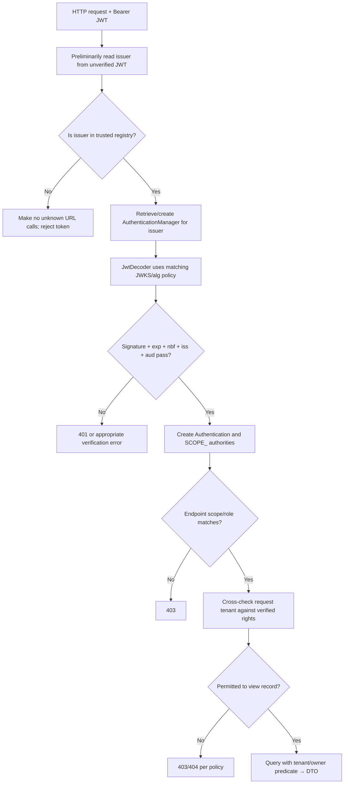
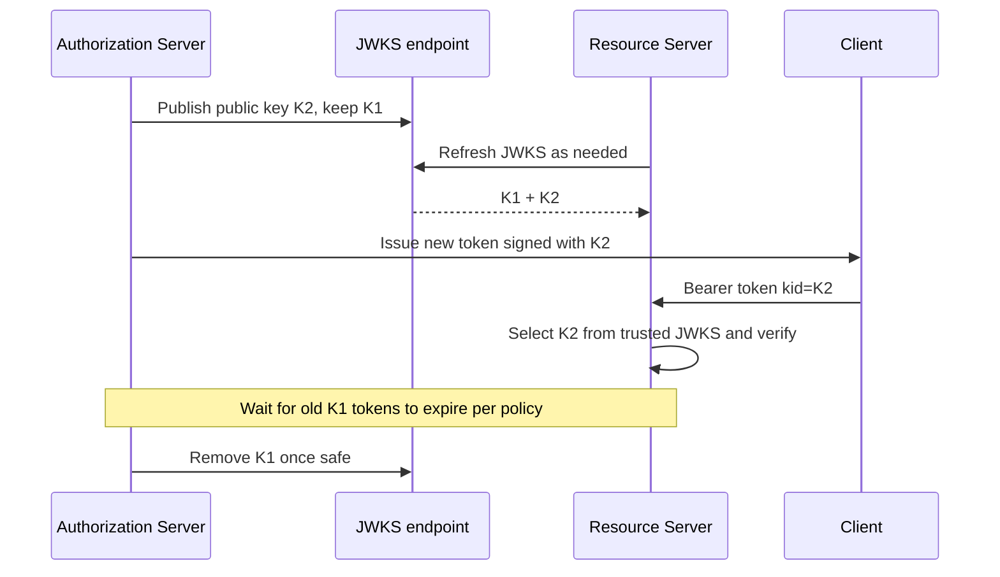

# Managing decoders, keys, caches, and configuration per tenant

## 1. Context: one Resource Server serving multiple tenants

An order-management system may accept requests from multiple organizational customers:

- **Tenant Alpha** signs in via Authorization Server `https://login.alpha.example/realms/store`.
- **Tenant Beta** signs in via `https://login.beta.example/realms/store`.
- **Tenant Gamma** shares a centralized Authorization Server with several other tenants, while maintaining its own tenant identifier and data policy.

Clients call the same REST API:

```http
GET /api/tenants/alpha/orders/123 HTTP/1.1
Host: orders.example.com
Authorization: Bearer <access-token>
```

If the Resource Server configures only a single decoder with one `issuer-uri`, it may be unable to verify tokens from all permitted issuers. Yet if the application "accepts any issuer" for easy integration, it opens up risks of **trusting forged tokens, fetching keys from client-controlled addresses, misusing caches, and cross-tenant access**.

A secure multi-tenant system must solve these questions simultaneously:

1. Which tenant is this request **requesting**?
2. Which **issuer** minted the token? Is that issuer in the trusted list?
3. Which **decoder, JWK Set URI, and signing algorithm** must be used to verify the token?
4. Was the token issued for the **right API audience**?
5. Does the requested tenant match the **authenticated tenant/entitlement**?
6. How are decoders and keys **cached**, and how can they be rotated or revoked?
7. If a new tenant is onboarded or an old tenant is disabled, how must configuration and caches be updated?
8. How do you prevent clients from choosing an untrusted issuer or endpoint?

**Core principle:** *Information from an unverified token or request URL can help route to an **approved** candidate configuration, yet is never enough to expand the set of trusted issuers, keys, audiences, or tenants.*

### After this lesson, you should be able to

- Distinguish **tenant**, **issuer**, **audience**, **OAuth Client**, and **JWK Set URI**.
- Organize a **trusted tenant registry** with versioned security configs and update policies.
- Use `JwtIssuerAuthenticationManagerResolver` for multiple issuers in Spring Security Servlet.
- Build standalone `JwtDecoder`s with issuer validators, audience validators, and signing-algorithm policies.
- Distinguish **decoder/authentication manager** caches, **JWKS** caches, **entitlement** caches, and **response/data** caches.
- Design key rotation, cache invalidation, tenant suspension, and safe onboarding.
- Know when multiple tenants sharing an issuer **do not need multiple decoders**, while still needing tenant authorization.
- Handle opaque tokens and WebFlux using the same principles.
- Design tests for cross-issuer, cross-tenant, unknown issuer, audience confusion, and JWKS rotation.

---

## 2. First, distinguish five identifiers

### 2.1. Tenant ID

`tenant_id` is the identifier of the organizational customer or data partition managed by the application:

```text
alpha
beta
gamma
```

It typically relates to data isolation: the `orders` table has a `tenant_id`, each user belongs to one or more tenants, and an administrator of one tenant does not automatically hold privileges in another.

A Tenant ID **is not automatically an OAuth issuer**. One issuer can mint tokens for many tenants; one tenant can also use multiple identity providers in complex federated setups.

### 2.2. Issuer (`iss`)

The issuer identifies the Authorization Server or token-issuing realm per profile:

```json
{
  "iss": "https://login.alpha.example/realms/store"
}
```

In a JWT, `iss` resides in the payload and is **untrusted** until signature verification and the issuer validator succeed. It may be read preliminarily solely to locate an **existing trusted configuration**.

If the API permits Alpha and Beta, treat the two issuer values as **two independent trust anchors** whenever they genuinely represent distinct issuers.

### 2.3. Audience (`aud`)

Audience states which Resource Server or resource the token was issued for:

```json
{
  "aud": ["orders-api"]
}
```

A token from the right issuer with `aud=["billing-api"]` **must not be automatically accepted at `orders-api`**. Multiple tenants may share the `orders-api` audience or each tenant may have its own API audience; what matters is validating against the **configured contract**.

### 2.4. OAuth Client (`client_id` or `azp` per profile)

The OAuth Client is the application requesting the token, such as `web-portal` or `billing-worker`. It is not synonymous with issuer, audience, or tenant.

An access token with `client_id=web-portal` does not prove it is valid for every API; and a user belonging to tenant Alpha does not mean every Client registered by Alpha may read all of Alpha's data.

### 2.5. JWKS/JWK Set URI and `kid`

JWTs are usually signed with the Authorization Server's private key. The Resource Server verifies the signature using a **public key** from a trusted JWK Set or controlled key source.

An illustrative JOSE header:

```json
{
  "alg": "RS256",
  "kid": "alpha-2026-key-2",
  "typ": "at+jwt"
}
```

`kid` is a hint for selecting a **key inside that issuer's trusted key set**. It is not proof of access; nor does it mean `kid` is unique across all issuers.

```text
Issuer Alpha:
  jwks_uri = https://login.alpha.example/.../certs
  kid      = alpha-2026-key-2

Issuer Beta:
  jwks_uri = https://login.beta.example/.../certs
  kid      = beta-2026-key-2
```

Even if two issuers share the exact same `kid` string, **never use Alpha's public key to verify Beta's token** just because `kid` collides.

### 2.6. Quick reference table

| Concept | Role | Source of trust | Common mistake |
|---|---|---|---|
| `tenant_id` | Data scope and membership | Verified claim, entitlement DB, or policy | Trusting tenant in URL as permission |
| `iss` | Token issuer | Allowlist/registry and validator | Fetching keys from an unapproved issuer |
| `aud` | Target Resource Server | API config and token validator | Checking only signature and issuer |
| `client_id` | Application granted the token | Verified token metadata / AS | Treating Client ID as audience |
| `jwks_uri` | Public key source to verify JWT | Trusted issuer config/discovery | Using arbitrary `jku` in JWT header |
| `kid` | Pick key inside issuer's JWKS | Untrusted header + trusted key set | Caching keys globally by `kid` |
| `scope`/`scp` | Operation privileges granted by AS | Verified token | Treating `SCOPE_orders.read` as access to every record |

---

## 3. Three multi-tenant models with different security properties

### 3.1. Model A: one issuer per tenant

```text
Alpha → issuer A → JWKS A
Beta  → issuer B → JWKS B
Gamma → issuer C → JWKS C
                    |
                    v
                orders-api
```

In this model, the Resource Server must choose a **token verifier by issuer**. Multiple decoders/authentication managers can be used, each bound to:

- Approved issuer.
- Trusted JWKS URI.
- Allowed signing algorithms.
- API audience.
- Claim validators.
- Authority mapping rules.
- Lifecycle/cache for that tenant.

### 3.2. Model B: multiple tenants sharing an issuer

```text
Alpha ─┐
Beta  ─┼→ https://id.example.com/realms/shared → shared JWKS
Gamma ─┘                                      |
                                               v
                                           orders-api
```

When sharing **the same issuer, key material, token profile, and audience validation**, a single decoder can verify tokens across many tenants. Creating hundreds of identical decoders keyed by `tenant_id` only increases JWKS and cache overhead.

However, **one shared decoder does not mean tenants share permissions**. After verifying the token, the application must still enforce tenant claims, membership/ACL, and data predicates.

Example:

```json
{
  "iss": "https://id.example.com/realms/shared",
  "aud": ["orders-api"],
  "sub": "user-417",
  "tenant_id": "alpha",
  "scope": "orders.read"
}
```

A request to `/api/tenants/beta/orders/123` must be denied if the principal is only authorized for Alpha, even though the token verifies via the shared decoder.

### 3.3. Model C: multiple issuers for one tenant

One tenant might accept both a corporate IdP and a partner IdP:

```text
Tenant Alpha:
  issuer A1 → corporate IdP
  issuer A2 → partner IdP
```

Here, the registry may map **many issuers → one tenant**. Map `(iss, sub)` or a subject linked via a trusted process to the internal user identity.

**Never treat identical `sub` values from two issuers as the same user.** `sub=user-417` in A1 and `sub=user-417` in A2 can be two completely different principals.

### 3.4. Choose architecture from real trust boundaries

Never assume:

```text
tenant_id = issuer = client_id = audience = hostname
```

Those strings may look similar in a demo yet are completely independent in real models. A sound registry schema must represent one-to-many and many-to-one relationships rather than forcing every setting into a single `tenantId` string.

---

## 4. Request path: selecting a manager is only a routing step

### 4.1. Safe flow for multi-issuer JWTs



**An important detail:** Reading `iss` before checking the signature **does not mean trusting `iss`**. It only picks a candidate from a **pre-approved** registry, and the decoder must then verify the signature and exact issuer value.

If the application reads an unverified `iss` and automatically fetches metadata/JWKS from that host, an attacker's token can steer the API to an unintended host.

### 4.2. Example token from an untrusted source

Unverified JWT payload:

```json
{
  "iss": "https://evil.example/issuer",
  "aud": ["orders-api"],
  "sub": "admin",
  "scope": "orders.read"
}
```

If the Resource Server automatically calls `JwtDecoders.fromIssuerLocation(iss)` for every new issuer encountered, it can:

- Make outbound HTTP requests to an external host controlled by the token sender.
- Download unapproved metadata and JWKs.
- Create unbounded cache entries and authentication managers.
- Accept self-signed tokens without an independent allowlist check.
- Cause SSRF or resource exhaustion across varied issuer URLs.

Therefore **never build a trust registry by "adding every issuer as it arrives."**

### 4.3. Some checks are conceptually checked twice

The `iss` value used to locate configuration is **untrusted data**. After decoding, the `iss` value in the decoder-verified JWT must match the issuer configured on that manager.

If the request path picks Alpha while the verified JWT belongs to Beta, you must still enforce the Alpha/Beta condition in the business layer. Never treat "the manager decoded the token" as proof the token is authorized for the tenant named in the path.

---

## 5. Trusted tenant registry: the authoritative config source

### 5.1. What information should each profile contain?

An example profile:

```yaml
security:
  tenants:
    alpha:
      enabled: true
      issuer: https://login.alpha.example/realms/store
      jwks-uri: https://login.alpha.example/realms/store/protocol/openid-connect/certs
      audience: orders-api
      allowed-algorithms:
        - RS256
      token-tenant-claim: tenant_id
      expected-tenant-claim-value: alpha
    beta:
      enabled: true
      issuer: https://login.beta.example/realms/store
      jwks-uri: https://login.beta.example/realms/store/protocol/openid-connect/certs
      audience: orders-api
      allowed-algorithms:
        - RS256
      token-tenant-claim: tenant_id
      expected-tenant-claim-value: beta
```

This is a **proposed application schema**, not built-in Spring Boot properties. You must define `@ConfigurationProperties`, a registry loader, or corresponding bindings.

Commonly needed fields:

| Field | Role |
|---|---|
| `tenantId` | Stable internal ID |
| `enabled` | Enable/disable tenant |
| `issuer` | Exact trusted issuer identifier |
| `jwksUri` | Approved public key source |
| `audience` | Mandatory API/token recipient |
| `allowedAlgorithms` | Signing algorithm policy |
| `tokenProfile` | Token type/claim constraints per contract |
| `tenantClaim` | How principals map to tenants |
| `scopeMapping` | Authority claim/prefix if non-default |
| `version` | Snapshot version for cache updates/invalidation |
| `maxStale`/`timeouts` | Cache and network policies |
| `status` | Active/suspended/offboarded |

Not every tenant requires a distinct JWKS URI. When sharing an issuer/trust anchor, the registry can reuse the same decoder while keeping business mappings separate.

### 5.2. Who may update the registry?

The registry is **security configuration**, not an arbitrary list supplied by HTTP clients. Update sources may include:

- Reviewed deployment configuration.
- Internal database with restricted admin privileges.
- Separately authenticated and authorized onboarding control plane.
- Audited, versioned secret manager or config service.

For onboarding a new tenant, require verification of issuer, metadata, JWKS URI, audience, key algorithms, and tenant mapping. Never expose a public API to "self-register an issuer by URL" and immediately honor it on the first request.

### 5.3. Immutable configuration snapshots

A clean way to govern updates is loading the registry into an **immutable snapshot**:

```text
Registry revision 18:
  alpha → profile A v5
  beta  → profile B v2

Registry revision 19:
  alpha → profile A v6
  beta  → disabled
```

Each request uses a single consistent snapshot to select and evaluate policies. On updates, swap the snapshot atomically and apply the corresponding invalidation policy.

Avoid mutating individual `issuer`, `jwksUri`, `audience`, and `enabled` fields on a shared mutable bean while requests are running; mixed intermediate states can emerge.

### 5.4. Do not trust based on "similar-looking" domain names

An unsafe trust check:

```java
if (issuer.startsWith("https://login.example.com")) {
    return true;
}
```

It can mistakenly accept invalid strings like:

```text
https://login.example.com.attacker.example/issuer
```

Use **exact** issuer identifiers per verified configuration. If complex hostname/URL policies are needed, parse and canonicalize exact components, while keeping the JWT validator's issuer check strictly equal to the contracted string.

### 5.5. Network protection during discovery/JWKS refresh

Even an approved issuer can suffer from misconfiguration or DNS/redirect changes. Consider:

- HTTPS only, with valid TLS certificate and hostname verification.
- Restricting outbound destinations via allowlists and network policies.
- Blocking access to cloud metadata IPs, loopback, and private networks unless explicitly intended.
- Controlling HTTP client redirects.
- Timeouts and connection limits.
- Rejecting `jku`/`x5u` from tokens as key-fetch URLs.
- Controlling DNS and egress to mitigate SSRF.
- Never sending Bearer tokens to introspection/JWKS endpoints outside the trust registry.

---

## 6. Simple configuration with multiple known issuers

### 6.1. Dependencies

Spring Boot Servlet Resource Server example:

```groovy
dependencies {
    implementation 'org.springframework.boot:spring-boot-starter-web'
    implementation 'org.springframework.boot:spring-boot-starter-security'
    implementation 'org.springframework.boot:spring-boot-starter-oauth2-resource-server'

    testImplementation 'org.springframework.boot:spring-boot-starter-test'
    testImplementation 'org.springframework.security:spring-security-test'
}
```

Examples in sections 6–11 use **Servlet/MVC** with `HttpSecurity`, `SecurityFilterChain`, and `JwtIssuerAuthenticationManagerResolver`. WebFlux uses different types, covered in a dedicated section.

### 6.2. `JwtIssuerAuthenticationManagerResolver` with trusted issuers

With a small static set of issuers, Spring Security Servlet supports `JwtIssuerAuthenticationManagerResolver`.

Example using the modern Spring Security API:

```java
package com.example.orders;

import org.springframework.context.annotation.Bean;
import org.springframework.context.annotation.Configuration;
import org.springframework.http.HttpMethod;
import org.springframework.security.config.annotation.web.builders.HttpSecurity;
import org.springframework.security.web.SecurityFilterChain;
import org.springframework.security.oauth2.server.resource.authentication.JwtIssuerAuthenticationManagerResolver;

@Configuration
public class MultiIssuerSecurityConfig {

    @Bean
    SecurityFilterChain apiSecurity(HttpSecurity http) throws Exception {
        JwtIssuerAuthenticationManagerResolver resolver =
            JwtIssuerAuthenticationManagerResolver
                .fromTrustedIssuers(
                    "https://login.alpha.example/realms/store",
                    "https://login.beta.example/realms/store");

        return http
            .securityMatcher("/api/**")
            .csrf(csrf -> csrf.disable())
            .authorizeHttpRequests(auth -> auth
                .requestMatchers("/api/public/**").permitAll()
                .requestMatchers(HttpMethod.GET, "/api/orders/**")
                    .hasAuthority("SCOPE_orders.read")
                .anyRequest().denyAll())
            .oauth2ResourceServer(oauth2 -> oauth2
                .authenticationManagerResolver(resolver))
            .build();
    }
}
```

Meaning:

1. The trusted issuer list is declared on the server.
2. The resolver uses the candidate issuer to pick the matching `AuthenticationManager`.
3. The corresponding decoder actually **verifies the token**, not merely reading `iss`.
4. The API checks `SCOPE_orders.read` after Authentication succeeds.

**Version note:** The `fromTrustedIssuers(...)` factory can differ across Spring Security versions; for older projects, check the Javadoc of your active dependency. Never copy an API signature from another version and work around it by dropping issuer checks. Some versions use constructors accepting trusted issuers or `AuthenticationManagerResolver<String>`; the allowlist and post-decode issuer validation principles remain unchanged.

### 6.3. Limitations of the minimal example

The example above selects the issuer/decoder, yet **does not automatically enforce all tenant-specific policies**:

- Dedicated audience for `orders-api`.
- Token `typ`/profile.
- Mandatory `tenant_id` claim.
- Data ownership.
- Per-tenant roles.
- Cache policies, custom timeouts, or required key rotation rules.
- Dynamic tenant onboarding/offboarding.

To handle those, build per-tenant managers/decoders or add an explicit policy layer.

### 6.4. When not to use an issuer-based resolver?

If all tenants share the same issuer and keys, a per-issuer decoder map would only have **one entry**. Tenant decisions then belong in **authorization/data isolation**, not JWT verifier selection.

Conversely, if one tenant has multiple issuers or an AS mints multiple token types, a simple `tenantId → issuer` map is too restrictive. Design the registry around **trust profiles**, not an assumed 1:1 relationship.

---

## 7. Building decoders per trusted issuer

When per-tenant audiences, JWKS URIs, and algorithms are needed, construct explicit managers.

### 7.1. Immutable profile

Example:

```java
package com.example.orders;

public record TenantJwtProfile(
    String tenantId,
    String issuer,
    String jwksUri,
    String audience,
    boolean enabled,
    long version
) {
}
```

This is a minimal model; never let a Client submit a `TenantJwtProfile` object and treat it as a security configuration source.

### 7.2. Factory building a `JwtDecoder` with validators

```java
package com.example.orders;

import org.springframework.security.oauth2.core.DelegatingOAuth2TokenValidator;
import org.springframework.security.oauth2.core.OAuth2Error;
import org.springframework.security.oauth2.core.OAuth2TokenValidator;
import org.springframework.security.oauth2.core.OAuth2TokenValidatorResult;
import org.springframework.security.oauth2.jwt.Jwt;
import org.springframework.security.oauth2.jwt.JwtValidators;
import org.springframework.security.oauth2.jwt.NimbusJwtDecoder;
import org.springframework.security.oauth2.jose.jws.SignatureAlgorithm;

public final class TenantJwtDecoderFactory {

    public NimbusJwtDecoder create(TenantJwtProfile profile) {
        if (!profile.enabled()) {
            throw new IllegalArgumentException(
                "Tenant is not enabled");
        }

        // JWKS URL and algorithm originate from the approved registry.
        NimbusJwtDecoder decoder =
            NimbusJwtDecoder
                .withJwkSetUri(profile.jwksUri())
                .jwsAlgorithm(SignatureAlgorithm.RS256)
                .build();

        OAuth2TokenValidator<Jwt> issuerAndTime =
            JwtValidators.createDefaultWithIssuer(
                profile.issuer());

        OAuth2TokenValidator<Jwt> audience = jwt ->
            jwt.getAudience().contains(profile.audience())
                ? OAuth2TokenValidatorResult.success()
                : OAuth2TokenValidatorResult.failure(
                    new OAuth2Error(
                        "invalid_token",
                        "Token audience is not accepted",
                        null));

        decoder.setJwtValidator(
            new DelegatingOAuth2TokenValidator<>(
                issuerAndTime, audience));

        return decoder;
    }
}
```

This code illustrates a **fixed RS256 policy for the example**. If each tenant allows different algorithms, include an approved algorithm set in the profile and configure the builder per the API and algorithm policy—never use an unverified `alg` from the token as grounds to accept a new algorithm.

### 7.3. Why is `JwtValidators.createDefaultWithIssuer` needed?

When constructing a decoder directly from `jwksUri`, ensure you verify not just the signature but also required conditions such as issuer, timestamps, and audience.

`JwtValidators.createDefaultWithIssuer(profile.issuer())` creates the default issuer-bound validators for JWTs in that API. Audience is added separately via its own validator. If your project adds `typ`/`azp`/tenant claim validators, compose them with the validators you need to retain—**never overwrite them with a single standalone validator**.

Never just write:

```java
// Incomplete without issuer/audience/time policies:
NimbusJwtDecoder.withJwkSetUri(jwksUri).build();
```

and assume the token targets the right API and tenant.

### 7.4. Valid signature but wrong issuer

Suppose Alpha's configuration uses JWKS A. A crafted token contains:

```json
{
  "iss": "https://login.beta.example/realms/store",
  "aud": ["orders-api"],
  "scope": "orders.read"
}
```

Even if a flawed design accidentally verifies the signature via a shared key or cache mix-up, the token must still fail because `iss` does not match Alpha's profile.

**Signature and issuer are two independent conditions.** Never treat finding a matching public key as proof that the token was issued within the right trust boundary.

### 7.5. Validating the tenant claim per contract

If issuer A only mints tokens for tenant Alpha, you can require `tenant_id=alpha` in the profile. Distinguish carefully:

- **Mandatory token claim:** can be validated right inside the decoder if every token from that issuer/profile must carry it.
- **Endpoint-dependent membership:** usually checked in authorization/Services against current entitlement sources.
- **Multiple tenants sharing an issuer:** decoder is shared, while the tenant claim must still be cross-checked against the request and DB.

Simple validator example:

```java
OAuth2TokenValidator<Jwt> tenantClaim = jwt -> {
    String tenant = jwt.getClaimAsString("tenant_id");

    return profile.tenantId().equals(tenant)
        ? OAuth2TokenValidatorResult.success()
        : OAuth2TokenValidatorResult.failure(
            new OAuth2Error(
                "invalid_token",
                "Token tenant does not match its profile",
                null));
};
```

Use this validator only when the contract stipulates **one token belongs to exactly one tenant and the profile corresponds to that tenant**. If a user may access multiple tenants or shares an issuer, use a proper membership policy instead of hardcoding one tenant per issuer.

---

## 8. Per-issuer AuthenticationManager and caching in the right place

### 8.1. Why cache managers?

If every request rebuilds `JwtDecoder`/`JwtAuthenticationProvider`, the system repeats expensive work:

- Constructing the decoder/JWK source.
- Fetching metadata/key sets unnecessarily.
- Initializing converters and validation policies.
- Creating unshared JWKS caches.
- Increasing latency, memory usage, and load on the AS.

A common strategy is **lazy initialization**: build the manager for a trusted issuer only when a token for that issuer first arrives, then reuse it.

### 8.2. AuthenticationManager factory

```java
package com.example.orders;

import org.springframework.security.authentication.AuthenticationManager;
import org.springframework.security.authentication.ProviderManager;
import org.springframework.security.oauth2.server.resource.authentication.JwtAuthenticationProvider;

public final class TenantAuthenticationManagerFactory {

    private final TenantJwtDecoderFactory decoderFactory =
        new TenantJwtDecoderFactory();

    public AuthenticationManager create(
            TenantJwtProfile profile) {

        JwtAuthenticationProvider provider =
            new JwtAuthenticationProvider(
                decoderFactory.create(profile));

        return new ProviderManager(provider);
    }
}
```

`JwtAuthenticationProvider` converts a Bearer JWT request into a `JwtAuthenticationToken` once the decoder succeeds. Scopes are typically mapped to `SCOPE_...` authorities by the configured converter.

If a tenant uses non-default authority claims, attach a `JwtAuthenticationConverter` with an appropriate mapping and constrain role/tenant claims. Never automatically grant `ROLE_ADMIN` to every token from an Admin issuer simply based on tenant name.

### 8.3. Illustrative registry and cache

Suppose the registry exposes:

```java
public interface TrustedIssuerRegistry {
    Optional<TenantJwtProfile> findEnabledByIssuer(
        String issuer);
}
```

You can cache managers **by issuer** when each issuer has a unique, static profile during the current runtime:

```java
package com.example.orders;

import java.util.concurrent.ConcurrentHashMap;
import java.util.concurrent.ConcurrentMap;
import org.springframework.security.authentication.AuthenticationManager;
import org.springframework.security.authentication.AuthenticationManagerResolver;
import org.springframework.security.oauth2.core.OAuth2AuthenticationException;
import org.springframework.security.oauth2.core.OAuth2Error;

public final class TrustedIssuerManagerResolver
        implements AuthenticationManagerResolver<String> {

    private final TrustedIssuerRegistry registry;
    private final TenantAuthenticationManagerFactory factory;
    private final ConcurrentMap<String, AuthenticationManager> cache =
        new ConcurrentHashMap<>();

    public TrustedIssuerManagerResolver(
            TrustedIssuerRegistry registry,
            TenantAuthenticationManagerFactory factory) {

        this.registry = registry;
        this.factory = factory;
    }

    @Override
    public AuthenticationManager resolve(String issuer) {
        TenantJwtProfile profile =
            registry.findEnabledByIssuer(issuer)
                .orElseThrow(() ->
                    new OAuth2AuthenticationException(
                        new OAuth2Error(
                            "invalid_token",
                            "Issuer is not trusted",
                            null)));

        return cache.computeIfAbsent(
            profile.issuer(),
            key -> factory.create(profile));
    }
}
```

**Important limitation of this example:** `cache` here suits a **runtime-immutable trusted registry** where each issuer has one stable profile. If the registry updates `jwksUri`, `audience`, algorithms, `enabled`, or `version` at runtime, caching solely by issuer retains a **stale** manager. Section 12 explains versioning and invalidation.

Contrast this with an unsafe cache:

```java
// UNSAFE:
return cache.computeIfAbsent(
    untrustedIssuer,
    JwtDecoders::fromIssuerLocation);
```

The unsafe snippet spins up decoders for any self-declared token issuer without an allowlist check prior to HTTP/discovery calls.

### 8.4. Wiring the registry resolver into the Servlet security chain

With versions providing `JwtIssuerAuthenticationManagerResolver(AuthenticationManagerResolver<String>)`:

```java
@Bean
AuthenticationManagerResolver<HttpServletRequest>
multiIssuerResolver(
        TrustedIssuerRegistry registry) {

    TrustedIssuerManagerResolver trustedManagers =
        new TrustedIssuerManagerResolver(
            registry,
            new TenantAuthenticationManagerFactory());

    return new JwtIssuerAuthenticationManagerResolver(
        trustedManagers);
}
```

Then:

```java
@Bean
SecurityFilterChain api(
        HttpSecurity http,
        AuthenticationManagerResolver<HttpServletRequest> resolver)
        throws Exception {

    return http
        .securityMatcher("/api/**")
        .authorizeHttpRequests(auth -> auth
            .requestMatchers(HttpMethod.GET, "/api/orders/**")
                .hasAuthority("SCOPE_orders.read")
            .anyRequest().denyAll())
        .oauth2ResourceServer(oauth2 -> oauth2
            .authenticationManagerResolver(resolver))
        .build();
}
```

Imports for the example:

```java
import jakarta.servlet.http.HttpServletRequest;
import org.springframework.http.HttpMethod;
import org.springframework.security.authentication.AuthenticationManagerResolver;
import org.springframework.security.oauth2.server.resource.authentication.JwtIssuerAuthenticationManagerResolver;
import org.springframework.security.web.SecurityFilterChain;
```

This configuration **replaces** the static trusted-issuer factory from section 6; do not register multiple equivalent chains unintentionally. Across different Spring Security versions, check the exact constructor/factory signatures. Legacy Servlet apps on `javax.servlet` will have different imports.

### 8.5. Separating registry lookup from decoder creation

Avoid stuffing all logic into an unguarded lambda:

```text
untrusted iss
  → registry lookup/enable check
  → approved immutable profile
  → cache lookup by config identity/version
  → decoder with approved JWKS and validators
  → token verification
```

This layering gives clear places to:

- Reject unknown issuers immediately with zero outbound requests.
- Enforce tenant suspension.
- Use a tested factory for decoders.
- Bound the number of profiles and managers created.
- Manage invalidation when the control plane updates configs.

---

## 9. There is more than one kind of cache

In a multi-tenant system, the phrase "cache the decoder" is misleading because several distinct layers are cached.

| Cache layer | Contents | Appropriate key/boundary | Risk if wrong |
|---|---|---|---|
| Registry snapshot | Trusted tenant/issuer policies | Config revision and trusted tenant IDs | Using offboarded issuers or stale policies |
| AuthenticationManager cache | Provider + decoder + converters | Issuer and profile version | Continuing to use old JWKS URI/audience |
| Decoder cache | Initialized decoder/JWK source | Trust profile/issuer/version | Using one tenant's decoder for another |
| JWKS cache | Public JWK Set | JWKS URI/issuer per design | Mixing keys, stale keys, refresh storms |
| Token validation/result cache | Decoded/verified token results | Only with very strict policy | Honoring expired/revoked tokens or outdated policy |
| Entitlement cache | Roles/tenant memberships/ACLs | Issuer + subject + tenant + version | Revoked privileges still accepted |
| Response/data cache | Authorized DTOs/lists/counts | Principal + tenant + query/policy | Cross-tenant data leakage |

**Do not solve everything with one global `ConcurrentHashMap<String, Object>`.** Each cache has its own semantics, lifecycle, and invalidation requirements.

### 9.1. Caching a decoder does not replace per-request verification

Reusing the same `JwtDecoder` **never means** an incoming request's token is accepted without verification.

Every JWT must still undergo:

- Signature/algorithm/key verification.
- `exp`, `nbf`, `iss`, `aud`, and required validator checks.
- Authority mapping.
- Authorization and data isolation.

Decoder caching only avoids reconstructing expensive objects and configurations.

### 9.2. JWKS cache vs. token cache

A **JWKS cache** holds public keys used to verify tokens. It does not hold a decision that "token T is valid forever."

An expired token must still fail at the current time even if its signature verifies against a cached key.

### 9.3. Should you cache JWT Authentications?

Do not add a **"token string → approved Authentication"** cache without strong justification and dedicated design: token expiration, permission changes, tenant offboarding, or audience updates can all invalidate cached results.

If performance requirements force caching token outcomes, ensure TTLs never exceed token expiry, enforce policy versioning/revocation, and namespace by issuer/tenant/audience. Typically, **reusing decoders/JWKS** comes long before caching authentication decisions.

### 9.4. Safe cache keying

Never key public keys by `kid` alone:

```text
cache["key-1"] = publicKey
```

Because Alpha and Beta can both use `kid=key-1`.

An appropriate conceptual pattern:

```text
JWKS-cache namespace:
  issuer=https://login.alpha.example/realms/store
  jwksUri=https://login.alpha.example/.../certs
  keySetVersion=...
```

Or isolate a separate cache instance per trusted issuer with its own lifecycle. Never store the AS's private signing keys in the Resource Server: **Resource Servers normally need only public keys** to verify JWTs.

---

## 10. JWK Sets and key rotation: avoid permanent dependence on one `kid`

### 10.1. Why do Authorization Servers rotate keys?

An AS rotates keys for:

- Scheduled security cycles.
- HSM or signing service replacements.
- Approaching end-of-life for old keys.
- Suspected private key compromise.
- Separating signing policies per issuer/tenant.

A JWKS can hold multiple public keys:

```json
{
  "keys": [
    {
      "kty": "RSA",
      "kid": "alpha-key-2026-01",
      "use": "sig",
      "alg": "RS256",
      "n": "BASE64URL_MODULUS_1",
      "e": "AQAB"
    },
    {
      "kty": "RSA",
      "kid": "alpha-key-2026-02",
      "use": "sig",
      "alg": "RS256",
      "n": "BASE64URL_MODULUS_2",
      "e": "AQAB"
    }
  ]
}
```

This is illustrative data, **not a valid RSA JWKS to run**; the `n` values are placeholders.

### 10.2. Rotation with an overlap window

A normal rotation flow:



Publishing the new key before signing tokens with it reduces the risk that the Resource Server fails to verify newly issued tokens.

### 10.3. Do not assume caches refresh instantaneously

Every JWT library and JWK source version has its own caching and refresh rules. Some implementations refresh the JWK Set when an unknown `kid` appears, yet actual behavior depends on version, cache, and provider.

Never promise "the JWT decoder always refreshes on every unknown `kid`" without verifying your implementation. Operational design requires:

- Appropriate cache TTL and JWKS refresh strategies.
- Bounded timeouts and retries.
- Monitoring unknown `kid` rates.
- Controlled cache reload/invalidation mechanisms.
- Testing key rotation against your real Spring Security version.
- Limiting client requests carrying thousands of fake `kid`s to prevent refresh storms.

### 10.4. If a private key is compromised

Routine rotation differs from **compromise**:

- When a key is compromised, you may need to revoke trust in the old key early and reject tokens signed with it.
- Waiting for tokens to expire naturally may be insufficient.
- Invalidate/update JWKS caches across all Resource Servers.
- Coordinate with the AS and incident response: revoke tokens, adjust issuance policies, or disable the issuer.
- Never use `kid` to automatically trust an arbitrary key from a JWT header.

### 10.5. Limits of `kid`

`kid` helps locate a key, yet it:

- Does not prove which issuer owns the key.
- Does not guarantee the key is still trusted.
- Does not replace signature verification.
- Does not permit bypassing the algorithm allowlist.
- Does not replace claims validation.

In multi-issuer systems, identical `kid` values across two issuers must be handled in **two separate trust zones**.

---

## 11. Configuring the JWKS cache in Spring Security

### 11.1. The framework may already cache keys by default

`NimbusJwtDecoder` uses the underlying library's JWK source/caching mechanism to avoid fetching keys on every request. Do not immediately build a custom Redis cache or write public keys to a DB table without checking how your active decoder behaves.

Measure first:

- Number of HTTP GETs to JWKS per issuer.
- Cache hits/misses for tokens sharing a `kid`.
- Refresh timing during key rotation.
- Memory footprint and live decoder count.
- Load when multiple issuers rotate keys concurrently.

### 11.2. Cache API on `NimbusJwtDecoder` builder

Some Spring Security Servlet versions allow configuring a Spring `Cache` for the JWK Set:

```java
// Example builder API when the version supports cache(Cache).
NimbusJwtDecoder decoder =
    NimbusJwtDecoder.withJwkSetUri(profile.jwksUri())
        .cache(jwksCache)
        .build();
```

`jwksCache` is an `org.springframework.cache.Cache` you provide. This snippet shows how to integrate a cache, **not a claim that one cache manager fits all tenants**. Check the Javadoc of your resolved dependency for the exact key/TTL semantics used by the decoder.

Do not call `cache(...)` in WebFlux by copying Servlet APIs; `NimbusReactiveJwtDecoder` has its own builder and configuration.

### 11.3. Caching per tenant or issuer

When multiple decoders use separate JWKS URIs, apply explicit cache namespaces:

```text
jwks.alpha
jwks.beta
jwks.gamma
```

or a cache backend whose keys include the normalized URI/trust profile. Never share one global cache entry across distinct JWK Sets.

**Caution:** never put tokens, Client secrets, private signing keys, or sensitive claims into cache keys or logs. JWKS normally hold only public keys, yet you must still control source authenticity and data integrity.

### 11.4. TTL should not be a single rigid magic number

Cache duration depends on:

- How often the AS rotates keys.
- Access token lifetime.
- Urgency of emergency key revocation.
- HTTP caching headers/implementation of the JWK provider.
- Request traffic and AS capacity.
- Organizational operational policies.

Too short a TTL causes JWKS request storms; too long a TTL leaves the API trusting stale key info longer than desired. When policies change, support runtime updates or safe decoder instance replacement.

### 11.5. Why not cache "kid not found" forever?

If negative caching for `kid-not-found` lasts too long, a key newly published by the AS will keep getting rejected. With zero caching/throttling, floods of random `kid` tokens can cause a refresh storm.

Use **bounded negative caching/rate limiting** per your implementation, never turning "key not found" into a permanent verdict.

---

## 12. Dynamic tenant updates: versioning and invalidation

### 12.1. The stale cache problem

Suppose the initial registry is:

```text
Alpha v1:
  enabled = true
  issuer  = https://login.alpha.example/realms/store
  jwksUri = https://login.alpha.example/old/certs
  aud     = orders-api
```

Later it changes to:

```text
Alpha v2:
  enabled = true
  issuer  = https://login.alpha.example/realms/store
  jwksUri = https://login.alpha.example/new/certs
  aud     = orders-api-v2
```

If the manager cache keys only by issuer:

```java
cache.computeIfAbsent(issuer, ignored -> factory.create(profile));
```

then an `AuthenticationManager` built under v1 will keep using `old/certs` and `orders-api` even after the registry moves to v2.

That is a **policy consistency bug** and can lead to accepting invalid tokens.

### 12.2. Keys containing issuer + config version

Conceptual pattern:

```text
AuthenticationManager cache key:
  (issuer, securityConfigRevision)

For Alpha v1:
  ("https://login.alpha.example/realms/store", 1)

For Alpha v2:
  ("https://login.alpha.example/realms/store", 2)
```

When the revision changes, a new manager is built from the new snapshot. The old manager must be evicted and never returned by the active resolver.

**Never bump the version in the DB while leaving code to look up caches by the old issuer key alone.** Both lookup and caching must use the same source revision.

### 12.3. Atomic snapshot swaps

One implementation flow:

```text
Control plane approves change
    ↓
Validate new tenant security profile
    ↓
Prepare immutable registry snapshot v19
    ↓
Atomically switch active snapshot v18 → v19
    ↓
Invalidate/recreate affected manager + JWKS entries
    ↓
Observe error rates, enforce disabled tenants
```

Across multiple Resource Server nodes/pods, ensure propagation and convergence. One node on v18 while another runs v19 produces inconsistent authentication behavior.

### 12.4. Tenant disablement must be checked on every request

A suspended/offboarded tenant:

```yaml
tenantId: beta
enabled: false
```

Deleting an entry from one cache map is not enough if a request handler still holds the old manager in another variable.

Ensure:

1. The resolver checks the enabled state in the active registry snapshot.
2. Disabled issuers never return a manager.
3. Related caches are invalidated.
4. Business data and entitlements have their own revocation policies.
5. In-flight requests behave per a consistent policy.
6. Disablement is audit-logged.

If a tenant shares an issuer with other tenants, **you cannot disable the entire issuer** without breaking the remaining tenants. Use tenant-level authorization, memberships, or per-tenant token policies instead.

### 12.5. Bounding tenant/manager counts

In systems with dynamic onboarding, never let a Client sending 100,000 random issuer values create 100,000 decoder entries. The registry holds only approved profiles, and the system should also enforce:

- Maximum active tenant limits.
- Concurrent decoder creation caps.
- Timeouts on metadata/JWKS requests.
- Quotas and cache eviction policies where appropriate.
- Rate limiting on invalid issuer/`kid` requests.
- Memory and manager count monitoring.

---

## 13. Lazy vs. eager decoder initialization?

### 13.1. Lazy initialization

With hundreds of tenants, building every decoder at startup can trigger heavy HTTP discovery/JWKS calls and slow boot times.

Lazy initialization builds a decoder only when a token for a trusted issuer is first presented:

```text
Request for Alpha
   → Alpha trusted?
   → no cached manager?
   → create Alpha manager/decoder
   → verify JWT
```

Pros:

- Faster startup.
- Idle tenants consume few resources.
- AS load spreads out over real demand.

Cons:

- Higher first-request latency.
- A misconfigured tenant is only discovered once traffic arrives.
- Concurrent initial requests can cause duplicate initialization or lock contention if caching is not properly synchronized.

### 13.2. Eager initialization

You can warm up decoders/JWKS for critical tenants before serving traffic:

```text
Application start
   → validate approved tenant registry
   → precreate selected managers
   → attempt JWKS warmup/health verification
   → mark readiness according to policy
```

Pros:

- Catches configuration errors early.
- Eliminates cold-start latency on the first request.

Cons:

- Startup depends on many ASs.
- Large tenant counts delay readiness.
- One failing AS can degrade cluster readiness unless critical and optional tenants are separated.

### 13.3. Combining both strategies

A practical policy:

- Validate the config/issuer trust registry at deployment time.
- Pre-create decoders for high-SLA tenants.
- Lazy-load low-traffic tenants.
- Pre-warm JWKS with bounded concurrency.
- Decouple individual AS/tenant health from global readiness per product requirements.
- Refresh/evict cleanly on tenant rotation.

Never use lazy initialization as an excuse to **temporarily accept tokens without keys** on the first request.

---

## 14. Concurrency and thread safety of manager caches

### 14.1. Never use plain HashMap under concurrent requests

In a Servlet API, multiple request threads can resolve Alpha simultaneously. An unsynchronized `HashMap` mutated across threads risks race conditions and visibility bugs.

`ConcurrentHashMap.computeIfAbsent(...)` is a common technique for lazy manager creation against a stable registry.

Keep in mind:

- The factory may perform network I/O or heavy initialization.
- Locks/contention can stall threads.
- If creation fails, control retry behavior and negative caching.
- If the registry changes concurrently, results must match the active policy snapshot.

### 14.2. Key caches by trust profile, not by token

Never build a new decoder for each raw Bearer token:

```text
decoderCache[hashOfRawToken] = JwtDecoder
```

One decoder is normally shared across **all tokens belonging to the same issuer/profile**. Keying by token wastes resources and lets clients trigger cache explosion by sending distinct tokens.

### 14.3. What if one issuer has two profiles with different audiences?

Do not key the cache solely by issuer if profiles genuinely differ in audience or token-type policy per API surface. You may need keys like:

```text
(issuer, audience-policy, algorithm-policy, config-version)
```

or a decoder validating shared token-level conditions while an authorization manager enforces per-route audiences. Choose clear policy boundaries instead of sharing an overly permissive audience manager.

### 14.4. Never mutate tenant A's cached instance for tenant B

If code writes:

```java
static JwtDecoder sharedDecoder;
```

and mutates `jwksUri` internally when a Beta request arrives, an in-flight Alpha request can accidentally verify against Beta's keys. **Decoders and security configs should be immutable per profile**; policy changes must swap instances or registry snapshots, never mutate a singleton per request.

---

## 15. Tenant resolution from requests: never use as proof of permission

### 15.1. Common tenant sources an API sees

An application may receive tenant indicators via:

- Path: `/api/tenants/alpha/orders`.
- Subdomain: `alpha.api.example.com`.
- Header: `X-Tenant-ID: alpha`.
- Verified claim: `tenant_id=alpha`.
- Internal user membership/entitlement DB.

Path, subdomain, and headers identify the **requested tenant**, yet clients can modify them. Never read the tenant from the path and assume the principal belongs to it.

### 15.2. Proper flow

```text
1. Parse requested tenant from URL/routing.
2. Authenticate token using the matching trust policy.
3. Extract tenant grants from verified claims or entitlement source.
4. Verify caller is allowed to act in the requested tenant.
5. Query orders scoped by tenant and owner.
6. Map DTO containing only permitted fields.
```

Example Alpha token:

```json
{
  "iss": "https://login.alpha.example/realms/store",
  "aud": ["orders-api"],
  "sub": "user-417",
  "tenant_id": "alpha",
  "scope": "orders.read"
}
```

Request:

```http
GET /api/tenants/beta/orders/123 HTTP/1.1
Authorization: Bearer <alpha-access-token>
```

If policy forbids an Alpha user from accessing Beta, the Resource Server must reject even with a valid signature and read scope.

### 15.3. Repository queries with tenant/owner predicates

```sql
SELECT id, order_no, total_amount
FROM orders
WHERE id = :order_id
  AND tenant_id = :verified_tenant_id
  AND owner_issuer = :verified_issuer
  AND owner_subject = :verified_subject;
```

`verified_tenant_id`, `verified_issuer`, and `verified_subject` must come from verified Authentication and entitlements.

Never run a system-wide `findById(orderId)` and return the Entity before checking tenant/owner. If a record is outside scope, you may return `404` per policy to avoid leaking its existence.

### 15.4. A tenant role is not a global role

A user can be `TENANT_ADMIN` in Alpha while only a viewer in Beta. Never turn a tenant-scoped role into a system-wide `ROLE_ADMIN` without tenant context.

If roles arrive in the token:

```text
user-417:
  alpha → ADMIN
  beta  → VIEWER
```

then permission checks must combine **role + requested tenant**, never `hasRole("ADMIN")` alone.

---

## 16. Keys and JWT claims: validate every layer

### 16.1. Required validators

A multi-issuer decoder generally needs:

| Condition | Question |
|---|---|
| Signature | Was the token signed by a key matching the trusted issuer? |
| `alg` | Is the algorithm in the profile's allowlist? |
| `kid` | Does the key belong to the issuer's approved JWK Set? |
| `iss` | Does the exact value match the selected issuer? |
| `aud` | Is the token intended for this API? |
| `exp` | Is the token still valid? |
| `nbf` | Has the token reached its active time? |
| Token type/profile | Is it a contracted access token, not an ID token? |
| Claim types | Do tenant/client/subject claims have valid types and semantics? |
| Scope | Does it grant the required operation authority? |
| Business ACL | Does the principal have access to the specific record? |

### 16.2. Never use an ID token as an access token

In OIDC, an ID token typically has the OAuth Client as its audience. It lets the Client verify login identity and is **not by default a token that `orders-api` should accept**.

A multi-tenant Resource Server must prevent token confusion via contract-aligned audience and type validators. Never rely on "same issuer and valid signature" as the sole check.

### 16.3. Algorithm confusion

Never pick the algorithm solely from the token:

```java
// DO NOT DO THIS:
String algorithm = unverifiedHeader.getAlgorithm();
decoder.configureToAccept(algorithm);
```

Pin the allowed algorithms per trusted profile, run the verification library in strict mode, and reject `alg=none` or symmetric/asymmetric algorithms outside the contract.

### 16.4. Metadata endpoints from issuers

If using issuer discovery to locate `jwks_uri`, run discovery only for **issuers already in the registry**. Verify metadata issuer matching, enforce redirect/network policies, and apply an `iss` validator to the JWT.

If using an explicit `jwksUri` in the profile, it must still be vetted and pass TLS/egress policies—do not trust it blindly merely because it came from a database row.

---

## 17. Multi-tenant opaque tokens: do not force-fit JWT decoders

Not every tenant uses JWT access tokens. Some ASs emit opaque tokens requiring Resource Server introspection.

### 17.1. No `iss` readable from an opaque string

With JWTs, a resolver can read an unverified `iss` to pick a **trusted decoder**. With opaque tokens, the token string usually carries no safely parseable issuer.

Never try:

```text
for each introspectionEndpoint in registry:
    send raw token
    if active=true:
        trust it
```

This is dangerous: the raw Bearer token is sprayed to multiple ASs, increasing credential exposure and violating trust boundaries.

### 17.2. Choosing the introspection endpoint from trusted context

Options include:

- Tokens/Clients mapped by API hostname or tenant route to a trusted AS.
- A trusted gateway routing requests to per-issuer API deployments.
- Token prefix/metadata routing only when the **AS has an explicit contract** that prevents spoofing or misrouting.
- A centralized introspection service authorized by the organization across multiple issuers that resolves tokens over trusted protocols.

Once the AS returns a principal, still enforce audience/resource binding, scopes, and tenant ACLs. If the AS is chosen from a client-modifiable tenant URL, `active=true` alone does not grant data access; verify tenant policies afterward.

### 17.3. Spring Security `OpaqueTokenIntrospector`

In Servlet, the interface is typically:

```java
OpaqueTokenIntrospector
```

In WebFlux:

```java
ReactiveOpaqueTokenIntrospector
```

Each tenant may need its own introspection URI, credentials, timeouts, and principal converter. Never send Alpha's Client secret to Beta's AS, and never share an `active=true` cache without distinguishing Resource Server/audience.

### 17.4. Error codes and outages

- `active=false`: token rejected, typically `401`.
- `active=true` but missing scope: typically `403`.
- `active=true` but wrong audience: token-level policy must reject.
- Introspection endpoint timeout: cannot verify token; **never fail open**.
- Tenant disabled: never let a principal through just because an introspection cache still holds `active=true`.

---

## 18. WebFlux: reactive manager/decoder registry

In WebFlux, the types change:

| Servlet Resource Server | WebFlux Resource Server |
|---|---|
| `HttpSecurity` | `ServerHttpSecurity` |
| `SecurityFilterChain` | `SecurityWebFilterChain` |
| `JwtDecoder` | `ReactiveJwtDecoder` |
| `AuthenticationManager` | `ReactiveAuthenticationManager` |
| `JwtIssuerAuthenticationManagerResolver` | `JwtIssuerReactiveAuthenticationManagerResolver` |
| `OpaqueTokenIntrospector` | `ReactiveOpaqueTokenIntrospector` |
| `JwtAuthenticationProvider` | `JwtReactiveAuthenticationManager` |

### 18.1. Selecting trusted issuers in WebFlux

Spring Security WebFlux can use `JwtIssuerReactiveAuthenticationManagerResolver` for multi-issuer JWTs. Depending on version, the resolver API provides factories/constructors taking trusted issuers or a per-issuer resolver; check your actual version's API.

Example in the style of Spring Security versions with `fromTrustedIssuers(...)`:

```java
JwtIssuerReactiveAuthenticationManagerResolver resolver =
    JwtIssuerReactiveAuthenticationManagerResolver
        .fromTrustedIssuers(
            "https://login.alpha.example/realms/store",
            "https://login.beta.example/realms/store");
```

Wired into the chain:

```java
@Bean
SecurityWebFilterChain api(
        ServerHttpSecurity http,
        JwtIssuerReactiveAuthenticationManagerResolver resolver) {

    return http
        .authorizeExchange(auth -> auth
            .pathMatchers("/api/public/**").permitAll()
            .pathMatchers("/api/orders/**")
                .hasAuthority("SCOPE_orders.read")
            .anyExchange().denyAll())
        .oauth2ResourceServer(oauth2 -> oauth2
            .authenticationManagerResolver(resolver))
        .build();
}
```

As in Servlet, the trusted issuer list must come from a server-side registry. **Never create reactive decoders dynamically for every new issuer seen in a token.**

### 18.2. Reactive JWKS I/O

`NimbusReactiveJwtDecoder` is designed for the reactive JWT authentication path. Use the reactive decoder rather than calling a blocking Servlet `JwtDecoder` on the event loop.

If the application looks up user/tenant memberships in a DB, use reactive clients such as R2DBC or `WebClient` to remain non-blocking. Avoid `Mono.just(jdbcRepository.findUser())` or `block()` inside security filters.

### 18.3. Never trade away security when going reactive

Even in WebFlux, you still need:

- An issuer allowlist prior to discovery.
- Issuer/signature/audience validators.
- JWKS caches partitioned by trust profile.
- Tenant entitlements and owner policies.
- Invalidation when a tenant is disabled.
- Fail-closed behavior when AS/JWKS cannot verify.

"Reactive" describes how I/O executes, not a relaxation of trust boundaries.

---

## 19. Logging, monitoring, and per-tenant incidents

### 19.1. Observing the system without logging tokens

Useful log fields:

```text
correlation_id
route_pattern
resolved_trusted_issuer_id
tenant_id_after_authorization
security_config_revision
decoder_cache_hit
jwks_refresh_attempt/result
jwt_validation_failure_category
http_status
request_latency
```

Never log:

```text
Authorization: Bearer <real-token>
raw JWT payloads containing PII
introspection client_secret
private signing keys
session cookies
```

If you need to correlate repeated tokens, use a policy-compliant controlled identifier or keyed hash, never the raw token.

### 19.2. Metrics to partition

| Metric | Purpose |
|---|---|
| JWT decode duration by profile | Spot tenants with unusual tokens/crypto |
| JWK refresh hit/miss/rate | Track key rotation and caching |
| Unknown issuer count | Detect token requests from unknown sources |
| Unknown `kid` rate | Alert on key rotation or DoS |
| Decoder manager count | Detect unbounded cache growth |
| Registry revision age | Catch nodes lagging on config updates |
| AS/JWKS latency and error rate | Distinguish infra outages from invalid tokens |
| 401/403 by failure category | Separate authentication from authorization |
| Cross-tenant deny count | Spot cross-tenant access attempts |
| Cache eviction/recreation | Track policy rollouts |
| Memory/GC and connection pools | Catch scaling bottlenecks as tenant counts grow |

Never put `sub`, raw tokens, emails, or sensitive tenant IDs into unbounded-cardinality metric labels. Group by safe internal profile IDs permitted for observability.

### 19.3. Multi-tenant incidents need bounded blast radius

A slow Alpha AS **should not take down Beta or Gamma** if the architecture isolates connections, timeouts, and thread pools.

Mitigations:

- HTTP client timeouts.
- Per-issuer or per-AS concurrency limits and circuit breakers.
- Partitioned JWKS caches.
- Bulkheads for critical tenants.
- **Fail-closed** fallback when verification is impossible.
- Monitoring that separates AS outages from genuine token errors.

Never "fail over Alpha's token to Beta's decoder" when JWKS A fails.

---

## 20. Testing multi-issuer setups and rotation

### 20.1. Test fixtures

Create two simulated issuers:

```text
Issuer Alpha:
  iss  = https://login.alpha.example/issuer
  aud  = orders-api
  JWKS = A
  key  = A1 / A2
  tenant = alpha

Issuer Beta:
  iss  = https://login.beta.example/issuer
  aud  = orders-api
  JWKS = B
  key  = B1
  tenant = beta
```

Use dedicated test public/private key pairs, stub JWKS endpoints, and real access tokens signed with test private keys. **Never use production signing keys** in test fixtures.

### 20.2. Core test matrix

| Test case | Expected outcome |
|---|---|
| Alpha JWT signed with A1, valid issuer/audience | Passes token validation |
| Beta JWT signed with B1, valid issuer/audience | Passes token validation |
| Unregistered unknown issuer | Rejected; zero calls to unknown host |
| Forged Alpha issuer JWT signed with B1 | Rejected on signature |
| Validly signed Alpha issuer JWT with `aud=billing-api` | Rejected on audience |
| Expired Alpha JWT | `401` |
| Alpha JWT with `alg` outside allowlist | Rejected |
| Alpha JWT with unknown `kid` | Does not trust keys from elsewhere |
| JWT with client-supplied `jku` to unknown host | Never fetches that URL |
| Alpha JWT with sufficient scope requesting tenant Beta | Denied Beta data |
| Alpha JWT missing `orders.read` | `403` |
| Beta tenant disabled in new registry | Beta tokens rejected per policy |
| Alpha rotates A1 → A2, publishes both | Tokens signed by A2 accepted after proper refresh |
| A1 revoked due to compromise | A1 stops being trusted within policy window |
| Alpha JWKS outage | Never fails open or falls back to Beta |
| Flood of 1,000 random unknown issuers | Cache does not create 1,000 managers |
| Same `kid` in JWKS A and B | Keys are never mixed |
| Shared issuer for Alpha/Beta, different tenant claim | Enforces proper data authorization |
| Same issuer + same sub, different tenant rights | Enforces per-tenant membership/ACL |
| Client sends web cookie without Bearer token | Per API policy, does not silently use web session |
| Beta AS opaque token sent to Alpha AS | Does not spray token to unrelated endpoints |

### 20.3. Mock authentication does not test the decoder

Spring Security Test's `with(jwt())` in Servlet or `mockJwt()` in WebFlux builds an `Authentication` for authorization tests. However, they **bypass real JWT signature/JWKS/issuer validation** in most test setups.

Example:

```java
mvc.perform(get("/api/orders/123")
        .with(jwt().authorities(
            new SimpleGrantedAuthority("SCOPE_orders.read"))))
    .andExpect(status().isOk());
```

This test only proves the request proceeds once an Authentication with that authority exists; it **does not prove** the multi-issuer resolver or JWKS cache works.

To test multi-issuer logic, write integration tests flowing through a **real decoder/resolver** with stubbed JWKS and genuinely signed test JWTs.

### 20.4. Testing key rotation

A scenario:

1. JWKS A serves only A1; token A1 verifies cleanly.
2. AS publishes A2 alongside A1.
3. New tokens are signed with A2.
4. Resource Server refreshes JWK Set per implementation/cache policy.
5. Token A2 verifies cleanly.
6. After the overlap window and A1 token expiration, AS removes A1.
7. Confirm the Resource Server rejects A1 once policy/refresh takes effect.

For compromise scenarios, policy may require cutting off A1 early; test emergency revocation separately.

### 20.5. Testing registry updates and invalidation

Scenario:

```text
Revision 10:
  beta.enabled=true
  beta.audience=orders-api

Revision 11:
  beta.enabled=false
```

Verify that new requests do not keep using Beta's cached `AuthenticationManager` from revision 10. If code keys caches only by issuer, this test catches the flaw immediately.

### 20.6. Verifying zero SSRF

Send forged tokens claiming issuers like:

```text
http://127.0.0.1:8080/internal
http://169.254.169.254/latest/meta-data
https://attacker.example/jwks
https://login.alpha.example.attacker.example
```

Verify the resolver rejects them immediately at the allowlist and **makes zero outbound HTTP requests to those addresses**. Use a stub/recorder in tests to assert zero requests without ever hitting live dangerous addresses.

---

## 21. Performance considerations and trade-offs

### 21.1. Is one decoder per tenant always best?

**No.** When all tenants share issuer, keys, and audience, separate decoders waste memory and duplicate JWKS fetches.

Conversely, when issuers, keys, or algorithms differ, a single global decoder with an unpartitioned key set blurs trust boundaries and causes confusion.

How to choose:

- **Decoder per trust profile** when issuers, JWKS, or policies differ.
- **Shared decoder per issuer** when issuer, keys, and validators are completely shared.
- **Dedicated tenant-level ACLs** in Services/Repositories even when the decoder is shared.

### 21.2. Should each tenant get its own SecurityFilterChain?

Not necessarily. A single `SecurityFilterChain` guarding `/api/**` can use an `AuthenticationManagerResolver` to pick managers per issuer. Multiple chains make sense when API surfaces genuinely need different filters, entry points, or session policies.

If each tenant has special routes and trust policies, multiple chains are an option, provided `securityMatcher` and `@Order` are managed carefully. Spring Security picks the first matching chain rather than merging policies across chains.

### 21.3. Configure decoders by issuer or JWKS URI?

Two common approaches:

- **Issuer discovery:** convenient when the AS publishes standard metadata, yet requires a trusted issuer and controlled discovery/networking.
- **Explicit JWKS URI:** gives exact control over where keys are fetched, yet requires explicitly attaching issuer/time/audience validators.

Never let clients choose whichever mechanism weakens trust policy.

### 21.4. Are shared caches always better?

No. A shared JWKS cache with under-partitioned keys risks cross-tenant contamination. Conversely, overly fragmented caches raise network and connection overhead.

Optimize using real measurements and **put security boundaries ahead of cache hit rates**.

### 21.5. Should stale JWKS be accepted when the AS is offline?

That is a risk decision tied to key rotation and revocation contracts. You may keep previously fetched public keys cached for an approved window to keep verifying tokens, yet never expand trust or accept unverified new keys. During emergency key revocation, keeping stale JWKS too long lets untrusted tokens remain valid.

No single TTL fits every issuer; define rules per trust profile and incident type.

---

## 22. Common design mistakes

| Mistake | Why it is dangerous | Remediation |
|---|---|---|
| Creating decoders from arbitrary token `iss` | SSRF, trust bypass, cache explosion | Trusted issuer registry before discovery |
| Selecting tenant from header and trusting it | Client chooses its own privileges | Verify token and tenant entitlement |
| Letting issuer A use B's JWKS | Cross-issuer key confusion | Bind decoder/JWKS to trust profile |
| Keying key caches solely by `kid` | `kid` collisions across issuers | Namespace by issuer/JWKS |
| Checking only signature | Valid signature may target another API | Issuer, time, audience, type validators |
| Checking only issuer/audience | User can read another tenant's data | Owner/tenant/ACL in Repository |
| Caching managers forever by issuer | Policy changes leave stale cache | Versioned keys and invalidation |
| Tenant disabled yet manager stays cached | Old tenant tokens keep working | Check enabled in resolver + evict |
| Building a decoder per request | Wastes I/O, memory, CPU | Cache per trust profile |
| Building a decoder per distinct token | Cache explosion | Reuse by issuer/profile |
| Unknown `kid` → fetch `jku` | Untrusted key source | Use only configured JWKS |
| Accepting token-declared `alg` | Algorithm confusion | Algorithm allowlist |
| Onboarding tenants via public HTTP | Self-expanding trust | Control plane with approval/audit |
| Skipping `aud` check | Cross-resource token replay | Audience validator |
| Using `sub` alone across issuers | Principal collision | Key identity by `(iss, sub)` |
| Conflating shared issuer with shared tenant | Wrong decoders or leaky permissions | Separate trust from data isolation |
| Spraying opaque tokens across all ASs | Credential exposure | Select endpoint from trust context |
| Untested key rotation | 401s on new keys or lingering old keys | Overlap, refresh, incident policy |
| Caching `active=true` indefinitely | Revoked tokens stay valid | TTL/revocation per contract |
| JWKS outage → accept all | Fail-open security | Fail closed |
| Testing with `with(jwt())` and assuming keys work | Bypasses real decoder | Signed JWT/JWKS integration tests |

---

## 23. Phased implementation roadmap

### Phase 1: Map trust boundaries

Identify:

- Trusted issuers.
- Which tenants map to which issuers.
- Approved JWKS endpoints.
- Allowed audiences and token profiles.
- Authoritative tenant claim or entitlement sources.
- Client applications and scopes.
- Record read/write and field-level permissions.

### Phase 2: Registry and update policy

Build a config loader with validation, immutable snapshots, enable/disable flags, versioning, auditing, and restricted admin privileges. Never insert self-declared token issuers into the registry.

### Phase 3: Decoder factory

Build decoders with:

- Trust-bound JWKS URI.
- Allowed JWS algorithms.
- Default issuer and timestamp validation.
- Audience validator.
- Claim/type validators per contract.

Never let the factory read unverified routing inputs outside the approved registry.

### Phase 4: Resolver and cache

Use a trusted issuer resolver or custom manager resolver. Cache managers by trust profile/config revision, manage lifecycles, and guard against cold-start and refresh storms.

### Phase 5: Business authorization

After Authentication:

- Determine the requested tenant.
- Verify tenant entitlement and roles.
- Query data scoped by tenant and owner.
- Return only authorized DTOs/fields.

### Phase 6: Rotation and offboarding

Test JWKS changes, issuer URI updates, tenant disablement, cache invalidation, and multi-node propagation.

### Phase 7: Observability and operations

Monitor unknown issuers, decoder counts, JWKS refreshes, 401/403s, cache hits/misses, and latencies per trust profile. Maintain runbooks distinguishing normal key rotation, AS outages, and suspected compromise.

---

## 24. Self-check questions

**Question 1.** Does multi-tenancy require one `JwtDecoder` per tenant?

**Answer:** No. If multiple tenants share the same issuer, JWKS, and validators, one decoder suffices while tenant authorization stays in the business layer. If issuers, keys, or policies differ, create corresponding trust profiles/decoders.

**Question 2.** Can you trust `iss` from a JWT before verifying the signature?

**Answer:** No. You can read it preliminarily to select a **candidate configuration from an allowlist**, and the decoder must then verify both the signature and exact `iss`. Never auto-add a new issuer just because a token claims it.

**Question 3.** Why must you not cache public keys solely by `kid`?

**Answer:** `kid` only identifies a key within a JWK Set; multiple issuers can use the same value. Keys and caches must be bound to the issuer/JWKS trust boundary.

**Question 4.** Beta's JWT has a valid signature and scope `orders.read`. May it view an Alpha order?

**Answer:** Not without Alpha permissions. Audience/scopes and object-level tenant authorization are separate decisions.

**Question 5.** If multiple tenants share one issuer, can `sub` serve as a global user ID?

**Answer:** Only if the issuer contract guarantees appropriate identity semantics. Across multiple issuers, use `(issuer, subject)` or a reliably mapped internal user ID to prevent collisions.

**Question 6.** When a tenant is disabled, is deleting one JWK cache entry enough?

**Answer:** No. The resolver must stop returning managers for that tenant/issuer per the new policy, manager caches must be invalidated, and business entitlements/data access must enforce revocation.

**Question 7.** Why does JWKS rotation typically publish the new key before the AS starts signing new tokens?

**Answer:** So Resource Servers have a chance to obtain the new public key, reducing the risk of rejecting newly issued tokens because decoders/caches do not yet know the new `kid`.

**Question 8.** If an untrusted issuer serves a working `jwks_uri`, can it be accepted?

**Answer:** No. Being able to download a public key is not proof the issuer is approved; trust must come from a server-side registry or control plane.

**Question 9.** What goes wrong if Alpha's audience changes while the manager cache still keys only by issuer?

**Answer:** The old manager can keep enforcing the pre-change audience validator. Use version-aware cache keys or evict/recreate managers per registry revision.

**Question 10.** Is `SCOPE_orders.read` enough to return every order?

**Answer:** No. Services and repositories must restrict tenant, owner, per-record roles/ACLs, and permitted fields.

**Question 11.** Can you send an opaque token to every introspection endpoint to find the right AS?

**Answer:** No. That exposes credentials to multiple parties and crosses trust boundaries. Use a designed, trusted mechanism to choose the introspection endpoint.

**Question 12.** Can a JWKS cache cause an expired JWT to remain valid?

**Answer:** Caching public keys does not change token lifetimes; `exp` must be checked on every verification. Stale-cache risks involve revoked keys or changed JWKS policies, not skipping `exp`.

**Question 13.** Do tests using `with(jwt())` verify the manager resolver and JWKS?

**Answer:** No. They typically mock `Authentication`; use signed tokens and JWKS stubs to test the real decoder/resolver path.

**Question 14.** When Alpha's AS times out, should you use Beta's decoder to "rescue" Alpha's request?

**Answer:** No. That is an invalid cross-issuer trust fallback. Fail closed or handle the outage per policy without shifting tokens to another trust anchor.

**Question 15.** What is the main benefit of caching `AuthenticationManager` per trusted issuer?

**Answer:** Avoiding repeated initialization of decoders, providers, and JWK sources while enabling lazy creation. However, caches must enforce trust boundaries and invalidation whenever security profiles change.

---

## 25. Takeaways

In a **multi-tenant Spring Security OAuth 2.0 Resource Server**, managing decoders is not just "read `iss` and call a JWKS URL." You need a **trusted tenant/issuer registry**, a resolver path constrained to trusted sources, decoders bound to approved JWKS and algorithms, issuer/audience/time validators, trust-profile-scoped caches, and controlled rotation and revocation workflows.

Key decisions:

1. **Separate issuer from tenant:** many tenants can share an issuer; one tenant can trust many issuers. Decoders follow trust profiles, while data authorization follows tenant and owner.
2. **Never let tokens mint new trust:** unverified `iss` and `kid` values only select candidates from approved configs; never fetch keys from client-declared URLs.
3. **Cache at the right layers:** reuse `AuthenticationManager`/decoder/JWKS; never turn caches into expired permissions; use versioning and invalidation on audience, JWKS URI, or disablement changes.
4. **Plan for key rotation:** publish new keys, manage overlap cleanly, refresh JWKS, and handle compromise separately; never mix keys across issuers.
5. **Enforce full authorization:** a token verified for issuer, audience, and scope still requires tenant membership and object-level checks in the Repository.
6. **Operate with observability:** track JWKS refreshes, cache counts, unknown issuers/`kid`s, 401/403s, timeouts, and cross-node policy consistency.

**Ultimate goal:** every token is verified strictly against **the exact trust anchor and approved policy of its tenant/issuer**, every cache reflects currently active policies, and no request ever crosses tenant data boundaries simply because a decoder verified a signature.
